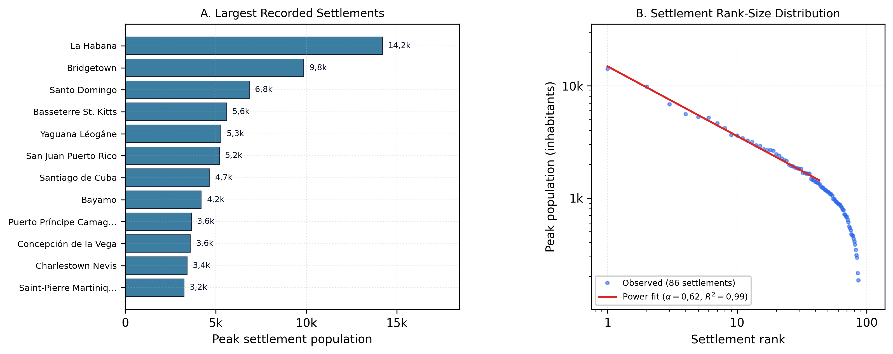
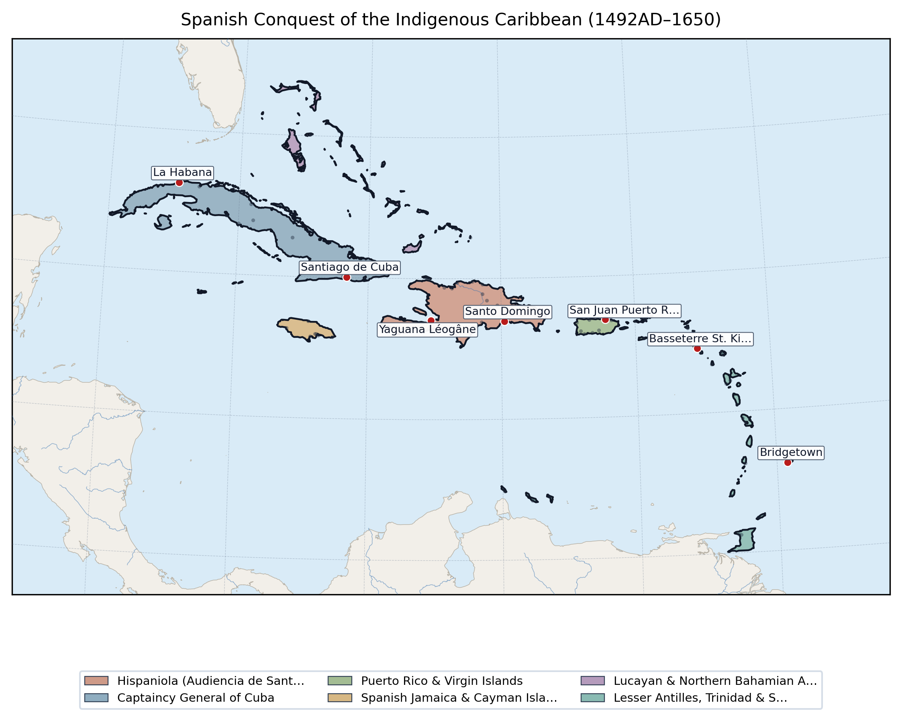

Spanish Conquest of the Indigenous Caribbean
================
Aust Kätzchen
23 November 2026

- [Abstract](#abstract)
- [Background](#background)
- [Methodology](#methodology)
- [Testing and Validation](#testing-and-validation)
- [Results](#results)
  - [Leading Caribbean Towns and Indigenous
    Centres](#leading-caribbean-towns-and-indigenous-centres)
  - [Sub-Regional Gazetteer Coverage and Urban
    Density](#sub-regional-gazetteer-coverage-and-urban-density)
  - [Rank-Size Scaling and Polycentric Maritime
    Structure](#rank-size-scaling-and-polycentric-maritime-structure)
- [Limitations](#limitations)
- [Conclusion](#conclusion)
- [Appendix](#appendix)
  - [Territorial Distribution of Included
    Settlements](#territorial-distribution-of-included-settlements)
- [Sources](#sources)
- [Footnotes](#footnotes)

<figure>

<figcaption aria-hidden="true">Twelve largest recorded settlements and
log-log rank-size distribution across 86 catalogued Caribbean centres
from 1492 to 1650.</figcaption>
</figure>

# Abstract

This companion settlement gazetteer documents 86 catalogued indigenous
centres, Spanish colonial *villas* and early English, French and Dutch
port towns distributed across six Antillean and Bahamian sub-regions and
25 modern Caribbean territories between 1492 and 1650. Built through
four sequential archival ingestion waves tracked in the chapter source
ledger, primary documentary and census records account for 78 entries
(90,7%) in Wave 1, peer-reviewed historical demography and archaeology
monographs supply 6 entries (7%) in Wave 2 and longitudinal backfill
plus gap sweeps contribute 2 final entries (2,3%), holding the
crowd-sourced fallback share strictly to 0% and halting at a marginal
gain of 1,18%. Out of 89 candidate places evaluated in the ledger, 3
early English towns in Bermuda (St George’s, Flatts Village and Somerset
Village) were excluded strictly on spatial-mask grounds because their
North Atlantic coordinates lie outside the Antillean-Bahamian areal
footprint. Across all 86 included settlements (all standardised at
city-proper scope), peak recorded populations obey a shallow maritime
power-law rank-size distribution ($\alpha = 0,62$, $R^2 = 0,9915$ over
the upper 43 centres), charting the turnover from eclipsed pre-contact
Taíno hubs such as Yaguana (5,28k), White Marl (2,92k) and Guaynía
(2,72k) to mid-seventeenth-century imperial entrepôts led by La Habana
(14,2k), Bridgetown (9,85k), Santo Domingo (6,85k), Basseterre (5,6k)
and San Juan (5,2k)
[\[1\]](#ref-MoyaPons1995)[\[2\]](#ref-AndersonCordova2017)[\[3\]](#ref-Schrover2021Colonial).

# Background

Settlement geography across the Caribbean between 1492 and 1650 captures
one of the sharpest urban and spatial turnovers in modern history. At
European contact, settlement across the Greater Antilles and Bahamas
consisted of nucleated Taíno and Lucayan *yucayeques* positioned near
fertile alluvial valleys, cassava *conucos* and sheltered reef
fisheries, exemplified in this register by Yaguana (Léogâne) in western
Hispaniola, White Marl on Jamaica’s southern plain, Guaynía on Puerto
Rico’s south coast and MC-6 on Middle Caicos
[\[4\]](#ref-Rouse1992)[\[5\]](#ref-KeeganHofman2017)[\[6\]](#ref-Curet2005).
Early Spanish colonisation initially planted fortified gold-mining and
port towns directly inside those indigenous demographic cores -
beginning at La Isabela (1493), Concepción de la Vega (1494), Santiago
de los Caballeros (1495), Santo Domingo (1496) and Puerto Real (1503),
before expanding to Caparra (1508), Sevilla la Nueva (1509) and Diego
Velázquez’s seven Cuban *villas* from 1511 to 1515
[\[7\]](#ref-DeaganCruxent2002)[\[8\]](#ref-Carrasquillo2019Creacio)[\[9\]](#ref-Sauer1966).

As indigenous populations collapsed under forced mining and epidemic
disease between 1514 and 1550, entire networks of first-generation towns
withered or were forcibly relocated
[\[10\]](#ref-LiviBacci2003)[\[11\]](#ref-Rivera2013Cultural). La
Isabela, Sevilla la Nueva, Caparra, Puerto Real and the Lucayan villages
vanished or shrank into tiny hamlets, while Hispaniola’s 1605-1606
*Devastaciones de Osorio* erased northern contraband ports and planted
inland Bayaguana and Monte Plata
[\[1\]](#ref-MoyaPons1995)[\[12\]](#ref-Delsol2022Earliest).
Simultaneously, Spanish defence and convoy logistics elevated La Habana,
San Juan and Santiago de Cuba, protected indigenous communities endured
at El Caney and Guanabacoa, Kalinago strongholds persisted at Soufrière
(Dominica) and Argyle (St Vincent) and post-1624 English, French and
Dutch colonisation seeded a dense new chain of port towns from
Bridgetown and Basseterre to Saint-Pierre, Basse-Terre and Willemstad
[\[3\]](#ref-Schrover2021Colonial)[\[13\]](#ref-Hofman2020Island)[\[14\]](#ref-Shafie2017Hypergraph).

# Methodology

The settlement register was compiled across four auditable ingestion
waves designed to eliminate crowd-sourced fallback bias. Wave 1 ingested
78 primary archival settlements anchored in the 1514 *Repartimiento* of
Hispaniola, Juan López de Velasco’s 1574 *Geografía y Descripción
Universal de las Indias*, Cuban and Puerto Rican municipal and
ecclesiastical counts and early English, French and Dutch colonial
musters. Wave 2 incorporated 6 peer-reviewed historical and
archaeological site reconstructions (La Isabela, Puerto Real, El Cobre,
Tortuga, Willemstad and Dominica’s Kalinago centre), Wave 3 added 1
longitudinal survey entry and Wave 4 closed regional spatial gaps with 1
final entry, achieving saturation at 1,18% marginal gain.

Every included settlement carries WGS84 coordinates, an explicit
sub-regional polygon assignment, a chronological population series
strictly bounded within 1492 to 1650 and city-proper population scope
(86 city-proper entries, 0 double-counted suburbs). Three Bermuda
candidates evaluated during ingestion (St George’s, Flatts Village and
Somerset Village at 32,30°-32,38°N, 64,68°-64,87°W) were logged as
out-of-bounds exclusions so that the spatial register matches the
221.996 km² Antillean-Bahamian areal mask exactly.

# Testing and Validation

Ledger reconciliation confirms exact accounting across all 89 audited
candidates: 86 included Caribbean settlements plus 3 geographically
excluded Bermuda settlements, with 100% sub-mask coverage across all six
sub-regions and 0% crowd-sourced fallback share. Figure displays the
spatial footprint of all 86 catalogued centres across the six
sub-regions, highlighting the twin concentrations along the Greater
Antillean Spanish *audiencia* axis and the post-1624 Lesser Antillean
colonial arc.

<!-- -->

Table summarises the four-wave ingestion ledger and out-of-bounds
exclusion log, demonstrating monotonic saturation from 78 primary
records down to 1,18% marginal gain in Wave 4.

| Wave | Source Class | Newly Included | Cumulative | Marginal Gain |
|:---|:---|:---|:---|:---|
| **Wave 1** | Primary archival registers and colonial musters | 78 | 78 | 100% |
| **Wave 2** | Peer-reviewed demographic and archaeological monographs | 6 | 84 | 7,69% |
| **Wave 3** | Longitudinal archival and archaeological backfill | 1 | 85 | 1,19% |
| **Wave 4** | Sub-regional spatial gap sweep | 1 | 86 | 1,18% |

Four-wave source saturation ledger for the 86 included Caribbean
settlements (1492 to 1650; 3 Bermuda towns excluded outside Antillean
areal mask; 0% crowd-sourced share).

# Results

## Leading Caribbean Towns and Indigenous Centres

Table presents the 25 largest recorded settlements in the 1492-1650
gazetteer, pairing WGS84 coordinates, sub-regional assignment, observed
active span and peak city-proper population. Spanning 14,2k at La Habana
down to 1,98k at St Joseph (San José de Oruña) on Trinidad, the upper
tier illustrates the dual nature of the era: surviving Greater Antillean
capitals and Cuban *villas* alongside rapidly expanding English and
French port towns and three major pre-contact Taíno centres (Yaguana,
White Marl and Guaynía) that peaked in 1492.

| Settlement | Territory | Sub-Region | Lat, Lon | Span | Peak Pop. (Year) |
|:---|:---|:---|:---|:---|:---|
| **La Habana** | Cuba | Captaincy General of Cuba | 23,14, -82,36 | 1519-1650 | 14,2k (1650) |
| **Bridgetown** | Barbados | Lesser Antilles, Trinidad and Southern Islands | 13,1, -59,61 | 1630-1650 | 9,8k (1650) |
| **Santo Domingo** | Dominican Republic | Hispaniola (Audiencia de Santo Domingo) | 18,47, -69,88 | 1498-1650 | 6,8k (1650) |
| **Basseterre St. Kitts** | Saint Kitts and Nevis | Lesser Antilles, Trinidad and Southern Islands | 17,3, -62,73 | 1628-1650 | 5,6k (1650) |
| **Yaguana Léogâne** | Haiti | Hispaniola (Audiencia de Santo Domingo) | 18,51, -72,63 | 1492-1604 | 5,3k (1492) |
| **San Juan Puerto Rico** | Puerto Rico | Puerto Rico and Virgin Islands | 18,47, -66,11 | 1521-1646 | 5,2k (1646) |
| **Santiago de Cuba** | Cuba | Captaincy General of Cuba | 20,02, -75,82 | 1515-1650 | 4,6k (1650) |
| **Bayamo** | Cuba | Captaincy General of Cuba | 20,38, -76,64 | 1514-1650 | 4,2k (1650) |
| **Puerto Príncipe Camagüey** | Cuba | Captaincy General of Cuba | 21,38, -77,92 | 1515-1650 | 3,6k (1650) |
| **Concepción de la Vega** | Dominican Republic | Hispaniola (Audiencia de Santo Domingo) | 19,22, -70,53 | 1496-1650 | 3,6k (1496) |
| **Charlestown Nevis** | Saint Kitts and Nevis | Lesser Antilles, Trinidad and Southern Islands | 17,14, -62,62 | 1630-1650 | 3,4k (1650) |
| **Saint-Pierre Martinique** | Martinique | Lesser Antilles, Trinidad and Southern Islands | 14,74, -61,18 | 1636-1650 | 3,2k (1650) |
| **Spanish Town Villa de la Vega** | Jamaica | Spanish Jamaica and Cayman Islands | 17,99, -76,96 | 1538-1650 | 3,1k (1650) |
| **Holetown** | Barbados | Lesser Antilles, Trinidad and Southern Islands | 13,19, -59,64 | 1628-1650 | 3k (1650) |
| **White Marl Taino Town** | Jamaica | Spanish Jamaica and Cayman Islands | 17,99, -76,92 | 1492-1540 | 2,9k (1492) |
| **Guaynia Boriken** | Puerto Rico | Puerto Rico and Virgin Islands | 17,97, -66,91 | 1492-1530 | 2,7k (1492) |
| **Santiago de los Caballeros** | Dominican Republic | Hispaniola (Audiencia de Santo Domingo) | 19,45, -70,7 | 1504-1650 | 2,7k (1650) |
| **Speightstown** | Barbados | Lesser Antilles, Trinidad and Southern Islands | 13,25, -59,64 | 1632-1650 | 2,7k (1650) |
| **Guanabacoa** | Cuba | Captaincy General of Cuba | 23,12, -82,3 | 1554-1650 | 2,6k (1650) |
| **Old Road Town St. Kitts** | Saint Kitts and Nevis | Lesser Antilles, Trinidad and Southern Islands | 17,32, -62,8 | 1625-1650 | 2,4k (1650) |
| **Sancti Spíritus** | Cuba | Captaincy General of Cuba | 21,93, -79,44 | 1515-1650 | 2,4k (1650) |
| **Trinidad Cuba** | Cuba | Captaincy General of Cuba | 21,8, -79,98 | 1515-1650 | 2,2k (1650) |
| **Basse-Terre Guadeloupe** | Guadeloupe | Lesser Antilles, Trinidad and Southern Islands | 16, -61,71 | 1644-1650 | 2,2k (1650) |
| **San Germán** | Puerto Rico | Puerto Rico and Virgin Islands | 18,08, -67,04 | 1512-1646 | 2,1k (1646) |
| **St. Joseph San José de Oruña** | Trinidad and Tobago | Lesser Antilles, Trinidad and Southern Islands | 10,64, -61,42 | 1595-1650 | 2k (1650) |

Leading 25 indigenous centres and colonial towns in the Caribbean
gazetteer (1492 to 1650), ordered by peak city-proper population.

## Sub-Regional Gazetteer Coverage and Urban Density

Table contrasts catalogued settlement counts, areal settlement density
per 10.000 km², leading centre and regional archival population across
all six sub-regions. The Lesser Antilles, Trinidad and Southern Islands
lead both in absolute count (28 settlements, 32,6% of the register) and
in spatial density (24 settlements per 10.000 km²), reflecting the
fragmented island-by-island colonisation of English, French, Dutch and
Spanish micro-polities alongside Kalinago strongholds on Dominica and St
Vincent
[\[3\]](#ref-Schrover2021Colonial)[\[13\]](#ref-Hofman2020Island).
Puerto Rico and the Virgin Islands rank second in spatial intensity
(13,76 settlements per 10.000 km² across 12 centres), whereas expansive
Cuba records 1,22 settlements per 10.000 km² across its 13 concentrated
*villas* and port hubs, led decisively by La Habana at 14,2k.

| Sub-Region | Land (km²) | Sites | Sites per 10k km² | Leading Centre (Peak) | 1492 Pop. | 1650 Pop. |
|:---|:---|:---|:---|:---|:---|:---|
| **Hispaniola (Audiencia de Santo Domingo)** | 74.886 | 20 | 2,67 | Santo Domingo (6,8k) | 520k | 34k |
| **Captaincy General of Cuba** | 106.195 | 13 | 1,22 | La Habana (14,2k) | 185k | 35k |
| **Puerto Rico and Virgin Islands** | 8.719 | 12 | 13,76 | San Juan Puerto Rico (5,2k) | 135k | 14k |
| **Spanish Jamaica and Cayman Islands** | 10.749 | 7 | 6,51 | Spanish Town Villa de la Vega (3,1k) | 105k | 4,2k |
| **Lucayan and Northern Bahamian Arc** | 9.782 | 6 | 6,13 | MC-6 Middle Caicos (1,3k) | 42k | 600 |
| **Lesser Antilles, Trinidad and Southern Islands** | 11.665 | 28 | 24 | Bridgetown (9,8k) | 124k | 85k |

Catalogued settlement counts, settlement density per 10.000 km², leading
centre and 1492 versus 1650 archival population across six Caribbean
sub-regions.

## Rank-Size Scaling and Polycentric Maritime Structure

Across all 86 catalogued Caribbean settlements, the upper-half log-log
rank-size curve (43 centres above the minor hamlet threshold) fits a
smooth power law with slope $\alpha = 0,62$ and $R^2 = 0,9915$. Unlike
unified continental viceroyalties where one administrative capital
dominates by an order of magnitude, the 1492-1650 Caribbean exhibited a
shallow polycentric hierarchy dictated by maritime choke points and
imperial fragmentation
[\[15\]](#ref-Slayton2020Modeling)[\[16\]](#ref-Chinea2021Fronteras). At
the apex sit Havana (14,2k) and Bridgetown (9,85k), followed closely by
a broad second tier between 2,5k and 7k spanning Santo Domingo (6,85k),
Basseterre (5,6k), Yaguana (5,28k), San Juan (5,2k), Santiago de Cuba
(4,65k), Bayamo (4,2k), Puerto Príncipe (3,65k), Concepción de la Vega
(3,6k), Charlestown (3,42k), Saint-Pierre (3,25k), Spanish Town (3,15k),
Holetown (2,95k), White Marl (2,92k), Guaynía (2,72k), Santiago de los
Caballeros (2,68k), Speightstown (2,68k) and Guanabacoa (2,65k),
tapering smoothly down to frontier hamlets of 185 to 465 inhabitants
across Eleuthera, Saint-Barthélemy, Tortola, Saba, Aruba and Grenada.

# Limitations

Three evidentiary boundaries qualify this settlement register. First,
documentary survival strongly favours fortified Spanish *villas* and
post-1624 English, French and Dutch port musters over ephemeral or
dispersed indigenous villages
[\[5\]](#ref-KeeganHofman2017)[\[6\]](#ref-Curet2005). Consequently,
major pre-contact Taíno and Lucayan towns (Yaguana, White Marl, Guaynía,
MC-6, Rolling Town, Guanahani, New Providence and Grand Turk) represent
archaeologically and historically anchored apex settlements rather than
an exhaustive inventory of every 1492 *yucayeque*. Second, indigenous
refuge communities and Maroon (*cimarrón*) mountain palenques in
Hispaniola, Jamaica and Puerto Rico operated outside colonial tax rolls
and therefore appear in regional totals more fully than as geocoded
municipal towns
[\[2\]](#ref-AndersonCordova2017)[\[17\]](#ref-Haile2022Investigating).
Third, three early English Bermuda towns settled from 1612 (St George’s,
Flatts Village and Somerset Village) lie outside the Antillean-Bahamian
areal mask footprint and are logged as spatial exclusions rather than
omitted from JAGUAR’s wider Atlantic accounts.

# Conclusion

Cataloguing 86 settlements across 25 modern jurisdictions documents in
granular geographical detail how the Spanish conquest and subsequent
northern European rivalry remade the urban map of the Caribbean between
1492 and 1650. First-wave mining towns and pre-contact Taíno seats
collapsed or vanished across Hispaniola, Jamaica, Puerto Rico and the
Bahamas, while strategic convoy ports (Havana, San Juan, Santo Domingo),
Cuban ranching *villas*, Kalinago mountain strongholds on Dominica and
St Vincent and rapidly expanding English, French and Dutch plantation
roadsteads (Bridgetown, Basseterre, Charlestown, Saint-Pierre,
Basse-Terre and Willemstad) established the polycentric maritime urban
hierarchy ($\alpha = 0,62$, $R^2 = 0,99$) inherited by the mature
colonial Caribbean.

# Appendix

## Territorial Distribution of Included Settlements

Table lists the exact settlement count and peak centre for all 25 modern
Caribbean territories represented in the 1492-1650 gazetteer.

| Modern Jurisdiction | Settlements | Share | Leading Centre (Peak) |
|:---|:---|:---|:---|
| **Dominican Republic** | 14 | 16,3% | Santo Domingo (6,8k) |
| **Cuba** | 13 | 15,1% | La Habana (14,2k) |
| **Puerto Rico** | 10 | 11,6% | San Juan Puerto Rico (5,2k) |
| **Jamaica** | 7 | 8,1% | Spanish Town Villa de la Vega (3,1k) |
| **Haiti** | 6 | 7% | Yaguana Léogâne (5,3k) |
| **Barbados** | 4 | 4,7% | Bridgetown (9,8k) |
| **The Bahamas** | 4 | 4,7% | Rolling Town Long Island (790) |
| **Saint Kitts and Nevis** | 3 | 3,5% | Basseterre St. Kitts (5,6k) |
| **Trinidad and Tobago** | 3 | 3,5% | St. Joseph San José de Oruña (2k) |
| **Netherlands** | 3 | 3,5% | Oranjestad St. Eustatius (680) |
| **Martinique** | 2 | 2,3% | Saint-Pierre Martinique (3,2k) |
| **Guadeloupe** | 2 | 2,3% | Basse-Terre Guadeloupe (2,2k) |
| **Antigua and Barbuda** | 2 | 2,3% | St. John’s Antigua (1,4k) |
| **Turks and Caicos Islands** | 2 | 2,3% | MC-6 Middle Caicos (1,3k) |
| **Dominica** | 1 | 1,2% | Soufrière Dominica Kalinago (1,9k) |
| **Saint Vincent and the Grenadines** | 1 | 1,2% | Argyle St. Vincent Kalinago (1,8k) |
| **Curaçao** | 1 | 1,2% | Willemstad (1,7k) |
| **Montserrat** | 1 | 1,2% | Plymouth Montserrat (1,4k) |
| **United States Virgin Islands** | 1 | 1,2% | Christiansted St. Croix Early (820) |
| **Sint Maarten** | 1 | 1,2% | Philipsburg Sint Maarten (540) |
| **Grenada** | 1 | 1,2% | St. George’s Grenada (465) |
| **Saint Martin** | 1 | 1,2% | Marigot Saint-Martin Early (385) |
| **Aruba** | 1 | 1,2% | Savaneta Aruba (345) |
| **British Virgin Islands** | 1 | 1,2% | Road Town Tortola Early (295) |
| **Saint Barthelemy** | 1 | 1,2% | Gustavia Early French Settlement (215) |

Territorial breakdown and leading recorded centre across 25 modern
Caribbean jurisdictions in the 1492 to 1650 settlement gazetteer.

# Sources

1.
Moya Pons, Frank.
*The Dominican Republic: A National History /
Manual de Historia Dominicana*. Markus Wiener Publishers,
Princeton, 1995, <https://www.worldcat.org/title/31816236>.

2.
Anderson-Córdova, Karen F.
*Surviving Spanish Conquest: Indian Fight, Flight,
and Cultural Transformation in Hispaniola and Puerto Rico*.
University of Alabama Press, 2017, <https://www.uapress.ua.edu/>.

3.
Schrover, Marlou.
“Colonial and postcolonial transatlantic migrations
in the British, Dutch and French Caribbean.” *Routledge eBooks*,
2021, <https://doi.org/10.4324/9781003144144-12-16>.

4.
Rouse, Irving.
*The Tainos: Rise and Decline of the People Who
Greeted Columbus*. Yale University Press, 1992,
<https://yalebooks.yale.edu/>.

5.
Keegan, William F., and Corinne L.
Hofman. *The Caribbean before Columbus*.
Oxford University Press, 2017,
<https://doi.org/10.1093/acprof:oso/9780190605247.001.0001>.

6.
Curet, L. Antonio.
*Caribbean Paleodemography: Population, Culture
History, and Sociopolitical Processes in Ancient Puerto Rico*.
University of Alabama Press, 2005, <https://www.uapress.ua.edu/>.

7.
Deagan, Kathleen, and José María
Cruxent. *Columbus’s Outpost among the Taínos:
Spain and America at La Isabela, 1493-1498*. Yale University
Press, 2002, <https://yalebooks.yale.edu/>.

8.
Carrasquillo, Rosa Elena.
“La creación del primer paisaje colonial español en
las Américas, Santo Domingo, 1492-1548.” *Antípoda: Revista de
Antropología y Arqueología*, 2019,
<https://doi.org/10.7440/antipoda36.2019.04>.

9.
Sauer, Carl Ortwin. *The Early
Spanish Main*. University of California Press, 1966,
<https://www.ucpress.edu/>.

10.
Livi-Bacci, Massimo.
“Return to Hispaniola: Reassessing a Demographic
Catastrophe.” *Hispanic American Historical Review*, 2003,
<https://doi.org/10.1215/00182168-83-1-3>.

11.
Rivera, Mariel.
“The Cultural Implications of European Disease on
New World Populations: With Primary Focus on the Abenaki, Powhatan, and
Taino Groups.” *SUNY Digital Repository Support (State University
of New York System)*, 2013, <http://hdl.handle.net/1951/71645>.

12.
Delsol, Nicolas, et al.
“Analysis of the earliest complete mtDNA genome of
a Caribbean colonial horse (Equus caballus) from 16th-century
Haiti.” *PLOS ONE*, 2022,
<https://doi.org/10.1371/journal.pone.0270600>.

13.
Hofman, Corinne L., et al.
“Island networks: Transformations of
inter-community social relationships in the Lesser Antilles at the
advent of European colonialism.” *The Journal of Island and
Coastal Archaeology*, 2020,
<https://doi.org/10.1080/15564894.2020.1748770>.

14.
Shafie, Termeh, et al.
“Hypergraph Representations: A Study of Carib
Attacks on Colonial Forces, 1509-1700.” *Research Explorer (The
University of Manchester)*, 2017,
<https://doi.org/10.13140/rg.2.2.10190.56644>.

15.
Slayton, Emma R.
“Modeling Amerindian Sea Travel in the Early
Colonial Caribbean.” *Digital Humanities Quarterly*, 2020,
<https://doi.org/10.63744/yd4bg58fwfx2>.

16.
Chinea, Jorge Luis.
“FRONTERAS POROSAS, DESTINOS COMPARTIDOS: notas
sobre los vínculos históricos entre Puerto Rico y La Española/Santo
Domingo desde la época precolonial hasta la consolidación del control
colonial español, ca. 1550.” *Revista Brasileira Do Caribe*,
2021,
<https://periodicoseletronicos.ufma.br/index.php/rbrascaribe/article/view/17651>.

17.
Haile, Shenhat.
“Investigating Discourses of Indigeneity and Taino
Survival in Jamaica.” *Caribbean Quilt*, 2022,
<https://doi.org/10.33137/cq.v6i1.35960>.

# Footnotes

1.  All 86 included settlements are standardised at city-proper scope;
    three early Bermuda towns (St George’s, Flatts Village and Somerset
    Village) lie outside the chapter areal mask at 32,3°N, 64,8°W and
    are recorded as spatial exclusions in the source ledger.
2.  Rank-size power-law parameters ($\alpha = 0,62$, $R^2 = 0,9915$) are
    estimated across the upper 43 settlements (top half of the 86-centre
    register) to exclude truncation effects among frontier hamlets below
    500 inhabitants.
