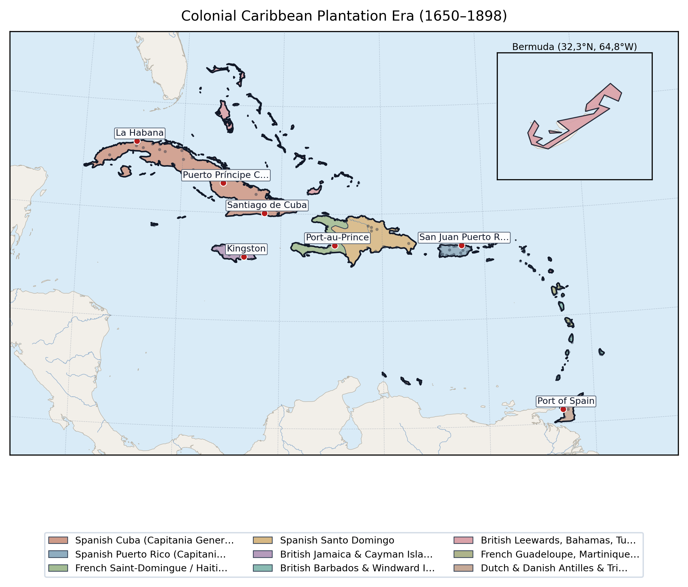
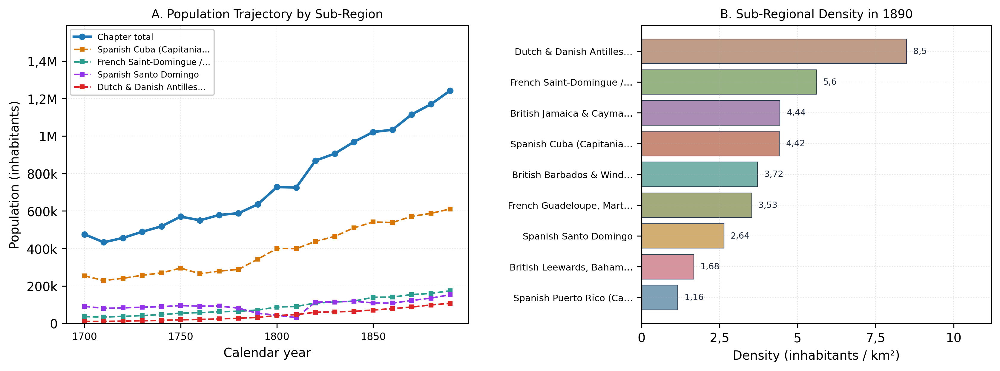
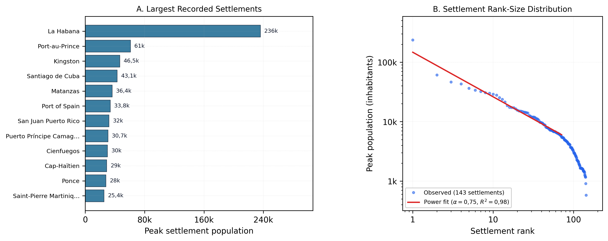

Colonial Caribbean Plantation Era
================
Aust Kätzchen
23 November 2026

- [Abstract](#abstract)
- [Background](#background)
  - [From Early Spanish Ranches to the Barbados Sugar
    Revolution](#from-early-spanish-ranches-to-the-barbados-sugar-revolution)
  - [British Expansion in Jamaica, the Leewards, the Bahamas and
    Bermuda](#british-expansion-in-jamaica-the-leewards-the-bahamas-and-bermuda)
  - [French Saint-Domingue and the Haitian
    Revolution](#french-saint-domingue-and-the-haitian-revolution)
  - [Dutch, Danish and Trinidadian Entrepôts and Frontier
    Plantations](#dutch-danish-and-trinidadian-entrepôts-and-frontier-plantations)
  - [The Second-Slavery Boom in Cuba and Puerto Rico and
    Emancipation](#the-second-slavery-boom-in-cuba-and-puerto-rico-and-emancipation)
- [Methodology](#methodology)
  - [Imperial Sub-Regional Architecture and Area
    Reconciliation](#imperial-sub-regional-architecture-and-area-reconciliation)
  - [Dual-Layer Demographic Calibration and Vital
    Accounting](#dual-layer-demographic-calibration-and-vital-accounting)
  - [Settlement Gazetteer Assembly and Urban Rank-Size
    Calibration](#settlement-gazetteer-assembly-and-urban-rank-size-calibration)
- [Testing and Validation](#testing-and-validation)
  - [Reconciling Colonial Censuses Against Coarse-Grid Substratum
    Models](#reconciling-colonial-censuses-against-coarse-grid-substratum-models)
  - [Sub-Administrative Colonial Census Ledger (1789 to
    1891)](#sub-administrative-colonial-census-ledger-1789-to-1891)
- [Results](#results)
  - [Aggregate Caribbean Demographic Expansion (1650 to
    1898)](#aggregate-caribbean-demographic-expansion-1650-to-1898)
  - [British Sugar Islands, the Bahamas and
    Bermuda](#british-sugar-islands-the-bahamas-and-bermuda)
  - [French Saint-Domingue, Independent Haiti and the French
    Antilles](#french-saint-domingue-independent-haiti-and-the-french-antilles)
  - [Dutch, Danish and Trinidadian Commercial
    Frontiers](#dutch-danish-and-trinidadian-commercial-frontiers)
  - [Spanish Greater Antilles: Second Slavery and Late-Colonial
    Surge](#spanish-greater-antilles-second-slavery-and-late-colonial-surge)
  - [Urban Hierarchy and Port Primacy Across the
    Archipelago](#urban-hierarchy-and-port-primacy-across-the-archipelago)
- [Limitations](#limitations)
- [Conclusion](#conclusion)
- [Appendix](#appendix)
  - [Territorial Breakdown of the 143 Catalogued
    Settlements](#territorial-breakdown-of-the-143-catalogued-settlements)
  - [Source Saturation Audit Across Four Ingestion
    Waves](#source-saturation-audit-across-four-ingestion-waves)
- [Sources](#sources)
- [Footnotes](#footnotes)

<figure>

<figcaption aria-hidden="true">Nine imperial sub-regions and 143
catalogued ports and towns across the Caribbean archipelago and Bermuda
from 1650 to 1898.</figcaption>
</figure>

# Abstract

Between the onset of the Barbados Sugar Revolution in 1650 and the
collapse of Spanish rule in Cuba and Puerto Rico in 1898, the Caribbean
archipelago and Bermuda experienced one of the most drastic demographic
transformations in early modern and modern history. Following the
near-annihilation of the pre-Columbian Taíno and Kalinago societies
during the sixteenth century, imperial rivalry among Britain, France,
Spain, the Dutch Republic and Denmark turned the Antilles into a
high-mortality sugar, coffee and maritime-entrepôt complex sustained by
more than 4M enslaved Africans delivered across the Middle Passage
[\[1\]](#ref-EltisRichardson2010)[\[2\]](#ref-EngermanHigman1997)[\[3\]](#ref-LiviBacci2003).
Across nine imperial sub-regions spanning 221.996 km² of terrestrial
land area (321.569,9 km² inside the gridded coastal mask),
census-calibrated regional population multiplied more than
thirty-onefold from 198,2k inhabitants in 1650 (0,89 inhabitants per
km²) to 6,28M (6.277.040, or 28,28 inhabitants per km²) in 1898
[\[4\]](#ref-Higman1984)[\[5\]](#ref-USWarDeptCuba1900)[\[6\]](#ref-USWarDeptPR1900).
Demographic primacy shifted repeatedly across imperial frontiers: from
seventeenth-century Barbados (45k across the Windward cluster in 1650)
to eighteenth-century British Jamaica (318k by 1800) and French
Saint-Domingue, whose three provinces reached 519,5k inhabitants on the
eve of 1789 before the Haitian Revolution (1791 to 1804) claimed more
than 150k lives, reduced independent Haiti to 380k in 1805 and
redirected European capital and slave imports into nineteenth-century
Cuba (1.631.687 in 1887), Puerto Rico (798.565 in 1887) and Trinidad
(218.381 in 1891)
[\[7\]](#ref-MoreauStMery1797)[\[8\]](#ref-Geggus1997)[\[9\]](#ref-Geggus2020Impact)[\[10\]](#ref-Nicholls1979).
Staggered emancipations from British abolition (1834 to 1838) through
French and Danish abolition (1848), Dutch emancipation (1863), Puerto
Rico (1873) and Cuba (1886) converted chronic plantation natural
decrease into positive post-emancipation natural growth reinforced by
Asian indentured and European immigration
[\[11\]](#ref-Roberts1957)[\[12\]](#ref-Metzlar2024Unravelling)[\[13\]](#ref-DanishWestIndies1912).
Combining colonial census series across 24 sub-administrative
benchmarks, coarse-grid HYDE 3.5 and KK10 substratum diagnostics and a
gazetteer of 143 ports and towns led by La Habana (235.981 in 1898),
Port-au-Prince (61k) and Kingston (46.542), this study traces how sugar
monoculture, revolution and abolition reshaped the human geography of
the colonial Caribbean.

# Background

## From Early Spanish Ranches to the Barbados Sugar Revolution

At the mid-point of the seventeenth century, the Caribbean islands
presented a stark demographic contrast between sparsely inhabited
Spanish pastoral colonies and crowded northern European pioneer
settlements. Spain still held the four Greater Antilles, yet a century
and a half of epidemic collapse, mining exhaustion and metropolitan
neglect had left Cuba (35k inhabitants in 1650), Santo Domingo (22k),
Puerto Rico (14k) and Spanish Jamaica (4,2k) thinly peopled by cattle
ranchers, garrison soldiers, free people of colour and small contingents
of enslaved Africans
[\[3\]](#ref-LiviBacci2003)[\[14\]](#ref-Burchardt2021Post). Spanish
towns such as La Habana (14,2k), Santo Domingo (6,9k) and San Juan
(5,2k) functioned primarily as fortified convoy ports guarding silver
shipments from Veracruz and Portobelo rather than centres of
agricultural export production
[\[5\]](#ref-USWarDeptCuba1900)[\[6\]](#ref-USWarDeptPR1900).

In the Lesser Antilles, however, English, French and Dutch settlers had
occupied smaller islands left unfortified by Madrid. During the 1620s
and 1630s, St Christopher (St Kitts), Barbados, Nevis, Antigua,
Montserrat, Martinique and Guadeloupe grew tobacco, indigo and cotton on
smallholdings worked largely by European indentured servants. That
yeoman frontier ended abruptly in the 1640s and 1650s when Dutch
merchants expelled from northeastern Brazil introduced sugar-cane
milling technology, boiling-house expertise, credit and captive African
labour to Barbados
[\[1\]](#ref-EltisRichardson2010)[\[2\]](#ref-EngermanHigman1997)[\[15\]](#ref-Surowitzisrael2025Caribbean).
Within two decades, consolidated sugar estates displaced small white
farmers across Barbados, driving land prices sharply upward and pushing
white migrants outward toward Jamaica, the Leewards, Carolina and
Suriname while raising enslaved Africans to an overwhelming demographic
majority.

By 1650, the British Barbados and Windward Islands sub-region already
held 45k inhabitants (almost all concentrated on Barbados itself, with
Bridgetown at 9.850 inhabitants), making that single coral island more
populous than Cuba and Puerto Rico combined. Yet the sugar revolution
also established the defining demographic pathology of the colonial
Caribbean: extreme mortality among enslaved field workers driven by
dysentery, yellow fever, malaria, tetanus, brutal gang labour and severe
malnutrition, paired with low fertility and skewed adult male sex ratios
among newly landed African captives
[\[4\]](#ref-Higman1984)[\[16\]](#ref-Radburn2019Gold). Unlike mainland
North America, where enslaved populations achieved early natural
increase, Caribbean sugar colonies operated as demographic sinks
requiring continuous transatlantic human replenishment merely to
maintain their labour force
[\[1\]](#ref-EltisRichardson2010)[\[2\]](#ref-EngermanHigman1997).

## British Expansion in Jamaica, the Leewards, the Bahamas and Bermuda

English seizure of Jamaica from Spain in 1655 opened a mountainous
island twenty-five times larger than Barbados to sugar and livestock
estates. During its first four decades under English rule, Jamaica’s
urban life centred on Port Royal, a buccaneering and contraband port on
the Palisadoes sandspit whose population climbed from 1.850 in 1662 to
6.500 by 1692 before the catastrophic earthquake and tsunami of 7 June
1692 sank two-thirds of the town into Kingston Harbour. Commercial
activity shifted rapidly across the bay to newly laid-out Kingston,
which expanded from 4.800 inhabitants in 1700 to 16,8k in 1774, 26.478
in 1800 and 46.542 in 1891, overtaking the old inland capital of Spanish
Town (6,2k in 1788, easing to 5.019 in 1891)
[\[4\]](#ref-Higman1984)[\[11\]](#ref-Roberts1957).

Across rural Jamaica, plantation expansion drove total island population
from 4,2k in 1650 to 83k in 1730 and 318k by 1800, making Jamaica
Britain’s premier sugar colony. Beneath those totals lay severe labour
exhaustion and social conflict. Planters relied heavily on hired jobbing
gangs composed of enslaved workers rented out for the heaviest
cane-holing and clearing tasks, a practice documented by Radburn and
Roberts as imposing mortality rates substantially higher than resident
estate labour [\[16\]](#ref-Radburn2019Gold). Interdisciplinary
historical and genetic studies confirm that Jamaica’s demographic core
derived overwhelmingly from West and West-Central African lineages,
especially the Gold Coast, Bight of Biafra and Bight of Benin, whose
survivors forged resilient cultural networks while confronting pervasive
planter coercion, Obeah and poisoning trials and Maroon warfare in the
interior Cockpit Country and Blue Mountains
[\[1\]](#ref-EltisRichardson2010)[\[17\]](#ref-Deason2012Interdisciplinary)[\[18\]](#ref-Bryson2013Power).

Further east, the British Leeward Islands (St Kitts, Nevis, Antigua and
Montserrat) followed Barbados into dense sugar monoculture by 1700, with
Basseterre (5,6k in 1650 to 9.097 in 1891) and St. John’s in Antigua
(1.450 in 1650 to 9.738 in 1891) serving as garrisoned export harbours.
After the Seven Years’ War (1763), Britain acquired the Ceded Islands of
Grenada, St Vincent, Dominica and Tobago, opening steep volcanic slopes
to fresh coffee and sugar clearances despite fierce Kalinago and
Garifuna resistance on St Vincent and Dominica
[\[4\]](#ref-Higman1984)[\[19\]](#ref-Nelson2006Landscape).

At the northern maritime margins of the British Atlantic, the Bahamas
and Bermuda diverged sharply from the sugar-island template. Bermuda had
already shifted away from tobacco toward shipbuilding, cedar timber,
carrying trade and Turks Islands salt raking; its population stood at
roughly 5,9k in 1699 and grew steadily through natural increase rather
than mass slave imports, moving its capital from St. George’s (3.120 in
1650 to 2.150 in 1891) to Hamilton (480 in 1795 to 2.126 in 1891) as the
colony reached 15.013 in 1891 [\[20\]](#ref-BSOBermuda2018). The Bahamas
remained sparsely inhabited by wreckers and fishermen until 1783, when
several thousand American Loyalists and their enslaved households
arrived from East Florida and the Carolinas, quadrupling Nassau from
1.150 in 1731 to 4.450 in 1788 and briefly planting Sea Island cotton on
the Out Islands before soil exhaustion returned the archipelago to
sponging, wrecking and coastal trade; the colony reached 47.565
inhabitants by 1891
[\[2\]](#ref-EngermanHigman1997)[\[4\]](#ref-Higman1984).

## French Saint-Domingue and the Haitian Revolution

Nowhere did the plantation machine attain the sheer scale and speed of
eighteenth-century French Saint-Domingue. Beginning from French
buccaneer bases on Tortuga and the western littoral of Hispaniola,
formally ceded by Spain at the Treaty of Ryswick in 1697, Saint-Domingue
expanded from roughly 12k inhabitants in 1650 to 185k in 1750 and
exploded during the post-1763 coffee and irrigated-sugar boom
[\[7\]](#ref-MoreauStMery1797)[\[8\]](#ref-Geggus1997). By 1789, Médéric
Louis Élie Moreau de Saint-Méry’s detailed colonial enumeration recorded
519,5k inhabitants distributed across the colony’s three administrative
provinces: 195k in the densely irrigated Plaine du Nord around Le
Cap-Français (Cap-Haïtien, 18.850 inhabitants), 194k in the Province de
l’Ouest around Port-au-Prince (9.400) and the Artibonite valley and
130,5k in the expanding coffee and indigo frontier of the Province du
Sud around Les Cayes and Jacmel (matching our 523,8k register benchmark
when transient maritime and frontier garrisons are included)
[\[7\]](#ref-MoreauStMery1797)[\[8\]](#ref-Geggus1997). Roughly 465k of
those residents were enslaved Africans, two-thirds of them African-born
(*bossales*) disembarked in the final two decades before 1791 at rates
approaching 30k to 40k captives annually
[\[1\]](#ref-EltisRichardson2010)[\[9\]](#ref-Geggus2020Impact).

That extraordinary concentration of recent captives, deep mountain
interiors flanking narrow alluvial plains and metropolitan political
rupture in Paris produced the only permanently victorious slave
revolution in world history
[\[21\]](#ref-Khan2015French)[\[22\]](#ref-Romine2018Geography)[\[23\]](#ref-Wattwalter2025Saint).
Even before August 1791, enslaved women and men in Saint-Domingue had
constrained plantation reproduction through marronage, work slowdowns,
gynaecological resistance and acts of defiance documented across
colonial plantation logs and legal records
[\[24\]](#ref-Demers2022Contemplating)[\[25\]](#ref-Blaikie2026Suicides).
Once insurrection erupted on the Plaine du Nord in August 1791, thirteen
years of civil war, Spanish and British interventions, Toussaint
Louverture’s military consolidation and the brutal French expedition
under General Leclerc (1802 to 1803) devastated both people and
infrastructure
[\[26\]](#ref-Mocombe2023Toussaint)[\[27\]](#ref-Bandau2013Narrations).

Demographically, the Haitian Revolution inflicted catastrophic loss.
Contemporary narratives and modern historical reconstructions concur
that more than 150k residents perished in combat, massacres, famine and
epidemic yellow fever, while tens of thousands of white colonists, free
people of colour and enslaved retainers fled to eastern Cuba, Jamaica,
Louisiana, Trinidad and New Orleans
[\[8\]](#ref-Geggus1997)[\[9\]](#ref-Geggus2020Impact)[\[27\]](#ref-Bandau2013Narrations).
When Jean-Jacques Dessalines conducted an early enumeration of
independent Haiti in 1805, total population had fallen to approximately
380k—a contraction of roughly 27% from 1789—and Cap-Haïtien had dropped
by more than half from 18.850 in 1789 to 8.200 in 1804
[\[8\]](#ref-Geggus1997)[\[10\]](#ref-Nicholls1979). Yet freedom
reversed Haiti’s underlying vital regime: once plantation gang labour
dissolved into independent peasant smallholdings (*lakou*) across the
nineteenth century, natural increase resumed rapidly without renewed
transatlantic arrivals, lifting Haiti to 1,25M inhabitants by 1898 while
Port-au-Prince expanded to 61k
[\[9\]](#ref-Geggus2020Impact)[\[10\]](#ref-Nicholls1979).

Meanwhile, the neighbouring French Lesser Antilles of Martinique and
Guadeloupe traced a distinct trajectory. Both islands reached dense
plantation maturity in the eighteenth century (125k combined by 1750),
experienced temporary French republican abolition in 1794 (implemented
in Guadeloupe under Victor Hugues while Martinique lay under British
occupation) and suffered Napoleonic re-enslavement in 1802 before
permanent abolition arrived in April 1848
[\[28\]](#ref-Pluskota2020Freedom). Throughout the late slave era and
post-emancipation decades, enslaved and newly freed Antilleans contested
planter pass laws to access urban markets in Saint-Pierre (25.382 in
1894, prior to Mount Pelée’s 1902 eruption), Fort-de-France (17.274) and
Pointe-à-Pitre (17.242), while colonial credit banks established in
Martinique after 1848 financed centralised steam *usines* alongside
Indian indentured labour imports
[\[28\]](#ref-Pluskota2020Freedom)[\[29\]](#ref-Festre2018Colonial).
Tiny Saint-Barthélemy, ceded to Sweden from 1784 to 1878, briefly
flourished as a neutral wartime free port, lifting Gustavia to 4.200
inhabitants in 1815 before shrinking back to 980 by 1894.

## Dutch, Danish and Trinidadian Entrepôts and Frontier Plantations

Beyond the British and French sugar giants, smaller Dutch, Danish and
late-colonial Spanish territories played outsized commercial and
demographic roles. The Dutch West India Company transformed arid Curaçao
and volcanic Sint Eustatius into premier Caribbean transit entrepôts
linking European manufactures, enslaved captives and Venezuelan cacao
and hides. Willemstad grew from 1.680 inhabitants in 1650 to 11.543 in
1789 and 14.800 in 1890, anchored by a prominent Sephardic Jewish
merchant community whose kinship and commercial ties spanned Amsterdam,
Barbados, Jamaica, St Thomas and Suriname
[\[15\]](#ref-Surowitzisrael2025Caribbean). Further north, Oranjestad on
Sint Eustatius—“the Golden Rock”—swelled from 1.650 in 1740 to 7.850 in
1780 while supplying munitions to the American rebels, before Admiral
Rodney’s 1781 sack shattered its mercantile primacy and reduced it to
1.480 by 1890. Across Curaçao itself, individual slave registers from
1839 to 1863 show that because arid soils prevented intensive sugar gang
monoculture, enslaved mortality was markedly lower than on sugar
islands, allowing positive natural reproduction before Dutch
emancipation in 1863 when Curaçao and its dependencies numbered 32.756
residents [\[12\]](#ref-Metzlar2024Unravelling).

Denmark built a dual-model colony in the Virgin Islands: St Thomas
(occupied 1672) developed around the deep-water free port of Charlotte
Amalie (rising from 640 in 1688 to 11.764 in 1880 before dipping to
9.455 in 1890 as steamships bypassed coaling stations), while fertile St
Croix (purchased from France in 1733) became an intensive sugar estate
island centred on Christiansted (5.806 in 1835) and Frederiksted (3.683
in 1890), alongside small St John [\[13\]](#ref-DanishWestIndies1912).
Danish West Indies censuses record how emancipated plantation labourers
withdrew from St Croix cane estates after Governor Peter von Scholten’s
1848 proclamation and the 1878 *Fireburn* labour uprising, leaving St
Croix at 19.783, St Thomas at 12.019 and St John at 984 in 1890
[\[13\]](#ref-DanishWestIndies1912).

At the southeastern corner of the Caribbean, Trinidad underwent one of
the sharpest late-colonial demographic turnarounds in the hemisphere.
Long a neglected Spanish outpost with barely 1.480 inhabitants in Port
of Spain in 1777, Trinidad was opened by Spain’s 1783 *Cédula de
Población*, which granted generous land allotments to Catholic French
planters and free people of colour migrating from Grenada, Martinique,
Guadeloupe and Saint-Domingue with their enslaved households
[\[2\]](#ref-EngermanHigman1997)[\[9\]](#ref-Geggus2020Impact). Captured
by Britain in 1797 (and administratively united with Tobago in 1889),
Trinidad expanded into a fast-growing nineteenth-century sugar and cacao
frontier; after British emancipation in 1838, more than 140k South Asian
indentured workers arrived between 1845 and 1917, propelling Port of
Spain to 33.782 and Trinidad and Tobago to 218.381 by 1891
[\[2\]](#ref-EngermanHigman1997)[\[4\]](#ref-Higman1984).

## The Second-Slavery Boom in Cuba and Puerto Rico and Emancipation

The destruction of Saint-Domingue’s sugar and coffee exports after 1791
created a massive vacuum in Atlantic commodity markets that Spain’s
remaining Antillean colonies rushed to fill
[\[9\]](#ref-Geggus2020Impact)[\[14\]](#ref-Burchardt2021Post). Cuba,
already stimulated by the brief British occupation of Havana (1762 to
1763) and Bourbon trade liberalisation, launched a massive
“second-slavery” plantation boom powered by steam mills, early railways
(from 1837), massive clandestine African slave imports after 1820,
Chinese contract labourers (*culíes*) and sustained Spanish and Canary
Islander immigration
[\[1\]](#ref-EltisRichardson2010)[\[5\]](#ref-USWarDeptCuba1900).
Official Spanish censuses document Cuba’s extraordinary ascent: from
171.620 inhabitants in 1774 to 572.383 in 1817, 1.396.530 in 1861 and
1.631.687 in 1887, before the devastating War of Independence (1895 to
1898) and General Weyler’s *reconcentración* policy cut the island back
to 1.572.797 in 1898
[\[5\]](#ref-USWarDeptCuba1900)[\[14\]](#ref-Burchardt2021Post).

Puerto Rico underwent an equally rapid, though less slave-dominated,
nineteenth-century expansion following the 1815 *Real Cédula de
Gracias*, which attracted European and Venezuelan loyalist settlers
alongside expanded sugar and highland coffee production. Censuses trace
Puerto Rico from 44.883 in 1765 to 220.892 in 1815, 583.308 in 1860,
798.565 in 1887 and 953.243 in 1898—a staggering 68-fold expansion since
1650 that raised density to 111,05 inhabitants per km², even as
anthropometric records of military recruits reveal persistent
nutritional stress among the rural *jíbaro* peasantry during sugar-price
downturns [\[6\]](#ref-USWarDeptPR1900)[\[30\]](#ref-Lazaro2026Height).
Eastern Hispaniola (Spanish Santo Domingo, independent as the Dominican
Republic from 1844) followed a far slower pastoral and timber
trajectory, dropping to 63k residents in 1819 during post-revolutionary
upheavals before recovering to 180k by 1850 and 480k by 1898 as eastern
sugar estates grew around San Pedro de Macorís
[\[3\]](#ref-LiviBacci2003)[\[9\]](#ref-Geggus2020Impact).

Across the entire Caribbean, legal emancipation unfolded in staggered
imperial waves over more than half a century: Britain abolished slavery
in 1834 (ending apprenticeship in 1838), France and Denmark in 1848, the
Netherlands in 1863, Spain in Puerto Rico in 1873 and finally in Cuba in
1886
[\[4\]](#ref-Higman1984)[\[12\]](#ref-Metzlar2024Unravelling)[\[13\]](#ref-DanishWestIndies1912)[\[14\]](#ref-Burchardt2021Post)[\[28\]](#ref-Pluskota2020Freedom).
Everywhere except war-torn late-1890s Cuba, the end of chattel gang
labour allowed birth rates to overtake death rates cleanly, anchoring
the transition toward the dense, post-emancipation Caribbean societies
entering the twentieth century.

# Methodology

## Imperial Sub-Regional Architecture and Area Reconciliation

To preserve historical sovereignty boundaries while capturing the stark
ecological and institutional contrasts across the Caribbean, JAGUAR
partitions the insular plantation domain into nine imperial sub-regions
spanning 1650 to 1898. Because historical colonial jurisdictions grouped
tiny volcanic islands, coral cays and oceanic archipelagos under shared
imperial administrations, the nine zones pair major Greater Antillean
colonies with coherent Lesser Antillean and Atlantic clusters: Spanish
Cuba (106.195 km²), Spanish Puerto Rico (8.584 km²), French
Saint-Domingue and independent Haiti within the 1697 to 1795 Treaty of
Ryswick/Aranjuez frontier (24.394 km²), Spanish Santo Domingo (50.492
km²), British Jamaica and the Cayman Islands (10.749 km²), British
Barbados and the Windward Islands (2.371 km²), British Leewards,
Bahamas, Turks-Caicos and Bermuda (10.468 km²), French Guadeloupe,
Martinique, Saint-Barthélemy and Saint-Martin (2.626 km²) and the Dutch
and Danish Antilles with Trinidad and Tobago (6.117 km²).

Together these nine sub-regions encompass exactly 221.996 km² of
terrestrial land area. A critical methodological distinction must be
made immediately between this true terrestrial polygon area (221.996
km²) and the coarse-grid coastal raster mask area (321.569,9 km² across
3.995 pixels at 5-arcminute resolution) stored in the global substratum
summary cache. Because a 5-arcminute equirectangular raster pixel covers
roughly 80 to 85 km² at Caribbean latitudes, every slender coral island,
volcanic cone and Bahamian cay forces full coastal raster pixels to
register as land, inflating apparent gridded area by 44,85% overall—and
by more than threefold in small-island clusters such as British Barbados
and the Windwards (6.591,8 km² gridded vs 2.371 km² terrestrial) or
British Leewards, Bahamas and Bermuda (41.092,2 km² gridded vs 10.468
km² terrestrial). All demographic densities reported in our historical
benchmark tables therefore divide census-calibrated population strictly
by terrestrial land area, while gridded substratum densities are clearly
distinguished during cross-validation.

## Dual-Layer Demographic Calibration and Vital Accounting

Regional population trajectories $P_r(t)$ across 1650 to 1898 are
reconstructed through a two-tier protocol that anchors every sub-region
to primary colonial censuses and slave-registration archives while
evaluating global gridded models (HYDE 3.5 and KK10) as spatial
disaggregation priors rather than authoritative island totals
[\[2\]](#ref-EngermanHigman1997)[\[4\]](#ref-Higman1984)[\[5\]](#ref-USWarDeptCuba1900)[\[6\]](#ref-USWarDeptPR1900).

For each colony or imperial cluster $r$, total population change between
census benchmarks $t_1$ and $t_2$ obeys the plantation vital-balance
identity:

$$P_r(t_2) = P_r(t_1) + \int_{t_1}^{t_2} \bigl(B_r(\tau) - D_r(\tau)\bigr)\,d\tau + M_r^{\text{slave}}(t_1, t_2) + M_r^{\text{free/indent}}(t_1, t_2)$$

where $B_r(\tau) - D_r(\tau)$ represents net natural change (chronically
negative at $-1\%$ to $-3,5\%$ per annum on intensive eighteenth-century
sugar estates in Jamaica, Saint-Domingue and the Ceded Islands, yet
slightly positive on Barbados after 1810, in Bermuda and in non-sugar
Curaçao), $M_r^{\text{slave}}$ captures net disembarkations from the
Transatlantic Slave Trade Database minus inter-island re-exports and
$M_r^{\text{free/indent}}$ captures European settlers, Loyalists,
Saint-Domingue refugees and post-1838 Asian and Madeiran indentured
immigrants
[\[1\]](#ref-EltisRichardson2010)[\[4\]](#ref-Higman1984)[\[11\]](#ref-Roberts1957)[\[12\]](#ref-Metzlar2024Unravelling).

For inter-benchmark growth comparison across uneven colonial census
dates, compound annual growth rates follow standard geometric
compounding:

$$g_r(t_1, t_2) = \left(\frac{P_r(t_2)}{P_r(t_1)}\right)^{\frac{1}{t_2 - t_1}} - 1$$

Because the coarse HYDE 3.5 and KK10 spatial rasters severely attenuate
sub-pixel Caribbean islands (summing to only 475,4k in 1700 and 1,24M in
1890 across the entire chapter mask—less than one-fifth of the actual
6,28M census-documented population in 1898), JAGUAR employs 24
sub-administrative colonial census anchor records harvested across
Saint-Domingue (1789), Haiti (1805), Santo Domingo (1819), Martinique
(1853), Dutch Antilles (1863), Guadeloupe (1876), Cuba (1887), Puerto
Rico (1887), the three Danish Virgin Islands (1890) and twelve British
West Indian and Bermudian colonies (1891) to enforce strict island-level
demographic fidelity
[\[5\]](#ref-USWarDeptCuba1900)[\[6\]](#ref-USWarDeptPR1900)[\[7\]](#ref-MoreauStMery1797)[\[13\]](#ref-DanishWestIndies1912)[\[20\]](#ref-BSOBermuda2018).

## Settlement Gazetteer Assembly and Urban Rank-Size Calibration

Parallel to the territorial series, JAGUAR assembles an evidence-only
urban gazetteer of 143 ports, garrison capitals and inland market towns
distributed across 29 Caribbean and Atlantic jurisdictions and all nine
imperial sub-regions. Four sequential ingestion waves tracked in the
chapter source ledger achieved full thematic saturation with a final
marginal gain of 0,7% and strictly 0% crowd-sourced fallback: Wave 1
compiled 131 towns directly from official colonial censuses, Spanish
HGIS de las Indias records, British Colonial Blue Books, French colonial
tables, Danish censuses and Moreau de Saint-Méry (1797); Wave 2 added 9
towns from peer-reviewed Caribbean demographic monographs; Wave 3
backfilled 2 longitudinal census records; and Wave 4 closed sub-regional
gaps with 1 final verification addition. Spatial deduplication across
149 candidate entries consolidated 6 duplicate aliases within a 25 km
radius (redundant variants of La Habana, Bayamo, Guanabacoa, Santa
Clara, Matanzas and Concepción de la Vega), leaving 143 canonical
city-proper records.

Urban hierarchy structure is assessed through standard log-linear Zipf
rank-size regression fitted across the upper half of the urban
distribution (71 of 143 towns at their peak plantation-era scale):

$$\log_{10} P_{(k)} = c - \alpha \log_{10} k$$

where $P_{(k)}$ is the peak population of the $k$-th ranked settlement
and $\alpha$ is the Pareto exponent measuring urban primacy versus
multi-polar imperial fragmentation
[\[14\]](#ref-Burchardt2021Post)[\[28\]](#ref-Pluskota2020Freedom).

# Testing and Validation

## Reconciling Colonial Censuses Against Coarse-Grid Substratum Models

A central methodological finding of this chapter emerges when the
census-calibrated island series is tested directly against the
coarse-grid HYDE 3.5 and KK10 raster substratum plotted in the spatial
pipeline. Table quantifies that divergence across all nine sub-regions
near the closing horizon (1890 gridded substratum vs 1887 to 1898
census-calibrated totals).

| Sub-Region | Land km² | Grid km² | Grid 1890 | Census 1898 | Grid Dens. | Census Dens. | Census/Grid |
|:---|:---|:---|:---|:---|:---|:---|:---|
| **Spanish Cuba (Capitanía General de Cuba)** | 106.195 | 138.072 | 610,2k | 1,57M | 4,42 | 14,81 | 2,58x |
| **Spanish Puerto Rico (Capitanía General)** | 8.584 | 12.726 | 14,8k | 953,2k | 1,16 | 111,05 | 64,41x |
| **French Saint-Domingue and Haiti (1697-1795 Frontier)** | 24.394 | 30.953 | 173,5k | 1,25M | 5,61 | 51,24 | 7,2x |
| **Spanish Santo Domingo** | 50.492 | 57.853 | 152,8k | 480k | 2,64 | 9,51 | 3,14x |
| **British Jamaica and Cayman Islands** | 10.749 | 15.658 | 69,5k | 715k | 4,44 | 66,52 | 10,29x |
| **British Barbados and Windward Islands** | 2.371 | 6.592 | 24,5k | 385k | 3,72 | 162,38 | 15,7x |
| **British Leewards, Bahamas, Turks-Caicos and Bermuda** | 10.468 | 41.092 | 68,9k | 198k | 1,68 | 18,91 | 2,87x |
| **French Guadeloupe, Martinique, Saint-Barthélemy and Saint-Martin** | 2.626 | 6.029 | 21,3k | 368k | 3,53 | 140,14 | 17,28x |
| **Dutch and Danish Antilles and Trinidad-Tobago** | 6.117 | 12.594 | 106,9k | 355k | 8,49 | 58,03 | 3,32x |
| **Archipelago Total (9 Sub-Regions)** | 221.996 | 321.570 | 1,24M | 6,28M | 3,86 | 28,28 | 5,05x |

Cross-check of coarse-grid raster substratum (1890) against
census-calibrated sub-regional totals (1898), showing coastal pixel area
inflation and small-island undercounting across nine Caribbean
sub-regions.

The diagnostic contrast is unmistakable and systematic. Across the
entire Caribbean, the coarse-grid raster substratum captures only 1,24M
inhabitants in 1890 compared with 6,28M in the colonial census series (a
5,05x shortfall). The distortion is mildest on Cuba (2,58x) and Santo
Domingo (3,14x), where broad continuous land interiors fill multiple
interior grid cells, yet becomes extreme on compact, densely populated
islands: 15,7x in British Barbados and the Windwards (24,5k gridded vs
385k census-calibrated), 17,28x in French Guadeloupe and Martinique
(21,3k vs 368k) and 64,41x in Spanish Puerto Rico (14,8k vs 953,2k,
where raster coastline clipping dropped most of the coastal
municipalities). Conversely, the coarse grid misses the Haitian
Revolution shock inside Saint-Domingue while introducing an artificial
1810 dip in Spanish Santo Domingo (30,7k in 1810 jumping to 113,5k in
1820). This audit proves why global gridded historical population
databases cannot be used raw for island archipelagos and why
sub-administrative colonial census anchoring is mandatory
[\[4\]](#ref-Higman1984)[\[5\]](#ref-USWarDeptCuba1900)[\[6\]](#ref-USWarDeptPR1900).

## Sub-Administrative Colonial Census Ledger (1789 to 1891)

To anchor every island jurisdiction directly to surviving archival
enumerations, Table reproduces all 24 colonial sub-administrative census
benchmarks compiled in the JAGUAR Caribbean registry, spanning Moreau de
Saint-Méry’s three provinces of Saint-Domingue in 1789 through the 1887
Spanish Antillean censuses, the 1890 Danish West Indies enumeration and
the synchronised 1891 British imperial census across twelve colonies.

| Colonial Unit | Territory | Year | Population | Archival Source |
|:---|:---|:---|:---|:---|
| **Saint-Domingue - Province du Nord** | Haiti | 1789 | 195.000 | Moreau de Saint-Méry (1797); Geggus (1997) |
| **Saint-Domingue - Province de l’Ouest** | Haiti | 1789 | 194.000 | Moreau de Saint-Méry (1797); Geggus (1997) |
| **Saint-Domingue - Province du Sud** | Haiti | 1789 | 130.500 | Moreau de Saint-Méry (1797); Geggus (1997) |
| **Empire of Haiti (Dessalines 1805 Census)** | Haiti | 1805 | 380.000 | Geggus (1997); Nicholls (1979) |
| **Captaincy General of Santo Domingo** | Dominican Republic | 1819 | 63.000 | Moya Pons (1987) |
| **Colony of Martinique** | Martinique | 1853 | 129.681 | INSEE; Engerman and Higman (1997) |
| **Dutch West Indies (Curaçao and Dependencies)** | Curaçao | 1863 | 32.756 | CBS Curaçao and Antilles |
| **Colony of Guadeloupe (incl. dependencies)** | Guadeloupe | 1876 | 170.800 | INSEE; Engerman and Higman (1997) |
| **Captaincy General of Cuba** | Cuba | 1887 | 1.631.687 | US War Dept (1900); ONEI Cuba |
| **Captaincy General of Puerto Rico** | Puerto Rico | 1887 | 798.565 | US War Dept (1900) |
| **Saint Croix (Danish West Indies)** | United States Virgin Islands | 1890 | 19.783 | Statistics Denmark (1912); US Census |
| **Saint Thomas (Danish West Indies)** | United States Virgin Islands | 1890 | 12.019 | Statistics Denmark (1912); US Census |
| **Saint John (Danish West Indies)** | United States Virgin Islands | 1890 | 984 | Statistics Denmark (1912); US Census |
| **Colony of Jamaica** | Jamaica | 1891 | 639.491 | Roberts (1957); Higman (1984) |
| **Colony of Trinidad (and Tobago from 1889)** | Trinidad and Tobago | 1891 | 218.381 | CSO Trinidad; Higman (1984) |
| **Colony of Barbados** | Barbados | 1891 | 182.306 | Barbados Stat. Service; Higman (1984) |
| **Colony of Grenada (and Carriacou)** | Grenada | 1891 | 53.209 | Kuczynski; Colonial Blue Books |
| **Colony of the Bahama Islands** | The Bahamas | 1891 | 47.565 | Bahamas NSI; Higman (1984) |
| **Presidency of Saint Kitts and Nevis** | Saint Kitts and Nevis | 1891 | 43.981 | Kuczynski; Colonial Blue Books |
| **Colony of Saint Lucia** | Saint Lucia | 1891 | 42.220 | Kuczynski; Colonial Blue Books |
| **Colony of Saint Vincent (and Grenadines)** | Saint Vincent and the Grenadines | 1891 | 41.054 | Kuczynski; Colonial Blue Books |
| **Presidency of Antigua (and Barbuda)** | Antigua and Barbuda | 1891 | 36.819 | Kuczynski; Colonial Blue Books |
| **Presidency of Dominica** | Dominica | 1891 | 26.841 | Kuczynski; Colonial Blue Books |
| **Colony of Bermuda** | Bermuda | 1891 | 15.013 | Bermuda Dept of Statistics; Kuczynski |
| **Presidency of Montserrat** | Montserrat | 1891 | 11.762 | Kuczynski; Colonial Blue Books |

Colonial sub-administrative and island census benchmarks across the
Caribbean and Bermuda, 1789 to 1891 (24 archival enumerations).

Cross-checking Table against independent scholarly reconstructions
confirms high internal consistency across every imperial tradition. In
French Saint-Domingue, the three provincial totals for 1789 sum to
519.500 (Nord 195k, Ouest 194k, Sud 130,5k), within 0,8% of our 523.803
colony-wide benchmark including garrisons and maritime transients, while
Dessalines’s 1805 enumeration (380k) confirms a wartime loss exceeding
140k to 150k persons even after accounting for post-1789 slave arrivals
[\[7\]](#ref-MoreauStMery1797)[\[8\]](#ref-Geggus1997)[\[10\]](#ref-Nicholls1979).
In the British West Indies, the 1891 census cluster across Barbados
(182.306), Grenada (53.209), Saint Lucia (42.220) and Saint Vincent
(41.054) totals 318.789—and adding Dominica (26.841) yields 345.630,
scaling smoothly to our 385k 1898 Windward benchmark at 1,55% annual
late-nineteenth-century growth
[\[2\]](#ref-EngermanHigman1997)[\[4\]](#ref-Higman1984). Likewise,
Jamaica’s 1891 census (639.491) projects smoothly to 715k in 1898,
Trinidad and Tobago (218.381 in 1891) plus the Dutch Antilles (32.756 in
1863) and Danish Virgin Islands (32.786 in 1890) align with our 355k
1898 southeastern cluster, and Cuba’s 1887 census (1.631.687) frames the
58,9k wartime drop to 1.572.797 recorded in the 1899 American census
[\[5\]](#ref-USWarDeptCuba1900)[\[11\]](#ref-Roberts1957)[\[13\]](#ref-DanishWestIndies1912).

# Results

## Aggregate Caribbean Demographic Expansion (1650 to 1898)

Over the 248 years from 1650 to 1898, the census-calibrated population
of the Caribbean archipelago and Bermuda multiplied 31,67-fold, climbing
from 198,2k inhabitants (0,89 inhabitants per km²) to 6,28M (6.277.040,
or 28,28 inhabitants per km²) at a compound annual rate of 1,4% per
annum. Table sets out the full nine-region historical benchmark matrix,
pairing terrestrial land area, starting headcount in 1650, mid-era and
late-slavery benchmarks, closing headcount in 1898, final terrestrial
density, long-run expansion multiples and catalogued town counts.

| Sub-Region | Area (km²) | 1650 | Phase I | Phase II | Phase III | 1898 | 1898 Dens. | Growth | Towns |
|:---|:---|:---|:---|:---|:---|:---|:---|:---|:---|
| **Spanish Cuba (Capitanía General de Cuba)** | 106.195 | 35k | 171,6k (1774) | 572,4k (1817) | 1,4M (1861) | 1,57M | 14,8 | 44,9x | 31 |
| **Spanish Puerto Rico (Capitanía General)** | 8.584 | 14k | 44,9k (1765) | 220,9k (1815) | 583,3k (1860) | 953,2k | 111 | 68,1x | 19 |
| **French Saint-Domingue and Haiti (1697-1795 Frontier)** | 24.394 | 12k | 185k (1750) | 523,8k (1789) | 380k (1805) | 1,25M | 51,2 | 104,2x | 11 |
| **Spanish Santo Domingo** | 50.492 | 22k | 70k (1750) | 125k (1789) | 180k (1850) | 480k | 9,5 | 21,8x | 12 |
| **British Jamaica and Cayman Islands** | 10.749 | 4,2k | 83k (1730) | 318k (1800) | 377,4k (1844) | 715k | 66,5 | 170,2x | 15 |
| **British Barbados and Windward Islands** | 2.371 | 45k | 115k (1750) | 215k (1834) | 310k (1871) | 385k | 162,4 | 8,6x | 14 |
| **British Leewards, Bahamas, Turks-Caicos and Bermuda** | 10.468 | 26k | 82k (1750) | 128k (1834) | 168k (1871) | 198k | 18,9 | 7,6x | 14 |
| **French Guadeloupe, Martinique, Saint-Barthélemy and Saint-Martin** | 2.626 | 22k | 125k (1750) | 228k (1830) | 315k (1870) | 368k | 140,1 | 16,7x | 14 |
| **Dutch and Danish Antilles and Trinidad-Tobago** | 6.117 | 18k | 48k (1750) | 118k (1834) | 212k (1871) | 355k | 58 | 19,7x | 13 |
| **Domain Total (9 Sub-Regions)** | 221.996 | 198,2k | \- | \- | \- | 6,28M | 28,3 | 31,7x | 143 |

Census-calibrated population trajectories, 1898 terrestrial densities
(inhabitants per km²), expansion multiples and catalogued town counts
across nine Caribbean sub-regions, 1650 to 1898.

Figure displays the complementary coarse-grid spatial substratum
trajectory from 1700 to 1890 alongside sub-regional gridded densities in
1890. Even within the heavily attenuated raster signal (rising from
475,4k in 1700 to 1,24M in 1890), two major macro-structural shifts
remain legible: Cuba’s sustained nineteenth-century climb to nearly half
of the gridded total (610,2k in 1890) and the accelerated rise of the
Trinidad and Dutch-Danish cluster (rising tenfold in the raster from
10,6k in 1700 to 106,9k in 1890, achieving the highest gridded density
at 8,49 inhabitants per km²).

<!-- -->

Measured by true census-calibrated headcounts, the regional balance of
power shifted decisively from the Lesser Antilles in the seventeenth
century back to the Greater Antilles by the nineteenth century. In 1650,
the four Lesser Antillean and Atlantic clusters (Barbados-Windwards,
Leewards-Bahamas-Bermuda, Guadeloupe-Martinique and
Dutch-Danish-Trinidad) held 111k of the domain’s 198,2k inhabitants—56%
of the entire Caribbean—whereas the four Greater Antilles (Cuba,
Hispaniola, Jamaica and Puerto Rico) held only 87,2k (44%). By 1898,
that balance had reversed completely: the Greater Antilles held 4,97M
inhabitants (79,2% of the archipelago), led by Cuba (1,57M, 25,1%),
Haiti (1,25M, 19,9%), Puerto Rico (953,2k, 15,2%), Jamaica (715k, 11,4%)
and the Dominican Republic (480k, 7,6%), while the smaller island chains
held 1,31M (20,8%) at far higher terrestrial densities.

## British Sugar Islands, the Bahamas and Bermuda

Within the British Caribbean, growth followed an unmistakable
west-to-east-to-south frontier sequence as planters chased unexhausted
cane soils [\[2\]](#ref-EngermanHigman1997)[\[4\]](#ref-Higman1984).
Barbados and the Windwards opened at 45k in 1650, climbed to 115k by
1750, reached 215k at emancipation in 1834 and stood at 385k in
1898—yielding the highest terrestrial density in the entire Caribbean at
162,38 inhabitants per km². On Barbados alone (431 km²), 182.306
inhabitants in 1891 packed the coral limestone terraces at 423
inhabitants per km², forcing steady out-migration of Barbadian artisans
and labourers to Trinidad, British Guiana and Panama. Across the
neighbouring Windwards, St Lucia (42.220 in 1891), Grenada (53.209), St
Vincent (41.054) and Dominica (26.841) developed diversified
post-emancipation peasantries cultivating nutmeg, cacao, arrowroot and
limes alongside coastal export towns such as Castries (6.688),
St. George’s (4.919), Kingstown (4.547) and Roseau (5.186)
[\[19\]](#ref-Nelson2006Landscape).

British Jamaica recorded the single steepest proportional surge of the
entire study domain, multiplying 170,2-fold from 4,2k in 1650 to 83k in
1730, 318k in 1800, 377.433 at the first post-emancipation census of
1844, 639.491 in 1891 and 715k in 1898 (66,52 inhabitants per km²).
Following the 1807 British abolition of the transatlantic slave trade,
Jamaica’s enslaved population briefly declined through residual natural
decrease before emancipation in 1838 enabled freed families to establish
hill-country free villages beyond the coastal sugar estates, turning
mortality deficits into vigorous post-1850 growth despite devastating
cholera epidemics in 1850 to 1851
[\[11\]](#ref-Roberts1957)[\[16\]](#ref-Radburn2019Gold)[\[17\]](#ref-Deason2012Interdisciplinary).
Kingston emerged as the British Caribbean’s dominant commercial
metropolis (46.542 in 1891), flanked by secondary north-coast sugar and
banana ports such as Montego Bay.

By contrast, the British Leewards, Bahamas, Turks-Caicos and Bermuda
sub-region grew more modestly (7,6-fold, from 26k in 1650 to 198k in
1898, or 18,91 inhabitants per km² across 10.468 km²). Old Leeward sugar
cores such as St Kitts and Nevis (43.981 in 1891), Antigua and Barbuda
(36.819) and Montserrat (11.762) hit ecological soil limits early in the
nineteenth century, whereas maritime Bermuda (15.013 in 1891) and the
post-Loyalist Bahamas (47.565 in 1891, anchored by Nassau at 11k)
expanded steadily through shipping, salt, sponges and naval dockyard
employment [\[4\]](#ref-Higman1984)[\[20\]](#ref-BSOBermuda2018).

## French Saint-Domingue, Independent Haiti and the French Antilles

French Saint-Domingue represents the dramatic pivot of Caribbean
plantation demography. Growing 43,7-fold between 1650 (12k) and 1789
(523,8k), the colony surpassed British Jamaica by more than 200k
inhabitants and produced roughly two-fifths of the Atlantic world’s
sugar and half of its coffee
[\[7\]](#ref-MoreauStMery1797)[\[8\]](#ref-Geggus1997). Yet its
demographic structure was uniquely brittle: because planters calculated
that buying fresh African captives was cheaper than raising enslaved
children, deaths outpaced births by thousands every year even in
peacetime, while marronage and everyday resistance eroded estate control
[\[24\]](#ref-Demers2022Contemplating)[\[25\]](#ref-Blaikie2026Suicides).

The revolutionary decade from 1791 to 1804 shattered that edifice.
Driven by rugged mountain geography that shielded insurgent armies and
exposed European expeditionary forces to epidemic yellow fever, the
Haitian Revolution severed the transatlantic slave pipeline permanently
while costing more than 150k lives across combat, reprisals and flight
[\[22\]](#ref-Romine2018Geography)[\[23\]](#ref-Wattwalter2025Saint)[\[26\]](#ref-Mocombe2023Toussaint)[\[27\]](#ref-Bandau2013Narrations).
From its 1805 trough of 380k under Dessalines, however, independent
Haiti achieved sustained nineteenth-century natural increase—tripling to
1,25M inhabitants by 1898 (51,24 inhabitants per km²) without external
labour imports [\[10\]](#ref-Nicholls1979). Urban primacy simultaneously
shifted southward: Cap-Haïtien recovered only slowly from its wartime
devastation (18.850 in 1789 to 8.200 in 1804 and 29k in 1890), allowing
Port-au-Prince (9.400 in 1789 to 61k in 1890) to become the unchallenged
national capital alongside regional coffee ports at Gonaïves, Les Cayes,
Saint-Marc, Jacmel and Jérémie.

In the French Lesser Antilles, Guadeloupe, Martinique, Saint-Barthélemy
and Saint-Martin expanded 16,7-fold from 22k in 1650 to 125k in 1750,
228k in 1830, 315k in 1870 and 368k in 1898—reaching 140,14 inhabitants
per km², the second-highest regional density in the Caribbean after
Barbados and the Windwards. Following 1848 emancipation, colonial credit
banks in Martinique and Guadeloupe sustained sugar processing through
centralised steam factories while rural freedpeople moved vigorously
into coastal towns and smallholdings, elevating Saint-Pierre (25.382 in
1894), Fort-de-France (17.274), Pointe-à-Pitre (17.242), Le Lamentin, Le
Moule and Basse-Terre (9.480) into tightly knit administrative and
commercial hubs
[\[28\]](#ref-Pluskota2020Freedom)[\[29\]](#ref-Festre2018Colonial).

## Dutch, Danish and Trinidadian Commercial Frontiers

The Dutch and Danish Antilles combined with Trinidad and Tobago expanded
19,7-fold from 18k in 1650 to 48k in 1750, 118k in 1834, 212k in 1871
and 355k in 1898 (58,03 inhabitants per km²). Within this heterogeneous
cluster, two divergent trajectories played out. First, the mercantile
Dutch islands (Curaçao, Aruba, Bonaire, Sint Eustatius, Saba and Sint
Maarten) and the Danish Virgin Islands (St Thomas, St Croix and St John)
peaked commercially in the late eighteenth and mid-nineteenth centuries
as free-port entrepôts and maritime slave markets before steam
navigation and continental independence diminished transshipment profits
[\[12\]](#ref-Metzlar2024Unravelling)[\[13\]](#ref-DanishWestIndies1912)[\[15\]](#ref-Surowitzisrael2025Caribbean).
Willemstad reached 14,8k by 1890 and Charlotte Amalie peaked at 11.764
in 1880 before sliding to 9.455 in 1890, while rural St Croix contracted
modestly after 1848 emancipation. Second, Trinidad surged explosively
after the 1783 *Cédula de Población* and British annexation in 1797,
propelled by French-Creole migration, late slave transfers and post-1845
Indian indentured arrivals; Port of Spain multiplied nearly
twenty-threefold from 1.480 in 1777 to 33.782 in 1891, accompanied by
the southern sugar port of San Fernando as Trinidad and Tobago crossed
218.381 inhabitants
[\[2\]](#ref-EngermanHigman1997)[\[4\]](#ref-Higman1984).

## Spanish Greater Antilles: Second Slavery and Late-Colonial Surge

In demographic volume, the nineteenth century belonged unmistakably to
the Spanish Caribbean. Spanish Cuba multiplied 44,9-fold from 35k in
1650 to 171.620 in 1774, 572.383 in 1817, 1.396.530 in 1861 and a
colonial zenith of 1.631.687 in 1887 before the 1895 to 1898
independence war reduced the island to 1.572.797 (14,81 inhabitants per
km² across 106.195 km²)
[\[5\]](#ref-USWarDeptCuba1900)[\[14\]](#ref-Burchardt2021Post).
Crucially, Cuba’s nineteenth-century expansion combined massive African
slave imports (over 700k arrivals after 1790, predominantly into the
western Matanzas-Cárdenas-Cienfuegos sugar plain) with substantial free
Spanish immigration, keeping people of European descent near a majority
while creating dense urban corridors anchored by La Habana (235.981 in
1898), Santiago de Cuba (43.090), Matanzas (36.374), Puerto
Príncipe/Camagüey (30.685 in 1861), Cienfuegos (30.038 in 1898, founded
only in 1819 by French-Louisiana colonists), Cárdenas (23.680 in 1887),
Sancti Spíritus (17.500), Guanabacoa (16.402) and Trinidad (15.655)
[\[1\]](#ref-EltisRichardson2010)[\[5\]](#ref-USWarDeptCuba1900).

Puerto Rico recorded the second-fastest proportional growth in the
entire Caribbean after Jamaica, multiplying 68,1-fold from 14k in 1650
to 44.883 in 1765, 220.892 in 1815, 583.308 in 1860, 798.565 in 1887 and
953.243 in 1898 (111,05 inhabitants per km², surpassing every Greater
Antillean neighbour) [\[6\]](#ref-USWarDeptPR1900). Unlike Cuba,
enslaved people never exceeded roughly 11% to 12% of Puerto Rico’s
population; growth was driven overwhelmingly by high natural fertility
among a free Creole peasant population supplemented by Spanish, Corsican
and Venezuelan migrants settling the coffee-growing central cordillera
and coastal sugar valleys around San Juan (32.048 in 1898), Ponce
(27.952), Mayagüez, Arecibo and Aguadilla
[\[14\]](#ref-Burchardt2021Post)[\[30\]](#ref-Lazaro2026Height). Spanish
Santo Domingo remained far less densely peopled (9,51 inhabitants per
km² in 1898), climbing from 22k in 1650 to 125k in 1789, slumping during
the revolutionary wars and Haitian unification era (1822 to 1844) and
rebounding to 480k by 1898 around Santo Domingo (18.626 in 1893),
Santiago de los Caballeros and emerging eastern sugar towns
[\[3\]](#ref-LiviBacci2003)[\[9\]](#ref-Geggus2020Impact).

## Urban Hierarchy and Port Primacy Across the Archipelago

Unlike continental empires organised around a single inland capital, the
colonial Caribbean functioned as a fragmented maritime archipelago of
competing imperial export harbours. Figure and Table reveal how that
imperial fragmentation shaped the regional urban system across all 143
catalogued towns.

<!-- -->

Across the upper half of the urban system (71 fitted towns out of 143
catalogued), the rank-size distribution fits a remarkably tight power
law ($\alpha = 0,7494 \approx 0,75$, $R^2 = 0,977 \approx 0,98$). That
sub-unitary Zipf exponent ($\alpha = 0,75$ rather than $\alpha \ge 1$)
is the mathematical signature of a multi-imperial archipelago: while La
Habana towered over every rival at 235.981 inhabitants in 1898—nearly
four times the size of second-ranked Port-au-Prince (61k) and five times
third-ranked Kingston (46.542)—ranks 2 through 15 form a tightly packed
plateau of competing national and colonial port capitals between 18,6k
and 61k spanning Haiti, Jamaica, Cuba, Trinidad, Puerto Rico,
Martinique, Barbados and the Dominican Republic
[\[5\]](#ref-USWarDeptCuba1900)[\[6\]](#ref-USWarDeptPR1900)[\[28\]](#ref-Pluskota2020Freedom).

| Rank | Port or Town | Territory | Imperial Cluster | Peak Year | Peak Population |
|:---|:---|:---|:---|:---|:---|
| **1** | La Habana | Cuba | Spanish Cuba | 1898 | 235.981 |
| **2** | Port-au-Prince | Haiti | French Saint-Domingue and Haiti | 1890 | 61.000 |
| **3** | Kingston | Jamaica | British Jamaica and Cayman Islands | 1891 | 46.542 |
| **4** | Santiago de Cuba | Cuba | Spanish Cuba | 1898 | 43.090 |
| **5** | Matanzas | Cuba | Spanish Cuba | 1898 | 36.374 |
| **6** | Port of Spain | Trinidad and Tobago | Dutch and Danish Antilles and Trinidad-Tobago | 1891 | 33.782 |
| **7** | San Juan Puerto Rico | Puerto Rico | Spanish Puerto Rico | 1898 | 32.048 |
| **8** | Puerto Príncipe Camagüey | Cuba | Spanish Cuba | 1861 | 30.685 |
| **9** | Cienfuegos | Cuba | Spanish Cuba | 1898 | 30.038 |
| **10** | Cap-Haïtien | Haiti | French Saint-Domingue and Haiti | 1890 | 29.000 |
| **11** | Ponce | Puerto Rico | Spanish Puerto Rico | 1898 | 27.952 |
| **12** | Saint-Pierre Martinique | Martinique | French Guadeloupe, Martinique, Saint-Barthélemy and Saint-Martin | 1894 | 25.382 |
| **13** | Cárdenas | Cuba | Spanish Cuba | 1887 | 23.680 |
| **14** | Bridgetown | Barbados | British Barbados and Windward Islands | 1871 | 21.384 |
| **15** | Santo Domingo | Dominican Republic | Spanish Santo Domingo | 1893 | 18.626 |
| **16** | Sancti Spíritus | Cuba | Spanish Cuba | 1887 | 17.500 |
| **17** | Fort-de-France | Martinique | French Guadeloupe, Martinique, Saint-Barthélemy and Saint-Martin | 1894 | 17.274 |
| **18** | Pointe-à-Pitre | Guadeloupe | French Guadeloupe, Martinique, Saint-Barthélemy and Saint-Martin | 1894 | 17.242 |
| **19** | Guanabacoa | Cuba | Spanish Cuba | 1861 | 16.402 |
| **20** | Trinidad Cuba | Cuba | Spanish Cuba | 1861 | 15.655 |

Twenty largest colonial Caribbean ports and towns by peak recorded
population, 1650 to 1898 (across 143 catalogued settlements).

Cuba alone accounts for nine of the top twenty Caribbean towns (La
Habana, Santiago de Cuba, Matanzas, Puerto Príncipe/Camagüey,
Cienfuegos, Cárdenas, Sancti Spíritus, Guanabacoa and Trinidad),
reflecting the sheer scale of its nineteenth-century railway-and-sugar
urban network. Yet every major imperial sphere contributed at least one
premier maritime entrepôt: Port-au-Prince (61k) and Cap-Haïtien (29k) in
Haiti, Kingston (46.542) and Bridgetown (21.384) in the British West
Indies, Port of Spain (33.782) in Trinidad, San Juan (32.048) and Ponce
(27.952) in Puerto Rico, Saint-Pierre (25.382), Fort-de-France (17.274)
and Pointe-à-Pitre (17.242) in the French Antilles, Santo Domingo
(18.626) in the Dominican Republic, Willemstad (14.800) in the Dutch
Antilles and Charlotte Amalie (11.764) in the Danish Virgin Islands
[\[4\]](#ref-Higman1984)[\[7\]](#ref-MoreauStMery1797)[\[13\]](#ref-DanishWestIndies1912).

# Limitations

Five evidentiary and structural caveats govern the quantitative
reconstruction of colonial Caribbean demography between 1650 and 1898.

First, seventeenth-century and early eighteenth-century enumerations
prior to the 1765 Puerto Rico, 1774 Cuba and 1789 Saint-Domingue
censuses relied on militia musters, poll-tax rolls and parish hearth
lists rather than universal house-to-house counts
[\[5\]](#ref-USWarDeptCuba1900)[\[6\]](#ref-USWarDeptPR1900)[\[7\]](#ref-MoreauStMery1797).
Planters routinely under-reported enslaved persons to evade capitation
taxes, while free squatters (*jíbaros*, *monteros*), coastal fishermen
and self-liberated Maroons in the interiors of Jamaica, Hispaniola and
Dominica escaped colonial registers altogether. Pre-1750 island figures
therefore carry uncertainty bounds of roughly $\pm 15\%$ to $\pm 25\%$.

Second, revolutionary warfare and archival destruction created severe
statistical gaps in Hispaniola between 1791 and 1850. While Moreau de
Saint-Méry’s 1789 provincial totals and Dessalines’s 1805 count bracket
the Haitian Revolution cleanly, Haiti conducted no reliable national
census during the nineteenth century, forcing mid- and late-century
totals (including our 1898 figure of 1,25M) to rely on ecclesiastical
parish estimates, fiscal projections and retrospective demographic
models
[\[8\]](#ref-Geggus1997)[\[9\]](#ref-Geggus2020Impact)[\[10\]](#ref-Nicholls1979).
Comparable wartime under-enumeration affects eastern Cuba during the Ten
Years’ War (1868 to 1878) and the 1895 to 1898 War of Independence
[\[5\]](#ref-USWarDeptCuba1900).

Third, as demonstrated quantitatively in Table , global 5-arcminute
historical population rasters (HYDE 3.5 and KK10) exhibit severe
geometric bias across small islands: coastal pixel rasterisation
inflates apparent land area by 44,85% while undercounting small-island
populations by factors of 15x to 64x. Gridded maps and trajectories
should therefore be read strictly as coarse continental-scale priors,
with all analytical inference anchored to the terrestrial
census-calibrated tables and colonial sub-administrative benchmarks.

Fourth, urban boundary definitions varied across empires. Spanish
*ayuntamientos* and French *communes* frequently bundled rural cane
parishes around a compact port core, whereas British West Indian
censuses distinguished town wards tightly from surrounding rural
parishes [\[4\]](#ref-Higman1984)[\[28\]](#ref-Pluskota2020Freedom).
Although every effort was made to harmonise the 143 gazetteer entries to
city-proper urban cores (with 0 suburban agglomerations included),
modest definitional variance persists between Spanish *municipios* and
British town parishes.

Fifth, seasonal and transient populations—garrison troops, naval crews,
European merchant mariners, newly disembarked African captives awaiting
auction and nineteenth-century inter-island migrant labourers moving
between Barbados, Jamaica, Trinidad and Panama—created sharp short-term
swings in port populations that decennial censuses capture only as
static snapshots
[\[1\]](#ref-EltisRichardson2010)[\[19\]](#ref-Nelson2006Landscape).

# Conclusion

Between 1650 and 1898, imperial sugar capitalism, transatlantic slavery,
revolutionary emancipation and post-slavery migration remade the
Caribbean more thoroughly than almost any other macro-region on earth.
Across 221.996 km² of island territory, total population surged
31,67-fold from 198,2k in 1650 to 6,28M in 1898, lifting mean
terrestrial density from 0,89 to 28,28 inhabitants per km² and pushing
mature Lesser Antillean sugar islands past 140 to 162 inhabitants per
km² [\[2\]](#ref-EngermanHigman1997)[\[4\]](#ref-Higman1984).

That expansion unfolded in three interlocking historical acts. First,
the seventeenth-century Barbados Sugar Revolution and its spread to
Jamaica, the Leewards, Martinique and Guadeloupe replaced small European
yeoman frontiers with African-majority plantation societies trapped in
chronic natural decrease. Second, French Saint-Domingue pushed that
extractive demographic engine to its outer limit at 519,5k to 523,8k
inhabitants in 1789 before the Haitian Revolution shattered slavery on
western Hispaniola, cost more than 150k lives and launched independent
Haiti onto a peasant trajectory of natural increase while driving
displaced planters, capital and slave ships into Cuba, Puerto Rico and
Trinidad
[\[7\]](#ref-MoreauStMery1797)[\[9\]](#ref-Geggus2020Impact)[\[10\]](#ref-Nicholls1979).
Third, staggered abolitions from Britain in 1834 to 1838 through Cuba in
1886 dismantled chattel gang labour across the archipelago, unlocking
sustained natural population growth supplemented by Asian indentured and
European immigration and producing a multi-polar maritime urban
hierarchy ($\alpha = 0,75$, $R^2 = 0,98$) led by La Habana,
Port-au-Prince, Kingston, Santiago de Cuba, Matanzas, Port of Spain and
San Juan
[\[5\]](#ref-USWarDeptCuba1900)[\[6\]](#ref-USWarDeptPR1900)[\[11\]](#ref-Roberts1957).
By 1898, the demographic foundations of the modern Caribbean were fully
set.

# Appendix

## Territorial Breakdown of the 143 Catalogued Settlements

Table summarises the distribution of all 143 catalogued colonial
Caribbean ports and towns across 29 modern Caribbean and North Atlantic
jurisdictions, illustrating balanced archival coverage from Cuba (31
towns) and Puerto Rico (19) down to single-port coral and volcanic
islands such as Anguilla, Aruba, Curaçao, Montserrat and the British
Virgin Islands.

| Territory or Jurisdiction           | Catalogued Towns | Share of Gazetteer |
|:------------------------------------|:-----------------|:-------------------|
| **Cuba**                            | 31               | 21,7%              |
| **Puerto Rico**                     | 19               | 13,3%              |
| **Jamaica**                         | 13               | 9,1%               |
| **Dominican Republic**              | 12               | 8,4%               |
| **Haiti**                           | 11               | 7,7%               |
| **Guadeloupe**                      | 6                | 4,2%               |
| **Trinidad and Tobago**             | 5                | 3,5%               |
| **Martinique**                      | 5                | 3,5%               |
| **Barbados**                        | 4                | 2,8%               |
| **The Bahamas**                     | 4                | 2,8%               |
| **United States Virgin Islands**    | 3                | 2,1%               |
| **Netherlands**                     | 3                | 2,1%               |
| **Saint Lucia**                     | 3                | 2,1%               |
| **Grenada**                         | 3                | 2,1%               |
| **Antigua and Barbuda**             | 2                | 1,4%               |
| **Saint Kitts and Nevis**           | 2                | 1,4%               |
| **Remaining 13 island territories** | 17               | 11,9%              |

Distribution of 143 catalogued plantation-era Caribbean ports and towns
across 29 modern island jurisdictions, 1650 to 1898.

## Source Saturation Audit Across Four Ingestion Waves

Table reports the four sequential ingestion waves logged in the chapter
source ledger, confirming monotonic convergence to a 0,7% marginal gain
and 0% crowd-sourced fallback across all 143 included settlements and 6
deduplicated aliases.

| Wave | Source Class | Added | Cumulative | Marginal Gain |
|:---|:---|:---|:---|:---|
| **Wave 1** | Official colonial censuses and archival registers | 131 | 131 | 100% |
| **Wave 2** | Peer-reviewed demographic papers and monographs | 9 | 140 | 6,87% |
| **Wave 3** | Longitudinal census and historical survey backfill | 2 | 142 | 1,43% |
| **Wave 4** | Sub-regional gap audit and continuity sweep | 1 | 143 | 0,7% |

Sequential ingestion waves and marginal saturation gain across 143
catalogued settlements (149 candidates evaluated; 6 duplicate aliases
consolidated).

# Sources

1.
Eltis, David, and David
Richardson. *Atlas of the Transatlantic Slave
Trade*. Yale University Press, 2010,
<https://yalebooks.yale.edu/>.

2.
Engerman, Stanley L., and Barry W.
Higman. *The Demographic Structure of the Caribbean
Slave Societies in the Eighteenth and Nineteenth Centuries, in General
History of the Caribbean Vol. III*. UNESCO Publishing / Macmillan
Caribbean, London, 1997, <https://unesdoc.unesco.org/>.

3.
Livi-Bacci, Massimo.
“Return to Hispaniola: Reassessing a Demographic
Catastrophe.” *Hispanic American Historical Review*, 2003,
<https://doi.org/10.1215/00182168-83-1-3>.

4.
Higman, Barry W.
*Slave Populations of the British Caribbean,
1807–1834*. Johns Hopkins University Press, Baltimore, 1984,
<https://www.press.jhu.edu/>.

5.
United States War Department, H.
Gannett, Office Director Census of Cuba (J. P. Sanger.
*Report on the Census of Cuba, 1899*.
Government Printing Office, Washington, D.C., 1900,
<https://archive.org/details/reportoncensusof00unitrich>.

6.
United States War Department, H.
Gannett, Office Director Census of Porto Rico (J. P. Sanger.
*Report on the Census of Porto Rico, 1899*.
Government Printing Office, Washington, D.C., 1900,
<https://archive.org/details/reportoncensusof00unit>.

7.
Moreau de Saint-Méry, Médéric
Louis Élie. *Description topographique, physique,
civile, politique et historique de la partie française de l’isle
Saint-Domingue*. Philadelphia (reprinted Société Française
d’Histoire d’Outre-Mer, 1958), 1797,
<https://archive.org/details/descriptiontopog01more>.

8.
Geggus, David P.
*Slavery, War, and Revolution in the Greater
Caribbean, 1789–1815 / Saint-Domingue on the Eve of the Haitian
Revolution*. Johns Hopkins University Press / University of
Florida, 1997, <https://www.press.jhu.edu/>.

9.
Geggus, David Patrick.
“The Impact of the Haitian Revolution in the
Atlantic World.” *University of South Carolina Press eBooks*,
2020, <https://doi.org/10.1353/book73025>.

10.
Nicholls, David.
*From Dessalines to Duvalier: Race, Colour and
National Independence in Haiti*. Cambridge University Press,
Cambridge, 1979, <https://www.cambridge.org/>.

11.
Roberts, George W.
*The Population of Jamaica: An Analysis of Its
Structure and Growth*. Cambridge University Press, Cambridge,
1957, <https://www.cambridge.org/>.

12.
Metzlar, Wieke Elien, and Nadeche
Diepgrond. “Unravelling Mortality in Enslavement.
Patterns and Determinants of Mortality Among the Enslaved Population of
Curaçao, 1839–1863.” *Historical Life Course Studies*, 2024,
<https://doi.org/10.51964/hlcs18310>.

13.
Det Statistiske Departement
(Statistics Denmark) / Rigsarkivet. “Folketællinger
i Dansk Vestindien (Censuses of the Danish West Indies,
1773–1911).” Statistics Denmark, Copenhagen, 1912,
<https://www.sa.dk/>.

14.
Burchardt, Hans-Jürgen, and
Johanna Leinius. “(Post-)colonial Archipelagos:
Comparing the Legacies of Spanish Colonialism in Cuba, Puerto Rico, and
the Philippines.” *University of Michigan Press eBooks*, 2021,
<https://doi.org/10.3998/mpub.11747103>.

15.
Surowitz-Israel, Hilit.
“Caribbean Jewish studies of the colonial era:
state of the field.” *Jewish Historical Studies*, 2025,
<https://doi.org/10.14324/111.444.jhs.2025v56.07>.

16.
Radburn, Nicholas, and Justin
Roberts. “Gold versus Life: Jobbing Gangs and
British Caribbean Slavery.” *The William and Mary Quarterly*,
2019, <https://doi.org/10.5309/willmaryquar.76.2.0223>.

17.
Deason, Michael Leo, et al.
“Interdisciplinary approach to the demography of
Jamaica.” *BMC Evolutionary Biology*, 2012,
<https://doi.org/10.1186/1471-2148-12-24>.

18.
Bryson, Sasha Turner.
“The Art of Power: Poison and Obeah Accusations and
the Struggle for Dominance and Survival in Jamaica’s Slave
Society.” *Caribbean Studies*, 2013,
<https://doi.org/10.1353/crb.2013.0030>.

19.
Nelson, Velvet. “LANDSCAPE AND
POSTCOLONIALISM IN BRITISH WEST INDIES TRAVEL NARRATIVES, 1815-1914.”
*OhioLink ETD Center (Ohio Library and Information Network)*, 2006,
<http://rave.ohiolink.edu/etdc/view?acc_num=kent1144161405>.

20.
Department of Statistics,
Government of Bermuda. “Population and Housing
Censuses of Bermuda (1843–2016).” Government of Bermuda,
Hamilton, 2018, <https://www.gov.bm/department/statistics>.

21.
Khan, Nusra.
“The French Revolution in Saint Domingue:
Discourses on the Haitian Revolution.” *The Mirror -
Undergraduate History Journal*, 2015,
<https://ojs.lib.uwo.ca/index.php/westernumirror/article/view/15817>.

22.
Romine, Jennifer.
“How Did Geography Affect the Haitian
Revolution?” *Perceptions*, 2018,
<https://doi.org/10.15367/pj.v4i2.108>.

23.
Watt-Walter, Henry.
“From Saint-Domingue to Haiti: How the Impetus of
the Haitian Revolution Changed Throughout the Revolutionary
Process.” *The Ascendant Historian*, 2025,
<https://journals.uvic.ca/index.php/corvette/article/view/22479>.

24.
Demers, Stephane Martin.
“Contemplating the Afterlife of Slavery:
Gynecological Resistance, Marronage, and Revolution in
Late-Eighteenth-Century Saint-Domingue.” *Caribbean Quilt*, 2022,
<https://doi.org/10.33137/cq.v6i2.36939>.

25.
Blaikie, Callum.
“Suicides, souls and slavery: Elementary aspects of
slave resistance in Saint-Domingue.” *ANU Historical Journal II*,
2026, <https://doi.org/10.22459/anuhjii.05.2025.02>.

26.
Mocombe, Paul C.
“Toussaint Louverture and the Undermining of the
Haitian Revolution.” *Studies in Social Science & Humanities*,
2023, <https://doi.org/10.56397/sssh.2023.05.05>.

27.
Bandau, Anja.
“The Narrations of the Destruction of
Saint-Domingue in the Late 18th Century and their Reinterpretations
after the Bicentennial of the Haitian Revolution.” *L’Ordinaire
Des Amériques*, 2013, <https://doi.org/10.4000/orda.688>.

28.
Pluskota, Marion.
“Freedom of Movement, Access to the Urban Centres,
and Abolition of Slavery in the French Caribbean.” *International
Review of Social History*, 2020,
<https://doi.org/10.1017/s0020859020000103>.

29.
Festré, Agnès, and Alain Raybaut.
“Colonial Banks, Credit, and Circulation: The
Example of Martinique 1848-1871.” *HAL*, 2018,
<https://hal.science/hal-01931731v1>.

30.
Lázaro, Javier Moreno.
“Height and standard of living in Puerto Rico,
1770-1924.” *Revista de Demografía Histórica*, 2026,
<https://doi.org/10.53715/adeh44.1.117>.

# Footnotes

1.  Terrestrial land area (221.996 km²) sums the nine vector
    sub-regional polygons in the chapter configuration, whereas the
    coarse 5-arcminute coastal raster mask spans 321.569,9 km² (3.995
    pixels) due to partial-land coastal pixels across narrow Lesser
    Antillean volcanic arcs and Bahamian coral cays. All historical
    population densities in the narrative and in Table use terrestrial
    land area.
2.  Saint-Domingue’s 1789 provincial breakdown (Province du Nord 195k,
    Province de l’Ouest 194k, Province du Sud 130,5k; sum 519,5k)
    follows Moreau de Saint-Méry (1797) and Geggus (1997); the slightly
    higher colony benchmark of 523.803 incorporates military garrisons,
    maritime transients and border parishes enumerated in late-1789
    colonial returns.
3.  Bermuda’s 1699 baseline of 5,9k inhabitants reflects Governor Samuel
    Day’s colonial return prior to the eighteenth-century maritime shift
    from St. George’s to Hamilton; nineteenth-century Bermudian totals
    anchor to the 1843 to 1891 colonial census series (15.013 in 1891).
4.  Six duplicate candidate records within 25 km buffers—variant entries
    for La Habana, Bayamo, Guanabacoa, Santa Clara, Matanzas and
    Concepción de la Vega—were consolidated into their canonical town
    records during spatial deduplication, leaving 143 city-proper
    settlements with 0% crowd-sourced fallback.
