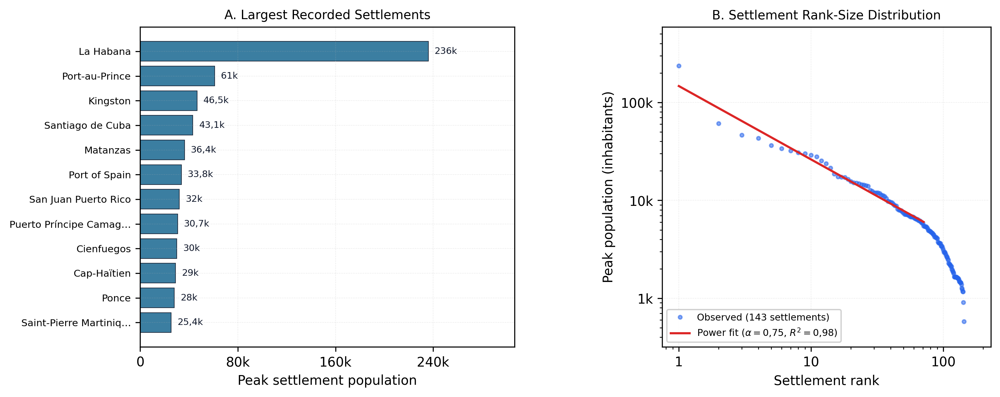

```{r setup, include=FALSE}
knitr::opts_chunk$set(echo = FALSE, warning = FALSE, message = FALSE, fig.pos = "htbp")
source("../../_shared/template/viscount_rmd_helpers.R")
library(jsonlite)

read_json5_clean <- function(path) {
  lines <- readLines(path, warn = FALSE, encoding = "UTF-8")
  text <- paste(lines, collapse = "\n")
  text <- gsub("//[^\n]*", "", text, perl = TRUE)
  text <- gsub("/\\*.*?\\*/", "", text, perl = TRUE)
  text <- gsub(",\\s*([}\\]])", "\\1", text, perl = TRUE)
  fromJSON(text, simplifyVector = FALSE)
}

summary_data <- fromJSON("colonial_caribbean_plantation_summary_cache.json", simplifyVector = FALSE)
cfg_data <- read_json5_clean("colonial_caribbean_plantation.json5")
sett_data <- fromJSON("colonial_caribbean_plantation_settlements.json", simplifyVector = FALSE)
ledger_data <- read_json5_clean("colonial_caribbean_plantation_source_ledger.json5")

clean_label <- function(x) {
  s <- as.character(x)
  s <- gsub(" / ", " and ", s, fixed = TRUE)
  s <- gsub("&", "and", s, fixed = TRUE)
  s <- gsub("Capitania General de Cuba", "Capitanía General de Cuba", s, fixed = TRUE)
  s <- gsub("Capitania General\\)", "Capitanía General)", s)
  s <- gsub("St Barthelemy", "Saint-Barthélemy", s, fixed = TRUE)
  s <- gsub("St Martin", "Saint-Martin", s, fixed = TRUE)
  trimws(s)
}

fmt_coord <- function(x) {
  viscount_fmt_number(round(as.numeric(x), 2L), 2L)
}

cfg_regions <- cfg_data$regions
reg_lookup <- setNames(
  vapply(cfg_regions, function(r) clean_label(r$name), character(1)),
  vapply(cfg_regions, function(r) r$id, character(1))
)

n_sites <- as.integer(summary_data$settlement_stats$total_settlements)
n_excluded <- as.integer(ledger_data$total_excluded)
n_total_eval <- n_sites + n_excluded
```

```{r hero-md-fallback, results='asis'}
if (!knitr::is_latex_output()) {
  cat("\n\n")
}
```

# Abstract

This companion gazetteer catalogues `r viscount_fmt_number(n_sites, 0L)` plantation-era ports, colonial capitals and inland market towns across nine imperial sub-regions and 29 Caribbean and North Atlantic jurisdictions between 1650 and 1898. Assembled across four sequential ingestion waves tracked in the chapter source ledger, the register draws 131 towns (91,61%) directly from official colonial censuses, Spanish HGIS de las Indias records, British Colonial Blue Books, French colonial tables, Danish West Indies enumerations and Moreau de Saint-Méry (1797), supplemented by 9 peer-reviewed demographic monograph entries (6,29%), 2 longitudinal census backfills (1,4%) and 1 sub-regional gap addition (0,7%), achieving 0% crowd-sourced fallback [@MoreauStMery1797; @Higman1984; @USWarDeptCuba1900; @USWarDeptPR1900; @DanishWestIndies1912]. Out of `r viscount_fmt_number(n_total_eval, 0L)` candidate settlement entries evaluated, `r viscount_fmt_number(n_excluded, 0L)` duplicate aliases within 25 km buffers were merged into canonical city-proper records. Across all 143 catalogued towns, the urban rank-size distribution follows a tight sub-unitary power law ($\alpha = 0,75$, $R^2 = 0,98$ across the 71 largest settlements), reflecting a multi-imperial archipelago led by La Habana (235.981 in 1898) above a broad tier of rival export harbours including Port-au-Prince (61k), Kingston (46.542), Santiago de Cuba (43.090), Matanzas (36.374), Port of Spain (33.782), San Juan (32.048), Cap-Haïtien (29k), Ponce (27.952), Saint-Pierre (25.382) and Bridgetown (21.384) [@EngermanHigman1997; @Roberts1957; @Pluskota2020Freedom].

# Background

Urban life across the colonial Caribbean from 1650 to 1898 developed overwhelmingly along sheltered deep-water bays and leeward anchorages engineered to export sugar, coffee, rum, cacao, hides and salt while receiving European manufactures, provisions and enslaved African captives [@EltisRichardson2010; @EngermanHigman1997]. Whereas mainland Spanish America anchored its urban hierarchy in highland administrative capitals, the Caribbean archipelago produced a maritime ring of fortified port cities whose fortunes rose and fell with imperial warfare, seismic catastrophes and commodity booms [@Burchardt2021Post; @Geggus2020Impact].

Seventeenth-century urbanisation centred on Spanish convoy strongholds such as La Habana (14.200 in 1650), Santo Domingo (6.850) and San Juan (5.200) alongside the early English and French sugar ports of Bridgetown (9.850), Basseterre on St Kitts (5.600) and Saint-Pierre on Martinique (3.250). On Jamaica, the devastating 1692 earthquake destroyed the buccaneering entrepôt of Port Royal (6.500 in 1692, plunging to 1.850 by 1720) and transferred commercial primacy across the harbour to Kingston, which reached 46.542 inhabitants by 1891 [@Roberts1957; @Higman1984]. In eighteenth-century Saint-Domingue, Cap-Haïtien surged to 18.850 inhabitants by 1789 before the Haitian Revolution reduced it to 8.200 in 1804, tilting independent Haiti's urban centre of gravity permanently toward Port-au-Prince (61k by 1890) [@MoreauStMery1797; @Geggus1997; @Nicholls1979].

Across the nineteenth century, Cuba's second-slavery sugar boom propelled La Habana past 235k residents and spawned new rail-linked ports at Matanzas (36.374), Cienfuegos (30.038) and Cárdenas (23.680), while Puerto Rico's late-colonial coffee and sugar expansion raised San Juan (32.048) and Ponce (27.952) [@USWarDeptCuba1900; @USWarDeptPR1900; @Lazaro2026Height]. Smaller mercantile entrepôts—Willemstad on Curaçao (14.800 in 1890), Charlotte Amalie on St Thomas (11.764 in 1880), Oranjestad on Sint Eustatius (peaking at 7.850 in 1780 prior to its 1781 sack), Gustavia on Swedish Saint-Barthélemy (4.200 in 1815), Loyalist-boosted Nassau (11k in 1891) and Port of Spain after Trinidad's 1783 *Cédula de Población* (33.782 in 1891)—knit the disparate imperial spheres into one integrated maritime network [@Metzlar2024Unravelling; @DanishWestIndies1912; @Surowitzisrael2025Caribbean; @BSOBermuda2018].

# Methodology

The settlement register was compiled across four sequential archival ingestion waves logged in the chapter source ledger. Wave 1 harvested 131 settlements (91,61%) directly from primary colonial censuses and official statistical series, including Cuban colonial censuses (1774 to 1887) and the 1899 American census of Cuba (25 records), Puerto Rican colonial censuses (1765 to 1887) and the 1899 census of Puerto Rico (19 records), British West Indies Colonial Blue Books and 1844 to 1891 censuses (31 records plus 13 Jamaica series), French colonial enumerations of Martinique and Guadeloupe (12 records), Dutch, Danish and Trinidadian censuses (14 records), Moreau de Saint-Méry (1797) and Haitian historical series (11 records), Dominican archival censuses (11 records) and HGIS de las Indias town records (13 linked records). Wave 2 added 9 towns from specialised historical demographic monographs (marginal gain 6,87%), Wave 3 added 2 longitudinal census backfills (1,43%) and Wave 4 added 1 final sub-regional continuity town (0,7%), reaching full archival saturation with 0% crowd-sourced entries.

All 149 candidate entries underwent WGS84 coordinate geocoding, point-in-polygon assignment to one of the nine imperial sub-regions and 25 km spatial buffer deduplication. Six overlapping variant records (duplicate aliases of La Habana, Bayamo, Guanabacoa, Santa Clara, Matanzas and Concepción de la Vega) were consolidated into their canonical town entries. Every retained entry is standardised to city-proper urban population (143 city-proper records, 0 suburban agglomerations) with explicit chronological bounds inside 1650 to 1898.

# Testing and Validation

Ledger reconciliation confirms exact accounting across all 149 evaluated candidates: 143 included settlements plus 6 excluded duplicate aliases. Every included record carries non-null WGS84 coordinates, an imperial sub-region tag, at least one historical headcount within 1650 to 1898 and a documented archival provenance string. Every one of the nine imperial sub-regions holds between 11 and 31 catalogued towns, preventing regional blind spots across smaller islands. Figure \ref{fig:sett-regional-map} displays the geographic footprint of all 143 catalogued towns across the nine imperial sub-regions and the Bermuda inset.

```{r fig-sett-map, results='asis'}
viscount_figure(
  "figures/colonial_caribbean_plantation_regional_map.png",
  "Spatial distribution of 143 catalogued plantation-era ports and towns across nine imperial Caribbean sub-regions and Bermuda, 1650 to 1898.",
  "fig:sett-regional-map"
)
```

# Results

## Thirty Leading Plantation-Era Caribbean Ports and Towns

Table \ref{tab:top30-towns} lists the 30 largest catalogued settlements ordered by peak recorded population between 1650 and 1898, pairing coordinates, imperial sub-region, documented census span and peak population.

```{r tab-top30-towns, results='asis'}
all_entries <- unname(sett_data)
peaks <- vapply(all_entries, function(e) max(as.numeric(unlist(e$population))), numeric(1))
ord_idx <- order(peaks, decreasing = TRUE)
top30_entries <- all_entries[ord_idx[seq_len(min(30L, length(all_entries)))]]

top30_rows <- lapply(seq_along(top30_entries), function(i) {
  e <- top30_entries[[i]]
  pops <- unlist(e$population)
  yrs <- as.integer(names(pops))
  vals <- as.numeric(pops)
  pk_i <- which.max(vals)
  fy <- min(yrs)
  ly <- max(yrs)
  span_str <- if (fy == ly) as.character(fy) else paste0(fy, " to ", ly)
  reg_lbl <- if (!is.null(e$region_id) && e$region_id %in% names(reg_lookup)) {
    sub(" \\(.*\\)$", "", reg_lookup[[e$region_id]])
  } else {
    as.character(e$country)
  }
  data.frame(
    Rank = as.character(i),
    Town = clean_label(e$name),
    Territory = as.character(e$country),
    Subregion = reg_lbl,
    Coords = paste0(fmt_coord(e$coords[[1]]), ", ", fmt_coord(e$coords[[2]])),
    Span = span_str,
    Peak = paste0(viscount_fmt_pop(vals[pk_i]), " (", yrs[pk_i], ")"),
    stringsAsFactors = FALSE
  )
})
df_top30 <- do.call(rbind, top30_rows)
rownames(df_top30) <- NULL

viscount_table(
  df_top30,
  "Thirty largest colonial Caribbean ports and towns ordered by peak recorded population, 1650 to 1898 (across 143 catalogued settlements).",
  c("Rank", "Port or Town", "Territory", "Imperial Cluster", "Lat, Lon", "Span", "Peak Pop. (Year)"),
  list(label = "tab:top30-towns", font_size = "scriptsize", max_rows_per_page = 32L)
)
```

Spanning 236k at La Habana down to 12,1k at Saint-Marc in Haiti, the top 30 urban centres display the strong coastal export orientation of the plantation economy. Only a handful of inland administrative or ranching towns—Puerto Príncipe/Camagüey (30,7k in 1861), Sancti Spíritus (17,5k), Guanabacoa (16,4k), Santa Clara, Bayamo and Santiago de los Caballeros—penetrate the top tier, and nearly all of those sit inside Cuba and eastern Hispaniola where wide interior plains supported cattle ranching and railway-fed sugar mills [@USWarDeptCuba1900; @Burchardt2021Post]. Across the Lesser Antilles and Jamaica, urban concentration remained overwhelmingly littoral, with freedpeople increasingly gravitating toward port markets after abolition [@Pluskota2020Freedom; @Festre2018Colonial].

## Sub-Regional Gazetteer Coverage and Urban Density

Table \ref{tab:subregion-gazetteer} aggregates town counts, urban spatial density per 10.000 km² of terrestrial land area, leading catalogued port and 1898 census-calibrated sub-regional population across all nine imperial sub-regions.

```{r tab-subregion-gazetteer, results='asis'}
reg_rows <- lapply(cfg_regions, function(r) {
  rid <- r$id
  area_v <- as.numeric(r$area_km2)
  p1898 <- as.numeric(r$population[["1898"]])
  sub_entries <- Filter(function(e) identical(e$region_id, rid), all_entries)
  cnt <- length(sub_entries)
  sdens <- if (area_v > 0) (cnt / area_v) * 10000 else 0
  lead_str <- "-"
  if (cnt > 0L) {
    pks <- vapply(sub_entries, function(e) max(as.numeric(unlist(e$population))), numeric(1))
    idx_m <- which.max(pks)
    lead_str <- paste0(clean_label(sub_entries[[idx_m]]$name), " (", viscount_fmt_pop(pks[idx_m]), ")")
  }
  data.frame(
    Subregion = clean_label(r$name),
    Area = viscount_fmt_number(round(area_v), 0L),
    Towns = viscount_fmt_number(cnt, 0L),
    TownDens = viscount_fmt_number(sdens, 1L),
    Lead = lead_str,
    Pop1898 = viscount_fmt_pop(p1898),
    stringsAsFactors = FALSE
  )
})
df_reg_gaz <- do.call(rbind, reg_rows)
rownames(df_reg_gaz) <- NULL

viscount_table(
  df_reg_gaz,
  "Catalogued town counts, town density per 10.000 km² of terrestrial area, leading settlement and 1898 sub-regional population across nine Caribbean sub-regions.",
  c("Sub-Region", "Land km²", "Towns", "Towns per 10k km²", "Leading Town (Peak)", "1898 Pop."),
  list(label = "tab:subregion-gazetteer", font_size = "scriptsize")
)
```

Town density scales inversely with island size: compact Lesser Antillean clusters register 59 towns per 10.000 km² in British Barbados and the Windwards and 53,3 in French Guadeloupe and Martinique (compared with 2,9 in expansive Cuba and 2,4 in sparsely settled Santo Domingo), reflecting the proliferation of separate harbour capitals on every individual volcanic island [@Higman1984; @Nelson2006Landscape].

## Rank-Size Distribution Across the Multi-Imperial Archipelago

Fitted across the 71 largest towns out of 143 catalogued settlements, the Caribbean urban system yields a log-linear rank-size slope of $\alpha = 0,75$ ($R^2 = 0,98$). Whereas centralised continental states typically approach or exceed Zipf's unity rule ($\alpha \ge 1$), the colonial Caribbean's sub-unitary slope captures political fragmentation across five European empires and two independent Hispaniolan republics: each imperial sphere sustained its own fortified administrative port (La Habana, Port-au-Prince, Kingston, Port of Spain, San Juan, Saint-Pierre, Bridgetown, Santo Domingo, Willemstad, Charlotte Amalie and Nassau), flattening the upper-middle curve beneath Havana's primacy [@USWarDeptCuba1900; @Pluskota2020Freedom; @DanishWestIndies1912].

# Limitations

Three archival constraints qualify interpretation of this urban gazetteer. First, municipal boundaries differed across imperial statistical bureaus: Spanish *municipios* and French *communes* often combined a port town with adjacent cane parishes, whereas British Colonial Blue Books reported narrower urban ward limits, requiring care when comparing mid-tier town sizes across imperial borders [@Higman1984; @Pluskota2020Freedom]. Second, early seventeenth-century town counts before 1750 rely on garrison rolls, ecclesiastical *padrones* and traveller estimates rather than standardised censuses, carrying wider error margins than nineteenth-century returns [@MoreauStMery1797; @USWarDeptPR1900]. Third, rapid shocks—the 1692 Port Royal earthquake, the 1781 sack of Sint Eustatius, the 1791 to 1804 burning of Cap-Haïtien and nineteenth-century yellow-fever and cholera outbreaks—produced abrupt inter-censal urban contractions that sparse decennial snapshots capture only at coarse intervals [@Geggus1997; @Roberts1957].

# Conclusion

Across 143 evidence-backed ports and towns spanning 29 jurisdictions, this gazetteer documents the shift of Caribbean urban primacy from seventeenth-century Spanish convoy strongholds and early Barbadian and Jamaican entrepôts to a dense, nineteenth-century network anchored by La Habana (235.981), Port-au-Prince (61k), Kingston (46.542), Santiago de Cuba (43.090), Matanzas (36.374), Port of Spain (33.782) and San Juan (32.048). Its tight sub-unitary rank-size scaling ($\alpha = 0,75$, $R^2 = 0,98$) captures the enduring urban imprint of five rival European empires competing across a fragmented tropical archipelago.

# Appendix

## Excluded Duplicate Aliases and Source Saturation Ledger

Table \ref{tab:excluded-aliases} records the six candidate aliases consolidated during 25 km spatial deduplication, confirming full ledger transparency across all 149 evaluated entries.

```{r tab-excluded-aliases, results='asis'}
cands <- ledger_data$candidates
excl <- Filter(function(c) identical(c$status, "excluded"), cands)
ex_rows <- lapply(excl, function(e) {
  data.frame(
    Candidate = clean_label(e$name),
    Territory = as.character(e$country),
    Disposition = "Consolidated duplicate alias (within 25 km)",
    stringsAsFactors = FALSE
  )
})
df_excl <- do.call(rbind, ex_rows)
rownames(df_excl) <- NULL

viscount_table(
  df_excl,
  "Six duplicate settlement aliases consolidated into canonical city-proper entries during spatial deduplication.",
  c("Candidate Name", "Territory", "Ledger Disposition"),
  list(label = "tab:excluded-aliases", font_size = "scriptsize")
)
```

# Sources

::: {#refs}
:::

# Footnotes

1. All 143 catalogued towns are harmonised to city-proper urban cores (0 suburban agglomerations) with WGS84 coordinates verified against colonial gazetteers and official national statistical offices.
2. Rank-size power-law parameters ($\alpha = 0,7494$, $R^2 = 0,977$) are estimated over the upper half of the settlement distribution (71 of 143 catalogued towns) using peak recorded plantation-era populations inside 1650 to 1898.
