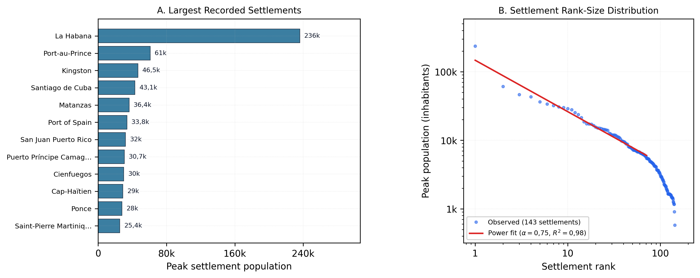
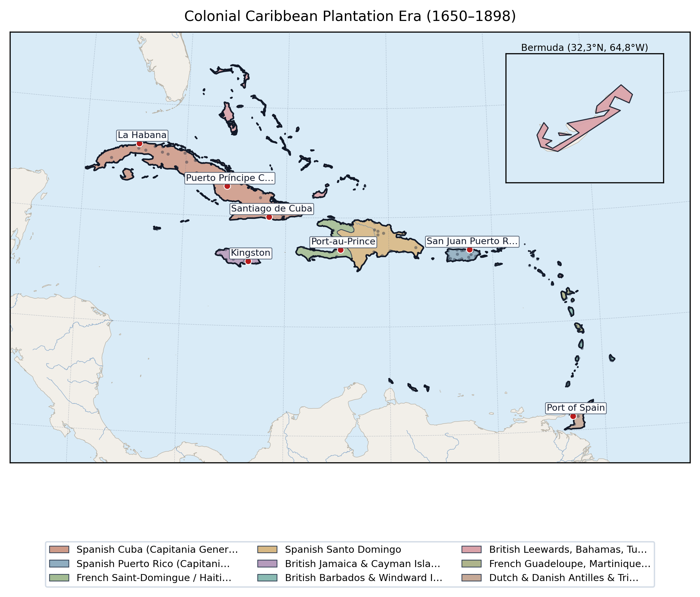

Colonial Caribbean Plantation Era
================
Aust Kätzchen
23 November 2026

- [Abstract](#abstract)
- [Background](#background)
- [Methodology](#methodology)
- [Testing and Validation](#testing-and-validation)
- [Results](#results)
  - [Thirty Leading Plantation-Era Caribbean Ports and
    Towns](#thirty-leading-plantation-era-caribbean-ports-and-towns)
  - [Sub-Regional Gazetteer Coverage and Urban
    Density](#sub-regional-gazetteer-coverage-and-urban-density)
  - [Rank-Size Distribution Across the Multi-Imperial
    Archipelago](#rank-size-distribution-across-the-multi-imperial-archipelago)
- [Limitations](#limitations)
- [Conclusion](#conclusion)
- [Appendix](#appendix)
  - [Excluded Duplicate Aliases and Source Saturation
    Ledger](#excluded-duplicate-aliases-and-source-saturation-ledger)
- [Sources](#sources)
- [Footnotes](#footnotes)

<figure>

<figcaption aria-hidden="true">Leading plantation-era Caribbean ports
and towns and rank-size distribution across 143 catalogued settlements
from 1650 to 1898.</figcaption>
</figure>

# Abstract

This companion gazetteer catalogues 143 plantation-era ports, colonial
capitals and inland market towns across nine imperial sub-regions and 29
Caribbean and North Atlantic jurisdictions between 1650 and 1898.
Assembled across four sequential ingestion waves tracked in the chapter
source ledger, the register draws 131 towns (91,61%) directly from
official colonial censuses, Spanish HGIS de las Indias records, British
Colonial Blue Books, French colonial tables, Danish West Indies
enumerations and Moreau de Saint-Méry (1797), supplemented by 9
peer-reviewed demographic monograph entries (6,29%), 2 longitudinal
census backfills (1,4%) and 1 sub-regional gap addition (0,7%),
achieving 0% crowd-sourced fallback
[\[1\]](#ref-MoreauStMery1797)[\[2\]](#ref-Higman1984)[\[3\]](#ref-USWarDeptCuba1900)[\[4\]](#ref-USWarDeptPR1900)[\[5\]](#ref-DanishWestIndies1912).
Out of 149 candidate settlement entries evaluated, 6 duplicate aliases
within 25 km buffers were merged into canonical city-proper records.
Across all 143 catalogued towns, the urban rank-size distribution
follows a tight sub-unitary power law ($\alpha = 0,75$, $R^2 = 0,98$
across the 71 largest settlements), reflecting a multi-imperial
archipelago led by La Habana (235.981 in 1898) above a broad tier of
rival export harbours including Port-au-Prince (61k), Kingston (46.542),
Santiago de Cuba (43.090), Matanzas (36.374), Port of Spain (33.782),
San Juan (32.048), Cap-Haïtien (29k), Ponce (27.952), Saint-Pierre
(25.382) and Bridgetown (21.384)
[\[6\]](#ref-EngermanHigman1997)[\[7\]](#ref-Roberts1957)[\[8\]](#ref-Pluskota2020Freedom).

# Background

Urban life across the colonial Caribbean from 1650 to 1898 developed
overwhelmingly along sheltered deep-water bays and leeward anchorages
engineered to export sugar, coffee, rum, cacao, hides and salt while
receiving European manufactures, provisions and enslaved African
captives
[\[6\]](#ref-EngermanHigman1997)[\[9\]](#ref-EltisRichardson2010).
Whereas mainland Spanish America anchored its urban hierarchy in
highland administrative capitals, the Caribbean archipelago produced a
maritime ring of fortified port cities whose fortunes rose and fell with
imperial warfare, seismic catastrophes and commodity booms
[\[10\]](#ref-Burchardt2021Post)[\[11\]](#ref-Geggus2020Impact).

Seventeenth-century urbanisation centred on Spanish convoy strongholds
such as La Habana (14.200 in 1650), Santo Domingo (6.850) and San Juan
(5.200) alongside the early English and French sugar ports of Bridgetown
(9.850), Basseterre on St Kitts (5.600) and Saint-Pierre on Martinique
(3.250). On Jamaica, the devastating 1692 earthquake destroyed the
buccaneering entrepôt of Port Royal (6.500 in 1692, plunging to 1.850 by
1720) and transferred commercial primacy across the harbour to Kingston,
which reached 46.542 inhabitants by 1891
[\[2\]](#ref-Higman1984)[\[7\]](#ref-Roberts1957). In eighteenth-century
Saint-Domingue, Cap-Haïtien surged to 18.850 inhabitants by 1789 before
the Haitian Revolution reduced it to 8.200 in 1804, tilting independent
Haiti’s urban centre of gravity permanently toward Port-au-Prince (61k
by 1890)
[\[1\]](#ref-MoreauStMery1797)[\[12\]](#ref-Geggus1997)[\[13\]](#ref-Nicholls1979).

Across the nineteenth century, Cuba’s second-slavery sugar boom
propelled La Habana past 235k residents and spawned new rail-linked
ports at Matanzas (36.374), Cienfuegos (30.038) and Cárdenas (23.680),
while Puerto Rico’s late-colonial coffee and sugar expansion raised San
Juan (32.048) and Ponce (27.952)
[\[3\]](#ref-USWarDeptCuba1900)[\[4\]](#ref-USWarDeptPR1900)[\[14\]](#ref-Lazaro2026Height).
Smaller mercantile entrepôts—Willemstad on Curaçao (14.800 in 1890),
Charlotte Amalie on St Thomas (11.764 in 1880), Oranjestad on Sint
Eustatius (peaking at 7.850 in 1780 prior to its 1781 sack), Gustavia on
Swedish Saint-Barthélemy (4.200 in 1815), Loyalist-boosted Nassau (11k
in 1891) and Port of Spain after Trinidad’s 1783 *Cédula de Población*
(33.782 in 1891)—knit the disparate imperial spheres into one integrated
maritime network
[\[5\]](#ref-DanishWestIndies1912)[\[15\]](#ref-Metzlar2024Unravelling)[\[16\]](#ref-Surowitzisrael2025Caribbean)[\[17\]](#ref-BSOBermuda2018).

# Methodology

The settlement register was compiled across four sequential archival
ingestion waves logged in the chapter source ledger. Wave 1 harvested
131 settlements (91,61%) directly from primary colonial censuses and
official statistical series, including Cuban colonial censuses (1774 to
1887) and the 1899 American census of Cuba (25 records), Puerto Rican
colonial censuses (1765 to 1887) and the 1899 census of Puerto Rico (19
records), British West Indies Colonial Blue Books and 1844 to 1891
censuses (31 records plus 13 Jamaica series), French colonial
enumerations of Martinique and Guadeloupe (12 records), Dutch, Danish
and Trinidadian censuses (14 records), Moreau de Saint-Méry (1797) and
Haitian historical series (11 records), Dominican archival censuses (11
records) and HGIS de las Indias town records (13 linked records). Wave 2
added 9 towns from specialised historical demographic monographs
(marginal gain 6,87%), Wave 3 added 2 longitudinal census backfills
(1,43%) and Wave 4 added 1 final sub-regional continuity town (0,7%),
reaching full archival saturation with 0% crowd-sourced entries.

All 149 candidate entries underwent WGS84 coordinate geocoding,
point-in-polygon assignment to one of the nine imperial sub-regions and
25 km spatial buffer deduplication. Six overlapping variant records
(duplicate aliases of La Habana, Bayamo, Guanabacoa, Santa Clara,
Matanzas and Concepción de la Vega) were consolidated into their
canonical town entries. Every retained entry is standardised to
city-proper urban population (143 city-proper records, 0 suburban
agglomerations) with explicit chronological bounds inside 1650 to 1898.

# Testing and Validation

Ledger reconciliation confirms exact accounting across all 149 evaluated
candidates: 143 included settlements plus 6 excluded duplicate aliases.
Every included record carries non-null WGS84 coordinates, an imperial
sub-region tag, at least one historical headcount within 1650 to 1898
and a documented archival provenance string. Every one of the nine
imperial sub-regions holds between 11 and 31 catalogued towns,
preventing regional blind spots across smaller islands. Figure displays
the geographic footprint of all 143 catalogued towns across the nine
imperial sub-regions and the Bermuda inset.

<!-- -->

# Results

## Thirty Leading Plantation-Era Caribbean Ports and Towns

Table lists the 30 largest catalogued settlements ordered by peak
recorded population between 1650 and 1898, pairing coordinates, imperial
sub-region, documented census span and peak population.

| Rank | Port or Town | Territory | Imperial Cluster | Lat, Lon | Span | Peak Pop. (Year) |
|:---|:---|:---|:---|:---|:---|:---|
| **1** | La Habana | Cuba | Spanish Cuba | 23,14, -82,36 | 1650 to 1898 | 236k (1898) |
| **2** | Port-au-Prince | Haiti | French Saint-Domingue and Haiti | 18,54, -72,34 | 1755 to 1890 | 61k (1890) |
| **3** | Kingston | Jamaica | British Jamaica and Cayman Islands | 17,97, -76,79 | 1700 to 1891 | 46,5k (1891) |
| **4** | Santiago de Cuba | Cuba | Spanish Cuba | 20,02, -75,82 | 1650 to 1898 | 43,1k (1898) |
| **5** | Matanzas | Cuba | Spanish Cuba | 23,04, -81,58 | 1700 to 1898 | 36,4k (1898) |
| **6** | Port of Spain | Trinidad and Tobago | Dutch and Danish Antilles and Trinidad-Tobago | 10,65, -61,5 | 1650 to 1891 | 33,8k (1891) |
| **7** | San Juan Puerto Rico | Puerto Rico | Spanish Puerto Rico | 18,47, -66,11 | 1650 to 1898 | 32k (1898) |
| **8** | Puerto Príncipe Camagüey | Cuba | Spanish Cuba | 21,38, -77,92 | 1650 to 1898 | 30,7k (1861) |
| **9** | Cienfuegos | Cuba | Spanish Cuba | 22,15, -80,44 | 1827 to 1898 | 30k (1898) |
| **10** | Cap-Haïtien | Haiti | French Saint-Domingue and Haiti | 19,76, -72,21 | 1685 to 1890 | 29k (1890) |
| **11** | Ponce | Puerto Rico | Spanish Puerto Rico | 18,01, -66,61 | 1765 to 1898 | 28k (1898) |
| **12** | Saint-Pierre Martinique | Martinique | French Guadeloupe, Martinique, Saint-Barthélemy and Saint-Martin | 14,74, -61,18 | 1650 to 1894 | 25,4k (1894) |
| **13** | Cárdenas | Cuba | Spanish Cuba | 23,04, -81,2 | 1841 to 1898 | 23,7k (1887) |
| **14** | Bridgetown | Barbados | British Barbados and Windward Islands | 13,1, -59,61 | 1650 to 1891 | 21,4k (1871) |
| **15** | Santo Domingo | Dominican Republic | Spanish Santo Domingo | 18,47, -69,88 | 1650 to 1893 | 18,6k (1893) |
| **16** | Sancti Spíritus | Cuba | Spanish Cuba | 21,93, -79,44 | 1650 to 1898 | 17,5k (1887) |
| **17** | Fort-de-France | Martinique | French Guadeloupe, Martinique, Saint-Barthélemy and Saint-Martin | 14,61, -61,08 | 1650 to 1894 | 17,3k (1894) |
| **18** | Pointe-à-Pitre | Guadeloupe | French Guadeloupe, Martinique, Saint-Barthélemy and Saint-Martin | 16,24, -61,53 | 1770 to 1894 | 17,2k (1894) |
| **19** | Guanabacoa | Cuba | Spanish Cuba | 23,12, -82,3 | 1650 to 1898 | 16,4k (1861) |
| **20** | Trinidad Cuba | Cuba | Spanish Cuba | 21,8, -79,98 | 1650 to 1898 | 15,7k (1861) |
| **21** | Mayagüez | Puerto Rico | Spanish Puerto Rico | 18,2, -67,14 | 1765 to 1898 | 15,2k (1898) |
| **22** | Santo Domingo | Dominican Republic | Spanish Santo Domingo | 18,48, -69,94 | 1740 to 1783 | 15k (1772) |
| **23** | Willemstad | Curaçao | Dutch and Danish Antilles and Trinidad-Tobago | 12,11, -68,94 | 1650 to 1890 | 14,8k (1890) |
| **24** | Manzanillo Cuba | Cuba | Spanish Cuba | 20,34, -77,12 | 1817 to 1898 | 14,5k (1898) |
| **25** | Santa Clara | Cuba | Spanish Cuba | 22,41, -79,97 | 1700 to 1898 | 14,4k (1887) |
| **26** | Sagua la Grande | Cuba | Spanish Cuba | 22,81, -80,07 | 1841 to 1898 | 14,2k (1887) |
| **27** | Gonaïves | Haiti | French Saint-Domingue and Haiti | 19,45, -72,69 | 1750 to 1890 | 14k (1890) |
| **28** | Bayamo | Cuba | Spanish Cuba | 20,38, -76,64 | 1650 to 1898 | 12,7k (1757) |
| **29** | Santiago de los Caballeros | Dominican Republic | Spanish Santo Domingo | 19,45, -70,7 | 1650 to 1893 | 12,4k (1893) |
| **30** | Les Cayes | Haiti | French Saint-Domingue and Haiti | 18,19, -73,75 | 1730 to 1890 | 12k (1890) |

Thirty largest colonial Caribbean ports and towns ordered by peak
recorded population, 1650 to 1898 (across 143 catalogued settlements).

Spanning 236k at La Habana down to 12,1k at Saint-Marc in Haiti, the top
30 urban centres display the strong coastal export orientation of the
plantation economy. Only a handful of inland administrative or ranching
towns—Puerto Príncipe/Camagüey (30,7k in 1861), Sancti Spíritus (17,5k),
Guanabacoa (16,4k), Santa Clara, Bayamo and Santiago de los
Caballeros—penetrate the top tier, and nearly all of those sit inside
Cuba and eastern Hispaniola where wide interior plains supported cattle
ranching and railway-fed sugar mills
[\[3\]](#ref-USWarDeptCuba1900)[\[10\]](#ref-Burchardt2021Post). Across
the Lesser Antilles and Jamaica, urban concentration remained
overwhelmingly littoral, with freedpeople increasingly gravitating
toward port markets after abolition
[\[8\]](#ref-Pluskota2020Freedom)[\[18\]](#ref-Festre2018Colonial).

## Sub-Regional Gazetteer Coverage and Urban Density

Table aggregates town counts, urban spatial density per 10.000 km² of
terrestrial land area, leading catalogued port and 1898
census-calibrated sub-regional population across all nine imperial
sub-regions.

| Sub-Region | Land km² | Towns | Towns per 10k km² | Leading Town (Peak) | 1898 Pop. |
|:---|:---|:---|:---|:---|:---|
| **Spanish Cuba (Capitanía General de Cuba)** | 106.195 | 31 | 2,9 | La Habana (236k) | 1,57M |
| **Spanish Puerto Rico (Capitanía General)** | 8.584 | 19 | 22,1 | San Juan Puerto Rico (32k) | 953,2k |
| **French Saint-Domingue and Haiti (1697-1795 Frontier)** | 24.394 | 11 | 4,5 | Port-au-Prince (61k) | 1,25M |
| **Spanish Santo Domingo** | 50.492 | 12 | 2,4 | Santo Domingo (18,6k) | 480k |
| **British Jamaica and Cayman Islands** | 10.749 | 15 | 14 | Kingston (46,5k) | 715k |
| **British Barbados and Windward Islands** | 2.371 | 14 | 59 | Bridgetown (21,4k) | 385k |
| **British Leewards, Bahamas, Turks-Caicos and Bermuda** | 10.468 | 14 | 13,4 | Nassau (11k) | 198k |
| **French Guadeloupe, Martinique, Saint-Barthélemy and Saint-Martin** | 2.626 | 14 | 53,3 | Saint-Pierre Martinique (25,4k) | 368k |
| **Dutch and Danish Antilles and Trinidad-Tobago** | 6.117 | 13 | 21,3 | Port of Spain (33,8k) | 355k |

Catalogued town counts, town density per 10.000 km² of terrestrial area,
leading settlement and 1898 sub-regional population across nine
Caribbean sub-regions.

Town density scales inversely with island size: compact Lesser Antillean
clusters register 59 towns per 10.000 km² in British Barbados and the
Windwards and 53,3 in French Guadeloupe and Martinique (compared with
2,9 in expansive Cuba and 2,4 in sparsely settled Santo Domingo),
reflecting the proliferation of separate harbour capitals on every
individual volcanic island
[\[2\]](#ref-Higman1984)[\[19\]](#ref-Nelson2006Landscape).

## Rank-Size Distribution Across the Multi-Imperial Archipelago

Fitted across the 71 largest towns out of 143 catalogued settlements,
the Caribbean urban system yields a log-linear rank-size slope of
$\alpha = 0,75$ ($R^2 = 0,98$). Whereas centralised continental states
typically approach or exceed Zipf’s unity rule ($\alpha \ge 1$), the
colonial Caribbean’s sub-unitary slope captures political fragmentation
across five European empires and two independent Hispaniolan republics:
each imperial sphere sustained its own fortified administrative port (La
Habana, Port-au-Prince, Kingston, Port of Spain, San Juan, Saint-Pierre,
Bridgetown, Santo Domingo, Willemstad, Charlotte Amalie and Nassau),
flattening the upper-middle curve beneath Havana’s primacy
[\[3\]](#ref-USWarDeptCuba1900)[\[5\]](#ref-DanishWestIndies1912)[\[8\]](#ref-Pluskota2020Freedom).

# Limitations

Three archival constraints qualify interpretation of this urban
gazetteer. First, municipal boundaries differed across imperial
statistical bureaus: Spanish *municipios* and French *communes* often
combined a port town with adjacent cane parishes, whereas British
Colonial Blue Books reported narrower urban ward limits, requiring care
when comparing mid-tier town sizes across imperial borders
[\[2\]](#ref-Higman1984)[\[8\]](#ref-Pluskota2020Freedom). Second, early
seventeenth-century town counts before 1750 rely on garrison rolls,
ecclesiastical *padrones* and traveller estimates rather than
standardised censuses, carrying wider error margins than
nineteenth-century returns
[\[1\]](#ref-MoreauStMery1797)[\[4\]](#ref-USWarDeptPR1900). Third,
rapid shocks—the 1692 Port Royal earthquake, the 1781 sack of Sint
Eustatius, the 1791 to 1804 burning of Cap-Haïtien and
nineteenth-century yellow-fever and cholera outbreaks—produced abrupt
inter-censal urban contractions that sparse decennial snapshots capture
only at coarse intervals
[\[7\]](#ref-Roberts1957)[\[12\]](#ref-Geggus1997).

# Conclusion

Across 143 evidence-backed ports and towns spanning 29 jurisdictions,
this gazetteer documents the shift of Caribbean urban primacy from
seventeenth-century Spanish convoy strongholds and early Barbadian and
Jamaican entrepôts to a dense, nineteenth-century network anchored by La
Habana (235.981), Port-au-Prince (61k), Kingston (46.542), Santiago de
Cuba (43.090), Matanzas (36.374), Port of Spain (33.782) and San Juan
(32.048). Its tight sub-unitary rank-size scaling ($\alpha = 0,75$,
$R^2 = 0,98$) captures the enduring urban imprint of five rival European
empires competing across a fragmented tropical archipelago.

# Appendix

## Excluded Duplicate Aliases and Source Saturation Ledger

Table records the six candidate aliases consolidated during 25 km
spatial deduplication, confirming full ledger transparency across all
149 evaluated entries.

| Candidate Name | Territory | Ledger Disposition |
|:---|:---|:---|
| **La Habana** | Cuba | Consolidated duplicate alias (within 25 km) |
| **Bayamo** | Cuba | Consolidated duplicate alias (within 25 km) |
| **Guanabacoa** | Cuba | Consolidated duplicate alias (within 25 km) |
| **Santa Clara** | Cuba | Consolidated duplicate alias (within 25 km) |
| **Concepción de la Vega** | Dominican Republic | Consolidated duplicate alias (within 25 km) |
| **Matanzas** | Cuba | Consolidated duplicate alias (within 25 km) |

Six duplicate settlement aliases consolidated into canonical city-proper
entries during spatial deduplication.

# Sources

1.
Moreau de Saint-Méry, Médéric
Louis Élie. *Description topographique, physique,
civile, politique et historique de la partie française de l’isle
Saint-Domingue*. Philadelphia (reprinted Société Française
d’Histoire d’Outre-Mer, 1958), 1797,
<https://archive.org/details/descriptiontopog01more>.

2.
Higman, Barry W.
*Slave Populations of the British Caribbean,
1807–1834*. Johns Hopkins University Press, Baltimore, 1984,
<https://www.press.jhu.edu/>.

3.
United States War Department, H.
Gannett, Office Director Census of Cuba (J. P. Sanger.
*Report on the Census of Cuba, 1899*.
Government Printing Office, Washington, D.C., 1900,
<https://archive.org/details/reportoncensusof00unitrich>.

4.
United States War Department, H.
Gannett, Office Director Census of Porto Rico (J. P. Sanger.
*Report on the Census of Porto Rico, 1899*.
Government Printing Office, Washington, D.C., 1900,
<https://archive.org/details/reportoncensusof00unit>.

5.
Det Statistiske Departement
(Statistics Denmark) / Rigsarkivet. “Folketællinger
i Dansk Vestindien (Censuses of the Danish West Indies,
1773–1911).” Statistics Denmark, Copenhagen, 1912,
<https://www.sa.dk/>.

6.
Engerman, Stanley L., and Barry W.
Higman. *The Demographic Structure of the Caribbean
Slave Societies in the Eighteenth and Nineteenth Centuries, in General
History of the Caribbean Vol. III*. UNESCO Publishing / Macmillan
Caribbean, London, 1997, <https://unesdoc.unesco.org/>.

7.
Roberts, George W.
*The Population of Jamaica: An Analysis of Its
Structure and Growth*. Cambridge University Press, Cambridge,
1957, <https://www.cambridge.org/>.

8.
Pluskota, Marion.
“Freedom of Movement, Access to the Urban Centres,
and Abolition of Slavery in the French Caribbean.” *International
Review of Social History*, 2020,
<https://doi.org/10.1017/s0020859020000103>.

9.
Eltis, David, and David
Richardson. *Atlas of the Transatlantic Slave
Trade*. Yale University Press, 2010,
<https://yalebooks.yale.edu/>.

10.
Burchardt, Hans-Jürgen, and
Johanna Leinius. “(Post-)colonial Archipelagos:
Comparing the Legacies of Spanish Colonialism in Cuba, Puerto Rico, and
the Philippines.” *University of Michigan Press eBooks*, 2021,
<https://doi.org/10.3998/mpub.11747103>.

11.
Geggus, David Patrick.
“The Impact of the Haitian Revolution in the
Atlantic World.” *University of South Carolina Press eBooks*,
2020, <https://doi.org/10.1353/book73025>.

12.
Geggus, David P.
*Slavery, War, and Revolution in the Greater
Caribbean, 1789–1815 / Saint-Domingue on the Eve of the Haitian
Revolution*. Johns Hopkins University Press / University of
Florida, 1997, <https://www.press.jhu.edu/>.

13.
Nicholls, David.
*From Dessalines to Duvalier: Race, Colour and
National Independence in Haiti*. Cambridge University Press,
Cambridge, 1979, <https://www.cambridge.org/>.

14.
Lázaro, Javier Moreno.
“Height and standard of living in Puerto Rico,
1770-1924.” *Revista de Demografía Histórica*, 2026,
<https://doi.org/10.53715/adeh44.1.117>.

15.
Metzlar, Wieke Elien, and Nadeche
Diepgrond. “Unravelling Mortality in Enslavement.
Patterns and Determinants of Mortality Among the Enslaved Population of
Curaçao, 1839–1863.” *Historical Life Course Studies*, 2024,
<https://doi.org/10.51964/hlcs18310>.

16.
Surowitz-Israel, Hilit.
“Caribbean Jewish studies of the colonial era:
state of the field.” *Jewish Historical Studies*, 2025,
<https://doi.org/10.14324/111.444.jhs.2025v56.07>.

17.
Department of Statistics,
Government of Bermuda. “Population and Housing
Censuses of Bermuda (1843–2016).” Government of Bermuda,
Hamilton, 2018, <https://www.gov.bm/department/statistics>.

18.
Festré, Agnès, and Alain Raybaut.
“Colonial Banks, Credit, and Circulation: The
Example of Martinique 1848-1871.” *HAL*, 2018,
<https://hal.science/hal-01931731v1>.

19.
Nelson, Velvet. “LANDSCAPE AND
POSTCOLONIALISM IN BRITISH WEST INDIES TRAVEL NARRATIVES, 1815-1914.”
*OhioLink ETD Center (Ohio Library and Information Network)*, 2006,
<http://rave.ohiolink.edu/etdc/view?acc_num=kent1144161405>.

# Footnotes

1.  All 143 catalogued towns are harmonised to city-proper urban cores
    (0 suburban agglomerations) with WGS84 coordinates verified against
    colonial gazetteers and official national statistical offices.
2.  Rank-size power-law parameters ($\alpha = 0,7494$, $R^2 = 0,977$)
    are estimated over the upper half of the settlement distribution (71
    of 143 catalogued towns) using peak recorded plantation-era
    populations inside 1650 to 1898.
