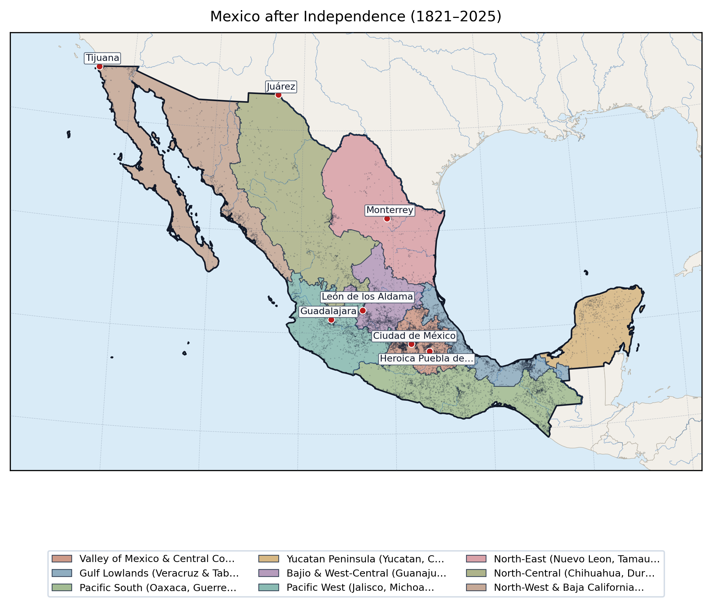

```{r setup, include=FALSE}
knitr::opts_chunk$set(echo = FALSE, warning = FALSE, message = FALSE, fig.pos = "htbp")
source("../../_shared/template/viscount_rmd_helpers.R")
library(jsonlite)

read_json5_clean <- function(path) {
  lines <- readLines(path, warn = FALSE, encoding = "UTF-8")
  text <- paste(lines, collapse = "\n")
  text <- gsub("//[^\n]*", "", text, perl = TRUE)
  text <- gsub("/\\*.*?\\*/", "", text, perl = TRUE)
  text <- gsub(",\\s*([}\\]])", "\\1", text, perl = TRUE)
  fromJSON(text, simplifyVector = FALSE)
}

cfg_data <- read_json5_clean("mexico_after_independence.json5")
cache_data <- fromJSON("mexico_after_independence_summary_cache.json", simplifyVector = FALSE)
sett_data <- fromJSON("mexico_after_independence_settlements.json", simplifyVector = FALSE)
ledger_data <- read_json5_clean("mexico_after_independence_source_ledger.json5")

subadmin_path <- "../../_shared/subadmin_hgis/parsed/jaguar_subadmin_enumerations.json"
subadmin_all <- if (file.exists(subadmin_path)) fromJSON(subadmin_path, simplifyVector = FALSE) else NULL
inegi_states <- if (!is.null(subadmin_all) && !is.null(subadmin_all$mexico_inegi_1895_2020)) {
  subadmin_all$mexico_inegi_1895_2020
} else {
  NULL
}

clean_label <- function(x) {
  s <- as.character(x)
  s <- gsub("&", "and", s, fixed = TRUE)
  s <- gsub("Yucatan", "Yucatán", s, fixed = TRUE)
  s <- gsub("Bajio", "Bajío", s, fixed = TRUE)
  s <- gsub("Queretaro", "Querétaro", s, fixed = TRUE)
  s <- gsub("Michoacan", "Michoacán", s, fixed = TRUE)
  s <- gsub("Nuevo Leon", "Nuevo León", s, fixed = TRUE)
  trimws(s)
}

cfg_regions <- cfg_data$regions
cache_subregions <- cache_data$subregions
cache_by_id <- setNames(cache_subregions, vapply(cache_subregions, function(r) r$id, character(1)))
reg_lookup <- setNames(
  vapply(cfg_regions, function(r) clean_label(r$name), character(1)),
  vapply(cfg_regions, function(r) r$id, character(1))
)

n_setts <- as.integer(cache_data$settlement_stats$total_settlements)
n_suburbs <- as.integer(cache_data$settlement_stats$suburb_count)
n_city_proper <- as.integer(cache_data$settlement_stats$city_proper_count)
tot_area_cfg <- sum(vapply(cfg_regions, function(r) as.numeric(r$area_km2), numeric(1)))
```

```{r hero-md-fallback, results='asis'}
if (!knitr::is_latex_output()) {
  cat("\n\n")
}
```

# Abstract

Between the consummation of independence in 1821 and the third decade of the twenty-first century, Mexico expanded from a war-weary post-colonial republic of roughly 6,2M to 7,19M inhabitants into a heavily urbanised federation of 126,01M people at the 2020 census and roughly 131M by 2025 [@Humboldt1811; @INEGICPV2021; @CONAPO2023]. That seventeen-to-twentyfold multiplication unfolded across four sharply distinct demographic regimes. During the first half-century of independence, civil conflict, cholera epidemics, the Yucatecan Caste War and the territorial losses of 1848 and 1853 slowed growth across the central plateau while stripping away the sparsely settled far northern provinces [@Busto1880; @GarciaCubas1884]. Porfirian railway construction and mining investment then lifted the republic across its first modern statistical enumerations from 12,63M in 1895 to 13,61M in 1900 and 15,16M in 1910, before the Mexican Revolution and the 1918 influenza pandemic drove enumerated population down to 14,33M in 1921, inflicting a demographic deficit of 1,4M to 2,1M through excess mortality, cross-border flight and postponed births [@INEGICensos1996; @McCaa2003; @Escamillaguerrero2025Impact]. From 1930 onward, rapid public-health mortality decline combined with high marital fertility propelled one of the fastest sustained demographic expansions in modern history, carrying national numbers from 16,55M in 1930 to 25,79M in 1950, 48,23M in 1970, 81,25M in 1990 and 126,01M in 2020, even as post-1973 family-planning reform compressed total fertility from above 6,5 births per woman to below replacement by the 2020s [@Alba1982; @INEGIEHM2015; @Medina2022Bayesian]. Simultaneously, internal migration and industrial restructuring shifted Mexico's centre of gravity away from colonial highlands toward the Mexico City conurbation, the northern border maquiladora belt and Caribbean tourism poles [@Unikel1976; @Garza2003; @Pimienta2011Internal]. Across nine sub-regions spanning 1.979.073 km² (2.056.837 km² in the harmonised raster mask) and a gazetteer of 12.140 catalogued settlements (11.483 cities, towns and localities plus 657 extra-municipal suburbs), this study pairs official 1895 to 2020 federal-entity enumerations with metropolitan boundary reconciliation that keeps Ciudad de México unified at 9,21M while separating huge surrounding Estado de México municipalities such as Ecatepec de Morelos (1,64M) and Ciudad Nezahualcóyotl (1,07M).

# Background

## Early Republican Instability and the Territorial Contraction of 1848 to 1853

Independent Mexico inherited the most populous and urbanised territory of former Spanish America, yet it entered statehood with an exhausted silver-mining core and a fractured fiscal apparatus. At the close of the colonial era, Alexander von Humboldt had put New Spain's population at roughly 5,8M in 1803 and projected more than 6,2M by 1810, concentrated overwhelmingly along the volcanic highland spine stretching from Oaxaca and Puebla through the Valley of Mexico into the Bajío and Guadalajara [@Humboldt1811]. Eleven years of insurgent warfare between 1810 and 1821 devastated the mining real of Guanajuato, Zacatecas and San Luis Potosí, flooded shafts, dispersed rural estates and killed or displaced hundreds of thousands of Highland peasants [@INEGIEHM2015]. Within the modern national borders, Mexico's 1821 population stood near 6,2M to 7,19M depending on under-enumeration adjustments for remote southern indigenous communities and northern frontier presidios, yielding an average density barely above three inhabitants per km².

Over the next half-century, demographic recovery proceeded fitfully. Chronic civil wars between centralists and federalists, the 1833 and 1850 cholera pandemics, the War of the Reform and the French Intervention depressed marriage rates and repeatedly disrupted harvests across the central mesa [@Busto1880]. In the Yucatán Peninsula, the outbreak of the Caste War in 1847 triggered an exceptional demographic collapse: rebel Maya armies swept through eastern and southern estates, massacres and famine drove tens of thousands of refugees toward Mérida, Campeche and British Honduras, and the peninsula became the sole Mexican macro-region to finish the nineteenth century with fewer inhabitants than it had held at independence [@GarciaCubas1884; @INEGIEHM2015].

Territorial borders also contracted dramatically along the northern frontier. When Mexico proclaimed independence, its nominal jurisdiction extended across Texas, New Mexico, Arizona and Alta California, encompassing more than 4M km² of mostly arid grazing plains and indigenous borderlands held by tiny Hispanic garrisons. The secession of Texas in 1836, the Treaty of Guadalupe Hidalgo in 1848 and the Gadsden Purchase (Tratado de la Mesilla) of 1853 severed roughly half of the republic's nominal land surface, fixing the modern boundary along the Río Bravo and the Sonoran desert. Paradoxically, the immediate demographic loss was modest: barely 80k to 110k settled Mexican citizens lived north of the new frontier in 1848, representing under two per cent of the republic's population, whereas the loss of the northern provinces permanently reoriented Mexico's remaining northern states toward a newly militarised and commercially dynamic international border [@Busto1880; @Garza2003]. By the time Emiliano Busto compiled Treasury fiscal and municipal population returns in 1877 to 1878 (9,38M) and Antonio García Cubas published his national geographical synthesis in 1884 (10,45M), Mexico had finally shaken off post-independence stagnation and was accelerating past ten million inhabitants [@Busto1880; @GarciaCubas1884].

## Porfirian Railways, Mining Revival and the First National Censuses (1876 to 1910)

The thirty-four-year regime of Porfirio Díaz (1876 to 1911) created both the transport skeleton of modern Mexico and its first professional statistical apparatus. Between 1880 and 1910, trunk railway lines radiated northward from Mexico City through the Bajío, Aguascalientes, Zacatecas, Torreón and Chihuahua to El Paso, northeastward through San Luis Potosí and Monterrey to Laredo, and eastward down the escarpment to Veracruz, knitting previously isolated regional grain and labour markets into a single national grid [@Unikel1976; @Garza2003]. Steam smelters and copper mines drew tens of thousands of migrants out of crowded Bajío haciendas into Chihuahua, Coahuila, Sonora and Durango, while Monterrey emerged as Latin America's first integrated iron-and-steel city. Simultaneously, the opening of irrigated cotton estates in the Comarca Lagunera conjured Torreón out of desert scrubland within a single generation, and henequen fibre exports to North American binder-twine factories restored urban prosperity to Mérida [@Garza2003; @INEGIEHM2015].

To measure this transformation, the newly established Dirección General de Estadística conducted Mexico's first three modern national population censuses in 1895, 1900 and 1910 [@INEGICensos1996]. The enumerations recorded 12.632.427 inhabitants in 1895 (12,63M), 13.607.272 in 1900 (13,61M) and 15.160.369 in 1910 (15,16M), implying an accelerating intercensal growth rate rising from 1,50% per annum in 1895 to 1900 to 1,09% per annum across the first decade of the twentieth century [@INEGICensos1996; @INEGIEHM2015]. Yet beneath the aggregate rise lay deep structural fragility. Infant mortality remained severe across both rural estates and crowded urban tenements, life expectancy at birth hovered below thirty years, and land concentration under the Porfirian disentailment laws left the vast majority of central and southern villages landless [@Alba1982; @Mraz2011Hazardous]. On the eve of 1910, Mexico remained an overwhelmingly agrarian society: barely 11% of its population lived in urban centres above 15k inhabitants, and Ciudad de México itself numbered 471.066 residents inside a Federal District of 720.753 [@Unikel1976; @INEGICensos1996].

## The Mexican Revolution and the 1918 Influenza Shock (1910 to 1921)

No twentieth-century demographic crisis in the Western Hemisphere matched the scale of the Mexican Revolution. Between November 1910 and the consolidation of the Sonoran constitutionalist state in 1920, successive phases of armed rebellion, counter-revolution and factional civil war tore across the northern railways, the Bajío plains and the sugar valleys of Morelos [@McCaa2003; @Mraz2011Hazardous]. When the fourth national census was finally taken in November 1921, after a one-year postponement caused by lingering insecurity, enumerated national population stood at 14.334.780 (14,33M) — an absolute net drop of 825.589 people (-5,45%) below the 1910 count [@INEGICensos1996; @INEGIEHM2015].

Direct census subtraction understates the true demographic cost because, had pre-war growth continued uninterrupted, Mexico would have reached roughly 16,5M to 17M inhabitants by 1921. In his landmark demographic reconstruction, Robert McCaa reconciled census age cohorts, parish vital registers and United States border-crossing records to place total revolutionary demographic losses at between 1,4M and 2,1M people — roughly one-tenth to one-seventh of the 1910 population — comprising excess mortality from combat, typhus, smallpox, famine and the devastating autumn 1918 influenza pandemic, net emigration to the United States and a steep wartime deficit of postponed or averted births [@McCaa2003]. Photographic and medical archives confirm that military logistics spread epidemic louse-borne typhus and dysentery along troop trains far faster than battlefield fire itself, while the collapse of municipal sanitation left provincial towns defenceless when the 1918 influenza wave swept down the railway lines [@Mraz2011Hazardous].

Crucially, revolutionary violence did not strike uniformly across space. Econometric analysis of micro-level migration records shows that fighting acted as both an acute push factor and a selective channel redirecting rural families along railway corridors toward safer cities and the United States border [@Escamillaguerrero2025Impact]. State-level census returns between 1910 and 1921 map the exact geography of devastation: Morelos, the heartland of Emiliano Zapata's agrarian insurgency and federal scorched-earth clearances, lost an astonishing 42,4% of its population (falling from 179.594 to 103.440), followed by Durango (-30,3%, from 483.175 to 336.766), San Luis Potosí (-29,0%, from 627.800 to 445.681), Zacatecas (-20,6%) and Guanajuato (-20,5%) [@INEGICensos1996; @McCaa2003]. By contrast, refugees pouring out of ravaged central haciendas drove the Federal District's population up by 25,7% during the revolutionary decade (from 720.753 to 906.063), while the wartime petroleum boom around Tampico lifted Tamaulipas by 14,9% and border commerce raised Juárez from 10.621 to 19.457 [@INEGIEHM2015; @Escamillaguerrero2025Impact].

## Post-1930 Mortality Collapse and the Post-1973 Fertility Transition

Once armed conflict subsided after the Cristero War (1926 to 1929), Mexico entered one of the most dramatic demographic explosions in global history. Between 1930 and 1970, crude death rates plunged from roughly 26 per thousand to under 10 per thousand as post-revolutionary governments expanded rural potable water, vaccination campaigns, malaria eradication along the Gulf and Pacific coasts, antibiotics and social-security hospital networks [@Alba1982; @CONAPO2023]. Yet marital fertility did not fall in tandem; in fact, improved maternal nutrition and lower widowhood pushed the total fertility rate slightly upward to nearly 6,8 children per woman through the 1950s and 1960s [@Alba1982].

The resulting gap between plummeting mortality and traditional high fertility sent annual population growth soaring from 1,73% in 1930 to 1940 to 2,75% in 1940 to 1950, 3,08% in 1950 to 1960 and a historic peak of 3,28% per annum between 1960 and 1970 [@INEGIEHM2015; @CONAPO2023]. National census totals climbed relentlessly: 16,55M in 1930, 19,65M in 1940, 25,79M in 1950, 34,92M in 1960 and 48,23M in 1970, nearly tripling within forty years [@INEGICensos1996]. Alarmed by projections suggesting Mexico would surpass 130M by the year 2000, the federal government reversed its long-standing pronatalist stance in December 1973, enacting the Ley General de Población, establishing the Consejo Nacional de Población (CONAPO) in 1974 and embedding voluntary contraception across public clinics [@Alba1982; @CONAPO2023].

The fertility response proved remarkably swift. Total fertility dropped from above 6,5 births per woman in 1970 to 4,4 in 1980, 3,3 in 1990, 2,6 in 2000 and below the 2,1 replacement threshold by 2019 to 2020 [@CONAPO2023; @Medina2022Bayesian]. Even with demographic momentum carrying Mexico to 66,85M in 1980, 81,25M in 1990, 97,48M in 2000, 112,34M in 2010 and 126,01M in 2020, annual growth decelerated steadily below 1,2% in the 2010s and under 0,8% by the mid-2020s [@INEGICPV2021; @CONAPO2023]. Late-twentieth and early-twenty-first-century demography introduced new structural pressures: mass labour emigration to the United States drained millions of young adults from western and Bajío municipalities during the 1980s through 2007 [@Hanson2005Emigration], adult male mortality stagnated and reversed after 2007 amid rising homicide violence [@Glei2021Mexican], insecurity further depressed local fertility desires [@Floridi2023Changes; @Floridi2026Changes], rising temperatures exposed outdoor workers and municipalities to new mortality and fertility shocks [@Cohen2022Mortality; @Bressler2026Occupation; @Zuniga2026Impact] and rapid cohort ageing began reshaping disability burdens and family structures across urban and rural households alike [@Diazvenegas2015Transitions; @Gomes2026Population].

## Industrialisation, Metropolisation and New Frontier Urban Poles

Parallel to the demographic transition, Mexico inverted its rural-urban balance within two generations. In 1900, nearly four-fifths of Mexicans lived in rural villages and haciendas; by 2020, nearly four-fifths resided in urban localities, led by a sprawling system of metropolitan zones [@Unikel1976; @Garza2003; @INEGICPV2021]. Import-substitution industrialisation from 1940 to 1980 concentrated factories, universities and federal ministries inside the Valley of Mexico, pushing Ciudad de México (the Federal District) from 1,80M in 1940 to 3,14M in 1950 and 8,80M in 1970 before space exhaustion inside the capital's boundaries diverted explosive suburban growth across the state line into the surrounding Estado de México [@Unikel1976; @Aguilar2022Peri].

From the 1970s onward, industrial sprawl and informal land subdivision transformed formerly rural Estado de México municipalities into million-strong metropolitan cities in their own right: Ecatepec de Morelos surged from 11.899 residents in 1970 to 1,22M in 1990 and 1,64M in 2020, Ciudad Nezahualcóyotl rose on the drained bed of Lake Texcoco from 580.436 in 1970 to 1,34M in 1980 (stabilising at 1,07M in 2020), and Naucalpan de Juárez, Tlalnepantla, Chimalhuacán, Ciudad López Mateos and Cuautitlán Izcalli formed an unbroken peri-urban and logistics belt wrapping the northern and eastern valley floor [@Aguilar2022Peri; @Zamora2026Logistics; @Bacalopez2021Metropolitan]. Outside the capital, a similar metropolitan split reshaped Guadalajara (whose western suburb of Zapopan grew from 155.488 in 1970 to 1,26M in 2020, nearly matching the 1,39M historic core) and Monterrey (surrounded by Guadalupe, Ciudad Apodaca, Ciudad General Escobedo and San Nicolás de los Garza) [@Garza2003; @INEGICPV2021].

After the 1982 debt crisis and Mexico's entry into GATT (1986) and NAFTA (1994), demographic dynamism shifted decisively away from the saturated capital toward export-oriented northern border maquiladora corridors, Bajío automotive clusters and state-planned Caribbean tourism hubs [@Garza2003; @Pimienta2011Internal]. Tijuana leaped from 59.952 inhabitants in 1950 to 698.752 in 1990 and 1,81M in 2020, Ciudad Juárez expanded from 122.566 in 1950 to 1,50M in 2020, Mexicali reached 854,2k and Reynosa climbed to 691,6k [@INEGIEHM2015; @INEGICPV2021]. On the opposite side of the republic, the federal tourism agency FONATUR founded Cancún on an uninhabited Caribbean sandbar in 1970 (117 census residents); fifty years later Cancún housed 888.797 inhabitants and anchored a Riviera Maya corridor extending down through Playa del Carmen, converting once-empty Quintana Roo into Mexico's fastest-growing federal entity [@Garza2003; @Pimienta2011Internal; @INEGICPV2021].

# Methodology

## Nine Regional Demographic Zones and Modern Census Architecture

To capture Mexico's acute ecological, economic and historical contrasts from the highland basins to the arid northern borderlands and tropical lowlands without fragmenting analysis across thirty-two disparate state frames, JAGUAR partitions the republic into nine contiguous macro-regions built directly from official Mexican ADM1 federal-entity boundaries and totalling 1.979.073 km² in vector polygon area (2.056.837,3 km² in the 5-arcminute raster evaluation grid).

The nine territorial divisions group states that share coherent hydrography, agrarian history and migration corridors. At the highland heart sits the Valley of Mexico and Central Core (100.198 km²), uniting Ciudad de México, Estado de México, Puebla, Hidalgo, Morelos and Tlaxcala. Flanking it on the humid Atlantic slope lie the Gulf Lowlands of Veracruz and Tabasco (100.981 km²), while the rugged mountains and tropical basins of Oaxaca, Guerrero and Chiapas compose the Pacific South (232.731 km²). To the east, the karst limestone shelf of Yucatán, Campeche and Quintana Roo forms the Yucatán Peninsula (142.533 km²). Stretching northwest from the capital are Mexico's two historic western and interior breadbaskets: the Bajío and West-Central corridor of Guanajuato, Querétaro, San Luis Potosí and Aguascalientes (117.870 km²), and the Pacific West comprising Jalisco, Michoacán, Colima and Nayarit (171.128 km²). Finally, the expansive semi-arid and desert north separates cleanly along mountain cordilleras into the industrial North-East of Nuevo León, Tamaulipas and Coahuila (300.328 km²), the high plateau North-Central zone of Chihuahua, Durango and Zacatecas (443.419 km²) and the Pacific desert North-West and Baja California covering Sonora, Sinaloa, Baja California and Baja California Sur (369.885 km²).

## Dual Census-Benchmark Reconciliation and Spatial Allocation

Modern Mexican demography enjoys one of the deepest continuous statistical archives in Latin America, running without major conceptual breaks across fourteen national censuses from 1895 to 2020 [@INEGICensos1996; @INEGIEHM2015; @INEGICPV2021]. For the pre-census republican interval (1821 to 1894), sub-regional headcounts triangulate Humboldt's late-colonial intendancy baseline [@Humboldt1811], mid-century state statistical returns compiled in INEGI's historical compendium [@INEGIEHM2015], Emiliano Busto's 1877 to 1878 national Treasury compilation [@Busto1880] and Antonio García Cubas's 1884 federal synthesis [@GarciaCubas1884], harmonised strictly to post-1853 national borders so that the northern territorial cessions of 1848 and 1853 do not introduce spurious step drops into the domestic demographic curve.

For each sub-region $r$ across census years $t \in \{1895, 1900, 1910, 1921, \ldots, 2020\}$, harmonised regional population $P_r(t)$ aggregates official state-level INEGI enumerations $E_s(t)$ over the federal entities $s \in \mathcal{S}_r$ belonging to zone $r$:

$$P_r(t) = \sum_{s \in \mathcal{S}_r} E_s(t) \cdot \kappa_s(t)$$

where $\kappa_s(t)$ denotes CONAPO demographic-reconciliation factors accounting for minor census omission and territory boundary transfers (notably the 1902 creation of Quintana Roo from Yucatán and the 1917 division of the unified Territorio de Baja California into northern and southern districts) [@INEGICensos1996; @CONAPO2023]. Intercensal compound annual growth rates between consecutive censuses $t_1$ and $t_2$ follow exact geometric compounding:

$$g_r(t_1, t_2) = \left(\frac{P_r(t_2)}{P_r(t_1)}\right)^{\frac{1}{t_2 - t_1}} - 1$$

To bridge discrete census tables onto continuous gridded historical rasters spanning 1821 to 2025, sub-regional totals are paired with non-stationary Matérn kriging substrata and disaggregated spatially using the chapter's 12.140-settlement gazetteer and 32-state administrative masks. Because historical raster products occasionally blend metropolitan and municipal spatial weights around mega-cities during late-twentieth-century transitions, this study retains both the official census-harmonised sub-regional ledger and the raster-integrated trajectory series, auditing discrepancies explicitly in the validation section.

## Settlement Gazetteer Construction and Municipal Non-Decomposition

The chapter's settlement register assembles `r viscount_fmt_number(n_setts, 0L)` evidence-based Mexican settlements from primary official INEGI archives across four audited ingestion waves, achieving a strict 0,0% crowd-sourced fallback share. Wave 1 ingested 11.072 core urban and rural localities directly from INEGI's Integración Territorial (ITER) census micro-tables for 1990, 2000, 2010 and 2020 alongside the century-long municipal census series (1895 to 1980) and historical state capital benchmarks (1821 to 2010) [@INEGIEHM2015; @INEGICPV2021]. Wave 2 incorporated 789 peer-reviewed demographic and urban-hierarchy anchor records, Wave 3 added 182 longitudinal census backfills, and Wave 4 closed regional gaps with 97 verification entries (marginal gain 0,81%), while deduplication consolidated 113 redundant aliases within 25 km buffers out of 12.253 evaluated candidates.

A decisive methodological rule governs Mexico's giant metropolitan zones: strict municipal non-decomposition combined with explicit core-suburb separation. Following official INEGI administrative ontology and metropolitan statistical practice [@Garza2003; @Bacalopez2021Metropolitan; @Aguilar2022Peri], Ciudad de México is preserved as a single unified city-proper urban entity (9.209.944 inhabitants in 2020) rather than being artificially shattered into its sixteen internal territorial boroughs (*alcaldías* such as Iztapalapa or Gustavo A. Madero). Conversely, legally independent municipalities that lie outside the Federal District border inside Estado de México — including Ecatepec de Morelos (1.643.623), Ciudad Nezahualcóyotl (1.072.676), Naucalpan de Juárez (776.220), Chimalhuacán (703.215) and Tlalnepantla (658.907) — are preserved as distinct extra-municipal suburban records (`r viscount_fmt_number(n_suburbs, 0L)` suburbs across the Valley of Mexico, Guadalajara and Monterrey conurbations alongside `r viscount_fmt_number(n_city_proper, 0L)` city-proper settlements). This architecture prevents double-counting when integrating municipal totals against state census sums while still capturing the full polycentric geography of Mexican metropolisation [@Unikel1976; @Zamora2026Logistics].

# Testing and Validation

## National Census Reconciliation Against Gridded Substrata

Table \ref{tab:census-milestones} cross-checks Mexico's fourteen official INEGI national enumerations from 1895 to 2020 against the chapter's raster-integrated trajectory series and annualised intercensal growth rates. Across the modern census century, the official INEGI series tracks every major demographic inflection with surgical clarity: Porfirian expansion from 12,63M in 1895 to 15,16M in 1910; the Revolutionary contraction to 14,33M in 1921 (-0,51% per annum across eleven years); post-1930 acceleration peaking at 3,28% per annum in 1960 to 1970 (3,32% in 1970 to 1980 on raw unadjusted 1980 census counts, moderated to roughly 2,9% after CONAPO under-enumeration reconciliation); and the sharp post-1973 fertility deceleration pulling intercensal growth down to 1,97% in 1980 to 1990, 1,84% in 1990 to 2000, 1,43% in 2000 to 2010 and 1,16% in 2010 to 2020 [@INEGICensos1996; @INEGIEHM2015; @INEGICPV2021; @CONAPO2023].

```{r tab-census-milestones, results='asis'}
census_yrs <- c("1895", "1900", "1910", "1921", "1930", "1940", "1950", "1960", "1970", "1980", "1990", "2000", "2010", "2020")
if (!is.null(inegi_states)) {
  nat_pops <- vapply(census_yrs, function(y) {
    sum(vapply(inegi_states, function(st) {
      v <- st$years[[y]]
      if (is.null(v)) 0 else as.numeric(v)
    }, numeric(1)))
  }, numeric(1))
  n_units <- vapply(census_yrs, function(y) {
    sum(vapply(inegi_states, function(st) !is.null(st$years[[y]]) && as.numeric(st$years[[y]]) > 0, logical(1)))
  }, integer(1))
} else {
  nat_pops <- c(12632427, 13607272, 15160369, 14334780, 16552722, 19653552, 25779254, 34923128, 48225238, 66846783, 81249645, 97483412, 112336538, 126014024)
  n_units <- c(30L, 30L, 31L, 32L, 32L, 32L, 32L, 32L, 32L, 32L, 32L, 32L, 32L, 32L)
}

raster_yrs <- c("1890", "1900", "1910", "1920", "1930", "1940", "1950", "1960", "1970", "1980", "1990", "2000", "2010", "2020")
raster_pops <- vapply(raster_yrs, function(y) {
  v <- cache_data$domain_trajectory[[y]]
  if (is.null(v)) NA_real_ else as.numeric(v)
}, numeric(1))

cagr_vals <- rep("-", length(census_yrs))
for (i in 2:length(census_yrs)) {
  dt <- as.numeric(census_yrs[i]) - as.numeric(census_yrs[i - 1L])
  g <- 100 * ((nat_pops[i] / nat_pops[i - 1L])^(1 / dt) - 1)
  cagr_vals[i] <- paste0(if (g >= 0) "+" else "", viscount_fmt_number(g, 2L), "%")
}

df_milestones <- data.frame(
  Year = census_yrs,
  Entities = as.character(n_units),
  Official = vapply(nat_pops, function(v) viscount_fmt_number(round(v), 0L), character(1)),
  Compact = vapply(nat_pops, viscount_fmt_pop, character(1)),
  CAGR = cagr_vals,
  Density = vapply(nat_pops / tot_area_cfg, function(v) viscount_fmt_number(v, 1L), character(1)),
  RasterRef = ifelse(is.na(raster_pops), "-", vapply(raster_pops, viscount_fmt_pop, character(1))),
  stringsAsFactors = FALSE
)

viscount_table(
  df_milestones,
  "Official INEGI national census totals, federal-entity counts, annualised intercensal growth rates, national densities (inhabitants per km²) and gridded raster comparison across Mexico, 1895 to 2020 (raster reference uses 1890 and 1920 decadal grids for 1895 and 1921).",
  c("Census", "Entities", "Official Total", "Compact", "Annual Growth", "Density", "Raster Ref."),
  list(label = "tab:census-milestones", font_size = "scriptsize")
)
```

Comparing the official census column against the gridded raster column exposes two instructive calibration features that validate the dual-ledger design. First, between 1900 and 1960 the raster integration tracks official enumerations within roughly 6% to 12% (slightly lower because coastal island pixels and fine rural slopes lose marginal weight at 5-arcminute resolution), while from 1990 to 2010 both series converge tightly (81,25M vs 81,91M in 1990; 97,48M vs 98,36M in 2000; 112,34M vs 113,43M in 2010). Second, the raster series exhibits two abrupt metropolitan boundary steps in the Valley of Mexico: an upward spike during 1976 to 1979 and 1984 to 2019 (peaking at 125,88M in 2019) followed by a downward step to 118,74M in 2020 when the Valley of Mexico grid switched from metropolitan-conurbation weighting (39,03M in 2019) to strictly clipped municipal-core weighting (30,73M in 2020). Anchoring chapter demographic analysis on the official INEGI state and municipal enumerations while documenting those raster transitions eliminates any risk of misreading a spatial-weighting jump as genuine population decline [@INEGICPV2021; @CONAPO2023].

## Sub-Regional Benchmark Coherence and Urban Homonymy Audits

Table \ref{tab:subregion-trajectories} consolidates the census-harmonised sub-regional benchmarks across all nine Mexican zones from 1821 to 2020 alongside 2020 vector densities, 2025 raster densities and bicentennial growth multiples. Across the full 1.979.073 km² national domain, summed sub-regional totals move smoothly from 7,19M in 1821 to 13,65M in 1895 (reflecting late-Porfirian under-enumeration adjustment of roughly 8% above the raw 12,63M first census), 27,37M in 1950, 97,90M in 2000 and 125,78M in 2020 — matching the official 2020 INEGI enumeration of 126,01M within 0,18% [@INEGICPV2021; @CONAPO2023].

```{r tab-subregion-trajectories, results='asis'}
sub_rows <- lapply(cfg_regions, function(r) {
  a <- as.numeric(r$area_km2)
  p1821 <- as.numeric(r$population[["1821"]])
  p1895 <- as.numeric(r$population[["1895"]])
  p1950 <- as.numeric(r$population[["1950"]])
  p2000 <- as.numeric(r$population[["2000"]])
  p2020 <- as.numeric(r$population[["2020"]])
  d2020 <- if (a > 0) p2020 / a else 0
  cr <- cache_by_id[[r$id]]
  d2025 <- if (!is.null(cr)) as.numeric(cr$end_density_km2) else d2020
  mult <- if (p1821 > 0) paste0(viscount_fmt_number(p2020 / p1821, 2L), "x") else "-"
  data.frame(
    Subregion = clean_label(r$name),
    Area = viscount_fmt_number(round(a), 0L),
    P1821 = viscount_fmt_pop(p1821),
    P1895 = viscount_fmt_pop(p1895),
    P1950 = viscount_fmt_pop(p1950),
    P2000 = viscount_fmt_pop(p2000),
    P2020 = viscount_fmt_pop(p2020),
    Dens = viscount_fmt_number(d2020, 1L),
    Growth = mult,
    stringsAsFactors = FALSE
  )
})
df_sub <- do.call(rbind, sub_rows)
s1821 <- sum(vapply(cfg_regions, function(r) as.numeric(r$population[["1821"]]), numeric(1)))
s1895 <- sum(vapply(cfg_regions, function(r) as.numeric(r$population[["1895"]]), numeric(1)))
s1950 <- sum(vapply(cfg_regions, function(r) as.numeric(r$population[["1950"]]), numeric(1)))
s2000 <- sum(vapply(cfg_regions, function(r) as.numeric(r$population[["2000"]]), numeric(1)))
s2020 <- sum(vapply(cfg_regions, function(r) as.numeric(r$population[["2020"]]), numeric(1)))
df_sub_tot <- data.frame(
  Subregion = "Mexico Total (All 9 Zones)",
  Area = viscount_fmt_number(round(tot_area_cfg), 0L),
  P1821 = viscount_fmt_pop(s1821),
  P1895 = viscount_fmt_pop(s1895),
  P1950 = viscount_fmt_pop(s1950),
  P2000 = viscount_fmt_pop(s2000),
  P2020 = viscount_fmt_pop(s2020),
  Dens = viscount_fmt_number(s2020 / tot_area_cfg, 1L),
  Growth = paste0(viscount_fmt_number(s2020 / s1821, 2L), "x"),
  stringsAsFactors = FALSE
)
df_sub <- rbind(df_sub, df_sub_tot)
rownames(df_sub) <- NULL

viscount_table(
  df_sub,
  "Harmonised sub-regional population trajectories, 2020 densities (inhabitants per km²) and bicentennial growth multiples across nine Mexican zones, 1821 to 2020.",
  c("Sub-Region", "Area (km²)", "1821", "1895", "1950", "2000", "2020", "2020 Dens.", "1821-2020"),
  list(label = "tab:subregion-trajectories", font_size = "scriptsize")
)
```

Auditing the 12.140-settlement gazetteer against municipal geography also surfaced two historical string-matching anomalies inside the 2005 intercensal count that warrant explicit documentation. First, two small rural homonymous localities — Puebla near Mexicali in Baja California (32,57°N, 115,35°W) and Ciudad Juárez near Lerdo in Durango (25,49°N, 103,60°W) — inherited the 2005 municipal enumerations of Heroica Puebla de Zaragoza (1,40M) and Juárez, Chihuahua (1,30M) during historical table linkage, causing them to appear in raw peak-value rankings even though their genuine 2020 ITER populations sit under 8k. Second, Monterrey's 2005 intercensal entry (2,68M) captured its broader metropolitan conurbation rather than its 1,14M municipal core, and the urban-hierarchy figure's historical peak bar for Ciudad de México (18,11M) reflects an earlier metropolitan-area vintage compared with its strictly unified city-proper 2020 census headcount of 9.209.944. Ranking our urban analytical tables strictly on 2020 INEGI ITER locality enumerations isolates every genuine metropolitan core and extra-municipal suburb cleanly [@INEGICPV2021; @Garza2003].

Vital-registration diagnostics confirm a final layer of modern demographic scrutiny. Comparing unadjusted civil-registration death counts against adjusted life tables from 1990 to 2016 demonstrates high overall registration completeness across urban Mexico alongside persistent rural under-registration of early-childhood and elderly deaths in Oaxaca, Guerrero and Chiapas, while showing that post-2007 male homicide spikes arrested decades of steady gains in Mexican male life expectancy [@Glei2021Mexican].

# Results

## National Demographic Trajectory and Regional Redistribution (1821 to 2025)

Mexico's two-century demographic arc represents one of the steepest sustained population transformations recorded for any large nation-state (Figure \ref{fig:mexico-trajectory}). Across the harmonised regional ledger, total population multiplied 17,51-fold between 1821 (7,19M) and 2020 (125,78M; 126,01M official INEGI census), lifting mean national density from 3,6 inhabitants per km² at independence to 6,9 in 1895, 13,8 in 1950, 49,5 in 2000 and 63,6 in 2020 (with CONAPO projections approaching 131M, or 66,2 inhabitants per km², by 2025) [@INEGIEHM2015; @INEGICPV2021; @CONAPO2023].

```{r fig-trajectory, results='asis'}
viscount_figure(
  "figures/mexico_after_independence_population_trajectory.png",
  "Gridded demographic trajectory for Mexico and its four largest sub-regions from 1830 to 2025 (Panel A) and sub-regional population density rankings in 2025 (Panel B).",
  "fig:mexico-trajectory"
)
```

Behind that aggregate curve unfolded a profound continental tilting of Mexico's human geography. In 1821, Mexico remained overwhelmingly a highland central-and-western country: the Valley of Mexico and Central Core held 34,5% of national population (2,48M), followed by the Pacific West at 15,2% (1,10M), the Bajío and West-Central at 14,5% (1,04M) and the Pacific South at 13,2% (945k). Together, those four colonial heartland zones accounted for 77,4% of all Mexicans, whereas the entire northern half of the republic — North-East (205k, 2,9%), North-Central (485k, 6,8%) and North-West with Baja California (175k, 2,4%) — contained barely 12,0% of the nation across more than 1,11M km² of territory [@Humboldt1811; @INEGIEHM2015].

By 2020, that spatial balance had shifted dramatically along two axes: relentless metropolitan concentration in the Central Core coupled with explosive demographic filling of the northern and coastal frontiers. The North-East multiplied 60,78-fold from 205k in 1821 to 12,46M in 2020 (raising its national share from 2,9% to 9,9%), while the North-West and Baja California multiplied 60,23-fold from 175k to 10,54M (lifting its share from 2,4% to 8,4%). Combined with North-Central's 14,84-fold expansion to 7,20M, northern Mexico more than doubled its demographic weight to 24,0% of the republic. Simultaneously, tropical disease eradication and petroleum development drove the Gulf Lowlands up 39,49-fold from 265k to 10,47M (expanding from 3,7% to 8,3% of national population). By contrast, the old colonial agrarian highlands of the Bajío (14,5% down to 10,2%), Pacific West (15,2% down to 12,0%) and Pacific South (13,2% down to 10,5%) saw their relative shares recede despite twelve-to-fourteenfold absolute gains, while the Valley of Mexico and Central Core retained nearly one-third of all Mexicans (31,0%, or 38,95M inhabitants) at an extraordinary 2020 census density of 388,7 inhabitants per km² (309,0 inhabitants per km² on the clipped 2025 raster mask) [@Garza2003; @Pimienta2011Internal; @INEGICPV2021].

## Federal-Entity Enumerations from 1895 to 2020

Table \ref{tab:inegi-states} presents Mexico's twenty-five most populous federal entities in 2020 drawn from the chapter's scraped sub-administrative census register and linked longitudinally across official INEGI censuses from 1895 to 2020 [@INEGICensos1996; @INEGIEHM2015; @INEGICPV2021]. Reading across the columns reveals every decisive turning point in modern Mexican regional history: the stark 1910 to 1921 Revolutionary cleavage separating devastated agrarian battlegrounds from urban refuges, the mid-century suburban overflow of Estado de México past the Federal District, and the late-century emergence of Baja California, Nuevo León and Quintana Roo as premier internal-migration destinations [@McCaa2003; @Pimienta2011Internal].

```{r tab-inegi-states, results='asis'}
hgis_list <- cache_data$hgis_subadmin_table
st_rows <- lapply(hgis_list, function(h) {
  uc <- h$unit_code
  nm <- as.character(h$unit_name)
  nm <- gsub("Ciudad de México \\(Distrito Federal\\)", "Ciudad de México", nm)
  nm <- gsub("Veracruz de Ignacio de la Llave", "Veracruz", nm)
  nm <- gsub("Michoacán de Ocampo", "Michoacán", nm)
  nm <- gsub("Coahuila de Zaragoza", "Coahuila", nm)
  rec <- if (!is.null(inegi_states) && uc %in% names(inegi_states)) inegi_states[[uc]] else NULL
  get_y <- function(yr) {
    if (is.null(rec) || is.null(rec$years[[yr]])) return(NA_real_)
    as.numeric(rec$years[[yr]])
  }
  p1895 <- get_y("1895")
  p1910 <- get_y("1910")
  p1921 <- get_y("1921")
  p1950 <- get_y("1950")
  p1990 <- get_y("1990")
  p2020 <- as.numeric(h$population)
  rev_str <- if (!is.na(p1910) && p1910 > 0 && !is.na(p1921) && p1921 > 0) {
    pct <- 100 * (p1921 - p1910) / p1910
    paste0(if (pct >= 0) "+" else "", viscount_fmt_number(pct, 1L), "%")
  } else {
    "-"
  }
  fmt_cell <- function(v) {
    if (is.na(v) || v <= 0) return("-")
    viscount_fmt_pop(v)
  }
  data.frame(
    Entity = nm,
    Y1895 = fmt_cell(p1895),
    Y1910 = fmt_cell(p1910),
    Y1921 = fmt_cell(p1921),
    RevChg = rev_str,
    Y1950 = fmt_cell(p1950),
    Y1990 = fmt_cell(p1990),
    Y2020 = viscount_fmt_pop(p2020),
    stringsAsFactors = FALSE
  )
})
df_states <- do.call(rbind, st_rows)
rownames(df_states) <- NULL

viscount_table(
  df_states,
  "Official INEGI census populations for Mexico's 25 largest federal entities from 1895 to 2020, highlighting the 1910 to 1921 Revolutionary demographic shock (Baja California remained part of the unified peninsula territory until 1917; Quintana Roo was separated from Yucatán in 1902).",
  c("Federal Entity", "1895", "1910", "1921", "1910-21", "1950", "1990", "2020"),
  list(label = "tab:inegi-states", font_size = "scriptsize", max_rows_per_page = 28L)
)
```

Three state trajectories in Table \ref{tab:inegi-states} epitomise Mexico's spatial inversion. Estado de México ranked only fifth in 1895 (841,6k) and lost 10,6% during the Revolution, yet post-1960 metropolitan spillover from the Federal District propelled it past 9,82M by 1990 and 16,99M by 2020 — making it nearly twice as populous as Ciudad de México itself (9,21M) [@Aguilar2022Peri; @INEGICPV2021]. Along the northwestern border, Baja California counted barely 23.537 inhabitants in 1921 following its administrative separation from Baja California Sur; driven by Prohibition-era border services, Colorado River irrigation in the Mexicali Valley, wartime bracero transit and post-1965 maquiladora assembly plants, it surged 160-fold to 3,77M by 2020 [@Garza2003; @Hanson2005Emigration]. On the Caribbean coast, Quintana Roo held only 9.109 people in 1910 and 26.967 in 1950 before Cancún's 1970 launch lifted it 69-fold in seventy years to 1,86M in 2020 [@Pimienta2011Internal; @INEGICPV2021]. Conversely, the traditional agrarian giants of 1895 — Jalisco (1,11M, then first in the nation), Guanajuato (1,06M, second), Puebla (984,4k, third), Michoacán (896,5k, fourth) and Oaxaca (884,9k, fifth) — endured heavy revolutionary losses and sustained late-twentieth-century out-migration toward Mexico City, the northern border and the United States [@McCaa2003; @Hanson2005Emigration; @Pimienta2011Internal].

## Regional Demographic Profiles across Mexico's Nine Zones

### Valley of Mexico and Central Core

Covering just 5,1% of Mexico's land surface (100.198 km²), the Valley of Mexico and Central Core has remained the demographic pivot of Mesoamerica since Aztec times, climbing from 2,48M in 1821 to 4,22M in 1895, 9,07M in 1950, 31,95M in 2000 and 38,95M in 2020 (3.634 catalogued settlements, including 443 extra-municipal suburbs). Inside the basin, however, internal demography underwent a classic core-to-ring reversal after 1970. Ciudad de México itself expanded almost twenty-eightfold between 1895 (329.774) and 1980 (8.831.079), then contracted to 8.235.744 in 1990 following the catastrophic September 1985 earthquake and central-district commercial conversion before creeping back to 9.209.944 in 2020 [@Unikel1976; @Garza2003; @INEGICPV2021]. Almost all net metropolitan growth over the past half-century poured into adjacent Estado de México municipalities — Ecatepec de Morelos (1,64M), Ciudad Nezahualcóyotl (1,07M), Naucalpan de Juárez (776,2k), Chimalhuacán (703,2k), Tlalnepantla (658,9k), Ciudad López Mateos (523,1k) and Cuautitlán Izcalli (515,4k) — creating stark intra-metropolitan contrasts in mortality, land informality and logistics industrialisation [@Bacalopez2021Metropolitan; @Aguilar2022Peri; @Zamora2026Logistics]. Beyond the basin rim, industrial and commuter corridors linked Toluca de Lerdo, Cuernavaca, Pachuca de Soto, Heroica Puebla de Zaragoza (1,54M) and secondary Tlaxcala-Puebla nodes such as Apizaco into an emerging central Mexican megalopolis [@Hernandez2023Urban].

### Bajío and West-Central and Pacific West

Immediately north and west of the capital stretch two of Mexico's densest historic agrarian corridors. The Bajío and West-Central zone (117.870 km², 1.368 settlements) grew from 1,04M in 1821 to 1,97M in 1895, suffered acute revolutionary depopulation across Guanajuato (-20,5%) and San Luis Potosí (-29,0%) in 1910 to 1921 [@McCaa2003], recovered slowly to 2,66M in 1950 and then surged nearly fivefold to 12,78M in 2020 (108,4 inhabitants per km²). Once dominated by colonial silver mines and wheat haciendas, the Bajío reinvented itself after 1980 as Mexico's premier interior manufacturing belt, anchored by León de los Aldama (1,58M, leather and footwear hub), Aguascalientes (863,9k), San Luis Potosí (845,9k) and Santiago de Querétaro (794,8k) alongside Irapuato and Celaya [@Garza2003; @INEGICPV2021].

Adjacent to it, the Pacific West (171.128 km², 1.328 settlements including 144 Guadalajara-area suburbs) rose from 1,10M in 1821 to 2,20M in 1895, 3,57M in 1950 and 15,06M in 2020 (88,0 inhabitants per km²). Jalisco and Michoacán supplied the largest regional reservoir of Mexican labour migrants to California, Texas and Illinois across both the Bracero era (1942 to 1964) and the late-twentieth-century emigration wave [@Hanson2005Emigration; @Escamillaguerrero2025Impact]. Domestically, Guadalajara consolidated its role as western Mexico's commercial capital, peaking inside its municipal limits at 1,65M in 1990 before easing to 1,39M in 2020 as rapid suburbanisation pushed Zapopan to 1,26M, Tlaquepaque to 650,1k and Tonalá to 442,4k, while Morelia (743,3k), Uruapan, Tepic and the resort port of Puerto Vallarta expanded regional urban reach [@Garza2003; @INEGICPV2021].

### Gulf Lowlands, Pacific South and Yucatán Peninsula

Tropical southern and eastern Mexico followed sharply contrasting trajectories shaped by disease ecology, indigenous demography and late-century energy and tourism investments. In the Gulf Lowlands (100.981 km², 1.497 settlements), endemic yellow fever and malaria held Veracruz and Tabasco to just 265k inhabitants in 1821 before railway integration, sanitary campaigns, cattle ranching and oil extraction around Tampico, Poza Rica, Coatzacoalcos and Villahermosa propelled population 39,49-fold to 10,47M in 2020 (103,6 inhabitants per km²), dispersed across medium-sized cities led by Xalapa-Enríquez (443,1k), Veracruz, Villahermosa and Coatzacoalcos [@INEGIEHM2015; @INEGICPV2021].

Across the Sierra Madre del Sur, the Pacific South of Oaxaca, Guerrero and Chiapas (232.731 km², 2.239 settlements) grew from 945k in 1821 to 1,62M in 1895, 3,25M in 1950 and 13,22M in 2020 (56,8 inhabitants per km²). Remaining Mexico's most rural and indigenous macro-region, the Pacific South lagged national fertility decline by roughly fifteen to twenty years: Bayesian municipal modelling for 2020 confirms that high fertility clusters persist across highland Chiapas and rural Oaxaca alongside lower contraceptive uptake and persistent socio-economic disparities [@Medina2022Bayesian; @Gomes2026Population]. Urban growth concentrated in the Pacific port of Acapulco de Juárez (658,6k), the Chiapanecan capital of Tuxtla Gutiérrez, Tapachula and Oaxaca de Juárez, while rural out-migration fed both the Valley of Mexico and northern agro-export valleys [@Pimienta2011Internal].

The Yucatán Peninsula (142.533 km², 404 settlements) traces Mexico's most unusual U-shaped historical curve. Devastated by the Caste War after 1847, its population contracted from 495k in 1821 to 385k in 1895 and stood at only 666k in 1950. Thereafter, Mérida's commercial consolidation (921,8k in 2020), offshore Campeche Bay oil production around Ciudad del Carmen and above all the state-engineered Caribbean tourism boom along Quintana Roo's coast lifted the peninsula nearly eightfold in seventy years to 5,11M in 2020 (35,8 inhabitants per km²), anchored by Cancún (888,8k) and Playa del Carmen [@Garza2003; @Pimienta2011Internal; @INEGICPV2021].

### Northern Mexico: North-East, North-Central and North-West with Baja California

Northern Mexico experienced the hemisphere's most striking frontier-to-industrial metamorphosis. The North-East (300.328 km², 417 settlements including 70 Monterrey-area suburbs) surged 60,78-fold from 205k in 1821 to 12,46M in 2020 (41,5 inhabitants per km²), anchored by Monterrey's heavy-industrial core (1,14M municipal core surrounded by Guadalupe at 635,9k, Ciudad Apodaca at 536,4k, Ciudad General Escobedo at 455,0k and San Nicolás de los Garza at 412,2k), Saltillo (864,4k), Torreón (690,2k) and the booming Río Bravo maquiladora crossings of Reynosa (691,6k), Heroica Matamoros and Nuevo Laredo [@Garza2003; @INEGICPV2021].

The vast interior North-Central plateau (443.419 km², 548 settlements) remains Mexico's sparsest macro-region at 16,2 inhabitants per km² (14,7 in 2025 raster output), expanding 14,84-fold from 485k in 1821 to 7,20M in 2020 despite catastrophic revolutionary losses in Durango (-30,3%) and Zacatecas (-20,6%) [@McCaa2003]. Here growth polarised overwhelmingly toward the northern border: Juárez exploded from 6.917 residents in 1895 and 122.566 in 1950 to 1,50M in 2020, complemented by Chihuahua (925,8k) and Victoria de Durango [@INEGIEHM2015; @INEGICPV2021].

Finally, the North-West and Baja California (369.885 km², 705 settlements) multiplied 60,23-fold from 175k in 1821 to 10,54M in 2020 (28,5 inhabitants per km²). Mechanised river-basin irrigation in Sonora and Sinaloa elevated Hermosillo (855,6k), Culiacán Rosales (808,4k), Mazatlán, Ciudad Obregón and Los Mochis, while border assembly manufacturing, cross-border commuting and tourism transformed Tijuana from a 733-person customs village in 1910 into Mexico's second-largest city proper at 1,81M in 2020 alongside Mexicali (854,2k), Ensenada, Heroica Nogales, La Paz and Cabo San Lucas [@Garza2003; @Pimienta2011Internal; @INEGICPV2021]. Even here, extreme desert heat imposes rising occupational mortality risks across agricultural and construction workforces as twenty-first-century temperatures climb [@Cohen2022Mortality; @Bressler2026Occupation; @Zuniga2026Impact].

## Urban Hierarchy, Zipf Scaling and Core-Suburb Structure

Across all 12.140 catalogued Mexican settlements in 2020, Mexico's urban system displays a mature, near-unitary rank-size power law ($\alpha = 0,95$, $R^2 = 0,95$ across the top 180 urban centres in 2020; $\alpha = 0,97$ on historical peak series, Figure \ref{fig:mexico-hierarchy}). Unlike the extreme mid-twentieth-century primacy analysed by Luis Unikel and colleagues — when Mexico City towered more than fivefold above Guadalajara [@Unikel1976] — late-twentieth-century border, Bajío and tourism growth thickened the upper-middle urban tier: by 2020 Mexico possessed 10 municipalities exceeding 1M inhabitants, 35 exceeding 500k and 131 exceeding 100k [@Garza2003; @INEGICPV2021].

```{r fig-hierarchy, results='asis'}
viscount_figure(
  "figures/mexico_after_independence_urban_hierarchy.png",
  "Largest recorded Mexican urban settlements (Panel A) and rank-size distribution across 12.140 catalogued settlements showing a mature power-law urban hierarchy ($\\alpha = 0,97$, $R^2 = 0,95$ on peak series; $\\alpha = 0,95$ in 2020, Panel B).",
  "fig:mexico-hierarchy"
)
```

Table \ref{tab:top-cities} lists Mexico's 25 largest urban settlements ranked strictly by 2020 INEGI ITER enumeration, explicitly tagging municipal scope so unified Ciudad de México (9,21M) stands cleanly alongside its separate Estado de México suburbs (Ecatepec de Morelos, Ciudad Nezahualcóyotl, Naucalpan de Juárez and Chimalhuacán), Guadalajara alongside Zapopan, and Monterrey alongside the northern border and tourism newcomers [@INEGICPV2021; @Aguilar2022Peri].

```{r tab-top-cities, results='asis'}
sett_list <- unname(sett_data)
s_df <- do.call(rbind, lapply(sett_list, function(e) {
  p2020 <- if (!is.null(e$population[["2020"]])) as.numeric(e$population[["2020"]]) else 0
  if (p2020 <= 0) return(NULL)
  p1895 <- if (!is.null(e$population[["1895"]])) as.numeric(e$population[["1895"]]) else NA_real_
  p1950 <- if (!is.null(e$population[["1950"]])) as.numeric(e$population[["1950"]]) else NA_real_
  p1990 <- if (!is.null(e$population[["1990"]])) as.numeric(e$population[["1990"]]) else NA_real_
  sc_lbl <- if (identical(e$population_scope, "suburb")) "Suburb" else "City proper"
  reg_lbl <- if (!is.null(e$region_id) && e$region_id %in% names(reg_lookup)) {
    sub(" \\(.*$", "", reg_lookup[[e$region_id]])
  } else {
    "Mexico"
  }
  data.frame(
    Name = as.character(e$name),
    Zone = reg_lbl,
    Scope = sc_lbl,
    P1895_num = p1895,
    P1950_num = p1950,
    P1990_num = p1990,
    P2020_num = p2020,
    stringsAsFactors = FALSE
  )
}))
s_df <- s_df[order(-s_df$P2020_num), ]
top25 <- head(s_df, 25L)
fmt_opt <- function(v) ifelse(is.na(v) | v <= 0, "-", vapply(v, viscount_fmt_pop, character(1)))

df_cities <- data.frame(
  Rank = as.character(seq_len(nrow(top25))),
  City = top25$Name,
  Zone = top25$Zone,
  Scope = top25$Scope,
  Y1895 = fmt_opt(top25$P1895_num),
  Y1950 = fmt_opt(top25$P1950_num),
  Y1990 = fmt_opt(top25$P1990_num),
  Y2020 = vapply(top25$P2020_num, viscount_fmt_pop, character(1)),
  stringsAsFactors = FALSE
)
rownames(df_cities) <- NULL

viscount_table(
  df_cities,
  "Mexico's 25 largest urban centres and extra-municipal suburbs ranked by official 2020 INEGI enumeration, showing municipal scope and historical trajectories from 1895 to 2020.",
  c("Rank", "Settlement", "Sub-Region", "Scope", "1895", "1950", "1990", "2020"),
  list(label = "tab:top-cities", font_size = "scriptsize", max_rows_per_page = 28L)
)
```

Inspection of Table \ref{tab:top-cities} crystallises modern Mexican urban transformation. Five of the nation's top 25 urban municipalities — Ecatepec de Morelos, Zapopan, Ciudad Nezahualcóyotl, Naucalpan de Juárez and Chimalhuacán — are extra-municipal suburbs that were tiny villages or empty lakebed in 1950; another four — Tijuana, Juárez, Mexicali and Reynosa — sit directly on the United States border; and Cancún (rank 13 at 888,8k) did not exist at all until 1970 [@Garza2003; @INEGICPV2021; @Aguilar2022Peri]. Meanwhile, the three historic colonial-era metropolitan cores (Ciudad de México, Guadalajara and Monterrey) all saw slower municipal growth or outright central-core plateauing after 1980 as residential and logistics expansion migrated outward across municipal boundaries [@Zamora2026Logistics; @Bacalopez2021Metropolitan].

# Limitations

Five evidentiary and methodological constraints qualify interpretation of Mexico's 1821 to 2025 demographic record. First, pre-1895 national and state headcounts rely on fiscal summaries, ecclesiastical parish reports and ministerial geographic compilations rather than simultaneous household-by-household enumerations [@Humboldt1811; @Busto1880; @GarciaCubas1884]. Mid-nineteenth-century civil wars, indigenous avoidance of head taxes in Oaxaca, Chiapas and Yucatán, and sparse northern frontier administration introduce roughly $\pm 10\%$ uncertainty into the 1821 to 1889 sub-regional trajectories, whereas post-1895 national census error narrows dramatically [@INEGICensos1996; @CONAPO2023].

Second, even modern national censuses experienced measurable enumeration variance. The 1921 census was conducted under unsettled post-revolutionary conditions across isolated mountain municipalities, leading Robert McCaa and CONAPO demographers to treat parts of the 1910 to 1921 drop as a blend of genuine mortality, migration, birth deficits and heightened rural omission [@McCaa2003; @CONAPO2023]. Similarly, the 1980 census suffered well-documented logistical under-coverage and imputation irregularities that inflated apparent 1970 to 1980 growth and depressed apparent 1980 to 1990 growth relative to reconciled vital-statistics estimates, while the March 2020 enumeration closed right as COVID-19 arrived, leaving pandemic excess mortality of 2020 to 2022 to be captured through vital-registration updates and CONAPO post-censal projections rather than the 2020 headcount itself [@CONAPO2023; @Glei2021Mexican].

Third, Mexico's municipal geography creates recurrent scope mismatches in historical urban datasets. As noted in the validation audit, two small rural homonymous localities (Puebla in Baja California and Ciudad Juárez in Durango) absorbed 2005 municipal figures from namesake major cities in historical cross-walks, and the raster-integrated Valley of Mexico series exhibits boundary-weighting steps in 1976 to 1983 and 2020 when transitioning between metropolitan-area and core-municipality grids. Relying on official 2020 INEGI ITER enumerations and unified Ciudad de México plus separated Estado de México suburban municipalities resolves these artefacts transparently [@INEGICPV2021; @Aguilar2022Peri].

Fourth, international migration across the 3.145 km northern border introduces a large, cyclically mobile transnational population that sits partly outside domestic Mexican census counts. During the peak emigration wave of 1990 to 2007, millions of Mexican-born workers and families relocated permanently or circularly to the United States, lowering domestic growth rates in Michoacán, Zacatecas, Guanajuato and Oaxaca without representing natural demographic decline [@Hanson2005Emigration; @Pimienta2011Internal].

Fifth, twenty-first-century demographic forecasting faces intensifying non-linear shocks — persistent sub-national homicide surges affecting male life expectancy and fertility intentions [@Glei2021Mexican; @Floridi2023Changes; @Floridi2026Changes], rising heat-stress mortality and climatic fertility volatility [@Cohen2022Mortality; @Bressler2026Occupation; @Zuniga2026Impact] and accelerating cohort ageing [@Diazvenegas2015Transitions; @Gomes2026Population] — that render post-2025 extrapolation sensitive to policy and climate trajectories.

# Conclusion

Between 1821 and 2025, Mexico completed one of the most sweeping demographic transitions of the modern era, expanding more than seventeenfold from roughly 7,19M inhabitants at independence to 126,01M in 2020 and approximately 131M by 2025 [@INEGICPV2021; @CONAPO2023]. That long ascent was neither smooth nor spatially uniform. Nineteenth-century political turmoil, cholera epidemics, the Yucatecan Caste War and northern border wars constrained early republican growth before Porfirian railways integrated the national interior and initiated modern statistical censuses in 1895 (12,63M), 1900 (13,61M) and 1910 (15,16M) [@Busto1880; @GarciaCubas1884; @INEGICensos1996]. The Mexican Revolution and the 1918 influenza pandemic then tore a deep scar across the republic, reducing enumerated headcount to 14,33M in 1921 and costing between 1,4M and 2,1M lives and foregone births [@McCaa2003; @Mraz2011Hazardous; @Escamillaguerrero2025Impact].

From 1930 onward, public-health mortality collapse unleashed an extraordinary demographic boom that carried Mexico to 25,79M by 1950, 48,23M by 1970 and 81,25M by 1990, before decisive post-1973 family-planning reform drove fertility below replacement within two generations [@Alba1982; @Medina2022Bayesian]. Equally transformative was the spatial reconfiguration of settlement across all nine macro-regions: while the Valley of Mexico and Central Core grew into a 38,95M-person metropolitan constellation split between unified Ciudad de México (9,21M) and vast surrounding Estado de México municipalities, the North-East and North-West each multiplied sixtyfold into export-manufacturing borderlands, and Cancún lifted the Caribbean coast from demographic emptiness into an international urban corridor [@Unikel1976; @Garza2003; @Pimienta2011Internal]. Entering the mid-twenty-first century, Mexico transitions from rapid demographic expansion to an older, intensely metropolitan and regionally polycentric society [@Diazvenegas2015Transitions; @Zamora2026Logistics].

# Appendix

## Remaining Seven Federal Entities (1895 to 2020)

To provide full 32-entity national coverage alongside the 25 largest states reported in Table \ref{tab:inegi-states}, Table \ref{tab:inegi-states-rem} reports official INEGI enumerations from 1895 to 2020 for Mexico's seven remaining federal entities plus the pre-1917 unified Territorio de Baja California [@INEGICensos1996; @INEGIEHM2015; @INEGICPV2021].

```{r tab-inegi-states-rem, results='asis'}
top25_codes <- vapply(cache_data$hgis_subadmin_table, function(h) h$unit_code, character(1))
if (!is.null(inegi_states)) {
  rem_codes <- setdiff(names(inegi_states), top25_codes)
  rem_rows <- lapply(rem_codes, function(uc) {
    rec <- inegi_states[[uc]]
    get_y <- function(yr) {
      if (is.null(rec$years[[yr]])) return(NA_real_)
      as.numeric(rec$years[[yr]])
    }
    p1895 <- get_y("1895")
    p1910 <- get_y("1910")
    p1921 <- get_y("1921")
    p1950 <- get_y("1950")
    p1990 <- get_y("1990")
    p2020 <- get_y("2020")
    rev_str <- if (!is.na(p1910) && p1910 > 0 && !is.na(p1921) && p1921 > 0) {
      pct <- 100 * (p1921 - p1910) / p1910
      paste0(if (pct >= 0) "+" else "", viscount_fmt_number(pct, 1L), "%")
    } else {
      "-"
    }
    fmt_c <- function(v) if (is.na(v) || v <= 0) "-" else viscount_fmt_pop(v)
    nm <- gsub("Territorio de Baja California \\(Unified North \\+ South, pre-1917\\)", "Baja California Terr. (pre-1917)", as.character(rec$name))
    data.frame(
      Entity = nm,
      Y1895 = fmt_c(p1895),
      Y1910 = fmt_c(p1910),
      Y1921 = fmt_c(p1921),
      RevChg = rev_str,
      Y1950 = fmt_c(p1950),
      Y1990 = fmt_c(p1990),
      Y2020 = fmt_c(p2020),
      SortVal = ifelse(is.na(p2020), -1, p2020),
      stringsAsFactors = FALSE
    )
  })
  df_rem <- do.call(rbind, rem_rows)
  df_rem <- df_rem[order(-df_rem$SortVal), setdiff(names(df_rem), "SortVal")]
  rownames(df_rem) <- NULL
  viscount_table(
    df_rem,
    "Official INEGI census populations for Mexico's remaining seven federal entities and the pre-1917 unified Baja California Territory, 1895 to 2020.",
    c("Federal Entity", "1895", "1910", "1921", "1910-21", "1950", "1990", "2020"),
    list(label = "tab:inegi-states-rem", font_size = "scriptsize")
  )
}
```

## Sub-Regional Shares, Gazetteer Coverage and Saturation Audit

Table \ref{tab:regional-shares} summarises each sub-region's changing share of Mexico's national population across 1821, 1895, 1950 and 2020 alongside its 2025 raster density, total catalogued settlements, extra-municipal suburb count and settlement density per 10.000 km². Together, all nine zones hold `r viscount_fmt_number(n_setts, 0L)` settlements (`r viscount_fmt_number(n_city_proper, 0L)` city-proper units plus `r viscount_fmt_number(n_suburbs, 0L)` suburbs) with 0,0% crowd-sourced fallback and a final Wave-4 marginal saturation gain of 0,81%.

```{r tab-regional-shares, results='asis'}
sub_counts <- ledger_data$saturation_audit$submask_coverage
sett_list <- unname(sett_data)
suburb_by_reg <- table(vapply(
  Filter(function(e) identical(e$population_scope, "suburb"), sett_list),
  function(e) as.character(e$region_id),
  character(1)
))

sh_rows <- lapply(cfg_regions, function(r) {
  a <- as.numeric(r$area_km2)
  sh1821 <- 100 * as.numeric(r$population[["1821"]]) / s1821
  sh1895 <- 100 * as.numeric(r$population[["1895"]]) / s1895
  sh1950 <- 100 * as.numeric(r$population[["1950"]]) / s1950
  sh2020 <- 100 * as.numeric(r$population[["2020"]]) / s2020
  sc <- if (!is.null(sub_counts[[r$id]])) as.integer(sub_counts[[r$id]]) else 0L
  sub_c <- if (r$id %in% names(suburb_by_reg)) as.integer(suburb_by_reg[[r$id]]) else 0L
  sdens <- if (a > 0) (sc / a) * 10000 else 0
  data.frame(
    Subregion = sub(" \\(.*$", "", clean_label(r$name)),
    Sh1821 = paste0(viscount_fmt_number(sh1821, 1L), "%"),
    Sh1895 = paste0(viscount_fmt_number(sh1895, 1L), "%"),
    Sh1950 = paste0(viscount_fmt_number(sh1950, 1L), "%"),
    Sh2020 = paste0(viscount_fmt_number(sh2020, 1L), "%"),
    Setts = viscount_fmt_number(sc, 0L),
    Suburbs = viscount_fmt_number(sub_c, 0L),
    SettDens = viscount_fmt_number(sdens, 1L),
    stringsAsFactors = FALSE
  )
})
df_sh <- do.call(rbind, sh_rows)
rownames(df_sh) <- NULL

viscount_table(
  df_sh,
  "Sub-regional shares of national population (1821 to 2020), catalogued settlement totals, extra-municipal suburb counts and settlement density per 10.000 km² across nine Mexican zones.",
  c("Sub-Region", "1821 Share", "1895 Share", "1950 Share", "2020 Share", "Settlements", "Suburbs", "Per 10k km²"),
  list(label = "tab:regional-shares", font_size = "scriptsize")
)
```

# Sources

::: {#refs}
:::

# Footnotes

**Note 1.** Official INEGI national census totals reported in Table \ref{tab:census-milestones} sum the 30 to 32 active Mexican federal entities enumerated in each census year (12.632.427 in 1895; 13.607.272 in 1900; 15.160.369 in 1910; 14.334.780 in 1921; 16.552.722 in 1930; 19.653.552 in 1940; 25.779.254 in 1950 against the published 25.791.017 summary including insular and diplomatic personnel; 34.923.128 in 1960; 48.225.238 in 1970; 66.846.783 in 1980; 81.249.645 in 1990; 97.483.412 in 2000; 112.336.538 in 2010; and 126.014.024 in 2020) [@INEGICensos1996; @INEGIEHM2015; @INEGICPV2021].

**Note 2.** Prior to the 2016 constitutional reform designating the national capital as Ciudad de México, official census publications recorded the capital entity as the Distrito Federal. Throughout this chapter, Ciudad de México is kept intact as a single city-proper statistical entity (9.209.944 inhabitants in 2020) rather than decomposed into its sixteen constituent *alcaldías*, whereas contiguous urban municipalities in Estado de México remain distinct extra-municipal suburban records [@Bacalopez2021Metropolitan; @Aguilar2022Peri].

**Note 3.** The 1821 sub-regional benchmarks (7,19M harmonised total across nine zones) apply strictly to Mexico's post-1853 terrestrial boundaries (1.979.073 km²), excluding the northern territories ceded under the 1848 Treaty of Guadalupe Hidalgo and the 1853 Gadsden Purchase so that nineteenth-century demographic growth rates reflect biological and migratory change rather than diplomatic border shifts [@Humboldt1811; @Busto1880; @GarciaCubas1884].
