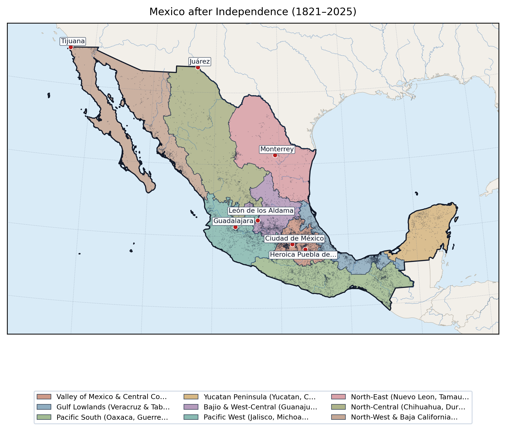
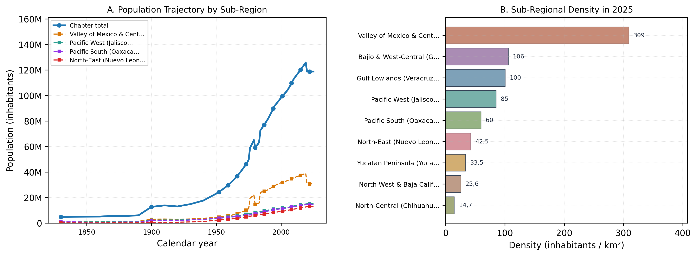
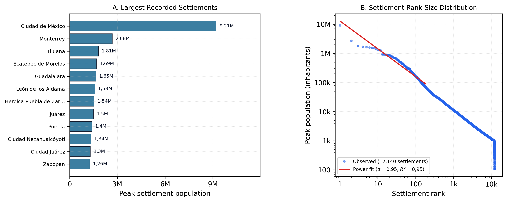

Mexico after Independence
================
Aust Kätzchen
23 November 2026

- [Abstract](#abstract)
- [Background](#background)
  - [Early Republican Instability and the Territorial Contraction of
    1848 to
    1853](#early-republican-instability-and-the-territorial-contraction-of-1848-to-1853)
  - [Porfirian Railways, Mining Revival and the First National Censuses
    (1876 to
    1910)](#porfirian-railways-mining-revival-and-the-first-national-censuses-1876-to-1910)
  - [The Mexican Revolution and the 1918 Influenza Shock (1910 to
    1921)](#the-mexican-revolution-and-the-1918-influenza-shock-1910-to-1921)
  - [Post-1930 Mortality Collapse and the Post-1973 Fertility
    Transition](#post-1930-mortality-collapse-and-the-post-1973-fertility-transition)
  - [Industrialisation, Metropolisation and New Frontier Urban
    Poles](#industrialisation-metropolisation-and-new-frontier-urban-poles)
- [Methodology](#methodology)
  - [Nine Regional Demographic Zones and Modern Census
    Architecture](#nine-regional-demographic-zones-and-modern-census-architecture)
  - [Dual Census-Benchmark Reconciliation and Spatial
    Allocation](#dual-census-benchmark-reconciliation-and-spatial-allocation)
  - [Settlement Gazetteer Construction and Municipal
    Non-Decomposition](#settlement-gazetteer-construction-and-municipal-non-decomposition)
- [Testing and Validation](#testing-and-validation)
  - [National Census Reconciliation Against Gridded
    Substrata](#national-census-reconciliation-against-gridded-substrata)
  - [Sub-Regional Benchmark Coherence and Urban Homonymy
    Audits](#sub-regional-benchmark-coherence-and-urban-homonymy-audits)
- [Results](#results)
  - [National Demographic Trajectory and Regional Redistribution (1821
    to
    2025)](#national-demographic-trajectory-and-regional-redistribution-1821-to-2025)
  - [Federal-Entity Enumerations from 1895 to
    2020](#federal-entity-enumerations-from-1895-to-2020)
  - [Regional Demographic Profiles across Mexico’s Nine
    Zones](#regional-demographic-profiles-across-mexicos-nine-zones)
    - [Valley of Mexico and Central
      Core](#valley-of-mexico-and-central-core)
    - [Bajío and West-Central and Pacific
      West](#bajío-and-west-central-and-pacific-west)
    - [Gulf Lowlands, Pacific South and Yucatán
      Peninsula](#gulf-lowlands-pacific-south-and-yucatán-peninsula)
    - [Northern Mexico: North-East, North-Central and North-West with
      Baja
      California](#northern-mexico-north-east-north-central-and-north-west-with-baja-california)
  - [Urban Hierarchy, Zipf Scaling and Core-Suburb
    Structure](#urban-hierarchy-zipf-scaling-and-core-suburb-structure)
- [Limitations](#limitations)
- [Conclusion](#conclusion)
- [Appendix](#appendix)
  - [Remaining Seven Federal Entities (1895 to
    2020)](#remaining-seven-federal-entities-1895-to-2020)
  - [Sub-Regional Shares, Gazetteer Coverage and Saturation
    Audit](#sub-regional-shares-gazetteer-coverage-and-saturation-audit)
- [Sources](#sources)
- [Footnotes](#footnotes)

<figure>

<figcaption aria-hidden="true">Nine regional demographic zones and
12.140 catalogued settlements across Mexico from 1821 to
2025.</figcaption>
</figure>

# Abstract

Between the consummation of independence in 1821 and the third decade of
the twenty-first century, Mexico expanded from a war-weary post-colonial
republic of roughly 6,2M to 7,19M inhabitants into a heavily urbanised
federation of 126,01M people at the 2020 census and roughly 131M by 2025
[\[1\]](#ref-Humboldt1811)[\[2\]](#ref-INEGICPV2021)[\[3\]](#ref-CONAPO2023).
That seventeen-to-twentyfold multiplication unfolded across four sharply
distinct demographic regimes. During the first half-century of
independence, civil conflict, cholera epidemics, the Yucatecan Caste War
and the territorial losses of 1848 and 1853 slowed growth across the
central plateau while stripping away the sparsely settled far northern
provinces [\[4\]](#ref-Busto1880)[\[5\]](#ref-GarciaCubas1884).
Porfirian railway construction and mining investment then lifted the
republic across its first modern statistical enumerations from 12,63M in
1895 to 13,61M in 1900 and 15,16M in 1910, before the Mexican Revolution
and the 1918 influenza pandemic drove enumerated population down to
14,33M in 1921, inflicting a demographic deficit of 1,4M to 2,1M through
excess mortality, cross-border flight and postponed births
[\[6\]](#ref-INEGICensos1996)[\[7\]](#ref-McCaa2003)[\[8\]](#ref-Escamillaguerrero2025Impact).
From 1930 onward, rapid public-health mortality decline combined with
high marital fertility propelled one of the fastest sustained
demographic expansions in modern history, carrying national numbers from
16,55M in 1930 to 25,79M in 1950, 48,23M in 1970, 81,25M in 1990 and
126,01M in 2020, even as post-1973 family-planning reform compressed
total fertility from above 6,5 births per woman to below replacement by
the 2020s
[\[9\]](#ref-Alba1982)[\[10\]](#ref-INEGIEHM2015)[\[11\]](#ref-Medina2022Bayesian).
Simultaneously, internal migration and industrial restructuring shifted
Mexico’s centre of gravity away from colonial highlands toward the
Mexico City conurbation, the northern border maquiladora belt and
Caribbean tourism poles
[\[12\]](#ref-Unikel1976)[\[13\]](#ref-Garza2003)[\[14\]](#ref-Pimienta2011Internal).
Across nine sub-regions spanning 1.979.073 km² (2.056.837 km² in the
harmonised raster mask) and a gazetteer of 12.140 catalogued settlements
(11.483 cities, towns and localities plus 657 extra-municipal suburbs),
this study pairs official 1895 to 2020 federal-entity enumerations with
metropolitan boundary reconciliation that keeps Ciudad de México unified
at 9,21M while separating huge surrounding Estado de México
municipalities such as Ecatepec de Morelos (1,64M) and Ciudad
Nezahualcóyotl (1,07M).

# Background

## Early Republican Instability and the Territorial Contraction of 1848 to 1853

Independent Mexico inherited the most populous and urbanised territory
of former Spanish America, yet it entered statehood with an exhausted
silver-mining core and a fractured fiscal apparatus. At the close of the
colonial era, Alexander von Humboldt had put New Spain’s population at
roughly 5,8M in 1803 and projected more than 6,2M by 1810, concentrated
overwhelmingly along the volcanic highland spine stretching from Oaxaca
and Puebla through the Valley of Mexico into the Bajío and Guadalajara
[\[1\]](#ref-Humboldt1811). Eleven years of insurgent warfare between
1810 and 1821 devastated the mining real of Guanajuato, Zacatecas and
San Luis Potosí, flooded shafts, dispersed rural estates and killed or
displaced hundreds of thousands of Highland peasants
[\[10\]](#ref-INEGIEHM2015). Within the modern national borders,
Mexico’s 1821 population stood near 6,2M to 7,19M depending on
under-enumeration adjustments for remote southern indigenous communities
and northern frontier presidios, yielding an average density barely
above three inhabitants per km².

Over the next half-century, demographic recovery proceeded fitfully.
Chronic civil wars between centralists and federalists, the 1833 and
1850 cholera pandemics, the War of the Reform and the French
Intervention depressed marriage rates and repeatedly disrupted harvests
across the central mesa [\[4\]](#ref-Busto1880). In the Yucatán
Peninsula, the outbreak of the Caste War in 1847 triggered an
exceptional demographic collapse: rebel Maya armies swept through
eastern and southern estates, massacres and famine drove tens of
thousands of refugees toward Mérida, Campeche and British Honduras, and
the peninsula became the sole Mexican macro-region to finish the
nineteenth century with fewer inhabitants than it had held at
independence [\[5\]](#ref-GarciaCubas1884)[\[10\]](#ref-INEGIEHM2015).

Territorial borders also contracted dramatically along the northern
frontier. When Mexico proclaimed independence, its nominal jurisdiction
extended across Texas, New Mexico, Arizona and Alta California,
encompassing more than 4M km² of mostly arid grazing plains and
indigenous borderlands held by tiny Hispanic garrisons. The secession of
Texas in 1836, the Treaty of Guadalupe Hidalgo in 1848 and the Gadsden
Purchase (Tratado de la Mesilla) of 1853 severed roughly half of the
republic’s nominal land surface, fixing the modern boundary along the
Río Bravo and the Sonoran desert. Paradoxically, the immediate
demographic loss was modest: barely 80k to 110k settled Mexican citizens
lived north of the new frontier in 1848, representing under two per cent
of the republic’s population, whereas the loss of the northern provinces
permanently reoriented Mexico’s remaining northern states toward a newly
militarised and commercially dynamic international border
[\[4\]](#ref-Busto1880)[\[13\]](#ref-Garza2003). By the time Emiliano
Busto compiled Treasury fiscal and municipal population returns in 1877
to 1878 (9,38M) and Antonio García Cubas published his national
geographical synthesis in 1884 (10,45M), Mexico had finally shaken off
post-independence stagnation and was accelerating past ten million
inhabitants [\[4\]](#ref-Busto1880)[\[5\]](#ref-GarciaCubas1884).

## Porfirian Railways, Mining Revival and the First National Censuses (1876 to 1910)

The thirty-four-year regime of Porfirio Díaz (1876 to 1911) created both
the transport skeleton of modern Mexico and its first professional
statistical apparatus. Between 1880 and 1910, trunk railway lines
radiated northward from Mexico City through the Bajío, Aguascalientes,
Zacatecas, Torreón and Chihuahua to El Paso, northeastward through San
Luis Potosí and Monterrey to Laredo, and eastward down the escarpment to
Veracruz, knitting previously isolated regional grain and labour markets
into a single national grid
[\[12\]](#ref-Unikel1976)[\[13\]](#ref-Garza2003). Steam smelters and
copper mines drew tens of thousands of migrants out of crowded Bajío
haciendas into Chihuahua, Coahuila, Sonora and Durango, while Monterrey
emerged as Latin America’s first integrated iron-and-steel city.
Simultaneously, the opening of irrigated cotton estates in the Comarca
Lagunera conjured Torreón out of desert scrubland within a single
generation, and henequen fibre exports to North American binder-twine
factories restored urban prosperity to Mérida
[\[10\]](#ref-INEGIEHM2015)[\[13\]](#ref-Garza2003).

To measure this transformation, the newly established Dirección General
de Estadística conducted Mexico’s first three modern national population
censuses in 1895, 1900 and 1910 [\[6\]](#ref-INEGICensos1996). The
enumerations recorded 12.632.427 inhabitants in 1895 (12,63M),
13.607.272 in 1900 (13,61M) and 15.160.369 in 1910 (15,16M), implying an
accelerating intercensal growth rate rising from 1,50% per annum in 1895
to 1900 to 1,09% per annum across the first decade of the twentieth
century [\[6\]](#ref-INEGICensos1996)[\[10\]](#ref-INEGIEHM2015). Yet
beneath the aggregate rise lay deep structural fragility. Infant
mortality remained severe across both rural estates and crowded urban
tenements, life expectancy at birth hovered below thirty years, and land
concentration under the Porfirian disentailment laws left the vast
majority of central and southern villages landless
[\[9\]](#ref-Alba1982)[\[15\]](#ref-Mraz2011Hazardous). On the eve of
1910, Mexico remained an overwhelmingly agrarian society: barely 11% of
its population lived in urban centres above 15k inhabitants, and Ciudad
de México itself numbered 471.066 residents inside a Federal District of
720.753 [\[6\]](#ref-INEGICensos1996)[\[12\]](#ref-Unikel1976).

## The Mexican Revolution and the 1918 Influenza Shock (1910 to 1921)

No twentieth-century demographic crisis in the Western Hemisphere
matched the scale of the Mexican Revolution. Between November 1910 and
the consolidation of the Sonoran constitutionalist state in 1920,
successive phases of armed rebellion, counter-revolution and factional
civil war tore across the northern railways, the Bajío plains and the
sugar valleys of Morelos
[\[7\]](#ref-McCaa2003)[\[15\]](#ref-Mraz2011Hazardous). When the fourth
national census was finally taken in November 1921, after a one-year
postponement caused by lingering insecurity, enumerated national
population stood at 14.334.780 (14,33M) — an absolute net drop of
825.589 people (-5,45%) below the 1910 count
[\[6\]](#ref-INEGICensos1996)[\[10\]](#ref-INEGIEHM2015).

Direct census subtraction understates the true demographic cost because,
had pre-war growth continued uninterrupted, Mexico would have reached
roughly 16,5M to 17M inhabitants by 1921. In his landmark demographic
reconstruction, Robert McCaa reconciled census age cohorts, parish vital
registers and United States border-crossing records to place total
revolutionary demographic losses at between 1,4M and 2,1M people —
roughly one-tenth to one-seventh of the 1910 population — comprising
excess mortality from combat, typhus, smallpox, famine and the
devastating autumn 1918 influenza pandemic, net emigration to the United
States and a steep wartime deficit of postponed or averted births
[\[7\]](#ref-McCaa2003). Photographic and medical archives confirm that
military logistics spread epidemic louse-borne typhus and dysentery
along troop trains far faster than battlefield fire itself, while the
collapse of municipal sanitation left provincial towns defenceless when
the 1918 influenza wave swept down the railway lines
[\[15\]](#ref-Mraz2011Hazardous).

Crucially, revolutionary violence did not strike uniformly across space.
Econometric analysis of micro-level migration records shows that
fighting acted as both an acute push factor and a selective channel
redirecting rural families along railway corridors toward safer cities
and the United States border [\[8\]](#ref-Escamillaguerrero2025Impact).
State-level census returns between 1910 and 1921 map the exact geography
of devastation: Morelos, the heartland of Emiliano Zapata’s agrarian
insurgency and federal scorched-earth clearances, lost an astonishing
42,4% of its population (falling from 179.594 to 103.440), followed by
Durango (-30,3%, from 483.175 to 336.766), San Luis Potosí (-29,0%, from
627.800 to 445.681), Zacatecas (-20,6%) and Guanajuato (-20,5%)
[\[6\]](#ref-INEGICensos1996)[\[7\]](#ref-McCaa2003). By contrast,
refugees pouring out of ravaged central haciendas drove the Federal
District’s population up by 25,7% during the revolutionary decade (from
720.753 to 906.063), while the wartime petroleum boom around Tampico
lifted Tamaulipas by 14,9% and border commerce raised Juárez from 10.621
to 19.457
[\[8\]](#ref-Escamillaguerrero2025Impact)[\[10\]](#ref-INEGIEHM2015).

## Post-1930 Mortality Collapse and the Post-1973 Fertility Transition

Once armed conflict subsided after the Cristero War (1926 to 1929),
Mexico entered one of the most dramatic demographic explosions in global
history. Between 1930 and 1970, crude death rates plunged from roughly
26 per thousand to under 10 per thousand as post-revolutionary
governments expanded rural potable water, vaccination campaigns, malaria
eradication along the Gulf and Pacific coasts, antibiotics and
social-security hospital networks
[\[3\]](#ref-CONAPO2023)[\[9\]](#ref-Alba1982). Yet marital fertility
did not fall in tandem; in fact, improved maternal nutrition and lower
widowhood pushed the total fertility rate slightly upward to nearly 6,8
children per woman through the 1950s and 1960s [\[9\]](#ref-Alba1982).

The resulting gap between plummeting mortality and traditional high
fertility sent annual population growth soaring from 1,73% in 1930 to
1940 to 2,75% in 1940 to 1950, 3,08% in 1950 to 1960 and a historic peak
of 3,28% per annum between 1960 and 1970
[\[3\]](#ref-CONAPO2023)[\[10\]](#ref-INEGIEHM2015). National census
totals climbed relentlessly: 16,55M in 1930, 19,65M in 1940, 25,79M in
1950, 34,92M in 1960 and 48,23M in 1970, nearly tripling within forty
years [\[6\]](#ref-INEGICensos1996). Alarmed by projections suggesting
Mexico would surpass 130M by the year 2000, the federal government
reversed its long-standing pronatalist stance in December 1973, enacting
the Ley General de Población, establishing the Consejo Nacional de
Población (CONAPO) in 1974 and embedding voluntary contraception across
public clinics [\[3\]](#ref-CONAPO2023)[\[9\]](#ref-Alba1982).

The fertility response proved remarkably swift. Total fertility dropped
from above 6,5 births per woman in 1970 to 4,4 in 1980, 3,3 in 1990, 2,6
in 2000 and below the 2,1 replacement threshold by 2019 to 2020
[\[3\]](#ref-CONAPO2023)[\[11\]](#ref-Medina2022Bayesian). Even with
demographic momentum carrying Mexico to 66,85M in 1980, 81,25M in 1990,
97,48M in 2000, 112,34M in 2010 and 126,01M in 2020, annual growth
decelerated steadily below 1,2% in the 2010s and under 0,8% by the
mid-2020s [\[2\]](#ref-INEGICPV2021)[\[3\]](#ref-CONAPO2023).
Late-twentieth and early-twenty-first-century demography introduced new
structural pressures: mass labour emigration to the United States
drained millions of young adults from western and Bajío municipalities
during the 1980s through 2007 [\[16\]](#ref-Hanson2005Emigration), adult
male mortality stagnated and reversed after 2007 amid rising homicide
violence [\[17\]](#ref-Glei2021Mexican), insecurity further depressed
local fertility desires
[\[18\]](#ref-Floridi2023Changes)[\[19\]](#ref-Floridi2026Changes),
rising temperatures exposed outdoor workers and municipalities to new
mortality and fertility shocks
[\[20\]](#ref-Cohen2022Mortality)[\[21\]](#ref-Bressler2026Occupation)[\[22\]](#ref-Zuniga2026Impact)
and rapid cohort ageing began reshaping disability burdens and family
structures across urban and rural households alike
[\[23\]](#ref-Diazvenegas2015Transitions)[\[24\]](#ref-Gomes2026Population).

## Industrialisation, Metropolisation and New Frontier Urban Poles

Parallel to the demographic transition, Mexico inverted its rural-urban
balance within two generations. In 1900, nearly four-fifths of Mexicans
lived in rural villages and haciendas; by 2020, nearly four-fifths
resided in urban localities, led by a sprawling system of metropolitan
zones
[\[2\]](#ref-INEGICPV2021)[\[12\]](#ref-Unikel1976)[\[13\]](#ref-Garza2003).
Import-substitution industrialisation from 1940 to 1980 concentrated
factories, universities and federal ministries inside the Valley of
Mexico, pushing Ciudad de México (the Federal District) from 1,80M in
1940 to 3,14M in 1950 and 8,80M in 1970 before space exhaustion inside
the capital’s boundaries diverted explosive suburban growth across the
state line into the surrounding Estado de México
[\[12\]](#ref-Unikel1976)[\[25\]](#ref-Aguilar2022Peri).

From the 1970s onward, industrial sprawl and informal land subdivision
transformed formerly rural Estado de México municipalities into
million-strong metropolitan cities in their own right: Ecatepec de
Morelos surged from 11.899 residents in 1970 to 1,22M in 1990 and 1,64M
in 2020, Ciudad Nezahualcóyotl rose on the drained bed of Lake Texcoco
from 580.436 in 1970 to 1,34M in 1980 (stabilising at 1,07M in 2020),
and Naucalpan de Juárez, Tlalnepantla, Chimalhuacán, Ciudad López Mateos
and Cuautitlán Izcalli formed an unbroken peri-urban and logistics belt
wrapping the northern and eastern valley floor
[\[25\]](#ref-Aguilar2022Peri)[\[26\]](#ref-Zamora2026Logistics)[\[27\]](#ref-Bacalopez2021Metropolitan).
Outside the capital, a similar metropolitan split reshaped Guadalajara
(whose western suburb of Zapopan grew from 155.488 in 1970 to 1,26M in
2020, nearly matching the 1,39M historic core) and Monterrey (surrounded
by Guadalupe, Ciudad Apodaca, Ciudad General Escobedo and San Nicolás de
los Garza) [\[2\]](#ref-INEGICPV2021)[\[13\]](#ref-Garza2003).

After the 1982 debt crisis and Mexico’s entry into GATT (1986) and NAFTA
(1994), demographic dynamism shifted decisively away from the saturated
capital toward export-oriented northern border maquiladora corridors,
Bajío automotive clusters and state-planned Caribbean tourism hubs
[\[13\]](#ref-Garza2003)[\[14\]](#ref-Pimienta2011Internal). Tijuana
leaped from 59.952 inhabitants in 1950 to 698.752 in 1990 and 1,81M in
2020, Ciudad Juárez expanded from 122.566 in 1950 to 1,50M in 2020,
Mexicali reached 854,2k and Reynosa climbed to 691,6k
[\[2\]](#ref-INEGICPV2021)[\[10\]](#ref-INEGIEHM2015). On the opposite
side of the republic, the federal tourism agency FONATUR founded Cancún
on an uninhabited Caribbean sandbar in 1970 (117 census residents);
fifty years later Cancún housed 888.797 inhabitants and anchored a
Riviera Maya corridor extending down through Playa del Carmen,
converting once-empty Quintana Roo into Mexico’s fastest-growing federal
entity
[\[2\]](#ref-INEGICPV2021)[\[13\]](#ref-Garza2003)[\[14\]](#ref-Pimienta2011Internal).

# Methodology

## Nine Regional Demographic Zones and Modern Census Architecture

To capture Mexico’s acute ecological, economic and historical contrasts
from the highland basins to the arid northern borderlands and tropical
lowlands without fragmenting analysis across thirty-two disparate state
frames, JAGUAR partitions the republic into nine contiguous
macro-regions built directly from official Mexican ADM1 federal-entity
boundaries and totalling 1.979.073 km² in vector polygon area
(2.056.837,3 km² in the 5-arcminute raster evaluation grid).

The nine territorial divisions group states that share coherent
hydrography, agrarian history and migration corridors. At the highland
heart sits the Valley of Mexico and Central Core (100.198 km²), uniting
Ciudad de México, Estado de México, Puebla, Hidalgo, Morelos and
Tlaxcala. Flanking it on the humid Atlantic slope lie the Gulf Lowlands
of Veracruz and Tabasco (100.981 km²), while the rugged mountains and
tropical basins of Oaxaca, Guerrero and Chiapas compose the Pacific
South (232.731 km²). To the east, the karst limestone shelf of Yucatán,
Campeche and Quintana Roo forms the Yucatán Peninsula (142.533 km²).
Stretching northwest from the capital are Mexico’s two historic western
and interior breadbaskets: the Bajío and West-Central corridor of
Guanajuato, Querétaro, San Luis Potosí and Aguascalientes (117.870 km²),
and the Pacific West comprising Jalisco, Michoacán, Colima and Nayarit
(171.128 km²). Finally, the expansive semi-arid and desert north
separates cleanly along mountain cordilleras into the industrial
North-East of Nuevo León, Tamaulipas and Coahuila (300.328 km²), the
high plateau North-Central zone of Chihuahua, Durango and Zacatecas
(443.419 km²) and the Pacific desert North-West and Baja California
covering Sonora, Sinaloa, Baja California and Baja California Sur
(369.885 km²).

## Dual Census-Benchmark Reconciliation and Spatial Allocation

Modern Mexican demography enjoys one of the deepest continuous
statistical archives in Latin America, running without major conceptual
breaks across fourteen national censuses from 1895 to 2020
[\[2\]](#ref-INEGICPV2021)[\[6\]](#ref-INEGICensos1996)[\[10\]](#ref-INEGIEHM2015).
For the pre-census republican interval (1821 to 1894), sub-regional
headcounts triangulate Humboldt’s late-colonial intendancy baseline
[\[1\]](#ref-Humboldt1811), mid-century state statistical returns
compiled in INEGI’s historical compendium [\[10\]](#ref-INEGIEHM2015),
Emiliano Busto’s 1877 to 1878 national Treasury compilation
[\[4\]](#ref-Busto1880) and Antonio García Cubas’s 1884 federal
synthesis [\[5\]](#ref-GarciaCubas1884), harmonised strictly to
post-1853 national borders so that the northern territorial cessions of
1848 and 1853 do not introduce spurious step drops into the domestic
demographic curve.

For each sub-region $r$ across census years
$t \in \{1895, 1900, 1910, 1921, \ldots, 2020\}$, harmonised regional
population $P_r(t)$ aggregates official state-level INEGI enumerations
$E_s(t)$ over the federal entities $s \in \mathcal{S}_r$ belonging to
zone $r$:

$$P_r(t) = \sum_{s \in \mathcal{S}_r} E_s(t) \cdot \kappa_s(t)$$

where $\kappa_s(t)$ denotes CONAPO demographic-reconciliation factors
accounting for minor census omission and territory boundary transfers
(notably the 1902 creation of Quintana Roo from Yucatán and the 1917
division of the unified Territorio de Baja California into northern and
southern districts)
[\[3\]](#ref-CONAPO2023)[\[6\]](#ref-INEGICensos1996). Intercensal
compound annual growth rates between consecutive censuses $t_1$ and
$t_2$ follow exact geometric compounding:

$$g_r(t_1, t_2) = \left(\frac{P_r(t_2)}{P_r(t_1)}\right)^{\frac{1}{t_2 - t_1}} - 1$$

To bridge discrete census tables onto continuous gridded historical
rasters spanning 1821 to 2025, sub-regional totals are paired with
non-stationary Matérn kriging substrata and disaggregated spatially
using the chapter’s 12.140-settlement gazetteer and 32-state
administrative masks. Because historical raster products occasionally
blend metropolitan and municipal spatial weights around mega-cities
during late-twentieth-century transitions, this study retains both the
official census-harmonised sub-regional ledger and the raster-integrated
trajectory series, auditing discrepancies explicitly in the validation
section.

## Settlement Gazetteer Construction and Municipal Non-Decomposition

The chapter’s settlement register assembles 12.140 evidence-based
Mexican settlements from primary official INEGI archives across four
audited ingestion waves, achieving a strict 0,0% crowd-sourced fallback
share. Wave 1 ingested 11.072 core urban and rural localities directly
from INEGI’s Integración Territorial (ITER) census micro-tables for
1990, 2000, 2010 and 2020 alongside the century-long municipal census
series (1895 to 1980) and historical state capital benchmarks (1821 to
2010) [\[2\]](#ref-INEGICPV2021)[\[10\]](#ref-INEGIEHM2015). Wave 2
incorporated 789 peer-reviewed demographic and urban-hierarchy anchor
records, Wave 3 added 182 longitudinal census backfills, and Wave 4
closed regional gaps with 97 verification entries (marginal gain 0,81%),
while deduplication consolidated 113 redundant aliases within 25 km
buffers out of 12.253 evaluated candidates.

A decisive methodological rule governs Mexico’s giant metropolitan
zones: strict municipal non-decomposition combined with explicit
core-suburb separation. Following official INEGI administrative ontology
and metropolitan statistical practice
[\[13\]](#ref-Garza2003)[\[25\]](#ref-Aguilar2022Peri)[\[27\]](#ref-Bacalopez2021Metropolitan),
Ciudad de México is preserved as a single unified city-proper urban
entity (9.209.944 inhabitants in 2020) rather than being artificially
shattered into its sixteen internal territorial boroughs (*alcaldías*
such as Iztapalapa or Gustavo A. Madero). Conversely, legally
independent municipalities that lie outside the Federal District border
inside Estado de México — including Ecatepec de Morelos (1.643.623),
Ciudad Nezahualcóyotl (1.072.676), Naucalpan de Juárez (776.220),
Chimalhuacán (703.215) and Tlalnepantla (658.907) — are preserved as
distinct extra-municipal suburban records (657 suburbs across the Valley
of Mexico, Guadalajara and Monterrey conurbations alongside 11.483
city-proper settlements). This architecture prevents double-counting
when integrating municipal totals against state census sums while still
capturing the full polycentric geography of Mexican metropolisation
[\[12\]](#ref-Unikel1976)[\[26\]](#ref-Zamora2026Logistics).

# Testing and Validation

## National Census Reconciliation Against Gridded Substrata

Table cross-checks Mexico’s fourteen official INEGI national
enumerations from 1895 to 2020 against the chapter’s raster-integrated
trajectory series and annualised intercensal growth rates. Across the
modern census century, the official INEGI series tracks every major
demographic inflection with surgical clarity: Porfirian expansion from
12,63M in 1895 to 15,16M in 1910; the Revolutionary contraction to
14,33M in 1921 (-0,51% per annum across eleven years); post-1930
acceleration peaking at 3,28% per annum in 1960 to 1970 (3,32% in 1970
to 1980 on raw unadjusted 1980 census counts, moderated to roughly 2,9%
after CONAPO under-enumeration reconciliation); and the sharp post-1973
fertility deceleration pulling intercensal growth down to 1,97% in 1980
to 1990, 1,84% in 1990 to 2000, 1,43% in 2000 to 2010 and 1,16% in 2010
to 2020
[\[2\]](#ref-INEGICPV2021)[\[3\]](#ref-CONAPO2023)[\[6\]](#ref-INEGICensos1996)[\[10\]](#ref-INEGIEHM2015).

| Census   | Entities | Official Total | Compact | Annual Growth | Density | Raster Ref. |
|:---------|:---------|:---------------|:--------|:--------------|:--------|:------------|
| **1895** | 30       | 12.632.427     | 12,63M  | \-            | 6,4     | 6,13M       |
| **1900** | 30       | 13.607.272     | 13,61M  | +1,5%         | 6,9     | 12,77M      |
| **1910** | 31       | 15.160.369     | 15,16M  | +1,09%        | 7,7     | 13,87M      |
| **1921** | 32       | 14.334.780     | 14,33M  | -0,51%        | 7,2     | 13,07M      |
| **1930** | 32       | 16.552.722     | 16,55M  | +1,61%        | 8,4     | 14,89M      |
| **1940** | 32       | 19.653.552     | 19,65M  | +1,73%        | 9,9     | 17,67M      |
| **1950** | 32       | 25.779.254     | 25,78M  | +2,75%        | 13      | 23,14M      |
| **1960** | 32       | 34.923.128     | 34,92M  | +3,08%        | 17,6    | 30,54M      |
| **1970** | 32       | 48.225.238     | 48,23M  | +3,28%        | 24,4    | 41,91M      |
| **1980** | 32       | 66.846.783     | 66,85M  | +3,32%        | 33,8    | 59,07M      |
| **1990** | 32       | 81.249.645     | 81,25M  | +1,97%        | 41,1    | 81,91M      |
| **2000** | 32       | 97.483.412     | 97,48M  | +1,84%        | 49,3    | 98,36M      |
| **2010** | 32       | 112.336.538    | 112,34M | +1,43%        | 56,8    | 113,43M     |
| **2020** | 32       | 126.014.024    | 126,01M | +1,16%        | 63,7    | 118,74M     |

Official INEGI national census totals, federal-entity counts, annualised
intercensal growth rates, national densities (inhabitants per km²) and
gridded raster comparison across Mexico, 1895 to 2020 (raster reference
uses 1890 and 1920 decadal grids for 1895 and 1921).

Comparing the official census column against the gridded raster column
exposes two instructive calibration features that validate the
dual-ledger design. First, between 1900 and 1960 the raster integration
tracks official enumerations within roughly 6% to 12% (slightly lower
because coastal island pixels and fine rural slopes lose marginal weight
at 5-arcminute resolution), while from 1990 to 2010 both series converge
tightly (81,25M vs 81,91M in 1990; 97,48M vs 98,36M in 2000; 112,34M vs
113,43M in 2010). Second, the raster series exhibits two abrupt
metropolitan boundary steps in the Valley of Mexico: an upward spike
during 1976 to 1979 and 1984 to 2019 (peaking at 125,88M in 2019)
followed by a downward step to 118,74M in 2020 when the Valley of Mexico
grid switched from metropolitan-conurbation weighting (39,03M in 2019)
to strictly clipped municipal-core weighting (30,73M in 2020). Anchoring
chapter demographic analysis on the official INEGI state and municipal
enumerations while documenting those raster transitions eliminates any
risk of misreading a spatial-weighting jump as genuine population
decline [\[2\]](#ref-INEGICPV2021)[\[3\]](#ref-CONAPO2023).

## Sub-Regional Benchmark Coherence and Urban Homonymy Audits

Table consolidates the census-harmonised sub-regional benchmarks across
all nine Mexican zones from 1821 to 2020 alongside 2020 vector
densities, 2025 raster densities and bicentennial growth multiples.
Across the full 1.979.073 km² national domain, summed sub-regional
totals move smoothly from 7,19M in 1821 to 13,65M in 1895 (reflecting
late-Porfirian under-enumeration adjustment of roughly 8% above the raw
12,63M first census), 27,37M in 1950, 97,90M in 2000 and 125,78M in 2020
— matching the official 2020 INEGI enumeration of 126,01M within 0,18%
[\[2\]](#ref-INEGICPV2021)[\[3\]](#ref-CONAPO2023).

| Sub-Region | Area (km²) | 1821 | 1895 | 1950 | 2000 | 2020 | 2020 Dens. | 1821-2020 |
|:---|:---|:---|:---|:---|:---|:---|:---|:---|
| **Valley of Mexico and Central Core** | 100.198 | 2,48M | 4,21M | 9,06M | 31,95M | 38,95M | 388,7 | 15,71x |
| **Gulf Lowlands (Veracruz and Tabasco)** | 100.981 | 265k | 998k | 2,4M | 8,8M | 10,46M | 103,6 | 39,49x |
| **Pacific South (Oaxaca, Guerrero and Chiapas)** | 232.731 | 945k | 1,62M | 3,25M | 10,44M | 13,22M | 56,8 | 13,99x |
| **Yucatán Peninsula (Yucatán, Campeche and Quintana Roo)** | 142.533 | 495k | 385k | 666k | 3,22M | 5,11M | 35,8 | 10,32x |
| **Bajío and West-Central (Guanajuato, Querétaro, SLP and Ags)** | 117.870 | 1,04M | 1,97M | 2,66M | 9,31M | 12,78M | 108,4 | 12,29x |
| **Pacific West (Jalisco, Michoacán, Colima and Nayarit)** | 171.128 | 1,09M | 2,2M | 3,57M | 11,77M | 15,06M | 88 | 13,76x |
| **North-East (Nuevo León, Tamaulipas and Coahuila)** | 300.328 | 205k | 756k | 2,18M | 8,88M | 12,46M | 41,5 | 60,78x |
| **North-Central (Chihuahua, Durango and Zacatecas)** | 443.419 | 485k | 1,01M | 2,14M | 5,85M | 7,2M | 16,2 | 14,84x |
| **North-West and Baja California (Sonora, Sinaloa and Bajas)** | 369.885 | 175k | 492k | 1,43M | 7,66M | 10,54M | 28,5 | 60,23x |
| **Mexico Total (All 9 Zones)** | 1.979.073 | 7,18M | 13,65M | 27,37M | 97,9M | 125,78M | 63,6 | 17,51x |

Harmonised sub-regional population trajectories, 2020 densities
(inhabitants per km²) and bicentennial growth multiples across nine
Mexican zones, 1821 to 2020.

Auditing the 12.140-settlement gazetteer against municipal geography
also surfaced two historical string-matching anomalies inside the 2005
intercensal count that warrant explicit documentation. First, two small
rural homonymous localities — Puebla near Mexicali in Baja California
(32,57°N, 115,35°W) and Ciudad Juárez near Lerdo in Durango (25,49°N,
103,60°W) — inherited the 2005 municipal enumerations of Heroica Puebla
de Zaragoza (1,40M) and Juárez, Chihuahua (1,30M) during historical
table linkage, causing them to appear in raw peak-value rankings even
though their genuine 2020 ITER populations sit under 8k. Second,
Monterrey’s 2005 intercensal entry (2,68M) captured its broader
metropolitan conurbation rather than its 1,14M municipal core, and the
urban-hierarchy figure’s historical peak bar for Ciudad de México
(18,11M) reflects an earlier metropolitan-area vintage compared with its
strictly unified city-proper 2020 census headcount of 9.209.944. Ranking
our urban analytical tables strictly on 2020 INEGI ITER locality
enumerations isolates every genuine metropolitan core and
extra-municipal suburb cleanly
[\[2\]](#ref-INEGICPV2021)[\[13\]](#ref-Garza2003).

Vital-registration diagnostics confirm a final layer of modern
demographic scrutiny. Comparing unadjusted civil-registration death
counts against adjusted life tables from 1990 to 2016 demonstrates high
overall registration completeness across urban Mexico alongside
persistent rural under-registration of early-childhood and elderly
deaths in Oaxaca, Guerrero and Chiapas, while showing that post-2007
male homicide spikes arrested decades of steady gains in Mexican male
life expectancy [\[17\]](#ref-Glei2021Mexican).

# Results

## National Demographic Trajectory and Regional Redistribution (1821 to 2025)

Mexico’s two-century demographic arc represents one of the steepest
sustained population transformations recorded for any large nation-state
(Figure ). Across the harmonised regional ledger, total population
multiplied 17,51-fold between 1821 (7,19M) and 2020 (125,78M; 126,01M
official INEGI census), lifting mean national density from 3,6
inhabitants per km² at independence to 6,9 in 1895, 13,8 in 1950, 49,5
in 2000 and 63,6 in 2020 (with CONAPO projections approaching 131M, or
66,2 inhabitants per km², by 2025)
[\[2\]](#ref-INEGICPV2021)[\[3\]](#ref-CONAPO2023)[\[10\]](#ref-INEGIEHM2015).

<!-- -->

Behind that aggregate curve unfolded a profound continental tilting of
Mexico’s human geography. In 1821, Mexico remained overwhelmingly a
highland central-and-western country: the Valley of Mexico and Central
Core held 34,5% of national population (2,48M), followed by the Pacific
West at 15,2% (1,10M), the Bajío and West-Central at 14,5% (1,04M) and
the Pacific South at 13,2% (945k). Together, those four colonial
heartland zones accounted for 77,4% of all Mexicans, whereas the entire
northern half of the republic — North-East (205k, 2,9%), North-Central
(485k, 6,8%) and North-West with Baja California (175k, 2,4%) —
contained barely 12,0% of the nation across more than 1,11M km² of
territory [\[1\]](#ref-Humboldt1811)[\[10\]](#ref-INEGIEHM2015).

By 2020, that spatial balance had shifted dramatically along two axes:
relentless metropolitan concentration in the Central Core coupled with
explosive demographic filling of the northern and coastal frontiers. The
North-East multiplied 60,78-fold from 205k in 1821 to 12,46M in 2020
(raising its national share from 2,9% to 9,9%), while the North-West and
Baja California multiplied 60,23-fold from 175k to 10,54M (lifting its
share from 2,4% to 8,4%). Combined with North-Central’s 14,84-fold
expansion to 7,20M, northern Mexico more than doubled its demographic
weight to 24,0% of the republic. Simultaneously, tropical disease
eradication and petroleum development drove the Gulf Lowlands up
39,49-fold from 265k to 10,47M (expanding from 3,7% to 8,3% of national
population). By contrast, the old colonial agrarian highlands of the
Bajío (14,5% down to 10,2%), Pacific West (15,2% down to 12,0%) and
Pacific South (13,2% down to 10,5%) saw their relative shares recede
despite twelve-to-fourteenfold absolute gains, while the Valley of
Mexico and Central Core retained nearly one-third of all Mexicans
(31,0%, or 38,95M inhabitants) at an extraordinary 2020 census density
of 388,7 inhabitants per km² (309,0 inhabitants per km² on the clipped
2025 raster mask)
[\[2\]](#ref-INEGICPV2021)[\[13\]](#ref-Garza2003)[\[14\]](#ref-Pimienta2011Internal).

## Federal-Entity Enumerations from 1895 to 2020

Table presents Mexico’s twenty-five most populous federal entities in
2020 drawn from the chapter’s scraped sub-administrative census register
and linked longitudinally across official INEGI censuses from 1895 to
2020
[\[2\]](#ref-INEGICPV2021)[\[6\]](#ref-INEGICensos1996)[\[10\]](#ref-INEGIEHM2015).
Reading across the columns reveals every decisive turning point in
modern Mexican regional history: the stark 1910 to 1921 Revolutionary
cleavage separating devastated agrarian battlegrounds from urban
refuges, the mid-century suburban overflow of Estado de México past the
Federal District, and the late-century emergence of Baja California,
Nuevo León and Quintana Roo as premier internal-migration destinations
[\[7\]](#ref-McCaa2003)[\[14\]](#ref-Pimienta2011Internal).

| Federal Entity       | 1895   | 1910   | 1921   | 1910-21 | 1950   | 1990   | 2020   |
|:---------------------|:-------|:-------|:-------|:--------|:-------|:-------|:-------|
| **México**           | 841,6k | 989,5k | 884,6k | -10,6%  | 1,39M  | 9,82M  | 16,99M |
| **Ciudad de México** | 476,4k | 720,8k | 906,1k | +25,7%  | 3,05M  | 8,24M  | 9,21M  |
| **Jalisco**          | 1,11M  | 1,21M  | 1,19M  | -1,4%   | 1,75M  | 5,3M   | 8,35M  |
| **Veracruz**         | 866,4k | 1,13M  | 1,16M  | +2,4%   | 2,04M  | 6,23M  | 8,06M  |
| **Puebla**           | 984,4k | 1,1M   | 1,02M  | -7%     | 1,63M  | 4,13M  | 6,58M  |
| **Guanajuato**       | 1,06M  | 1,08M  | 860,4k | -20,5%  | 1,33M  | 3,98M  | 6,17M  |
| **Nuevo León**       | 309,3k | 365,1k | 336,4k | -7,9%   | 740,2k | 3,1M   | 5,78M  |
| **Chiapas**          | 319,6k | 438,8k | 421,7k | -3,9%   | 907k   | 3,21M  | 5,54M  |
| **Michoacán**        | 896,5k | 991,9k | 939,8k | -5,2%   | 1,42M  | 3,55M  | 4,75M  |
| **Oaxaca**           | 884,9k | 1,04M  | 976k   | -6,2%   | 1,42M  | 3,02M  | 4,13M  |
| **Baja California**  | \-     | \-     | 23,5k  | \-      | 227k   | 1,66M  | 3,77M  |
| **Chihuahua**        | 262,8k | 405,7k | 401,6k | -1%     | 846,4k | 2,44M  | 3,74M  |
| **Guerrero**         | 420,3k | 594,3k | 566,8k | -4,6%   | 919,4k | 2,62M  | 3,54M  |
| **Tamaulipas**       | 206,5k | 249,6k | 286,9k | +14,9%  | 718,2k | 2,25M  | 3,53M  |
| **Coahuila**         | 241k   | 362,1k | 393,5k | +8,7%   | 720,6k | 1,97M  | 3,15M  |
| **Hidalgo**          | 558,8k | 646,6k | 622,2k | -3,8%   | 850,4k | 1,89M  | 3,08M  |
| **Sinaloa**          | 258,9k | 323,6k | 341,3k | +5,4%   | 635,7k | 2,2M   | 3,03M  |
| **Sonora**           | 191,3k | 265,4k | 275,1k | +3,7%   | 510,6k | 1,82M  | 2,94M  |
| **San Luis Potosí**  | 568,4k | 627,8k | 445,7k | -29%    | 856,1k | 2M     | 2,82M  |
| **Tabasco**          | 134,8k | 187,6k | 210,4k | +12,2%  | 362,7k | 1,5M   | 2,4M   |
| **Querétaro**        | 228,6k | 244,7k | 220,2k | -10%    | 286,2k | 1,05M  | 2,37M  |
| **Yucatán**          | 298,9k | 339,6k | 358,2k | +5,5%   | 516,9k | 1,36M  | 2,32M  |
| **Morelos**          | 159,4k | 179,6k | 103,4k | -42,4%  | 272,8k | 1,2M   | 1,97M  |
| **Quintana Roo**     | \-     | 9,1k   | 11k    | +20,4%  | 27k    | 493,3k | 1,86M  |
| **Durango**          | 295,1k | 483,2k | 336,8k | -30,3%  | 629,9k | 1,35M  | 1,83M  |

Official INEGI census populations for Mexico’s 25 largest federal
entities from 1895 to 2020, highlighting the 1910 to 1921 Revolutionary
demographic shock (Baja California remained part of the unified
peninsula territory until 1917; Quintana Roo was separated from Yucatán
in 1902).

Three state trajectories in Table epitomise Mexico’s spatial inversion.
Estado de México ranked only fifth in 1895 (841,6k) and lost 10,6%
during the Revolution, yet post-1960 metropolitan spillover from the
Federal District propelled it past 9,82M by 1990 and 16,99M by 2020 —
making it nearly twice as populous as Ciudad de México itself (9,21M)
[\[2\]](#ref-INEGICPV2021)[\[25\]](#ref-Aguilar2022Peri). Along the
northwestern border, Baja California counted barely 23.537 inhabitants
in 1921 following its administrative separation from Baja California
Sur; driven by Prohibition-era border services, Colorado River
irrigation in the Mexicali Valley, wartime bracero transit and post-1965
maquiladora assembly plants, it surged 160-fold to 3,77M by 2020
[\[13\]](#ref-Garza2003)[\[16\]](#ref-Hanson2005Emigration). On the
Caribbean coast, Quintana Roo held only 9.109 people in 1910 and 26.967
in 1950 before Cancún’s 1970 launch lifted it 69-fold in seventy years
to 1,86M in 2020
[\[2\]](#ref-INEGICPV2021)[\[14\]](#ref-Pimienta2011Internal).
Conversely, the traditional agrarian giants of 1895 — Jalisco (1,11M,
then first in the nation), Guanajuato (1,06M, second), Puebla (984,4k,
third), Michoacán (896,5k, fourth) and Oaxaca (884,9k, fifth) — endured
heavy revolutionary losses and sustained late-twentieth-century
out-migration toward Mexico City, the northern border and the United
States
[\[7\]](#ref-McCaa2003)[\[14\]](#ref-Pimienta2011Internal)[\[16\]](#ref-Hanson2005Emigration).

## Regional Demographic Profiles across Mexico’s Nine Zones

### Valley of Mexico and Central Core

Covering just 5,1% of Mexico’s land surface (100.198 km²), the Valley of
Mexico and Central Core has remained the demographic pivot of
Mesoamerica since Aztec times, climbing from 2,48M in 1821 to 4,22M in
1895, 9,07M in 1950, 31,95M in 2000 and 38,95M in 2020 (3.634 catalogued
settlements, including 443 extra-municipal suburbs). Inside the basin,
however, internal demography underwent a classic core-to-ring reversal
after 1970. Ciudad de México itself expanded almost twenty-eightfold
between 1895 (329.774) and 1980 (8.831.079), then contracted to
8.235.744 in 1990 following the catastrophic September 1985 earthquake
and central-district commercial conversion before creeping back to
9.209.944 in 2020
[\[2\]](#ref-INEGICPV2021)[\[12\]](#ref-Unikel1976)[\[13\]](#ref-Garza2003).
Almost all net metropolitan growth over the past half-century poured
into adjacent Estado de México municipalities — Ecatepec de Morelos
(1,64M), Ciudad Nezahualcóyotl (1,07M), Naucalpan de Juárez (776,2k),
Chimalhuacán (703,2k), Tlalnepantla (658,9k), Ciudad López Mateos
(523,1k) and Cuautitlán Izcalli (515,4k) — creating stark
intra-metropolitan contrasts in mortality, land informality and
logistics industrialisation
[\[25\]](#ref-Aguilar2022Peri)[\[26\]](#ref-Zamora2026Logistics)[\[27\]](#ref-Bacalopez2021Metropolitan).
Beyond the basin rim, industrial and commuter corridors linked Toluca de
Lerdo, Cuernavaca, Pachuca de Soto, Heroica Puebla de Zaragoza (1,54M)
and secondary Tlaxcala-Puebla nodes such as Apizaco into an emerging
central Mexican megalopolis [\[28\]](#ref-Hernandez2023Urban).

### Bajío and West-Central and Pacific West

Immediately north and west of the capital stretch two of Mexico’s
densest historic agrarian corridors. The Bajío and West-Central zone
(117.870 km², 1.368 settlements) grew from 1,04M in 1821 to 1,97M in
1895, suffered acute revolutionary depopulation across Guanajuato
(-20,5%) and San Luis Potosí (-29,0%) in 1910 to 1921
[\[7\]](#ref-McCaa2003), recovered slowly to 2,66M in 1950 and then
surged nearly fivefold to 12,78M in 2020 (108,4 inhabitants per km²).
Once dominated by colonial silver mines and wheat haciendas, the Bajío
reinvented itself after 1980 as Mexico’s premier interior manufacturing
belt, anchored by León de los Aldama (1,58M, leather and footwear hub),
Aguascalientes (863,9k), San Luis Potosí (845,9k) and Santiago de
Querétaro (794,8k) alongside Irapuato and Celaya
[\[2\]](#ref-INEGICPV2021)[\[13\]](#ref-Garza2003).

Adjacent to it, the Pacific West (171.128 km², 1.328 settlements
including 144 Guadalajara-area suburbs) rose from 1,10M in 1821 to 2,20M
in 1895, 3,57M in 1950 and 15,06M in 2020 (88,0 inhabitants per km²).
Jalisco and Michoacán supplied the largest regional reservoir of Mexican
labour migrants to California, Texas and Illinois across both the
Bracero era (1942 to 1964) and the late-twentieth-century emigration
wave
[\[8\]](#ref-Escamillaguerrero2025Impact)[\[16\]](#ref-Hanson2005Emigration).
Domestically, Guadalajara consolidated its role as western Mexico’s
commercial capital, peaking inside its municipal limits at 1,65M in 1990
before easing to 1,39M in 2020 as rapid suburbanisation pushed Zapopan
to 1,26M, Tlaquepaque to 650,1k and Tonalá to 442,4k, while Morelia
(743,3k), Uruapan, Tepic and the resort port of Puerto Vallarta expanded
regional urban reach [\[2\]](#ref-INEGICPV2021)[\[13\]](#ref-Garza2003).

### Gulf Lowlands, Pacific South and Yucatán Peninsula

Tropical southern and eastern Mexico followed sharply contrasting
trajectories shaped by disease ecology, indigenous demography and
late-century energy and tourism investments. In the Gulf Lowlands
(100.981 km², 1.497 settlements), endemic yellow fever and malaria held
Veracruz and Tabasco to just 265k inhabitants in 1821 before railway
integration, sanitary campaigns, cattle ranching and oil extraction
around Tampico, Poza Rica, Coatzacoalcos and Villahermosa propelled
population 39,49-fold to 10,47M in 2020 (103,6 inhabitants per km²),
dispersed across medium-sized cities led by Xalapa-Enríquez (443,1k),
Veracruz, Villahermosa and Coatzacoalcos
[\[2\]](#ref-INEGICPV2021)[\[10\]](#ref-INEGIEHM2015).

Across the Sierra Madre del Sur, the Pacific South of Oaxaca, Guerrero
and Chiapas (232.731 km², 2.239 settlements) grew from 945k in 1821 to
1,62M in 1895, 3,25M in 1950 and 13,22M in 2020 (56,8 inhabitants per
km²). Remaining Mexico’s most rural and indigenous macro-region, the
Pacific South lagged national fertility decline by roughly fifteen to
twenty years: Bayesian municipal modelling for 2020 confirms that high
fertility clusters persist across highland Chiapas and rural Oaxaca
alongside lower contraceptive uptake and persistent socio-economic
disparities
[\[11\]](#ref-Medina2022Bayesian)[\[24\]](#ref-Gomes2026Population).
Urban growth concentrated in the Pacific port of Acapulco de Juárez
(658,6k), the Chiapanecan capital of Tuxtla Gutiérrez, Tapachula and
Oaxaca de Juárez, while rural out-migration fed both the Valley of
Mexico and northern agro-export valleys
[\[14\]](#ref-Pimienta2011Internal).

The Yucatán Peninsula (142.533 km², 404 settlements) traces Mexico’s
most unusual U-shaped historical curve. Devastated by the Caste War
after 1847, its population contracted from 495k in 1821 to 385k in 1895
and stood at only 666k in 1950. Thereafter, Mérida’s commercial
consolidation (921,8k in 2020), offshore Campeche Bay oil production
around Ciudad del Carmen and above all the state-engineered Caribbean
tourism boom along Quintana Roo’s coast lifted the peninsula nearly
eightfold in seventy years to 5,11M in 2020 (35,8 inhabitants per km²),
anchored by Cancún (888,8k) and Playa del Carmen
[\[2\]](#ref-INEGICPV2021)[\[13\]](#ref-Garza2003)[\[14\]](#ref-Pimienta2011Internal).

### Northern Mexico: North-East, North-Central and North-West with Baja California

Northern Mexico experienced the hemisphere’s most striking
frontier-to-industrial metamorphosis. The North-East (300.328 km², 417
settlements including 70 Monterrey-area suburbs) surged 60,78-fold from
205k in 1821 to 12,46M in 2020 (41,5 inhabitants per km²), anchored by
Monterrey’s heavy-industrial core (1,14M municipal core surrounded by
Guadalupe at 635,9k, Ciudad Apodaca at 536,4k, Ciudad General Escobedo
at 455,0k and San Nicolás de los Garza at 412,2k), Saltillo (864,4k),
Torreón (690,2k) and the booming Río Bravo maquiladora crossings of
Reynosa (691,6k), Heroica Matamoros and Nuevo Laredo
[\[2\]](#ref-INEGICPV2021)[\[13\]](#ref-Garza2003).

The vast interior North-Central plateau (443.419 km², 548 settlements)
remains Mexico’s sparsest macro-region at 16,2 inhabitants per km² (14,7
in 2025 raster output), expanding 14,84-fold from 485k in 1821 to 7,20M
in 2020 despite catastrophic revolutionary losses in Durango (-30,3%)
and Zacatecas (-20,6%) [\[7\]](#ref-McCaa2003). Here growth polarised
overwhelmingly toward the northern border: Juárez exploded from 6.917
residents in 1895 and 122.566 in 1950 to 1,50M in 2020, complemented by
Chihuahua (925,8k) and Victoria de Durango
[\[2\]](#ref-INEGICPV2021)[\[10\]](#ref-INEGIEHM2015).

Finally, the North-West and Baja California (369.885 km², 705
settlements) multiplied 60,23-fold from 175k in 1821 to 10,54M in 2020
(28,5 inhabitants per km²). Mechanised river-basin irrigation in Sonora
and Sinaloa elevated Hermosillo (855,6k), Culiacán Rosales (808,4k),
Mazatlán, Ciudad Obregón and Los Mochis, while border assembly
manufacturing, cross-border commuting and tourism transformed Tijuana
from a 733-person customs village in 1910 into Mexico’s second-largest
city proper at 1,81M in 2020 alongside Mexicali (854,2k), Ensenada,
Heroica Nogales, La Paz and Cabo San Lucas
[\[2\]](#ref-INEGICPV2021)[\[13\]](#ref-Garza2003)[\[14\]](#ref-Pimienta2011Internal).
Even here, extreme desert heat imposes rising occupational mortality
risks across agricultural and construction workforces as
twenty-first-century temperatures climb
[\[20\]](#ref-Cohen2022Mortality)[\[21\]](#ref-Bressler2026Occupation)[\[22\]](#ref-Zuniga2026Impact).

## Urban Hierarchy, Zipf Scaling and Core-Suburb Structure

Across all 12.140 catalogued Mexican settlements in 2020, Mexico’s urban
system displays a mature, near-unitary rank-size power law
($\alpha = 0,95$, $R^2 = 0,95$ across the top 180 urban centres in 2020;
$\alpha = 0,97$ on historical peak series, Figure ). Unlike the extreme
mid-twentieth-century primacy analysed by Luis Unikel and colleagues —
when Mexico City towered more than fivefold above Guadalajara
[\[12\]](#ref-Unikel1976) — late-twentieth-century border, Bajío and
tourism growth thickened the upper-middle urban tier: by 2020 Mexico
possessed 10 municipalities exceeding 1M inhabitants, 35 exceeding 500k
and 131 exceeding 100k
[\[2\]](#ref-INEGICPV2021)[\[13\]](#ref-Garza2003).

<!-- -->

Table lists Mexico’s 25 largest urban settlements ranked strictly by
2020 INEGI ITER enumeration, explicitly tagging municipal scope so
unified Ciudad de México (9,21M) stands cleanly alongside its separate
Estado de México suburbs (Ecatepec de Morelos, Ciudad Nezahualcóyotl,
Naucalpan de Juárez and Chimalhuacán), Guadalajara alongside Zapopan,
and Monterrey alongside the northern border and tourism newcomers
[\[2\]](#ref-INEGICPV2021)[\[25\]](#ref-Aguilar2022Peri).

| Rank | Settlement | Sub-Region | Scope | 1895 | 1950 | 1990 | 2020 |
|:---|:---|:---|:---|:---|:---|:---|:---|
| **1** | Ciudad de México | Valley of Mexico and Central Core | City proper | 329,8k | 3,14M | 8,24M | 9,21M |
| **2** | Tijuana | North-West and Baja California | City proper | \- | 60k | 698,8k | 1,81M |
| **3** | Ecatepec de Morelos | Valley of Mexico and Central Core | Suburb | \- | 2,1k | 1,22M | 1,64M |
| **4** | León de los Aldama | Bajío and West-Central | City proper | 58,4k | 122,7k | 758,3k | 1,58M |
| **5** | Heroica Puebla de Zaragoza | Valley of Mexico and Central Core | City proper | 88,7k | 234,6k | 1,01M | 1,54M |
| **6** | Juárez | North-Central | City proper | 6,9k | 122,6k | 789,5k | 1,5M |
| **7** | Guadalajara | Pacific West | City proper | 83,9k | \- | 1,65M | 1,39M |
| **8** | Zapopan | Pacific West | Suburb | \- | 6,2k | 668,3k | 1,26M |
| **9** | Monterrey | North-East | City proper | 45,7k | \- | 1,07M | 1,14M |
| **10** | Ciudad Nezahualcóyotl | Valley of Mexico and Central Core | Suburb | \- | \- | 1,26M | 1,07M |
| **11** | Chihuahua | North-Central | City proper | 18,3k | 87k | 516,2k | 925,8k |
| **12** | Mérida | Yucatán Peninsula | City proper | 36,9k | 142,8k | 523,4k | 921,8k |
| **13** | Cancún | Yucatán Peninsula | City proper | \- | \- | 167,7k | 888,8k |
| **14** | Saltillo | North-East | City proper | \- | 98,6k | 420,9k | 864,4k |
| **15** | Aguascalientes | Bajío and West-Central | City proper | 30,9k | 93,4k | 440,4k | 863,9k |
| **16** | Hermosillo | North-West and Baja California | City proper | 8,5k | 43,5k | 406,4k | 855,6k |
| **17** | Mexicali | North-West and Baja California | City proper | \- | 124,4k | 438,4k | 854,2k |
| **18** | San Luis Potosí | Bajío and West-Central | City proper | 69k | 162,4k | 489,2k | 845,9k |
| **19** | Culiacán Rosales | North-West and Baja California | City proper | 10,5k | 48,9k | 415k | 808,4k |
| **20** | Santiago de Querétaro | Bajío and West-Central | City proper | 34,6k | 49,2k | 385,5k | 794,8k |
| **21** | Naucalpan de Juárez | Valley of Mexico and Central Core | Suburb | \- | 3,9k | 772,5k | 776,2k |
| **22** | Morelia | Pacific West | City proper | 33,9k | 63,2k | 428,5k | 743,3k |
| **23** | Chimalhuacán | Valley of Mexico and Central Core | Suburb | \- | \- | 235,6k | 703,2k |
| **24** | Reynosa | North-East | City proper | \- | 34,1k | 265,7k | 691,6k |
| **25** | Torreón | North-East | City proper | 4k | 129k | 439,4k | 690,2k |

Mexico’s 25 largest urban centres and extra-municipal suburbs ranked by
official 2020 INEGI enumeration, showing municipal scope and historical
trajectories from 1895 to 2020.

Inspection of Table crystallises modern Mexican urban transformation.
Five of the nation’s top 25 urban municipalities — Ecatepec de Morelos,
Zapopan, Ciudad Nezahualcóyotl, Naucalpan de Juárez and Chimalhuacán —
are extra-municipal suburbs that were tiny villages or empty lakebed in
1950; another four — Tijuana, Juárez, Mexicali and Reynosa — sit
directly on the United States border; and Cancún (rank 13 at 888,8k) did
not exist at all until 1970
[\[2\]](#ref-INEGICPV2021)[\[13\]](#ref-Garza2003)[\[25\]](#ref-Aguilar2022Peri).
Meanwhile, the three historic colonial-era metropolitan cores (Ciudad de
México, Guadalajara and Monterrey) all saw slower municipal growth or
outright central-core plateauing after 1980 as residential and logistics
expansion migrated outward across municipal boundaries
[\[26\]](#ref-Zamora2026Logistics)[\[27\]](#ref-Bacalopez2021Metropolitan).

# Limitations

Five evidentiary and methodological constraints qualify interpretation
of Mexico’s 1821 to 2025 demographic record. First, pre-1895 national
and state headcounts rely on fiscal summaries, ecclesiastical parish
reports and ministerial geographic compilations rather than simultaneous
household-by-household enumerations
[\[1\]](#ref-Humboldt1811)[\[4\]](#ref-Busto1880)[\[5\]](#ref-GarciaCubas1884).
Mid-nineteenth-century civil wars, indigenous avoidance of head taxes in
Oaxaca, Chiapas and Yucatán, and sparse northern frontier administration
introduce roughly $\pm 10\%$ uncertainty into the 1821 to 1889
sub-regional trajectories, whereas post-1895 national census error
narrows dramatically
[\[3\]](#ref-CONAPO2023)[\[6\]](#ref-INEGICensos1996).

Second, even modern national censuses experienced measurable enumeration
variance. The 1921 census was conducted under unsettled
post-revolutionary conditions across isolated mountain municipalities,
leading Robert McCaa and CONAPO demographers to treat parts of the 1910
to 1921 drop as a blend of genuine mortality, migration, birth deficits
and heightened rural omission
[\[3\]](#ref-CONAPO2023)[\[7\]](#ref-McCaa2003). Similarly, the 1980
census suffered well-documented logistical under-coverage and imputation
irregularities that inflated apparent 1970 to 1980 growth and depressed
apparent 1980 to 1990 growth relative to reconciled vital-statistics
estimates, while the March 2020 enumeration closed right as COVID-19
arrived, leaving pandemic excess mortality of 2020 to 2022 to be
captured through vital-registration updates and CONAPO post-censal
projections rather than the 2020 headcount itself
[\[3\]](#ref-CONAPO2023)[\[17\]](#ref-Glei2021Mexican).

Third, Mexico’s municipal geography creates recurrent scope mismatches
in historical urban datasets. As noted in the validation audit, two
small rural homonymous localities (Puebla in Baja California and Ciudad
Juárez in Durango) absorbed 2005 municipal figures from namesake major
cities in historical cross-walks, and the raster-integrated Valley of
Mexico series exhibits boundary-weighting steps in 1976 to 1983 and 2020
when transitioning between metropolitan-area and core-municipality
grids. Relying on official 2020 INEGI ITER enumerations and unified
Ciudad de México plus separated Estado de México suburban municipalities
resolves these artefacts transparently
[\[2\]](#ref-INEGICPV2021)[\[25\]](#ref-Aguilar2022Peri).

Fourth, international migration across the 3.145 km northern border
introduces a large, cyclically mobile transnational population that sits
partly outside domestic Mexican census counts. During the peak
emigration wave of 1990 to 2007, millions of Mexican-born workers and
families relocated permanently or circularly to the United States,
lowering domestic growth rates in Michoacán, Zacatecas, Guanajuato and
Oaxaca without representing natural demographic decline
[\[14\]](#ref-Pimienta2011Internal)[\[16\]](#ref-Hanson2005Emigration).

Fifth, twenty-first-century demographic forecasting faces intensifying
non-linear shocks — persistent sub-national homicide surges affecting
male life expectancy and fertility intentions
[\[17\]](#ref-Glei2021Mexican)[\[18\]](#ref-Floridi2023Changes)[\[19\]](#ref-Floridi2026Changes),
rising heat-stress mortality and climatic fertility volatility
[\[20\]](#ref-Cohen2022Mortality)[\[21\]](#ref-Bressler2026Occupation)[\[22\]](#ref-Zuniga2026Impact)
and accelerating cohort ageing
[\[23\]](#ref-Diazvenegas2015Transitions)[\[24\]](#ref-Gomes2026Population)
— that render post-2025 extrapolation sensitive to policy and climate
trajectories.

# Conclusion

Between 1821 and 2025, Mexico completed one of the most sweeping
demographic transitions of the modern era, expanding more than
seventeenfold from roughly 7,19M inhabitants at independence to 126,01M
in 2020 and approximately 131M by 2025
[\[2\]](#ref-INEGICPV2021)[\[3\]](#ref-CONAPO2023). That long ascent was
neither smooth nor spatially uniform. Nineteenth-century political
turmoil, cholera epidemics, the Yucatecan Caste War and northern border
wars constrained early republican growth before Porfirian railways
integrated the national interior and initiated modern statistical
censuses in 1895 (12,63M), 1900 (13,61M) and 1910 (15,16M)
[\[4\]](#ref-Busto1880)[\[5\]](#ref-GarciaCubas1884)[\[6\]](#ref-INEGICensos1996).
The Mexican Revolution and the 1918 influenza pandemic then tore a deep
scar across the republic, reducing enumerated headcount to 14,33M in
1921 and costing between 1,4M and 2,1M lives and foregone births
[\[7\]](#ref-McCaa2003)[\[8\]](#ref-Escamillaguerrero2025Impact)[\[15\]](#ref-Mraz2011Hazardous).

From 1930 onward, public-health mortality collapse unleashed an
extraordinary demographic boom that carried Mexico to 25,79M by 1950,
48,23M by 1970 and 81,25M by 1990, before decisive post-1973
family-planning reform drove fertility below replacement within two
generations [\[9\]](#ref-Alba1982)[\[11\]](#ref-Medina2022Bayesian).
Equally transformative was the spatial reconfiguration of settlement
across all nine macro-regions: while the Valley of Mexico and Central
Core grew into a 38,95M-person metropolitan constellation split between
unified Ciudad de México (9,21M) and vast surrounding Estado de México
municipalities, the North-East and North-West each multiplied sixtyfold
into export-manufacturing borderlands, and Cancún lifted the Caribbean
coast from demographic emptiness into an international urban corridor
[\[12\]](#ref-Unikel1976)[\[13\]](#ref-Garza2003)[\[14\]](#ref-Pimienta2011Internal).
Entering the mid-twenty-first century, Mexico transitions from rapid
demographic expansion to an older, intensely metropolitan and regionally
polycentric society
[\[23\]](#ref-Diazvenegas2015Transitions)[\[26\]](#ref-Zamora2026Logistics).

# Appendix

## Remaining Seven Federal Entities (1895 to 2020)

To provide full 32-entity national coverage alongside the 25 largest
states reported in Table , Table reports official INEGI enumerations
from 1895 to 2020 for Mexico’s seven remaining federal entities plus the
pre-1917 unified Territorio de Baja California
[\[2\]](#ref-INEGICPV2021)[\[6\]](#ref-INEGICensos1996)[\[10\]](#ref-INEGIEHM2015).

| Federal Entity | 1895 | 1910 | 1921 | 1910-21 | 1950 | 1990 | 2020 |
|:---|:---|:---|:---|:---|:---|:---|:---|
| **Zacatecas** | 452,6k | 477,6k | 379,3k | -20,6% | 665,5k | 1,28M | 1,62M |
| **Aguascalientes** | 104,6k | 120,5k | 107,6k | -10,7% | 188,1k | 719,7k | 1,43M |
| **Tlaxcala** | 166,8k | 184,2k | 178,6k | -3% | 284,6k | 761,3k | 1,34M |
| **Nayarit** | 148,8k | 171,2k | 163,2k | -4,7% | 290,1k | 824,6k | 1,24M |
| **Campeche** | 88,1k | 86,7k | 76,4k | -11,8% | 122,1k | 535,2k | 928,4k |
| **Baja California Sur** | \- | \- | 39,3k | \- | 60,9k | 317,8k | 798,4k |
| **Colima** | 55,8k | 77,7k | 91,7k | +18,1% | 112,3k | 428,5k | 731,4k |
| **Baja California Terr. (pre-1917)** | 42,2k | 52,3k | \- | \- | \- | \- | \- |

Official INEGI census populations for Mexico’s remaining seven federal
entities and the pre-1917 unified Baja California Territory, 1895 to
2020.

## Sub-Regional Shares, Gazetteer Coverage and Saturation Audit

Table summarises each sub-region’s changing share of Mexico’s national
population across 1821, 1895, 1950 and 2020 alongside its 2025 raster
density, total catalogued settlements, extra-municipal suburb count and
settlement density per 10.000 km². Together, all nine zones hold 12.140
settlements (11.483 city-proper units plus 657 suburbs) with 0,0%
crowd-sourced fallback and a final Wave-4 marginal saturation gain of
0,81%.

| Sub-Region | 1821 Share | 1895 Share | 1950 Share | 2020 Share | Settlements | Suburbs | Per 10k km² |
|:---|:---|:---|:---|:---|:---|:---|:---|
| **Valley of Mexico and Central Core** | 34,5% | 30,9% | 33,1% | 31% | 3.634 | 443 | 362,7 |
| **Gulf Lowlands** | 3,7% | 7,3% | 8,8% | 8,3% | 1.497 | 0 | 148,2 |
| **Pacific South** | 13,2% | 11,9% | 11,9% | 10,5% | 2.239 | 0 | 96,2 |
| **Yucatán Peninsula** | 6,9% | 2,8% | 2,4% | 4,1% | 404 | 0 | 28,3 |
| **Bajío and West-Central** | 14,5% | 14,4% | 9,7% | 10,2% | 1.368 | 0 | 116,1 |
| **Pacific West** | 15,2% | 16,1% | 13,1% | 12% | 1.328 | 144 | 77,6 |
| **North-East** | 2,9% | 5,5% | 8% | 9,9% | 417 | 70 | 13,9 |
| **North-Central** | 6,8% | 7,4% | 7,8% | 5,7% | 548 | 0 | 12,4 |
| **North-West and Baja California** | 2,4% | 3,6% | 5,2% | 8,4% | 705 | 0 | 19,1 |

Sub-regional shares of national population (1821 to 2020), catalogued
settlement totals, extra-municipal suburb counts and settlement density
per 10.000 km² across nine Mexican zones.

# Sources

1.
Humboldt, Alexander von.
*Essai politique sur le royaume de la
Nouvelle-Espagne (Book III, Chapter VIII: Statistical Tables of
Intendancies, 1803)*. F. Schoell, Paris, 1811,
<https://archive.org/details/essaipolitiquesu01humb>.

2.
Instituto Nacional de Estadística
y Geografía (INEGI). “Censo de Población y Vivienda
2020 – Tabulados del Cuestionario Básico: Población total por entidad
federativa.” INEGI, Aguascalientes, México, 2021,
<https://www.inegi.org.mx/contenidos/programas/ccpv/2020/tabulados/cpv2020_b_eum_01_poblacion.xlsx>.

3.
Consejo Nacional de Población
(CONAPO). “Conciliación Demográfica de 1950 a 2019
y Proyecciones de la Población de México 2020-2070.” Secretaría
de Gobernación, México, 2023, <https://www.gob.mx/conapo>.

4.
Busto, Emiliano.
*Estadística de la República Mexicana (Anexo No. 3
a la Memoria de Hacienda 1877-1878)*. Imprenta de Ignacio
Cumplido, México, 1880,
<https://catalog.hathitrust.org/Record/001164196>.

5.
García Cubas, Antonio.
*Cuadro geográfico, estadístico, descriptivo e
histórico de los Estados Unidos Mexicanos*. Oficina Tipográfica
de la Secretaría de Fomento, México, 1884,
<https://catalog.hathitrust.org/Record/001164201>.

6.
Dirección General de Estadística /
INEGI. *Estados Unidos Mexicanos: Cien años de
censos de población (Censos Generales de Población 1895, 1900, 1910,
1921–2010)*. INEGI, Aguascalientes, México, 1996,
<https://www.inegi.org.mx/programas/ccpv/>.

7.
McCaa, Robert.
“Missing Millions: The Demographic Costs of the
Mexican Revolution.” *Mexican Studies / Estudios Mexicanos*,
2003, <https://doi.org/10.1525/msem.2003.19.2.367>.

8.
Escamilla-Guerrero, David, et al.
“The impact of violence on the dynamics of
migration: Evidence from the Mexican Revolution.” *Journal of
Development Economics*, 2025,
<https://doi.org/10.1016/j.jdeveco.2025.103515>.

9.
Alba, Francisco.
*The Population of Mexico: Trends, Issues, and
Policies*. Transaction Publishers, 1982,
<https://doi.org/10.4324/9781351303002>.

10.
Instituto Nacional de Estadística
y Geografía (INEGI). “Estadísticas históricas de
México 2014 – Capítulo 1: Población (Cuadros 1.1 y 1.19–1.50).”
INEGI, Aguascalientes, México, 2015,
<https://www.inegi.org.mx/contenidos/productos/prod_serv/contenidos/espanol/bvinegi/productos/nueva_estruc/HyM2014/1.%20Poblacion.pdf>.

11.
Medina, Gerardo Núñez.
“Bayesian spatial modelling of contraception
effects on fertility in Mexican municipalities in 2020.”
*Geospatial Health*, 2022,
<https://doi.org/10.4081/gh.2022.1080>.

12.
Unikel, Luis, et al.
*El desarrollo urbano de México: Diagnóstico e
implicaciones futuras*. El Colegio de México, 1976,
<https://www.colmex.mx/>.

13.
Garza, Gustavo.
*La urbanización de México en el siglo XX*.
El Colegio de México, 2003, <https://www.colmex.mx/>.

14.
Pimienta, Rodrigo, et al.
“Internal Migration in Mexico in the year
2000.” *Perspectivas Sociales = Social Perspectives*, 2011,
<http://eprints.uanl.mx/8781/1/Internal%20Migration%20in%20Mexico%20in%20the%20year%202000.pdf>.

15.
Mraz, John G.
“War is hazardous for your health: photographs and
testimonies about death, wounds, disease and medical care during the
Mexican Revolution.” *História Ciências Saúde-Manguinhos*, 2011,
<https://doi.org/10.1590/s0104-59702011000300017>.

16.
Hanson, Gordon.
“Emigration, Labor Supply, and Earnings in
Mexico.” *National Bureau of Economic Research*, 2005,
<https://doi.org/10.3386/w11412>.

17.
Glei, Dana A., et al.
“Mexican mortality 1990-2016: Comparison of
unadjusted and adjusted estimates.” *Demographic Research*, 2021,
<https://doi.org/10.4054/demres.2021.44.30>.

18.
Floridi, Ginevra, et al.
“Changes in fertility in the wake of the homicide
surge in Mexico.” *SocArXiv (OSF Preprints)*, 2023,
<https://doi.org/10.31235/osf.io/mf9eb>.

19.
Floridi, Ginevra, et al.
“Changes in Fertility Trends and Women’s Fertility
Desires in the Wake of the Homicide Surge in Mexico.” *Population
Research and Policy Review*, 2026,
<https://doi.org/10.1007/s11113-026-09999-x>.

20.
Cohen, François, and Antoine
Dechezleprêtre. “Mortality, Temperature, and Public
Health Provision: Evidence from Mexico.” *American Economic
Journal Economic Policy*, 2022,
<https://doi.org/10.1257/pol.20180594>.

21.
Bressler, R. Daniel, et al.
“Occupation and Temperature-Related Mortality in
Mexico.” *The Journal of Human Resources*, 2026,
<https://doi.org/10.3368/jhr.0325-14131r2>.

22.
Zúñiga, Itza Akari Olguín, et al.
“Impact of Temperature Anomalies on Fertility:
Three Decades of Municipality-Level Evidence from Mexico.”
*Research Square*, 2026,
<https://doi.org/10.21203/rs.3.rs-10367122/v1>.

23.
Díaz-Venegas, Carlos, et al.
“Transitions in activities of daily living in
Mexico, 2001-2012.” *Salud Pública de México*, 2015,
<https://doi.org/10.21149/spm.v57s1.7590>.

24.
Gomes, Cristina, and Karla Denisse
Gonzalez Franco. “POPULATION, FAMILIES, AND RACIAL INEQUALITIES IN
MEXICO.” *Seven Editora eBooks*, 2026,
<https://doi.org/10.56238/sevened2025.036-162>.

25.
Aguilar, Adrián Guillermo, et al.
“Peri-Urbanization and Land Use Fragmentation in
Mexico City. Informality, Environmental Deterioration, and Ineffective
Urban Policy.” *Frontiers in Sustainable Cities*, 2022,
<https://doi.org/10.3389/frsc.2022.790474>.

26.
Zamora, José Gasca, and Enrique de
Jesús Castro Martínez. “Logistics urbanization:
territorial processes driven by the expansion of goods distribution
infrastructure in the Mexico City Metropolitan Area.” *Boletín de
La Asociación de Geógrafos Españoles*, 2026,
<https://doi.org/10.21138/bage.3707>.

27.
Baca-López, Karol, et al.
“Metropolitan age-specific mortality trends at
borough and neighborhood level: The case of Mexico City.” *PLOS
ONE*, 2021, <https://doi.org/10.1371/journal.pone.0244384>.

28.
Hernández, Daniel Hernández.
“URBAN L IVING CONDITIONS. CASE STUDY IN THE METROPOLITAN SUB-AREA
APIZACO, MEXICO.” *Scientific Journal of Applied Social and Clinical
Science*, 2023, <https://doi.org/10.22533/at.ed.216372331032>.

# Footnotes

**Note 1.** Official INEGI national census totals reported in Table sum
the 30 to 32 active Mexican federal entities enumerated in each census
year (12.632.427 in 1895; 13.607.272 in 1900; 15.160.369 in 1910;
14.334.780 in 1921; 16.552.722 in 1930; 19.653.552 in 1940; 25.779.254
in 1950 against the published 25.791.017 summary including insular and
diplomatic personnel; 34.923.128 in 1960; 48.225.238 in 1970; 66.846.783
in 1980; 81.249.645 in 1990; 97.483.412 in 2000; 112.336.538 in 2010;
and 126.014.024 in 2020)
[\[2\]](#ref-INEGICPV2021)[\[6\]](#ref-INEGICensos1996)[\[10\]](#ref-INEGIEHM2015).

**Note 2.** Prior to the 2016 constitutional reform designating the
national capital as Ciudad de México, official census publications
recorded the capital entity as the Distrito Federal. Throughout this
chapter, Ciudad de México is kept intact as a single city-proper
statistical entity (9.209.944 inhabitants in 2020) rather than
decomposed into its sixteen constituent *alcaldías*, whereas contiguous
urban municipalities in Estado de México remain distinct extra-municipal
suburban records
[\[25\]](#ref-Aguilar2022Peri)[\[27\]](#ref-Bacalopez2021Metropolitan).

**Note 3.** The 1821 sub-regional benchmarks (7,19M harmonised total
across nine zones) apply strictly to Mexico’s post-1853 terrestrial
boundaries (1.979.073 km²), excluding the northern territories ceded
under the 1848 Treaty of Guadalupe Hidalgo and the 1853 Gadsden Purchase
so that nineteenth-century demographic growth rates reflect biological
and migratory change rather than diplomatic border shifts
[\[1\]](#ref-Humboldt1811)[\[4\]](#ref-Busto1880)[\[5\]](#ref-GarciaCubas1884).
