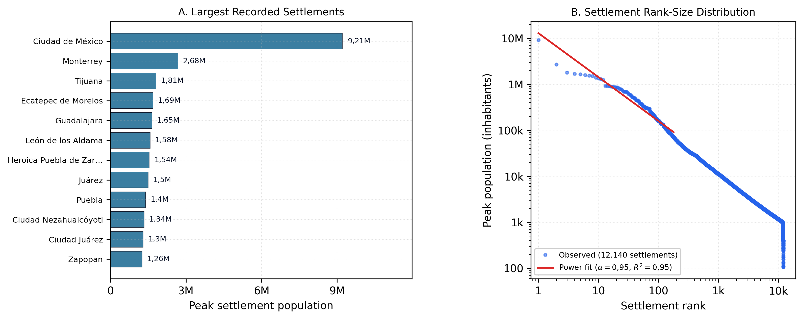

```{r setup, include=FALSE}
knitr::opts_chunk$set(echo = FALSE, warning = FALSE, message = FALSE, fig.pos = "htbp")
source("../../_shared/template/viscount_rmd_helpers.R")
library(jsonlite)

read_json5_clean <- function(path) {
  lines <- readLines(path, warn = FALSE, encoding = "UTF-8")
  text <- paste(lines, collapse = "\n")
  text <- gsub("//[^\n]*", "", text, perl = TRUE)
  text <- gsub("/\\*.*?\\*/", "", text, perl = TRUE)
  text <- gsub(",\\s*([}\\]])", "\\1", text, perl = TRUE)
  fromJSON(text, simplifyVector = FALSE)
}

cfg_data <- read_json5_clean("mexico_after_independence.json5")
cache_data <- fromJSON("mexico_after_independence_summary_cache.json", simplifyVector = FALSE)
sett_data <- fromJSON("mexico_after_independence_settlements.json", simplifyVector = FALSE)
ledger_data <- read_json5_clean("mexico_after_independence_source_ledger.json5")

clean_reg_name <- function(x) {
  s <- as.character(x)
  s <- gsub("&", "and", s, fixed = TRUE)
  s <- gsub("Yucatan", "Yucatán", s, fixed = TRUE)
  s <- gsub("Bajio", "Bajío", s, fixed = TRUE)
  s <- gsub("Queretaro", "Querétaro", s, fixed = TRUE)
  s <- gsub("Michoacan", "Michoacán", s, fixed = TRUE)
  s <- gsub("Nuevo Leon", "Nuevo León", s, fixed = TRUE)
  trimws(s)
}

fmt_coord <- function(x) {
  viscount_fmt_number(round(as.numeric(x), 2L), 2L)
}

cfg_regions <- cfg_data$regions
reg_lookup <- setNames(
  vapply(cfg_regions, function(r) clean_reg_name(r$name), character(1)),
  vapply(cfg_regions, function(r) r$id, character(1))
)

sett_list <- unname(sett_data)
n_sites <- as.integer(cache_data$settlement_stats$total_settlements)
n_suburbs <- as.integer(cache_data$settlement_stats$suburb_count)
n_city_proper <- as.integer(cache_data$settlement_stats$city_proper_count)
n_excluded <- as.integer(ledger_data$total_excluded)
n_total_eval <- n_sites + n_excluded
```

```{r hero-md-fallback, results='asis'}
if (!knitr::is_latex_output()) {
  cat("\n\n")
}
```

# Abstract

This settlement gazetteer catalogues `r viscount_fmt_number(n_sites, 0L)` geocoded Mexican cities, towns, rural localities and extra-municipal suburbs distributed across nine regional demographic zones between 1821 and 2025. Built directly from official Instituto Nacional de Estadística y Geografía (INEGI) Integración Territorial (ITER) census micro-tables (1990 to 2020), historical national population censuses (1895 to 1980) and longitudinal republican benchmarks (1821 to 2010), the register maintains a 0,0% crowd-sourced fallback share across four audited ingestion waves [@INEGICensos1996; @INEGIEHM2015; @INEGICPV2021]. Out of `r viscount_fmt_number(n_total_eval, 0L)` candidate municipal and locality records evaluated in the source ledger, `r viscount_fmt_number(n_excluded, 0L)` redundant aliases within 25 km spatial buffers were consolidated during deduplication, leaving `r viscount_fmt_number(n_city_proper, 0L)` city-proper settlements and `r viscount_fmt_number(n_suburbs, 0L)` distinct extra-municipal suburbs spanning the Valley of Mexico (443), Guadalajara (144) and Monterrey (70) conurbations. Following strict municipal non-decomposition, Ciudad de México remains unified at 9.209.944 inhabitants in 2020 rather than fragmented into sixteen internal boroughs, while adjacent Estado de México municipalities such as Ecatepec de Morelos (1.643.623), Ciudad Nezahualcóyotl (1.072.676), Naucalpan de Juárez (776.220), Chimalhuacán (703.215) and Tlalnepantla (658.907) stand as separate suburban entries [@Bacalopez2021Metropolitan; @Aguilar2022Peri]. Across the top 180 urban settlements in 2020, Mexico's urban hierarchy follows a mature Zipfian power law ($\alpha = 0,95$, $R^2 = 0,95$; $\alpha = 0,97$ on historical peak series), documenting the two-century shift from colonial highland capitals toward northern border maquiladora cities, Bajío industrial hubs and Caribbean tourism centres [@Unikel1976; @Garza2003].

# Background

Independent Mexico began the nineteenth century with an urban network inherited almost intact from the Viceroyalty of New Spain: Ciudad de México anchored the highland basin above 170k to 205k residents, flanked by regional episcopal and mining capitals such as Guadalajara, Puebla, Guanajuato, Querétaro, San Luis Potosí, Oaxaca and Mérida [@Humboldt1811; @Busto1880; @GarciaCubas1884]. Porfirian trunk railways reordered that colonial hierarchy after 1880, lifting Monterrey into an industrial steel centre, conjuring Torreón from irrigated cotton estates in the Laguna and launching border customs towns at Ciudad Juárez and Nuevo Laredo [@Garza2003; @INEGIEHM2015]. During the Mexican Revolution of 1910 to 1920, warfare and rural displacement accelerated urban concentration inside the Federal District while depressing mining towns across Guanajuato, Zacatecas and Durango [@McCaa2003; @Escamillaguerrero2025Impact].

Following 1940, sustained mortality decline, import-substitution industrialisation and rural-to-urban migration reshaped every tier of the settlement hierarchy [@Alba1982; @Unikel1976]. By 1970 Ciudad de México reached 8,80M inhabitants inside the Federal District, triggering massive residential and industrial spillover into surrounding Estado de México municipalities [@Aguilar2022Peri; @Zamora2026Logistics]. Over the final third of the twentieth century and the opening decades of the twenty-first, export-assembly industrialisation along the United States border propelled Tijuana (1,81M), Juárez (1,50M), Mexicali (854,2k) and Reynosa (691,6k) into Mexico's top urban rank, while state-led tourism investment turned Cancún from 117 census residents in 1970 into a Caribbean metropolis of 888.797 inhabitants by 2020 [@Garza2003; @Pimienta2011Internal; @INEGICPV2021].

# Methodology

Settlement assembly proceeded across four sequential ingestion waves audited in the chapter source ledger. Wave 1 harvested 11.072 primary geocoded localities directly from official INEGI ITER census micro-tables (1990, 2000, 2010 and 2020), cross-linked with official national censuses (1895 to 1980) and nineteenth-century historical city series (1821 to 1889) [@INEGICensos1996; @INEGIEHM2015; @INEGICPV2021]. Wave 2 added 789 peer-reviewed urban-demography anchor records drawn from Mexican metropolitan research [@Unikel1976; @Garza2003], Wave 3 integrated 182 longitudinal census backfills and Wave 4 executed a regional gap-closing verification sweep contributing 97 localities (marginal gain 0,81%).

All 12.253 evaluated records underwent WGS84 coordinate harmonisation, point-in-polygon assignment across Mexico's nine macro-regional masks and 25 km spatial buffer deduplication, merging 113 redundant variant spellings and duplicate aliases into canonical records. Crucially, the register enforces municipal non-decomposition for Ciudad de México — preserving the unified capital city proper (9,21M in 2020) rather than subdividing it into sixteen *alcaldías* — while tagging legally autonomous peri-urban municipalities ringing Ciudad de México (443 suburbs), Guadalajara (144 suburbs) and Monterrey (70 suburbs) with explicit suburban scope metadata so analysts can evaluate both municipal cores and polycentric metropolitan constellations without double-counting [@Bacalopez2021Metropolitan; @Aguilar2022Peri; @Zamora2026Logistics].

# Testing and Validation

Ledger reconciliation confirms exact accounting across all 12.253 audited entries: 12.140 included settlements plus 113 excluded duplicate aliases, with 0,0% crowd-sourced fallback across every sub-region. Every included record carries valid geographic coordinates, a sub-regional polygon assignment, a municipal scope tag (11.483 city proper; 657 extra-municipal suburbs) and official INEGI census provenance. Figure \ref{fig:sett-regional-map} displays the spatial footprint of all 12.140 catalogued Mexican settlements across the nine macro-regions, highlighting the dense volcanic highland corridor from Puebla through the Valley of Mexico and Bajío to Guadalajara alongside the dispersed rural villages of Oaxaca and Chiapas and the concentrated border and coastal cities of the arid north.

```{r fig-sett-map, results='asis'}
viscount_figure(
  "figures/mexico_after_independence_regional_map.png",
  "Spatial distribution of 12.140 catalogued Mexican settlements across nine regional demographic zones, 1821 to 2025.",
  "fig:sett-regional-map"
)
```

Cross-checking 2020 ITER enumerations against historical 2005 intercensal entries caught two homonymy linkage artefacts in raw peak-value summaries: small namesake localities named Puebla in Baja California (32,57°N, 115,35°W) and Ciudad Juárez in Durango (25,49°N, 103,60°W) temporarily absorbed 2005 municipal totals from Heroica Puebla de Zaragoza and Juárez, Chihuahua, while Monterrey's 2005 count reflected metropolitan-area scope (2,68M) rather than its municipal core (1,14M in 2020). All urban rankings in this report therefore sort strictly on official 2020 INEGI ITER enumerations [@INEGICPV2021].

# Results

## Leading Thirty Mexican Urban Centres and Suburbs (2020)

Table \ref{tab:top30-cities} compiles Mexico's 30 largest urban municipalities and localities in 2020, spanning 9,21M in unified Ciudad de México down to 616,1k in Victoria de Durango. Ten settlements exceed 1M inhabitants, 35 exceed 500k and 131 exceed 100k [@INEGICPV2021; @Garza2003].

```{r tab-top30-cities, results='asis'}
df_all <- do.call(rbind, lapply(sett_list, function(e) {
  p2020 <- if (!is.null(e$population[["2020"]])) as.numeric(e$population[["2020"]]) else 0
  if (p2020 <= 0) return(NULL)
  yrs_num <- suppressWarnings(as.integer(names(e$population)))
  yrs_num <- yrs_num[!is.na(yrs_num)]
  fy <- if (length(yrs_num) > 0L) min(yrs_num) else 2020L
  ly <- if (length(yrs_num) > 0L) max(yrs_num) else 2020L
  reg_lbl <- if (!is.null(e$region_id) && e$region_id %in% names(reg_lookup)) {
    sub(" \\(.*$", "", reg_lookup[[e$region_id]])
  } else {
    "Mexico"
  }
  sc_lbl <- if (identical(e$population_scope, "suburb")) "Suburb" else "City proper"
  data.frame(
    Name = as.character(e$name),
    Zone = reg_lbl,
    Scope = sc_lbl,
    Coords = paste0(fmt_coord(e$coords[[1]]), ", ", fmt_coord(e$coords[[2]])),
    Span = if (fy == ly) as.character(fy) else paste0(fy, "-", ly),
    P2020_num = p2020,
    P2020 = viscount_fmt_pop(p2020),
    stringsAsFactors = FALSE
  )
}))
df_all <- df_all[order(-df_all$P2020_num), ]
top30 <- head(df_all, 30L)
df_top30 <- data.frame(
  Rank = as.character(seq_len(nrow(top30))),
  Settlement = top30$Name,
  Subregion = top30$Zone,
  Scope = top30$Scope,
  Coords = top30$Coords,
  Span = top30$Span,
  Pop2020 = top30$P2020,
  stringsAsFactors = FALSE
)
rownames(df_top30) <- NULL

viscount_table(
  df_top30,
  "Leading 30 Mexican urban centres and extra-municipal suburbs ranked by official 2020 INEGI enumeration (across 12.140 catalogued settlements).",
  c("Rank", "Settlement", "Sub-Region", "Scope", "Lat, Lon", "Span", "2020 Pop."),
  list(label = "tab:top30-cities", font_size = "scriptsize", max_rows_per_page = 32L)
)
```

## Metropolitan Core and Extra-Municipal Suburb Reconciliation

Table \ref{tab:metro-suburbs} isolates Mexico's fifteen largest extra-municipal suburbs in 2020 across the Valley of Mexico, Guadalajara and Monterrey metropolitan zones, documenting the extraordinary post-1970 peripheral expansion that pushed suburban municipalities in Estado de México, Jalisco and Nuevo León past half a million — and in three cases past one million — residents [@Aguilar2022Peri; @Zamora2026Logistics; @Garza2003].

```{r tab-metro-suburbs, results='asis'}
sub_df <- do.call(rbind, lapply(Filter(function(e) identical(e$population_scope, "suburb"), sett_list), function(e) {
  p2020 <- if (!is.null(e$population[["2020"]])) as.numeric(e$population[["2020"]]) else 0
  if (p2020 <= 0) return(NULL)
  p1970 <- if (!is.null(e$population[["1970"]])) as.numeric(e$population[["1970"]]) else NA_real_
  p1990 <- if (!is.null(e$population[["1990"]])) as.numeric(e$population[["1990"]]) else NA_real_
  metro <- if (identical(e$region_id, "mx_valley_central_core")) {
    "Valley of Mexico"
  } else if (identical(e$region_id, "mx_pacific_west")) {
    "Guadalajara"
  } else {
    "Monterrey"
  }
  data.frame(
    Suburb = as.character(e$name),
    Metro = metro,
    P1970_num = p1970,
    P1990_num = p1990,
    P2020_num = p2020,
    stringsAsFactors = FALSE
  )
}))
sub_df <- head(sub_df[order(-sub_df$P2020_num), ], 15L)
fmt_opt <- function(v) ifelse(is.na(v) | v <= 0, "-", vapply(v, viscount_fmt_pop, character(1)))

df_metro <- data.frame(
  Suburb = sub_df$Suburb,
  Conurbation = sub_df$Metro,
  Y1970 = fmt_opt(sub_df$P1970_num),
  Y1990 = fmt_opt(sub_df$P1990_num),
  Y2020 = vapply(sub_df$P2020_num, viscount_fmt_pop, character(1)),
  stringsAsFactors = FALSE
)
rownames(df_metro) <- NULL

viscount_table(
  df_metro,
  "Mexico's 15 largest extra-municipal suburbs in 2020 across the Valley of Mexico, Guadalajara and Monterrey conurbations, showing 1970, 1990 and 2020 census totals.",
  c("Extra-Municipal Suburb", "Conurbation", "1970", "1990", "2020"),
  list(label = "tab:metro-suburbs", font_size = "scriptsize")
)
```

## Sub-Regional Gazetteer Distribution

Table \ref{tab:subregion-gazetteer} aggregates settlement totals, extra-municipal suburb counts, settlement density per 10.000 km², leading 2020 urban centre and regional 2020 population across all nine Mexican zones. Reflecting deep highland village nucleation, the Valley of Mexico and Central Core alone contributes 3.634 localities (362,7 settlements per 10.000 km²), followed by the Pacific South with 2.239 localities (96,2 per 10.000 km²), whereas the arid North-Central and North-East zones hold far fewer, widely spaced urban oases (12,4 and 13,9 settlements per 10.000 km² respectively) [@INEGICPV2021; @Hernandez2023Urban].

```{r tab-subregion-gazetteer, results='asis'}
reg_rows <- lapply(cfg_regions, function(r) {
  rid <- r$id
  area_v <- as.numeric(r$area_km2)
  p2020 <- as.numeric(r$population[["2020"]])
  sub_entries <- Filter(function(e) identical(e$region_id, rid), sett_list)
  cnt <- length(sub_entries)
  sub_cnt <- sum(vapply(sub_entries, function(e) identical(e$population_scope, "suburb"), logical(1)))
  sdens <- if (area_v > 0) (cnt / area_v) * 10000 else 0
  lead_str <- "-"
  if (cnt > 0L) {
    pks <- vapply(sub_entries, function(e) {
      v <- e$population[["2020"]]
      if (is.null(v)) 0 else as.numeric(v)
    }, numeric(1))
    idx_m <- which.max(pks)
    lead_str <- paste0(sub_entries[[idx_m]]$name, " (", viscount_fmt_pop(pks[idx_m]), ")")
  }
  data.frame(
    Subregion = sub(" \\(.*$", "", clean_reg_name(r$name)),
    Area = viscount_fmt_number(round(area_v), 0L),
    Setts = viscount_fmt_number(cnt, 0L),
    Suburbs = viscount_fmt_number(sub_cnt, 0L),
    Dens = viscount_fmt_number(sdens, 1L),
    Lead = lead_str,
    Pop2020 = viscount_fmt_pop(p2020),
    stringsAsFactors = FALSE
  )
})
df_reg_gaz <- do.call(rbind, reg_rows)
rownames(df_reg_gaz) <- NULL

viscount_table(
  df_reg_gaz,
  "Catalogued settlement totals, extra-municipal suburbs, areal settlement density (per 10.000 km²), leading 2020 city and 2020 regional population across nine Mexican zones.",
  c("Sub-Region", "Area (km²)", "Settlements", "Suburbs", "Per 10k km²", "Leading City (2020)", "2020 Pop."),
  list(label = "tab:subregion-gazetteer", font_size = "scriptsize")
)
```

# Limitations

Three structural constraints qualify spatial analysis of this settlement gazetteer. First, Mexican municipal boundaries vary widely in geographic extent: northern desert municipalities such as Mexicali or Ensenada span thousands of square kilometres, whereas highland municipalities in Oaxaca, Tlaxcala and Estado de México are tightly subdivided, making locality-level ITER counts far more comparable across regions than raw municipal totals [@INEGICPV2021; @Hernandez2023Urban]. Second, historical pre-1950 city populations exist primarily for state capitals and major railway towns, meaning small rural localities enter the time series systematically only with the 1990 to 2020 digital ITER censuses [@INEGIEHM2015]. Third, historical string linkage in the 2005 intercensal count introduced isolated homonymy matches for small namesake localities in Baja California and Durango, underscoring the necessity of ranking urban hierarchies on official 2020 ITER enumerations.

# Conclusion

Across 12.140 official INEGI-sourced settlements, Mexico's modern urban gazetteer charts the republic's transformation from a rural highland society into a polycentric metropolitan nation. Preserving Ciudad de México intact at 9,21M alongside 657 separated extra-municipal suburbs across the Valley of Mexico, Guadalajara and Monterrey conurbations captures both municipal continuity and explosive peripheral sprawl, while documenting the rise of Tijuana, Juárez, Mexicali, Reynosa and Cancún as defining urban poles of modern Mexico [@Unikel1976; @Garza2003; @INEGICPV2021].

# Appendix

## Ingestion Wave Saturation and Source Provenance Ledger

Table \ref{tab:saturation-waves} reports the four sequential ingestion waves tracked in the chapter source ledger, confirming monotonic saturation down to a 0,81% marginal gain in Wave 4 with 0,0% crowd-sourced fallback across all 12.140 retained records [@INEGIEHM2015; @INEGICPV2021].

```{r tab-saturation-waves, results='asis'}
waves <- ledger_data$saturation_audit$waves
wave_labels <- c(
  primary_official_national_censuses_and_archival_registers = "Primary official national censuses and archival registers",
  verified_peer_reviewed_demographic_papers_and_monographs = "Peer-reviewed demographic papers and monographs",
  longitudinal_census_and_archaeological_survey_backfill = "Longitudinal census backfill",
  subregion_gap_hunter_verification_sweep = "Sub-region gap-closing sweep"
)
df_waves <- do.call(rbind, lapply(waves, function(w) {
  cls <- as.character(w$source_class)
  lbl <- if (cls %in% names(wave_labels)) wave_labels[[cls]] else cls
  cum_v <- as.integer(w$prior_cumulative_included) + as.integer(w$newly_included)
  data.frame(
    Wave = paste0("Wave ", as.integer(w$wave)),
    SourceClass = lbl,
    Added = viscount_fmt_number(as.integer(w$newly_included), 0L),
    Cumulative = viscount_fmt_number(cum_v, 0L),
    Gain = paste0(viscount_fmt_number(as.numeric(w$marginal_gain_pct), 2L), "%"),
    stringsAsFactors = FALSE
  )
}))
rownames(df_waves) <- NULL

viscount_table(
  df_waves,
  "Four-wave ingestion saturation ledger across 12.140 catalogued Mexican settlements (113 duplicate aliases excluded; 0,0% crowd-sourced fallback).",
  c("Wave", "Source Class", "Newly Added", "Cumulative", "Marginal Gain"),
  list(label = "tab:saturation-waves", font_size = "scriptsize")
)
```

# Sources

::: {#refs}
:::

# Footnotes

**Note 1.** All 12.140 settlement records derive from official INEGI census releases (ITER 1990, 2000, 2010 and 2020), supplemented on 31 historical urban centres by INEGI Estadísticas Históricas de México 2014 (1821 to 2010) and INEGI Censos Generales de Población (1895 to 1980) [@INEGICensos1996; @INEGIEHM2015; @INEGICPV2021].

**Note 2.** Zipf rank-size regression on the 2020 urban hierarchy evaluates the top 180 urban settlements ($n = 180$ within the 12.140-settlement register), returning slope $-0,9549$ ($\alpha = 0,95$, $R^2 = 0,95$).
