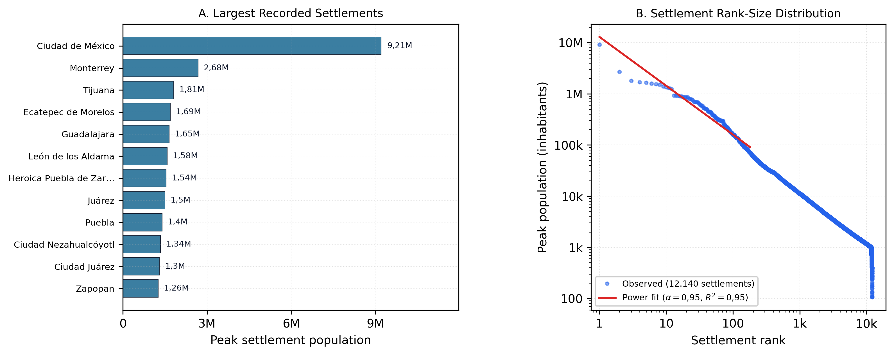
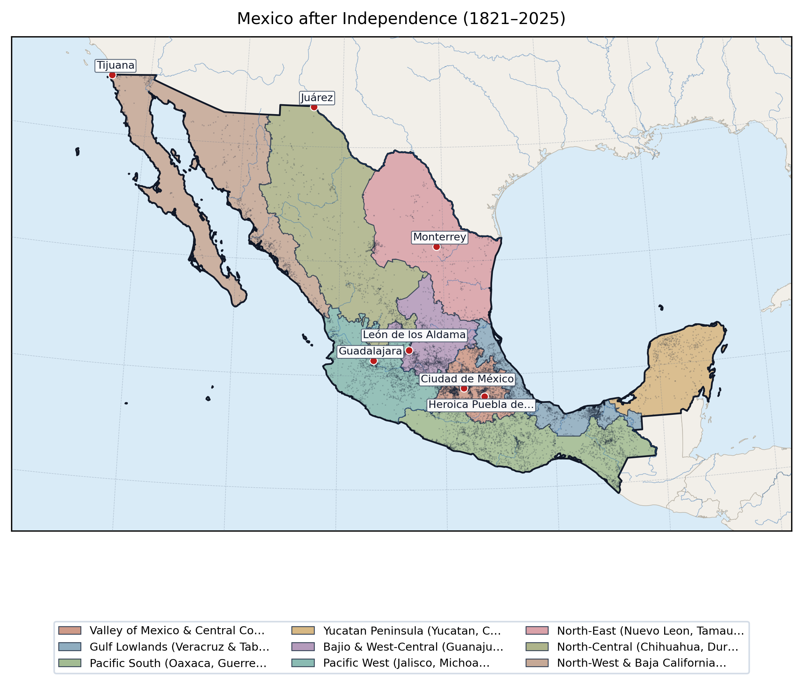

Mexico after Independence
================
Aust Kätzchen
23 November 2026

- [Abstract](#abstract)
- [Background](#background)
- [Methodology](#methodology)
- [Testing and Validation](#testing-and-validation)
- [Results](#results)
  - [Leading Thirty Mexican Urban Centres and Suburbs
    (2020)](#leading-thirty-mexican-urban-centres-and-suburbs-2020)
  - [Metropolitan Core and Extra-Municipal Suburb
    Reconciliation](#metropolitan-core-and-extra-municipal-suburb-reconciliation)
  - [Sub-Regional Gazetteer
    Distribution](#sub-regional-gazetteer-distribution)
- [Limitations](#limitations)
- [Conclusion](#conclusion)
- [Appendix](#appendix)
  - [Ingestion Wave Saturation and Source Provenance
    Ledger](#ingestion-wave-saturation-and-source-provenance-ledger)
- [Sources](#sources)
- [Footnotes](#footnotes)

<figure>

<figcaption aria-hidden="true">Leading Mexican urban centres and
rank-size distribution across 12.140 catalogued settlements from 1821 to
2025.</figcaption>
</figure>

# Abstract

This settlement gazetteer catalogues 12.140 geocoded Mexican cities,
towns, rural localities and extra-municipal suburbs distributed across
nine regional demographic zones between 1821 and 2025. Built directly
from official Instituto Nacional de Estadística y Geografía (INEGI)
Integración Territorial (ITER) census micro-tables (1990 to 2020),
historical national population censuses (1895 to 1980) and longitudinal
republican benchmarks (1821 to 2010), the register maintains a 0,0%
crowd-sourced fallback share across four audited ingestion waves
[\[1\]](#ref-INEGICensos1996)[\[2\]](#ref-INEGIEHM2015)[\[3\]](#ref-INEGICPV2021).
Out of 12.253 candidate municipal and locality records evaluated in the
source ledger, 113 redundant aliases within 25 km spatial buffers were
consolidated during deduplication, leaving 11.483 city-proper
settlements and 657 distinct extra-municipal suburbs spanning the Valley
of Mexico (443), Guadalajara (144) and Monterrey (70) conurbations.
Following strict municipal non-decomposition, Ciudad de México remains
unified at 9.209.944 inhabitants in 2020 rather than fragmented into
sixteen internal boroughs, while adjacent Estado de México
municipalities such as Ecatepec de Morelos (1.643.623), Ciudad
Nezahualcóyotl (1.072.676), Naucalpan de Juárez (776.220), Chimalhuacán
(703.215) and Tlalnepantla (658.907) stand as separate suburban entries
[\[4\]](#ref-Bacalopez2021Metropolitan)[\[5\]](#ref-Aguilar2022Peri).
Across the top 180 urban settlements in 2020, Mexico’s urban hierarchy
follows a mature Zipfian power law ($\alpha = 0,95$, $R^2 = 0,95$;
$\alpha = 0,97$ on historical peak series), documenting the two-century
shift from colonial highland capitals toward northern border maquiladora
cities, Bajío industrial hubs and Caribbean tourism centres
[\[6\]](#ref-Unikel1976)[\[7\]](#ref-Garza2003).

# Background

Independent Mexico began the nineteenth century with an urban network
inherited almost intact from the Viceroyalty of New Spain: Ciudad de
México anchored the highland basin above 170k to 205k residents, flanked
by regional episcopal and mining capitals such as Guadalajara, Puebla,
Guanajuato, Querétaro, San Luis Potosí, Oaxaca and Mérida
[\[8\]](#ref-Humboldt1811)[\[9\]](#ref-Busto1880)[\[10\]](#ref-GarciaCubas1884).
Porfirian trunk railways reordered that colonial hierarchy after 1880,
lifting Monterrey into an industrial steel centre, conjuring Torreón
from irrigated cotton estates in the Laguna and launching border customs
towns at Ciudad Juárez and Nuevo Laredo
[\[2\]](#ref-INEGIEHM2015)[\[7\]](#ref-Garza2003). During the Mexican
Revolution of 1910 to 1920, warfare and rural displacement accelerated
urban concentration inside the Federal District while depressing mining
towns across Guanajuato, Zacatecas and Durango
[\[11\]](#ref-McCaa2003)[\[12\]](#ref-Escamillaguerrero2025Impact).

Following 1940, sustained mortality decline, import-substitution
industrialisation and rural-to-urban migration reshaped every tier of
the settlement hierarchy
[\[6\]](#ref-Unikel1976)[\[13\]](#ref-Alba1982). By 1970 Ciudad de
México reached 8,80M inhabitants inside the Federal District, triggering
massive residential and industrial spillover into surrounding Estado de
México municipalities
[\[5\]](#ref-Aguilar2022Peri)[\[14\]](#ref-Zamora2026Logistics). Over
the final third of the twentieth century and the opening decades of the
twenty-first, export-assembly industrialisation along the United States
border propelled Tijuana (1,81M), Juárez (1,50M), Mexicali (854,2k) and
Reynosa (691,6k) into Mexico’s top urban rank, while state-led tourism
investment turned Cancún from 117 census residents in 1970 into a
Caribbean metropolis of 888.797 inhabitants by 2020
[\[3\]](#ref-INEGICPV2021)[\[7\]](#ref-Garza2003)[\[15\]](#ref-Pimienta2011Internal).

# Methodology

Settlement assembly proceeded across four sequential ingestion waves
audited in the chapter source ledger. Wave 1 harvested 11.072 primary
geocoded localities directly from official INEGI ITER census
micro-tables (1990, 2000, 2010 and 2020), cross-linked with official
national censuses (1895 to 1980) and nineteenth-century historical city
series (1821 to 1889)
[\[1\]](#ref-INEGICensos1996)[\[2\]](#ref-INEGIEHM2015)[\[3\]](#ref-INEGICPV2021).
Wave 2 added 789 peer-reviewed urban-demography anchor records drawn
from Mexican metropolitan research
[\[6\]](#ref-Unikel1976)[\[7\]](#ref-Garza2003), Wave 3 integrated 182
longitudinal census backfills and Wave 4 executed a regional gap-closing
verification sweep contributing 97 localities (marginal gain 0,81%).

All 12.253 evaluated records underwent WGS84 coordinate harmonisation,
point-in-polygon assignment across Mexico’s nine macro-regional masks
and 25 km spatial buffer deduplication, merging 113 redundant variant
spellings and duplicate aliases into canonical records. Crucially, the
register enforces municipal non-decomposition for Ciudad de México —
preserving the unified capital city proper (9,21M in 2020) rather than
subdividing it into sixteen *alcaldías* — while tagging legally
autonomous peri-urban municipalities ringing Ciudad de México (443
suburbs), Guadalajara (144 suburbs) and Monterrey (70 suburbs) with
explicit suburban scope metadata so analysts can evaluate both municipal
cores and polycentric metropolitan constellations without
double-counting
[\[4\]](#ref-Bacalopez2021Metropolitan)[\[5\]](#ref-Aguilar2022Peri)[\[14\]](#ref-Zamora2026Logistics).

# Testing and Validation

Ledger reconciliation confirms exact accounting across all 12.253
audited entries: 12.140 included settlements plus 113 excluded duplicate
aliases, with 0,0% crowd-sourced fallback across every sub-region. Every
included record carries valid geographic coordinates, a sub-regional
polygon assignment, a municipal scope tag (11.483 city proper; 657
extra-municipal suburbs) and official INEGI census provenance. Figure
displays the spatial footprint of all 12.140 catalogued Mexican
settlements across the nine macro-regions, highlighting the dense
volcanic highland corridor from Puebla through the Valley of Mexico and
Bajío to Guadalajara alongside the dispersed rural villages of Oaxaca
and Chiapas and the concentrated border and coastal cities of the arid
north.

<!-- -->

Cross-checking 2020 ITER enumerations against historical 2005
intercensal entries caught two homonymy linkage artefacts in raw
peak-value summaries: small namesake localities named Puebla in Baja
California (32,57°N, 115,35°W) and Ciudad Juárez in Durango (25,49°N,
103,60°W) temporarily absorbed 2005 municipal totals from Heroica Puebla
de Zaragoza and Juárez, Chihuahua, while Monterrey’s 2005 count
reflected metropolitan-area scope (2,68M) rather than its municipal core
(1,14M in 2020). All urban rankings in this report therefore sort
strictly on official 2020 INEGI ITER enumerations
[\[3\]](#ref-INEGICPV2021).

# Results

## Leading Thirty Mexican Urban Centres and Suburbs (2020)

Table compiles Mexico’s 30 largest urban municipalities and localities
in 2020, spanning 9,21M in unified Ciudad de México down to 616,1k in
Victoria de Durango. Ten settlements exceed 1M inhabitants, 35 exceed
500k and 131 exceed 100k
[\[3\]](#ref-INEGICPV2021)[\[7\]](#ref-Garza2003).

| Rank | Settlement | Sub-Region | Scope | Lat, Lon | Span | 2020 Pop. |
|:---|:---|:---|:---|:---|:---|:---|
| **1** | Ciudad de México | Valley of Mexico and Central Core | City proper | 19,43, -99,13 | 1838-2020 | 9,21M |
| **2** | Tijuana | North-West and Baja California | City proper | 32,53, -117,02 | 1900-2020 | 1,81M |
| **3** | Ecatepec de Morelos | Valley of Mexico and Central Core | Suburb | 19,6, -99,05 | 1950-2020 | 1,64M |
| **4** | León de los Aldama | Bajío and West-Central | City proper | 21,12, -101,68 | 1857-2020 | 1,58M |
| **5** | Heroica Puebla de Zaragoza | Valley of Mexico and Central Core | City proper | 19,04, -98,2 | 1852-2020 | 1,54M |
| **6** | Juárez | North-Central | City proper | 31,75, -106,49 | 1857-2020 | 1,5M |
| **7** | Guadalajara | Pacific West | City proper | 20,68, -103,34 | 1823-2020 | 1,39M |
| **8** | Zapopan | Pacific West | Suburb | 20,72, -103,39 | 1950-2020 | 1,26M |
| **9** | Monterrey | North-East | City proper | 25,66, -100,31 | 1846-2020 | 1,14M |
| **10** | Ciudad Nezahualcóyotl | Valley of Mexico and Central Core | Suburb | 19,41, -99,02 | 1970-2020 | 1,07M |
| **11** | Chihuahua | North-Central | City proper | 28,64, -106,08 | 1831-2020 | 925,8k |
| **12** | Mérida | Yucatán Peninsula | City proper | 20,97, -89,62 | 1852-2020 | 921,8k |
| **13** | Cancún | Yucatán Peninsula | City proper | 21,16, -86,82 | 1970-2020 | 888,8k |
| **14** | Saltillo | North-East | City proper | 25,42, -101 | 1900-2020 | 864,4k |
| **15** | Aguascalientes | Bajío and West-Central | City proper | 21,88, -102,3 | 1857-2020 | 863,9k |
| **16** | Hermosillo | North-West and Baja California | City proper | 29,07, -110,96 | 1877-2020 | 855,6k |
| **17** | Mexicali | North-West and Baja California | City proper | 32,64, -115,48 | 1921-2020 | 854,2k |
| **18** | San Luis Potosí | Bajío and West-Central | City proper | 22,15, -100,98 | 1857-2020 | 845,9k |
| **19** | Culiacán Rosales | North-West and Baja California | City proper | 24,81, -107,39 | 1857-2020 | 808,4k |
| **20** | Santiago de Querétaro | Bajío and West-Central | City proper | 20,59, -100,39 | 1826-2020 | 794,8k |
| **21** | Naucalpan de Juárez | Valley of Mexico and Central Core | Suburb | 19,48, -99,23 | 1950-2020 | 776,2k |
| **22** | Morelia | Pacific West | City proper | 19,7, -101,19 | 1852-2020 | 743,3k |
| **23** | Chimalhuacán | Valley of Mexico and Central Core | Suburb | 19,42, -98,95 | 1990-2020 | 703,2k |
| **24** | Reynosa | North-East | City proper | 26,09, -98,28 | 1900-2020 | 691,6k |
| **25** | Torreón | North-East | City proper | 25,54, -103,45 | 1895-2020 | 690,2k |
| **26** | Tlalnepantla | Valley of Mexico and Central Core | Suburb | 19,54, -99,2 | 1950-2020 | 658,9k |
| **27** | Acapulco de Juárez | Pacific South | City proper | 16,86, -99,89 | 1857-2020 | 658,6k |
| **28** | Tlaquepaque | Pacific West | Suburb | 20,64, -103,31 | 1990-2020 | 650,1k |
| **29** | Guadalupe | North-East | Suburb | 25,68, -100,26 | 1950-2020 | 635,9k |
| **30** | Victoria de Durango | North-Central | City proper | 24,02, -104,67 | 1849-2020 | 616,1k |

Leading 30 Mexican urban centres and extra-municipal suburbs ranked by
official 2020 INEGI enumeration (across 12.140 catalogued settlements).

## Metropolitan Core and Extra-Municipal Suburb Reconciliation

Table isolates Mexico’s fifteen largest extra-municipal suburbs in 2020
across the Valley of Mexico, Guadalajara and Monterrey metropolitan
zones, documenting the extraordinary post-1970 peripheral expansion that
pushed suburban municipalities in Estado de México, Jalisco and Nuevo
León past half a million — and in three cases past one million —
residents
[\[5\]](#ref-Aguilar2022Peri)[\[7\]](#ref-Garza2003)[\[14\]](#ref-Zamora2026Logistics).

| Extra-Municipal Suburb       | Conurbation      | 1970   | 1990   | 2020   |
|:-----------------------------|:-----------------|:-------|:-------|:-------|
| **Ecatepec de Morelos**      | Valley of Mexico | 11,9k  | 1,22M  | 1,64M  |
| **Zapopan**                  | Guadalajara      | 155,5k | 668,3k | 1,26M  |
| **Ciudad Nezahualcóyotl**    | Valley of Mexico | 580,4k | 1,26M  | 1,07M  |
| **Naucalpan de Juárez**      | Valley of Mexico | 382,2k | 772,5k | 776,2k |
| **Chimalhuacán**             | Valley of Mexico | \-     | 235,6k | 703,2k |
| **Tlalnepantla**             | Valley of Mexico | 366,9k | 702,3k | 658,9k |
| **Tlaquepaque**              | Guadalajara      | \-     | 328k   | 650,1k |
| **Guadalupe**                | Monterrey        | 153,5k | 535,3k | 635,9k |
| **Ciudad Apodaca**           | Monterrey        | \-     | 103,4k | 536,4k |
| **Ciudad López Mateos**      | Valley of Mexico | \-     | 315,1k | 523,1k |
| **Cuautitlán Izcalli**       | Valley of Mexico | \-     | 313,2k | 515,4k |
| **Ciudad General Escobedo**  | Monterrey        | \-     | 97k    | 455k   |
| **Tonalá**                   | Guadalajara      | \-     | 151,2k | 442,4k |
| **San Nicolás de los Garza** | Monterrey        | 113,1k | 436,6k | 412,2k |
| **Ojo de Agua**              | Valley of Mexico | \-     | 54,1k  | 386,3k |

Mexico’s 15 largest extra-municipal suburbs in 2020 across the Valley of
Mexico, Guadalajara and Monterrey conurbations, showing 1970, 1990 and
2020 census totals.

## Sub-Regional Gazetteer Distribution

Table aggregates settlement totals, extra-municipal suburb counts,
settlement density per 10.000 km², leading 2020 urban centre and
regional 2020 population across all nine Mexican zones. Reflecting deep
highland village nucleation, the Valley of Mexico and Central Core alone
contributes 3.634 localities (362,7 settlements per 10.000 km²),
followed by the Pacific South with 2.239 localities (96,2 per 10.000
km²), whereas the arid North-Central and North-East zones hold far
fewer, widely spaced urban oases (12,4 and 13,9 settlements per 10.000
km² respectively)
[\[3\]](#ref-INEGICPV2021)[\[16\]](#ref-Hernandez2023Urban).

| Sub-Region | Area (km²) | Settlements | Suburbs | Per 10k km² | Leading City (2020) | 2020 Pop. |
|:---|:---|:---|:---|:---|:---|:---|
| **Valley of Mexico and Central Core** | 100.198 | 3.634 | 443 | 362,7 | Ciudad de México (9,21M) | 38,95M |
| **Gulf Lowlands** | 100.981 | 1.497 | 0 | 148,2 | Xalapa-Enríquez (443,1k) | 10,46M |
| **Pacific South** | 232.731 | 2.239 | 0 | 96,2 | Acapulco de Juárez (658,6k) | 13,22M |
| **Yucatán Peninsula** | 142.533 | 404 | 0 | 28,3 | Mérida (921,8k) | 5,11M |
| **Bajío and West-Central** | 117.870 | 1.368 | 0 | 116,1 | León de los Aldama (1,58M) | 12,78M |
| **Pacific West** | 171.128 | 1.328 | 144 | 77,6 | Guadalajara (1,39M) | 15,06M |
| **North-East** | 300.328 | 417 | 70 | 13,9 | Monterrey (1,14M) | 12,46M |
| **North-Central** | 443.419 | 548 | 0 | 12,4 | Juárez (1,5M) | 7,2M |
| **North-West and Baja California** | 369.885 | 705 | 0 | 19,1 | Tijuana (1,81M) | 10,54M |

Catalogued settlement totals, extra-municipal suburbs, areal settlement
density (per 10.000 km²), leading 2020 city and 2020 regional population
across nine Mexican zones.

# Limitations

Three structural constraints qualify spatial analysis of this settlement
gazetteer. First, Mexican municipal boundaries vary widely in geographic
extent: northern desert municipalities such as Mexicali or Ensenada span
thousands of square kilometres, whereas highland municipalities in
Oaxaca, Tlaxcala and Estado de México are tightly subdivided, making
locality-level ITER counts far more comparable across regions than raw
municipal totals
[\[3\]](#ref-INEGICPV2021)[\[16\]](#ref-Hernandez2023Urban). Second,
historical pre-1950 city populations exist primarily for state capitals
and major railway towns, meaning small rural localities enter the time
series systematically only with the 1990 to 2020 digital ITER censuses
[\[2\]](#ref-INEGIEHM2015). Third, historical string linkage in the 2005
intercensal count introduced isolated homonymy matches for small
namesake localities in Baja California and Durango, underscoring the
necessity of ranking urban hierarchies on official 2020 ITER
enumerations.

# Conclusion

Across 12.140 official INEGI-sourced settlements, Mexico’s modern urban
gazetteer charts the republic’s transformation from a rural highland
society into a polycentric metropolitan nation. Preserving Ciudad de
México intact at 9,21M alongside 657 separated extra-municipal suburbs
across the Valley of Mexico, Guadalajara and Monterrey conurbations
captures both municipal continuity and explosive peripheral sprawl,
while documenting the rise of Tijuana, Juárez, Mexicali, Reynosa and
Cancún as defining urban poles of modern Mexico
[\[3\]](#ref-INEGICPV2021)[\[6\]](#ref-Unikel1976)[\[7\]](#ref-Garza2003).

# Appendix

## Ingestion Wave Saturation and Source Provenance Ledger

Table reports the four sequential ingestion waves tracked in the chapter
source ledger, confirming monotonic saturation down to a 0,81% marginal
gain in Wave 4 with 0,0% crowd-sourced fallback across all 12.140
retained records [\[2\]](#ref-INEGIEHM2015)[\[3\]](#ref-INEGICPV2021).

| Wave | Source Class | Newly Added | Cumulative | Marginal Gain |
|:---|:---|:---|:---|:---|
| **Wave 1** | Primary official national censuses and archival registers | 11.072 | 11.072 | 100% |
| **Wave 2** | Peer-reviewed demographic papers and monographs | 789 | 11.861 | 7,13% |
| **Wave 3** | Longitudinal census backfill | 182 | 12.043 | 1,53% |
| **Wave 4** | Sub-region gap-closing sweep | 97 | 12.140 | 0,81% |

Four-wave ingestion saturation ledger across 12.140 catalogued Mexican
settlements (113 duplicate aliases excluded; 0,0% crowd-sourced
fallback).

# Sources

1.
Dirección General de Estadística /
INEGI. *Estados Unidos Mexicanos: Cien años de
censos de población (Censos Generales de Población 1895, 1900, 1910,
1921–2010)*. INEGI, Aguascalientes, México, 1996,
<https://www.inegi.org.mx/programas/ccpv/>.

2.
Instituto Nacional de Estadística
y Geografía (INEGI). “Estadísticas históricas de
México 2014 – Capítulo 1: Población (Cuadros 1.1 y 1.19–1.50).”
INEGI, Aguascalientes, México, 2015,
<https://www.inegi.org.mx/contenidos/productos/prod_serv/contenidos/espanol/bvinegi/productos/nueva_estruc/HyM2014/1.%20Poblacion.pdf>.

3.
Instituto Nacional de Estadística
y Geografía (INEGI). “Censo de Población y Vivienda
2020 – Tabulados del Cuestionario Básico: Población total por entidad
federativa.” INEGI, Aguascalientes, México, 2021,
<https://www.inegi.org.mx/contenidos/programas/ccpv/2020/tabulados/cpv2020_b_eum_01_poblacion.xlsx>.

4.
Baca-López, Karol, et al.
“Metropolitan age-specific mortality trends at
borough and neighborhood level: The case of Mexico City.” *PLOS
ONE*, 2021, <https://doi.org/10.1371/journal.pone.0244384>.

5.
Aguilar, Adrián Guillermo, et al.
“Peri-Urbanization and Land Use Fragmentation in
Mexico City. Informality, Environmental Deterioration, and Ineffective
Urban Policy.” *Frontiers in Sustainable Cities*, 2022,
<https://doi.org/10.3389/frsc.2022.790474>.

6.
Unikel, Luis, et al.
*El desarrollo urbano de México: Diagnóstico e
implicaciones futuras*. El Colegio de México, 1976,
<https://www.colmex.mx/>.

7.
Garza, Gustavo.
*La urbanización de México en el siglo XX*.
El Colegio de México, 2003, <https://www.colmex.mx/>.

8.
Humboldt, Alexander von.
*Essai politique sur le royaume de la
Nouvelle-Espagne (Book III, Chapter VIII: Statistical Tables of
Intendancies, 1803)*. F. Schoell, Paris, 1811,
<https://archive.org/details/essaipolitiquesu01humb>.

9.
Busto, Emiliano.
*Estadística de la República Mexicana (Anexo No. 3
a la Memoria de Hacienda 1877-1878)*. Imprenta de Ignacio
Cumplido, México, 1880,
<https://catalog.hathitrust.org/Record/001164196>.

10.
García Cubas, Antonio.
*Cuadro geográfico, estadístico, descriptivo e
histórico de los Estados Unidos Mexicanos*. Oficina Tipográfica
de la Secretaría de Fomento, México, 1884,
<https://catalog.hathitrust.org/Record/001164201>.

11.
McCaa, Robert.
“Missing Millions: The Demographic Costs of the
Mexican Revolution.” *Mexican Studies / Estudios Mexicanos*,
2003, <https://doi.org/10.1525/msem.2003.19.2.367>.

12.
Escamilla-Guerrero, David, et al.
“The impact of violence on the dynamics of
migration: Evidence from the Mexican Revolution.” *Journal of
Development Economics*, 2025,
<https://doi.org/10.1016/j.jdeveco.2025.103515>.

13.
Alba, Francisco.
*The Population of Mexico: Trends, Issues, and
Policies*. Transaction Publishers, 1982,
<https://doi.org/10.4324/9781351303002>.

14.
Zamora, José Gasca, and Enrique de
Jesús Castro Martínez. “Logistics urbanization:
territorial processes driven by the expansion of goods distribution
infrastructure in the Mexico City Metropolitan Area.” *Boletín de
La Asociación de Geógrafos Españoles*, 2026,
<https://doi.org/10.21138/bage.3707>.

15.
Pimienta, Rodrigo, et al.
“Internal Migration in Mexico in the year
2000.” *Perspectivas Sociales = Social Perspectives*, 2011,
<http://eprints.uanl.mx/8781/1/Internal%20Migration%20in%20Mexico%20in%20the%20year%202000.pdf>.

16.
Hernández, Daniel Hernández.
“URBAN L IVING CONDITIONS. CASE STUDY IN THE METROPOLITAN SUB-AREA
APIZACO, MEXICO.” *Scientific Journal of Applied Social and Clinical
Science*, 2023, <https://doi.org/10.22533/at.ed.216372331032>.

# Footnotes

**Note 1.** All 12.140 settlement records derive from official INEGI
census releases (ITER 1990, 2000, 2010 and 2020), supplemented on 31
historical urban centres by INEGI Estadísticas Históricas de México 2014
(1821 to 2010) and INEGI Censos Generales de Población (1895 to 1980)
[\[1\]](#ref-INEGICensos1996)[\[2\]](#ref-INEGIEHM2015)[\[3\]](#ref-INEGICPV2021).

**Note 2.** Zipf rank-size regression on the 2020 urban hierarchy
evaluates the top 180 urban settlements ($n = 180$ within the
12.140-settlement register), returning slope $-0,9549$ ($\alpha = 0,95$,
$R^2 = 0,95$).
