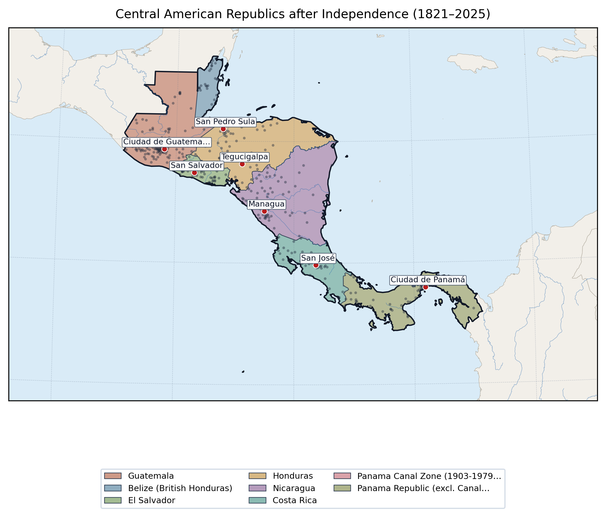
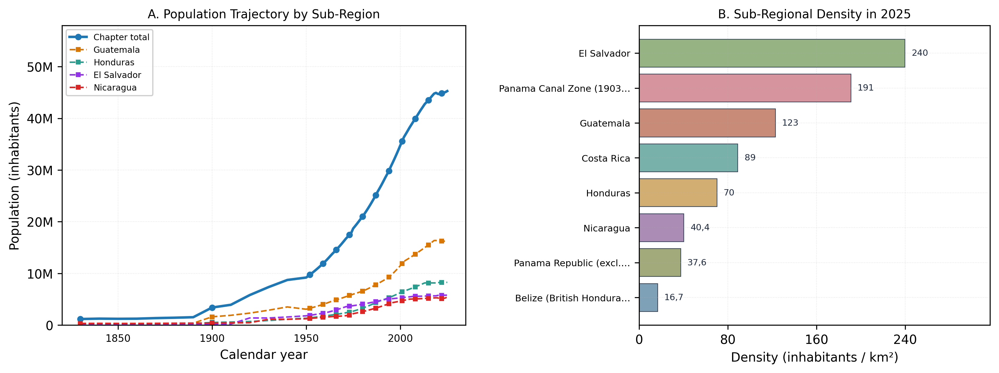
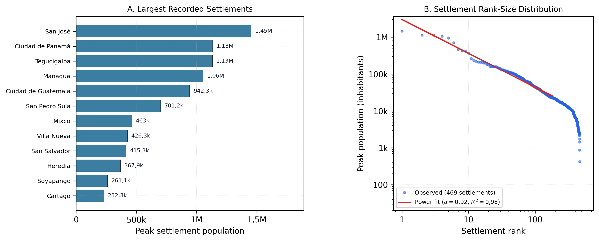

Central American Republics after Independence
================
Aust Kätzchen
23 November 2026

- [Abstract](#abstract)
- [Background](#background)
  - [Dissolution of the Kingdom of Guatemala and the Federal Republic
    (1821 to
    1841)](#dissolution-of-the-kingdom-of-guatemala-and-the-federal-republic-1821-to-1841)
  - [Nineteenth-Century Coffee Republics and Agrarian
    Transformation](#nineteenth-century-coffee-republics-and-agrarian-transformation)
  - [Caribbean Banana Enclaves and West Indian
    Migration](#caribbean-banana-enclaves-and-west-indian-migration)
  - [Panama’s 1903 Separation and the US Panama Canal Zone (1903 to
    1979)](#panamas-1903-separation-and-the-us-panama-canal-zone-1903-to-1979)
  - [British Honduras to Independent Belize: Hurricane Hattie and
    Belmopan](#british-honduras-to-independent-belize-hurricane-hattie-and-belmopan)
  - [Post-1950 Mortality Decline, Divergent Transitions and Conflict
    Shocks](#post-1950-mortality-decline-divergent-transitions-and-conflict-shocks)
- [Methodology](#methodology)
  - [Territorial Partition into Eight Political
    Sub-Regions](#territorial-partition-into-eight-political-sub-regions)
  - [Census Anchoring, Intercensal Interpolation and Raster
    Kriging](#census-anchoring-intercensal-interpolation-and-raster-kriging)
  - [Settlement Gazetteer Assembly and Metropolitan Ring
    Reconciliation](#settlement-gazetteer-assembly-and-metropolitan-ring-reconciliation)
- [Testing and Validation](#testing-and-validation)
  - [Reconciliation Against Official National Censuses and Raster
    Diagnostics](#reconciliation-against-official-national-censuses-and-raster-diagnostics)
  - [Sub-National Administrative
    Cross-Check](#sub-national-administrative-cross-check)
- [Results](#results)
  - [Macro-Regional Demographic Trajectory (1821 to
    2025)](#macro-regional-demographic-trajectory-1821-to-2025)
  - [Regional Divergence: Highland Primacy, Pacific Density and Atlantic
    Frontiers](#regional-divergence-highland-primacy-pacific-density-and-atlantic-frontiers)
  - [Early Demographic Transition in Costa Rica and Trans-Isthmian
    Panama](#early-demographic-transition-in-costa-rica-and-trans-isthmian-panama)
  - [Urbanisation, Rank-Size Structure and Metropolitan
    Rings](#urbanisation-rank-size-structure-and-metropolitan-rings)
- [Limitations](#limitations)
- [Conclusion](#conclusion)
- [Appendix](#appendix)
  - [Historic US Panama Canal Zone Townships (1912 to
    1970)](#historic-us-panama-canal-zone-townships-1912-to-1970)
  - [National Gazetteer Distribution and Provenance
    Summary](#national-gazetteer-distribution-and-provenance-summary)
- [Sources](#sources)
- [Footnotes](#footnotes)

<figure>

<figcaption aria-hidden="true">Eight political sub-regions and 469
catalogued urban settlements across Central America, the Panama Canal
Zone and Belize from 1821 to 2025.</figcaption>
</figure>

# Abstract

Between the declaration of Central American independence from Spain in
September 1821 and the close of the first quarter of the twenty-first
century in 2025, the human population of the Central American isthmus
from Guatemala and Belize to Panama multiplied roughly fortyfold. Across
eight territorial sub-regions covering a harmonised raster footprint of
587.326 km², aggregate population expanded from 1,17M (1.171.449) in
1830 to 3,40M in 1900, 9,19M in 1950, 21,01M in 1980, 34,72M in 2000 and
45,27M (45.268.077) in 2025, closely tracking twenty-first-century
national census benchmarks across Guatemala (14,90M in 2018), Honduras
(8,30M in 2013), El Salvador (6,03M in 2024), Nicaragua (5,14M in 2005),
Costa Rica (5,04M in 2022), Panama (4,06M in 2023) and Belize (397,5k in
2022)
[\[1\]](#ref-INEGuatemala2019)[\[2\]](#ref-INEHonduras2015)[\[3\]](#ref-DIGESTYC2024)[\[4\]](#ref-INIDENicaragua2006)[\[5\]](#ref-INECCostaRica2023)[\[6\]](#ref-INECPanama2023)[\[7\]](#ref-SIBBelize2024).
The political geography of that expansion was repeatedly reshaped by
nineteenth-century border realignments, export monocultures and
interoceanic transit corridors: the brief Federal Republic of Central
America (1823 to 1841), the transfer of Chiapas to Mexico in 1824, the
rise of highland coffee republics in Guatemala, El Salvador and Costa
Rica, West Indian labour immigration into Caribbean banana enclaves from
Limón and Bocas del Toro to Colón, Tela and La Ceiba, Panama’s 1903
separation from Colombia, the establishment and 1979 reversion of the
United States Panama Canal Zone (62,8k inhabitants in 1912 easing to
44,2k in 1970) and the 1970 relocation of British Honduras’s capital
from hurricane-struck Belize City to inland Belmopan prior to Belizean
independence in 1981
[\[8\]](#ref-HallPerezBrignoli2003)[\[9\]](#ref-JaenSuarez1978)[\[10\]](#ref-USCensusCanalZone1973)[\[11\]](#ref-PerezBrignoli2010).
After 1950, falling infant mortality unleashed a prolonged demographic
surge that fractured into sharply divergent national trajectories: Costa
Rica and Panama completed early fertility transitions and entered
demographic ageing, Guatemala and Honduras retained high rural fertility
far longer, and El Salvador, Nicaragua and Guatemala endured acute
civil-war mortality and mass emigration during the 1970s and 1980s
[\[12\]](#ref-Glei2019Costa)[\[13\]](#ref-B2009Presentacion)[\[14\]](#ref-Acevedo2024Emigration)[\[15\]](#ref-Rosas1988Mortalidad)[\[16\]](#ref-Rosas1988Mortalidadb).
Pairing national and sub-national census registers with a 469-settlement
urban gazetteer spanning city-proper cores, 17 independent metropolitan
suburban municipalities and historic Canal Zone townships, this study
reconciles the modern demographic evolution of the entire isthmus
[\[17\]](#ref-Maria2017Central).

# Background

## Dissolution of the Kingdom of Guatemala and the Federal Republic (1821 to 1841)

When Central America declared independence from Spain on 15 September
1821, the former Captaincy General of Guatemala was a sparsely peopled
agrarian bridge linking New Spain to New Granada. Roughly 1,28M people
lived between the Maya highlands of western Guatemala and the Darién
forests of Panama, strung overwhelmingly along the volcanic Pacific
piedmont and intermontane basins while the humid Caribbean lowlands
remained thinly settled forest and mangrove swamp
[\[8\]](#ref-HallPerezBrignoli2003). Within months of independence,
political unity fractured along both external and internal seams.
Following brief annexation to Agustín de Iturbide’s Mexican Empire (1822
to 1823), the five core provinces formed the Federal Republic of Central
America in July 1823, yet Chiapas chose permanent incorporation into
Mexico in 1824 (followed later by the Soconusco district), detaching an
entire highland Maya demographic belt from the isthmian state system
[\[8\]](#ref-HallPerezBrignoli2003). Meanwhile, the Isthmus of Panama
remained attached to Gran Colombia and subsequently the Republic of New
Granada (later Colombia), tying its nineteenth-century demography to
South American administrative registers even as its transit economy
served Atlantic-Pacific maritime commerce [\[9\]](#ref-JaenSuarez1978).
On the northeastern Caribbean coast, the British woodcutting settlement
along the Belize River operated outside Spanish republican jurisdiction,
evolving formally into the Crown Colony of British Honduras in 1862
[\[7\]](#ref-SIBBelize2024).

Inside the Federal Republic, provincial rivalries between conservative
landed elites in Guatemala City and Granada and liberal factions in San
Salvador, León and Tegucigalpa triggered recurring civil wars from 1826
to 1841. Wartime levies, disrupted overland trade and the devastating
cholera epidemic of 1837 checked natural increase across the middle
decades of the nineteenth century
[\[8\]](#ref-HallPerezBrignoli2003)[\[11\]](#ref-PerezBrignoli2010).
Even after the federation dissolved into five sovereign republics
between 1838 and 1841, demographic momentum stayed sluggish. In the
harmonised JAGUAR regional trajectory, aggregate population across the
eight sub-regions edged from 1,17M in 1830 to 1,25M in 1840 and dipped
briefly to 1,21M in 1850 before climbing past 1,43M in 1880 and 1,52M in
1890. Early republican capitals remained modest provincial towns: Ciudad
de Guatemala stood at 32k in 1825 and 40k in 1850, León at 25k and
Granada at 15k in 1850, San Salvador at 16,5k in 1830, San José at 16k
in 1844, Managua at 12k in 1850, Ciudad de Panamá at 11k in 1851,
Tegucigalpa at 10k in 1850 and Belize City at barely 4,5k in 1832
[\[1\]](#ref-INEGuatemala2019)[\[3\]](#ref-DIGESTYC2024)[\[5\]](#ref-INECCostaRica2023)[\[6\]](#ref-INECPanama2023)[\[7\]](#ref-SIBBelize2024).

## Nineteenth-Century Coffee Republics and Agrarian Transformation

Demographic stagnation broke during the last third of the nineteenth
century as global industrial demand drew Central America into export
agriculture. Coffee transformed the volcanic highlands and western
slopes of Costa Rica, El Salvador and Guatemala first, followed more
slowly by the north-central hills of Nicaragua
[\[8\]](#ref-HallPerezBrignoli2003)[\[11\]](#ref-PerezBrignoli2010).
Costa Rica pioneered the shift out of its isolated Central Valley
(*Meseta Central*), where smallholder and medium-sized family estates
expanded steadily around San José, Heredia, Alajuela and Cartago. Steady
export revenues financed basic sanitation, road linkages to Puntarenas
and later Puerto Limón, and the earliest sustained national census
series on the isthmus beginning in 1864, lifting Costa Rica from roughly
62k inhabitants at independence to 243,2k by the 1892 census
[\[5\]](#ref-INECCostaRica2023)[\[11\]](#ref-PerezBrignoli2010).

In El Salvador and Guatemala, coffee expansion operated under far
tighter land concentration and coercive labour regimes. Salvadoran
liberal governments abolished communal indigenous *ejidos* and *tierras
comunales* in 1881 and 1882, converting the fertile slopes around Santa
Ana, Sonsonate, La Libertad and San Salvador into dense commercial
coffee belts
[\[8\]](#ref-HallPerezBrignoli2003)[\[18\]](#ref-Gomez2017Extranjero).
Because El Salvador possessed no empty Caribbean frontier, rural
population packed tightly onto its compact 21.240 km² territory, driving
national numbers from roughly 248k in 1821 to 703,5k by 1892 and laying
the structural foundation for the highest population density on the
American mainland [\[3\]](#ref-DIGESTYC2024). In Guatemala, the liberal
revolution of 1871 similarly mobilised highland Maya labour from
Huehuetenango, Quiché, Totonicapán, San Marcos and Alta Verapaz toward
Pacific piedmont (*Boca Costa*) and Verapaz coffee plantations through
debt peonage and vagrancy laws, while German merchant-planters anchored
Cobán’s regional rise (18,4k by 1880). Guatemala reached 1,36M
inhabitants in its 1893 census, retaining demographic primacy across the
isthmus [\[1\]](#ref-INEGuatemala2019). Honduras, fractured by rugged
cordilleras and lacking a dominant volcanic coffee core, grew more
gradually from roughly 155k in 1821 to 331,9k in 1887 and roughly 400k
in the 1895 territorial census analysed by Davidson, before silver
mining around Tegucigalpa and northern coastal banana concessions
reordered its spatial balance
[\[2\]](#ref-INEHonduras2015)[\[19\]](#ref-Davidson2002).

## Caribbean Banana Enclaves and West Indian Migration

Until the 1870s, the Caribbean littoral of Central America from Belize
to Darién remained demographically marginal, held loosely by Miskito,
Garifuna, Creole and Afro-indigenous coastal communities alongside
scattered timber camps. Between 1875 and 1930, railway construction and
United States fruit companies—chiefly United Fruit and Standard
Fruit—created a chain of export banana enclaves that permanently altered
the ethnic and spatial demography of the Atlantic slope
[\[8\]](#ref-HallPerezBrignoli2003)[\[20\]](#ref-Zabaleta2013Mercados).
Because highland mestizo and indigenous workers resisted seasonal
descent into malaria- and yellow-fever-ridden tropical lowlands, railway
contractors and plantation managers recruited tens of thousands of
English-speaking Afro-Caribbean labourers from Jamaica, Barbados, Saint
Lucia, Grenada and the Cayman Islands
[\[8\]](#ref-HallPerezBrignoli2003)[\[21\]](#ref-Grugni2015Exploring).

This West Indian migration built new port cities almost from scratch
along the Atlantic arc. In Costa Rica, construction of the Atlantic
railway from the Central Valley to the coast turned Limón from an
uninhabited anchorage into a thriving Afro-Caribbean port (2,1k in 1892,
7,6k in 1927, 11,3k in 1950 and 65,3k by 2020)
[\[5\]](#ref-INECCostaRica2023)[\[11\]](#ref-PerezBrignoli2010). Across
the border in northwestern Panama, Bocas del Toro (Changuinola and
Almirante) drew parallel waves of Jamaican and Barbadian workers into
banana plantations, while Colón—founded as Aspinwall in 1850 at the
Atlantic terminus of the Panama Railroad—surged from 1,5k in 1855 and
6,5k in 1885 to 17,7k in 1911 and 31,2k in 1920
[\[6\]](#ref-INECPanama2023)[\[9\]](#ref-JaenSuarez1978). On the north
coast of Honduras, banana railways radiating inland along the Sula and
Aguán valleys propelled San Pedro Sula from a tiny village of 3,4k in
1887 to 17,5k in 1930 and eventually Honduras’s industrial engine
(701,2k in 2023), flanked by the coastal ports of La Ceiba (4,6k in 1910
to 209k in 2023), Tela and Puerto Cortés
[\[2\]](#ref-INEHonduras2015)[\[19\]](#ref-Davidson2002). Guatemala
opened Puerto Barrios in 1895 as its Caribbean railhead (4,2k in 1921 to
100,6k in 2018), while Nicaragua’s Caribbean port of Bluefields (4,7k in
1906) and later Puerto Cabezas anchored timber and banana exports along
the former Mosquito Reserve
[\[1\]](#ref-INEGuatemala2019)[\[4\]](#ref-INIDENicaragua2006). During
the Great Depression of the 1930s, however, Panama disease (*Fusarium*
wilt), falling fruit prices and exclusionary nationality laws across
several republics curbed new West Indian arrivals and prompted partial
return migration or internal movement toward the Canal Zone and Pacific
plantations
[\[18\]](#ref-Gomez2017Extranjero)[\[20\]](#ref-Zabaleta2013Mercados).

## Panama’s 1903 Separation and the US Panama Canal Zone (1903 to 1979)

Nowhere did international geopolitics intervene more abruptly in Central
American demography than on the Panamanian isthmus. During the second
half of the nineteenth century, the California Gold Rush (1849), the
Panama Railroad (1855) and Ferdinand de Lesseps’s ill-fated French canal
enterprise (1881 to 1889) brought intermittent bursts of foreign labour
and heavy yellow-fever mortality to the Chagres-Panamá corridor
[\[9\]](#ref-JaenSuarez1978). Following the Thousand Days’ War in
Colombia and the Colombian Senate’s rejection of the Hay-Herrán Treaty,
Panamanian leaders declared independence on 3 November 1903 with United
States naval backing, signing the Hay-Bunau-Varilla Treaty fifteen days
later. That treaty carved a ten-mile-wide strip spanning roughly 1.432
km² across the waist of the new republic—the United States Panama Canal
Zone—which operated under US civil and military jurisdiction from 1904
until 1 October 1979
[\[9\]](#ref-JaenSuarez1978)[\[10\]](#ref-USCensusCanalZone1973).

Construction of the interoceanic waterway between 1904 and 1914
triggered the largest concentrated labour mobilisation in isthmian
history. Sanitation campaigns led by William Gorgas eradicated yellow
fever and sharply curtailed malaria, allowing the Isthmian Canal
Commission to import more than 45.000 contract labourers, predominantly
from Barbados and Jamaica alongside Spanish, Italian and Greek workers—a
demographic infusion whose lasting imprint remains clearly detectable in
modern Panamanian Y-chromosomal ancestry studies
[\[9\]](#ref-JaenSuarez1978)[\[21\]](#ref-Grugni2015Exploring). The
special 1912 Canal Zone census counted 62.810 (62,8k) residents living
inside the Zone’s work camps and administrative towns, led by Gatún
(8,9k), Empire (7,2k), Culebra (5,6k), Cristóbal (3,4k), Paraíso (3,2k),
Ancón (2,7k), Pedro Miguel (2,6k) and Balboa (1,3k)
[\[10\]](#ref-USCensusCanalZone1973). Once the canal opened in August
1914 and excavation crews dispersed—many settling permanently in the
adjacent Panamanian terminal cities of Ciudad de Panamá (rising from
37,5k in 1911 to 59,5k in 1920) and Colón (17,7k to 31,2k)—the Zone’s
enumerated population contracted sharply to 22.858 (22,9k) in 1920
[\[6\]](#ref-INECPanama2023)[\[10\]](#ref-USCensusCanalZone1973).
Subsequent strategic garrisoning during the 1930s, World War II and the
early Cold War lifted the Canal Zone back to 39,5k in 1930, 51,8k in
1940 and 52,8k in 1950 before stabilising at 42,1k in 1960 and 44,2k in
1970, clustered around Balboa (2,6k), Gamboa (2,1k), Paraíso (1,7k),
Margarita (1,4k), Pedro Miguel (1,4k), Coco Solo (1,2k) and Ancón (1,1k)
[\[10\]](#ref-USCensusCanalZone1973). When the Torrijos-Carter Treaties
abolished the Canal Zone in October 1979 and returned the territory to
Panamanian sovereignty (with full canal transfer completed on 31
December 1999), the former restricted strip opened rapidly to
metropolitan housing, port logistics and suburban spill-over linking
Ciudad de Panamá, Arraiján, La Chorrera and Colón
[\[6\]](#ref-INECPanama2023)[\[17\]](#ref-Maria2017Central).

## British Honduras to Independent Belize: Hurricane Hattie and Belmopan

At the northern Caribbean corner of the isthmus, British Honduras
followed a distinct colonial and post-colonial demographic path.
Dependent on mahogany and logwood extraction during the nineteenth
century, the colony remained tiny—5,2k inhabitants around 1821 and 31,5k
in the 1891 census—augmented mid-century by Yucatec Maya and mestizo
refugees fleeing Mexico’s Caste War of Yucatán (1847 to 1855) into
Corozal and Orange Walk, alongside Garifuna settlements in southern
Stann Creek (Dangriga) and Toledo
[\[7\]](#ref-SIBBelize2024)[\[8\]](#ref-HallPerezBrignoli2003). Well
into the mid-twentieth century, demographic weight remained heavily
concentrated on the low-lying coastal peninsula of Belize City, which
grew from 6,97k in 1891 to 21,9k in 1946 and 32,9k in 1960, holding over
a third of the entire colony’s 90k residents.

On 31 October 1961, Hurricane Hattie struck Belize City with a
catastrophic storm surge that wrecked much of the low-lying wooden
capital and exposed the existential vulnerability of concentrating
national administration at sea level. In response, the government
planned a new inland capital 80 km up the Belize River valley in Cayo
District. Formally inaugurated in 1970, Belmopan started with just 274
enumerated inhabitants in the 1970 census and grew slowly during its
first two decades (2,9k in 1980 and 3,6k in 1991), even as Belize
achieved full independence from the United Kingdom in September 1981
[\[7\]](#ref-SIBBelize2024). Only after 2000 did administrative
expansion, university development and internal migration from
neighbouring Guatemala and El Salvador accelerate inland urbanisation:
Belmopan multiplied more than fourfold from 5,1k in 2000 to 20,8k in the
2022 census (22,6k projected in 2025), while San Ignacio-Santa Elena
reached 21,1k and Cayo District (99,1k) nearly drew level with coastal
Belize District (113,6k) within a national population of 397,5k in 2022
[\[7\]](#ref-SIBBelize2024).

## Post-1950 Mortality Decline, Divergent Transitions and Conflict Shocks

The defining demographic rupture of modern Central America began around
1945 to 1955. Public-health campaigns—DDT malaria eradication,
vaccination drives, antibiotics, clean drinking water and expanded rural
clinics—cut crude death rates and infant mortality precipitously across
every republic while birth rates initially stayed above 40 to 45 per
1.000 [\[8\]](#ref-HallPerezBrignoli2003)[\[12\]](#ref-Glei2019Costa).
Aggregate isthmian population, which had taken over a century to rise
from 1,17M in 1830 to 9,19M in 1950, surged to 16,21M by 1970, 27,09M by
1990 and 45,27M by 2025—a nearly fivefold multiplication in seventy-five
years.

Beneath that shared post-war boom, however, the seven nations diverged
dramatically along three demographic pathways. First, Costa
Rica—followed closely by Panama—pioneered one of the fastest demographic
transitions in Latin America. Aided by universal social security (*Caja
Costarricense de Seguro Social*), rural primary healthcare, high female
literacy and the abolition of its standing army in 1948, Costa Rica
slashed infant and adult mortality to Western European levels after 1950
[\[11\]](#ref-PerezBrignoli2010)[\[12\]](#ref-Glei2019Costa) and drove
total fertility downward at historic speed from the early 1960s onward
[\[13\]](#ref-B2009Presentacion). Smaller family sizes lifted school
attainment across cohorts [\[22\]](#ref-Contributors2014Declining),
while regional longevity clusters such as the Nicoya Peninsula attracted
global attention before late-born cohorts began converging toward
national averages [\[23\]](#ref-Contributors2023Vanishing). By the
2020s, Costa Rica’s sub-replacement fertility left it facing rapid
population ageing and rising pension and healthcare fiscal pressures
[\[5\]](#ref-INECCostaRica2023)[\[24\]](#ref-Reyestagle2026Fiscal).

Second, Guatemala and Honduras maintained high fertility far longer,
especially across indigenous rural departments of Guatemala’s western
highlands and Alta Verapaz and across Honduras’s interior hills.
Guatemala’s national census total expanded from 2,79M in 1950 to 11,24M
in 2002 and 14,90M in 2018 (projected past 17M to 18M by 2025), while
Honduras grew from 1,37M in 1950 to 6,54M in 2001 and 8,30M in 2013
[\[1\]](#ref-INEGuatemala2019)[\[2\]](#ref-INEHonduras2015). Third,
acute geopolitical violence and agrarian land hunger stamped lasting
scars onto El Salvador, Nicaragua and Guatemala between 1969 and 1996.
In El Salvador, intense rural overcrowding pushed roughly 300k landless
Salvadorans across the border into Honduras during the 1950s and 1960s;
Honduras’s abrupt expulsion of Salvadoran settlers sparked the July 1969
war and closed the regional safety valve
[\[8\]](#ref-HallPerezBrignoli2003)[\[18\]](#ref-Gomez2017Extranjero).
When full-scale civil war erupted in El Salvador (1979 to 1992), combat
mortality, depressed child survival and mass flight to the United States
drained well over half a million citizens, checking national growth and
reshaping domestic politics and household remittance dependence for
decades
[\[14\]](#ref-Acevedo2024Emigration)[\[15\]](#ref-Rosas1988Mortalidad).
Nicaragua endured the devastating December 1972 Managua earthquake, the
1978 to 1979 insurrection against Somoza and the 1980s Contra conflict,
which stalled child-mortality gains and displaced hundreds of thousands
toward Costa Rica and the United States
[\[16\]](#ref-Rosas1988Mortalidadb)[\[20\]](#ref-Zabaleta2013Mercados)[\[25\]](#ref-Barahona2006Familias).
Guatemala’s 36-year internal armed conflict (1960 to 1996), peaking in
scorched-earth counter-insurgency campaigns across Quiché,
Huehuetenango, Alta Verapaz and Petén during 1981 to 1983, killed an
estimated 200k people and displaced over a million internally and into
southern Mexico [\[1\]](#ref-INEGuatemala2019). Compounding these
shocks, reproductive-health restrictions and maternal mortality
disparities across Nicaragua and El Salvador slowed post-war convergence
in maternal and infant survival [\[26\]](#ref-Bolanos2013Aborto).

# Methodology

## Territorial Partition into Eight Political Sub-Regions

To capture both sovereign national trajectories and the distinctive
enclave geography of the interoceanic transit strip without distorting
border counts, JAGUAR partitions the Central American isthmus into eight
discrete sub-regions spanning a harmonised 5-arcminute raster footprint
of 587.326 km². Six sub-regions correspond directly to modern sovereign
states: Guatemala (132.086 km² raster footprint), Belize (British
Honduras, 30.074 km²), El Salvador (24.110 km²), Honduras (117.693 km²),
Nicaragua (134.545 km²) and Costa Rica (58.031 km²). Panama is
deliberately split into two complementary spatial masks: the **Panama
Canal Zone (1903 to 1979 OHM Footprint)** (2.967 km² across 35 raster
pixels capturing the historic ten-mile trans-isthmian corridor plus
bordering terminal-city pixels) and **Panama Republic (excl. Canal
Zone)** (87.820 km² across 1.034 pixels). Separating the Canal Zone
prevents the sharp 1912 construction peak (62,8k), 1920 demobilisation
trough (22,9k) and 1979 sovereign reversion from being blurred into
interior Panamanian provinces, while summing the two Panamanian masks
reproduces the full republic across every year from 1830 to 2025
[\[6\]](#ref-INECPanama2023)[\[9\]](#ref-JaenSuarez1978)[\[10\]](#ref-USCensusCanalZone1973).

## Census Anchoring, Intercensal Interpolation and Raster Kriging

Unlike pre-statistical eras reliant on archaeological proxies, Central
America after 1821 belongs squarely to the modern census regime,
anchored by serial national enumerations across all seven sovereign
jurisdictions plus the United States Decennial Censuses of the Panama
Canal Zone
[\[1\]](#ref-INEGuatemala2019)[\[2\]](#ref-INEHonduras2015)[\[3\]](#ref-DIGESTYC2024)[\[4\]](#ref-INIDENicaragua2006)[\[5\]](#ref-INECCostaRica2023)[\[6\]](#ref-INECPanama2023)[\[7\]](#ref-SIBBelize2024)[\[10\]](#ref-USCensusCanalZone1973).
For each sub-region $r$, continuous annual or decadal headcounts
$P_r(t)$ between consecutive census dates $t_1$ and $t_2$ are modelled
via exponential intercensal compounding combined with spatially
disaggregated population grids:

$$P_r(t) = P_r(t_1) \cdot \exp\left(g_r \cdot (t - t_1)\right), \qquad g_r = \frac{\ln\left(P_r(t_2) / P_r(t_1)\right)}{t_2 - t_1}$$

where $g_r$ denotes the continuous intercensal growth rate per annum. To
preserve strict spatial mass conservation across sub-national
departments, provinces and districts—such as the 25 sub-national
administrative units recorded in the chapter’s sub-administrative
benchmark table—gridded historical population rasters are calibrated
against administrative census totals at each decadal slice from 1830 to
1950 and annually from 1950 to 2025. Where nineteenth-century national
censuses suffered irregular intervals or omission of remote indigenous
and Caribbean communities (notably in Honduras prior to 1887, Nicaragua
prior to 1906 and Guatemala’s Petén lowlands), regional totals are
reconciled against historical demographic reconstructions and
retrospective survey evaluations
[\[8\]](#ref-HallPerezBrignoli2003)[\[11\]](#ref-PerezBrignoli2010)[\[19\]](#ref-Davidson2002)[\[27\]](#ref-Jara2014Calendario)[\[28\]](#ref-Gonzalez2022Presentacio).

For any territorial unit of area $A_r$, arithmetic population density
$D_r(t) = P_r(t) / A_r$ tracks pressure on arable and urban land, while
the rank-size hierarchy of the isthmian urban system is evaluated using
a log-linear Zipf specification across the top $k = 180$ settlements out
of $N = 469$ catalogued urban places:

$$\ln P_{(i)} = c - \alpha \ln(i) + \varepsilon_i$$

where $P_{(i)}$ is the peak census population of the settlement at rank
$i$ and $\alpha$ measures urban concentration ($\alpha \approx 1$
denoting classic rank-size balance across a multi-state urban network,
$\alpha > 1$ denoting extreme primacy and $\alpha < 1$ indicating
polycentric flattening) [\[17\]](#ref-Maria2017Central).

## Settlement Gazetteer Assembly and Metropolitan Ring Reconciliation

Alongside sub-regional macro-trajectories, JAGUAR assembles an
evidence-based gazetteer of 469 catalogued urban settlements spanning
all eight masks and all seven countries: 132 in Guatemala, 65 in El
Salvador, 65 in Nicaragua, 61 in Costa Rica, 59 in Honduras, 58 in
Panama (including 11 historic US Panama Canal Zone townships) and 29 in
Belize. Every entry derives directly from official national statistical
censuses or US Canal Zone decennial enumerations, yielding a 0,0%
crowd-sourced fallback share across the entire source ledger. Saturation
audits across four ingestion waves evaluated 471 candidate settlements,
excluding just 2 duplicate aliases within a 25 km reconciliation buffer
and lowering marginal wave-4 gain to 0,86%.

A central methodological problem in modern Central American urban
demography is administrative fragmentation across metropolitan rings
[\[17\]](#ref-Maria2017Central). Because national censuses report
municipal populations (*municipios*, *cantones* or *distritos*)
separately from functional urban areas, core capitals such as Ciudad de
Guatemala (923,4k in 2018) and San Salvador (316,1k in 2007) appear
artificially stagnant or shrinking even as their surrounding
metropolitan belts boom. To prevent double-counting while preserving
full municipal fidelity, JAGUAR explicitly classifies 17 rapidly growing
ring municipalities as independent suburban entries linked to their
metropolitan parent—including Mixco (463k in 2018), Villa Nueva
(426,3k), Villa Canales (124,7k), Chinautla (105k), Amatitlán (98,2k)
and Santa Catarina Pinula (71k) around Ciudad de Guatemala; Soyapango
(261,1k in 1992; 241,4k in 2007), Mejicanos (140,8k), Apopa (123,1k),
Santa Tecla (108,8k), Delgado (95,6k), Ilopango (88,9k), San Marcos
(60k), Antiguo Cuscatlán (33k) and Cuscatancingo (35,1k) around San
Salvador; and La Chorrera (206k in 2023) and Arraiján (84,5k) west of
Ciudad de Panamá (complementing San Miguelito on the eastern flank at
156,6k in 1980 and over 280k in recent censuses)
[\[1\]](#ref-INEGuatemala2019)[\[3\]](#ref-DIGESTYC2024)[\[6\]](#ref-INECPanama2023)[\[17\]](#ref-Maria2017Central).

# Testing and Validation

## Reconciliation Against Official National Censuses and Raster Diagnostics

To verify that harmonised raster totals remain faithful to national
statistical records, Table cross-checks JAGUAR’s sub-regional raster
trajectory against official national census benchmarks from independence
through the 2020s
[\[1\]](#ref-INEGuatemala2019)[\[2\]](#ref-INEHonduras2015)[\[3\]](#ref-DIGESTYC2024)[\[4\]](#ref-INIDENicaragua2006)[\[5\]](#ref-INECCostaRica2023)[\[6\]](#ref-INECPanama2023)[\[7\]](#ref-SIBBelize2024)[\[10\]](#ref-USCensusCanalZone1973).
Across the twentieth and twenty-first centuries, agreement between the
harmonised raster model and census enumerations is close across every
core republic: Guatemala’s raster reaches 16,35M in 2018 (16,25M in
2025) against the official 2018 census of 14,90M (which INE itself noted
carried roughly 8% under-enumeration, matching post-census demographic
reconciliations near 16,3M); Honduras’s raster stands at 8,16M in 2013
(8,27M in 2025) against the official 2013 census of 8,30M; El Salvador’s
raster reaches 5,78M in 2024 against the official VII Censo of 6,03M;
Nicaragua’s raster records 5,02M in 2005 (5,43M in 2025) against the
official 2005 census of 5,14M; Costa Rica’s raster hits 5,18M in 2022
against the official 2022 census of 5,04M; and the two Panamanian masks
combine to 3,86M in 2023 (3,87M in 2025) against Panama’s official 2023
census of 4,06M.

| Jurisdiction | 1950 Census | 1950 Raster | Latest Official Census | Matched Raster | 2025 Raster |
|:---|:---|:---|:---|:---|:---|
| **Guatemala** | 2,79M | 3,07M | 14,9M (2018) | 16,35M (2018) | 16,25M |
| **Honduras** | 1,37M | 1,33M | 8,3M (2013) | 8,16M (2013) | 8,27M |
| **El Salvador** | 1,86M | 1,79M | 6,03M (2024) | 5,78M (2024) | 5,78M |
| **Nicaragua** | 1,06M | 1,22M | 5,14M (2005) | 5,02M (2005) | 5,43M |
| **Costa Rica** | 800,9k | 817,8k | 5,04M (2022) | 5,18M (2022) | 5,17M |
| **Panama (Republic + Canal Zone)** | 805,3k | 901k | 4,06M (2023) | 3,86M (2023) | 3,87M |
| **US Panama Canal Zone (1912-1970)** | 52,8k | 52,8k | 44,2k (1970) | 44,2k (1970) | 567,2k\* |
| **Belize (British Honduras)** | 68k | 64,6k | 397,5k (2022) | 498,9k (2022) | 502k |

Comparison of official national census enumerations against harmonised
JAGUAR raster totals at 1950, latest census year and 2025 (\*post-1979
Canal Zone footprint reflects reverted Panamanian metropolitan growth).

Three known raster-disaggregation artefacts surface clearly during
validation and are documented transparently rather than smoothed away.
First, at the 5-arcminute grid resolution (~9 km equatorial pixel
width), narrow or small coastal territories absorb boundary-pixel
spillover from denser neighbours: Belize’s raster registers 63,5k in
1830 and 498,9k in 2022 against official British Honduras and Belize
censuses of 5,2k (1821), 31,5k (1891) and 397,5k (2022)
[\[7\]](#ref-SIBBelize2024). Similarly, the 35-pixel Canal Zone mask
expands to 2.967 km²—roughly double the historic 1.432 km² treaty
strip—because coastal and terminal-city grid cells straddling Ciudad de
Panamá and Colón fall inside the pixel mask after 1979. Second, in the
nineteenth-century pre-harmonised grid slices, sharp step jumps appear
when national census anchors supersede coarse global hindcasts:
Guatemala jumps from 368,1k in 1890 to 1,60M in 1900, El Salvador from
207,3k in 1910 to 1,37M in 1920 and Nicaragua from 461,2k in 1920 to
1,12M in 1930. Readers analysing nineteenth-century levels should
therefore rely on the direct historical census series (Guatemala 535k in
1821 and 1,36M in 1893; El Salvador 248k in 1821 and 703,5k in 1892;
Nicaragua 185k in 1821 and 505,4k in 1906) alongside the post-1930
continuous raster curves
[\[1\]](#ref-INEGuatemala2019)[\[3\]](#ref-DIGESTYC2024)[\[4\]](#ref-INIDENicaragua2006)[\[8\]](#ref-HallPerezBrignoli2003).
Third, across the US Canal Zone administration window (1910 to 1979),
direct decennial census overriding holds the series to exact historical
accuracy: 62.810 in 1912, 22.858 in 1920, 39.467 in 1930, 51.827 in
1940, 52.822 in 1950, 42.122 in 1960 and 44.198 in 1970
[\[10\]](#ref-USCensusCanalZone1973).

## Sub-National Administrative Cross-Check

A second independent validation tests spatial concentration inside each
republic against 25 leading first-order sub-national census units
(departments, provinces and districts) assembled from national
statistical institutes and Davidson’s historical territorial compilation
(Table )
[\[1\]](#ref-INEGuatemala2019)[\[2\]](#ref-INEHonduras2015)[\[3\]](#ref-DIGESTYC2024)[\[4\]](#ref-INIDENicaragua2006)[\[5\]](#ref-INECCostaRica2023)[\[6\]](#ref-INECPanama2023)[\[7\]](#ref-SIBBelize2024)[\[19\]](#ref-Davidson2002).
Across every country, the leading metropolitan department or province
anchors between 20% and 35% of the national headcount: Guatemala
Department holds 3,02M (20,2% of Guatemala’s 2018 census), San Salvador
Department 1,56M (25,9% of El Salvador’s 2024 census), San José Province
1,60M (31,7% of Costa Rica’s 2022 census), Panamá Province 1,44M plus
Panamá Oeste 653,7k (51,5% combined of Panama’s 2023 census), Managua
Department 1,26M (24,6% of Nicaragua’s 2005 census) and Belize District
113,6k alongside Cayo District 99,1k (53,5% combined of Belize’s 2022
census). Only Honduras splits national demographic leadership evenly
between two rival poles—industrial Cortés (1,56M in 2013) on the
Caribbean Sula plain and administrative Francisco Morazán (1,51M) in the
central highlands—confirming the bipolar urban structure captured in our
raster and city gazetteer
[\[2\]](#ref-INEHonduras2015)[\[17\]](#ref-Maria2017Central).

| Administrative Unit | Country | Tier | Census Year | Population | Statistical Source |
|:---|:---|:---|:---|:---|:---|
| **Managua** | Nicaragua | Department | 2005 | 1.262.978 | INIDE Nicaragua (2005) |
| **Matagalpa** | Nicaragua | Department | 2005 | 469.172 | INIDE Nicaragua (2005) |
| **Chinandega** | Nicaragua | Department | 2005 | 378.970 | INIDE Nicaragua (2005) |
| **Cortés** | Honduras | Department | 2013 | 1.562.394 | INE Honduras; Davidson (2002) |
| **Francisco Morazán** | Honduras | Department | 2013 | 1.508.906 | INE Honduras; Davidson (2002) |
| **Yoro** | Honduras | Department | 2013 | 570.595 | INE Honduras; Davidson (2002) |
| **Olancho** | Honduras | Department | 2013 | 520.761 | INE Honduras; Davidson (2002) |
| **Guatemala** | Guatemala | Department | 2018 | 3.015.081 | INE Guatemala (2018) |
| **Alta Verapaz** | Guatemala | Department | 2018 | 1.215.038 | INE Guatemala (2018) |
| **Huehuetenango** | Guatemala | Department | 2018 | 1.170.669 | INE Guatemala (2018) |
| **San Marcos** | Guatemala | Department | 2018 | 1.032.277 | INE Guatemala (2018) |
| **San José** | Costa Rica | Province | 2022 | 1.601.167 | INEC Costa Rica (2022) |
| **Alajuela** | Costa Rica | Province | 2022 | 1.035.464 | INEC Costa Rica (2022) |
| **Cartago** | Costa Rica | Province | 2022 | 545.092 | INEC Costa Rica (2022) |
| **Puntarenas** | Costa Rica | Province | 2022 | 500.166 | INEC Costa Rica (2022) |
| **Belize District** | Belize | District | 2022 | 113.630 | SIB Belize (2022) |
| **Cayo District** | Belize | District | 2022 | 99.105 | SIB Belize (2022) |
| **Orange Walk District** | Belize | District | 2022 | 54.152 | SIB Belize (2022) |
| **Panamá** | Panama | Province | 2023 | 1.439.575 | INEC Panamá (2023) |
| **Panamá Oeste** | Panama | Province | 2023 | 653.665 | INEC Panamá (2023) |
| **Chiriquí** | Panama | Province | 2023 | 471.071 | INEC Panamá (2023) |
| **San Salvador** | El Salvador | Department | 2024 | 1.563.371 | DIGESTYC / BCR-ONEC (2024) |
| **La Libertad** | El Salvador | Department | 2024 | 765.879 | DIGESTYC / BCR-ONEC (2024) |
| **Santa Ana** | El Salvador | Department | 2024 | 552.938 | DIGESTYC / BCR-ONEC (2024) |
| **Sonsonate** | El Salvador | Department | 2024 | 470.455 | DIGESTYC / BCR-ONEC (2024) |

Leading first-order sub-national administrative census benchmarks across
all seven Central American states (25 units).

# Results

## Macro-Regional Demographic Trajectory (1821 to 2025)

Central America’s modern demographic history unfolds across three
distinct growth epochs visible in Figure and quantified across all eight
sub-regions in Table . During the nineteenth-century post-independence
epoch (1821 to 1900), expansion stayed modest under recurring civil
wars, epidemic mortality and limited overland transport, lifting the
eight-region aggregate from 1,17M in 1830 to 3,40M in 1900 (and roughly
3,8M to 4M using contemporary national censuses). During the early
export-modernisation epoch (1900 to 1950), coffee revenues, banana
railways, canal sanitation and initial urban waterworks pushed growth
rates above 2% per annum, lifting the isthmus nearly threefold to 9,19M
by 1950. Finally, during the post-1950 demographic explosion (1950 to
2025), sustained mortality collapse raised the regional total nearly
fivefold to 45,27M in 2025—peaking in annual expansion speed during the
1960s and 1970s (3,0% to 3,3% per year) before moderating steadily after
2000 as fertility fell across every state and international emigration
siphoned off working-age cohorts
[\[8\]](#ref-HallPerezBrignoli2003)[\[17\]](#ref-Maria2017Central)[\[28\]](#ref-Gonzalez2022Presentacio).

<!-- -->

| Sub-Region | Area (km²) | 1830 | 1900 | 1950 | 1980 | 2000 | 2025 | 2025 Dens. |
|:---|:---|:---|:---|:---|:---|:---|:---|:---|
| **Guatemala** | 132.086 | 293,1k | 1,6M | 3,07M | 6,59M | 11,47M | 16,25M | 123 |
| **Belize (British Honduras)** | 30.074 | 63,5k | 63,8k | 64,6k | 210,1k | 452k | 502k | 16,7 |
| **El Salvador** | 24.110 | 98,6k | 177,3k | 1,79M | 4,05M | 5,27M | 5,78M | 239,9 |
| **Honduras** | 117.693 | 186k | 507,5k | 1,33M | 3,28M | 6,25M | 8,27M | 70,2 |
| **Nicaragua** | 134.545 | 312,8k | 393k | 1,22M | 2,6M | 4,64M | 5,43M | 40,4 |
| **Costa Rica** | 58.031 | 92,6k | 286k | 817,8k | 2,28M | 3,91M | 5,17M | 89,1 |
| **Panama Canal Zone (1903-1979 OHM Footprint)** | 2.967 | 7,8k | 22,3k | 52,8k | 287,9k | 467k | 567,2k | 191,2 |
| **Panama Republic (excl. Canal Zone)** | 87.820 | 117k | 343,5k | 848,1k | 1,72M | 2,26M | 3,3M | 37,6 |
| **Isthmian Total (8 Sub-Regions)** | 587.326 | 1,17M | 3,4M | 9,19M | 21,01M | 34,72M | 45,27M | 77,1 |

Harmonised sub-regional population trajectories (1830 to 2025), raster
footprint areas and 2025 arithmetic densities (inhabitants per km²)
across Central America.

## Regional Divergence: Highland Primacy, Pacific Density and Atlantic Frontiers

Across the two centuries since independence, national shares of Central
America’s population shifted notably as fertility transitions, land
availability and emigration interacted. Guatemala remained the
demographic giant throughout, rising from 535k at independence and 1,36M
in 1893 to 3,07M (raster) in 1950, 6,59M in 1980, 11,47M in 2000 and
16,25M in 2025 (35,9% of the entire isthmus, 123 inhabitants per km²)
[\[1\]](#ref-INEGuatemala2019). Unlike neighbouring republics that
urbanised rapidly into single coastal corridors, Guatemala preserved
deep highland rural density across western Maya departments—Alta Verapaz
(1,22M in 2018), Huehuetenango (1,17M) and San Marcos (1,03M)—while its
metropolitan valley around Ciudad de Guatemala (3,02M department total)
spilled heavily into Mixco (463k), Villa Nueva (426,3k), San Juan
Sacatepéquez (156k) and Villa Canales (124,7k) alongside regional
highland and piedmont centres such as Cobán (212k), Quetzaltenango
(180,7k), Jalapa (159,8k) and Escuintla (156,3k)
[\[1\]](#ref-INEGuatemala2019)[\[17\]](#ref-Maria2017Central).

Honduras climbed into second place demographically during the late
twentieth century, expanding more than sixfold after 1950 from 1,33M to
3,28M in 1980, 6,25M in 2000 and 8,27M in 2025 (18,3% of the isthmus,
70,2 inhabitants per km²; official 2013 census 8,30M)
[\[2\]](#ref-INEHonduras2015). Its growth reflects a pronounced
northward spatial tilt: whereas nineteenth-century Honduras centred on
the colonial silver and cattle valleys of Comayagua (8,5k in 1850) and
Tegucigalpa (10k in 1850) [\[19\]](#ref-Davidson2002), twentieth-century
banana railways and post-1980 *maquila* apparel manufacturing shifted
economic gravity to the Sula Valley. By 2023, San Pedro Sula (701,2k)
and adjacent Choloma (220,3k), Villanueva and La Lima formed an
industrial conurbation rivaling highland Tegucigalpa (1,13M), while the
Caribbean port of La Ceiba reached 209k and interior agricultural hubs
such as El Progreso, Comayagua (120,5k), Choluteca, Danlí and Juticalpa
anchored secondary trade networks
[\[2\]](#ref-INEHonduras2015)[\[17\]](#ref-Maria2017Central).

El Salvador presents the sharpest contrast between extreme spatial
density and emigration-capped growth. At 239,9 inhabitants per km²
across its raster footprint (and over 280 inhabitants per km² on its
21.041 km² official land area), El Salvador sits atop the isthmian
density ranking (Figure , Panel B), nearly double Guatemala and fourteen
times Belize [\[3\]](#ref-DIGESTYC2024). Expanding rapidly from 1,79M in
1950 to 4,05M in 1980, Salvadoran demographic momentum decelerated
abruptly during the 1980s civil war and subsequent post-war emigration
to North America, crawling from 5,27M in 2000 to 5,78M in 2025 (official
2024 census 6,03M)
[\[3\]](#ref-DIGESTYC2024)[\[14\]](#ref-Acevedo2024Emigration)[\[15\]](#ref-Rosas1988Mortalidad).
Inside the country, San Salvador proper peaked at 415,3k in 1992 and
eased to 316,1k in 2007 as households spread across ring
municipalities—Soyapango (261,1k in 1992; 241,4k in 2007), Mejicanos
(140,8k), Apopa (123,1k), Santa Tecla (108,8k), Delgado (95,6k) and
Ilopango (88,9k)—while western coffee capital Santa Ana (198,3k) and
eastern hub San Miguel (156k) anchored regional catchments
[\[3\]](#ref-DIGESTYC2024)[\[17\]](#ref-Maria2017Central).

Nicaragua’s demographic arc moved from 1,22M in 1950 to 2,60M in 1980,
4,64M in 2000 and 5,43M in 2025 (40,4 inhabitants per km²; official 2005
census 5,14M) [\[4\]](#ref-INIDENicaragua2006). Historically split
between rival colonial towns León (25k in 1850; 177,3k in 2023) and
Granada (15k in 1850; 106,7k in 2023), Nicaragua consolidated around its
compromise capital of Managua (chosen in 1852), which surged from 12k in
1850 and 109,4k in 1950 to 384,9k in 1971—just months before the
December 1972 earthquake levelled its central core—and 1,06M by 2023,
flanked by suburban satellites Tipitapa (150,6k) and Ciudad Sandino
alongside Pacific agricultural cities Masaya (140,7k), Chinandega,
Matagalpa and Estelí
[\[4\]](#ref-INIDENicaragua2006)[\[25\]](#ref-Barahona2006Familias). Yet
despite wide open plains along the Caribbean autonomous regions
(anchored by Puerto Cabezas at 86,3k and Bluefields at 56,4k), conflict
displacement in the 1980s and recurring labour emigration to Costa Rica
and the United States kept Nicaragua’s density low
[\[16\]](#ref-Rosas1988Mortalidadb)[\[20\]](#ref-Zabaleta2013Mercados)[\[26\]](#ref-Bolanos2013Aborto).

## Early Demographic Transition in Costa Rica and Trans-Isthmian Panama

Southern Central America illustrates the opposite pole of isthmian
demography: sustained social investment, rapid fertility decline and
strong immigration attraction. Costa Rica multiplied more than sixfold
after 1950 from 817,8k to 2,28M in 1980, 3,91M in 2000 and 5,17M in 2025
(89,1 inhabitants per km²; official 2022 census 5,04M), bolstered after
1980 by hundreds of thousands of Nicaraguan migrants working in
construction, agriculture and domestic services
[\[5\]](#ref-INECCostaRica2023)[\[11\]](#ref-PerezBrignoli2010)[\[20\]](#ref-Zabaleta2013Mercados).
Having driven total fertility from over 6,5 children per woman in 1960
down toward 1,3 to 1,5 by the early 2020s while achieving life
expectancies near 80 years, Costa Rica’s population plateaued around
5,17M to 5,18M between 2022 and 2025 and now confronts rapid workforce
ageing
[\[12\]](#ref-Glei2019Costa)[\[13\]](#ref-B2009Presentacion)[\[22\]](#ref-Contributors2014Declining)[\[23\]](#ref-Contributors2023Vanishing)[\[24\]](#ref-Reyestagle2026Fiscal).
Spatially, its Greater Metropolitan Area (*Gran Área Metropolitana*)
fuses four colonial Central Valley cores—San José (1,45M urban
agglomeration in 2020), Heredia (367,9k), Cartago (232,3k) and Alajuela
(196,9k)—leaving Pacific Puntarenas (87,5k), Atlantic Limón (65,3k) and
Guanacaste’s Liberia (59,1k) as secondary regional nodes
[\[5\]](#ref-INECCostaRica2023)[\[17\]](#ref-Maria2017Central).

Panama followed a closely parallel trajectory shaped by its interoceanic
service economy. Excluding the Canal Zone, Panama Republic climbed from
848,1k in 1950 to 1,72M in 1980, 2,26M in 2000 and 3,30M in 2025 (37,6
inhabitants per km²), while the reverted Canal Zone corridor surged from
44,2k under US governance in 1970 to 287,9k in 1980, 467k in 2000 and
567,2k in 2025 (191,2 inhabitants per km²—second only to El Salvador in
sub-regional density)
[\[6\]](#ref-INECPanama2023)[\[9\]](#ref-JaenSuarez1978)[\[10\]](#ref-USCensusCanalZone1973).
Combined, Panama reached 4,06M in its 2023 census, with more than half
of all citizens concentrated in the trans-isthmian corridor spanning
Ciudad de Panamá (1,13M), San Miguelito, La Chorrera (206k), Arraiján
(84,5k) and Colón (159,2k), leaving Chiriquí’s David (103,9k) and the
Azuero towns of Chitré (57,4k) and Santiago de Veraguas (51,3k) as the
main interior centres
[\[6\]](#ref-INECPanama2023)[\[21\]](#ref-Grugni2015Exploring). At the
far northern Caribbean corner, Belize remained the least densely peopled
territory on the isthmus at 16,7 inhabitants per km² on the raster
footprint (17,3 on its official 22.966 km² land area at 397,5k in 2022),
yet its steady inland shift toward Belmopan (20,8k) and San Ignacio
(21,1k) alongside northern Orange Walk (14,6k) and coastal San Pedro
(15,5k) gradually balanced Belize City’s long colonial dominance
[\[7\]](#ref-SIBBelize2024).

## Urbanisation, Rank-Size Structure and Metropolitan Rings

Between 1950 and 2025, Central America crossed decisively from a rural
agrarian isthmus—less than 30% urban at mid-century—to a majority-urban
corridor approaching 60% overall and exceeding 70% in Costa Rica, El
Salvador and Panama [\[17\]](#ref-Maria2017Central). Figure maps both
the upper urban tier and the cross-national rank-size distribution
across all 469 catalogued settlements. Remarkably, because the isthmus
is divided among seven sovereign republics—each cultivating its own
primate capital—the combined Central American urban system produces a
tightly balanced, near-Zipfian rank-size slope ($\alpha = 0,92$,
$R^2 = 0,98$ across the top 180 settlements), avoiding the extreme
single-city skew typical of individual national systems
[\[17\]](#ref-Maria2017Central).

<!-- -->

Table presents the 25 largest urban settlements in the isthmian
gazetteer alongside historic Canal Zone administration centres,
illustrating how national capitals, industrial port hubs and independent
ring suburbs interlock across the urban hierarchy. Four national
metropolitan cores top one million inhabitants in their peak census
series: San José (1,45M urban agglomeration in 2020), Ciudad de Panamá
(1,13M in 2023), Tegucigalpa (1,13M in 2023) and Managua (1,06M in
2023), with Ciudad de Guatemala proper at 942,3k in 2002 (923,4k in
2018) rising past 2,2M once its directly contiguous ring municipalities
of Mixco (463k), Villa Nueva (426,3k), San Juan Sacatepéquez (156k),
Villa Canales (124,7k), Chinautla (105k) and Amatitlán (98,2k) are
combined [\[1\]](#ref-INEGuatemala2019)[\[17\]](#ref-Maria2017Central).
Similarly, San Salvador proper (415,3k in 1992; 316,1k in 2007) sits at
the core of a continuous metropolitan ring anchored by Soyapango
(261,1k), Mejicanos (140,8k), Apopa (123,1k) and Santa Tecla (108,8k),
while Ciudad de Panamá expands westward into La Chorrera (206k) and
Arraiján (84,5k) and eastward across San Miguelito (156,6k in 1980)
[\[3\]](#ref-DIGESTYC2024)[\[6\]](#ref-INECPanama2023).

| Settlement | Country | Administrative Scope | Census Span | Peak Pop. | Peak Year |
|:---|:---|:---|:---|:---|:---|
| **San José** | Costa Rica | City proper | 1844 to 2020 | 1,45M | 2020 |
| **Ciudad de Panamá** | Panama | City proper | 1851 to 2023 | 1,13M | 2023 |
| **Tegucigalpa** | Honduras | City proper | 1850 to 2023 | 1,13M | 2023 |
| **Managua** | Nicaragua | City proper | 1850 to 2023 | 1,06M | 2023 |
| **Ciudad de Guatemala** | Guatemala | City proper | 1825 to 2018 | 942,3k | 2002 |
| **San Pedro Sula** | Honduras | City proper | 1887 to 2023 | 701,2k | 2023 |
| **Mixco** | Guatemala | Independent suburb | 1994 to 2018 | 463k | 2018 |
| **Villa Nueva** | Guatemala | Independent suburb | 1994 to 2018 | 426,3k | 2018 |
| **San Salvador** | El Salvador | City proper | 1830 to 2007 | 415,3k | 1992 |
| **Heredia** | Costa Rica | City proper | 1864 to 2020 | 367,9k | 2020 |
| **Soyapango** | El Salvador | Independent suburb | 1992 to 2007 | 261,1k | 1992 |
| **Cartago** | Costa Rica | City proper | 1864 to 2020 | 232,3k | 2020 |
| **Choloma** | Honduras | City proper | 1988 to 2023 | 220,3k | 2023 |
| **Cobán** | Guatemala | City proper | 1880 to 2018 | 212k | 2018 |
| **La Ceiba** | Honduras | City proper | 1910 to 2023 | 209k | 2023 |
| **La Chorrera** | Panama | Independent suburb | 1911 to 2023 | 206k | 2023 |
| **Santa Ana** | El Salvador | City proper | 1878 to 2007 | 198,3k | 2007 |
| **Alajuela** | Costa Rica | City proper | 1864 to 2020 | 196,9k | 2020 |
| **Quetzaltenango** | Guatemala | City proper | 1850 to 2018 | 180,7k | 2018 |
| **León** | Nicaragua | City proper | 1850 to 2023 | 177,3k | 2023 |
| **Jalapa** | Guatemala | City proper | 1994 to 2018 | 159,8k | 2018 |
| **Colón** | Panama | City proper | 1855 to 2023 | 159,2k | 2023 |
| **San Miguelito** | Panama | City proper | 1960 to 1980 | 156,6k | 1980 |
| **Escuintla** | Guatemala | City proper | 1893 to 2018 | 156,3k | 2018 |
| **San Juan Sacatepéquez** | Guatemala | City proper | 1994 to 2018 | 156k | 2018 |
| **Gatún** | Panama | City proper | 1912 to 1970 | 8,9k | 1912 |
| **Balboa** | Panama | City proper | 1912 to 1970 | 4,2k | 1950 |
| **Gamboa** | Panama | City proper | 1920 to 1970 | 3,9k | 1940 |
| **Cristóbal** | Panama | City proper | 1912 to 1970 | 3,4k | 1912 |
| **Ancón** | Panama | City proper | 1912 to 1970 | 2,7k | 1912 |

Top 25 Central American urban settlements (including independent
metropolitan suburbs Mixco, Villa Nueva, Soyapango, La Chorrera and San
Miguelito) plus five historic US Panama Canal Zone townships, 1821 to
2025.

# Limitations

Five structural constraints govern the interpretation of modern Central
American census reconstructions.

First, national census calendars across the seven republics are
asynchronous and suffered lengthy wartime or budgetary interruptions.
Nicaragua has not published a full population census since 2005
[\[4\]](#ref-INIDENicaragua2006), Honduras last completed one in 2013
[\[2\]](#ref-INEHonduras2015) and El Salvador went seventeen years
between 2007 and 2024 [\[3\]](#ref-DIGESTYC2024). Post-2013 Honduran and
post-2005 Nicaraguan figures therefore depend on official intercensal
projections and vital-register updates rather than fresh house-to-house
enumerations, widening uncertainty over recent emigration flows
[\[20\]](#ref-Zabaleta2013Mercados)[\[28\]](#ref-Gonzalez2022Presentacio).

Second, nineteenth-century enumerations prior to 1880 suffered severe
under-registration across dispersed indigenous highlands (Guatemala’s
Quiché, Huehuetenango and Alta Verapaz), remote Caribbean rain forests
(Honduran and Nicaraguan Mosquitia, Panamanian Darién) and itinerant
timber camps in British Honduras
[\[8\]](#ref-HallPerezBrignoli2003)[\[19\]](#ref-Davidson2002). Even in
modern enumerations, coverage shortfalls persist: Guatemala’s 2018
census (14,90M enumerated) and Costa Rica’s 2022 census (5,04M)
experienced elevated non-response in gated urban neighbourhoods and
remote rural districts, creating a documented 5% to 9% gap between raw
enumerated counts and demographic reconciliation totals
[\[1\]](#ref-INEGuatemala2019)[\[5\]](#ref-INECCostaRica2023).

Third, spatial rasterisation at 5-arcminute resolution (~9 km pixel
width) introduces measurable boundary-pixel leakage for narrow or
compact jurisdictions. As documented in Table , Belize’s raster
footprint (30.074 km² vs 22.966 km² official land area) absorbs adjacent
Petén and Quintana Roo border pixels, lifting its 2022 raster estimate
to 498,9k against the 397,5k SIB census [\[7\]](#ref-SIBBelize2024),
while the 35-pixel Panama Canal Zone mask (2.967 km² vs 1.432 km²
historic treaty strip) captures parts of adjacent Ciudad de Panamá and
Colón after 1979 reversion. Furthermore, pre-1930 grid slices exhibit
sharp upward steps in 1900 (Guatemala), 1920 (El Salvador) and 1930
(Nicaragua) where national census constraints supersede sparser
nineteenth-century hindcasts.

Fourth, definitions of urban settlements vary widely across national
statistical offices. Costa Rica’s INEC reports metropolitan urban
agglomerations around San José (1,45M), Heredia (367,9k) and Cartago
(232,3k) that incorporate contiguous suburban cantons, whereas
Guatemala’s INE and El Salvador’s DIGESTYC/ONEC tabulate strict
municipal boundaries (*municipios*), splitting functional conurbations
across core capitals and independent suburban municipalities such as
Mixco, Villa Nueva, Soyapango and Mejicanos
[\[1\]](#ref-INEGuatemala2019)[\[3\]](#ref-DIGESTYC2024)[\[5\]](#ref-INECCostaRica2023)[\[17\]](#ref-Maria2017Central).
Cross-country comparisons of single-city rankings must always keep this
municipal-versus-agglomeration distinction in view.

Fifth, irregular international migration—especially from El Salvador,
Guatemala, Honduras and Nicaragua to the United States, Mexico and Costa
Rica since 1979—escapes full capture in origin-country civil registers
[\[14\]](#ref-Acevedo2024Emigration)[\[20\]](#ref-Zabaleta2013Mercados)[\[27\]](#ref-Jara2014Calendario).
Rapid surges in emigration during the 1980s civil wars and the post-2014
northern-triangle migration waves cause intercensal projections to
overshoot actual resident populations until corrected by subsequent
census rounds, as confirmed by El Salvador’s 2024 enumeration of 6,03M
against earlier projections exceeding 6,6M [\[3\]](#ref-DIGESTYC2024).

# Conclusion

Over the two centuries from 1821 to 2025, Central America evolved from a
lightly settled post-colonial bridge of roughly 1,2M inhabitants into a
complex, predominantly urban region of 45,27M people spanning seven
sovereign nations. Political fragmentation after the dissolution of the
Federal Republic of Central America in 1841, the loss of Chiapas to
Mexico in 1824, the consolidation of British Honduras and the 1903
creation of Panama and its US-administered Canal Zone ensured that no
single metropolis or uniform demographic regime ever dominated the
isthmus [\[8\]](#ref-HallPerezBrignoli2003)[\[9\]](#ref-JaenSuarez1978).
Instead, nineteenth-century coffee monocultures packed highland and
Pacific slopes from Guatemala to Costa Rica, while twentieth-century
banana railways and interoceanic canal construction opened the Atlantic
littoral through West Indian labour migration and forged a unique
trans-isthmian enclave that returned to Panamanian sovereignty in 1979
[\[10\]](#ref-USCensusCanalZone1973)[\[21\]](#ref-Grugni2015Exploring).

After 1950, rapid public-health gains unleashed an extraordinary
demographic expansion that multiplied isthmian population nearly
fivefold in seventy-five years before fracturing along divergent
socio-political lines. Costa Rica and Panama completed rapid fertility
transitions and entered twenty-first-century demographic ageing
[\[12\]](#ref-Glei2019Costa)[\[13\]](#ref-B2009Presentacion)[\[24\]](#ref-Reyestagle2026Fiscal);
Guatemala and Honduras sustained vigorous rural and industrial
population growth well into the 2010s
[\[1\]](#ref-INEGuatemala2019)[\[2\]](#ref-INEHonduras2015); Belize
gradually rebalanced away from hurricane-prone Belize City toward inland
Belmopan and Cayo [\[7\]](#ref-SIBBelize2024); and El Salvador and
Nicaragua saw intense twentieth-century conflicts and sustained
emigration check domestic growth while leaving El Salvador the most
densely settled republic on the American mainland
[\[3\]](#ref-DIGESTYC2024)[\[14\]](#ref-Acevedo2024Emigration)[\[25\]](#ref-Barahona2006Familias).
Taken together, the harmonised sub-regional rasters, 25 first-order
administrative benchmarks and 469-settlement urban gazetteer establish a
unified quantitative ledger for modern Central American population
history.

# Appendix

## Historic US Panama Canal Zone Townships (1912 to 1970)

Table documents the complete decennial census trajectory of the 11
historic townships enumerated inside the United States Panama Canal Zone
from the 1912 construction-peak census through the final US decennial
enumeration in 1970 [\[10\]](#ref-USCensusCanalZone1973). The series
captures the rapid evaporation of massive excavation camps such as
Empire (7,2k in 1912) and Culebra (5,6k in 1912) following the opening
of the waterway in 1914, contrasted with the durable administrative and
operational communities at Balboa, Gamboa, Paraíso, Margarita, Pedro
Miguel, Coco Solo, Ancón, Cristóbal and Gatún.

| Canal Zone Township      | 1912  | 1920  | 1930  | 1940  | 1950  | 1960  | 1970  |
|:-------------------------|:------|:------|:------|:------|:------|:------|:------|
| **Gatún**                | 8.887 | 3.144 | 2.219 | 2.477 | 2.275 | 693   | 515   |
| **Empire Canal Zone**    | 7.152 | 2.180 | \-    | \-    | \-    | \-    | \-    |
| **Culebra Canal Zone**   | 5.648 | 1.450 | \-    | \-    | \-    | \-    | \-    |
| **Balboa**               | 1.265 | 2.773 | 2.902 | 3.922 | 4.162 | 3.139 | 2.568 |
| **Gamboa**               | \-    | 410   | 428   | 3.853 | 3.074 | 3.489 | 2.135 |
| **Cristóbal**            | 3.392 | 1.621 | 599   | 826   | 417   | 817   | 682   |
| **Paraíso Canal Zone**   | 3.198 | 1.126 | 1.214 | 1.543 | 1.511 | 3.113 | 1.654 |
| **Ancón**                | 2.685 | 1.650 | 1.471 | 1.946 | 1.695 | 1.168 | 1.094 |
| **Pedro Miguel**         | 2.639 | 1.624 | 1.084 | 1.509 | 1.408 | 1.493 | 1.384 |
| **Coco Solo**            | \-    | 940   | 1.480 | 2.150 | 1.850 | 1.143 | 1.185 |
| **Margarita Canal Zone** | \-    | \-    | \-    | 840   | 1.450 | 1.396 | 1.436 |

Decennial population enumerations of 11 US Panama Canal Zone townships
from the 1912 construction peak to 1970 (U.S. Bureau of the Census).

## National Gazetteer Distribution and Provenance Summary

Table summarises the national distribution of all 469 catalogued Central
American settlements, contrasting city-proper municipal cores (452) with
independently reconciled suburban municipalities (17) across all seven
states.

| Country | Total Sites | City Proper | Suburbs | Share | Leading Recorded City (Peak) |
|:---|:---|:---|:---|:---|:---|
| **Guatemala** | 132 | 126 | 6 | 28,1% | Ciudad de Guatemala (942,3k) |
| **El Salvador** | 65 | 56 | 9 | 13,9% | San Salvador (415,3k) |
| **Nicaragua** | 65 | 65 | 0 | 13,9% | Managua (1,06M) |
| **Costa Rica** | 61 | 61 | 0 | 13% | San José (1,45M) |
| **Honduras** | 59 | 59 | 0 | 12,6% | Tegucigalpa (1,13M) |
| **Panama** | 58 | 56 | 2 | 12,4% | Ciudad de Panamá (1,13M) |
| **Belize** | 29 | 29 | 0 | 6,2% | Belize City (39k) |

National breakdown of 469 catalogued Central American settlements by
administrative scope and leading recorded city, 1821 to 2025.

# Sources

1.
Instituto Nacional de Estadística
(INE) Guatemala. “Censos Nacionales de Población y
Habitación (1893/1898, 1940, 1950, 1964, 1973, 1981, 1994, 2002, XII
Censo 2018).” INE, Ciudad de Guatemala, 2019,
<https://www.ine.gob.gt/>.

2.
Instituto Nacional de Estadística
(INE) Honduras. “Censos Nacionales de Población y
Vivienda de Honduras (1881, 1910, 1916, 1930, 1940, 1950, 1961, 1974,
1988, 2001, XVII Censo 2013).” INE, Tegucigalpa, 2015,
<https://www.ine.gob.hn/>.

3.
Dirección General de Estadística y
Censos (DIGESTYC) / Banco Central de Reserva (BCR) – ONEC.
“Censos Nacionales de Población y Vivienda de El
Salvador (1930, 1950, 1961, 1971, 1992, 2007, VII Censo 2024).”
BCR / ONEC, San Salvador, 2024, <https://onec.bcr.gob.sv/>.

4.
Instituto Nacional de Información
de Desarrollo (INIDE) Nicaragua. “Censos Nacionales
de Población y Vivienda de Nicaragua (1940, 1950, 1963, 1971, 1995, VIII
Censo 2005).” INIDE, Managua, 2006,
<https://www.inide.gob.ni/>.

5.
Instituto Nacional de Estadística
y Censos (INEC) Costa Rica. “Censos Nacionales de
Población de Costa Rica (1864, 1883, 1892, 1927, 1950, 1963, 1973, 1984,
2000, 2011, 2022).” INEC, San José, 2023,
<https://www.inec.cr/>.

6.
Instituto Nacional de Estadística
y Censo (INEC) Panamá. “Censos Nacionales de
Población y Vivienda de Panamá (1911, 1920, 1930, 1940, 1950, 1960,
1970, 1980, 1990, 2000, 2010, XII Censo 2023).” Contraloría
General de la República / INEC, Panamá, 2023,
<https://www.inec.gob.pa/>.

7.
Statistical Institute of Belize
(SIB) / Colonial Office British Honduras.
“Population and Housing Censuses of British
Honduras / Belize (1790–2022).” Statistical Institute of Belize,
Belmopan, 2024, <https://sib.org.bz/>.

8.
Hall, Carolyn, and Héctor Pérez
Brignoli (cartography by John V. Cotter).
*Historical Atlas of Central America*.
University of Oklahoma Press, Norman, 2003,
<https://www.oupress.com/9780806130385/historical-atlas-of-central-america/>.

9.
Jaén Suárez, Omar.
*La población del Istmo de Panamá del siglo XVI al
siglo XX: Estudio sobre la población y los modos de organización de las
economías, las sociedades y los espacios geográficos*. Impresora
de la Nación, Panamá, 1978, <https://binal.ac.pa/>.

10.
United States Bureau of the Census
/ Isthmian Canal Commission. “Census of the Canal
Zone (1912) and U.S. Decennial Censuses of the Panama Canal Zone
(1920–1970).” U.S. Government Printing Office, Washington, D.C.,
1973,
<https://www.census.gov/library/publications/decennial.html>.

11.
Pérez Brignoli, Héctor.
*La población de Costa Rica, 1750-2000: Una
historia experimental*. Editorial Universidad de Costa Rica,
2010, <https://editorial.ucr.ac.cr/>.

12.
Glei, Dana A., et al.
“Costa Rican mortality 1950-2013: An evaluation of
data quality and trends compared with other countries.”
*Demographic Research*, 2019,
<https://doi.org/10.4054/demres.2019.40.29>.

13.
B., Miguel Gómez. “PRESENTACION.
EL RAPIDO DESCENSO DE LA FECUNDIDAD EN COSTA RICA.” *Población y Salud
En Mesoamérica*, 2009,
<http://www.redalyc.org/articulo.oa?id=44611779009>.

14.
Acevedo, Jesse.
“Why Emigration Is Costly for Incumbents: the Case
of El Salvador.” *Revista Latinoamericana de Opinión Pública*,
2024, <https://doi.org/10.14201/rlop.31820>.

15.
Behm Rosas, Hugo, et al.
“La mortalidad en la niñez en Centroamérica, Panamá
y Belice: El Salvador 1970-1984.” *UN ECLAC / CEPAL-CELADE*,
1988, <https://hdl.handle.net/11362/32609>.

16.
Behm Rosas, Hugo, et al.
“La mortalidad en la niñez en Centroamérica, Panamá
y Belice: Nicaragua 1970-1986.” *UN ECLAC / CEPAL-CELADE*, 1988,
<https://hdl.handle.net/11362/32607>.

17.
Maria, Augustin, et al.
“Central America Urbanization Review: Making Cities
Work for Central America.” *World Bank, Washington, DC eBooks*,
2017, <https://doi.org/10.1596/978-1-4648-0985-9>.

18.
Gómez, Moisés.
“Ser extranjero en Centroamérica. Génesis y
evolución de las leyes de extranjería y migración en El Salvador: siglos
XIX y XX.” *Realidad*, 2017,
<https://doi.org/10.5377/realidad.v0i135.3167>.

19.
Davidson, William V.
*Honduras: Estructura territorial y estadística
según Censo 1895*. Academia Hondureña de Geografía e Historia,
Tegucigalpa, 2002, <https://www.worldcat.org/title/52040376>.

20.
Buonomo Zabaleta, Mariela.
“Mercados laborales, migración laboral
intrarregional y desafíos de la protección social en los países de
Centroamérica y la República Dominicana.” *UN ECLAC /
CEPAL-CELADE*, 2013, <https://hdl.handle.net/11362/4934>.

21.
Grugni, Viola, et al.
“Exploring the Y Chromosomal Ancestry of Modern
Panamanians.” *PLOS ONE*, 2015,
<https://doi.org/10.1371/journal.pone.0144223>.

22.
Contributors, MPIDR.
“The declining effect of sibling size on children’s
education in Costa Rica.” *Demographic Research*, 2014,
<https://doi.org/10.4054/DemRes.2014.31.48>.

23.
Contributors, MPIDR.
“The vanishing advantage of longevity in Nicoya,
Costa Rica: A cohort shift.” *Demographic Research*, 2023,
<https://doi.org/10.4054/DemRes.2023.49.27>.

24.
Reyes-Tagle, Gerardo, et al.
“Fiscal Effects of Population Ageing. The Case of
Costa Rica.” *Research Square*, 2026,
<https://doi.org/10.21203/rs.3.rs-8769001/v1>.

25.
Barahona, Milagros.
“Familias, hogares, dinámica demográfica,
vulnerabilidad y pobreza en Nicaragua.” *UN ECLAC /
CEPAL-CELADE*, 2006, <https://hdl.handle.net/11362/7205>.

26.
Bolaños, Adlin Nerissa Bacon.
“Aborto terapéutico en Nicaragua y El Salvador, la
mortalidad materna y los objetivos del milenio.” *Ciencia e
Interculturalidad*, 2013,
<https://doi.org/10.5377/rci.v12i1.1217>.

27.
Jara, Doris Sosa.
“El calendario como método de recolección de datos
demográficos.” *Población y Salud En Mesoamérica*, 2014,
<https://doi.org/10.15517/psm.v11i2.12740>.

28.
González, Adrián Murillo, and
Jorge Barquero. “Presentación: Volumen 20, número
1.” *Población y Salud En Mesoamérica*, 2022,
<https://doi.org/10.15517/psm.v20i1.51712>.

# Footnotes

1.  Historical census figures for Chiapas (detached to Mexico in 1824)
    are excluded from the Central American regional total throughout
    1821 to 2025 and accounted within JAGUAR’s Mexican national chapter
    to guarantee strict continental mass conservation across
    Mesoamerica.
2.  Raster footprint areas reported in Table reflect 5-arcminute
    equal-area pixel masks (587.326 km² total) rather than vector
    cadastral land areas (~521.876 km² across the seven sovereign
    states), explaining the modest upward area buffer along intricate
    Caribbean cays, gulfs and coastal borders.
3.  Because Costa Rica’s INEC publishes metropolitan urban agglomeration
    totals for San José, Heredia, Cartago and Alajuela from 2000 onward
    while Guatemala’s INE and El Salvador’s DIGESTYC/BCR-ONEC publish
    municipal city-proper counts separately from ring suburbs, direct
    inter-city comparisons in Table explicitly flag administrative
    scope.
