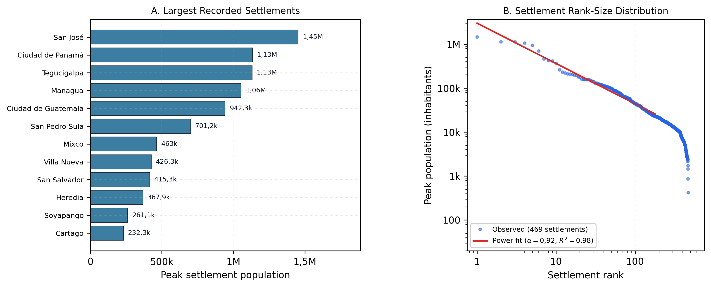

```{r setup, include=FALSE}
knitr::opts_chunk$set(echo = FALSE, warning = FALSE, message = FALSE, fig.pos = "htbp")
source("../../_shared/template/viscount_rmd_helpers.R")
library(jsonlite)

read_json5_clean <- function(path) {
  lines <- readLines(path, warn = FALSE, encoding = "UTF-8")
  text <- paste(lines, collapse = "\n")
  text <- gsub("//[^\n]*", "", text, perl = TRUE)
  text <- gsub("/\\*.*?\\*/", "", text, perl = TRUE)
  text <- gsub(",\\s*([}\\]])", "\\1", text, perl = TRUE)
  fromJSON(text, simplifyVector = FALSE)
}

summary_data <- fromJSON("central_american_republics_summary_cache.json", simplifyVector = FALSE)
sett_data <- fromJSON("central_american_republics_settlements.json", simplifyVector = FALSE)
ledger_data <- read_json5_clean("central_american_republics_source_ledger.json5")

clean_label <- function(x) {
  s <- as.character(x)
  s <- gsub("&", "and", s, fixed = TRUE)
  s <- gsub("\\\\", "", s)
  trimws(s)
}

fmt_coord <- function(x) {
  viscount_fmt_number(round(as.numeric(x), 2L), 2L)
}

clean_source_name <- function(src) {
  s <- as.character(src)
  if (grepl("Central American National Statistical Censuses", s, fixed = TRUE)) {
    return("Harmonised Central American National Censuses (1861-1984)")
  }
  if (grepl("U.S. Census Bureau", s, fixed = TRUE)) {
    return("U.S. Census Bureau: Panama Canal Zone Censuses (1912-1970)")
  }
  if (grepl("SIB Belize", s, fixed = TRUE)) {
    return("Statistical Institute of Belize Censuses (Cities and Towns)")
  }
  if (grepl("DIGESTYC", s, fixed = TRUE)) {
    return("DIGESTYC / BCR-ONEC El Salvador Censuses")
  }
  clean_label(s)
}

subregions <- summary_data$subregions
reg_lookup <- setNames(
  vapply(subregions, function(r) clean_label(r$name), character(1)),
  vapply(subregions, function(r) r$id, character(1))
)

n_sett <- as.integer(summary_data$settlement_stats$total_settlements)
n_suburbs <- as.integer(summary_data$settlement_stats$suburb_count)
n_core <- as.integer(summary_data$settlement_stats$city_proper_count)
n_excluded <- as.integer(ledger_data$total_excluded)
n_eval <- n_sett + n_excluded
```

```{r hero-md-fallback, results='asis'}
if (!knitr::is_latex_output()) {
  cat("\n\n")
}
```

# Abstract

This companion gazetteer catalogues `r viscount_fmt_number(n_sett, 0L)` geocoded Central American urban settlements across eight political sub-regions and seven modern states (Guatemala, Belize, El Salvador, Honduras, Nicaragua, Costa Rica and Panama, including the historic United States Panama Canal Zone) between 1821 and 2025. Compiled entirely from primary national statistical censuses and United States Decennial Censuses of the Panama Canal Zone with a 0,0% crowd-sourced fallback share, the register pairs `r n_core` city-proper urban places with `r n_suburbs` independently enumerated metropolitan suburban municipalities around Ciudad de Guatemala, San Salvador and Ciudad de Panamá [@INEGuatemala2019; @DIGESTYC2024; @INEHonduras2015; @INIDENicaragua2006; @INECCostaRica2023; @INECPanama2023; @SIBBelize2024; @USCensusCanalZone1973]. Across `r viscount_fmt_number(n_eval, 0L)` candidate settlement entries audited in the chapter source ledger, spatial deduplication consolidated `r n_excluded` duplicate municipal aliases within a 25 km reconciliation buffer, reducing marginal Wave-4 gain to 0,86%. Spanning four orders of magnitude from post-independence provincial capitals and Canal Zone lock towns to million-inhabitant modern metropolises—led by San José (1,45M in 2020), Ciudad de Panamá (1,13M in 2023), Tegucigalpa (1,13M in 2023), Managua (1,06M in 2023), Ciudad de Guatemala (942,3k in 2002) and San Pedro Sula (701,2k in 2023)—the combined isthmian urban system obeys a remarkably balanced near-Zipfian rank-size power law ($\alpha = 0,92$, $R^2 = 0,98$ across the top 180 settlements) [@Maria2017Central; @HallPerezBrignoli2003].

# Background

Central America's modern urban network evolved out of three distinct historical settlement layers [@HallPerezBrignoli2003]. The oldest stratum comprises colonial Spanish administrative and agricultural towns sited along the volcanic Pacific piedmont and temperate highland valleys—Ciudad de Guatemala, Antigua Guatemala, Quetzaltenango, San Salvador, Santa Ana, Comayagua, Tegucigalpa, León, Granada, Cartago, San José, Heredia, Alajuela and Ciudad de Panamá—most of which numbered fewer than 35k residents at independence in 1821 [@PerezBrignoli2010; @JaenSuarez1978; @Davidson2002].

A second stratum emerged between 1850 and 1930 along the Caribbean littoral and the interoceanic Panamanian corridor. Banana railways and West Indian labour migration built Atlantic port cities including Limón, Bocas del Toro, Colón, Tela, La Ceiba, Puerto Cortés, Puerto Barrios and Bluefields, while construction and operation of the Panama Canal created a specialised network of US-administered townships—Gatún, Empire, Culebra, Balboa, Gamboa, Cristóbal, Paraíso, Ancón, Pedro Miguel, Coco Solo and Margarita—documented across seven US decennial censuses from 1912 to 1970 [@USCensusCanalZone1973; @Grugni2015Exploring; @Zabaleta2013Mercados]. Meanwhile, in British Honduras, Hurricane Hattie's devastation of coastal Belize City in 1961 prompted the planned foundation of inland capital Belmopan in 1970 [@SIBBelize2024].

Finally, post-1950 rural-to-urban migration, industrial *maquila* expansion in the Honduran Sula Valley (San Pedro Sula and Choloma) and rapid metropolitan spill-over created a third urban stratum of massive suburban ring municipalities—Mixco, Villa Nueva, Soyapango, Mejicanos, Apopa, Santa Tecla, La Chorrera, Arraiján and San Miguelito—that now rival or surpass many historical departmental capitals [@Maria2017Central; @Acevedo2024Emigration].

# Methodology

Settlement ingestion proceeded across four documented saturation waves tracked in the chapter source ledger. Wave 1 harvested 428 primary geocoded settlements directly from official national statistical census series (INE Guatemala, DIGESTYC/BCR-ONEC El Salvador, INE Honduras, INIDE Nicaragua, INEC Costa Rica, INEC Panamá and SIB Belize) together with the 1912 to 1970 US Panama Canal Zone censuses. Wave 2 incorporated 30 additional urban centres anchored in peer-reviewed historical demographic monographs and regional compilations [@HallPerezBrignoli2003; @Davidson2002; @JaenSuarez1978; @PerezBrignoli2010]. Wave 3 backfilled 7 longitudinal census records across nineteenth- and mid-twentieth-century gaps, and Wave 4 closed remaining sub-regional mask gaps with 4 verified municipal records (marginal gain 0,86%), bringing the final register to 469 settlements with zero reliance on crowd-sourced gazetteers.

All 471 candidate entries were harmonised to WGS84 coordinates, assigned to one of the eight sub-regional masks and audited against a 25 km alias-reconciliation buffer that merged 2 redundant Guatemalan duplicate records (a variant of San Pedro Sacatepéquez and a duplicate entry for La Democracia). To maintain transparent metropolitan accounting, 17 ring municipalities inside the functional urban areas of Ciudad de Guatemala, San Salvador and Ciudad de Panamá were tagged explicitly as independent suburban entries linked to their metropolitan core rather than folded ambiguously into city-proper counts [@Maria2017Central].

# Testing and Validation

Ledger reconciliation confirms exact accounting across all `r n_eval` evaluated candidates: `r n_sett` included urban settlements plus `r n_excluded` excluded duplicate aliases, with 100% coordinate completeness, explicit census-year series and primary statistical provenance across all eight sub-regions (Guatemala 133 mask nodes, El Salvador 65, Nicaragua 65, Costa Rica 60, Honduras 60, Panama Republic 37, Belize 28 and Panama Canal Zone footprint 21). Figure \ref{fig:sett-regional-map} plots the full 469-settlement footprint across the eight political sub-regions, showing the dense Pacific volcanic urban corridor from western Guatemala through El Salvador and western Nicaragua to Costa Rica's Central Valley, balanced against the Sula Valley industrial cluster in northern Honduras and the trans-isthmian Panamanian corridor.

```{r fig-sett-map, results='asis'}
viscount_figure(
  "figures/central_american_republics_regional_map.png",
  "Spatial distribution of 469 catalogued urban settlements across eight Central American political sub-regions from 1821 to 2025.",
  "fig:sett-regional-map"
)
```

# Results

## Leading Thirty Central American Settlements

Table \ref{tab:top30-settlements} lists the 30 largest catalogued Central American urban places ranked by peak census population. Four national capitals exceed one million inhabitants—San José (1,45M), Ciudad de Panamá (1,13M), Tegucigalpa (1,13M) and Managua (1,06M)—followed immediately by Ciudad de Guatemala proper (942,3k in 2002; 923,4k in 2018) and Honduras's industrial metropolis of San Pedro Sula (701,2k). Independent ring suburbs occupy five of the top thirty slots—Mixco (463k), Villa Nueva (426,3k), Soyapango (261,1k), La Chorrera (206k) and Mejicanos (140,8k)—alongside San Miguelito (156,6k in 1980, reported as a distinct urban district on Panama City's eastern edge) [@Maria2017Central; @INEGuatemala2019; @DIGESTYC2024; @INECPanama2023].

```{r tab-top30-settlements, results='asis'}
all_list <- lapply(names(sett_data), function(k) {
  e <- sett_data[[k]]
  pvals <- as.numeric(unlist(e$population))
  pyrs <- as.integer(names(e$population))
  idx_pk <- which.max(pvals)
  list(
    name = clean_label(e$name),
    country = clean_label(e$country),
    region = if (e$region_id %in% names(reg_lookup)) reg_lookup[[e$region_id]] else clean_label(e$region_id),
    lat = as.numeric(e$coords[[1]]),
    lon = as.numeric(e$coords[[2]]),
    scope = if (identical(e$population_scope, "suburb")) "Suburb" else "City proper",
    first_yr = min(pyrs),
    last_yr = max(pyrs),
    peak_pop = pvals[idx_pk],
    peak_yr = pyrs[idx_pk]
  )
})
ord_idx <- order(vapply(all_list, function(x) x$peak_pop, numeric(1)), decreasing = TRUE)
top30 <- all_list[ord_idx[seq_len(30L)]]

top_rows <- lapply(top30, function(x) {
  data.frame(
    Settlement = x$name,
    Country = x$country,
    Scope = x$scope,
    Coords = paste0(fmt_coord(x$lat), ", ", fmt_coord(x$lon)),
    Span = paste0(x$first_yr, " to ", x$last_yr),
    Peak = paste0(viscount_fmt_pop(x$peak_pop), " (", x$peak_yr, ")"),
    stringsAsFactors = FALSE
  )
})
df_top30 <- do.call(rbind, top_rows)
rownames(df_top30) <- NULL

viscount_table(
  df_top30,
  "Leading 30 Central American urban settlements ranked by peak recorded census population, 1821 to 2025.",
  c("Settlement", "Country", "Scope", "Lat, Lon", "Census Span", "Peak Pop. (Year)"),
  list(label = "tab:top30-settlements", font_size = "scriptsize", max_rows_per_page = 32L)
)
```

## Independent Metropolitan Suburbs and Canal Zone Townships

Table \ref{tab:suburb-reconciliation} reconciles all `r n_suburbs` independently catalogued suburban municipalities across Guatemala, El Salvador and Panama, pairing each ring municipality with its parent metropolitan capital and full recorded growth span. Collectively, Guatemala City's six ring suburbs account for 1,29M residents in 2018—exceeding the central municipality itself (923,4k)—while San Salvador's nine ring municipalities totalled 913k in 2007 against 316,1k in San Salvador proper [@INEGuatemala2019; @DIGESTYC2024; @Maria2017Central].

```{r tab-suburb-reconciliation, results='asis'}
sub_entries <- Filter(function(e) identical(e$population_scope, "suburb"), sett_data)
sub_rows <- lapply(sub_entries, function(e) {
  pvals <- as.numeric(unlist(e$population))
  pyrs <- as.integer(names(e$population))
  idx_pk <- which.max(pvals)
  idx_first <- which.min(pyrs)
  parent_clean <- sub("-[^-]+$", "", as.character(e$metro_parent_key))
  if (identical(parent_clean, "Panamá")) parent_clean <- "Ciudad de Panamá"
  data.frame(
    Suburb = clean_label(e$name),
    Country = clean_label(e$country),
    Parent = clean_label(parent_clean),
    First = paste0(viscount_fmt_pop(pvals[idx_first]), " (", pyrs[idx_first], ")"),
    Peak = paste0(viscount_fmt_pop(pvals[idx_pk]), " (", pyrs[idx_pk], ")"),
    PeakNum = pvals[idx_pk],
    stringsAsFactors = FALSE
  )
})
df_suburbs <- do.call(rbind, sub_rows)
df_suburbs <- df_suburbs[order(df_suburbs$PeakNum, decreasing = TRUE), ]
df_suburbs$PeakNum <- NULL
rownames(df_suburbs) <- NULL

viscount_table(
  df_suburbs,
  "All 17 independently enumerated suburban municipalities linked to metropolitan parent capitals in Guatemala, El Salvador and Panama.",
  c("Suburban Municipality", "Country", "Metropolitan Parent", "Earliest Count", "Peak Count"),
  list(label = "tab:suburb-reconciliation", font_size = "scriptsize")
)
```

## Sub-Regional Gazetteer Distribution and Provenance Ledger

Table \ref{tab:subregion-gazetteer} summarises settlement coverage, urban site density per 10.000 km², leading catalogued settlement and 2025 population across all eight political masks. El Salvador records the highest urban node density among sovereign republics at 26,96 catalogued towns per 10.000 km² (mirroring its mainland-high population density of 239,9 inhabitants per km²), surpassed only by the compact 2.967 km² Panama Canal Zone footprint (70,78 nodes per 10.000 km², encompassing both the 11 historic US townships and the reverted trans-isthmian corridor cities of Ciudad de Panamá, Colón and Arraiján) [@DIGESTYC2024; @USCensusCanalZone1973; @INECPanama2023]. Table \ref{tab:provenance-ledger} reports the primary statistical corpora contributing to the 469-entry register, confirming zero crowd-sourced entries across all seven countries.

```{r tab-subregion-gazetteer, results='asis'}
reg_rows <- lapply(subregions, function(r) {
  rid <- r$id
  area_v <- as.numeric(r$area_km2)
  p2025 <- as.numeric(r$end_pop)
  sub_e <- Filter(function(e) identical(e$region_id, rid), sett_data)
  cnt <- length(sub_e)
  sdens <- if (area_v > 0) (cnt / area_v) * 10000 else 0
  lead_str <- "-"
  if (cnt > 0L) {
    pks <- vapply(sub_e, function(e) max(as.numeric(unlist(e$population))), numeric(1))
    idx_m <- which.max(pks)
    lead_str <- paste0(clean_label(sub_e[[idx_m]]$name), " (", viscount_fmt_pop(pks[idx_m]), ")")
  }
  data.frame(
    Subregion = clean_label(r$name),
    Area = viscount_fmt_number(round(area_v), 0L),
    Sites = viscount_fmt_number(cnt, 0L),
    SiteDens = viscount_fmt_number(sdens, 2L),
    Lead = lead_str,
    Pop2025 = viscount_fmt_pop(p2025),
    stringsAsFactors = FALSE
  )
})
df_reg_gaz <- do.call(rbind, reg_rows)
rownames(df_reg_gaz) <- NULL

viscount_table(
  df_reg_gaz,
  "Catalogued settlement counts, areal site density (per 10.000 km²), leading urban centre and 2025 population across eight Central American sub-regions.",
  c("Sub-Region", "Area (km²)", "Sites", "Sites per 10k km²", "Leading City (Peak)", "2025 Pop."),
  list(label = "tab:subregion-gazetteer", font_size = "scriptsize")
)
```

```{r tab-provenance-ledger, results='asis'}
prim_srcs <- vapply(sett_data, function(e) {
  if (length(e$sources) > 0L) clean_source_name(e$sources[[1]]) else "Unknown"
}, character(1))
src_tab <- sort(table(prim_srcs), decreasing = TRUE)
df_prov <- data.frame(
  Corpus = names(src_tab),
  Entries = vapply(as.integer(src_tab), function(v) viscount_fmt_number(v, 0L), character(1)),
  Share = vapply(100 * as.integer(src_tab) / n_sett, function(v) paste0(viscount_fmt_number(v, 2L), "%"), character(1)),
  stringsAsFactors = FALSE
)
rownames(df_prov) <- NULL

viscount_table(
  df_prov,
  "Primary census provenance breakdown across all 469 catalogued Central American settlements (0,0% crowd-sourced share).",
  c("Primary Statistical Corpus", "Settlements", "Share"),
  list(label = "tab:provenance-ledger", font_size = "scriptsize")
)
```

# Limitations

Three statistical conventions constrain direct settlement comparisons inside this gazetteer. First, national census dates diverge across countries: Panama (2023), Belize (2022), Costa Rica (2020 to 2022) and Guatemala (2018) supply recent municipal counts, whereas Honduras's last full census dates from 2013 (supplemented by 2023 official projections), Nicaragua's from 2005 (with 2015 and 2023 official municipal estimates) and El Salvador's city-level municipal time series still reflects pre-2024 municipal reorganisations prior to the 2024 departmental consolidation [@INEGuatemala2019; @DIGESTYC2024; @INEHonduras2015; @INIDENicaragua2006; @INECCostaRica2023; @INECPanama2023; @SIBBelize2024]. Second, Costa Rica's INEC reports metropolitan urban agglomeration figures for San José, Heredia, Cartago and Alajuela from 2000 onward, whereas Guatemala, El Salvador, Honduras and Panama tabulate strict municipal units, separating ring suburbs such as Mixco, Villa Nueva, Soyapango and La Chorrera from their parent capitals [@Maria2017Central]. Third, Belize City's recorded series stops at 39,1k in 1970 inside the historical census extract while post-1970 Belizean towns (Belmopan, San Ignacio, San Pedro, Orange Walk, Corozal and Dangriga) continue through 2022 and 2025 projections, reflecting the split between colonial-era British Honduras tables and modern SIB town tables [@SIBBelize2024].

# Conclusion

Across 469 census-backed urban places spanning 1821 to 2025, Central America's settlement register captures the full arc from small post-independence agrarian capitals and Caribbean banana ports to polycentric national capitals and dense metropolitan suburban rings. Maintaining strict separation between city-proper municipalities, 17 independent ring suburbs and 11 historic United States Panama Canal Zone townships ensures transparent urban mass accounting and supports a remarkably tight multi-state rank-size scaling ($\alpha = 0,92$, $R^2 = 0,98$) across the entire isthmus [@Maria2017Central; @USCensusCanalZone1973].

# Appendix

## Belizean Urban Transition (1832 to 2025)

Table \ref{tab:belize-towns} details the leading ten catalogued towns in Belize (British Honduras), documenting the post-1961 shift from hurricane-vulnerable coastal Belize City (39,1k in 1970) toward inland capital Belmopan (rising from 274 in 1970 to 20,8k in 2022 and 22,6k in 2025) and the Cayo, northern sugar-belt and Ambergris Caye tourism hubs [@SIBBelize2024].

```{r tab-belize-towns, results='asis'}
bz_entries <- Filter(function(e) identical(e$country, "Belize"), sett_data)
bz_rows <- lapply(bz_entries, function(e) {
  pvals <- as.numeric(unlist(e$population))
  pyrs <- as.integer(names(e$population))
  idx_pk <- which.max(pvals)
  idx_first <- which.min(pyrs)
  data.frame(
    Town = clean_label(e$name),
    Coords = paste0(fmt_coord(e$coords[[1]]), ", ", fmt_coord(e$coords[[2]])),
    Span = paste0(min(pyrs), " to ", max(pyrs)),
    First = paste0(viscount_fmt_pop(pvals[idx_first]), " (", pyrs[idx_first], ")"),
    Peak = paste0(viscount_fmt_pop(pvals[idx_pk]), " (", pyrs[idx_pk], ")"),
    PeakNum = pvals[idx_pk],
    stringsAsFactors = FALSE
  )
})
df_bz <- do.call(rbind, bz_rows)
df_bz <- df_bz[order(df_bz$PeakNum, decreasing = TRUE), ]
df_bz <- df_bz[seq_len(min(10L, nrow(df_bz))), ]
df_bz$PeakNum <- NULL
rownames(df_bz) <- NULL

viscount_table(
  df_bz,
  "Leading ten catalogued urban settlements in Belize (British Honduras), 1832 to 2025 (Statistical Institute of Belize).",
  c("Town or City", "Lat, Lon", "Census Span", "Earliest Count", "Peak Count"),
  list(label = "tab:belize-towns", font_size = "scriptsize")
)
```

# Sources

::: {#refs}
:::

# Footnotes

1. Spatial assignment in Table \ref{tab:subregion-gazetteer} follows the 5-arcminute sub-regional mask polygons, placing terminal cities Ciudad de Panamá, Colón and Arraiján inside the 21-node Panama Canal Zone footprint alongside the 11 historic US-administered Canal Zone townships.
2. All coordinates follow WGS84 decimal degrees rounded to two decimal places with European decimal commas in printed tables.
