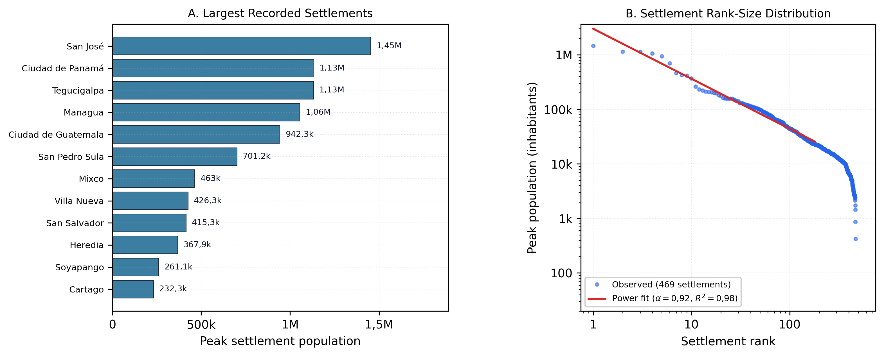
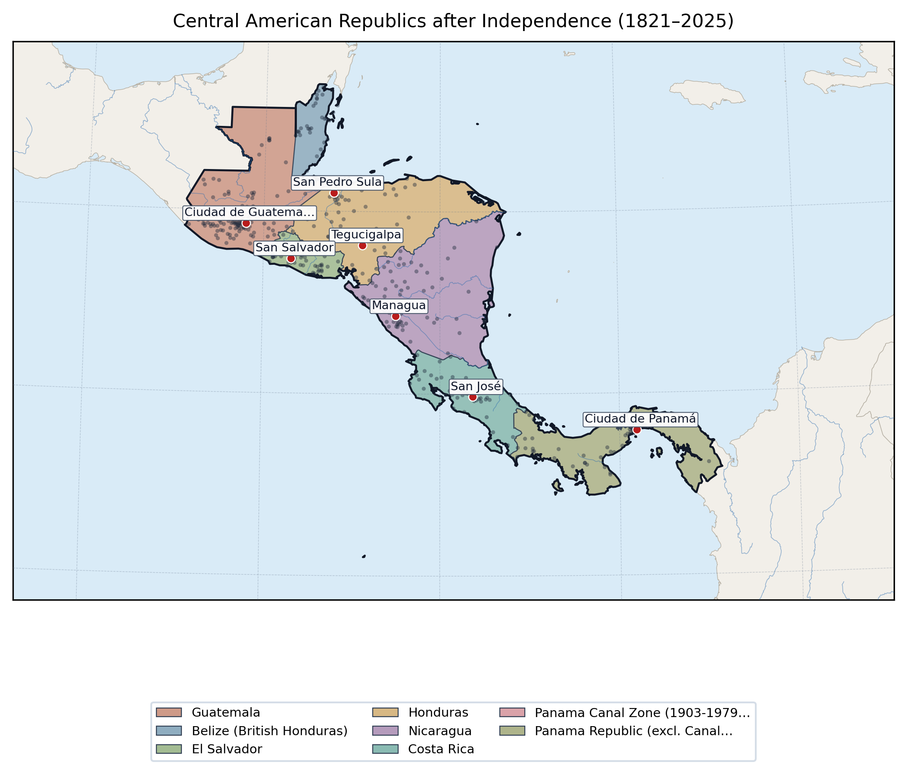

Central American Republics after Independence
================
Aust Kätzchen
23 November 2026

- [Abstract](#abstract)
- [Background](#background)
- [Methodology](#methodology)
- [Testing and Validation](#testing-and-validation)
- [Results](#results)
  - [Leading Thirty Central American
    Settlements](#leading-thirty-central-american-settlements)
  - [Independent Metropolitan Suburbs and Canal Zone
    Townships](#independent-metropolitan-suburbs-and-canal-zone-townships)
  - [Sub-Regional Gazetteer Distribution and Provenance
    Ledger](#sub-regional-gazetteer-distribution-and-provenance-ledger)
- [Limitations](#limitations)
- [Conclusion](#conclusion)
- [Appendix](#appendix)
  - [Belizean Urban Transition (1832 to
    2025)](#belizean-urban-transition-1832-to-2025)
- [Sources](#sources)
- [Footnotes](#footnotes)

<figure>

<figcaption aria-hidden="true">Largest catalogued Central American
settlements and rank-size distribution across 469 urban places from 1821
to 2025.</figcaption>
</figure>

# Abstract

This companion gazetteer catalogues 469 geocoded Central American urban
settlements across eight political sub-regions and seven modern states
(Guatemala, Belize, El Salvador, Honduras, Nicaragua, Costa Rica and
Panama, including the historic United States Panama Canal Zone) between
1821 and 2025. Compiled entirely from primary national statistical
censuses and United States Decennial Censuses of the Panama Canal Zone
with a 0,0% crowd-sourced fallback share, the register pairs 452
city-proper urban places with 17 independently enumerated metropolitan
suburban municipalities around Ciudad de Guatemala, San Salvador and
Ciudad de Panamá
[\[1\]](#ref-INEGuatemala2019)[\[2\]](#ref-DIGESTYC2024)[\[3\]](#ref-INEHonduras2015)[\[4\]](#ref-INIDENicaragua2006)[\[5\]](#ref-INECCostaRica2023)[\[6\]](#ref-INECPanama2023)[\[7\]](#ref-SIBBelize2024)[\[8\]](#ref-USCensusCanalZone1973).
Across 471 candidate settlement entries audited in the chapter source
ledger, spatial deduplication consolidated 2 duplicate municipal aliases
within a 25 km reconciliation buffer, reducing marginal Wave-4 gain to
0,86%. Spanning four orders of magnitude from post-independence
provincial capitals and Canal Zone lock towns to million-inhabitant
modern metropolises—led by San José (1,45M in 2020), Ciudad de Panamá
(1,13M in 2023), Tegucigalpa (1,13M in 2023), Managua (1,06M in 2023),
Ciudad de Guatemala (942,3k in 2002) and San Pedro Sula (701,2k in
2023)—the combined isthmian urban system obeys a remarkably balanced
near-Zipfian rank-size power law ($\alpha = 0,92$, $R^2 = 0,98$ across
the top 180 settlements)
[\[9\]](#ref-Maria2017Central)[\[10\]](#ref-HallPerezBrignoli2003).

# Background

Central America’s modern urban network evolved out of three distinct
historical settlement layers [\[10\]](#ref-HallPerezBrignoli2003). The
oldest stratum comprises colonial Spanish administrative and
agricultural towns sited along the volcanic Pacific piedmont and
temperate highland valleys—Ciudad de Guatemala, Antigua Guatemala,
Quetzaltenango, San Salvador, Santa Ana, Comayagua, Tegucigalpa, León,
Granada, Cartago, San José, Heredia, Alajuela and Ciudad de Panamá—most
of which numbered fewer than 35k residents at independence in 1821
[\[11\]](#ref-PerezBrignoli2010)[\[12\]](#ref-JaenSuarez1978)[\[13\]](#ref-Davidson2002).

A second stratum emerged between 1850 and 1930 along the Caribbean
littoral and the interoceanic Panamanian corridor. Banana railways and
West Indian labour migration built Atlantic port cities including Limón,
Bocas del Toro, Colón, Tela, La Ceiba, Puerto Cortés, Puerto Barrios and
Bluefields, while construction and operation of the Panama Canal created
a specialised network of US-administered townships—Gatún, Empire,
Culebra, Balboa, Gamboa, Cristóbal, Paraíso, Ancón, Pedro Miguel, Coco
Solo and Margarita—documented across seven US decennial censuses from
1912 to 1970
[\[8\]](#ref-USCensusCanalZone1973)[\[14\]](#ref-Grugni2015Exploring)[\[15\]](#ref-Zabaleta2013Mercados).
Meanwhile, in British Honduras, Hurricane Hattie’s devastation of
coastal Belize City in 1961 prompted the planned foundation of inland
capital Belmopan in 1970 [\[7\]](#ref-SIBBelize2024).

Finally, post-1950 rural-to-urban migration, industrial *maquila*
expansion in the Honduran Sula Valley (San Pedro Sula and Choloma) and
rapid metropolitan spill-over created a third urban stratum of massive
suburban ring municipalities—Mixco, Villa Nueva, Soyapango, Mejicanos,
Apopa, Santa Tecla, La Chorrera, Arraiján and San Miguelito—that now
rival or surpass many historical departmental capitals
[\[9\]](#ref-Maria2017Central)[\[16\]](#ref-Acevedo2024Emigration).

# Methodology

Settlement ingestion proceeded across four documented saturation waves
tracked in the chapter source ledger. Wave 1 harvested 428 primary
geocoded settlements directly from official national statistical census
series (INE Guatemala, DIGESTYC/BCR-ONEC El Salvador, INE Honduras,
INIDE Nicaragua, INEC Costa Rica, INEC Panamá and SIB Belize) together
with the 1912 to 1970 US Panama Canal Zone censuses. Wave 2 incorporated
30 additional urban centres anchored in peer-reviewed historical
demographic monographs and regional compilations
[\[10\]](#ref-HallPerezBrignoli2003)[\[11\]](#ref-PerezBrignoli2010)[\[12\]](#ref-JaenSuarez1978)[\[13\]](#ref-Davidson2002).
Wave 3 backfilled 7 longitudinal census records across nineteenth- and
mid-twentieth-century gaps, and Wave 4 closed remaining sub-regional
mask gaps with 4 verified municipal records (marginal gain 0,86%),
bringing the final register to 469 settlements with zero reliance on
crowd-sourced gazetteers.

All 471 candidate entries were harmonised to WGS84 coordinates, assigned
to one of the eight sub-regional masks and audited against a 25 km
alias-reconciliation buffer that merged 2 redundant Guatemalan duplicate
records (a variant of San Pedro Sacatepéquez and a duplicate entry for
La Democracia). To maintain transparent metropolitan accounting, 17 ring
municipalities inside the functional urban areas of Ciudad de Guatemala,
San Salvador and Ciudad de Panamá were tagged explicitly as independent
suburban entries linked to their metropolitan core rather than folded
ambiguously into city-proper counts [\[9\]](#ref-Maria2017Central).

# Testing and Validation

Ledger reconciliation confirms exact accounting across all 471 evaluated
candidates: 469 included urban settlements plus 2 excluded duplicate
aliases, with 100% coordinate completeness, explicit census-year series
and primary statistical provenance across all eight sub-regions
(Guatemala 133 mask nodes, El Salvador 65, Nicaragua 65, Costa Rica 60,
Honduras 60, Panama Republic 37, Belize 28 and Panama Canal Zone
footprint 21). Figure plots the full 469-settlement footprint across the
eight political sub-regions, showing the dense Pacific volcanic urban
corridor from western Guatemala through El Salvador and western
Nicaragua to Costa Rica’s Central Valley, balanced against the Sula
Valley industrial cluster in northern Honduras and the trans-isthmian
Panamanian corridor.

<!-- -->

# Results

## Leading Thirty Central American Settlements

Table lists the 30 largest catalogued Central American urban places
ranked by peak census population. Four national capitals exceed one
million inhabitants—San José (1,45M), Ciudad de Panamá (1,13M),
Tegucigalpa (1,13M) and Managua (1,06M)—followed immediately by Ciudad
de Guatemala proper (942,3k in 2002; 923,4k in 2018) and Honduras’s
industrial metropolis of San Pedro Sula (701,2k). Independent ring
suburbs occupy five of the top thirty slots—Mixco (463k), Villa Nueva
(426,3k), Soyapango (261,1k), La Chorrera (206k) and Mejicanos
(140,8k)—alongside San Miguelito (156,6k in 1980, reported as a distinct
urban district on Panama City’s eastern edge)
[\[1\]](#ref-INEGuatemala2019)[\[2\]](#ref-DIGESTYC2024)[\[6\]](#ref-INECPanama2023)[\[9\]](#ref-Maria2017Central).

| Settlement | Country | Scope | Lat, Lon | Census Span | Peak Pop. (Year) |
|:---|:---|:---|:---|:---|:---|
| **San José** | Costa Rica | City proper | 9,93, -84,09 | 1844 to 2020 | 1,45M (2020) |
| **Ciudad de Panamá** | Panama | City proper | 8,98, -79,52 | 1851 to 2023 | 1,13M (2023) |
| **Tegucigalpa** | Honduras | City proper | 14,07, -87,19 | 1850 to 2023 | 1,13M (2023) |
| **Managua** | Nicaragua | City proper | 12,14, -86,25 | 1850 to 2023 | 1,06M (2023) |
| **Ciudad de Guatemala** | Guatemala | City proper | 14,63, -90,51 | 1825 to 2018 | 942,3k (2002) |
| **San Pedro Sula** | Honduras | City proper | 15,5, -88,03 | 1887 to 2023 | 701,2k (2023) |
| **Mixco** | Guatemala | Suburb | 14,63, -90,61 | 1994 to 2018 | 463k (2018) |
| **Villa Nueva** | Guatemala | Suburb | 14,53, -90,59 | 1994 to 2018 | 426,3k (2018) |
| **San Salvador** | El Salvador | City proper | 13,69, -89,22 | 1830 to 2007 | 415,3k (1992) |
| **Heredia** | Costa Rica | City proper | 10, -84,12 | 1864 to 2020 | 367,9k (2020) |
| **Soyapango** | El Salvador | Suburb | 13,71, -89,14 | 1992 to 2007 | 261,1k (1992) |
| **Cartago** | Costa Rica | City proper | 9,86, -83,92 | 1864 to 2020 | 232,3k (2020) |
| **Choloma** | Honduras | City proper | 15,61, -87,95 | 1988 to 2023 | 220,3k (2023) |
| **Cobán** | Guatemala | City proper | 15,47, -90,37 | 1880 to 2018 | 212k (2018) |
| **La Ceiba** | Honduras | City proper | 15,76, -86,78 | 1910 to 2023 | 209k (2023) |
| **La Chorrera** | Panama | Suburb | 8,88, -79,78 | 1911 to 2023 | 206k (2023) |
| **Santa Ana** | El Salvador | City proper | 13,99, -89,56 | 1878 to 2007 | 198,3k (2007) |
| **Alajuela** | Costa Rica | City proper | 10,02, -84,21 | 1864 to 2020 | 196,9k (2020) |
| **Quetzaltenango** | Guatemala | City proper | 14,83, -91,52 | 1850 to 2018 | 180,7k (2018) |
| **León** | Nicaragua | City proper | 12,44, -86,88 | 1850 to 2023 | 177,3k (2023) |
| **Jalapa** | Guatemala | City proper | 14,64, -89,99 | 1994 to 2018 | 159,8k (2018) |
| **Colón** | Panama | City proper | 9,35, -79,9 | 1855 to 2023 | 159,2k (2023) |
| **San Miguelito** | Panama | City proper | 9,03, -79,5 | 1960 to 1980 | 156,6k (1980) |
| **Escuintla** | Guatemala | City proper | 14,3, -90,78 | 1893 to 2018 | 156,3k (2018) |
| **San Juan Sacatepéquez** | Guatemala | City proper | 14,72, -90,64 | 1994 to 2018 | 156k (2018) |
| **San Miguel** | El Salvador | City proper | 13,48, -88,18 | 1878 to 2007 | 156k (2007) |
| **Tipitapa** | Nicaragua | City proper | 12,2, -86,1 | 1971 to 2023 | 150,6k (2023) |
| **Jutiapa** | Guatemala | City proper | 14,28, -89,89 | 1994 to 2018 | 145,9k (2018) |
| **Mejicanos** | El Salvador | Suburb | 13,72, -89,19 | 1992 to 2007 | 140,8k (2007) |
| **Masaya** | Nicaragua | City proper | 11,97, -86,09 | 1850 to 2023 | 140,7k (2023) |

Leading 30 Central American urban settlements ranked by peak recorded
census population, 1821 to 2025.

## Independent Metropolitan Suburbs and Canal Zone Townships

Table reconciles all 17 independently catalogued suburban municipalities
across Guatemala, El Salvador and Panama, pairing each ring municipality
with its parent metropolitan capital and full recorded growth span.
Collectively, Guatemala City’s six ring suburbs account for 1,29M
residents in 2018—exceeding the central municipality itself
(923,4k)—while San Salvador’s nine ring municipalities totalled 913k in
2007 against 316,1k in San Salvador proper
[\[1\]](#ref-INEGuatemala2019)[\[2\]](#ref-DIGESTYC2024)[\[9\]](#ref-Maria2017Central).

| Suburban Municipality | Country | Metropolitan Parent | Earliest Count | Peak Count |
|:---|:---|:---|:---|:---|
| **Mixco** | Guatemala | Ciudad de Guatemala | 209,8k (1994) | 463k (2018) |
| **Villa Nueva** | Guatemala | Ciudad de Guatemala | 101,3k (1994) | 426,3k (2018) |
| **Soyapango** | El Salvador | San Salvador | 261,1k (1992) | 261,1k (1992) |
| **La Chorrera** | Panama | Ciudad de Panamá | 2,4k (1911) | 206k (2023) |
| **Mejicanos** | El Salvador | San Salvador | 132k (1992) | 140,8k (2007) |
| **Villa Canales** | Guatemala | Ciudad de Guatemala | 5,5k (1994) | 124,7k (2018) |
| **Apopa** | El Salvador | San Salvador | 88,8k (1992) | 123,1k (2007) |
| **Santa Tecla** | El Salvador | San Salvador | 11,2k (1878) | 108,8k (2007) |
| **Chinautla** | Guatemala | Ciudad de Guatemala | 37,1k (1994) | 105k (2018) |
| **Amatitlán** | Guatemala | Ciudad de Guatemala | 37k (1994) | 98,2k (2018) |
| **Delgado** | El Salvador | San Salvador | 56,7k (1992) | 95,6k (2007) |
| **Ilopango** | El Salvador | San Salvador | 79,1k (1992) | 88,9k (2007) |
| **Arraiján** | Panama | Ciudad de Panamá | 52,5k (2000) | 84,5k (2023) |
| **Santa Catarina Pinula** | Guatemala | Ciudad de Guatemala | 8,2k (1994) | 71k (2018) |
| **San Marcos** | El Salvador | San Salvador | 43,3k (1992) | 60k (2007) |
| **Cuscatancingo** | El Salvador | San Salvador | 35,1k (1992) | 35,1k (1992) |
| **Antiguo Cuscatlán** | El Salvador | San Salvador | 26,7k (1992) | 33k (2007) |

All 17 independently enumerated suburban municipalities linked to
metropolitan parent capitals in Guatemala, El Salvador and Panama.

## Sub-Regional Gazetteer Distribution and Provenance Ledger

Table summarises settlement coverage, urban site density per 10.000 km²,
leading catalogued settlement and 2025 population across all eight
political masks. El Salvador records the highest urban node density
among sovereign republics at 26,96 catalogued towns per 10.000 km²
(mirroring its mainland-high population density of 239,9 inhabitants per
km²), surpassed only by the compact 2.967 km² Panama Canal Zone
footprint (70,78 nodes per 10.000 km², encompassing both the 11 historic
US townships and the reverted trans-isthmian corridor cities of Ciudad
de Panamá, Colón and Arraiján)
[\[2\]](#ref-DIGESTYC2024)[\[6\]](#ref-INECPanama2023)[\[8\]](#ref-USCensusCanalZone1973).
Table reports the primary statistical corpora contributing to the
469-entry register, confirming zero crowd-sourced entries across all
seven countries.

| Sub-Region | Area (km²) | Sites | Sites per 10k km² | Leading City (Peak) | 2025 Pop. |
|:---|:---|:---|:---|:---|:---|
| **Guatemala** | 132.086 | 133 | 10,07 | Ciudad de Guatemala (942,3k) | 16,25M |
| **Belize (British Honduras)** | 30.074 | 28 | 9,31 | Belize City (39k) | 502k |
| **El Salvador** | 24.110 | 65 | 26,96 | San Salvador (415,3k) | 5,78M |
| **Honduras** | 117.693 | 60 | 5,1 | Tegucigalpa (1,13M) | 8,27M |
| **Nicaragua** | 134.545 | 65 | 4,83 | Managua (1,06M) | 5,43M |
| **Costa Rica** | 58.031 | 60 | 10,34 | San José (1,45M) | 5,17M |
| **Panama Canal Zone (1903-1979 OHM Footprint)** | 2.967 | 21 | 70,78 | Ciudad de Panamá (1,13M) | 567,2k |
| **Panama Republic (excl. Canal Zone)** | 87.820 | 37 | 4,21 | La Chorrera (206k) | 3,3M |

Catalogued settlement counts, areal site density (per 10.000 km²),
leading urban centre and 2025 population across eight Central American
sub-regions.

| Primary Statistical Corpus | Settlements | Share |
|:---|:---|:---|
| **INE Guatemala Censuses** | 132 | 28,14% |
| **DIGESTYC / BCR-ONEC El Salvador Censuses** | 65 | 13,86% |
| **INIDE Nicaragua Censuses** | 65 | 13,86% |
| **INE Honduras Censuses** | 59 | 12,58% |
| **INEC Costa Rica Censuses** | 51 | 10,87% |
| **INEC Panama Censuses** | 45 | 9,59% |
| **Statistical Institute of Belize Censuses (Cities and Towns)** | 28 | 5,97% |
| **Harmonised Central American National Censuses (1861-1984)** | 13 | 2,77% |
| **U.S. Census Bureau: Panama Canal Zone Censuses (1912-1970)** | 11 | 2,35% |

Primary census provenance breakdown across all 469 catalogued Central
American settlements (0,0% crowd-sourced share).

# Limitations

Three statistical conventions constrain direct settlement comparisons
inside this gazetteer. First, national census dates diverge across
countries: Panama (2023), Belize (2022), Costa Rica (2020 to 2022) and
Guatemala (2018) supply recent municipal counts, whereas Honduras’s last
full census dates from 2013 (supplemented by 2023 official projections),
Nicaragua’s from 2005 (with 2015 and 2023 official municipal estimates)
and El Salvador’s city-level municipal time series still reflects
pre-2024 municipal reorganisations prior to the 2024 departmental
consolidation
[\[1\]](#ref-INEGuatemala2019)[\[2\]](#ref-DIGESTYC2024)[\[3\]](#ref-INEHonduras2015)[\[4\]](#ref-INIDENicaragua2006)[\[5\]](#ref-INECCostaRica2023)[\[6\]](#ref-INECPanama2023)[\[7\]](#ref-SIBBelize2024).
Second, Costa Rica’s INEC reports metropolitan urban agglomeration
figures for San José, Heredia, Cartago and Alajuela from 2000 onward,
whereas Guatemala, El Salvador, Honduras and Panama tabulate strict
municipal units, separating ring suburbs such as Mixco, Villa Nueva,
Soyapango and La Chorrera from their parent capitals
[\[9\]](#ref-Maria2017Central). Third, Belize City’s recorded series
stops at 39,1k in 1970 inside the historical census extract while
post-1970 Belizean towns (Belmopan, San Ignacio, San Pedro, Orange Walk,
Corozal and Dangriga) continue through 2022 and 2025 projections,
reflecting the split between colonial-era British Honduras tables and
modern SIB town tables [\[7\]](#ref-SIBBelize2024).

# Conclusion

Across 469 census-backed urban places spanning 1821 to 2025, Central
America’s settlement register captures the full arc from small
post-independence agrarian capitals and Caribbean banana ports to
polycentric national capitals and dense metropolitan suburban rings.
Maintaining strict separation between city-proper municipalities, 17
independent ring suburbs and 11 historic United States Panama Canal Zone
townships ensures transparent urban mass accounting and supports a
remarkably tight multi-state rank-size scaling ($\alpha = 0,92$,
$R^2 = 0,98$) across the entire isthmus
[\[8\]](#ref-USCensusCanalZone1973)[\[9\]](#ref-Maria2017Central).

# Appendix

## Belizean Urban Transition (1832 to 2025)

Table details the leading ten catalogued towns in Belize (British
Honduras), documenting the post-1961 shift from hurricane-vulnerable
coastal Belize City (39,1k in 1970) toward inland capital Belmopan
(rising from 274 in 1970 to 20,8k in 2022 and 22,6k in 2025) and the
Cayo, northern sugar-belt and Ambergris Caye tourism hubs
[\[7\]](#ref-SIBBelize2024).

| Town or City    | Lat, Lon      | Census Span  | Earliest Count | Peak Count   |
|:----------------|:--------------|:-------------|:---------------|:-------------|
| **Belize City** | 17,5, -88,19  | 1832 to 1970 | 4,5k (1832)    | 39k (1970)   |
| **Belmopan**    | 17,25, -88,76 | 1970 to 2025 | 274 (1970)     | 22,6k (2025) |
| **San Ignacio** | 17,16, -89,07 | 1980 to 2025 | 5,6k (1980)    | 22k (2025)   |
| **San Pedro**   | 17,92, -87,97 | 1980 to 2025 | 1,1k (1980)    | 16,4k (2025) |
| **Orange Walk** | 18,08, -88,56 | 1980 to 2025 | 8,4k (1980)    | 14,8k (2025) |
| **Corozal**     | 18,39, -88,39 | 1980 to 2025 | 6,9k (1980)    | 10,3k (2010) |
| **Dangriga**    | 16,97, -88,23 | 1980 to 2025 | 6,7k (1980)    | 9,7k (2025)  |
| **Ladyville**   | 17,55, -88,29 | 2000 to 2022 | 3,5k (2000)    | 7,7k (2022)  |
| **Bella Vista** | 16,51, -88,53 | 2000 to 2022 | 710 (2000)     | 6,3k (2022)  |
| **Trial Farm**  | 18,1, -88,57  | 2000 to 2022 | 3,2k (2000)    | 5,8k (2022)  |

Leading ten catalogued urban settlements in Belize (British Honduras),
1832 to 2025 (Statistical Institute of Belize).

# Sources

1.
Instituto Nacional de Estadística
(INE) Guatemala. “Censos Nacionales de Población y
Habitación (1893/1898, 1940, 1950, 1964, 1973, 1981, 1994, 2002, XII
Censo 2018).” INE, Ciudad de Guatemala, 2019,
<https://www.ine.gob.gt/>.

2.
Dirección General de Estadística y
Censos (DIGESTYC) / Banco Central de Reserva (BCR) – ONEC.
“Censos Nacionales de Población y Vivienda de El
Salvador (1930, 1950, 1961, 1971, 1992, 2007, VII Censo 2024).”
BCR / ONEC, San Salvador, 2024, <https://onec.bcr.gob.sv/>.

3.
Instituto Nacional de Estadística
(INE) Honduras. “Censos Nacionales de Población y
Vivienda de Honduras (1881, 1910, 1916, 1930, 1940, 1950, 1961, 1974,
1988, 2001, XVII Censo 2013).” INE, Tegucigalpa, 2015,
<https://www.ine.gob.hn/>.

4.
Instituto Nacional de Información
de Desarrollo (INIDE) Nicaragua. “Censos Nacionales
de Población y Vivienda de Nicaragua (1940, 1950, 1963, 1971, 1995, VIII
Censo 2005).” INIDE, Managua, 2006,
<https://www.inide.gob.ni/>.

5.
Instituto Nacional de Estadística
y Censos (INEC) Costa Rica. “Censos Nacionales de
Población de Costa Rica (1864, 1883, 1892, 1927, 1950, 1963, 1973, 1984,
2000, 2011, 2022).” INEC, San José, 2023,
<https://www.inec.cr/>.

6.
Instituto Nacional de Estadística
y Censo (INEC) Panamá. “Censos Nacionales de
Población y Vivienda de Panamá (1911, 1920, 1930, 1940, 1950, 1960,
1970, 1980, 1990, 2000, 2010, XII Censo 2023).” Contraloría
General de la República / INEC, Panamá, 2023,
<https://www.inec.gob.pa/>.

7.
Statistical Institute of Belize
(SIB) / Colonial Office British Honduras.
“Population and Housing Censuses of British
Honduras / Belize (1790–2022).” Statistical Institute of Belize,
Belmopan, 2024, <https://sib.org.bz/>.

8.
United States Bureau of the Census
/ Isthmian Canal Commission. “Census of the Canal
Zone (1912) and U.S. Decennial Censuses of the Panama Canal Zone
(1920–1970).” U.S. Government Printing Office, Washington, D.C.,
1973,
<https://www.census.gov/library/publications/decennial.html>.

9.
Maria, Augustin, et al.
“Central America Urbanization Review: Making Cities
Work for Central America.” *World Bank, Washington, DC eBooks*,
2017, <https://doi.org/10.1596/978-1-4648-0985-9>.

10.
Hall, Carolyn, and Héctor Pérez
Brignoli (cartography by John V. Cotter).
*Historical Atlas of Central America*.
University of Oklahoma Press, Norman, 2003,
<https://www.oupress.com/9780806130385/historical-atlas-of-central-america/>.

11.
Pérez Brignoli, Héctor.
*La población de Costa Rica, 1750-2000: Una
historia experimental*. Editorial Universidad de Costa Rica,
2010, <https://editorial.ucr.ac.cr/>.

12.
Jaén Suárez, Omar.
*La población del Istmo de Panamá del siglo XVI al
siglo XX: Estudio sobre la población y los modos de organización de las
economías, las sociedades y los espacios geográficos*. Impresora
de la Nación, Panamá, 1978, <https://binal.ac.pa/>.

13.
Davidson, William V.
*Honduras: Estructura territorial y estadística
según Censo 1895*. Academia Hondureña de Geografía e Historia,
Tegucigalpa, 2002, <https://www.worldcat.org/title/52040376>.

14.
Grugni, Viola, et al.
“Exploring the Y Chromosomal Ancestry of Modern
Panamanians.” *PLOS ONE*, 2015,
<https://doi.org/10.1371/journal.pone.0144223>.

15.
Buonomo Zabaleta, Mariela.
“Mercados laborales, migración laboral
intrarregional y desafíos de la protección social en los países de
Centroamérica y la República Dominicana.” *UN ECLAC /
CEPAL-CELADE*, 2013, <https://hdl.handle.net/11362/4934>.

16.
Acevedo, Jesse.
“Why Emigration Is Costly for Incumbents: the Case
of El Salvador.” *Revista Latinoamericana de Opinión Pública*,
2024, <https://doi.org/10.14201/rlop.31820>.

# Footnotes

1.  Spatial assignment in Table follows the 5-arcminute sub-regional
    mask polygons, placing terminal cities Ciudad de Panamá, Colón and
    Arraiján inside the 21-node Panama Canal Zone footprint alongside
    the 11 historic US-administered Canal Zone townships.
2.  All coordinates follow WGS84 decimal degrees rounded to two decimal
    places with European decimal commas in printed tables.
