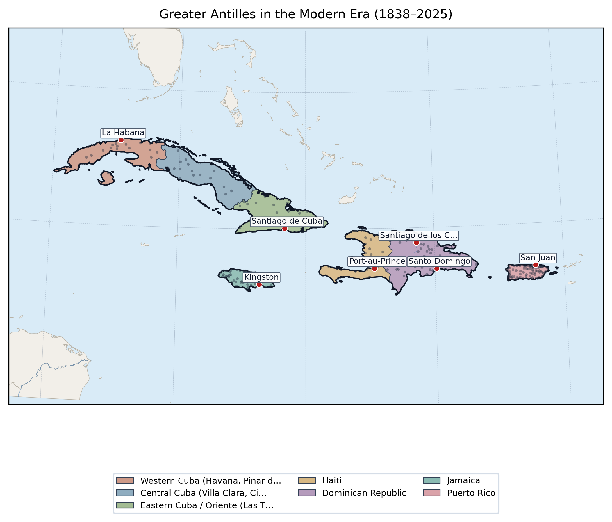
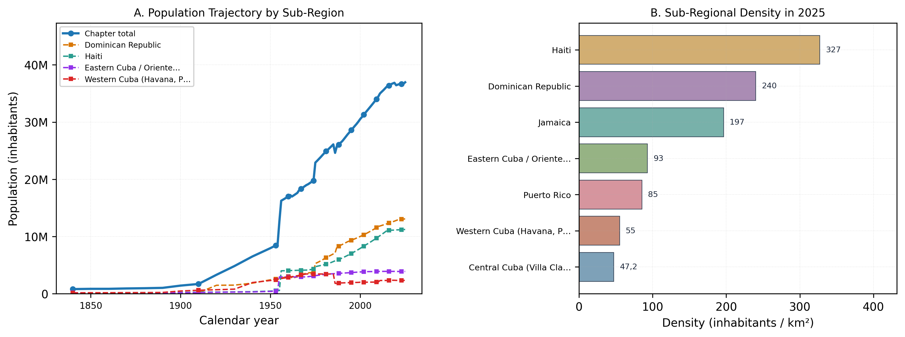
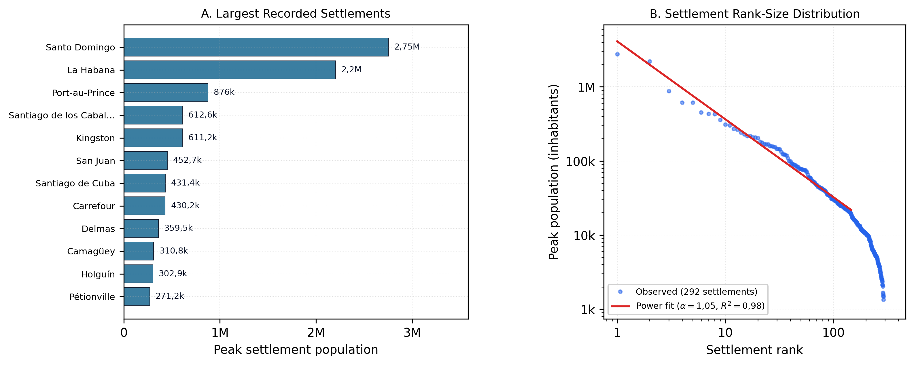

Greater Antilles in the Modern Era
================
Aust Kätzchen
23 November 2026

- [Abstract](#abstract)
- [Background](#background)
  - [Emancipation, Imperial Realignment and the Making of Five Antillean
    Regimes](#emancipation-imperial-realignment-and-the-making-of-five-antillean-regimes)
  - [Cuba: Immigration Waves, the Health Revolution and Early
    Demographic
    Ageing](#cuba-immigration-waves-the-health-revolution-and-early-demographic-ageing)
  - [Hispaniola Divided: Haitian Peasant Density and Dominican Frontier
    Expansion](#hispaniola-divided-haitian-peasant-density-and-dominican-frontier-expansion)
  - [Jamaica and Puerto Rico: Free Villages, Diaspora Circuits and
    Post-Industrial
    Contraction](#jamaica-and-puerto-rico-free-villages-diaspora-circuits-and-post-industrial-contraction)
- [Methodology](#methodology)
  - [Territorial Mask Architecture and Sub-Regional
    Partition](#territorial-mask-architecture-and-sub-regional-partition)
  - [Official Census Reconciliation and Inter-Censal Growth
    Modelling](#official-census-reconciliation-and-inter-censal-growth-modelling)
  - [Gazetteer Compilation, Metropolitan Scope and Rank-Size
    Scaling](#gazetteer-compilation-metropolitan-scope-and-rank-size-scaling)
- [Testing and Validation](#testing-and-validation)
  - [Census-to-Raster Cross-Checks and Sub-Regional
    Plausibility](#census-to-raster-cross-checks-and-sub-regional-plausibility)
  - [Sub-Administrative Historical GIS
    Verification](#sub-administrative-historical-gis-verification)
- [Results](#results)
  - [Archipelagic Demographic Trajectory (1838 to
    2025)](#archipelagic-demographic-trajectory-1838-to-2025)
  - [Cuba’s Three-Zone Internal Balance and Twenty-First-Century
    Contraction](#cubas-three-zone-internal-balance-and-twenty-first-century-contraction)
  - [Hispaniola: Divergent Urbanisation across a Shared
    Island](#hispaniola-divergent-urbanisation-across-a-shared-island)
  - [Jamaica and Puerto Rico: Diaspora Safety Valves and Post-Industrial
    Reversal](#jamaica-and-puerto-rico-diaspora-safety-valves-and-post-industrial-reversal)
  - [Greater Antillean Urban Hierarchy and Zipf
    Scaling](#greater-antillean-urban-hierarchy-and-zipf-scaling)
- [Limitations](#limitations)
- [Conclusion](#conclusion)
- [Appendix](#appendix)
  - [Territorial Breakdown of the Settlement Register and Metropolitan
    Suburbs](#territorial-breakdown-of-the-settlement-register-and-metropolitan-suburbs)
  - [Provenance Saturation Audit](#provenance-saturation-audit)
- [Sources](#sources)
- [Footnotes](#footnotes)

<figure>

<figcaption aria-hidden="true">Seven areal sub-regions and 292
catalogued census settlements across Cuba, Hispaniola, Jamaica and
Puerto Rico from 1838 to 2025.</figcaption>
</figure>

# Abstract

Between the end of apprenticeship in the British West Indies in 1838 and
the demographic contractions of the early twenty-first century, the four
main islands of the Greater Antilles expanded nearly fifteenfold in
aggregate population, moving from roughly 2,72M inhabitants in the early
post-emancipation era to approximately 40,2M by 2025 under official
national census benchmarks (and 36,95M inside the coarse coastal-gridded
harmonisation footprint across 253.724 km²). Behind that shared
Antillean climb lie five sharply divergent demographic transitions
across 200.416 km² of surveyed island land
[\[1\]](#ref-Celade2020Observatorio)[\[2\]](#ref-Celade2024Observatorio).
Cuba advanced from 1,01M in 1841 and 1,57M in the 1899 post-war
enumeration to 5,83M in 1953 and a peak of 11,17M in 2012, before
sub-replacement fertility, rapid population ageing and post-2015
emigration initiated a sustained contraction
[\[3\]](#ref-USWarDeptCuba1900)[\[4\]](#ref-ONEICuba2014)[\[5\]](#ref-Song2023Aging).
On Hispaniola, Haiti climbed from roughly 380k in 1805 and 750k in 1838
to 3,10M in 1950, 8,37M in 2003 and 10,91M by 2015, sustaining dense
rural smallholding alongside explosive metropolitan concentration across
Port-au-Prince, Carrefour, Delmas and Pétionville even after the 2010
earthquake [\[6\]](#ref-IHSIHaiti2015). Across the border, the Dominican
Republic rose from a sparsely settled frontier of roughly 135k in 1838
and 894,7k at its first modern census in 1920 to 10,77M in 2022,
overtaking Cuba as the archipelago’s leading metropolitan axis around
Santo Domingo (2,75M) and Santiago de los Caballeros (612,6k)
[\[7\]](#ref-ONEDomRep2023)[\[8\]](#ref-MoyaPons1995). Jamaica
multiplied more than sevenfold from 377,4k in 1844 to 1,24M in 1943 and
2,70M in 2011 despite successive emigration waves to Panama, Britain and
North America, while shifting urban gravity into Kingston and suburban
Saint Catherine
[\[9\]](#ref-STATINJamaica2012)[\[10\]](#ref-Roberts1957). Puerto Rico
surged from 447,9k in 1846 and 953,2k in 1899 to a peak of 3,81M in 2000
under Operation Bootstrap and the Great Migration, before post-2006
fiscal contraction and Hurricane María drove a steep drop to 3,29M in
2020
[\[11\]](#ref-USWarDeptPR1900)[\[12\]](#ref-VazquezCalzada1988)[\[13\]](#ref-USCensusPR2024).
Combining official national censuses, 25 sub-administrative enumeration
benchmarks and a settlement gazetteer of 292 cities and towns (rank-size
exponent $\alpha = 1,05$, $R^2 = 0,98$), this study reconstructs the
divergent modern population trajectories of the Greater Antilles.

# Background

## Emancipation, Imperial Realignment and the Making of Five Antillean Regimes

The year 1838 marks a clean watershed across the Greater Antilles,
though it did not arrive simultaneously on every shore. On 1 August
1838, the termination of apprenticeship across the British Caribbean
ended legal bondage in Jamaica, inaugurating the archipelago’s first
continuous series of post-emancipation censuses in 1844
[\[9\]](#ref-STATINJamaica2012)[\[10\]](#ref-Roberts1957). Haiti had
already abolished slavery four decades earlier in the Haitian Revolution
of 1791 to 1804, emerging from catastrophic war losses with barely 380k
inhabitants in 1805 and remaining locked out of Atlantic plantation
finance until its rural peasantry consolidated on fragmented highland
plots [\[6\]](#ref-IHSIHaiti2015). The eastern two-thirds of Hispaniola,
sparsely peopled by cattle ranchers and smallholders, threw off Haitian
administration in 1844 to establish the Dominican Republic with scarcely
135k inhabitants, leaving an extraordinary demographic asymmetry across
the island’s mountain frontier [\[8\]](#ref-MoyaPons1995).

In the Spanish Antilles, by contrast, emancipation arrived nearly half a
century later. Puerto Rico abolished slavery in 1873 while already
possessing a dense free *jíbaro* peasantry in the central cordillera and
a growing coastal sugar labour force [\[12\]](#ref-VazquezCalzada1988).
Cuba held onto plantation slavery until 1886, importing hundreds of
thousands of enslaved Africans alongside Chinese indentured labourers
and Spanish peninsular migrants to feed its mechanised
central-and-western sugar belt
[\[3\]](#ref-USWarDeptCuba1900)[\[14\]](#ref-DiazBriquets1983). Only
after the Spanish-American War of 1898 severed Madrid’s last American
possessions did Cuba and Puerto Rico enter the twentieth century under
radically altered constitutional frameworks: Cuba as an independent
republic deeply linked to North American capital, and Puerto Rico as an
unincorporated United States territory whose residents acquired
statutory United States citizenship in 1917
[\[11\]](#ref-USWarDeptPR1900)[\[12\]](#ref-VazquezCalzada1988).

Out of these distinct nineteenth-century starting lines grew five
contrasting modern demographic regimes. No other archipelago of
comparable size exhibits such wide divergence in fertility timing,
mortality decline, cross-border migration and metropolitan structure.
Within two hundred kilometres across the Windward Passage and Mona
Passage, late-twentieth-century Cuba and Puerto Rico converged on
European-style below-replacement fertility and rapid population ageing,
Jamaica moderated its natural increase through persistent transnational
emigration, the Dominican Republic completed a brisk mid-century
frontier boom and rapid urban transition, and Haiti sustained the
Western Hemisphere’s last prolonged high-fertility rural expansion
[\[1\]](#ref-Celade2020Observatorio)[\[2\]](#ref-Celade2024Observatorio).

## Cuba: Immigration Waves, the Health Revolution and Early Demographic Ageing

At the close of Spanish rule, Cuba was still a land-abundant island
whose population had been severely pruned by the Ten Years’ War (1868 to
1878) and the War of Independence (1895 to 1898). The United States War
Department census of 1899 enumerated 1.572.797 inhabitants across the
island’s six historical provinces, recording stark demographic scars in
Matanzas, Santa Clara and Havana where General Valeriano Weyler’s
*reconcentración* policy had elevated civilian mortality
[\[3\]](#ref-USWarDeptCuba1900). Yet peace, sanitary campaigns against
yellow fever and malaria, and an immense wave of Atlantic and Caribbean
immigration swiftly reversed the war deficit
[\[14\]](#ref-DiazBriquets1983). Between 1900 and 1930, more than one
million immigrants landed in Cuban ports: primarily Galicians, Asturians
and Canary Islanders settling across western and central Cuba, joined
during the sugar boom of the 1910s and 1920s by tens of thousands of
Haitian and Jamaican *braceros* cutting cane across the newly cleared
*latifundia* of Camagüey and Oriente
[\[4\]](#ref-ONEICuba2014)[\[14\]](#ref-DiazBriquets1983).

By the 1953 national census, Cuba’s population had nearly quadrupled
since 1899 to 5.829.029, with Western Cuba anchored on Havana (785,5k
city proper in 1953) holding 2,38M inhabitants, Central Cuba 1,65M and
Eastern Cuba (Oriente) 1,80M [\[4\]](#ref-ONEICuba2014). Mortality had
already fallen dramatically well before 1959, driven by urban
waterworks, vector control and expanding medical access
[\[14\]](#ref-DiazBriquets1983). Following the 1959 revolution,
universal primary health care, rural clinics, female educational
expansion and legalised fertility control compressed both infant
mortality and birth rates at remarkable speed
[\[14\]](#ref-DiazBriquets1983)[\[15\]](#ref-Garcia2024Mortalidad).
After a brief post-revolutionary baby boom during the early 1960s and
repeated waves of emigration to Florida—first in 1959 to 1962, then via
the Camarioca and Freedom Flights, the 1980 Mariel boatlift and the 1994
*balsero* crisis—Cuba’s total fertility rate dropped below replacement
level in 1978, decades ahead of the rest of Latin America
[\[5\]](#ref-Song2023Aging)[\[16\]](#ref-Celade2019Observatorio).

National headcount slowed steadily thereafter, rising from 9,72M in 1981
to 11,18M in 2002 and plateauing at 11,17M (11.167.325) in the 2012
census [\[4\]](#ref-ONEICuba2014). In the twenty-first century, Cuba
entered an advanced post-transitional regime characterised by an
inverted age pyramid, rising chronic cardiovascular disease burden and
pronounced internal migration of older residents toward Havana and
provincial capitals
[\[17\]](#ref-Hiortlorenzen2015Envejecimiento)[\[18\]](#ref-Collazoramos2016Algunas)[\[19\]](#ref-Rodriguez2015Envejecimiento)[\[20\]](#ref-Herrera2019Mortalidad).
Even as urban child-health cohorts in Havana and district-level infant
mortality monitoring in Santiago de Cuba demonstrated sustained clinical
surveillance despite material scarcity
[\[15\]](#ref-Garcia2024Mortalidad)[\[21\]](#ref-Britton2020Prevalence),
accelerating post-2015 and post-2021 out-migration combined with
persistent low fertility pulled Cuba’s resident population into absolute
contraction
[\[2\]](#ref-Celade2024Observatorio)[\[5\]](#ref-Song2023Aging).

## Hispaniola Divided: Haitian Peasant Density and Dominican Frontier Expansion

Hispaniola presents the starkest demographic reversal in the Caribbean.
Throughout the nineteenth century, Haiti held the overwhelming share of
the island’s population. Emerging from independence with roughly 380k
survivors in 1805, Haiti recovered steadily through natural increase
among free rural smallholders who rejected plantation wage labour in
favour of subsistence *lakou* compounds and coffee cultivation across
the Massif de la Hotte, the Artibonite valley and the northern plains.
By 1838, Haiti held approximately 750k inhabitants—more than five times
the population of the neighbouring Dominican territory—and reached
roughly 1,28M by 1900 [\[6\]](#ref-IHSIHaiti2015).

Haiti’s first modern national census, conducted in 1950 by the Institut
Haïtien de Statistique et d’Informatique (IHSI), recorded 3.097.220
inhabitants across an overwhelmingly agrarian landscape in which
Port-au-Prince still counted just 134,1k residents
[\[6\]](#ref-IHSIHaiti2015). Over the subsequent half-century, declining
childhood mortality without commensurate industrial employment or rapid
fertility reduction propelled explosive growth: population climbed to
4,31M in 1971, 5,05M in 1982, 8,37M (8.373.750) in 2003 and an IHSI
departmental estimate of 10,91M in 2015, approaching 11,90M by 2025
[\[1\]](#ref-Celade2020Observatorio)[\[6\]](#ref-IHSIHaiti2015). Rural
ecological strain, soil erosion and deforestation across the southern
and northwestern peninsulas pushed hundreds of thousands of migrants
either overseas—into the Dominican Republic, the Bahamas, the United
States and maritime refuge flows such as the 1981 to 1982 Fort Allen
detention cohort in Puerto Rico
[\[16\]](#ref-Celade2019Observatorio)[\[22\]](#ref-Cabral1995Migracio)[\[23\]](#ref-Santos2025Decolonizing)—or
into the metropolitan basin of the Ouest department. Port-au-Prince’s
municipal core grew from 134,1k in 1950 to 876,0k by 2009, while its
surrounding communes of Carrefour (430,3k), Delmas (359,5k), Pétionville
(271,2k) and Cité Soleil (241,1k) expanded into a sprawling conurbation
exceeding two million residents that absorbed the devastating mortality
and displacement shock of the January 2010 earthquake
[\[6\]](#ref-IHSIHaiti2015).

East of the Massacre and Artibonite headwaters, the Dominican Republic
followed a profoundly different trajectory. Following independence in
1844 and the War of Restoration (1863 to 1865), the republic possessed
vast tracts of fertile, lightly settled land across the Cibao valley and
the eastern plains [\[8\]](#ref-MoyaPons1995). Modern sugar plantations
established by Cuban and North American capital around San Pedro de
Macorís and La Romana in the late nineteenth century, alongside tobacco
and cacao smallholding around Santiago de los Caballeros, initiated
brisk growth. The first national census of 1920 enumerated 894.665
inhabitants—still well under half of Haiti’s population—with Santo
Domingo holding only 31,0k residents
[\[7\]](#ref-ONEDomRep2023)[\[8\]](#ref-MoyaPons1995). Thereafter,
frontier colonisation, road building, public sanitation and sustained
cross-border Haitian labour migration into sugar *bateyes*, construction
and agriculture accelerated demographic expansion
[\[8\]](#ref-MoyaPons1995)[\[22\]](#ref-Cabral1995Migracio). Total
population reached 2,14M in 1950, 5,65M in 1981, 8,56M in 2002 and
10,77M in the tenth national census of 2022 [\[7\]](#ref-ONEDomRep2023).
Unlike Haiti’s rural density, Dominican growth became decisively
metropolitan and coastal-industrial: Greater Santo Domingo expanded to
2,75M inside the main urban agglomeration (with Distrito Nacional and
Santo Domingo province together surpassing 3,80M), Santiago de los
Caballeros reached 612,6k, and eastern tourism and industrial corridors
propelled La Romana (265,3k), Higüey (210,3k) and San Pedro de Macorís
(207,4k) while national fertility converged steadily toward replacement
[\[2\]](#ref-Celade2024Observatorio)[\[7\]](#ref-ONEDomRep2023)[\[24\]](#ref-Cernigliaro2018Factors).

## Jamaica and Puerto Rico: Free Villages, Diaspora Circuits and Post-Industrial Contraction

Jamaica and Puerto Rico illustrate two distinct insular pathways in
which metropolitan ties to imperial powers shaped every decade of modern
demographic change. Immediately after full emancipation in 1838,
formerly enslaved Jamaicans left coastal sugar estates in large numbers
to establish Baptist- and Moravian-assisted free villages across the
interior limestone parishes of Manchester, Clarendon, Saint Ann and
Saint Elizabeth [\[10\]](#ref-Roberts1957). Jamaica’s 1844 census
counted 377.433 inhabitants, with Kingston holding 32,9k and the old
administrative capital Spanish Town just 5,8k
[\[9\]](#ref-STATINJamaica2012)[\[10\]](#ref-Roberts1957). As plantation
revenues weakened in the late nineteenth century, Jamaican labourers
became the premier mobile workforce of the circum-Caribbean, migrating
in tens of thousands to build the Panama railway and Panama Canal,
harvest bananas in Costa Rica and Honduras, and cut cane in eastern Cuba
[\[10\]](#ref-Roberts1957). Despite that outflow, falling mortality
lifted Jamaica from 831,4k in 1911 to 1,24M in 1943 and 1,61M on the eve
of independence in 1960 [\[9\]](#ref-STATINJamaica2012).

From the late 1940s onward, the Windrush migration to the United
Kingdom—followed after 1965 by heavy family-reunification and
skilled-worker flows to the United States and Canada—acted as a durable
demographic safety valve, syphoning off a large fraction of Jamaica’s
natural increase and anchoring a vigorous transnational diaspora
[\[10\]](#ref-Roberts1957)[\[16\]](#ref-Celade2019Observatorio)[\[25\]](#ref-Bourne2026Black).
Domestic growth moderated accordingly, climbing from 1,86M in 1970 to
2,61M in 2001 and 2,70M in 2011 (reaching 2,77M in provisional post-2020
series), while urban population poured out of central Kingston into
Saint Andrew (583,7k) and the planned suburban dormitory towns of
Portmore (182,2k peak in 2011) and Spanish Town (168,9k) in Saint
Catherine parish [\[9\]](#ref-STATINJamaica2012). Immediately to
Jamaica’s northwest, its former dependency of the Cayman
Islands—administered from Kingston until 1962—shifted from a tiny
seafaring outpost of 5,5k residents in 1911 to a booming offshore
financial centre of 71,1k inhabitants by 2021, driven largely by
expatriate immigration [\[26\]](#ref-ESOCayman2022).

Puerto Rico experienced the most dramatic boom-and-bust demographic arc
in the modern Antilles. Under Spanish rule, high natural increase lifted
the island from 447.914 inhabitants in 1846 to 953.243 in the United
States War Department census of 1899, distributed densely across
highland coffee municipios and coastal sugar plains while San Juan held
just 32,0k inhabitants
[\[11\]](#ref-USWarDeptPR1900)[\[12\]](#ref-VazquezCalzada1988).
Following 1898, American public-health campaigns against hookworm,
malaria and tuberculosis cut death rates sharply, pushing population
past 1,54M in 1930 and 2,21M in 1950 [\[12\]](#ref-VazquezCalzada1988).
From the late 1940s through the 1960s, Governor Luis Muñoz Marín’s
Operation Bootstrap (*Manos a la Obra*) transformed an agrarian island
into a light-manufacturing and pharmaceutical hub while cheap air links
carried over half a million Puerto Ricans to New York, Chicago and
Philadelphia during the Great Migration
[\[12\]](#ref-VazquezCalzada1988)[\[13\]](#ref-USCensusPR2024). Return
flows and suburban expansion nonetheless carried the island’s population
to an all-time decennial peak of 3.808.610 in 2000, centred on Greater
San Juan and its populous inner suburbs of Bayamón (203,5k urban peak in
2000), Carolina (168,2k), Caguas (92,4k) and Guaynabo (78,8k)
[\[13\]](#ref-USCensusPR2024)[\[27\]](#ref-Bureau2012Census). Once
federal Section 936 industrial tax incentives expired in 2006, however,
a decade-long fiscal crisis collided with collapsing fertility and the
catastrophic landfall of Hurricane María in September 2017. Census
population fell to 3,73M in 2010 and tumbled by nearly 12% to 3,29M
(3.285.874) in 2020—with San Juan city proper shrinking from its 1970
peak of 452,7k to 322,9k—marking the sharpest peacetime demographic
contraction of any major Greater Antillean jurisdiction
[\[2\]](#ref-Celade2024Observatorio)[\[13\]](#ref-USCensusPR2024)[\[27\]](#ref-Bureau2012Census).

# Methodology

## Territorial Mask Architecture and Sub-Regional Partition

To analyse demographic divergence without masking Cuba’s pronounced
internal east-west gradient, JAGUAR partitions the Greater Antilles into
seven contiguous territorial sub-regions covering 200.416 km² of
surveyed island land (and 253.724 km² inside the 5-arc-minute coastal
raster mask across 3.152 gridded cells). Cuba—which accounts for
slightly more than half of the archipelago’s land area—is divided into
three administrative macro-zones aligned with official ONEI provincial
boundaries: Western Cuba (Havana, Artemisa, Mayabeque, Pinar del Río,
Matanzas and Isla de la Juventud; 30.959 km² surveyed land), Central
Cuba (Villa Clara, Cienfuegos, Sancti Spíritus, Ciego de Ávila and
Camagüey; 40.346 km²) and Eastern Cuba or Oriente (Las Tunas, Holguín,
Granma, Santiago de Cuba and Guantánamo; 34.890 km²)
[\[4\]](#ref-ONEICuba2014). The remaining four jurisdictions form single
island or national masks: Haiti (27.828 km²), the Dominican Republic
(47.058 km²), Jamaica (10.749 km²) and Puerto Rico (8.584 km²).

This seven-part geometry captures the decisive geographic contrasts of
the modern Antilles: the early concentration of Cuban capital, port
trade and European immigration in Western Cuba versus the
twentieth-century sugar frontier of Camagüey and Oriente; the abrupt
ecological and institutional border dividing mountainous Haiti from the
broader alluvial valleys of the Dominican Republic; and the compact
island constraints of Jamaica and Puerto Rico, where metropolitan sprawl
rapidly engulfed narrow coastal plains
[\[8\]](#ref-MoyaPons1995)[\[10\]](#ref-Roberts1957)[\[12\]](#ref-VazquezCalzada1988).

## Official Census Reconciliation and Inter-Censal Growth Modelling

Unlike pre-modern chapters that rely on archaeological proxies or
colonial tribute multipliers, the Greater Antilles between 1838 and 2025
belong squarely to the modern statistical census regime. Primary
population series are anchored directly to published national
enumerations: the 1841, 1861, 1899 and 1907 to 2012 censuses of Cuba
[\[3\]](#ref-USWarDeptCuba1900)[\[4\]](#ref-ONEICuba2014); the 1846,
1899 and 1910 to 2020 decennial censuses plus Vintage 2023 municipio
estimates of Puerto Rico
[\[11\]](#ref-USWarDeptPR1900)[\[13\]](#ref-USCensusPR2024)[\[27\]](#ref-Bureau2012Census);
the 1844 to 2011 censuses of Jamaica and 1911 to 2021 censuses of the
Cayman Islands
[\[9\]](#ref-STATINJamaica2012)[\[10\]](#ref-Roberts1957)[\[26\]](#ref-ESOCayman2022);
the 1920 to 2022 national censuses of the Dominican Republic
[\[7\]](#ref-ONEDomRep2023); and the 1950 to 2003 national censuses plus
2015 departmental projections of Haiti [\[6\]](#ref-IHSIHaiti2015).

For any sub-region $r$ observed at consecutive census dates $t_1$ and
$t_2$, inter-censal population change obeys the fundamental demographic
balancing identity:

$$P_r(t_2) = P_r(t_1) + B_r(t_1, t_2) - D_r(t_1, t_2) + M_r^{\mathrm{in}}(t_1, t_2) - M_r^{\mathrm{out}}(t_1, t_2)$$

where $B_r$ and $D_r$ denote cumulative births and deaths and
$M_r^{\mathrm{in}} - M_r^{\mathrm{out}}$ captures net internal and
international migration
[\[1\]](#ref-Celade2020Observatorio)[\[16\]](#ref-Celade2019Observatorio).
Compound annual growth rates between census benchmarks follow standard
geometric compounding:

$$g_r(t_1, t_2) = \left(\frac{P_r(t_2)}{P_r(t_1)}\right)^{\frac{1}{t_2 - t_1}} - 1$$

In the modern Greater Antilles, the migration term
$M_r^{\mathrm{in}} - M_r^{\mathrm{out}}$ frequently rivals or overrides
natural increase $B_r - D_r$. In early twentieth-century Cuba, positive
net immigration lifted annual growth above 2,5% per year, whereas in
post-1950 Jamaica, post-2006 Puerto Rico and post-2015 Cuba, sustained
negative net migration depressed or inverted population growth even
while life expectancy exceeded 75 years
[\[2\]](#ref-Celade2024Observatorio)[\[5\]](#ref-Song2023Aging)[\[12\]](#ref-VazquezCalzada1988)[\[14\]](#ref-DiazBriquets1983).

## Gazetteer Compilation, Metropolitan Scope and Rank-Size Scaling

Alongside sub-regional totals, JAGUAR assembles an evidence-only urban
gazetteer of 292 settlements across the five Greater Antillean polities
spanning 1841 to 2022, with zero crowd-sourced entries (0,0% fallback
share). Four sequential ingestion waves tracked in the chapter source
ledger consolidated 267 settlements from primary national census tables
(Wave 1), 19 from demographic monographs and peer-reviewed historical
compilations (Wave 2), 4 from longitudinal census backfill (Wave 3) and
2 from sub-regional coverage verification sweeps (Wave 4), yielding a
final marginal gain of 0,69% and complete coverage across all seven
sub-regions: 85 settlements in Puerto Rico, 61 in the Dominican Republic
sub-region (64 under national borders due to three border-adjacent
towns), 56 in Jamaica, 33 in the Haiti sub-region (30 under national
borders), 21 in Eastern Cuba, 19 in Central Cuba and 17 in Western Cuba.

To prevent double-counting metropolitan agglomerations against their
constituent commuter municipalities, every settlement carries an
explicit urban-scope classification: 275 standalone cities and towns
alongside 17 explicitly tagged suburban municipalities linked to their
parent capitals—four around Port-au-Prince (Carrefour, Delmas, Cité
Soleil and Croix-des-Bouquets), nine around San Juan (Bayamón, Carolina,
Caguas, Guaynabo, Trujillo Alto, Cataño, Canóvanas, Toa Alta and Toa
Baja), two around Kingston (Portmore and Spanish Town) and two around
Santo Domingo (Boca Chica and Bajos de Haina). Urban hierarchy
concentration across all 292 settlements is evaluated through an
ordinary least-squares log-log rank-size regression fitted over the
upper 146 settlements:

$$\log_{10} P_{(k)} = \log_{10} P_{(1)} - \alpha \log_{10} k$$

where $P_{(k)}$ is the peak recorded population of the $k$-th ranked
settlement and $\alpha$ measures urban concentration around Zipf’s
benchmark of unity
[\[4\]](#ref-ONEICuba2014)[\[7\]](#ref-ONEDomRep2023).

# Testing and Validation

## Census-to-Raster Cross-Checks and Sub-Regional Plausibility

Rigorous testing in a multi-island census chapter requires reconciling
two distinct statistical layers: the official sub-regional census
benchmarks compiled from primary national statistical offices and the
5-arc-minute gridded dasymetric raster series extracted across the
regional polygon masks. Table presents the official census trajectory
across all seven sub-regions alongside their surveyed land areas, 2025
densities and catalogued settlement counts, while Table audits how the
coarse gridded raster series tracks those census anchors across key
modern dates.

| Sub-Region | Land Area (km²) | c. 1841 | c. 1900 | c. 1953 | c. 2002 | 2025 | 2025 Dens. | Towns |
|:---|:---|:---|:---|:---|:---|:---|:---|:---|
| **Western Cuba** | 30.959 | 520k | 814,3k | 2,38M | 4,46M | 4,32M | 139,5 | 17 |
| **Central Cuba** | 40.346 | 245k | 455,9k | 1,65M | 2,86M | 2,74M | 67,9 | 19 |
| **Eastern Cuba (Oriente)** | 34.890 | 242k | 339,5k | 1,8M | 3,86M | 3,76M | 107,8 | 21 |
| **Haiti** | 27.828 | 769,7k | 1,28M | 3,28M | 8,22M | 11,9M | 427,6 | 33 |
| **Dominican Republic** | 47.058 | 144,7k | 564,1k | 2,31M | 8,56M | 11,43M | 242,9 | 61 |
| **Jamaica** | 10.749 | 377,4k | 730,3k | 1,46M | 2,62M | 2,84M | 264,2 | 56 |
| **Puerto Rico** | 8.584 | 447,9k | 969,1k | 2,28M | 3,76M | 3,21M | 373,4 | 85 |
| **Greater Antilles Total** | 200.414 | 2,75M | 5,15M | 15,17M | 34,33M | 40,2M | 200,6 | 292 |

Official census benchmark trajectories (interpolated to common reference
years where national census dates differ), surveyed land area, 2025
density (inhabitants per km²) and catalogued settlement counts across
seven Greater Antillean sub-regions, 1841 to 2025.

Comparing the official census series against the 5-arc-minute gridded
raster extractions in Table uncovers two informative spatial artefacts
that must be explicitly understood before reading the gridded trajectory
plots. First, because 5-arc-minute cells straddle ragged coastlines,
cays and narrow bays across all four islands, the rasterised mask
footprint totals 253.724 km²—roughly 26,6% wider than the 200.416 km²
surveyed land area—reducing raw gridded densities across narrow or
deeply indented masks such as Puerto Rico (12.726 km² raster footprint
versus 8.584 km² land area) and Western Cuba (42.613 km² versus 30.959
km²). Second, historical sub-administrative regime handoffs in the
gridded reconstruction introduce discrete step adjustments when national
census grids supersede nineteenth-century interpolations (at 1920 in the
Dominican Republic, 1930 in Jamaica, 1955 to 1956 in Cuba and Haiti, and
1975 in Puerto Rico) and clip narrow littoral cores around Havana Bay
and San Juan Harbour, depressing gridded 2025 totals for Western Cuba
(2,36M raster versus 4,32M census) and Puerto Rico (1,09M raster versus
3,21M census) while tracking Eastern Cuba (3,89M versus 3,76M), Central
Cuba (2,53M versus 2,74M), Haiti (11,24M versus 11,90M) and Jamaica
(2,77M versus 2,84M) closely.

| Sub-Region | Mask Area (km²) | 1900 | 1960 | 1980 | 2000 | 2025 | Peak | 2025 Dens. |
|:---|:---|:---|:---|:---|:---|:---|:---|:---|
| **Western Cuba** | 42.613 | 474,9k | 2,86M | 3,44M | 2M | 2,36M | 3,46M | 55,3 |
| **Central Cuba** | 53.624 | 278,4k | 2,31M | 2,62M | 2,81M | 2,53M | 2,84M | 47,2 |
| **Eastern Cuba (Oriente)** | 41.834 | 182k | 2,94M | 3,37M | 3,8M | 3,89M | 3,9M | 92,9 |
| **Haiti** | 34.361 | 227,7k | 4,04M | 5,08M | 7,93M | 11,24M | 11,24M | 327,1 |
| **Dominican Republic** | 54.445 | 151,7k | 3,03M | 6,13M | 10,01M | 13,08M | 13,08M | 240,2 |
| **Jamaica** | 14.120 | 61,8k | 1,61M | 2,13M | 2,58M | 2,77M | 2,77M | 196,5 |
| **Puerto Rico** | 12.726 | 39,5k | 240,8k | 1,81M | 1,41M | 1,09M | 1,84M | 85,4 |
| **Gridded Domain Total** | 253.724 | 1,42M | 17,02M | 24,57M | 30,54M | 36,95M | 36,95M | 145,6 |

Gridded 5-arc-minute sub-regional population extractions, peak totals
and 2025 raster densities (inhabitants per km²) across the Greater
Antilles, 1900 to 2025.

## Sub-Administrative Historical GIS Verification

To guard against national-level aggregation error, JAGUAR validates
sub-regional totals against 25 primary sub-administrative census
enumerations scraped across historical Cuban provinces, Puerto Rican
historic departments, pre- and post-1982 Haitian departments, Dominican
provinces and Jamaican parishes (Table ). These primary sub-national
tallies confirm the structural geography visible in the regional tables:
by 1970, Oriente (3,00M) had already overtaken La Habana province
(2,34M) as Cuba’s most populous historical province
[\[4\]](#ref-ONEICuba2014); in Puerto Rico, the historic Bayamón-San
Juan northern department (1,10M) dwarfed Guayama (394,7k), Ponce
(359,3k), Arecibo (266,0k) and Mayagüez (216,9k)
[\[13\]](#ref-USCensusPR2024); in Haiti, the Ouest department surged
from 1,67M in 1971 to 4,03M in 2015 while Artibonite reached 1,73M and
Nord 1,07M [\[6\]](#ref-IHSIHaiti2015); in the Dominican Republic,
Distrito Nacional and Santo Domingo province dominated ahead of Santiago
(1,07M in 2022), San Cristóbal (688,8k) and the rapidly expanding
eastern tourist province of La Altagracia (446,1k)
[\[7\]](#ref-ONEDomRep2023); and in Jamaica, Saint Andrew (583,7k) and
Saint Catherine (542,8k) together held over two-fifths of the island’s
residents in 2022 [\[9\]](#ref-STATINJamaica2012).

| Administrative Unit | Polity | Unit Tier | Year | Population | Census Source |
|:---|:---|:---|:---|:---|:---|
| **Oriente** | Cuba | Historical province | 1970 | 3M | US War Dept. (1899) and ONEI Cuba |
| **La Habana** | Cuba | Historical province | 1970 | 2,34M | US War Dept. (1899) and ONEI Cuba |
| **Las Villas** | Cuba | Historical province | 1970 | 1,36M | US War Dept. (1899) and ONEI Cuba |
| **Historic Dept. of Bayamón** | Puerto Rico | Historic department | 1970 | 1,1M | US War Dept. (1899) and US Census Bureau |
| **Historic Dept. of Guayama** | Puerto Rico | Historic department | 1970 | 394,7k | US War Dept. (1899) and US Census Bureau |
| **Historic Dept. of Ponce** | Puerto Rico | Historic department | 1970 | 359,3k | US War Dept. (1899) and US Census Bureau |
| **Historic Dept. of Arecibo** | Puerto Rico | Historic department | 1970 | 266k | US War Dept. (1899) and US Census Bureau |
| **Historic Dept. of Mayagüez** | Puerto Rico | Historic department | 1970 | 216,9k | US War Dept. (1899) and US Census Bureau |
| **Ouest (pre-1982 boundaries)** | Haiti | Historical department | 1971 | 1,67M | IHSI Haiti |
| **Sud (pre-1982 boundaries)** | Haiti | Historical department | 1971 | 976,4k | IHSI Haiti |
| **Santo Domingo** | Dominican Republic | Province | 2010 | 2,37M | ONE Dominican Republic |
| **Ciudad de La Habana** | Cuba | Province | 2012 | 2,11M | ONEI Cuba |
| **Santiago de Cuba** | Cuba | Province | 2012 | 1,05M | ONEI Cuba |
| **Ouest** | Haiti | Department | 2015 | 4,03M | IHSI Haiti |
| **Artibonite** | Haiti | Department | 2015 | 1,73M | IHSI Haiti |
| **Nord** | Haiti | Department | 2015 | 1,07M | IHSI Haiti |
| **Distrito Nacional** | Dominican Republic | National district | 2022 | 3,8M | ONE Dominican Republic |
| **Santiago** | Dominican Republic | Province | 2022 | 1,07M | ONE Dominican Republic |
| **San Cristóbal** | Dominican Republic | Province | 2022 | 688,8k | ONE Dominican Republic |
| **Saint Andrew** | Jamaica | Parish | 2022 | 583,7k | STATIN Jamaica and Roberts (1957) |
| **Saint Catherine** | Jamaica | Parish | 2022 | 542,8k | STATIN Jamaica and Roberts (1957) |
| **La Altagracia** | Dominican Republic | Province | 2022 | 446,1k | ONE Dominican Republic |
| **Clarendon** | Jamaica | Parish | 2022 | 258,6k | STATIN Jamaica and Roberts (1957) |
| **Manchester** | Jamaica | Parish | 2022 | 193,7k | STATIN Jamaica and Roberts (1957) |
| **Saint James** | Jamaica | Parish | 2022 | 188,7k | STATIN Jamaica and Roberts (1957) |

Twenty-five primary sub-administrative census enumerations across Cuba,
Haiti, the Dominican Republic, Jamaica and Puerto Rico, 1970 to 2022.

# Results

## Archipelagic Demographic Trajectory (1838 to 2025)

Across nearly two centuries of post-emancipation history, the Greater
Antilles expanded from approximately 2,72M inhabitants around 1841 to
4,76M by 1900, 15,01M by 1953, 35,34M by 2002 and 40,20M by 2025 on the
official census benchmark series—a 14,8-fold expansion that lifted mean
surveyed island density from 13,6 to 200,6 inhabitants per km²
[\[1\]](#ref-Celade2020Observatorio)[\[2\]](#ref-Celade2024Observatorio).
Inside the gridded raster series plotted in Figure , aggregate regional
headcount climbs from 805,6k in 1840 and 1,42M in 1900 to 17,02M in
1960, 24,57M in 1980, 30,54M in 2000 and 36,95M in 2025, clearly
registering the post-1980 divergence between rapidly growing Hispaniola
and flattening or contracting Cuba and Puerto Rico.

<!-- -->

The long-term redistribution of population across the four main islands
constitutes one of the sharpest geopolitical shifts in the Americas.
Around 1841, Cuba (1,01M, 37,0% of the Greater Antilles) and Haiti
(750k, 27,6%) dominated the archipelago, trailed by Puerto Rico (447,9k,
16,5%) and Jamaica (377,4k, 13,9%), while the Dominican Republic trailed
far behind at roughly 135k (5,0%). By 1953, following half a century of
Cuban immigration and sanitary reform, Cuba still led decisively with
5,83M inhabitants (38,8% of the archipelago), ahead of Haiti (3,10M in
1950, rising to roughly 3,31M by 1953), Puerto Rico (2,27M), the
Dominican Republic (2,31M) and Jamaica (1,43M).

By 2025, that mid-century hierarchy had been turned upside down.
Hispaniola—split almost evenly between Haiti (11,90M benchmark; 11,24M
gridded) and the Dominican Republic (11,43M benchmark; 13,08M
gridded)—accounted for 58,0% of the entire Greater Antillean census
population (23,33M of 40,20M). Cuba’s share contracted from 38,8% in
1953 to 26,9% in 2025 (10,82M benchmark, and falling further under
post-2021 emigration), while Puerto Rico’s share halved from 15,1% in
1953 to 8,0% in 2025 (3,21M) and Jamaica eased to 7,1% (2,84M). Density
contrasts widened in parallel: on surveyed land area, Haiti reached
427,6 inhabitants per km² (327,1 in the wider raster mask) and Puerto
Rico still carried 373,4 inhabitants per km² despite two decades of
depopulation, ahead of Jamaica (264,2), the Dominican Republic (242,9)
and Cuba (101,9 overall, ranging from 139,5 in Western Cuba down to 67,9
in Central Cuba).

## Cuba’s Three-Zone Internal Balance and Twenty-First-Century Contraction

Within Cuba, modern demographic history unfolded as a long eastward
drift followed by metropolitan stabilisation and late-century ageing. At
the 1841 Spanish census, Western Cuba held more than half the island’s
population (520k of 1,01M, or 51,6%), sustained by the port primacy of
Havana (137,5k) and the dense sugar estates of Matanzas and Güines
[\[3\]](#ref-USWarDeptCuba1900). By 1899, after wartime devastation in
the west and early rail expansion into Santa Clara and Camagüey, Western
Cuba’s share stood at 50,8% (798k of 1,57M), while Central Cuba rose to
28,3% (445k) and Eastern Cuba held 20,9% (329k)
[\[3\]](#ref-USWarDeptCuba1900).

The decisive shift occurred between 1900 and 1953. Massive North
American capital investment cleared virgin forests across Camagüey and
northern Oriente for central sugar mills, drawing both internal Cuban
migrants and tens of thousands of Antillean seasonal labourers
[\[4\]](#ref-ONEICuba2014)[\[14\]](#ref-DiazBriquets1983). Eastern Cuba
expanded more than fivefold from 329k in 1899 to 1,80M in 1953 (30,9% of
Cuba), while Central Cuba rose nearly fourfold to 1,65M (28,3%) and
Western Cuba’s share declined to 40,8% (2,38M), even as Havana itself
climbed from 236,0k in 1899 to 785,5k in 1953
[\[4\]](#ref-ONEICuba2014).

After 1959, revolutionary regional policy deliberately redirected
housing, industrial estates and health infrastructure toward provincial
capitals outside Havana—above all Santiago de Cuba (rising from 163,2k
in 1953 to 431,4k in 2022), Camagüey (110,4k to 310,8k), Holguín (57,6k
to 302,9k), Santa Clara (to 217,9k), Guantánamo (peak 217,1k in 2012),
Las Tunas (176,1k) and Bayamo (159,0k) [\[4\]](#ref-ONEICuba2014).
Havana’s share of national population was effectively capped, with the
capital peaking at 2.201.610 in 2002 before edging down to 2.106.146 in
2012 and 2.137.847 in 2022 official registers
[\[4\]](#ref-ONEICuba2014). Meanwhile, Cuba’s exceptionally early
fertility transition—coupled with sustained life expectancy gains and
rising chronic cardiovascular mortality among older cohorts—turned the
entire island into the oldest society in Latin America
[\[14\]](#ref-DiazBriquets1983)[\[18\]](#ref-Collazoramos2016Algunas)[\[20\]](#ref-Herrera2019Mortalidad).
By the 2010s, elderly internal mobility toward Havana and western
provincial capitals coexisted with sharp rural emptying across Villa
Clara, Sancti Spíritus and Matanzas, while youth emigration accelerated
sharply after 2015, pushing every Cuban sub-region below its early-2000s
peak
[\[5\]](#ref-Song2023Aging)[\[15\]](#ref-Garcia2024Mortalidad)[\[17\]](#ref-Hiortlorenzen2015Envejecimiento)[\[19\]](#ref-Rodriguez2015Envejecimiento)[\[21\]](#ref-Britton2020Prevalence).

## Hispaniola: Divergent Urbanisation across a Shared Island

Hispaniola’s two republics demonstrate how identical tropical island
geographies can yield utterly contrasting settlement systems when
governed by different land-tenure and capital regimes. In Haiti,
nineteenth-century agrarian egalitarianism produced one of the densest
peasant countrysides in the Americas, keeping urbanisation remarkably
low until the second half of the twentieth century. As late as 1950,
barely one-tenth of Haiti’s 3,10M inhabitants lived in towns;
Port-au-Prince counted 134,1k residents, Cap-Haïtien 24,2k and Gonaïves
just 13,6k [\[6\]](#ref-IHSIHaiti2015).

Between 1950 and 2015, however, declining agricultural yields, rural
land fragmentation and centralised fiscal administration in the capital
triggered a dramatic urban implosion toward the Cul-de-Sac plain.
Port-au-Prince city proper multiplied six-and-a-half times to 876,0k by
2009, while its contiguous metropolitan communes exploded out of
peripheral fields and hillsides: Carrefour jumped from 129,5k in 1982 to
430,3k in 2009, Pétionville surged nearly eightfold from 35,3k to
271,2k, and Delmas (359,5k), Cité Soleil (241,1k) and Croix-des-Bouquets
(84,8k) formed an uninterrupted belt around the bay
[\[6\]](#ref-IHSIHaiti2015). Secondary coastal ports expanded far more
modestly, led by Gonaïves (228,7k in 2009), Cap-Haïtien (155,5k),
Saint-Marc (122,7k) and Les Cayes (71,2k). The magnitude-7,0 earthquake
of 12 January 2010 inflicted catastrophic casualties across
Port-au-Prince, Léogâne (86,0k) and Jacmel, temporarily dispersing
hundreds of thousands of survivors into provincial communes before rapid
informal re-densification resumed in the Ouest department, alongside
ongoing emigration to the Dominican Republic, Puerto Rico and North
America
[\[6\]](#ref-IHSIHaiti2015)[\[16\]](#ref-Celade2019Observatorio)[\[23\]](#ref-Santos2025Decolonizing).

Across the border, the Dominican Republic achieved equally rapid
aggregate growth—multiplying twelvefold from 894,7k in 1920 to 10,77M in
2022—yet channelled that expansion into a balanced twin-corridor urban
network supported by agricultural modernisation, free-zone manufacturing
and mass coastal tourism
[\[7\]](#ref-ONEDomRep2023)[\[8\]](#ref-MoyaPons1995). Santo Domingo
grew nearly ninetyfold over a century, leaping from 31,0k in 1920 and
181,6k in 1950 to 1,31M in 1981, 1,89M in 2002 and 2,75M in 2022,
flanked by industrial and coastal suburbs at Boca Chica (76,0k) and
Bajos de Haina (75,8k) and the adjacent provincial capital San Cristóbal
(167,5k) [\[7\]](#ref-ONEDomRep2023). Inland, the fertile Cibao valley
sustained a vigorous secondary hierarchy headed by Santiago de los
Caballeros (rising from 17,2k in 1920 to 612,6k in 2022), San Francisco
de Macorís (132,7k), La Vega (123,7k), Moca (71,0k) and Bonao (72,2k).
On the southeastern littoral, sugar plantations originally staffed by
cross-border Haitian and Anglophone *cocolo* workers
[\[22\]](#ref-Cabral1995Migracio) gave way to resort and logistics hubs
around La Romana (265,3k), San Pedro de Macorís (207,4k), Higüey
(210,3k) and Punta Cana (100,0k). Fertility declined rapidly after 1970
as female schooling and urban employment expanded, though regional
reproductive health studies confirm persistent socioeconomic gradients
in maternal care and family-size preferences across urban and peri-urban
districts
[\[2\]](#ref-Celade2024Observatorio)[\[24\]](#ref-Cernigliaro2018Factors).

## Jamaica and Puerto Rico: Diaspora Safety Valves and Post-Industrial Reversal

Jamaica’s modern demographic path stands as the archetype of
migration-moderated island transition. Between 1844 (377,4k) and 1911
(831,4k), population grew at 1,19% per year despite recurrent cholera
outbreaks in 1850 to 1851 and massive male out-migration to the Panama
Canal works [\[9\]](#ref-STATINJamaica2012)[\[10\]](#ref-Roberts1957).
Between 1911 and 1960, falling infant mortality lifted annual growth to
1,36% per year, carrying Jamaica to 1,61M on the eve of independence,
even as post-war Windrush emigration sent over 160k Jamaicans to Britain
during the 1950s and early 1960s
[\[10\]](#ref-Roberts1957)[\[25\]](#ref-Bourne2026Black). After 1960,
sustained emigration to the United States and Canada alongside steady
fertility decline slowed aggregate growth sharply: Jamaica added 1,00M
people between 1960 and 2001 (1,18% per year), then barely 90k between
2001 and 2011 (0,34% per year, reaching 2,70M)
[\[1\]](#ref-Celade2020Observatorio)[\[9\]](#ref-STATINJamaica2012).
Inside the island, rural-to-urban migration reshaped the southern
Liguanea Plain: Kingston expanded from 32,9k in 1844 to 109,1k in 1943
and 611,2k by 2022 (combining the Kingston and urban Saint Andrew
corporate core), while planned middle- and working-class sprawl turned
Portmore from 5,1k residents in 1970 into 182,2k by 2011 (161,4k in
2022) and lifted historic Spanish Town to 168,9k, accompanied by
secondary nodes at Montego Bay (110,1k), May Pen (72,2k) and Mandeville
(55,0k) [\[9\]](#ref-STATINJamaica2012). Across the western sea channel,
the Cayman Islands diverged into a high-immigration micro-polity rising
from 5,5k in 1911 and 10,1k in 1970 to 71,1k by 2021
[\[26\]](#ref-ESOCayman2022).

Puerto Rico’s twentieth-century rise and twenty-first-century reversal
are unmatched in statistical clarity across the Caribbean. From 953,2k
inhabitants in 1899, natural increase lifted the island to 1,87M by 1940
and 2,21M by 1950 despite accelerating migration to the mainland United
States [\[11\]](#ref-USWarDeptPR1900)[\[12\]](#ref-VazquezCalzada1988).
During the Operation Bootstrap decades (1950 to 1980), massive
out-migration—peaking at over 45k net departures annually in the
mid-1950s—capped decennial growth at just 6,3% in the 1950s (2,35M in
1960) before industrial expansion and return migration lifted headcount
to 2,71M in 1970, 3,20M in 1980, 3,52M in 1990 and the historical
ceiling of 3,81M in 2000
[\[12\]](#ref-VazquezCalzada1988)[\[13\]](#ref-USCensusPR2024).
Urbanisation simultaneously hollowed out the interior coffee mountains
and consolidated a sprawling northern metropolitan arc: San Juan proper
peaked at 452,7k in 1970 before suburban flight expanded Bayamón (203,5k
urban peak in 2000), Carolina (168,2k), Caguas (92,4k), Guaynabo (78,8k)
and Trujillo Alto (50,8k), while southern Ponce peaked at 159,2k in 1990
and western Mayagüez at 83,0k
[\[13\]](#ref-USCensusPR2024)[\[27\]](#ref-Bureau2012Census). After
2006, recession, public debt restructuring, ultra-low fertility (falling
below 1,0 child per woman) and Hurricane María reversed a century of
growth: population fell by 2,2% between 2000 and 2010 (to 3,73M) and
plunged by 11,8% between 2010 and 2020 (to 3,29M), shrinking San Juan to
322,9k, Ponce to 108,0k and Carolina to 138,3k and leaving Puerto Rico
alongside Cuba at the forefront of Antillean demographic contraction
[\[2\]](#ref-Celade2024Observatorio)[\[13\]](#ref-USCensusPR2024)[\[27\]](#ref-Bureau2012Census).

## Greater Antillean Urban Hierarchy and Zipf Scaling

Across all 292 catalogued towns and cities, the Greater Antilles display
a remarkably well-ordered urban hierarchy that closely mirrors classical
Zipfian scaling (Figure ). Fitted across the upper 146 settlements of
the 292-entry register, the log-log rank-size slope yields
$\alpha = 1,05$ with $R^2 = 0,98$, sitting almost directly on Zipf’s
canonical benchmark of $\alpha = 1,0$. Unlike continental Latin American
nations dominated by a single hyper-primate megacity, the four-island
political partition of the Greater Antilles produces a multi-polar upper
tier: two multi-million national capitals (Santo Domingo at 2,75M and La
Habana at 2,20M peak), a cluster of mid-tier capitals and major
secondary centres between 400k and 900k (Port-au-Prince city proper at
876,0k, Santiago de los Caballeros at 612,6k, Kingston at 611,2k, San
Juan at 452,7k peak, Santiago de Cuba at 431,4k and Carrefour at 430,3k)
and a dense middle rank of provincial capitals and metropolitan suburbs
spanning 100k to 360k.

<!-- -->

Table compiles the 20 largest catalogued settlements across the Greater
Antilles, documenting their polity, urban-scope designation, earliest
and latest census figures, peak population and peak year. Notice how
metropolitan morphology diverges sharply across the five polities: Santo
Domingo and La Habana consolidate their primary urban populations within
expansive central jurisdictions, whereas Port-au-Prince (with Carrefour,
Delmas and Cité Soleil in the top 14 alone), San Juan (flanked by
Bayamón and Carolina) and Kingston (flanked by Portmore and Spanish Town
just outside the top 20) distribute a huge share of their functional
urban populations across legally distinct suburban municipalities
[\[4\]](#ref-ONEICuba2014)[\[6\]](#ref-IHSIHaiti2015)[\[7\]](#ref-ONEDomRep2023)[\[9\]](#ref-STATINJamaica2012)[\[27\]](#ref-Bureau2012Census).

| Rank | Settlement | Polity | Scope | Earliest Census | Peak Census | Latest Census |
|:---|:---|:---|:---|:---|:---|:---|
| **1** | Santo Domingo | Dominican Republic | City proper | 10k (1844) | 2,75M (2022) | 2,75M (2022) |
| **2** | La Habana | Cuba | City proper | 137,5k (1841) | 2,2M (2002) | 2,14M (2022) |
| **3** | Port-au-Prince | Haiti | City proper | 28k (1860) | 876k (2009) | 876k (2009) |
| **4** | Santiago de los Caballeros | Dominican Republic | City proper | 12,4k (1893) | 612,6k (2022) | 612,6k (2022) |
| **5** | Kingston | Jamaica | City proper | 32,9k (1844) | 611,2k (2022) | 611,2k (2022) |
| **6** | San Juan | Puerto Rico | City proper | 18,3k (1860) | 452,7k (1970) | 322,9k (2020) |
| **7** | Santiago de Cuba | Cuba | City proper | 24,8k (1841) | 431,4k (2022) | 431,4k (2022) |
| **8** | Carrefour | Haiti | Suburb | 129,5k (1982) | 430,2k (2009) | 430,2k (2009) |
| **9** | Delmas | Haiti | Suburb | 359,5k (2009) | 359,5k (2009) | 359,5k (2009) |
| **10** | Camagüey | Cuba | City proper | 24k (1841) | 310,8k (2022) | 310,8k (2022) |
| **11** | Holguín | Cuba | City proper | 6k (1899) | 302,9k (2022) | 302,9k (2022) |
| **12** | Pétionville | Haiti | City proper | 35,3k (1982) | 271,2k (2009) | 271,2k (2009) |
| **13** | La Romana | Dominican Republic | City proper | 5,1k (1920) | 265,3k (2022) | 265,3k (2022) |
| **14** | Cité Soleil | Haiti | Suburb | 241,1k (2009) | 241,1k (2009) | 241,1k (2009) |
| **15** | Gonaïves | Haiti | City proper | 14k (1890) | 228,7k (2009) | 228,7k (2009) |
| **16** | Santa Clara | Cuba | City proper | 10,5k (1861) | 217,9k (2022) | 217,9k (2022) |
| **17** | Guantánamo | Cuba | City proper | 7,1k (1899) | 217,1k (2012) | 213,4k (2022) |
| **18** | Higüey | Dominican Republic | City proper | 33,5k (1981) | 210,3k (2022) | 210,3k (2022) |
| **19** | San Pedro de Macorís | Dominican Republic | City proper | 5,2k (1893) | 207,4k (2022) | 207,4k (2022) |
| **20** | Bayamón | Puerto Rico | Suburb | 2,2k (1899) | 203,5k (2000) | 1,9k (2020) |

Twenty largest catalogued urban settlements across the Greater Antilles
ordered by peak census population, 1841 to 2022.

# Limitations

Four concrete statistical and cartographic constraints govern modern
demographic synthesis across the Greater Antilles.

First, national census periodicity and archival continuity remain uneven
across the five polities. Puerto Rico and Jamaica possess uninterrupted
modern decennial series extending back to 1899 and 1844 respectively
[\[9\]](#ref-STATINJamaica2012)[\[11\]](#ref-USWarDeptPR1900), and Cuba
and the Dominican Republic maintain high-grade national enumerations
across the twentieth and early twenty-first centuries
[\[4\]](#ref-ONEICuba2014)[\[7\]](#ref-ONEDomRep2023). Haiti, however,
did not conduct a full national census until 1950 and has executed none
since 2003, forcing post-2003 national, departmental and municipal
series—including all post-2010 earthquake demographic reconstructions—to
rely on IHSI projections and household-survey updates rather than a
fresh complete count [\[6\]](#ref-IHSIHaiti2015). Similarly, Cuba
postponed its scheduled 2022 national census amid severe post-pandemic
economic strain and rapid unrecorded emigration, meaning that post-2020
official population registers likely overstate Cuba’s de facto resident
headcount by several hundred thousand inhabitants
[\[2\]](#ref-Celade2024Observatorio)[\[5\]](#ref-Song2023Aging).

Second, municipal versus urbanised-area boundary definitions introduce
apparent jumps in city-proper time series. In Jamaica, Kingston’s jump
from 123,4k in 1960 to 473,7k in 1970 reflects the statistical
consolidation of urban Saint Andrew with old Kingston parish rather than
an instantaneous fourfold influx [\[9\]](#ref-STATINJamaica2012). In
Puerto Rico, United States Census Bureau PL 94-171 urban-place
boundaries separate central *pueblo* tracts from wider *municipio*
boundaries, causing Bayamón’s core *pueblo* tract to register just 1,9k
in 2020 against a 2000 *zona urbana* peak of 203,5k even while Bayamón
*municipio* as a whole remained above 185k residents
[\[13\]](#ref-USCensusPR2024)[\[27\]](#ref-Bureau2012Census).
Cross-border metropolitan comparisons therefore pair city-proper counts
with explicitly tagged suburban municipalities and provincial
benchmarks.

Third, cross-border migration across Hispaniola and maritime emigration
across the Straits of Florida and Mona Passage resist exact annual
accounting. Undocumented Haitian residents and Dominican-born
descendants of Haitian migrants inside the Dominican Republic have long
been subject to fluctuating civil-registration rules and census
under-enumeration
[\[22\]](#ref-Cabral1995Migracio)[\[23\]](#ref-Santos2025Decolonizing).
Likewise, circular air travel between San Juan and the mainland United
States makes Puerto Rican net migration highly volatile from year to
year, amplifying inter-censal estimation drift prior to decennial census
corrections
[\[13\]](#ref-USCensusPR2024)[\[16\]](#ref-Celade2019Observatorio).

Fourth, coarse 5-arc-minute gridded rasters inevitably blur narrow
island littorals and indented bays. As audited in Table , coastal pixel
masking inflates polygon footprint area from 200.416 km² surveyed land
to 253.724 km² rasterised area and trims dense bayside pixels around
Havana and San Juan, while administrative-regime transitions produce
step discontinuities in the gridded time series prior to 1975.
Authoritative demographic interpretation therefore anchors national and
sub-regional headcounts to official census benchmarks while using the
gridded layers strictly to visualise continuous spatial gradients.

# Conclusion

Between 1838 and 2025, the Greater Antilles experienced a nearly
fifteenfold demographic expansion from roughly 2,72M to 40,20M
inhabitants, yet diverged into five unmistakable modern demographic
pathways shaped by emancipation timing, imperial integration,
public-health reform and international migration
[\[1\]](#ref-Celade2020Observatorio)[\[2\]](#ref-Celade2024Observatorio).
Cuba led the archipelago for more than a century after 1841, swelling
through early twentieth-century immigration and a sweeping health
transition to 11,17M in 2012 before pioneer below-replacement fertility,
rapid ageing and post-2015 emigration initiated structural decline
[\[3\]](#ref-USWarDeptCuba1900)[\[4\]](#ref-ONEICuba2014)[\[5\]](#ref-Song2023Aging)[\[14\]](#ref-DiazBriquets1983).
Puerto Rico compressed an even steeper rise and fall into a single
century, peaking at 3,81M in 2000 before fiscal austerity and Hurricane
María reduced its census population to 3,29M by 2020
[\[12\]](#ref-VazquezCalzada1988)[\[13\]](#ref-USCensusPR2024)[\[27\]](#ref-Bureau2012Census).
Jamaica moderated its post-emancipation expansion through continuous
diaspora outflows to Panama, Britain and North America, stabilising near
2,70M to 2,84M while shifting urban gravity into Kingston and Saint
Catherine
[\[9\]](#ref-STATINJamaica2012)[\[10\]](#ref-Roberts1957)[\[25\]](#ref-Bourne2026Black).

The demographic centre of gravity of the entire archipelago consequently
migrated onto Hispaniola. The Dominican Republic transformed from an
underpopulated nineteenth-century ranching frontier of 135k inhabitants
into an urbanised, economically diversified republic of 10,77M in 2022
led by Greater Santo Domingo (2,75M) and Santiago de los Caballeros
(612,6k) [\[7\]](#ref-ONEDomRep2023)[\[8\]](#ref-MoyaPons1995). Haiti
climbed from roughly 380k post-revolutionary survivors in 1805 and 3,10M
in 1950 to 10,91M by 2015 and near 11,90M by 2025, coupling the
Caribbean’s highest rural density with rapid metropolitan agglomeration
across Port-au-Prince and its neighbouring communes
[\[6\]](#ref-IHSIHaiti2015). Together, the 292 catalogued settlements
and 25 sub-administrative census benchmarks trace how a single tropical
island arc simultaneously houses the Western Hemisphere’s fastest-ageing
contracting societies and its last major cohort of young demographic
growth.

# Appendix

## Territorial Breakdown of the Settlement Register and Metropolitan Suburbs

Table summarises the spatial distribution of all 292 catalogued Greater
Antillean settlements across the seven sub-regions, separating
standalone cities and towns from explicitly tagged suburban
municipalities and recording each sub-region’s leading census centre.

| Sub-Region | Total Towns | City Proper | Suburbs | Towns per 1k km² | Leading Centre (Peak) |
|:---|:---|:---|:---|:---|:---|
| **Western Cuba** | 17 | 17 | 0 | 0,55 | La Habana (2,2M) |
| **Central Cuba** | 19 | 19 | 0 | 0,47 | Camagüey (310,8k) |
| **Eastern Cuba (Oriente)** | 21 | 21 | 0 | 0,6 | Santiago de Cuba (431,4k) |
| **Haiti** | 33 | 29 | 4 | 1,19 | Port-au-Prince (876k) |
| **Dominican Republic** | 61 | 59 | 2 | 1,3 | Santo Domingo (2,75M) |
| **Jamaica** | 56 | 54 | 2 | 5,21 | Kingston (611,2k) |
| **Puerto Rico** | 85 | 76 | 9 | 9,9 | San Juan (452,7k) |
| **Greater Antilles Total** | 292 | 275 | 17 | 1,46 | Santo Domingo (2,75M) |

Catalogued settlements, city-proper versus suburban counts, settlement
density per 1.000 km² of surveyed land and leading urban centre across
seven Greater Antillean sub-regions.

## Provenance Saturation Audit

Table records the four ingestion waves logged in the chapter source
ledger, confirming that primary official national censuses contributed
91,44% of all catalogued settlements (267 of 292), secondary demographic
monographs and longitudinal backfill supplied the remaining 8,56% (25
entries), and crowd-sourced fallback registries accounted for strictly
0,0%.

| Wave | Source Tier | Newly Added | Cumulative Total | Marginal Gain |
|:---|:---|:---|:---|:---|
| **Wave 1** | Primary official national censuses and archival registers | 267 | 267 | 100% |
| **Wave 2** | Peer-reviewed demographic studies and historical monographs | 19 | 286 | 7,12% |
| **Wave 3** | Longitudinal census series backfill | 4 | 290 | 1,4% |
| **Wave 4** | Sub-regional coverage audit sweep | 2 | 292 | 0,69% |

Four-wave ingestion ledger and marginal saturation decay across 292
Greater Antillean settlements.

# Sources

1.
CELADE, CEPAL /.
“Observatorio Demográfico de América Latina y el
Caribe 2019: Proyecciones de población = Demographic Observatory of
Latin America and the Caribbean 2019: Population projections.”
*UN ECLAC / CEPAL-CELADE*, 2020,
<https://hdl.handle.net/11362/45198>.

2.
CELADE, CEPAL /.
“Observatorio Demográfico de América Latina y el
Caribe 2023. La dinámica demográfica de América Latina y su impacto en
la fuerza de trabajo.” *UN ECLAC / CEPAL-CELADE*, 2024,
<https://hdl.handle.net/11362/68798>.

3.
United States War Department, H.
Gannett, Office Director Census of Cuba (J. P. Sanger.
*Report on the Census of Cuba, 1899*.
Government Printing Office, Washington, D.C., 1900,
<https://archive.org/details/reportoncensusof00unitrich>.

4.
Oficina Nacional de Estadística e
Información (ONEI) Cuba. “Censos de Población y
Viviendas de Cuba (1907, 1919, 1931, 1943, 1953, 1970, 1981, 2002,
2012).” ONEI, La Habana, 2014, <https://www.onei.gob.cu/>.

5.
Song, Jiachen.
“Aging in Cuba and Its Response.” *Academic
Journal of Humanities & Social Sciences*, 2023,
<https://doi.org/10.25236/ajhss.2023.060203>.

6.
Institut Haïtien de Statistique et
d’Informatique (IHSI). “Recensements Généraux de la
Population et de l’Habitat (1950, 1971, 1982, 2003) et Population Totale
par Département (2015).” IHSI, Port-au-Prince, 2015,
<https://ihsi.gouv.ht/>.

7.
Oficina Nacional de Estadística
(ONE) República Dominicana. “Censos Nacionales de
Población y Vivienda (I Censo 1920, 1935, 1950, 1960, 1970, 1981, 1993,
2002, 2010, X Censo 2022).” ONE, Santo Domingo, 2023,
<https://www.one.gob.do/>.

8.
Moya Pons, Frank.
*The Dominican Republic: A National History /
Manual de Historia Dominicana*. Markus Wiener Publishers,
Princeton, 1995, <https://www.worldcat.org/title/31816236>.

9.
Statistical Institute of Jamaica
(STATIN). “Population and Housing Censuses of
Jamaica (1844–2011).” STATIN, Kingston, 2012,
<https://statinja.gov.jm/>.

10.
Roberts, George W.
*The Population of Jamaica: An Analysis of Its
Structure and Growth*. Cambridge University Press, Cambridge,
1957, <https://www.cambridge.org/>.

11.
United States War Department, H.
Gannett, Office Director Census of Porto Rico (J. P. Sanger.
*Report on the Census of Porto Rico, 1899*.
Government Printing Office, Washington, D.C., 1900,
<https://archive.org/details/reportoncensusof00unit>.

12.
Vázquez Calzada, José L.
*La población de Puerto Rico y su trayectoria
histórica*. Escuela Graduada de Salud Pública, Universidad de
Puerto Rico, 1988, <https://rcm.upr.edu/>.

13.
United States Bureau of the
Census. “Decennial Censuses of Puerto Rico
(1910–2020) and Vintage 2023 Municipio Population Estimates Base
(prm-est2023-pop.xlsx).” U.S. Census Bureau, Washington, D.C.,
2024,
<https://www2.census.gov/programs-surveys/popest/tables/2020-2023/municipios/totals/prm-est2023-pop.xlsx>.

14.
Díaz-Briquets, Sergio.
*The Health Revolution in Cuba*. University
of Texas Press, 1983, <https://doi.org/10.7560/750715>.

15.
García, Lázaro Ibrahim Romero, et
al. “Mortalidad infantil y condiciones de vida
socioeconómicamente adversas: el caso de dos distritos poblacionales en
Santiago de Cuba.” *Medisan*, 2024,
<https://medisan.sld.cu/index.php/san/article/view/4829>.

16.
CELADE, CEPAL /.
“Observatorio Demográfico de América Latina y el
Caribe 2018: Migración internacional = Demographic Observatory of Latin
America and the Caribbean 2018: International migration.” *UN
ECLAC / CEPAL-CELADE*, 2019,
<https://hdl.handle.net/11362/44411>.

17.
Hiort-Lorenzen, Cristina
López-Calleja, and Blanca Morejón Seijas.
“Envejecimiento demográfico y migración interna de
personas con 60 años y más de edad en Cuba y países de América
Latina.” *Población y Salud En Mesoamérica*, 2015,
<https://doi.org/http://dx.doi.org/10.15517/psm.v12i2.17381>.

18.
Collazo-Ramos, Milagros Isabel,
and Jorge Luis Calero-Ricardo. “Algunas
características del envejecimiento poblacional en Cuba.”
*Medicentro*, 2016,
<http://medicentro.sld.cu/index.php/medicentro/article/view/2155>.

19.
Rodríguez, Raidel González, and
Juan Cardentey García. “El envejecimiento
poblacional: un desafío para los profesionales de la salud en
Cuba.” *Revista Habanera de Ciencias Médicas*, 2015,
<http://www.revhabanera.sld.cu/index.php/rhab/article/view/1081>.

20.
Herrera, Alfredo Dueñas, et al.
“Mortalidad Prematura por Enfermedades
Cardiovasculares en Cuba.” *Revista Cubana de Cardiología y
Cirugía Cardiovascular*, 2019,
<http://www.revcardiologia.sld.cu/index.php/revcardiologia/article/view/819>.

21.
Britton, John, et al.
“Prevalence and risk factors for wheeze, decreased
forced expiratory volume in 1 s and bronchoconstriction in young
children living in Havana, Cuba: a population-based cohort
study.” *BMJ Open*, 2020,
<https://doi.org/10.1136/bmjopen-2019-034192>.

22.
Cabral, Carlos Dore.
“Migración, raza y etnia al interior de la
periferia (O los haitianos en la República Dominicana) : contexto
teórico.” *Ciencia y Sociedad*, 1995,
<https://doi.org/10.22206/cys.1995.v20i2.pp235-52>.

23.
Santos, Fabio.
“Decolonizing the migration archive: Haitian
refugees at Fort Allen, Puerto Rico, 1981–82.” *Comparative
Migration Studies*, 2025,
<https://doi.org/10.1186/s40878-025-00515-2>.

24.
Cernigliaro, Dana, et al.
“Factors related to fertility desire among female
sex workers living with HIV in the Dominican Republic.” *BMC
Women’s Health*, 2018,
<https://doi.org/10.1186/s12905-018-0613-1>.

25.
Paul Andrew Bourne, DrPH, PhD.
“Black Nationalism and Black Empowerment in the
Twenty-First Century: Decline, Recalibration, or Transformation? An
Empirical and Critical Examination with Reference to Jamaica and the
African Diaspora.” *International Journal of Research and
Innovation in Social Science*, 2026,
<https://doi.org/10.47772/ijriss.2026.100800454>.

26.
Economics, and Government of the
Cayman Islands Statistics Office (ESO). “Population
and Housing Censuses of the Cayman Islands (1911–2021).” ESO
Cayman Islands, George Town, 2022, <https://www.eso.ky/>.

27.
United States Census Bureau.
“2010 Census of Population and Housing: Puerto Rico
Summary Population and Housing Characteristics (CPH-1-53).” *U.S.
Department of Commerce, Economics and Statistics Administration*, 2012,
<https://www2.census.gov/library/publications/2012/dec/cph-1-53.pdf>.

# Footnotes

Note 1. Official census totals in Table harmonise asynchronous national
enumeration dates via geometric inter-censal interpolation solely for
cross-island columns (circa 1841, 1900, 1953 and 2002), while all
narrative figures cite exact published census counts for each polity
(for example, 1844 and 2011 in Jamaica, 1899 and 1953 in Cuba, 1920 and
2022 in the Dominican Republic, 1950 and 2003 in Haiti, and 1899, 2000
and 2020 in Puerto Rico).

Note 2. Three Dominican settlements adjacent to the Haitian border
polygon fall inside the coarse raster boundary of the Haiti areal mask
when spatially intersected at 5-arc-minute resolution, accounting for
the minor offset between national settlement counts (Dominican Republic
64, Haiti 30) and sub-mask counts (Dominican Republic mask 61, Haiti
mask 33).

Note 3. Population figures for the Cayman Islands are treated in
comparative discussion as a historical administrative dependency of
Jamaica until 1962 rather than added to the surveyed land area or
headcount of the seven main Greater Antillean island sub-regions.
