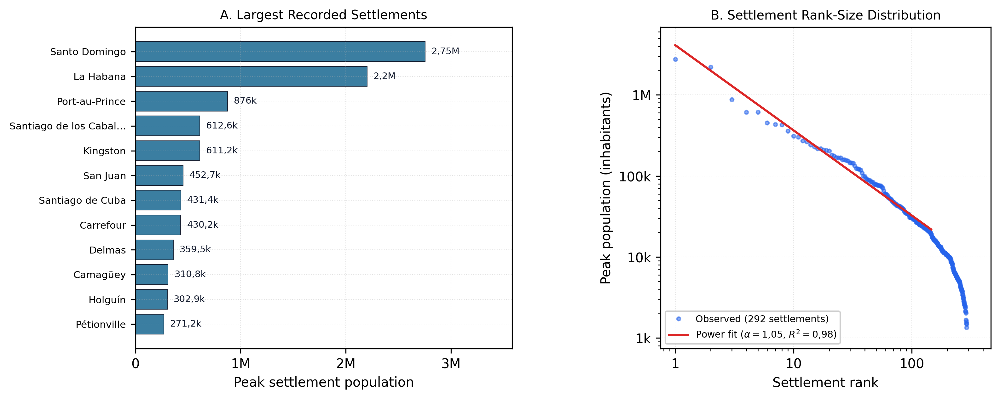

```{r setup, include=FALSE}
knitr::opts_chunk$set(echo = FALSE, warning = FALSE, message = FALSE, fig.pos = "htbp")
source("../../_shared/template/viscount_rmd_helpers.R")
library(jsonlite)

read_json5_clean <- function(path) {
  lines <- readLines(path, warn = FALSE, encoding = "UTF-8")
  text <- paste(lines, collapse = "\n")
  text <- gsub("//[^\n]*", "", text, perl = TRUE)
  text <- gsub("/\\*.*?\\*/", "", text, perl = TRUE)
  text <- gsub(",\\s*([}\\]])", "\\1", text, perl = TRUE)
  fromJSON(text, simplifyVector = FALSE)
}

summary_data <- fromJSON("greater_antilles_modern_summary_cache.json", simplifyVector = FALSE)
sett_data <- fromJSON("greater_antilles_modern_settlements.json", simplifyVector = FALSE)
mask_data <- read_json5_clean("greater_antilles_modern.json5")
ledger_data <- read_json5_clean("greater_antilles_modern_source_ledger.json5")

short_subregion_label <- function(id_str) {
  lbl_map <- c(
    ga_western_cuba = "Western Cuba",
    ga_central_cuba = "Central Cuba",
    ga_eastern_cuba = "Eastern Cuba (Oriente)",
    ga_haiti = "Haiti",
    ga_dominican_republic = "Dominican Republic",
    ga_jamaica = "Jamaica",
    ga_puerto_rico = "Puerto Rico"
  )
  if (id_str %in% names(lbl_map)) unname(lbl_map[[id_str]]) else as.character(id_str)
}

fmt_coord <- function(x) {
  viscount_fmt_number(round(as.numeric(x), 2L), 2L)
}

clean_parent <- function(k) {
  if (is.null(k) || !nzchar(as.character(k))) return("-")
  sub("-[^-]+$", "", as.character(k))
}

subregions_census <- mask_data$regions
n_settlements <- as.integer(summary_data$settlement_stats$total_settlements)
n_city_proper <- as.integer(summary_data$settlement_stats$city_proper_count)
n_suburbs <- as.integer(summary_data$settlement_stats$suburb_count)
n_excluded <- as.integer(ledger_data$total_excluded)
```

```{r hero-md-fallback, results='asis'}
if (!knitr::is_latex_output()) {
  cat("\n\n")
}
```

# Abstract

This companion settlement gazetteer catalogues `r viscount_fmt_number(n_settlements, 0L)` geocoded cities, towns and metropolitan suburbs across Cuba, Haiti, the Dominican Republic, Jamaica and Puerto Rico between 1841 and 2022, anchored strictly to official national census publications and demographic monographs with a 0,0% crowd-sourced fallback share [@ONEICuba2014; @ONEDomRep2023; @IHSIHaiti2015; @STATINJamaica2012; @USCensusPR2024]. Of the 292 catalogued entries, `r viscount_fmt_number(n_city_proper, 0L)` represent standalone urban jurisdictions and `r viscount_fmt_number(n_suburbs, 0L)` are explicitly classified suburban municipalities linked to four major metropolitan cores: San Juan (nine suburbs), Port-au-Prince (four suburbs), Kingston (two suburbs) and Santo Domingo (two suburbs). Across all seven Greater Antillean sub-regions, urban populations follow a crisp Zipfian rank-size distribution ($\alpha = 1,05$, $R^2 = 0,98$ over the leading 146 settlements), crowned by Santo Domingo (2,75M in 2022) and La Habana (2,20M peak in 2002) above a mid-tier archipelagic rank spanning Port-au-Prince (876,0k city proper), Santiago de los Caballeros (612,6k), Kingston (611,2k), San Juan (452,7k peak in 1970) and Santiago de Cuba (431,4k).

# Background

Modern urbanisation across the Greater Antilles evolved along contrasting colonial and postcolonial corridors. In nineteenth-century Cuba and Puerto Rico, administrative power and merchant shipping concentrated around walled port capitals at La Habana (137,5k in 1841), Santiago de Cuba (24,8k), Matanzas (19,1k) and San Juan (18,3k in 1860), joined by interior cattle and tobacco centres such as Camagüey (24,0k) and highland Puerto Rican market towns [@USWarDeptCuba1900; @USWarDeptPR1900; @VazquezCalzada1988]. In Jamaica, emancipation in 1838 redirected growth from estate wharves into Kingston (32,9k in 1844) and interior free-village parishes [@Roberts1957], whereas Hispaniola remained predominantly rural well into the twentieth century, with Santo Domingo holding only 31,0k residents in 1920 and Port-au-Prince 134,1k in 1950 [@MoyaPons1995; @IHSIHaiti2015].

During the second half of the twentieth century, industrialisation, highway expansion and rural-to-urban migration reshaped every island's settlement hierarchy. Cuba balanced growth across provincial capitals outside Havana [@ONEICuba2014; @DiazBriquets1983], the Dominican Republic built a twin-corridor urban system uniting Greater Santo Domingo with the Cibao and eastern tourism cities [@ONEDomRep2023], Jamaica expanded outward from Kingston into Portmore and Spanish Town [@STATINJamaica2012], Puerto Rico suburbanised rapidly around San Juan before post-2006 depopulation shrank urban cores [@Bureau2012Census; @USCensusPR2024], and Haiti experienced intense informal metropolitan concentration across Port-au-Prince, Carrefour, Delmas, Pétionville and Cité Soleil [@IHSIHaiti2015].

# Methodology

The settlement register was compiled across four documented saturation waves without crowd-sourced fallback records. Primary national census ingestion (Wave 1) assembled 267 entries directly from official statistical offices: the Oficina Nacional de Estadística e Información (ONEI) in Cuba [@ONEICuba2014], the Oficina Nacional de Estadística (ONE) in the Dominican Republic [@ONEDomRep2023], the Institut Haïtien de Statistique et d'Informatique (IHSI) in Haiti [@IHSIHaiti2015], the Statistical Institute of Jamaica (STATIN) [@STATINJamaica2012] and the United States Census Bureau for Puerto Rico [@Bureau2012Census; @USCensusPR2024]. Subsequent waves added 19 entries from demographic monographs and historical compilations (Wave 2), 4 from longitudinal nineteenth- and mid-twentieth-century census backfill (Wave 3) and 2 from sub-regional coverage verification sweeps (Wave 4), driving marginal gain down to 0,69%.

Every entry underwent WGS84 coordinate standardisation, spatial intersection against the seven Greater Antillean sub-regional masks and explicit metropolitan scope tagging. Commuter municipalities physically contiguous with national capitals were tagged as suburbs linked to their parent metropolitan centres so that city-proper rankings remain transparent alongside functional agglomeration analysis [@Celade2020Observatorio; @Celade2024Observatorio].

# Testing and Validation

Ledger reconciliation confirms exact accounting across all 292 included settlements (`r viscount_fmt_number(n_excluded, 0L)` excluded records after deduplication), 100% coordinate completeness and complete coverage across all seven areal sub-regions. Figure \ref{fig:sett-regional-map} displays the spatial footprint of all 292 catalogued settlements across Cuba, Hispaniola, Jamaica and Puerto Rico, highlighting the dense municipal grid of Puerto Rico (85 entries) and Jamaica (56) alongside the broader provincial spacing of Cuba (57) and Hispaniola (94 combined).

```{r fig-sett-map, results='asis'}
viscount_figure(
  "figures/greater_antilles_modern_regional_map.png",
  "Spatial distribution of 292 catalogued census settlements across seven Greater Antillean sub-regions from 1838 to 2025.",
  "fig:sett-regional-map"
)
```

# Results

## Thirty Largest Greater Antillean Settlements

Table \ref{tab:top30-settlements} presents the 30 largest catalogued settlements across the Greater Antilles ordered by peak recorded census population, spanning from Santo Domingo (2,75M in 2022) and La Habana (2,20M in 2002) down to Matanzas (145,0k in 2022). Every major polity contributes multiple cities to the upper tier: ten Cuban cities, eight Dominican cities, seven Haitian cities and communes, three Puerto Rican cities and two Jamaican urban centres.

```{r tab-top30-settlements, results='asis'}
all_entries <- unname(sett_data)
calc_peak <- function(e) {
  vals <- as.numeric(unlist(e$population))
  max(vals)
}
ord_idx <- order(vapply(all_entries, calc_peak, numeric(1)), decreasing = TRUE)
top30_entries <- all_entries[ord_idx[seq_len(30L)]]

top30_rows <- lapply(seq_along(top30_entries), function(i) {
  e <- top30_entries[[i]]
  yrs <- as.integer(names(e$population))
  vals <- as.numeric(unlist(e$population))
  o <- order(yrs)
  yrs <- yrs[o]
  vals <- vals[o]
  pk_i <- which.max(vals)
  span_str <- if (length(yrs) == 1L) as.character(yrs[1]) else paste0(yrs[1], " to ", yrs[length(yrs)])
  scope_lbl <- if (identical(e$population_scope, "suburb")) "Suburb" else "City proper"
  data.frame(
    Rank = as.character(i),
    Name = as.character(e$name),
    Polity = as.character(e$country),
    Scope = scope_lbl,
    Coords = paste0(fmt_coord(e$coords[[1]]), ", ", fmt_coord(e$coords[[2]])),
    Span = span_str,
    Peak = paste0(viscount_fmt_pop(vals[pk_i]), " (", yrs[pk_i], ")"),
    stringsAsFactors = FALSE
  )
})
df_top30 <- do.call(rbind, top30_rows)
rownames(df_top30) <- NULL

viscount_table(
  df_top30,
  "Leading 30 Greater Antillean settlements ordered by peak recorded census population, 1841 to 2022 (across 292 catalogued entries).",
  c("Rank", "Settlement", "Polity", "Scope", "Lat, Lon", "Census Span", "Peak Pop. (Year)"),
  list(label = "tab:top30-settlements", font_size = "scriptsize", max_rows_per_page = 32L)
)
```

## Metropolitan Suburbs and Commuter Rings

Table \ref{tab:metro-suburbs} lists all `r viscount_fmt_number(n_suburbs, 0L)` catalogued suburban municipalities across the Greater Antilles alongside their parent capitals, earliest and peak census populations and latest recorded enumerations. Four metropolitan systems account for the entire suburban register: Port-au-Prince's dense surrounding communes (led by Carrefour at 430,3k, Delmas at 359,5k and Cité Soleil at 241,1k), San Juan's sprawling municipal belt (led by Bayamón at 203,5k peak, Carolina at 168,2k and Caguas at 92,4k), Kingston's western Saint Catherine dormitory towns (Portmore at 182,2k peak and Spanish Town at 168,9k) and Santo Domingo's industrial and coastal satellites (Boca Chica at 76,0k and Bajos de Haina at 75,8k).

```{r tab-metro-suburbs, results='asis'}
sub_list <- Filter(function(e) identical(e$population_scope, "suburb"), all_entries)
sub_ord <- order(vapply(sub_list, calc_peak, numeric(1)), decreasing = TRUE)
sub_list <- sub_list[sub_ord]

sub_rows <- lapply(sub_list, function(e) {
  yrs <- as.integer(names(e$population))
  vals <- as.numeric(unlist(e$population))
  o <- order(yrs)
  yrs <- yrs[o]
  vals <- vals[o]
  pk_i <- which.max(vals)
  data.frame(
    Suburb = as.character(e$name),
    Parent = clean_parent(e$metro_parent_key),
    Polity = as.character(e$country),
    Earliest = paste0(viscount_fmt_pop(vals[1]), " (", yrs[1], ")"),
    Peak = paste0(viscount_fmt_pop(vals[pk_i]), " (", yrs[pk_i], ")"),
    Latest = paste0(viscount_fmt_pop(vals[length(vals)]), " (", yrs[length(yrs)], ")"),
    stringsAsFactors = FALSE
  )
})
df_subs <- do.call(rbind, sub_rows)
rownames(df_subs) <- NULL

viscount_table(
  df_subs,
  "All 17 catalogued suburban municipalities across Greater Antillean metropolitan rings, 1844 to 2022.",
  c("Suburb", "Parent Capital", "Polity", "Earliest Census", "Peak Census", "Latest Census"),
  list(label = "tab:metro-suburbs", font_size = "scriptsize")
)
```

## Sub-Regional Gazetteer Coverage and Provenance Summary

Table \ref{tab:subregion-coverage} aggregates settlement counts, areal coverage density per 1.000 km² of surveyed land and leading recorded urban centres across all seven sub-regions, paired with each sub-region's 2025 official census benchmark population. Puerto Rico exhibits the highest spatial catalogue density at 9,90 towns per 1.000 km² because every municipal seat and major urban place is enumerated separately in United States decennial censuses, followed by Jamaica at 5,21 towns per 1.000 km². Cuba's three macro-zones record 0,47 to 0,60 towns per 1.000 km², reflecting its larger municipal footprints and broader agricultural plains [@ONEICuba2014; @USCensusPR2024; @STATINJamaica2012].

```{r tab-subregion-coverage, results='asis'}
cov_rows <- lapply(subregions_census, function(r) {
  rid <- r$id
  area_v <- as.numeric(r$area_km2)
  p2025 <- as.numeric(r$population[["2025"]])
  entries_r <- Filter(function(e) identical(e$region_id, rid), all_entries)
  cnt <- length(entries_r)
  pks <- vapply(entries_r, calc_peak, numeric(1))
  idx_m <- which.max(pks)
  lead_str <- paste0(entries_r[[idx_m]]$name, " (", viscount_fmt_pop(pks[idx_m]), ")")
  data.frame(
    Subregion = short_subregion_label(rid),
    Area = viscount_fmt_number(round(area_v), 0L),
    Towns = viscount_fmt_number(cnt, 0L),
    Dens = viscount_fmt_number((cnt / area_v) * 1000, 2L),
    Lead = lead_str,
    Pop2025 = viscount_fmt_pop(p2025),
    stringsAsFactors = FALSE
  )
})
df_cov <- do.call(rbind, cov_rows)
rownames(df_cov) <- NULL

viscount_table(
  df_cov,
  "Sub-regional gazetteer counts, town density per 1.000 km² of surveyed land, leading urban centre and 2025 census population across seven Greater Antillean sub-regions.",
  c("Sub-Region", "Land Area (km²)", "Towns", "Towns per 1k km²", "Leading Centre (Peak)", "2025 Census Pop."),
  list(label = "tab:subregion-coverage", font_size = "scriptsize")
)
```

# Limitations

Three census-delimitation constraints qualify direct urban comparisons across this gazetteer. First, Haiti has conducted no national census since 2003, leaving its urban entries anchored on 2009 IHSI municipal updates prior to the January 2010 earthquake and subsequent informal rebuilding [@IHSIHaiti2015]. Second, United States Census Bureau PL 94-171 urban-place boundaries in Puerto Rico distinguish narrow central *pueblo* cores from wider *municipio* boundaries, producing steep apparent drops in inner-ring suburban *pueblo* series such as Bayamón in 2020 relative to its 2000 *zona urbana* peak of 203,5k [@Bureau2012Census; @USCensusPR2024]. Third, Kingston's 1970 jump from 123,4k to 473,7k reflects administrative integration of urban Saint Andrew with old Kingston parish rather than an instantaneous decade-long quadrupling [@STATINJamaica2012].

# Conclusion

Across 292 catalogued census settlements spanning 1841 to 2022, the Greater Antillean urban system mirrors the wider demographic realignment of the modern archipelago. Nineteenth-century colonial port primacy centred on La Habana and Kingston gave way over the twentieth century to a multi-polar network conforming tightly to Zipf's rank-size rule ($\alpha = 1,05$, $R^2 = 0,98$), now led in absolute scale by Santo Domingo (2,75M) and La Habana (2,20M peak) alongside rapidly growing Haitian metropolitan communes and contracting post-industrial Puerto Rican urban cores [@ONEDomRep2023; @ONEICuba2014; @IHSIHaiti2015; @USCensusPR2024].

# Appendix

## Primary Census Provenance Counts

Table \ref{tab:sett-provenance} documents the primary official census series contributing observations to the 292-entry settlement register. Because major historical cities appear in both nineteenth-century archival compilations and twentieth-century national statistical tables, individual settlements frequently draw longitudinal observations from two or three official census series.

```{r tab-sett-provenance, results='asis'}
src_counts <- list()
for (e in all_entries) {
  for (s in e$sources) {
    s_str <- as.character(s)
    src_counts[[s_str]] <- (if (is.null(src_counts[[s_str]])) 0L else src_counts[[s_str]]) + 1L
  }
}
src_map <- c(
  "U.S. Census Bureau 2010 & 2020 Decennial Census PL 94-171 (Puerto Rico)" = "US Census Bureau 2010 and 2020 Decennial PL 94-171 (Puerto Rico)",
  "US Census Bureau Puerto Rico Censuses (Cities & Urban Places)" = "US Census Bureau Historical Puerto Rico Urban Censuses (1899 to 2000)",
  "ONE Dominican Republic Censuses" = "ONE Dominican Republic National Censuses (1920 to 2022)",
  "ONEI Cuba Censuses" = "ONEI Cuba National Censuses (1907 to 2022)",
  "STATIN Jamaica Censuses" = "STATIN Jamaica National Censuses (1844 to 2022)",
  "Greater Antilles Official Censuses (ONEI Cuba 1841-1970, IHSI Haiti 1950-1971, ONE Dominican Republic 1920-1970, STATIN Jamaica 1844-1970, US Census Bureau Puerto Rico 1899-1980)" = "Harmonised Historical Greater Antilles Census Compendium (1841 to 1980)",
  "IHSI Haiti Censuses" = "IHSI Haiti National Censuses and Departmental Updates (1950 to 2009)"
)
s_vec <- unlist(src_counts)
s_ord <- sort(s_vec, decreasing = TRUE)
s_names <- vapply(names(s_ord), function(k) if (k %in% names(src_map)) unname(src_map[[k]]) else k, character(1))
df_src <- data.frame(
  Corpus = s_names,
  Towns = vapply(as.integer(s_ord), function(v) viscount_fmt_number(v, 0L), character(1)),
  Share = vapply(100 * as.integer(s_ord) / n_settlements, function(v) paste0(viscount_fmt_number(v, 1L), "%"), character(1)),
  stringsAsFactors = FALSE
)
rownames(df_src) <- NULL

viscount_table(
  df_src,
  "Official census corpora contributing longitudinal population records across 292 Greater Antillean settlements (entries may cite multiple historical series).",
  c("Census Corpus", "Settlements Covered", "Share of Gazetteer"),
  list(label = "tab:sett-provenance", font_size = "scriptsize")
)
```

# Sources

::: {#refs}
:::

# Footnotes

Note 1. Settlement peak years in Tables \ref{tab:top30-settlements} and \ref{tab:metro-suburbs} reflect the maximum enumerated census population inside the 1841 to 2022 register; several Cuban and Puerto Rican municipalities reached their historical maxima between 1970 and 2002 before declining in twenty-first-century censuses.

Note 2. Three Dominican border towns intersect the 5-arc-minute Haiti areal mask polygon, yielding 61 settlements inside the Dominican Republic mask and 33 inside the Haiti mask against national counts of 64 Dominican and 30 Haitian settlements.
