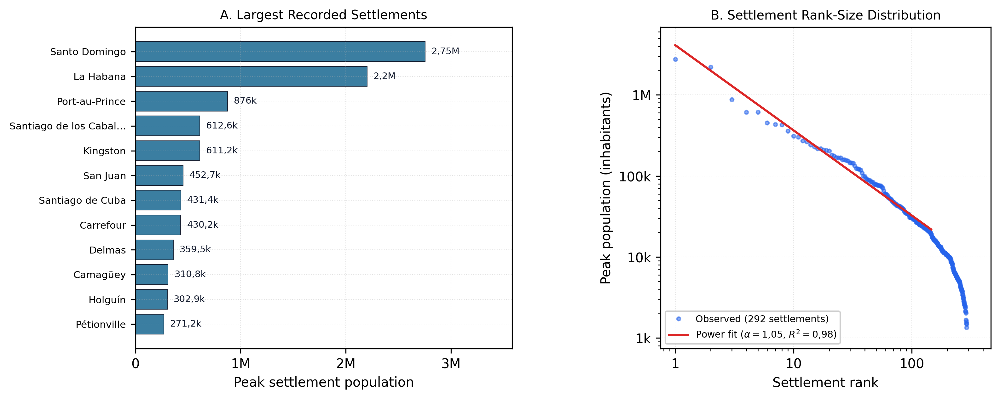
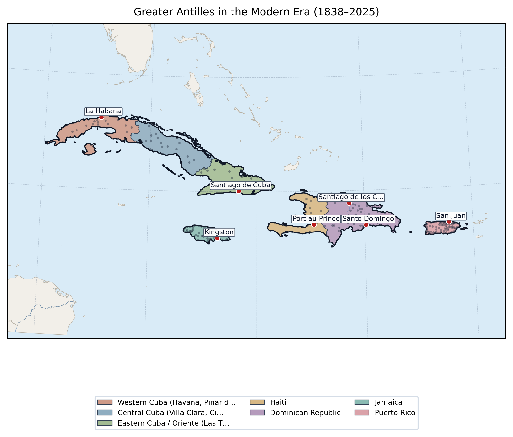

Greater Antilles in the Modern Era
================
Aust Kätzchen
23 November 2026

- [Abstract](#abstract)
- [Background](#background)
- [Methodology](#methodology)
- [Testing and Validation](#testing-and-validation)
- [Results](#results)
  - [Thirty Largest Greater Antillean
    Settlements](#thirty-largest-greater-antillean-settlements)
  - [Metropolitan Suburbs and Commuter
    Rings](#metropolitan-suburbs-and-commuter-rings)
  - [Sub-Regional Gazetteer Coverage and Provenance
    Summary](#sub-regional-gazetteer-coverage-and-provenance-summary)
- [Limitations](#limitations)
- [Conclusion](#conclusion)
- [Appendix](#appendix)
  - [Primary Census Provenance
    Counts](#primary-census-provenance-counts)
- [Sources](#sources)
- [Footnotes](#footnotes)

<figure>

<figcaption aria-hidden="true">Twelve largest census settlements and
rank-size distribution across 292 catalogued towns and cities in the
Greater Antilles from 1838 to 2025.</figcaption>
</figure>

# Abstract

This companion settlement gazetteer catalogues 292 geocoded cities,
towns and metropolitan suburbs across Cuba, Haiti, the Dominican
Republic, Jamaica and Puerto Rico between 1841 and 2022, anchored
strictly to official national census publications and demographic
monographs with a 0,0% crowd-sourced fallback share
[\[1\]](#ref-ONEICuba2014)[\[2\]](#ref-ONEDomRep2023)[\[3\]](#ref-IHSIHaiti2015)[\[4\]](#ref-STATINJamaica2012)[\[5\]](#ref-USCensusPR2024).
Of the 292 catalogued entries, 275 represent standalone urban
jurisdictions and 17 are explicitly classified suburban municipalities
linked to four major metropolitan cores: San Juan (nine suburbs),
Port-au-Prince (four suburbs), Kingston (two suburbs) and Santo Domingo
(two suburbs). Across all seven Greater Antillean sub-regions, urban
populations follow a crisp Zipfian rank-size distribution
($\alpha = 1,05$, $R^2 = 0,98$ over the leading 146 settlements),
crowned by Santo Domingo (2,75M in 2022) and La Habana (2,20M peak in
2002) above a mid-tier archipelagic rank spanning Port-au-Prince (876,0k
city proper), Santiago de los Caballeros (612,6k), Kingston (611,2k),
San Juan (452,7k peak in 1970) and Santiago de Cuba (431,4k).

# Background

Modern urbanisation across the Greater Antilles evolved along
contrasting colonial and postcolonial corridors. In nineteenth-century
Cuba and Puerto Rico, administrative power and merchant shipping
concentrated around walled port capitals at La Habana (137,5k in 1841),
Santiago de Cuba (24,8k), Matanzas (19,1k) and San Juan (18,3k in 1860),
joined by interior cattle and tobacco centres such as Camagüey (24,0k)
and highland Puerto Rican market towns
[\[6\]](#ref-USWarDeptCuba1900)[\[7\]](#ref-USWarDeptPR1900)[\[8\]](#ref-VazquezCalzada1988).
In Jamaica, emancipation in 1838 redirected growth from estate wharves
into Kingston (32,9k in 1844) and interior free-village parishes
[\[9\]](#ref-Roberts1957), whereas Hispaniola remained predominantly
rural well into the twentieth century, with Santo Domingo holding only
31,0k residents in 1920 and Port-au-Prince 134,1k in 1950
[\[3\]](#ref-IHSIHaiti2015)[\[10\]](#ref-MoyaPons1995).

During the second half of the twentieth century, industrialisation,
highway expansion and rural-to-urban migration reshaped every island’s
settlement hierarchy. Cuba balanced growth across provincial capitals
outside Havana
[\[1\]](#ref-ONEICuba2014)[\[11\]](#ref-DiazBriquets1983), the Dominican
Republic built a twin-corridor urban system uniting Greater Santo
Domingo with the Cibao and eastern tourism cities
[\[2\]](#ref-ONEDomRep2023), Jamaica expanded outward from Kingston into
Portmore and Spanish Town [\[4\]](#ref-STATINJamaica2012), Puerto Rico
suburbanised rapidly around San Juan before post-2006 depopulation
shrank urban cores
[\[5\]](#ref-USCensusPR2024)[\[12\]](#ref-Bureau2012Census), and Haiti
experienced intense informal metropolitan concentration across
Port-au-Prince, Carrefour, Delmas, Pétionville and Cité Soleil
[\[3\]](#ref-IHSIHaiti2015).

# Methodology

The settlement register was compiled across four documented saturation
waves without crowd-sourced fallback records. Primary national census
ingestion (Wave 1) assembled 267 entries directly from official
statistical offices: the Oficina Nacional de Estadística e Información
(ONEI) in Cuba [\[1\]](#ref-ONEICuba2014), the Oficina Nacional de
Estadística (ONE) in the Dominican Republic [\[2\]](#ref-ONEDomRep2023),
the Institut Haïtien de Statistique et d’Informatique (IHSI) in Haiti
[\[3\]](#ref-IHSIHaiti2015), the Statistical Institute of Jamaica
(STATIN) [\[4\]](#ref-STATINJamaica2012) and the United States Census
Bureau for Puerto Rico
[\[5\]](#ref-USCensusPR2024)[\[12\]](#ref-Bureau2012Census). Subsequent
waves added 19 entries from demographic monographs and historical
compilations (Wave 2), 4 from longitudinal nineteenth- and
mid-twentieth-century census backfill (Wave 3) and 2 from sub-regional
coverage verification sweeps (Wave 4), driving marginal gain down to
0,69%.

Every entry underwent WGS84 coordinate standardisation, spatial
intersection against the seven Greater Antillean sub-regional masks and
explicit metropolitan scope tagging. Commuter municipalities physically
contiguous with national capitals were tagged as suburbs linked to their
parent metropolitan centres so that city-proper rankings remain
transparent alongside functional agglomeration analysis
[\[13\]](#ref-Celade2020Observatorio)[\[14\]](#ref-Celade2024Observatorio).

# Testing and Validation

Ledger reconciliation confirms exact accounting across all 292 included
settlements (0 excluded records after deduplication), 100% coordinate
completeness and complete coverage across all seven areal sub-regions.
Figure displays the spatial footprint of all 292 catalogued settlements
across Cuba, Hispaniola, Jamaica and Puerto Rico, highlighting the dense
municipal grid of Puerto Rico (85 entries) and Jamaica (56) alongside
the broader provincial spacing of Cuba (57) and Hispaniola (94
combined).

<!-- -->

# Results

## Thirty Largest Greater Antillean Settlements

Table presents the 30 largest catalogued settlements across the Greater
Antilles ordered by peak recorded census population, spanning from Santo
Domingo (2,75M in 2022) and La Habana (2,20M in 2002) down to Matanzas
(145,0k in 2022). Every major polity contributes multiple cities to the
upper tier: ten Cuban cities, eight Dominican cities, seven Haitian
cities and communes, three Puerto Rican cities and two Jamaican urban
centres.

| Rank | Settlement | Polity | Scope | Lat, Lon | Census Span | Peak Pop. (Year) |
|:---|:---|:---|:---|:---|:---|:---|
| **1** | Santo Domingo | Dominican Republic | City proper | 18,49, -69,93 | 1844 to 2022 | 2,75M (2022) |
| **2** | La Habana | Cuba | City proper | 23,11, -82,37 | 1841 to 2022 | 2,2M (2002) |
| **3** | Port-au-Prince | Haiti | City proper | 18,54, -72,34 | 1860 to 2009 | 876k (2009) |
| **4** | Santiago de los Caballeros | Dominican Republic | City proper | 19,45, -70,7 | 1893 to 2022 | 612,6k (2022) |
| **5** | Kingston | Jamaica | City proper | 17,97, -76,79 | 1844 to 2022 | 611,2k (2022) |
| **6** | San Juan | Puerto Rico | City proper | 18,47, -66,11 | 1860 to 2020 | 452,7k (1970) |
| **7** | Santiago de Cuba | Cuba | City proper | 20,02, -75,82 | 1841 to 2022 | 431,4k (2022) |
| **8** | Carrefour | Haiti | Suburb | 18,54, -72,4 | 1982 to 2009 | 430,2k (2009) |
| **9** | Delmas | Haiti | Suburb | 18,54, -72,3 | 2009 | 359,5k (2009) |
| **10** | Camagüey | Cuba | City proper | 21,38, -77,92 | 1841 to 2022 | 310,8k (2022) |
| **11** | Holguín | Cuba | City proper | 20,89, -76,26 | 1899 to 2022 | 302,9k (2022) |
| **12** | Pétionville | Haiti | City proper | 18,51, -72,29 | 1982 to 2009 | 271,2k (2009) |
| **13** | La Romana | Dominican Republic | City proper | 18,43, -68,97 | 1920 to 2022 | 265,3k (2022) |
| **14** | Cité Soleil | Haiti | Suburb | 18,58, -72,34 | 2009 | 241,1k (2009) |
| **15** | Gonaïves | Haiti | City proper | 19,45, -72,69 | 1890 to 2009 | 228,7k (2009) |
| **16** | Santa Clara | Cuba | City proper | 22,41, -79,96 | 1861 to 2022 | 217,9k (2022) |
| **17** | Guantánamo | Cuba | City proper | 20,14, -75,21 | 1899 to 2022 | 217,1k (2012) |
| **18** | Higüey | Dominican Republic | City proper | 18,61, -68,71 | 1981 to 2022 | 210,3k (2022) |
| **19** | San Pedro de Macorís | Dominican Republic | City proper | 18,45, -69,31 | 1893 to 2022 | 207,4k (2022) |
| **20** | Bayamón | Puerto Rico | Suburb | 18,4, -66,16 | 1899 to 2020 | 203,5k (2000) |
| **21** | Portmore | Jamaica | Suburb | 17,95, -76,88 | 1970 to 2022 | 182,2k (2011) |
| **22** | Las Tunas | Cuba | City proper | 20,96, -76,95 | 1970 to 2022 | 176,1k (2022) |
| **23** | Spanish Town | Jamaica | Suburb | 17,99, -76,96 | 1844 to 2022 | 168,9k (2022) |
| **24** | Carolina | Puerto Rico | Suburb | 18,38, -65,96 | 1899 to 2020 | 168,2k (2000) |
| **25** | San Cristóbal | Dominican Republic | City proper | 18,42, -70,1 | 1981 to 2022 | 167,5k (2022) |
| **26** | Ponce | Puerto Rico | City proper | 18,01, -66,61 | 1860 to 2020 | 159,2k (1990) |
| **27** | Bayamo | Cuba | City proper | 20,38, -76,64 | 1970 to 2022 | 159k (2022) |
| **28** | Cap-Haïtien | Haiti | City proper | 19,76, -72,21 | 1860 to 2009 | 155,5k (2009) |
| **29** | Cienfuegos | Cuba | City proper | 22,15, -80,44 | 1861 to 2022 | 153k (2022) |
| **30** | Matanzas | Cuba | City proper | 23,04, -81,58 | 1841 to 2022 | 145k (2022) |

Leading 30 Greater Antillean settlements ordered by peak recorded census
population, 1841 to 2022 (across 292 catalogued entries).

## Metropolitan Suburbs and Commuter Rings

Table lists all 17 catalogued suburban municipalities across the Greater
Antilles alongside their parent capitals, earliest and peak census
populations and latest recorded enumerations. Four metropolitan systems
account for the entire suburban register: Port-au-Prince’s dense
surrounding communes (led by Carrefour at 430,3k, Delmas at 359,5k and
Cité Soleil at 241,1k), San Juan’s sprawling municipal belt (led by
Bayamón at 203,5k peak, Carolina at 168,2k and Caguas at 92,4k),
Kingston’s western Saint Catherine dormitory towns (Portmore at 182,2k
peak and Spanish Town at 168,9k) and Santo Domingo’s industrial and
coastal satellites (Boca Chica at 76,0k and Bajos de Haina at 75,8k).

| Suburb | Parent Capital | Polity | Earliest Census | Peak Census | Latest Census |
|:---|:---|:---|:---|:---|:---|
| **Carrefour** | Port-au-Prince | Haiti | 129,5k (1982) | 430,2k (2009) | 430,2k (2009) |
| **Delmas** | Port-au-Prince | Haiti | 359,5k (2009) | 359,5k (2009) | 359,5k (2009) |
| **Cité Soleil** | Port-au-Prince | Haiti | 241,1k (2009) | 241,1k (2009) | 241,1k (2009) |
| **Bayamón** | San Juan | Puerto Rico | 2,2k (1899) | 203,5k (2000) | 1,9k (2020) |
| **Portmore** | Kingston | Jamaica | 5,1k (1970) | 182,2k (2011) | 161,4k (2022) |
| **Spanish Town** | Kingston | Jamaica | 5,8k (1844) | 168,9k (2022) | 168,9k (2022) |
| **Carolina** | San Juan | Puerto Rico | 2,2k (1899) | 168,2k (2000) | 138,3k (2020) |
| **Caguas** | San Juan | Puerto Rico | 5,4k (1899) | 92,4k (1990) | 70,3k (2020) |
| **Croix-des-Bouquets** | Port-au-Prince | Haiti | 84,8k (2009) | 84,8k (2009) | 84,8k (2009) |
| **Guaynabo** | San Juan | Puerto Rico | 1,1k (1940) | 78,8k (2000) | 68,5k (2020) |
| **Boca Chica** | Santo Domingo | Dominican Republic | 46,4k (2002) | 76k (2022) | 76k (2022) |
| **Bajos de Haina** | Santo Domingo | Dominican Republic | 33,1k (1981) | 75,8k (2022) | 75,8k (2022) |
| **Trujillo Alto** | San Juan | Puerto Rico | 44,3k (1990) | 50,8k (2000) | 43,7k (2020) |
| **Cataño** | San Juan | Puerto Rico | 34,6k (1990) | 34,6k (1990) | 23,2k (2020) |
| **Canóvanas** | San Juan | Puerto Rico | 7,3k (2010) | 12k (2020) | 12k (2020) |
| **Toa Alta** | San Juan | Puerto Rico | 3,7k (2010) | 3,8k (2020) | 3,8k (2020) |
| **Toa Baja** | San Juan | Puerto Rico | 1,5k (2010) | 1,5k (2010) | 1,2k (2020) |

All 17 catalogued suburban municipalities across Greater Antillean
metropolitan rings, 1844 to 2022.

## Sub-Regional Gazetteer Coverage and Provenance Summary

Table aggregates settlement counts, areal coverage density per 1.000 km²
of surveyed land and leading recorded urban centres across all seven
sub-regions, paired with each sub-region’s 2025 official census
benchmark population. Puerto Rico exhibits the highest spatial catalogue
density at 9,90 towns per 1.000 km² because every municipal seat and
major urban place is enumerated separately in United States decennial
censuses, followed by Jamaica at 5,21 towns per 1.000 km². Cuba’s three
macro-zones record 0,47 to 0,60 towns per 1.000 km², reflecting its
larger municipal footprints and broader agricultural plains
[\[1\]](#ref-ONEICuba2014)[\[4\]](#ref-STATINJamaica2012)[\[5\]](#ref-USCensusPR2024).

| Sub-Region | Land Area (km²) | Towns | Towns per 1k km² | Leading Centre (Peak) | 2025 Census Pop. |
|:---|:---|:---|:---|:---|:---|
| **Western Cuba** | 30.959 | 17 | 0,55 | La Habana (2,2M) | 4,32M |
| **Central Cuba** | 40.346 | 19 | 0,47 | Camagüey (310,8k) | 2,74M |
| **Eastern Cuba (Oriente)** | 34.890 | 21 | 0,6 | Santiago de Cuba (431,4k) | 3,76M |
| **Haiti** | 27.828 | 33 | 1,19 | Port-au-Prince (876k) | 11,9M |
| **Dominican Republic** | 47.058 | 61 | 1,3 | Santo Domingo (2,75M) | 11,43M |
| **Jamaica** | 10.749 | 56 | 5,21 | Kingston (611,2k) | 2,84M |
| **Puerto Rico** | 8.584 | 85 | 9,9 | San Juan (452,7k) | 3,21M |

Sub-regional gazetteer counts, town density per 1.000 km² of surveyed
land, leading urban centre and 2025 census population across seven
Greater Antillean sub-regions.

# Limitations

Three census-delimitation constraints qualify direct urban comparisons
across this gazetteer. First, Haiti has conducted no national census
since 2003, leaving its urban entries anchored on 2009 IHSI municipal
updates prior to the January 2010 earthquake and subsequent informal
rebuilding [\[3\]](#ref-IHSIHaiti2015). Second, United States Census
Bureau PL 94-171 urban-place boundaries in Puerto Rico distinguish
narrow central *pueblo* cores from wider *municipio* boundaries,
producing steep apparent drops in inner-ring suburban *pueblo* series
such as Bayamón in 2020 relative to its 2000 *zona urbana* peak of
203,5k [\[5\]](#ref-USCensusPR2024)[\[12\]](#ref-Bureau2012Census).
Third, Kingston’s 1970 jump from 123,4k to 473,7k reflects
administrative integration of urban Saint Andrew with old Kingston
parish rather than an instantaneous decade-long quadrupling
[\[4\]](#ref-STATINJamaica2012).

# Conclusion

Across 292 catalogued census settlements spanning 1841 to 2022, the
Greater Antillean urban system mirrors the wider demographic realignment
of the modern archipelago. Nineteenth-century colonial port primacy
centred on La Habana and Kingston gave way over the twentieth century to
a multi-polar network conforming tightly to Zipf’s rank-size rule
($\alpha = 1,05$, $R^2 = 0,98$), now led in absolute scale by Santo
Domingo (2,75M) and La Habana (2,20M peak) alongside rapidly growing
Haitian metropolitan communes and contracting post-industrial Puerto
Rican urban cores
[\[1\]](#ref-ONEICuba2014)[\[2\]](#ref-ONEDomRep2023)[\[3\]](#ref-IHSIHaiti2015)[\[5\]](#ref-USCensusPR2024).

# Appendix

## Primary Census Provenance Counts

Table documents the primary official census series contributing
observations to the 292-entry settlement register. Because major
historical cities appear in both nineteenth-century archival
compilations and twentieth-century national statistical tables,
individual settlements frequently draw longitudinal observations from
two or three official census series.

| Census Corpus | Settlements Covered | Share of Gazetteer |
|:---|:---|:---|
| **US Census Bureau 2010 and 2020 Decennial PL 94-171 (Puerto Rico)** | 85 | 29,1% |
| **US Census Bureau Historical Puerto Rico Urban Censuses (1899 to 2000)** | 66 | 22,6% |
| **ONE Dominican Republic National Censuses (1920 to 2022)** | 64 | 21,9% |
| **ONEI Cuba National Censuses (1907 to 2022)** | 57 | 19,5% |
| **STATIN Jamaica National Censuses (1844 to 2022)** | 56 | 19,2% |
| **Harmonised Historical Greater Antilles Census Compendium (1841 to 1980)** | 33 | 11,3% |
| **IHSI Haiti National Censuses and Departmental Updates (1950 to 2009)** | 30 | 10,3% |

Official census corpora contributing longitudinal population records
across 292 Greater Antillean settlements (entries may cite multiple
historical series).

# Sources

1.
Oficina Nacional de Estadística e
Información (ONEI) Cuba. “Censos de Población y
Viviendas de Cuba (1907, 1919, 1931, 1943, 1953, 1970, 1981, 2002,
2012).” ONEI, La Habana, 2014, <https://www.onei.gob.cu/>.

2.
Oficina Nacional de Estadística
(ONE) República Dominicana. “Censos Nacionales de
Población y Vivienda (I Censo 1920, 1935, 1950, 1960, 1970, 1981, 1993,
2002, 2010, X Censo 2022).” ONE, Santo Domingo, 2023,
<https://www.one.gob.do/>.

3.
Institut Haïtien de Statistique et
d’Informatique (IHSI). “Recensements Généraux de la
Population et de l’Habitat (1950, 1971, 1982, 2003) et Population Totale
par Département (2015).” IHSI, Port-au-Prince, 2015,
<https://ihsi.gouv.ht/>.

4.
Statistical Institute of Jamaica
(STATIN). “Population and Housing Censuses of
Jamaica (1844–2011).” STATIN, Kingston, 2012,
<https://statinja.gov.jm/>.

5.
United States Bureau of the
Census. “Decennial Censuses of Puerto Rico
(1910–2020) and Vintage 2023 Municipio Population Estimates Base
(prm-est2023-pop.xlsx).” U.S. Census Bureau, Washington, D.C.,
2024,
<https://www2.census.gov/programs-surveys/popest/tables/2020-2023/municipios/totals/prm-est2023-pop.xlsx>.

6.
United States War Department, H.
Gannett, Office Director Census of Cuba (J. P. Sanger.
*Report on the Census of Cuba, 1899*.
Government Printing Office, Washington, D.C., 1900,
<https://archive.org/details/reportoncensusof00unitrich>.

7.
United States War Department, H.
Gannett, Office Director Census of Porto Rico (J. P. Sanger.
*Report on the Census of Porto Rico, 1899*.
Government Printing Office, Washington, D.C., 1900,
<https://archive.org/details/reportoncensusof00unit>.

8.
Vázquez Calzada, José L.
*La población de Puerto Rico y su trayectoria
histórica*. Escuela Graduada de Salud Pública, Universidad de
Puerto Rico, 1988, <https://rcm.upr.edu/>.

9.
Roberts, George W.
*The Population of Jamaica: An Analysis of Its
Structure and Growth*. Cambridge University Press, Cambridge,
1957, <https://www.cambridge.org/>.

10.
Moya Pons, Frank.
*The Dominican Republic: A National History /
Manual de Historia Dominicana*. Markus Wiener Publishers,
Princeton, 1995, <https://www.worldcat.org/title/31816236>.

11.
Díaz-Briquets, Sergio.
*The Health Revolution in Cuba*. University
of Texas Press, 1983, <https://doi.org/10.7560/750715>.

12.
United States Census Bureau.
“2010 Census of Population and Housing: Puerto Rico
Summary Population and Housing Characteristics (CPH-1-53).” *U.S.
Department of Commerce, Economics and Statistics Administration*, 2012,
<https://www2.census.gov/library/publications/2012/dec/cph-1-53.pdf>.

13.
CELADE, CEPAL /.
“Observatorio Demográfico de América Latina y el
Caribe 2019: Proyecciones de población = Demographic Observatory of
Latin America and the Caribbean 2019: Population projections.”
*UN ECLAC / CEPAL-CELADE*, 2020,
<https://hdl.handle.net/11362/45198>.

14.
CELADE, CEPAL /.
“Observatorio Demográfico de América Latina y el
Caribe 2023. La dinámica demográfica de América Latina y su impacto en
la fuerza de trabajo.” *UN ECLAC / CEPAL-CELADE*, 2024,
<https://hdl.handle.net/11362/68798>.

# Footnotes

Note 1. Settlement peak years in Tables and reflect the maximum
enumerated census population inside the 1841 to 2022 register; several
Cuban and Puerto Rican municipalities reached their historical maxima
between 1970 and 2002 before declining in twenty-first-century censuses.

Note 2. Three Dominican border towns intersect the 5-arc-minute Haiti
areal mask polygon, yielding 61 settlements inside the Dominican
Republic mask and 33 inside the Haiti mask against national counts of 64
Dominican and 30 Haitian settlements.
