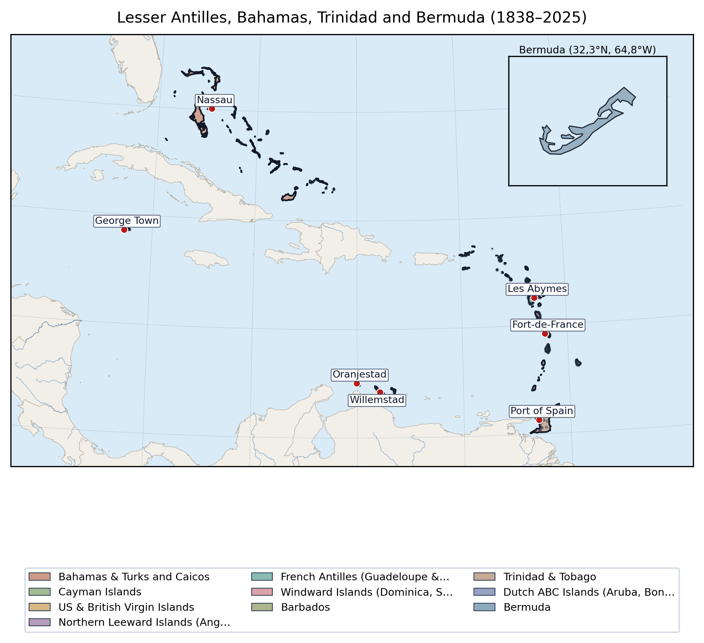

```{r setup, include=FALSE}
knitr::opts_chunk$set(echo = FALSE, warning = FALSE, message = FALSE, fig.pos = "htbp")
source("../../_shared/template/viscount_rmd_helpers.R")
library(jsonlite)

read_json5_clean <- function(path) {
  lines <- readLines(path, warn = FALSE, encoding = "UTF-8")
  text <- paste(lines, collapse = "\n")
  text <- gsub("(?<!:)//[^\n]*", "", text, perl = TRUE)
  text <- gsub("/\\*.*?\\*/", "", text, perl = TRUE)
  text <- gsub(",\\s*([}\\]])", "\\1", text, perl = TRUE)
  fromJSON(text, simplifyVector = FALSE)
}

summary_data <- fromJSON("lesser_antilles_bahamas_bermuda_summary_cache.json", simplifyVector = FALSE)
bench_data <- read_json5_clean("lesser_antilles_bahamas_bermuda.json5")
sett_data <- fromJSON("lesser_antilles_bahamas_bermuda_settlements.json", simplifyVector = FALSE)
ledger_data <- read_json5_clean("lesser_antilles_bahamas_bermuda_source_ledger.json5")

clean_label <- function(x) {
  s <- as.character(x)
  s <- gsub("&", "and", s, fixed = TRUE)
  s <- gsub("Curacao", "Curaçao", s, fixed = TRUE)
  s <- gsub("Saint Barthelemy", "Saint-Barthélemy", s, fixed = TRUE)
  s <- gsub("St\\. George$", "St. George's", s)
  trimws(s)
}

clean_source_short <- function(x) {
  s <- as.character(x)
  s <- gsub("Institut National de la Statistique\\s*$", "INSEE", s)
  s <- gsub("Central Statistics Office, Governmen\\w*$", "BVI Central Statistics Office", s)
  s <- gsub("Statistics Division, Ministry of Fin\\w*$", "Antigua and Barbuda Statistics Division", s)
  s <- gsub("Statistics Department, Government of,\\s*Kuczynski, Robert René", "Montserrat Statistics Dept; Kuczynski", s)
  s <- gsub("Department of Economic Planning and\\s*$", "Turks and Caicos DEPS", s)
  s <- gsub("Bahamas National Statistical Institu\\w*$", "Bahamas NSI", s)
  s <- gsub("Statistical Office, Government of Sa\\w*$", "St Vincent Statistical Office", s)
  s <- gsub("Centraal Bureau voor de Statistiek,\\s*Centraal Bureau voor de Statistiek", "CBS Netherlands", s)
  s <- gsub("Central Bureau of Statistics,\\s*Centraal Bureau voor de Statistiek", "CBS Aruba/Curaçao; CBS NL", s)
  s <- gsub("Department of Statistics, Government,\\s*Kuczynski, Robert René", "Bermuda Dept of Statistics; Kuczynski", s)
  s <- gsub("Det Statistiske Departement,\\s*United States Bureau of the Census", "Danish Stat. Dept; U.S. Census Bureau", s)
  s <- gsub("Central Statistical Office,\\s*Higman, Barry W\\.", "CSO Trinidad and Tobago; Higman", s)
  s <- gsub("Central Statistical Office,\\s*Kuczynski, Robert René", "CSO Trinidad and Tobago; Kuczynski", s)
  s <- gsub("Kuczynski, Robert René,\\s*Central Statistical Office", "Kuczynski; OECS CSOs", s)
  s <- gsub("Kuczynski, Robert René,\\s*United Nations Statistics Division", "Kuczynski; UNSD", s)
  s <- gsub("Barbados Statistical Service,\\s*Kuczynski, Robert René", "BSS Barbados; Kuczynski", s)
  s <- gsub("Department of Statistics,\\s*Centraal Bureau voor de Statistiek", "STAT Sint Maarten; CBS NL", s)
  trimws(s)
}

subregions_cache <- summary_data$subregions
subregions_bench <- bench_data$regions
bench_by_id <- setNames(subregions_bench, vapply(subregions_bench, function(r) r$id, character(1)))

n_settlements <- as.integer(summary_data$settlement_stats$total_settlements)
n_suburbs <- as.integer(summary_data$settlement_stats$suburb_count)
n_city_proper <- as.integer(summary_data$settlement_stats$city_proper_count)
grid_area_km2 <- as.numeric(summary_data$area_km2)
grid_start_pop <- as.numeric(summary_data$domain_trajectory[["1840"]])
grid_end_pop <- as.numeric(summary_data$domain_trajectory[["2025"]])
zipf_alpha <- as.numeric(summary_data$settlement_stats$zipf_stats$alpha)
zipf_r2 <- as.numeric(summary_data$settlement_stats$zipf_stats$r2)
zipf_n_fit <- as.integer(summary_data$settlement_stats$zipf_stats$n_fit)
```

```{r hero-md-fallback, results='asis'}
if (!knitr::is_latex_output()) {
  cat("\n\n")
}
```

# Abstract

Between the end of British apprenticeship in August 1838 and the 2020-round censuses of the eastern Caribbean and western North Atlantic, the small islands stretching from Bermuda and the Bahamas through the Leeward and Windward arcs to Barbados, the Dutch ABC islands and Trinidad and Tobago multiplied their combined population roughly sixfold. Harmonised official census series across ten insular sub-regions document an ascent from approximately 731k inhabitants in the early 1840s to 1,34M at the turn of the twentieth century, 1,92M around 1950, 3,79M near 2000 and 4,32M by 2025 (with the 5-arcminute gridded surface integrating 163,1k in 1840 to 3,34M in 2025 across coastal land cells) [@Kuczynski1953; @UNSDHistorical2000; @CSOTrinidad2012; @NSIBahamas2023]. Beneath that aggregate expansion lies an unusually restless history of labour migration, geological catastrophe and divergent fertility transitions. Post-emancipation Trinidad drew roughly 144k South Asian indentured workers between 1845 and 1917 before petroleum industrialisation lifted Trinidad and Tobago to 1,33M in 2011 and 1,51M by 2025 [@CSOTrinidad2012; @Boomert2016]. Densely settled Barbados exported labour to the Panama Canal, Curaçao, Aruba and post-war Britain while pioneering one of the earliest fertility declines in the developing world, stabilising near 277,8k in 2010 and 282,5k in 2025 [@BSSBarbados2023; @Nam2016Trends]. Tourism, offshore finance and metropolitan transfers reshaped the northern archipelagos: the Bahamas reached 398,2k in 2022 as Nassau concentrated nearly three-quarters of national residents while Out Islands thinned out, Bermuda packed 63,8k inhabitants onto 53 km² by 2016, and Aruba and Curaçao pivoted from Lago and Shell oil refineries to service economies alongside brisk 2011 to 2025 expansion in Bonaire [@NSIBahamas2023; @BSOBermuda2018; @CBSNetherlands2025; @Jurgens2024There]. Across the volcanic arc, Mount Pelée obliterated Saint-Pierre in May 1902 and cemented Fort-de-France's primacy in Martinique, while the 1995 to 1997 Soufrière Hills eruptions evacuated more than half of Montserrat, cutting the island from 10,6k to 4,4k [@INSEEDOM2024; @Simonsen2025Introduction]. Combining 25 archival sub-national census series with a gazetteer of 195 ports, towns and communes across 24 jurisdictions, this chapter reconstructs the demographic divergence of these small island polities across nearly two centuries.

# Background

## Emancipation, Land Scarcity and the Post-1838 Labour Realignment

The legal abolition of slavery broke across the eastern Caribbean and western Atlantic in staggered imperial waves: full emancipation followed apprenticeship across British colonies on 1 August 1838, came to Sweden's tiny Leeward entrepôt of Saint-Barthélemy in October 1847, struck the French Antilles and the Danish West Indies in the revolutionary spring and summer of 1848 and arrived finally in the Dutch Caribbean in July 1863 [@Kuczynski1953; @Palsson2021Diversity; @Begh2022Seven]. Everywhere, emancipation posed the same fundamental demographic question: where could freed people settle once planters lost coercive legal control over their movement?

The answer depended almost entirely on the ratio of arable land to people [@Simonsen2025Introduction]. On older, flat, fully cleared sugar islands such as Barbados, Antigua and Saint Kitts, planters monopolised virtually every hectare of cultivable soil. In Barbados, where 122.198 residents crowded onto 430 km² in 1844 (284 inhabitants per km²), freed workers possessed no frontier of crown forest into which to retreat; estate wages stayed low, population pressure intensified and emigration became the chief safety valve [@BSSBarbados2023; @Kuczynski1953]. Antigua exhibited a similar pattern, skipping apprenticeship altogether in 1834 because estate owners judged that landless labourers had nowhere else to go.

By contrast, Trinidad, Dominica, Saint Lucia, Saint Vincent and Grenada retained rugged mountainous interiors or uncleared lowland forest. In Trinidad, where indigenous Kalinago and Nepuyo communities had been compressed around Arima and the northern valleys during Spanish rule before British annexation in 1797, fewer than 73k inhabitants occupied 5.128 km² in 1844 [@Boomert2016; @CSOTrinidad2012]. Thousands of freed Afro-Trinidadians left sugar estates to establish independent provision grounds and cocoa holdings across eastern and central wards. Planters responded by lobbying London for state-subsidised Asian immigration. Between the arrival of the *Fatel Razack* in May 1845 and the abolition of indenture in 1917, roughly 143.939 South Asian indentured labourers entered Trinidad, accompanied by smaller contingents to Grenada, Saint Lucia, Saint Vincent and the French Antilles, alongside Madeiran Portuguese, liberated Africans and Chinese migrants [@CSOTrinidad2012; @Kuczynski1953]. That single migration stream transformed Trinidad's ethnic, linguistic and settlement geography permanently, turning the western Caroni and Naparima plains into one of the most densely farmed corridors in the Antilles.

## Inter-Island Circuits, Canal Migration and the Refinery Boom (1880 to 1950)

During the closing decades of the nineteenth century, declining European beet-subsidised sugar prices shook every monocrop colony in the arc. Rather than trapping islanders in Malthusian stagnation, maritime proximity knit the Lesser Antilles, the Bahamas and Bermuda into a single interlocking labour market [@Simonsen2025Introduction]. Between 1881 and 1914, tens of thousands of Barbadian, Saint Lucian, Grenadian, Vincentian and Martinican workers sailed west to dig first the French and then the American Panama Canal; Barbados alone dispatched an estimated 45k to 60k migrants to the isthmus, slowing island growth from 171,9k in 1911 to a slight intercensal dip by 1921 while remittances financed the purchase of small freehold house spots across rural parishes [@BSSBarbados2023; @Kuczynski1953].

When canal construction finished in 1914, new industrial magnets opened at the southern edge of the Caribbean Sea. Following major crude discoveries in Venezuela's Maracaibo basin, Royal Dutch Shell built its giant Isla refinery beside Willemstad on Curaçao (commissioned in 1918), while Standard Oil's Lago subsidiary erected an equally immense refinery at Sint Nicolaas on Aruba in the late 1920s [@CBSAruba2022; @CBSCuracao2024; @Jurgens2024There]. Previously arid, thinly populated trading islands suddenly experienced explosive demographic expansion. Aruba climbed from roughly 9,7k inhabitants in 1900 to more than 53k by 1950, while Curaçao tripled from 31k to over 100k across the same span, pulling English-speaking artisans and labourers from Barbados, Grenada, Saint Kitts, Anguilla, Saba and Sint Eustatius alongside Dutch technicians and Surinamese clerks [@CBSCuracao2024; @CBSAruba2022].

Simultaneously, southern Trinidad's own commercial oilfields began pumping at Guayaguayare, Point Fortin and Fyzabad from 1908 onward, drawing rural Trinidadians and thousands of Grenadian and Vincentian migrants into the southwestern petroleum belt around San Fernando and Point Fortin [@CSOTrinidad2012]. Far to the north, the 1917 transfer of the Danish West Indies to the United States for 25M dollars ended a century of post-emancipation decline in St Thomas, St John and St Croix, though economic revival waited until post-war tourism and the opening of the Hess refinery on St Croix in 1966 [@USCensusUSVI2021; @Begh2022Seven]. Meanwhile, in the Bahamas, the collapse of the sponge fishery in the late 1930s after fungal blight accelerated migration from the Out Islands toward Nassau, while Bermuda shifted gradually from winter vegetable exports and Royal Navy dockyard work toward Anglo-American resort tourism and Atlantic aviation [@NSIBahamas2023; @BSOBermuda2018].

## Volcanic Catastrophes, Metropolitan Emigration and the Modern Demographic Transition

Two volcanic catastrophes bookend the twentieth-century urban geography of the Lesser Antilles. On the morning of 8 May 1902, a pyroclastic surge from Mount Pelée annihilated Saint-Pierre, then the commercial and cultural capital of Martinique with 26.011 residents recorded in 1901, killing nearly the entire town within minutes [@INSEEDOM2024]. Administrative, port and commercial functions consolidated permanently at Fort-de-France on the southern bay, whose commune climbed from 22,2k in 1901 to a peak of 100.080 in 1990 before suburban overspill into Le Lamentin and Schoelcher trimmed its municipal core [@INSEEDOM2024]. Almost a century later, between July 1995 and 1997, repeated dome collapses and pyroclastic flows from the Soufrière Hills volcano buried Plymouth, Montserrat's historic capital (1.478 inhabitants in 1991), and rendered the southern two-thirds of the island an uninhabitable exclusion zone [@Simonsen2025Introduction]. Roughly two-thirds of Montserratians evacuated to the United Kingdom, Antigua and neighbouring islands; the territorial census plunged from 10.639 in 1991 to 4.482 in 2001 and 4.922 in 2011, forcing government offices into improvised northern villages at Brades, Salem and Cudjoe Head.

Across the post-1945 era, public health improvements slashed infant mortality across every island jurisdiction, briefly pushing natural increase above 2,5% to 3% per annum before large-scale metropolitan emigration and rapid fertility decline checked population totals [@UNSDHistorical2000; @Nam2016Trends; @Celade2008Socio]. From the *Empire Windrush* voyage of 1948 until the Commonwealth Immigrants Act of 1962, Britain absorbed hundreds of thousands of Barbadian, Trinidadian, Grenadian, Saint Lucian, Vincentian, Kittitian and Dominican workers; subsequent waves flowed to New York, Toronto and Miami. In the French Antilles, departmentalisation in 1946 was followed between 1963 and 1981 by the state-run BUMIDOM agency (*Bureau pour le développement des migrations dans les départements d'outre-mer*), which channelled over 160k Guadeloupeans and Martinicans into public-sector and hospital employment in metropolitan France [@INSEEDOM2024]. Parallel mobility linked the Dutch Caribbean to the Netherlands, echoing broader second-generation European diaspora family-formation patterns [@Contributors2010Timing]. By the 1990s and 2000s, total fertility rates had fallen below replacement across Barbados, Trinidad and Tobago, Bermuda, Aruba, Curaçao, Guadeloupe and Martinique, shifting epidemiological profiles decisively from infectious to chronic non-communicable diseases while leaving low-lying coastal towns exposed to flood-borne zoonoses and acute freshwater scarcity [@Warner2018Cancer; @Mycoo2024Water; @Martin2026Estimating; @Martin2026Leptospirosis].

# Methodology

## Sub-Regional Territorial Architecture and Archival Census Harmonisation

Analysing more than two dozen sovereign states, British Overseas Territories, French overseas departments and collectivities, Dutch constituent countries and special municipalities and an American unincorporated territory requires a coherent spatial partition that respects island archipelagic geography without losing administrative traceability. This study divides the study domain into ten sub-regions: Bahamas and Turks and Caicos, Bermuda, Cayman Islands, US and British Virgin Islands, Northern Leeward Islands (Anguilla, Saint-Martin, Sint Maarten, Saint-Barthélemy, Saba, Sint Eustatius, Saint Kitts and Nevis, Antigua and Barbuda and Montserrat), French Antilles (Guadeloupe and Martinique), Windward Islands (Dominica, Saint Lucia, Saint Vincent and the Grenadines and Grenada), Barbados, Trinidad and Tobago and the Dutch ABC Islands (Aruba, Bonaire and Curaçao).

Historical population reconstruction proceeds along two coupled tracks. First, primary archival census series are assembled directly from colonial Blue Books, Kuczynski's foundational British West Indian demographic survey [@Kuczynski1953], Swedish colonial registers for Saint-Barthélemy [@Palsson2021Diversity], Danish and United States Virgin Islands enumerations [@Census1992Census; @Bureau2003Census; @USCensusUSVI2021], French INSEE historical *populations légales* [@INSEEDOM2024], Dutch CBS Aruba, Curaçao and StatLine OData tables [@CBSAruba2022; @CBSCuracao2024; @CBSNetherlands2025] and Commonwealth Caribbean statistical offices [@CSOTrinidad2012; @BSSBarbados2023; @NSIBahamas2023; @BSOBermuda2018; @CSOStLucia2023; @CSOGrenada2023; @UNSDHistorical2000]. These series yield official terrestrial sub-regional benchmarks $P^{\text{cen}}_r(t)$ anchored to actual census dates across 1840 to 2025.

Second, to integrate these island micro-states into the continental 5-arcminute demographic surface of JAGUAR, sub-national census polygons and 195 geocoded settlements are projected onto a unified raster mask spanning `r viscount_fmt_number(grid_area_km2, 1L)` km² of grid-cell footprints (inclusive of coastal sea buffers around narrow coral cays and volcanic ridges). Annualised intercensal trajectories satisfy compound exponential interpolation between verified census dates $t_1$ and $t_2$:

$$P_r(t) = P_r(t_1) \cdot \left(\frac{P_r(t_2)}{P_r(t_1)}\right)^{\frac{t - t_1}{t_2 - t_1}}, \qquad g_r(t_1, t_2) = \left(\frac{P_r(t_2)}{P_r(t_1)}\right)^{\frac{1}{t_2 - t_1}} - 1$$

Effective terrestrial density $d_r(t) = P^{\text{cen}}_r(t) / A^{\text{land}}_r$ is always computed against true surveyed land area $A^{\text{land}}_r$ (for example 53 km² for Bermuda and 430 km² for Barbados) rather than coarse 5-arcminute pixel footprints, preventing marine-cell dilution from obscuring extreme insular crowding [@Mycoo2024Water; @Jurgens2024There].

## Evidence-Only Settlement Gazetteer and Urban Rank-Size Estimation

The chapter settlement gazetteer compiles `r viscount_fmt_number(n_settlements, 0L)` ports, administrative capitals, refinery towns, suburban boroughs and rural communes distributed across 24 island jurisdictions, with 0% crowd-sourced fallback. Ingestion proceeded across four documented ledger waves: Wave 1 harvested 177 primary national census towns and communes (90,8% of the final register), Wave 2 added 13 peer-reviewed historical town benchmarks (7,34% marginal gain), Wave 3 backfilled 3 longitudinal colonial-to-modern series (1,58% marginal gain) and Wave 4 closed remaining small-island coverage gaps with 2 additional settlements (1,04% marginal gain, confirming saturation well below the 2% threshold). Spatial deduplication against 197 candidate records merged exactly 2 variant spelling duplicates within a 25 km radius (one each for Saint John's in Antigua and St. George's in Grenada).

Urban boundary definitions diverge markedly across imperial statistical traditions. French INSEE enumerates territorial *communes* whose municipal polygons cover entire rural-urban quarters (making Les Abymes, Le Lamentin, Baie-Mahault and Le Gosier rank high in absolute population), whereas British Commonwealth censuses often preserve narrow nineteenth-century municipal cores: central Port of Spain (37.074 in 2011 inside a metropolitan East-West Corridor exceeding 550k), central Bridgetown (5.996 in 2000 inside an urbanised St Michael and Christ Church parish belt above 110k) and the City of Hamilton in Bermuda (854 residents in 2016 inside an island-wide commuter basin of 63,8k) [@CSOTrinidad2012; @BSSBarbados2023; @BSOBermuda2018]. Across the gazetteer, `r viscount_fmt_number(n_city_proper, 0L)` settlements carry municipal or island-town boundaries and `r viscount_fmt_number(n_suburbs, 0L)` carry explicitly tagged metropolitan suburban borough definitions (Chaguanas, San Juan and Tunapuna in Trinidad; Les Abymes, Baie-Mahault and Le Gosier in Guadeloupe; Le Lamentin and Schoelcher-adjacent quarters in Martinique). Rank-size scaling is estimated across the upper `r viscount_fmt_number(zipf_n_fit, 0L)` settlements of the 195-settlement system via ordinary least squares on log-transformed rank $R_i$ and peak population $S_i$:

$$\log_{10} S_i = c - \alpha \log_{10} R_i + \varepsilon_i$$

where $\alpha \approx 1$ indicates Zipf-consistent hierarchical dispersion across the multi-island port network rather than single-metropolis primacy.

# Testing and Validation

## Reconciling Official Island Censuses Against Coarse Gridded Surfaces

Small-island historical demography exposes an instructive methodological tension between archival census ledgers and global 5-arcminute (~9 km) gridded rasters. Table \ref{tab:subregion-trajectories} places both measures side by side across all ten sub-regions: official census benchmarks from the 1840s through 2025 alongside gridded mask areas and raster-integrated totals for 1840 and 2025.

```{r tab-subregion-trajectories, results='asis'}
true_land_km2 <- c(
  la_bahamas_turks_caicos = 14891,
  la_bermuda = 53,
  la_cayman_islands = 264,
  la_virgin_islands = 497,
  la_northern_leewards = 1138,
  la_french_antilles = 2756,
  la_windward_islands = 2097,
  la_barbados = 430,
  la_trinidad_tobago = 5128,
  la_dutch_abc_islands = 912
)

get_bench_val <- function(b_pop, target_yr) {
  yrs <- as.numeric(names(b_pop))
  idx <- which.min(abs(yrs - target_yr))
  as.numeric(b_pop[[idx]])
}

rows_sub <- lapply(subregions_cache, function(r) {
  rid <- r$id
  b <- bench_by_id[[rid]]
  b_pop <- b$population
  p1840_c <- get_bench_val(b_pop, 1844)
  p1900_c <- get_bench_val(b_pop, 1901)
  p1950_c <- get_bench_val(b_pop, 1950)
  p2000_c <- get_bench_val(b_pop, 2000)
  p2025_c <- get_bench_val(b_pop, 2025)
  land_a <- unname(true_land_km2[rid])
  dens_c <- if (land_a > 0) p2025_c / land_a else 0
  p2025_g <- as.numeric(r$end_pop)
  data.frame(
    Subregion = clean_label(r$name),
    Land = viscount_fmt_number(land_a, 0L),
    C1840 = viscount_fmt_pop(p1840_c),
    C1900 = viscount_fmt_pop(p1900_c),
    C1950 = viscount_fmt_pop(p1950_c),
    C2000 = viscount_fmt_pop(p2000_c),
    C2025 = viscount_fmt_pop(p2025_c),
    Dens = viscount_fmt_number(dens_c, 1L),
    Grid2025 = viscount_fmt_pop(p2025_g),
    stringsAsFactors = FALSE
  )
})
df_sub <- do.call(rbind, rows_sub)

tot_land <- sum(true_land_km2)
tot_c1840 <- sum(vapply(subregions_bench, function(b) get_bench_val(b$population, 1844), numeric(1)))
tot_c1900 <- sum(vapply(subregions_bench, function(b) get_bench_val(b$population, 1901), numeric(1)))
tot_c1950 <- sum(vapply(subregions_bench, function(b) get_bench_val(b$population, 1950), numeric(1)))
tot_c2000 <- sum(vapply(subregions_bench, function(b) get_bench_val(b$population, 2000), numeric(1)))
tot_c2025 <- sum(vapply(subregions_bench, function(b) get_bench_val(b$population, 2025), numeric(1)))

df_sub_tot <- data.frame(
  Subregion = "Domain Total (10 Sub-Regions)",
  Land = viscount_fmt_number(tot_land, 0L),
  C1840 = viscount_fmt_pop(tot_c1840),
  C1900 = viscount_fmt_pop(tot_c1900),
  C1950 = viscount_fmt_pop(tot_c1950),
  C2000 = viscount_fmt_pop(tot_c2000),
  C2025 = viscount_fmt_pop(tot_c2025),
  Dens = viscount_fmt_number(tot_c2025 / tot_land, 1L),
  Grid2025 = viscount_fmt_pop(grid_end_pop),
  stringsAsFactors = FALSE
)
df_sub <- rbind(df_sub, df_sub_tot)
rownames(df_sub) <- NULL

viscount_table(
  df_sub,
  "Official census benchmark trajectories (1840s to 2025), true terrestrial land area, 2025 terrestrial density (inhabitants per km²) and 5-arcminute raster integral across ten insular sub-regions.",
  c("Sub-Region", "Land (km²)", "1840s", "c. 1901", "c. 1950", "c. 2000", "2025 Census", "2025 Dens.", "2025 Raster"),
  list(label = "tab:subregion-trajectories", font_size = "scriptsize")
)
```

Three clear diagnostic patterns emerge from this cross-check. First, across larger landmasses with coherent interior grid cells such as Trinidad and Tobago (5.128 km²), Barbados (430 km²) and the Bahamas archipelago (14.891 km² including Turks and Caicos), the 2025 raster integral tracks official census totals closely (1,29M against 1,51M for Trinidad and Tobago; 227,4k against 282,5k for Barbados; 498,9k against 448k for the Bahamas and Turks and Caicos). Second, across narrow coral or volcanic islands whose width falls below a single 5-arcminute pixel (~9 km), raster coastal masking drops substantial shoreline population: the Cayman Islands register 0 on the coarse grid despite climbing from 1.800 in 1840 to 74,5k by 2025, while the US and British Virgin Islands capture only 33,8k on the grid against 124,5k in official counts [@USCensusUSVI2021; @UNSDHistorical2000]. Third, coarse grid-cell footprints inflate apparent land area for tiny oceanic islands: Bermuda's 8 raster cells span 580,8 km² (yielding a grid density of 101,1 inhabitants per km²), whereas its true limestone landmass of 53 km² carries 1.218,9 inhabitants per km² in 2025, the highest sustained territorial density in the entire region [@BSOBermuda2018]. Reporting official terrestrial census totals alongside gridded integrals prevents pixel-aliasing artifacts from distorting demographic interpretation.

## Sub-National Historical Census Cross-Checks

To anchor sub-regional aggregates against primary administrative returns, Table \ref{tab:hgis-subadmin} reproduces all 25 colonial and modern sub-national census units compiled in the chapter historical administrative series, spanning 1891 through 2025 across British, French, Dutch, Danish and American statistical regimes [@Kuczynski1953; @INSEEDOM2024; @CBSNetherlands2025; @USCensusUSVI2021; @Celade2024Report].

```{r tab-hgis-subadmin, results='asis'}
hgis_list <- summary_data$hgis_subadmin_table
hgis_rows <- lapply(hgis_list, function(h) {
  lvl_clean <- gsub("_", " ", as.character(h$level), fixed = TRUE)
  lvl_clean <- paste0(toupper(substr(lvl_clean, 1, 1)), substring(lvl_clean, 2))
  data.frame(
    Unit = clean_label(h$unit_name),
    Country = clean_label(h$country),
    Level = lvl_clean,
    Year = as.character(h$year),
    Pop = viscount_fmt_number(as.numeric(h$population), 0L),
    Source = clean_source_short(h$source),
    stringsAsFactors = FALSE
  )
})
df_hgis <- do.call(rbind, hgis_rows)
rownames(df_hgis) <- NULL

viscount_table(
  df_hgis,
  "Archival colonial and modern sub-national census enumerations across 25 administrative units in the Lesser Antilles, the Bahamas, Trinidad and Tobago and Bermuda, 1891 to 2025.",
  c("Administrative Unit", "Territory", "Tier", "Year", "Population", "Archival Source"),
  list(label = "tab:hgis-subadmin", font_size = "scriptsize", max_rows_per_page = 28L)
)
```

Every archival checkpoint aligns cleanly with independent national totals. Trinidad's 1891 colonial census (218.381, immediately following administrative union with Tobago in 1889) matches Kuczynski's Blue Book tabulation and bridges directly toward the 1990 national census of 1.213.733 and the 2011 enumeration of 1.328.019 [@Kuczynski1953; @CSOTrinidad2012]. Barbados's 2021 return of 269.090 confirms slight post-2010 stabilisation below the 2010 census of 277.821 [@BSSBarbados2023]. In the northern and eastern arcs, New Providence's 2022 tally of 296.732 confirms that 74,5% of the Bahamas' 398,2k national residents now live on a single 207 km² island [@NSIBahamas2023], while Bonaire's 2025 CBS Netherlands register total of 26.552 reflects sustained post-2010 immigration after the island became a Caribbean Netherlands special municipality [@CBSNetherlands2025]. In Montserrat, the 2011 census of 4.922 documents the partial, fragile recovery after the post-1995 volcanic collapse bottomed out near 4,4k.

# Results

## Regional Demographic Trajectory (1838 to 2025)

Across nearly two centuries since British emancipation, the ten island sub-regions grew along starkly different trajectories governed by resource endowments, imperial migration corridors and the timing of fertility decline. Official census totals climbed 5,9-fold from 731k in the 1840s to 4,32M in 2025, an average annual growth rate of 0,98%. Growth accelerated through the mid-twentieth century as colonial sanitation, malaria eradication and antibiotic medicine cut death rates sharply, lifting the aggregate from 1,34M around 1901 to 1,92M around 1950 (0,74% per annum) and surging to 3,79M by 2000 (1,37% per annum) before decelerating to 0,52% per annum across 2000 to 2025 as sub-replacement fertility and metropolitan emigration slowed expansion across the French Antilles, Barbados, the US Virgin Islands and Trinidad and Tobago [@UNSDHistorical2000; @Nam2016Trends; @Celade2024Report]. Figure \ref{fig:la-trajectory} illustrates the gridded sub-regional population trajectories alongside 2025 raster densities across the domain.

```{r fig-trajectory, results='asis'}
viscount_figure(
  "figures/lesser_antilles_bahamas_bermuda_population_trajectory.png",
  "Gridded demographic trajectories for the domain total and four largest sub-regions from 1840 to 2025 (Panel A) and sub-regional raster densities in 2025 (Panel B).",
  "fig:la-trajectory"
)
```

Noticeable step changes in Panel A around 1965, 1975 and 1985 reflect the underlying harmonisation transitions between decennial historical census rasters and annualised modern grids, yet the relative ranking of sub-regions remains unmistakable throughout. Trinidad and Tobago pulled decisively ahead of every neighbour during the twentieth century, climbing from barely 10% of the domain population in the 1840s (73k of 731k) to 20,4% in 1901, 29,1% around 1950 and 34,9% by 2025 (1,51M of 4,32M). Conversely, Barbados—the single most populous British colony in this arc at emancipation with 122,2k residents in 1844 (16,7% of the domain)—saw its regional share halve to 10% by 1950 and fall to 6,5% by 2025 (282,5k). The French Antilles peaked near 804k at the 1999 census before entering sustained demographic contraction to 745k by 2025, while the Bahamas and Turks and Caicos rose from just 3,8% of the regional total in 1841 (28k) to 10,4% in 2025 (448k).

## Trinidad and Tobago: Indenture, Petroleum and the East-West Corridor

No territory in the eastern Caribbean experienced a deeper demographic transformation after 1838 than Trinidad and Tobago. Standing on the South American continental shelf barely 11 km from Venezuela's Paria peninsula, Trinidad entered emancipation underpopulated relative to its 4.828 km² size (joined administratively with Tobago's 300 km² in 1889). Large-scale South Asian indentured immigration between 1845 and 1917—roughly 144k arrivals, the vast majority of whom settled permanently on crown land grants in Caroni, Victoria and St Patrick counties—propelled Trinidad and Tobago from 73k in 1844 to 218.381 in 1891, 273.899 in 1901 and 412.783 in 1931 [@Kuczynski1953; @CSOTrinidad2012]. Alongside Afro-Trinidadians, descendants of French Creole planters, Madeiran Portuguese and indigenous communities anchored at Santa Rosa in Arima [@Boomert2016], this influx forged a plural society whose natural increase accelerated once malaria was suppressed across the Caroni Swamp in the 1940s and 1950s.

Twentieth-century petroleum and natural-gas industrialisation reconfigured the island's internal geography along two axes. In the southwest, oilfields and refineries transformed San Fernando (climbing from 2.824 in 1851 to 55.419 in 2000 and 48.838 in 2011) and Point Fortin (4.800 in 1946 to 20.235 in 2011) into heavy industrial poles [@CSOTrinidad2012]. In the north, however, central Port of Spain peaked at 93.954 in 1960 and then hollowed out to 37.074 by 2011 as households decanted eastward along the foothills of the Northern Range into the continuous East-West Corridor linking Laventille, San Juan, Tunapuna, Arouca and Arima (33.606 in 2011) and southward onto the central plains around Chaguanas. Once a modest sugar-belt market town of 2.850 inhabitants in 1946, Chaguanas exploded nearly thirtyfold to 83.516 by 2011, overtaking both Port of Spain and San Fernando to become Trinidad and Tobago's largest municipality [@CSOTrinidad2012]. Nationally, the republic reached 1,26M in 2000 and 1,33M (1.328.019) in 2011; since 2015, economic collapse across the Gulf of Paria has also brought tens of thousands of Venezuelan refugees and labour migrants into Trinidad, lifting de facto 2025 population estimates toward 1,51M even as native fertility remains well below replacement and chronic diseases dominate adult mortality [@Mahabir2021Venezuelan; @Warner2018Cancer; @Mycoo2024Water].

## Barbados: Plantation Saturation, Emigration Safety Valves and Early Fertility Decline

Barbados represents the opposite pole of Caribbean post-emancipation demography: a compact, gently terraced 430 km² coral limestone island already fully cultivated by 1838. With 122.198 residents in 1844 (284 inhabitants per km²), Barbados reached 182.867 in 1891 (425 per km²) despite severe cholera mortality in 1854 that killed over 20k islanders [@BSSBarbados2023; @Kuczynski1953]. Only sustained out-migration prevented acute subsistence crisis. Between 1861 and 1921, Barbadians migrated first to Trinidad and British Guiana, then in massive numbers to the Panama Canal Zone and Cuba, dropping the island's census count from 182,9k in 1891 to 171.983 in 1911 and 156.774 in 1921 [@BSSBarbados2023].

When hemispheric migration outlets narrowed during the 1930s Depression, population resumed climbing to 192.800 in 1946 before post-war emigration to Britain (the Windrush generation, actively recruited by London Transport and the National Health Service) syphoned off roughly 25k to 30k young adults during the 1950s and early 1960s. Crucially, Barbados also pioneered voluntary family planning in the Commonwealth Caribbean: the Barbados Family Planning Association opened in 1955 with state backing, driving total fertility down from over 4,5 children per woman in 1950 to replacement level by 1980 and below 1,7 by 2010 [@Nam2016Trends; @Celade2008Socio]. Consequently, Barbados grew slowly from 232,3k in 1960 to 268.792 in 2000, 277.821 in 2010 and 269.090 in 2021 (estimated near 282,5k in 2025, or 657 inhabitants per km²), placing it among the most water-stressed and rapidly ageing nations in the Americas [@BSSBarbados2023; @Mycoo2024Water]. Within the island, municipal Bridgetown shrank from its 1871 core peak of 21.384 to 5.996 by 2000 as residential growth spread continuously across St Michael, Christ Church, St James and coastal towns such as Speightstown, Hastings, Oistins and Holetown.

## The Bahamas, Turks and Caicos and the Cayman Islands: Tourism, Offshore Finance and Urban Primacy

North of Cuba and Hispaniola, three low-lying limestone archipelagos underwent one of the sharpest late-twentieth-century demographic reversals in the Atlantic world. Throughout the nineteenth century, the Bahamas remained a sparsely populated maritime backwater living off wrecking, salt raking, sisal and sponging: the archipelago numbered roughly 26,5k in 1845 and barely 53,7k in 1901 across 13.939 km² of scattered islands [@NSIBahamas2023; @Kuczynski1953]. Two forces shattered that equilibrium after 1950: mass American air-and-cruise tourism and offshore private banking. Following the 1955 Hawksbill Creek Agreement, industrialist Wallace Groves carved the planned deep-water port and resort city of Freeport out of pine barrens on Grand Bahama, lifting it from 3.000 residents in 1963 to 28.000 by 2010. Far greater concentration occurred on New Providence: Nassau surged from 7.100 in 1845 and 46.125 in 1953 to 172.196 in 1990, 246.329 in 2010 and 296.732 at the 2022 census—capturing 74,5% of the nation's 398,2k inhabitants while Out Islands such as Cat Island, Long Island, Acklins, Crooked Island and Inagua suffered prolonged rural depopulation [@NSIBahamas2023]. Substantial Haitian labour immigration reinforced growth in New Providence, Abaco (Marsh Harbour) and Eleuthera.

Immediately southeast, the Turks and Caicos Islands remained below 6k residents through 1970 as traditional salt raking on Grand Turk (Cockburn Town, peaking at 2.287 in 1970) faded; resort construction on Providenciales from the 1980s onward then triggered a sixfold demographic boom from 7,4k in 1980 to 31,5k in 2012 (with 23.769 on Providenciales alone) and nearly 50k by 2025, requiring specialised migration-driven demographic projections [@Celade2016Development]. A parallel financial-and-tourism boom transformed the Cayman Islands, historically a remote Jamaican dependency whose seafaring households depended on hawksbill and green turtle fisheries across western Caribbean reef banks [@Dunbar2025Inter]. Counting barely 1.800 people in 1840 and 8.511 in 1960, the Cayman Islands enacted tax-neutral banking legislation in 1966, soaring nearly ninefold to 39.410 in 1999 and 74,5k by 2025 as George Town climbed from 1.480 in 1891 to 41.695 in 2023 alongside rapidly urbanising West Bay (18.799) and Bodden Town (17.164).

## Bermuda: Mid-Atlantic Density, Migration and International Finance

Isolated more than 1.000 km east of North Carolina, Bermuda stands apart from the Caribbean basin climatically yet shares its post-emancipation British colonial census architecture and Atlantic labour ties [@Kuczynski1953; @BSOBermuda2018]. Emancipation arrived in 1834 without apprenticeship, and the colony's 1843 census enumerated 9.930 inhabitants on just 53 km² of aeolian limestone islands (187 inhabitants per km²). Over the following century, Bermuda's economy pivoted successively from cedar shipbuilding and maritime carrying trades, to Royal Navy dockyard servicing on Ireland Island and winter onion and lily exports to New York, to high-end North American tourism and, from the 1970s onward, global reinsurance and captive-insurance finance [@BSOBermuda2018].

Because domestic fertility never supplied enough agricultural and construction labour, Bermuda imported contract workers from the Azores (Portuguese immigrants beginning in 1849, who became a foundational rural and commercial community) alongside Afro-Caribbean migrants from Saint Kitts, Nevis, Barbados and Jamaica. Population grew steadily from 17.535 in 1901 to 37.403 in 1950, 42.640 in 1960, 62.059 in 2000 and 63.779 at the 2016 census (projected near 64,6k in 2025, or 1.219 inhabitants per km²) [@BSOBermuda2018]. Urban settlement remained remarkably decentralised across Bermuda's nine parishes: the old colonial capital of St. George's peaked at 2.150 in 1891 and held 1.527 residents in 2016, while the commercial capital of Hamilton peaked at 3.259 in 1931 before commercial office conversion reduced its resident municipal population to 854 in 2016, even as surrounding Pembroke, Devonshire and Paget parishes and western Somerset Village (2.540 in 2016) housed the bulk of the island's commuter workforce [@BSOBermuda2018].

## French Antilles: Volcanic Rupture, BUMIDOM and Twenty-First-Century Ageing

Guadeloupe (1.628 km²) and Martinique (1.128 km²) entered post-emancipation history in 1848 with roughly 251k residents combined, sustained by French metropolitan sugar quotas and post-1854 Indian and African indentured arrivals [@INSEEDOM2024]. By 1901, the two islands held 385k inhabitants, yet Martinique suffered an immediate trauma when Mount Pelée erupted on 8 May 1902, wiping out Saint-Pierre (26.011 inhabitants in 1901; barely 3.961 in 2023) and permanently redirecting urban growth to Fort-de-France [@INSEEDOM2024]. Departmentalisation in 1946 extended French social security, family allowances and hospital infrastructure to both islands, igniting a rapid post-war baby boom that lifted their combined population from 468k in 1954 to 644k in 1974 despite heavy BUMIDOM-assisted emigration of young adults to mainland France during the 1960s and 1970s.

By the 1990s, suburbanisation had thoroughly reshaped both islands' settlement systems. In Guadeloupe, historic Pointe-à-Pitre shrank from 43.551 in 1936 to 15.040 in 2023 while adjacent suburban communes expanded around it: Les Abymes (63.054 in 1999; 51.055 in 2023), Baie-Mahault (30.924), Le Gosier (27.757) and Petit-Bourg (24.665) [@INSEEDOM2024]. In Martinique, Fort-de-France eased from its 1990 crest of 100.080 to 75.506 by 2023 while neighbouring Le Lamentin climbed to 39.400. More strikingly, after peaking near 804k combined in 1999, both overseas departments entered sustained twenty-first-century population decline driven by youth out-migration to metropolitan France and rapid ageing: by 2021, INSEE enumerated 384,3k in Guadeloupe (Arrondissement de Basse-Terre 183.544) and 364,3k in Martinique (Arrondissement de Fort-de-France 150.934), sliding further toward 745k combined by 2025 [@INSEEDOM2024]. By contrast, their northern dependencies—which became separate overseas collectivities in 2007—followed high-growth tourism curves: Saint-Barthélemy, whose nineteenth-century Swedish censuses recorded a modest mixed-origin freeport community around Gustavia before retrocession to France in 1878 [@Palsson2021Diversity], quadrupled from 2,4k in 1974 to 10.660 in 2023, while French Saint-Martin rose from under 6k in 1967 to 31.160 in 2023 [@INSEEDOM2024].

## Dutch ABC and SSS Islands: Refineries, Tourism Limits and Caribbean Netherlands Growth

Off the Venezuelan coast, the Dutch Leeward ABC islands (Aruba, Bonaire and Curaçao) traced a classic industrial-boom-and-restructuring curve. Modestly populated at 21,5k in 1840 and 44k in 1900, the installation of Shell's refinery in Curaçao and Lago's refinery in Aruba multiplied their population nearly fourfold to 156k by 1950 [@CBSAruba2022; @CBSCuracao2024]. Automation at both refineries during the 1960s and 1970s, culminating in Lago's 1985 closure on Aruba, temporarily stalled growth and triggered substantial emigration to the Netherlands. Aruba then executed a rapid pivot to mass beach tourism and Latin American labour immigration, rebounding from 60.312 in 1981 to 108k in 2020 (Oranjestad expanding from 1.650 in 1860 to 81.915 in 2020 and Sint Nicolaas holding 25.823), raising sharp ecological questions over coastal carrying capacity and tourism saturation [@CBSAruba2022; @Jurgens2024There]. Curaçao followed a steadier path around Willemstad (12.400 in 1860; 137.800 in 2023), reaching 155.826 island-wide in 2023 [@CBSCuracao2024].

In October 2010, the dissolution of the Netherlands Antilles created autonomous constituent countries for Curaçao and Sint Maarten while integrating Bonaire, Sint Eustatius and Saba (the BES islands) directly into the Netherlands as special municipalities. Annual CBS Netherlands population registers reveal striking demographic growth across the BES municipalities between 2011 and 2025: Bonaire surged by more than two-thirds from 15,7k in 2011 to 26.552 in 2025 (Kralendijk reaching 23.172 in 2024), while Saba (The Bottom and Windwardside) and Sint Eustatius held roughly 2k and 3,2k residents respectively [@CBSNetherlands2025]. To the north, Dutch Sint Maarten—a thinly settled salt-and-livestock island of barely 2,2k people in 1960—boomed nearly twentyfold after international airport and cruise-port development to 41.901 by 2022, densely packed onto 34 km² across Lower Prince's Quarter, Cul de Sac, Cole Bay and Little Bay [@CBSNetherlands2025; @Simonsen2025Introduction].

## US and British Virgin Islands, Northern Leewards and Windward Islands

Across the remaining eastern arc, post-emancipation trajectories diverged according to sovereignty, resort capital and volcanic hazard. In the Danish West Indies, emancipation in 1848 coincided with a secular decline in sugar exports and shipping traffic: the islands fell from 43,2k in 1841 to 26.051 at the 1917 transfer to the United States and 22k in 1930, even as local Virgin Islands Dutch Creole gave way to English Creole across St Thomas, St John and St Croix [@Begh2022Seven; @USCensusUSVI2021]. Post-1950 tourism, federal expenditure and St Croix's industrial corridor lifted the US Virgin Islands sharply to 101.809 in 1990 and a peak of 108.612 in 2000 before the 2012 Hovensa refinery closure and Hurricanes Irma and Maria (2017) drove a steep contraction to 87,1k (87.146) at the 2020 census, with St Croix at 41.004 and Charlotte Amalie down from 12.880 in 1960 to 8.194 in 2020 [@Census1992Census; @Bureau2003Census; @USCensusUSVI2021]. Across the channel, the British Virgin Islands followed an opposite late-twentieth-century path: stagnant around 5k to 7k until 1960, offshore corporate registration and yachting tourism propelled the territory past 28k in 2010 (Tortola 23.419) and roughly 37k by 2025 [@Kuczynski1953; @UNSDHistorical2000].

In the Northern Leewards, Antigua and Barbuda rebounded from nineteenth-century plantation stagnation (35k in 1844 to 30k in 1921) to roughly 100k by 2025 through resort tourism and regional migration centred on Saint John's parish (51.737 in 2011; city proper 22.219), while Saint Kitts and Nevis recovered slowly from post-war British emigration to roughly 48k around Basseterre (11.400 in 2011) and Anguilla climbed from 5,8k in 1960 to 15k [@Kuczynski1953; @Simonsen2025Introduction]. Montserrat alone suffered catastrophic modern reversal: stable between 10k and 12k for a century and a half (10.083 in 1850; 11.762 in 1901; 10.639 in 1991), the 1995 to 1997 Soufrière Hills eruption erased Plymouth and halved the population to 4,4k in 2001 (4.922 in 2011), leaving it the only Caribbean territory smaller today than at emancipation [@Kuczynski1953; @Simonsen2025Introduction].

Finally, the four volcanic Windward states—Dominica, Saint Lucia, Saint Vincent and the Grenadines and Grenada—expanded fivefold together from 98k in 1844 to 482k in 2025, anchored by smallholder peasant farming in cocoa, nutmeg, limes and post-1950 Geest-marketed bananas [@Kuczynski1953; @CSOStLucia2023; @CSOGrenada2023]. Saint Lucia emerged as the demographic leader of the Windwards, more than doubling from 86.108 in 1960 to roughly 180k by 2022 through tourism growth along the Castries–Gros Islet corridor even as central Castries shrank from 11.147 in 1991 to 446 by 2022 through residential suburbanisation [@CSOStLucia2023]. Grenada climbed from 37,7k in 1850 to 88.677 in 1960 and 112k by 2022 [@CSOGrenada2023]; Saint Vincent and the Grenadines reached 100.042 on St Vincent proper in 2023 around Kingstown (10.690); and heavily forested, hurricane-prone Dominica peaked near 75k in 1981 before emigration and Hurricane Maria (2017) stabilised it near 70k to 72k around Roseau (14.725 in 2011) [@UNSDHistorical2000; @Mycoo2024Water].

## Insular Port Hierarchy and Rank-Size Structure

Unlike continental realms dominated by a single primate capital, an archipelago of two dozen separate jurisdictions produces a remarkably balanced multi-polar urban hierarchy. Figure \ref{fig:la-hierarchy} displays the 12 largest recorded settlements alongside the log-log rank-size curve across all `r viscount_fmt_number(n_settlements, 0L)` catalogued towns and communes. Fitting the upper `r viscount_fmt_number(zipf_n_fit, 0L)` settlements yields a Zipf exponent of $\alpha = `r viscount_fmt_number(zipf_alpha, 2L)`$ ($R^2 = `r viscount_fmt_number(zipf_r2, 2L)`$), extraordinarily close to the canonical Zipf benchmark ($\alpha = 1$).

```{r fig-hierarchy, results='asis'}
viscount_figure(
  "figures/lesser_antilles_bahamas_bermuda_urban_hierarchy.png",
  "Twelve largest recorded island settlements by peak census population (Panel A) and rank-size distribution across 195 catalogued ports, towns and communes showing a near-Zipfian power-law slope ($\\alpha = 0,95$, $R^2 = 0,95$, Panel B).",
  "fig:la-hierarchy"
)
```

Table \ref{tab:top-ports} lists the leading island capitals, ports and suburban centres across the domain, incorporating Bermuda's historic municipalities of Hamilton and St. George's alongside major Caribbean hubs and Montserrat's pre-eruption capital Plymouth so every sub-region is represented transparently.

```{r tab-top-ports, results='asis'}
selected_keys <- c(
  "Nassau-The Bahamas",
  "Willemstad-Curaçao",
  "Fort-de-France-Martinique",
  "Port of Spain-Trinidad and Tobago",
  "Chaguanas-Trinidad and Tobago",
  "Oranjestad-Aruba",
  "Les Abymes-Guadeloupe",
  "San Fernando-Trinidad and Tobago",
  "Pointe-à-Pitre-Guadeloupe",
  "George Town-Cayman Islands",
  "Le Lamentin-Martinique",
  "Arima-Trinidad and Tobago",
  "Freeport-The Bahamas",
  "Sint Nicolaas-Aruba",
  "Saint-Pierre-Martinique",
  "Saint John's-Antigua and Barbuda",
  "Kralendijk-Netherlands",
  "Bridgetown-Barbados",
  "Point Fortin-Trinidad and Tobago",
  "Kingstown-Saint Vincent and the Grenadines",
  "Roseau-Dominica",
  "Basseterre-Saint Kitts and Nevis",
  "Charlotte Amalie-United States Virgin Islands",
  "Castries-Saint Lucia",
  "St. George's-Grenada",
  "Road Town-British Virgin Islands",
  "Hamilton-Bermuda",
  "St. George-Bermuda",
  "Plymouth-Montserrat"
)

port_rows <- lapply(selected_keys, function(k) {
  e <- sett_data[[k]]
  pop_vec <- unlist(e$population)
  yrs <- as.integer(names(pop_vec))
  ord <- order(yrs)
  yrs <- yrs[ord]
  vals <- as.numeric(pop_vec[ord])
  pk_i <- which.max(vals)
  fy <- yrs[1]
  ly <- yrs[length(yrs)]
  data.frame(
    Town = clean_label(e$name),
    Territory = clean_label(e$country),
    First = paste0(viscount_fmt_pop(vals[1]), " (", fy, ")"),
    Peak = paste0(viscount_fmt_pop(vals[pk_i]), " (", yrs[pk_i], ")"),
    Latest = paste0(viscount_fmt_pop(vals[length(vals)]), " (", ly, ")"),
    Scope = if (identical(e$population_scope, "suburb")) "Suburban borough" else "City or town",
    stringsAsFactors = FALSE
  )
})
df_ports <- do.call(rbind, port_rows)
rownames(df_ports) <- NULL

viscount_table(
  df_ports,
  "Leading island ports, capitals, refinery centres and historical municipalities across all ten sub-regions (including Hamilton and St. George's in Bermuda and pre-eruption Plymouth in Montserrat), 1844 to 2024.",
  c("Settlement", "Territory", "Earliest Count", "Peak Count", "Latest Count", "Boundary Scope"),
  list(label = "tab:top-ports", font_size = "scriptsize", max_rows_per_page = 32L)
)
```

Read vertically, Table \ref{tab:top-ports} captures four distinct urban histories in miniature. First, primate service-economy capitals expanded relentlessly: Nassau grew 42-fold from 7,1k in 1845 to 296,7k in 2022, Oranjestad nearly 50-fold from 1,7k in 1860 to 81,9k in 2020, George Town 28-fold from 1,5k in 1891 to 41,7k in 2023 and Kralendijk 14-fold from 1,7k in 1890 to 23,2k in 2024. Second, colonial administrative cores with frozen municipal boundaries hollowed out dramatically as metropolitan regions suburbanised: Port of Spain fell by 60,5% from its 1960 peak (94k to 37,1k), Bridgetown fell by 72% from 1871 (21,4k to 6k), Pointe-à-Pitre fell by 65,5% from 1936 (43,6k to 15k), Castries core fell from 11,1k in 1991 to 446 in 2022 and Hamilton fell by 73,8% from its 1931 peak (3,3k to 854 in 2016) even as Bermuda as a whole nearly doubled. Third, new suburban municipalities and industrial towns filled the gap: Chaguanas (83,5k), Les Abymes (63,1k peak), Le Lamentin (40k peak), Freeport (28k) and Point Fortin (20,2k). Fourth, volcanic disasters left permanent scars on the urban table: Saint-Pierre plummeted from 26k in 1901 to 4k in 2023, while Plymouth vanished from census tables altogether after 1991.

# Limitations

Four structural limitations qualify historical demographic reconstruction across these 24 island jurisdictions.

First, spatial scale mismatch affects gridded integration of micro-islands. At 5-arcminute resolution (~9 km equatorial cell width), narrow limestone cays and steep volcanic islands frequently occupy fractions of a single marine-coastal pixel. Consequently, the coarse raster surface misses the Cayman Islands entirely (0 gridded residents against 74,5k in 2025 official censuses), under-counts the US and British Virgin Islands and inflates Bermuda's apparent pixel footprint more than tenfold (580,8 km² versus 53 km² true land area). All density and sub-regional comparisons in this chapter therefore anchor on true surveyed terrestrial land areas and official archival census totals while documenting gridded integrals transparently.

Second, municipal boundary inconsistency complicates urban cross-island comparisons. French INSEE *communes* encompass suburban and rural hinterlands, whereas Commonwealth Caribbean towns such as Bridgetown, Port of Spain, Castries, St. George's (Grenada) and Hamilton (Bermuda) retain tight nineteenth-century corporate boundaries that record falling resident headcounts during intense metropolitan expansion [@CSOTrinidad2012; @BSSBarbados2023; @BSOBermuda2018; @INSEEDOM2024]. Reading municipal figures without their surrounding parish or metropolitan context risks misinterpreting suburbanisation as urban decay.

Third, circular and undocumented migration introduces uncertainty in post-2010 national estimates. The COVID-19 pandemic delayed or disrupted 2020-round censuses across Trinidad and Tobago, Barbados, Dominica, Saint Vincent and Antigua and Barbuda [@Celade2024Report]. Simultaneously, large informal flows—most notably Venezuelan migrants into Trinidad and Tobago, Aruba and Curaçao [@Mahabir2021Venezuelan] and Haitian labour migrants into the Bahamas and Turks and Caicos [@Celade2016Development]—are unevenly captured by de jure household registers and require careful triangulation between civil registrations and border surveys.

Fourth, nineteenth-century colonial enumerations varied in completeness and timing across British, French, Dutch, Danish and Swedish administrations. Early post-emancipation returns in Dominica, Saint Lucia and the Out Islands of the Bahamas suffered from mountainous or maritime inaccessibility, while nineteenth-century mortality spikes from cholera (1854 in Barbados and St Kitts) and yellow fever introduced sharp intercensal troughs only partially smoothed by decennial benchmarks [@Kuczynski1953; @Palsson2021Diversity].

# Conclusion

Between 1838 and 2025, the Lesser Antilles, the Bahamas, Trinidad and Tobago and Bermuda transformed from a fragmented string of post-slavery plantation colonies into a diverse constellation of densely populated service, financial, petroleum and tourism economies. Official census totals climbed nearly sixfold from 731k in the early 1840s to 4,32M in 2025, led by Trinidad and Tobago (1,51M), the French Antilles (745k), the Windward Islands (482k), the Bahamas and Turks and Caicos (448k), the Dutch ABC islands (292k) and Barbados (282,5k), alongside extreme micro-state densities on Bermuda (1.219 inhabitants per km² on 53 km²) and rapid financial-hub expansion in the Cayman Islands (74,5k).

Across nearly two centuries, four recurring mechanisms governed every local divergence: post-emancipation land-to-labour ratios (driving South Asian indenture into Trinidad versus early out-migration from saturated Barbados), hemispheric and metropolitan labour circuits (from the Panama Canal and Maracaibo-linked Aruba and Curaçao refineries to Windrush Britain, BUMIDOM France and North America), geological catastrophes (the 1902 destruction of Saint-Pierre and the 1995 to 1997 evacuation of Montserrat) and an exceptionally early fertility transition that has already turned the French Antilles and US Virgin Islands toward twenty-first-century demographic contraction [@INSEEDOM2024; @USCensusUSVI2021; @Nam2016Trends; @Mycoo2024Water]. Grounded in 25 sub-national census series and 195 ports, towns and communes displaying a near-Zipfian rank-size structure ($\alpha = 0,95$, $R^2 = 0,95$), this record demonstrates how small maritime societies repeatedly absorbed external economic and environmental shocks through mobility, urbanisation and institutional adaptation.

# Appendix

## Jurisdictional Breakdown of the Settlement Gazetteer

Table \ref{tab:country-counts} summarises the distribution of all `r viscount_fmt_number(n_settlements, 0L)` catalogued ports, towns and communes across the 24 island jurisdictions covered by this chapter, reporting total entries and percentage share of the regional settlement register.

```{r tab-country-counts, results='asis'}
cc_raw <- unlist(summary_data$settlement_stats$country_counts)
cc_ord <- sort(cc_raw, decreasing = TRUE)
cc_names <- vapply(names(cc_ord), function(nm) {
  if (identical(nm, "Netherlands")) return("Caribbean Netherlands (BES)")
  clean_label(nm)
}, character(1))
df_cc <- data.frame(
  Territory = unname(cc_names),
  Settlements = vapply(as.integer(cc_ord), function(v) viscount_fmt_number(v, 0L), character(1)),
  Share = vapply(100 * as.integer(cc_ord) / n_settlements, function(v) paste0(viscount_fmt_number(v, 1L), "%"), character(1)),
  stringsAsFactors = FALSE
)
rownames(df_cc) <- NULL

viscount_table(
  df_cc,
  "Distribution of 195 catalogued ports, towns and communes across 24 jurisdictions in the Lesser Antilles, the Bahamas, Trinidad and Tobago and Bermuda.",
  c("Jurisdiction", "Settlements", "Share of Gazetteer"),
  list(label = "tab:country-counts", font_size = "scriptsize")
)
```

## Four-Wave Ingestion and Saturation Ledger

Table \ref{tab:saturation-waves} documents the sequential ingestion waves recorded in the chapter source ledger, confirming 0% crowd-sourced fallback across all `r viscount_fmt_number(n_settlements, 0L)` included entries (with 2 duplicate spelling records merged during 25 km spatial deduplication) and a Wave-4 marginal gain of 1,04%.

```{r tab-saturation-waves, results='asis'}
wave_labels <- c(
  primary_official_national_censuses_and_archival_registers = "Official national censuses and archival registers",
  verified_peer_reviewed_demographic_papers_and_monographs = "Peer-reviewed demographic papers and monographs",
  longitudinal_census_and_archaeological_survey_backfill = "Longitudinal census backfill",
  subregion_gap_hunter_verification_sweep = "Sub-regional coverage gap sweep"
)
waves <- ledger_data$saturation_audit$waves
w_rows <- lapply(waves, function(w) {
  cls <- as.character(w$source_class)
  lbl <- if (cls %in% names(wave_labels)) unname(wave_labels[cls]) else gsub("_", " ", cls)
  data.frame(
    Wave = paste0("Wave ", w$wave),
    Class = lbl,
    Prior = viscount_fmt_number(as.integer(w$prior_cumulative_included), 0L),
    Added = viscount_fmt_number(as.integer(w$newly_included), 0L),
    Gain = paste0(viscount_fmt_number(as.numeric(w$marginal_gain_pct), 2L), "%"),
    stringsAsFactors = FALSE
  )
})
df_waves <- do.call(rbind, w_rows)
rownames(df_waves) <- NULL

viscount_table(
  df_waves,
  "Four-wave source ingestion and saturation progression across 195 catalogued settlements (2 duplicate aliases merged; 0% crowd-sourced fallback).",
  c("Wave", "Source Class", "Prior Total", "Added", "Marginal Gain"),
  list(label = "tab:saturation-waves", font_size = "scriptsize")
)
```

# Sources

::: {#refs}
:::

# Footnotes

1. Official terrestrial land areas used for density calculations follow national statistical yearbooks rather than coarse 5-arcminute coastal mask cells: Bermuda 53 km², Barbados 430 km², Cayman Islands 264 km², US and British Virgin Islands 497 km², Dutch ABC islands 912 km², Northern Leeward Islands 1.138 km², Windward Islands 2.097 km², French Antilles (Guadeloupe and Martinique) 2.756 km², Trinidad and Tobago 5.128 km² and Bahamas plus Turks and Caicos 14.891 km² (28.166 km² combined).
2. The five settlements listed under Caribbean Netherlands (BES) in the gazetteer—Kralendijk and Rincon on Bonaire, Oranjestad on Sint Eustatius and The Bottom and Windwardside on Saba—are assigned geographically to the Dutch ABC Islands (Bonaire) and Northern Leeward Islands (Saba and Sint Eustatius) sub-regions respectively, matching their physical archipelagic positions while retaining their post-2010 constitutional link to the Netherlands.
3. For Saint-Pierre (Martinique) and Plymouth (Montserrat), peak census counts immediately preceding the May 1902 Mount Pelée eruption (26.011 in 1901) and the 1995 to 1997 Soufrière Hills volcanic evacuation (1.478 in 1991) are retained in the historical gazetteer so urban rank-size distributions reflect pre-catastrophe settlement capacity alongside twenty-first-century outcomes.
