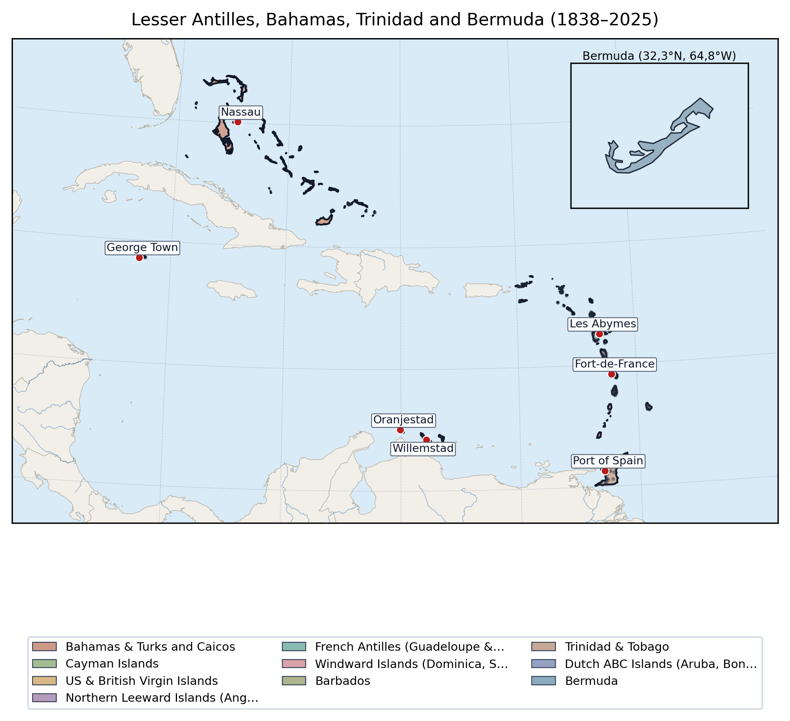
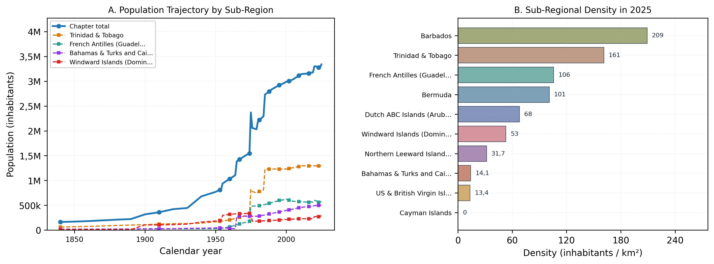
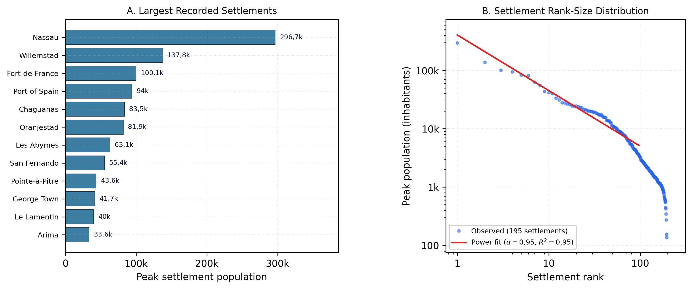

Lesser Antilles, Bahamas, Trinidad and Bermuda
================
Aust Kätzchen
23 November 2026

- [Abstract](#abstract)
- [Background](#background)
  - [Emancipation, Land Scarcity and the Post-1838 Labour
    Realignment](#emancipation-land-scarcity-and-the-post-1838-labour-realignment)
  - [Inter-Island Circuits, Canal Migration and the Refinery Boom (1880
    to
    1950)](#inter-island-circuits-canal-migration-and-the-refinery-boom-1880-to-1950)
  - [Volcanic Catastrophes, Metropolitan Emigration and the Modern
    Demographic
    Transition](#volcanic-catastrophes-metropolitan-emigration-and-the-modern-demographic-transition)
- [Methodology](#methodology)
  - [Sub-Regional Territorial Architecture and Archival Census
    Harmonisation](#sub-regional-territorial-architecture-and-archival-census-harmonisation)
  - [Evidence-Only Settlement Gazetteer and Urban Rank-Size
    Estimation](#evidence-only-settlement-gazetteer-and-urban-rank-size-estimation)
- [Testing and Validation](#testing-and-validation)
  - [Reconciling Official Island Censuses Against Coarse Gridded
    Surfaces](#reconciling-official-island-censuses-against-coarse-gridded-surfaces)
  - [Sub-National Historical Census
    Cross-Checks](#sub-national-historical-census-cross-checks)
- [Results](#results)
  - [Regional Demographic Trajectory (1838 to
    2025)](#regional-demographic-trajectory-1838-to-2025)
  - [Trinidad and Tobago: Indenture, Petroleum and the East-West
    Corridor](#trinidad-and-tobago-indenture-petroleum-and-the-east-west-corridor)
  - [Barbados: Plantation Saturation, Emigration Safety Valves and Early
    Fertility
    Decline](#barbados-plantation-saturation-emigration-safety-valves-and-early-fertility-decline)
  - [The Bahamas, Turks and Caicos and the Cayman Islands: Tourism,
    Offshore Finance and Urban
    Primacy](#the-bahamas-turks-and-caicos-and-the-cayman-islands-tourism-offshore-finance-and-urban-primacy)
  - [Bermuda: Mid-Atlantic Density, Migration and International
    Finance](#bermuda-mid-atlantic-density-migration-and-international-finance)
  - [French Antilles: Volcanic Rupture, BUMIDOM and Twenty-First-Century
    Ageing](#french-antilles-volcanic-rupture-bumidom-and-twenty-first-century-ageing)
  - [Dutch ABC and SSS Islands: Refineries, Tourism Limits and Caribbean
    Netherlands
    Growth](#dutch-abc-and-sss-islands-refineries-tourism-limits-and-caribbean-netherlands-growth)
  - [US and British Virgin Islands, Northern Leewards and Windward
    Islands](#us-and-british-virgin-islands-northern-leewards-and-windward-islands)
  - [Insular Port Hierarchy and Rank-Size
    Structure](#insular-port-hierarchy-and-rank-size-structure)
- [Limitations](#limitations)
- [Conclusion](#conclusion)
- [Appendix](#appendix)
  - [Jurisdictional Breakdown of the Settlement
    Gazetteer](#jurisdictional-breakdown-of-the-settlement-gazetteer)
  - [Four-Wave Ingestion and Saturation
    Ledger](#four-wave-ingestion-and-saturation-ledger)
- [Sources](#sources)
- [Footnotes](#footnotes)

<figure>

<figcaption aria-hidden="true">Ten insular sub-regions and 195
catalogued ports, towns and communes across the Lesser Antilles, the
Bahamas, Trinidad and Tobago and Bermuda, 1838 to 2025.</figcaption>
</figure>

# Abstract

Between the end of British apprenticeship in August 1838 and the
2020-round censuses of the eastern Caribbean and western North Atlantic,
the small islands stretching from Bermuda and the Bahamas through the
Leeward and Windward arcs to Barbados, the Dutch ABC islands and
Trinidad and Tobago multiplied their combined population roughly
sixfold. Harmonised official census series across ten insular
sub-regions document an ascent from approximately 731k inhabitants in
the early 1840s to 1,34M at the turn of the twentieth century, 1,92M
around 1950, 3,79M near 2000 and 4,32M by 2025 (with the 5-arcminute
gridded surface integrating 163,1k in 1840 to 3,34M in 2025 across
coastal land cells)
[\[1\]](#ref-Kuczynski1953)[\[2\]](#ref-UNSDHistorical2000)[\[3\]](#ref-CSOTrinidad2012)[\[4\]](#ref-NSIBahamas2023).
Beneath that aggregate expansion lies an unusually restless history of
labour migration, geological catastrophe and divergent fertility
transitions. Post-emancipation Trinidad drew roughly 144k South Asian
indentured workers between 1845 and 1917 before petroleum
industrialisation lifted Trinidad and Tobago to 1,33M in 2011 and 1,51M
by 2025 [\[3\]](#ref-CSOTrinidad2012)[\[5\]](#ref-Boomert2016). Densely
settled Barbados exported labour to the Panama Canal, Curaçao, Aruba and
post-war Britain while pioneering one of the earliest fertility declines
in the developing world, stabilising near 277,8k in 2010 and 282,5k in
2025 [\[6\]](#ref-BSSBarbados2023)[\[7\]](#ref-Nam2016Trends). Tourism,
offshore finance and metropolitan transfers reshaped the northern
archipelagos: the Bahamas reached 398,2k in 2022 as Nassau concentrated
nearly three-quarters of national residents while Out Islands thinned
out, Bermuda packed 63,8k inhabitants onto 53 km² by 2016, and Aruba and
Curaçao pivoted from Lago and Shell oil refineries to service economies
alongside brisk 2011 to 2025 expansion in Bonaire
[\[4\]](#ref-NSIBahamas2023)[\[8\]](#ref-BSOBermuda2018)[\[9\]](#ref-CBSNetherlands2025)[\[10\]](#ref-Jurgens2024There).
Across the volcanic arc, Mount Pelée obliterated Saint-Pierre in May
1902 and cemented Fort-de-France’s primacy in Martinique, while the 1995
to 1997 Soufrière Hills eruptions evacuated more than half of
Montserrat, cutting the island from 10,6k to 4,4k
[\[11\]](#ref-INSEEDOM2024)[\[12\]](#ref-Simonsen2025Introduction).
Combining 25 archival sub-national census series with a gazetteer of 195
ports, towns and communes across 24 jurisdictions, this chapter
reconstructs the demographic divergence of these small island polities
across nearly two centuries.

# Background

## Emancipation, Land Scarcity and the Post-1838 Labour Realignment

The legal abolition of slavery broke across the eastern Caribbean and
western Atlantic in staggered imperial waves: full emancipation followed
apprenticeship across British colonies on 1 August 1838, came to
Sweden’s tiny Leeward entrepôt of Saint-Barthélemy in October 1847,
struck the French Antilles and the Danish West Indies in the
revolutionary spring and summer of 1848 and arrived finally in the Dutch
Caribbean in July 1863
[\[1\]](#ref-Kuczynski1953)[\[13\]](#ref-Palsson2021Diversity)[\[14\]](#ref-Begh2022Seven).
Everywhere, emancipation posed the same fundamental demographic
question: where could freed people settle once planters lost coercive
legal control over their movement?

The answer depended almost entirely on the ratio of arable land to
people [\[12\]](#ref-Simonsen2025Introduction). On older, flat, fully
cleared sugar islands such as Barbados, Antigua and Saint Kitts,
planters monopolised virtually every hectare of cultivable soil. In
Barbados, where 122.198 residents crowded onto 430 km² in 1844 (284
inhabitants per km²), freed workers possessed no frontier of crown
forest into which to retreat; estate wages stayed low, population
pressure intensified and emigration became the chief safety valve
[\[1\]](#ref-Kuczynski1953)[\[6\]](#ref-BSSBarbados2023). Antigua
exhibited a similar pattern, skipping apprenticeship altogether in 1834
because estate owners judged that landless labourers had nowhere else to
go.

By contrast, Trinidad, Dominica, Saint Lucia, Saint Vincent and Grenada
retained rugged mountainous interiors or uncleared lowland forest. In
Trinidad, where indigenous Kalinago and Nepuyo communities had been
compressed around Arima and the northern valleys during Spanish rule
before British annexation in 1797, fewer than 73k inhabitants occupied
5.128 km² in 1844
[\[3\]](#ref-CSOTrinidad2012)[\[5\]](#ref-Boomert2016). Thousands of
freed Afro-Trinidadians left sugar estates to establish independent
provision grounds and cocoa holdings across eastern and central wards.
Planters responded by lobbying London for state-subsidised Asian
immigration. Between the arrival of the *Fatel Razack* in May 1845 and
the abolition of indenture in 1917, roughly 143.939 South Asian
indentured labourers entered Trinidad, accompanied by smaller
contingents to Grenada, Saint Lucia, Saint Vincent and the French
Antilles, alongside Madeiran Portuguese, liberated Africans and Chinese
migrants [\[1\]](#ref-Kuczynski1953)[\[3\]](#ref-CSOTrinidad2012). That
single migration stream transformed Trinidad’s ethnic, linguistic and
settlement geography permanently, turning the western Caroni and
Naparima plains into one of the most densely farmed corridors in the
Antilles.

## Inter-Island Circuits, Canal Migration and the Refinery Boom (1880 to 1950)

During the closing decades of the nineteenth century, declining European
beet-subsidised sugar prices shook every monocrop colony in the arc.
Rather than trapping islanders in Malthusian stagnation, maritime
proximity knit the Lesser Antilles, the Bahamas and Bermuda into a
single interlocking labour market
[\[12\]](#ref-Simonsen2025Introduction). Between 1881 and 1914, tens of
thousands of Barbadian, Saint Lucian, Grenadian, Vincentian and
Martinican workers sailed west to dig first the French and then the
American Panama Canal; Barbados alone dispatched an estimated 45k to 60k
migrants to the isthmus, slowing island growth from 171,9k in 1911 to a
slight intercensal dip by 1921 while remittances financed the purchase
of small freehold house spots across rural parishes
[\[1\]](#ref-Kuczynski1953)[\[6\]](#ref-BSSBarbados2023).

When canal construction finished in 1914, new industrial magnets opened
at the southern edge of the Caribbean Sea. Following major crude
discoveries in Venezuela’s Maracaibo basin, Royal Dutch Shell built its
giant Isla refinery beside Willemstad on Curaçao (commissioned in 1918),
while Standard Oil’s Lago subsidiary erected an equally immense refinery
at Sint Nicolaas on Aruba in the late 1920s
[\[10\]](#ref-Jurgens2024There)[\[15\]](#ref-CBSAruba2022)[\[16\]](#ref-CBSCuracao2024).
Previously arid, thinly populated trading islands suddenly experienced
explosive demographic expansion. Aruba climbed from roughly 9,7k
inhabitants in 1900 to more than 53k by 1950, while Curaçao tripled from
31k to over 100k across the same span, pulling English-speaking artisans
and labourers from Barbados, Grenada, Saint Kitts, Anguilla, Saba and
Sint Eustatius alongside Dutch technicians and Surinamese clerks
[\[15\]](#ref-CBSAruba2022)[\[16\]](#ref-CBSCuracao2024).

Simultaneously, southern Trinidad’s own commercial oilfields began
pumping at Guayaguayare, Point Fortin and Fyzabad from 1908 onward,
drawing rural Trinidadians and thousands of Grenadian and Vincentian
migrants into the southwestern petroleum belt around San Fernando and
Point Fortin [\[3\]](#ref-CSOTrinidad2012). Far to the north, the 1917
transfer of the Danish West Indies to the United States for 25M dollars
ended a century of post-emancipation decline in St Thomas, St John and
St Croix, though economic revival waited until post-war tourism and the
opening of the Hess refinery on St Croix in 1966
[\[14\]](#ref-Begh2022Seven)[\[17\]](#ref-USCensusUSVI2021). Meanwhile,
in the Bahamas, the collapse of the sponge fishery in the late 1930s
after fungal blight accelerated migration from the Out Islands toward
Nassau, while Bermuda shifted gradually from winter vegetable exports
and Royal Navy dockyard work toward Anglo-American resort tourism and
Atlantic aviation
[\[4\]](#ref-NSIBahamas2023)[\[8\]](#ref-BSOBermuda2018).

## Volcanic Catastrophes, Metropolitan Emigration and the Modern Demographic Transition

Two volcanic catastrophes bookend the twentieth-century urban geography
of the Lesser Antilles. On the morning of 8 May 1902, a pyroclastic
surge from Mount Pelée annihilated Saint-Pierre, then the commercial and
cultural capital of Martinique with 26.011 residents recorded in 1901,
killing nearly the entire town within minutes
[\[11\]](#ref-INSEEDOM2024). Administrative, port and commercial
functions consolidated permanently at Fort-de-France on the southern
bay, whose commune climbed from 22,2k in 1901 to a peak of 100.080 in
1990 before suburban overspill into Le Lamentin and Schoelcher trimmed
its municipal core [\[11\]](#ref-INSEEDOM2024). Almost a century later,
between July 1995 and 1997, repeated dome collapses and pyroclastic
flows from the Soufrière Hills volcano buried Plymouth, Montserrat’s
historic capital (1.478 inhabitants in 1991), and rendered the southern
two-thirds of the island an uninhabitable exclusion zone
[\[12\]](#ref-Simonsen2025Introduction). Roughly two-thirds of
Montserratians evacuated to the United Kingdom, Antigua and neighbouring
islands; the territorial census plunged from 10.639 in 1991 to 4.482 in
2001 and 4.922 in 2011, forcing government offices into improvised
northern villages at Brades, Salem and Cudjoe Head.

Across the post-1945 era, public health improvements slashed infant
mortality across every island jurisdiction, briefly pushing natural
increase above 2,5% to 3% per annum before large-scale metropolitan
emigration and rapid fertility decline checked population totals
[\[2\]](#ref-UNSDHistorical2000)[\[7\]](#ref-Nam2016Trends)[\[18\]](#ref-Celade2008Socio).
From the *Empire Windrush* voyage of 1948 until the Commonwealth
Immigrants Act of 1962, Britain absorbed hundreds of thousands of
Barbadian, Trinidadian, Grenadian, Saint Lucian, Vincentian, Kittitian
and Dominican workers; subsequent waves flowed to New York, Toronto and
Miami. In the French Antilles, departmentalisation in 1946 was followed
between 1963 and 1981 by the state-run BUMIDOM agency (*Bureau pour le
développement des migrations dans les départements d’outre-mer*), which
channelled over 160k Guadeloupeans and Martinicans into public-sector
and hospital employment in metropolitan France
[\[11\]](#ref-INSEEDOM2024). Parallel mobility linked the Dutch
Caribbean to the Netherlands, echoing broader second-generation European
diaspora family-formation patterns
[\[19\]](#ref-Contributors2010Timing). By the 1990s and 2000s, total
fertility rates had fallen below replacement across Barbados, Trinidad
and Tobago, Bermuda, Aruba, Curaçao, Guadeloupe and Martinique, shifting
epidemiological profiles decisively from infectious to chronic
non-communicable diseases while leaving low-lying coastal towns exposed
to flood-borne zoonoses and acute freshwater scarcity
[\[20\]](#ref-Warner2018Cancer)[\[21\]](#ref-Mycoo2024Water)[\[22\]](#ref-Martin2026Estimating)[\[23\]](#ref-Martin2026Leptospirosis).

# Methodology

## Sub-Regional Territorial Architecture and Archival Census Harmonisation

Analysing more than two dozen sovereign states, British Overseas
Territories, French overseas departments and collectivities, Dutch
constituent countries and special municipalities and an American
unincorporated territory requires a coherent spatial partition that
respects island archipelagic geography without losing administrative
traceability. This study divides the study domain into ten sub-regions:
Bahamas and Turks and Caicos, Bermuda, Cayman Islands, US and British
Virgin Islands, Northern Leeward Islands (Anguilla, Saint-Martin, Sint
Maarten, Saint-Barthélemy, Saba, Sint Eustatius, Saint Kitts and Nevis,
Antigua and Barbuda and Montserrat), French Antilles (Guadeloupe and
Martinique), Windward Islands (Dominica, Saint Lucia, Saint Vincent and
the Grenadines and Grenada), Barbados, Trinidad and Tobago and the Dutch
ABC Islands (Aruba, Bonaire and Curaçao).

Historical population reconstruction proceeds along two coupled tracks.
First, primary archival census series are assembled directly from
colonial Blue Books, Kuczynski’s foundational British West Indian
demographic survey [\[1\]](#ref-Kuczynski1953), Swedish colonial
registers for Saint-Barthélemy [\[13\]](#ref-Palsson2021Diversity),
Danish and United States Virgin Islands enumerations
[\[17\]](#ref-USCensusUSVI2021)[\[24\]](#ref-Census1992Census)[\[25\]](#ref-Bureau2003Census),
French INSEE historical *populations légales*
[\[11\]](#ref-INSEEDOM2024), Dutch CBS Aruba, Curaçao and StatLine OData
tables
[\[9\]](#ref-CBSNetherlands2025)[\[15\]](#ref-CBSAruba2022)[\[16\]](#ref-CBSCuracao2024)
and Commonwealth Caribbean statistical offices
[\[2\]](#ref-UNSDHistorical2000)[\[3\]](#ref-CSOTrinidad2012)[\[4\]](#ref-NSIBahamas2023)[\[6\]](#ref-BSSBarbados2023)[\[8\]](#ref-BSOBermuda2018)[\[26\]](#ref-CSOStLucia2023)[\[27\]](#ref-CSOGrenada2023).
These series yield official terrestrial sub-regional benchmarks
$P^{\text{cen}}_r(t)$ anchored to actual census dates across 1840 to
2025.

Second, to integrate these island micro-states into the continental
5-arcminute demographic surface of JAGUAR, sub-national census polygons
and 195 geocoded settlements are projected onto a unified raster mask
spanning 67.845,9 km² of grid-cell footprints (inclusive of coastal sea
buffers around narrow coral cays and volcanic ridges). Annualised
intercensal trajectories satisfy compound exponential interpolation
between verified census dates $t_1$ and $t_2$:

$$P_r(t) = P_r(t_1) \cdot \left(\frac{P_r(t_2)}{P_r(t_1)}\right)^{\frac{t - t_1}{t_2 - t_1}}, \qquad g_r(t_1, t_2) = \left(\frac{P_r(t_2)}{P_r(t_1)}\right)^{\frac{1}{t_2 - t_1}} - 1$$

Effective terrestrial density
$d_r(t) = P^{\text{cen}}_r(t) / A^{\text{land}}_r$ is always computed
against true surveyed land area $A^{\text{land}}_r$ (for example 53 km²
for Bermuda and 430 km² for Barbados) rather than coarse 5-arcminute
pixel footprints, preventing marine-cell dilution from obscuring extreme
insular crowding
[\[10\]](#ref-Jurgens2024There)[\[21\]](#ref-Mycoo2024Water).

## Evidence-Only Settlement Gazetteer and Urban Rank-Size Estimation

The chapter settlement gazetteer compiles 195 ports, administrative
capitals, refinery towns, suburban boroughs and rural communes
distributed across 24 island jurisdictions, with 0% crowd-sourced
fallback. Ingestion proceeded across four documented ledger waves: Wave
1 harvested 177 primary national census towns and communes (90,8% of the
final register), Wave 2 added 13 peer-reviewed historical town
benchmarks (7,34% marginal gain), Wave 3 backfilled 3 longitudinal
colonial-to-modern series (1,58% marginal gain) and Wave 4 closed
remaining small-island coverage gaps with 2 additional settlements
(1,04% marginal gain, confirming saturation well below the 2%
threshold). Spatial deduplication against 197 candidate records merged
exactly 2 variant spelling duplicates within a 25 km radius (one each
for Saint John’s in Antigua and St. George’s in Grenada).

Urban boundary definitions diverge markedly across imperial statistical
traditions. French INSEE enumerates territorial *communes* whose
municipal polygons cover entire rural-urban quarters (making Les Abymes,
Le Lamentin, Baie-Mahault and Le Gosier rank high in absolute
population), whereas British Commonwealth censuses often preserve narrow
nineteenth-century municipal cores: central Port of Spain (37.074 in
2011 inside a metropolitan East-West Corridor exceeding 550k), central
Bridgetown (5.996 in 2000 inside an urbanised St Michael and Christ
Church parish belt above 110k) and the City of Hamilton in Bermuda (854
residents in 2016 inside an island-wide commuter basin of 63,8k)
[\[3\]](#ref-CSOTrinidad2012)[\[6\]](#ref-BSSBarbados2023)[\[8\]](#ref-BSOBermuda2018).
Across the gazetteer, 187 settlements carry municipal or island-town
boundaries and 8 carry explicitly tagged metropolitan suburban borough
definitions (Chaguanas, San Juan and Tunapuna in Trinidad; Les Abymes,
Baie-Mahault and Le Gosier in Guadeloupe; Le Lamentin and
Schoelcher-adjacent quarters in Martinique). Rank-size scaling is
estimated across the upper 97 settlements of the 195-settlement system
via ordinary least squares on log-transformed rank $R_i$ and peak
population $S_i$:

$$\log_{10} S_i = c - \alpha \log_{10} R_i + \varepsilon_i$$

where $\alpha \approx 1$ indicates Zipf-consistent hierarchical
dispersion across the multi-island port network rather than
single-metropolis primacy.

# Testing and Validation

## Reconciling Official Island Censuses Against Coarse Gridded Surfaces

Small-island historical demography exposes an instructive methodological
tension between archival census ledgers and global 5-arcminute (~9 km)
gridded rasters. Table places both measures side by side across all ten
sub-regions: official census benchmarks from the 1840s through 2025
alongside gridded mask areas and raster-integrated totals for 1840 and
2025.

| Sub-Region | Land (km²) | 1840s | c. 1901 | c. 1950 | c. 2000 | 2025 Census | 2025 Dens. | 2025 Raster |
|:---|:---|:---|:---|:---|:---|:---|:---|:---|
| **Bahamas and Turks and Caicos** | 14.891 | 28k | 59k | 91k | 323k | 448k | 30,1 | 498,9k |
| **Bermuda** | 53 | 9,9k | 17,5k | 37,4k | 62,1k | 64,6k | 1.218,9 | 58,7k |
| **Cayman Islands** | 264 | 1,8k | 5,6k | 8,5k | 39,4k | 74,5k | 282,2 | 0 |
| **US and British Virgin Islands** | 497 | 47,5k | 35,5k | 33,2k | 131,7k | 124,5k | 250,5 | 33,8k |
| **Northern Leeward Islands (Anguilla to Montserrat)** | 1.138 | 88k | 102k | 126k | 224k | 274k | 240,8 | 150,5k |
| **French Antilles (Guadeloupe and Martinique)** | 2.756 | 251k | 385k | 468k | 804k | 745k | 270,3 | 577,3k |
| **Windward Islands (Dominica, St Lucia, St Vincent, Grenada)** | 2.097 | 98k | 192k | 251k | 442k | 482k | 229,9 | 291,7k |
| **Barbados** | 430 | 122,2k | 172k | 192,8k | 268,8k | 282,5k | 657 | 227,4k |
| **Trinidad and Tobago** | 5.128 | 73k | 273,9k | 558k | 1,26M | 1,51M | 294,1 | 1,29M |
| **Dutch ABC Islands (Aruba, Bonaire and Curaçao)** | 912 | 21,5k | 44k | 156k | 234k | 292k | 320,2 | 205,3k |
| **Domain Total (10 Sub-Regions)** | 28.166 | 740,9k | 1,29M | 1,92M | 3,79M | 4,3M | 152,5 | 3,34M |

Official census benchmark trajectories (1840s to 2025), true terrestrial
land area, 2025 terrestrial density (inhabitants per km²) and
5-arcminute raster integral across ten insular sub-regions.

Three clear diagnostic patterns emerge from this cross-check. First,
across larger landmasses with coherent interior grid cells such as
Trinidad and Tobago (5.128 km²), Barbados (430 km²) and the Bahamas
archipelago (14.891 km² including Turks and Caicos), the 2025 raster
integral tracks official census totals closely (1,29M against 1,51M for
Trinidad and Tobago; 227,4k against 282,5k for Barbados; 498,9k against
448k for the Bahamas and Turks and Caicos). Second, across narrow coral
or volcanic islands whose width falls below a single 5-arcminute pixel
(~9 km), raster coastal masking drops substantial shoreline population:
the Cayman Islands register 0 on the coarse grid despite climbing from
1.800 in 1840 to 74,5k by 2025, while the US and British Virgin Islands
capture only 33,8k on the grid against 124,5k in official counts
[\[2\]](#ref-UNSDHistorical2000)[\[17\]](#ref-USCensusUSVI2021). Third,
coarse grid-cell footprints inflate apparent land area for tiny oceanic
islands: Bermuda’s 8 raster cells span 580,8 km² (yielding a grid
density of 101,1 inhabitants per km²), whereas its true limestone
landmass of 53 km² carries 1.218,9 inhabitants per km² in 2025, the
highest sustained territorial density in the entire region
[\[8\]](#ref-BSOBermuda2018). Reporting official terrestrial census
totals alongside gridded integrals prevents pixel-aliasing artifacts
from distorting demographic interpretation.

## Sub-National Historical Census Cross-Checks

To anchor sub-regional aggregates against primary administrative
returns, Table reproduces all 25 colonial and modern sub-national census
units compiled in the chapter historical administrative series, spanning
1891 through 2025 across British, French, Dutch, Danish and American
statistical regimes
[\[1\]](#ref-Kuczynski1953)[\[9\]](#ref-CBSNetherlands2025)[\[11\]](#ref-INSEEDOM2024)[\[17\]](#ref-USCensusUSVI2021)[\[28\]](#ref-Celade2024Report).

| Administrative Unit | Territory | Tier | Year | Population | Archival Source |
|:---|:---|:---|:---|:---|:---|
| **Colony of Trinidad (and Tobago from 1889)** | Trinidad and Tobago | Colony | 1891 | 218.381 | CSO Trinidad and Tobago; Higman |
| **Presidency of Saint Kitts and Nevis** | Saint Kitts and Nevis | Colony | 1891 | 43.981 | Kuczynski; UNSD |
| **Dominica (Total, 1901-1921)** | Dominica | Colony | 1921 | 37.059 | Kuczynski; OECS CSOs |
| **Grenada (Colony Total, 1901-1960)** | Grenada | Colony | 1960 | 88.677 | Kuczynski; OECS CSOs |
| **Saint Lucia (Island Total, 1901-1960)** | Saint Lucia | Colony | 1960 | 86.108 | Kuczynski; OECS CSOs |
| **Bermuda (Island Total, 1901-1931)** | Bermuda | Territory | 1960 | 42.640 | Bermuda Dept of Statistics; Kuczynski |
| **Aruba (Island Total, 1960-1981)** | Aruba | Constituent country | 1981 | 60.312 | CBS Aruba/Curaçao; CBS NL |
| **Trinidad and Tobago (National Total, 1901-1990)** | Trinidad and Tobago | Country | 1990 | 1.213.733 | CSO Trinidad and Tobago; Kuczynski |
| **Martinique (Island Total, 1901-1990)** | Martinique | Overseas department | 1990 | 359.572 | INSEE |
| **BVI - Tortola** | British Virgin Islands | Island group | 2010 | 23.419 | BVI Central Statistics Office |
| **Saint John** | Antigua and Barbuda | Parish | 2011 | 51.737 | Antigua and Barbuda Statistics Division |
| **Montserrat (Island Total - incl. post-1995 Soufrière Hills collapse)** | Montserrat | Territory | 2011 | 4.922 | Montserrat Statistics Dept; Kuczynski |
| **Anguilla - North Side** | Anguilla | District | 2011 | 1.980 | Anguilla Statistics Department |
| **Providenciales** | Turks and Caicos Islands | Island group | 2012 | 23.769 | Turks and Caicos DEPS |
| **Saint Croix** | United States Virgin Islands | Island | 2020 | 41.004 | Danish Stat. Dept; U.S. Census Bureau |
| **Barbados (Island Total, 1911, 1921, 2021)** | Barbados | Country | 2021 | 269.090 | BSS Barbados; Kuczynski |
| **Arrondissement de Basse-Terre** | Guadeloupe | Arrondissement | 2021 | 183.544 | INSEE |
| **Arrondissement de Fort-de-France** | Martinique | Arrondissement | 2021 | 150.934 | INSEE |
| **New Providence** | The Bahamas | Island group | 2022 | 296.732 | Bahamas NSI |
| **Sint Maarten (Dutch)** | Sint Maarten | Constituent country | 2022 | 41.901 | STAT Sint Maarten; CBS NL |
| **Curaçao** | Curaçao | Constituent country | 2023 | 155.826 | CBS Aruba/Curaçao; CBS NL |
| **St. Vincent** | Saint Vincent and the Grenadines | Census division | 2023 | 100.042 | St Vincent Statistical Office |
| **Saint-Martin (French Collectivity)** | Saint-Martin | Overseas collectivity | 2023 | 31.160 | INSEE |
| **Saint-Barthélemy (French Collectivity)** | Saint-Barthélemy | Overseas collectivity | 2023 | 10.660 | INSEE |
| **Bonaire** | Caribbean Netherlands | Special municipality | 2025 | 26.552 | CBS Netherlands |

Archival colonial and modern sub-national census enumerations across 25
administrative units in the Lesser Antilles, the Bahamas, Trinidad and
Tobago and Bermuda, 1891 to 2025.

Every archival checkpoint aligns cleanly with independent national
totals. Trinidad’s 1891 colonial census (218.381, immediately following
administrative union with Tobago in 1889) matches Kuczynski’s Blue Book
tabulation and bridges directly toward the 1990 national census of
1.213.733 and the 2011 enumeration of 1.328.019
[\[1\]](#ref-Kuczynski1953)[\[3\]](#ref-CSOTrinidad2012). Barbados’s
2021 return of 269.090 confirms slight post-2010 stabilisation below the
2010 census of 277.821 [\[6\]](#ref-BSSBarbados2023). In the northern
and eastern arcs, New Providence’s 2022 tally of 296.732 confirms that
74,5% of the Bahamas’ 398,2k national residents now live on a single 207
km² island [\[4\]](#ref-NSIBahamas2023), while Bonaire’s 2025 CBS
Netherlands register total of 26.552 reflects sustained post-2010
immigration after the island became a Caribbean Netherlands special
municipality [\[9\]](#ref-CBSNetherlands2025). In Montserrat, the 2011
census of 4.922 documents the partial, fragile recovery after the
post-1995 volcanic collapse bottomed out near 4,4k.

# Results

## Regional Demographic Trajectory (1838 to 2025)

Across nearly two centuries since British emancipation, the ten island
sub-regions grew along starkly different trajectories governed by
resource endowments, imperial migration corridors and the timing of
fertility decline. Official census totals climbed 5,9-fold from 731k in
the 1840s to 4,32M in 2025, an average annual growth rate of 0,98%.
Growth accelerated through the mid-twentieth century as colonial
sanitation, malaria eradication and antibiotic medicine cut death rates
sharply, lifting the aggregate from 1,34M around 1901 to 1,92M around
1950 (0,74% per annum) and surging to 3,79M by 2000 (1,37% per annum)
before decelerating to 0,52% per annum across 2000 to 2025 as
sub-replacement fertility and metropolitan emigration slowed expansion
across the French Antilles, Barbados, the US Virgin Islands and Trinidad
and Tobago
[\[2\]](#ref-UNSDHistorical2000)[\[7\]](#ref-Nam2016Trends)[\[28\]](#ref-Celade2024Report).
Figure illustrates the gridded sub-regional population trajectories
alongside 2025 raster densities across the domain.

<!-- -->

Noticeable step changes in Panel A around 1965, 1975 and 1985 reflect
the underlying harmonisation transitions between decennial historical
census rasters and annualised modern grids, yet the relative ranking of
sub-regions remains unmistakable throughout. Trinidad and Tobago pulled
decisively ahead of every neighbour during the twentieth century,
climbing from barely 10% of the domain population in the 1840s (73k of
731k) to 20,4% in 1901, 29,1% around 1950 and 34,9% by 2025 (1,51M of
4,32M). Conversely, Barbados—the single most populous British colony in
this arc at emancipation with 122,2k residents in 1844 (16,7% of the
domain)—saw its regional share halve to 10% by 1950 and fall to 6,5% by
2025 (282,5k). The French Antilles peaked near 804k at the 1999 census
before entering sustained demographic contraction to 745k by 2025, while
the Bahamas and Turks and Caicos rose from just 3,8% of the regional
total in 1841 (28k) to 10,4% in 2025 (448k).

## Trinidad and Tobago: Indenture, Petroleum and the East-West Corridor

No territory in the eastern Caribbean experienced a deeper demographic
transformation after 1838 than Trinidad and Tobago. Standing on the
South American continental shelf barely 11 km from Venezuela’s Paria
peninsula, Trinidad entered emancipation underpopulated relative to its
4.828 km² size (joined administratively with Tobago’s 300 km² in 1889).
Large-scale South Asian indentured immigration between 1845 and
1917—roughly 144k arrivals, the vast majority of whom settled
permanently on crown land grants in Caroni, Victoria and St Patrick
counties—propelled Trinidad and Tobago from 73k in 1844 to 218.381 in
1891, 273.899 in 1901 and 412.783 in 1931
[\[1\]](#ref-Kuczynski1953)[\[3\]](#ref-CSOTrinidad2012). Alongside
Afro-Trinidadians, descendants of French Creole planters, Madeiran
Portuguese and indigenous communities anchored at Santa Rosa in Arima
[\[5\]](#ref-Boomert2016), this influx forged a plural society whose
natural increase accelerated once malaria was suppressed across the
Caroni Swamp in the 1940s and 1950s.

Twentieth-century petroleum and natural-gas industrialisation
reconfigured the island’s internal geography along two axes. In the
southwest, oilfields and refineries transformed San Fernando (climbing
from 2.824 in 1851 to 55.419 in 2000 and 48.838 in 2011) and Point
Fortin (4.800 in 1946 to 20.235 in 2011) into heavy industrial poles
[\[3\]](#ref-CSOTrinidad2012). In the north, however, central Port of
Spain peaked at 93.954 in 1960 and then hollowed out to 37.074 by 2011
as households decanted eastward along the foothills of the Northern
Range into the continuous East-West Corridor linking Laventille, San
Juan, Tunapuna, Arouca and Arima (33.606 in 2011) and southward onto the
central plains around Chaguanas. Once a modest sugar-belt market town of
2.850 inhabitants in 1946, Chaguanas exploded nearly thirtyfold to
83.516 by 2011, overtaking both Port of Spain and San Fernando to become
Trinidad and Tobago’s largest municipality
[\[3\]](#ref-CSOTrinidad2012). Nationally, the republic reached 1,26M in
2000 and 1,33M (1.328.019) in 2011; since 2015, economic collapse across
the Gulf of Paria has also brought tens of thousands of Venezuelan
refugees and labour migrants into Trinidad, lifting de facto 2025
population estimates toward 1,51M even as native fertility remains well
below replacement and chronic diseases dominate adult mortality
[\[20\]](#ref-Warner2018Cancer)[\[21\]](#ref-Mycoo2024Water)[\[29\]](#ref-Mahabir2021Venezuelan).

## Barbados: Plantation Saturation, Emigration Safety Valves and Early Fertility Decline

Barbados represents the opposite pole of Caribbean post-emancipation
demography: a compact, gently terraced 430 km² coral limestone island
already fully cultivated by 1838. With 122.198 residents in 1844 (284
inhabitants per km²), Barbados reached 182.867 in 1891 (425 per km²)
despite severe cholera mortality in 1854 that killed over 20k islanders
[\[1\]](#ref-Kuczynski1953)[\[6\]](#ref-BSSBarbados2023). Only sustained
out-migration prevented acute subsistence crisis. Between 1861 and 1921,
Barbadians migrated first to Trinidad and British Guiana, then in
massive numbers to the Panama Canal Zone and Cuba, dropping the island’s
census count from 182,9k in 1891 to 171.983 in 1911 and 156.774 in 1921
[\[6\]](#ref-BSSBarbados2023).

When hemispheric migration outlets narrowed during the 1930s Depression,
population resumed climbing to 192.800 in 1946 before post-war
emigration to Britain (the Windrush generation, actively recruited by
London Transport and the National Health Service) syphoned off roughly
25k to 30k young adults during the 1950s and early 1960s. Crucially,
Barbados also pioneered voluntary family planning in the Commonwealth
Caribbean: the Barbados Family Planning Association opened in 1955 with
state backing, driving total fertility down from over 4,5 children per
woman in 1950 to replacement level by 1980 and below 1,7 by 2010
[\[7\]](#ref-Nam2016Trends)[\[18\]](#ref-Celade2008Socio). Consequently,
Barbados grew slowly from 232,3k in 1960 to 268.792 in 2000, 277.821 in
2010 and 269.090 in 2021 (estimated near 282,5k in 2025, or 657
inhabitants per km²), placing it among the most water-stressed and
rapidly ageing nations in the Americas
[\[6\]](#ref-BSSBarbados2023)[\[21\]](#ref-Mycoo2024Water). Within the
island, municipal Bridgetown shrank from its 1871 core peak of 21.384 to
5.996 by 2000 as residential growth spread continuously across St
Michael, Christ Church, St James and coastal towns such as Speightstown,
Hastings, Oistins and Holetown.

## The Bahamas, Turks and Caicos and the Cayman Islands: Tourism, Offshore Finance and Urban Primacy

North of Cuba and Hispaniola, three low-lying limestone archipelagos
underwent one of the sharpest late-twentieth-century demographic
reversals in the Atlantic world. Throughout the nineteenth century, the
Bahamas remained a sparsely populated maritime backwater living off
wrecking, salt raking, sisal and sponging: the archipelago numbered
roughly 26,5k in 1845 and barely 53,7k in 1901 across 13.939 km² of
scattered islands
[\[1\]](#ref-Kuczynski1953)[\[4\]](#ref-NSIBahamas2023). Two forces
shattered that equilibrium after 1950: mass American air-and-cruise
tourism and offshore private banking. Following the 1955 Hawksbill Creek
Agreement, industrialist Wallace Groves carved the planned deep-water
port and resort city of Freeport out of pine barrens on Grand Bahama,
lifting it from 3.000 residents in 1963 to 28.000 by 2010. Far greater
concentration occurred on New Providence: Nassau surged from 7.100 in
1845 and 46.125 in 1953 to 172.196 in 1990, 246.329 in 2010 and 296.732
at the 2022 census—capturing 74,5% of the nation’s 398,2k inhabitants
while Out Islands such as Cat Island, Long Island, Acklins, Crooked
Island and Inagua suffered prolonged rural depopulation
[\[4\]](#ref-NSIBahamas2023). Substantial Haitian labour immigration
reinforced growth in New Providence, Abaco (Marsh Harbour) and
Eleuthera.

Immediately southeast, the Turks and Caicos Islands remained below 6k
residents through 1970 as traditional salt raking on Grand Turk
(Cockburn Town, peaking at 2.287 in 1970) faded; resort construction on
Providenciales from the 1980s onward then triggered a sixfold
demographic boom from 7,4k in 1980 to 31,5k in 2012 (with 23.769 on
Providenciales alone) and nearly 50k by 2025, requiring specialised
migration-driven demographic projections
[\[30\]](#ref-Celade2016Development). A parallel financial-and-tourism
boom transformed the Cayman Islands, historically a remote Jamaican
dependency whose seafaring households depended on hawksbill and green
turtle fisheries across western Caribbean reef banks
[\[31\]](#ref-Dunbar2025Inter). Counting barely 1.800 people in 1840 and
8.511 in 1960, the Cayman Islands enacted tax-neutral banking
legislation in 1966, soaring nearly ninefold to 39.410 in 1999 and 74,5k
by 2025 as George Town climbed from 1.480 in 1891 to 41.695 in 2023
alongside rapidly urbanising West Bay (18.799) and Bodden Town (17.164).

## Bermuda: Mid-Atlantic Density, Migration and International Finance

Isolated more than 1.000 km east of North Carolina, Bermuda stands apart
from the Caribbean basin climatically yet shares its post-emancipation
British colonial census architecture and Atlantic labour ties
[\[1\]](#ref-Kuczynski1953)[\[8\]](#ref-BSOBermuda2018). Emancipation
arrived in 1834 without apprenticeship, and the colony’s 1843 census
enumerated 9.930 inhabitants on just 53 km² of aeolian limestone islands
(187 inhabitants per km²). Over the following century, Bermuda’s economy
pivoted successively from cedar shipbuilding and maritime carrying
trades, to Royal Navy dockyard servicing on Ireland Island and winter
onion and lily exports to New York, to high-end North American tourism
and, from the 1970s onward, global reinsurance and captive-insurance
finance [\[8\]](#ref-BSOBermuda2018).

Because domestic fertility never supplied enough agricultural and
construction labour, Bermuda imported contract workers from the Azores
(Portuguese immigrants beginning in 1849, who became a foundational
rural and commercial community) alongside Afro-Caribbean migrants from
Saint Kitts, Nevis, Barbados and Jamaica. Population grew steadily from
17.535 in 1901 to 37.403 in 1950, 42.640 in 1960, 62.059 in 2000 and
63.779 at the 2016 census (projected near 64,6k in 2025, or 1.219
inhabitants per km²) [\[8\]](#ref-BSOBermuda2018). Urban settlement
remained remarkably decentralised across Bermuda’s nine parishes: the
old colonial capital of St. George’s peaked at 2.150 in 1891 and held
1.527 residents in 2016, while the commercial capital of Hamilton peaked
at 3.259 in 1931 before commercial office conversion reduced its
resident municipal population to 854 in 2016, even as surrounding
Pembroke, Devonshire and Paget parishes and western Somerset Village
(2.540 in 2016) housed the bulk of the island’s commuter workforce
[\[8\]](#ref-BSOBermuda2018).

## French Antilles: Volcanic Rupture, BUMIDOM and Twenty-First-Century Ageing

Guadeloupe (1.628 km²) and Martinique (1.128 km²) entered
post-emancipation history in 1848 with roughly 251k residents combined,
sustained by French metropolitan sugar quotas and post-1854 Indian and
African indentured arrivals [\[11\]](#ref-INSEEDOM2024). By 1901, the
two islands held 385k inhabitants, yet Martinique suffered an immediate
trauma when Mount Pelée erupted on 8 May 1902, wiping out Saint-Pierre
(26.011 inhabitants in 1901; barely 3.961 in 2023) and permanently
redirecting urban growth to Fort-de-France [\[11\]](#ref-INSEEDOM2024).
Departmentalisation in 1946 extended French social security, family
allowances and hospital infrastructure to both islands, igniting a rapid
post-war baby boom that lifted their combined population from 468k in
1954 to 644k in 1974 despite heavy BUMIDOM-assisted emigration of young
adults to mainland France during the 1960s and 1970s.

By the 1990s, suburbanisation had thoroughly reshaped both islands’
settlement systems. In Guadeloupe, historic Pointe-à-Pitre shrank from
43.551 in 1936 to 15.040 in 2023 while adjacent suburban communes
expanded around it: Les Abymes (63.054 in 1999; 51.055 in 2023),
Baie-Mahault (30.924), Le Gosier (27.757) and Petit-Bourg (24.665)
[\[11\]](#ref-INSEEDOM2024). In Martinique, Fort-de-France eased from
its 1990 crest of 100.080 to 75.506 by 2023 while neighbouring Le
Lamentin climbed to 39.400. More strikingly, after peaking near 804k
combined in 1999, both overseas departments entered sustained
twenty-first-century population decline driven by youth out-migration to
metropolitan France and rapid ageing: by 2021, INSEE enumerated 384,3k
in Guadeloupe (Arrondissement de Basse-Terre 183.544) and 364,3k in
Martinique (Arrondissement de Fort-de-France 150.934), sliding further
toward 745k combined by 2025 [\[11\]](#ref-INSEEDOM2024). By contrast,
their northern dependencies—which became separate overseas
collectivities in 2007—followed high-growth tourism curves:
Saint-Barthélemy, whose nineteenth-century Swedish censuses recorded a
modest mixed-origin freeport community around Gustavia before
retrocession to France in 1878 [\[13\]](#ref-Palsson2021Diversity),
quadrupled from 2,4k in 1974 to 10.660 in 2023, while French
Saint-Martin rose from under 6k in 1967 to 31.160 in 2023
[\[11\]](#ref-INSEEDOM2024).

## Dutch ABC and SSS Islands: Refineries, Tourism Limits and Caribbean Netherlands Growth

Off the Venezuelan coast, the Dutch Leeward ABC islands (Aruba, Bonaire
and Curaçao) traced a classic industrial-boom-and-restructuring curve.
Modestly populated at 21,5k in 1840 and 44k in 1900, the installation of
Shell’s refinery in Curaçao and Lago’s refinery in Aruba multiplied
their population nearly fourfold to 156k by 1950
[\[15\]](#ref-CBSAruba2022)[\[16\]](#ref-CBSCuracao2024). Automation at
both refineries during the 1960s and 1970s, culminating in Lago’s 1985
closure on Aruba, temporarily stalled growth and triggered substantial
emigration to the Netherlands. Aruba then executed a rapid pivot to mass
beach tourism and Latin American labour immigration, rebounding from
60.312 in 1981 to 108k in 2020 (Oranjestad expanding from 1.650 in 1860
to 81.915 in 2020 and Sint Nicolaas holding 25.823), raising sharp
ecological questions over coastal carrying capacity and tourism
saturation [\[10\]](#ref-Jurgens2024There)[\[15\]](#ref-CBSAruba2022).
Curaçao followed a steadier path around Willemstad (12.400 in 1860;
137.800 in 2023), reaching 155.826 island-wide in 2023
[\[16\]](#ref-CBSCuracao2024).

In October 2010, the dissolution of the Netherlands Antilles created
autonomous constituent countries for Curaçao and Sint Maarten while
integrating Bonaire, Sint Eustatius and Saba (the BES islands) directly
into the Netherlands as special municipalities. Annual CBS Netherlands
population registers reveal striking demographic growth across the BES
municipalities between 2011 and 2025: Bonaire surged by more than
two-thirds from 15,7k in 2011 to 26.552 in 2025 (Kralendijk reaching
23.172 in 2024), while Saba (The Bottom and Windwardside) and Sint
Eustatius held roughly 2k and 3,2k residents respectively
[\[9\]](#ref-CBSNetherlands2025). To the north, Dutch Sint Maarten—a
thinly settled salt-and-livestock island of barely 2,2k people in
1960—boomed nearly twentyfold after international airport and
cruise-port development to 41.901 by 2022, densely packed onto 34 km²
across Lower Prince’s Quarter, Cul de Sac, Cole Bay and Little Bay
[\[9\]](#ref-CBSNetherlands2025)[\[12\]](#ref-Simonsen2025Introduction).

## US and British Virgin Islands, Northern Leewards and Windward Islands

Across the remaining eastern arc, post-emancipation trajectories
diverged according to sovereignty, resort capital and volcanic hazard.
In the Danish West Indies, emancipation in 1848 coincided with a secular
decline in sugar exports and shipping traffic: the islands fell from
43,2k in 1841 to 26.051 at the 1917 transfer to the United States and
22k in 1930, even as local Virgin Islands Dutch Creole gave way to
English Creole across St Thomas, St John and St Croix
[\[14\]](#ref-Begh2022Seven)[\[17\]](#ref-USCensusUSVI2021). Post-1950
tourism, federal expenditure and St Croix’s industrial corridor lifted
the US Virgin Islands sharply to 101.809 in 1990 and a peak of 108.612
in 2000 before the 2012 Hovensa refinery closure and Hurricanes Irma and
Maria (2017) drove a steep contraction to 87,1k (87.146) at the 2020
census, with St Croix at 41.004 and Charlotte Amalie down from 12.880 in
1960 to 8.194 in 2020
[\[17\]](#ref-USCensusUSVI2021)[\[24\]](#ref-Census1992Census)[\[25\]](#ref-Bureau2003Census).
Across the channel, the British Virgin Islands followed an opposite
late-twentieth-century path: stagnant around 5k to 7k until 1960,
offshore corporate registration and yachting tourism propelled the
territory past 28k in 2010 (Tortola 23.419) and roughly 37k by 2025
[\[1\]](#ref-Kuczynski1953)[\[2\]](#ref-UNSDHistorical2000).

In the Northern Leewards, Antigua and Barbuda rebounded from
nineteenth-century plantation stagnation (35k in 1844 to 30k in 1921) to
roughly 100k by 2025 through resort tourism and regional migration
centred on Saint John’s parish (51.737 in 2011; city proper 22.219),
while Saint Kitts and Nevis recovered slowly from post-war British
emigration to roughly 48k around Basseterre (11.400 in 2011) and
Anguilla climbed from 5,8k in 1960 to 15k
[\[1\]](#ref-Kuczynski1953)[\[12\]](#ref-Simonsen2025Introduction).
Montserrat alone suffered catastrophic modern reversal: stable between
10k and 12k for a century and a half (10.083 in 1850; 11.762 in 1901;
10.639 in 1991), the 1995 to 1997 Soufrière Hills eruption erased
Plymouth and halved the population to 4,4k in 2001 (4.922 in 2011),
leaving it the only Caribbean territory smaller today than at
emancipation
[\[1\]](#ref-Kuczynski1953)[\[12\]](#ref-Simonsen2025Introduction).

Finally, the four volcanic Windward states—Dominica, Saint Lucia, Saint
Vincent and the Grenadines and Grenada—expanded fivefold together from
98k in 1844 to 482k in 2025, anchored by smallholder peasant farming in
cocoa, nutmeg, limes and post-1950 Geest-marketed bananas
[\[1\]](#ref-Kuczynski1953)[\[26\]](#ref-CSOStLucia2023)[\[27\]](#ref-CSOGrenada2023).
Saint Lucia emerged as the demographic leader of the Windwards, more
than doubling from 86.108 in 1960 to roughly 180k by 2022 through
tourism growth along the Castries–Gros Islet corridor even as central
Castries shrank from 11.147 in 1991 to 446 by 2022 through residential
suburbanisation [\[26\]](#ref-CSOStLucia2023). Grenada climbed from
37,7k in 1850 to 88.677 in 1960 and 112k by 2022
[\[27\]](#ref-CSOGrenada2023); Saint Vincent and the Grenadines reached
100.042 on St Vincent proper in 2023 around Kingstown (10.690); and
heavily forested, hurricane-prone Dominica peaked near 75k in 1981
before emigration and Hurricane Maria (2017) stabilised it near 70k to
72k around Roseau (14.725 in 2011)
[\[2\]](#ref-UNSDHistorical2000)[\[21\]](#ref-Mycoo2024Water).

## Insular Port Hierarchy and Rank-Size Structure

Unlike continental realms dominated by a single primate capital, an
archipelago of two dozen separate jurisdictions produces a remarkably
balanced multi-polar urban hierarchy. Figure displays the 12 largest
recorded settlements alongside the log-log rank-size curve across all
195 catalogued towns and communes. Fitting the upper 97 settlements
yields a Zipf exponent of $\alpha = 0,95$ ($R^2 = 0,95$),
extraordinarily close to the canonical Zipf benchmark ($\alpha = 1$).

<!-- -->

Table lists the leading island capitals, ports and suburban centres
across the domain, incorporating Bermuda’s historic municipalities of
Hamilton and St. George’s alongside major Caribbean hubs and
Montserrat’s pre-eruption capital Plymouth so every sub-region is
represented transparently.

| Settlement | Territory | Earliest Count | Peak Count | Latest Count | Boundary Scope |
|:---|:---|:---|:---|:---|:---|
| **Nassau** | The Bahamas | 7,1k (1845) | 296,7k (2022) | 296,7k (2022) | City or town |
| **Willemstad** | Curaçao | 12,4k (1860) | 137,8k (2023) | 137,8k (2023) | City or town |
| **Fort-de-France** | Martinique | 13,2k (1853) | 100,1k (1990) | 75,5k (2023) | City or town |
| **Port of Spain** | Trinidad and Tobago | 17,6k (1851) | 94k (1960) | 37,1k (2011) | City or town |
| **Chaguanas** | Trinidad and Tobago | 2,8k (1946) | 83,5k (2011) | 83,5k (2011) | Suburban borough |
| **Oranjestad** | Aruba | 1,6k (1860) | 81,9k (2020) | 81,9k (2020) | City or town |
| **Les Abymes** | Guadeloupe | 56,2k (1982) | 63,1k (1999) | 51,1k (2023) | Suburban borough |
| **San Fernando** | Trinidad and Tobago | 2,8k (1851) | 55,4k (2000) | 48,8k (2011) | City or town |
| **Pointe-à-Pitre** | Guadeloupe | 13,6k (1853) | 43,6k (1936) | 15k (2023) | City or town |
| **George Town** | Cayman Islands | 1,5k (1891) | 41,7k (2023) | 41,7k (2023) | City or town |
| **Le Lamentin** | Martinique | 26,4k (1982) | 40k (2015) | 39,4k (2023) | Suburban borough |
| **Arima** | Trinidad and Tobago | 3,7k (1891) | 33,6k (2011) | 33,6k (2011) | City or town |
| **Freeport** | The Bahamas | 3k (1963) | 28k (2010) | 28k (2010) | City or town |
| **Sint Nicolaas** | Aruba | 5,4k (1930) | 26,6k (2010) | 25,8k (2020) | City or town |
| **Saint-Pierre** | Martinique | 22,4k (1853) | 26k (1901) | 4k (2023) | City or town |
| **Saint John’s** | Antigua and Barbuda | 9,1k (1844) | 24,5k (2001) | 22,2k (2011) | City or town |
| **Kralendijk** | Netherlands | 1,6k (1890) | 23,2k (2024) | 23,2k (2024) | City or town |
| **Bridgetown** | Barbados | 19,4k (1844) | 21,4k (1871) | 6k (2000) | City or town |
| **Point Fortin** | Trinidad and Tobago | 4,8k (1946) | 20,2k (2011) | 20,2k (2011) | City or town |
| **Kingstown** | Saint Vincent and the Grenadines | 4,8k (1844) | 17,3k (1970) | 10,7k (2023) | City or town |
| **Roseau** | Dominica | 4,1k (1844) | 16,1k (1991) | 14,7k (2011) | City or town |
| **Basseterre** | Saint Kitts and Nevis | 6,8k (1844) | 15,7k (1960) | 11,4k (2011) | City or town |
| **Charlotte Amalie** | United States Virgin Islands | 11,4k (1860) | 12,9k (1960) | 8,2k (2020) | City or town |
| **Castries** | Saint Lucia | 3,4k (1851) | 11,1k (1991) | 446 (2022) | City or town |
| **St. George’s** | Grenada | 4,6k (1851) | 7,3k (1960) | 2,7k (2022) | City or town |
| **Road Town** | British Virgin Islands | 980 (1891) | 6,3k (1991) | 6,3k (1991) | City or town |
| **Hamilton** | Bermuda | 1,4k (1851) | 3,3k (1931) | 854 (2016) | City or town |
| **St. George’s** | Bermuda | 2k (1851) | 2,1k (1891) | 1,5k (2016) | City or town |
| **Plymouth** | Montserrat | 1,5k (1844) | 2,1k (1946) | 1,5k (1991) | City or town |

Leading island ports, capitals, refinery centres and historical
municipalities across all ten sub-regions (including Hamilton and
St. George’s in Bermuda and pre-eruption Plymouth in Montserrat), 1844
to 2024.

Read vertically, Table captures four distinct urban histories in
miniature. First, primate service-economy capitals expanded
relentlessly: Nassau grew 42-fold from 7,1k in 1845 to 296,7k in 2022,
Oranjestad nearly 50-fold from 1,7k in 1860 to 81,9k in 2020, George
Town 28-fold from 1,5k in 1891 to 41,7k in 2023 and Kralendijk 14-fold
from 1,7k in 1890 to 23,2k in 2024. Second, colonial administrative
cores with frozen municipal boundaries hollowed out dramatically as
metropolitan regions suburbanised: Port of Spain fell by 60,5% from its
1960 peak (94k to 37,1k), Bridgetown fell by 72% from 1871 (21,4k to
6k), Pointe-à-Pitre fell by 65,5% from 1936 (43,6k to 15k), Castries
core fell from 11,1k in 1991 to 446 in 2022 and Hamilton fell by 73,8%
from its 1931 peak (3,3k to 854 in 2016) even as Bermuda as a whole
nearly doubled. Third, new suburban municipalities and industrial towns
filled the gap: Chaguanas (83,5k), Les Abymes (63,1k peak), Le Lamentin
(40k peak), Freeport (28k) and Point Fortin (20,2k). Fourth, volcanic
disasters left permanent scars on the urban table: Saint-Pierre
plummeted from 26k in 1901 to 4k in 2023, while Plymouth vanished from
census tables altogether after 1991.

# Limitations

Four structural limitations qualify historical demographic
reconstruction across these 24 island jurisdictions.

First, spatial scale mismatch affects gridded integration of
micro-islands. At 5-arcminute resolution (~9 km equatorial cell width),
narrow limestone cays and steep volcanic islands frequently occupy
fractions of a single marine-coastal pixel. Consequently, the coarse
raster surface misses the Cayman Islands entirely (0 gridded residents
against 74,5k in 2025 official censuses), under-counts the US and
British Virgin Islands and inflates Bermuda’s apparent pixel footprint
more than tenfold (580,8 km² versus 53 km² true land area). All density
and sub-regional comparisons in this chapter therefore anchor on true
surveyed terrestrial land areas and official archival census totals
while documenting gridded integrals transparently.

Second, municipal boundary inconsistency complicates urban cross-island
comparisons. French INSEE *communes* encompass suburban and rural
hinterlands, whereas Commonwealth Caribbean towns such as Bridgetown,
Port of Spain, Castries, St. George’s (Grenada) and Hamilton (Bermuda)
retain tight nineteenth-century corporate boundaries that record falling
resident headcounts during intense metropolitan expansion
[\[3\]](#ref-CSOTrinidad2012)[\[6\]](#ref-BSSBarbados2023)[\[8\]](#ref-BSOBermuda2018)[\[11\]](#ref-INSEEDOM2024).
Reading municipal figures without their surrounding parish or
metropolitan context risks misinterpreting suburbanisation as urban
decay.

Third, circular and undocumented migration introduces uncertainty in
post-2010 national estimates. The COVID-19 pandemic delayed or disrupted
2020-round censuses across Trinidad and Tobago, Barbados, Dominica,
Saint Vincent and Antigua and Barbuda [\[28\]](#ref-Celade2024Report).
Simultaneously, large informal flows—most notably Venezuelan migrants
into Trinidad and Tobago, Aruba and Curaçao
[\[29\]](#ref-Mahabir2021Venezuelan) and Haitian labour migrants into
the Bahamas and Turks and Caicos
[\[30\]](#ref-Celade2016Development)—are unevenly captured by de jure
household registers and require careful triangulation between civil
registrations and border surveys.

Fourth, nineteenth-century colonial enumerations varied in completeness
and timing across British, French, Dutch, Danish and Swedish
administrations. Early post-emancipation returns in Dominica, Saint
Lucia and the Out Islands of the Bahamas suffered from mountainous or
maritime inaccessibility, while nineteenth-century mortality spikes from
cholera (1854 in Barbados and St Kitts) and yellow fever introduced
sharp intercensal troughs only partially smoothed by decennial
benchmarks
[\[1\]](#ref-Kuczynski1953)[\[13\]](#ref-Palsson2021Diversity).

# Conclusion

Between 1838 and 2025, the Lesser Antilles, the Bahamas, Trinidad and
Tobago and Bermuda transformed from a fragmented string of post-slavery
plantation colonies into a diverse constellation of densely populated
service, financial, petroleum and tourism economies. Official census
totals climbed nearly sixfold from 731k in the early 1840s to 4,32M in
2025, led by Trinidad and Tobago (1,51M), the French Antilles (745k),
the Windward Islands (482k), the Bahamas and Turks and Caicos (448k),
the Dutch ABC islands (292k) and Barbados (282,5k), alongside extreme
micro-state densities on Bermuda (1.219 inhabitants per km² on 53 km²)
and rapid financial-hub expansion in the Cayman Islands (74,5k).

Across nearly two centuries, four recurring mechanisms governed every
local divergence: post-emancipation land-to-labour ratios (driving South
Asian indenture into Trinidad versus early out-migration from saturated
Barbados), hemispheric and metropolitan labour circuits (from the Panama
Canal and Maracaibo-linked Aruba and Curaçao refineries to Windrush
Britain, BUMIDOM France and North America), geological catastrophes (the
1902 destruction of Saint-Pierre and the 1995 to 1997 evacuation of
Montserrat) and an exceptionally early fertility transition that has
already turned the French Antilles and US Virgin Islands toward
twenty-first-century demographic contraction
[\[7\]](#ref-Nam2016Trends)[\[11\]](#ref-INSEEDOM2024)[\[17\]](#ref-USCensusUSVI2021)[\[21\]](#ref-Mycoo2024Water).
Grounded in 25 sub-national census series and 195 ports, towns and
communes displaying a near-Zipfian rank-size structure ($\alpha = 0,95$,
$R^2 = 0,95$), this record demonstrates how small maritime societies
repeatedly absorbed external economic and environmental shocks through
mobility, urbanisation and institutional adaptation.

# Appendix

## Jurisdictional Breakdown of the Settlement Gazetteer

Table summarises the distribution of all 195 catalogued ports, towns and
communes across the 24 island jurisdictions covered by this chapter,
reporting total entries and percentage share of the regional settlement
register.

| Jurisdiction                         | Settlements | Share of Gazetteer |
|:-------------------------------------|:------------|:-------------------|
| **Saint Lucia**                      | 25          | 12,8%              |
| **Guadeloupe**                       | 23          | 11,8%              |
| **Martinique**                       | 21          | 10,8%              |
| **Trinidad and Tobago**              | 18          | 9,2%               |
| **Antigua and Barbuda**              | 15          | 7,7%               |
| **Dominica**                         | 15          | 7,7%               |
| **Anguilla**                         | 9           | 4,6%               |
| **Turks and Caicos Islands**         | 8           | 4,1%               |
| **Sint Maarten**                     | 7           | 3,6%               |
| **The Bahamas**                      | 6           | 3,1%               |
| **Barbados**                         | 6           | 3,1%               |
| **United States Virgin Islands**     | 6           | 3,1%               |
| **Curaçao**                          | 5           | 2,6%               |
| **Cayman Islands**                   | 5           | 2,6%               |
| **Caribbean Netherlands (BES)**      | 5           | 2,6%               |
| **Saint Martin**                     | 5           | 2,6%               |
| **Bermuda**                          | 4           | 2,1%               |
| **Montserrat**                       | 4           | 2,1%               |
| **Aruba**                            | 2           | 1%                 |
| **Saint Kitts and Nevis**            | 2           | 1%                 |
| **Saint Vincent and the Grenadines** | 1           | 0,5%               |
| **Grenada**                          | 1           | 0,5%               |
| **British Virgin Islands**           | 1           | 0,5%               |
| **Saint-Barthélemy**                 | 1           | 0,5%               |

Distribution of 195 catalogued ports, towns and communes across 24
jurisdictions in the Lesser Antilles, the Bahamas, Trinidad and Tobago
and Bermuda.

## Four-Wave Ingestion and Saturation Ledger

Table documents the sequential ingestion waves recorded in the chapter
source ledger, confirming 0% crowd-sourced fallback across all 195
included entries (with 2 duplicate spelling records merged during 25 km
spatial deduplication) and a Wave-4 marginal gain of 1,04%.

| Wave | Source Class | Prior Total | Added | Marginal Gain |
|:---|:---|:---|:---|:---|
| **Wave 1** | Official national censuses and archival registers | 0 | 177 | 100% |
| **Wave 2** | Peer-reviewed demographic papers and monographs | 177 | 13 | 7,34% |
| **Wave 3** | Longitudinal census backfill | 190 | 3 | 1,58% |
| **Wave 4** | Sub-regional coverage gap sweep | 193 | 2 | 1,04% |

Four-wave source ingestion and saturation progression across 195
catalogued settlements (2 duplicate aliases merged; 0% crowd-sourced
fallback).

# Sources

1.
Kuczynski, Robert René.
*Demographic Survey of the British Colonial Empire,
Volume III: West Indian and American Territories*. Oxford
University Press (Royal Institute of International Affairs), London,
1953, <https://archive.org/details/demographicsurve03kucz>.

2.
United Nations Statistics Division
(UNSD). “Demographic Yearbook Historical Supplement (1948–1997) &
Population Censuses’ Datasets.” United Nations, New York, 2000,
<https://unstats.un.org/unsd/demographic-social/products/dyb/>.

3.
Trinidad, Central Statistical
Office (CSO) of, and Tobago. “Population and
Housing Censuses of Trinidad and Tobago (1851–2011).” Ministry of
Planning; Sustainable Development, Port of Spain, 2012,
<https://cso.gov.tt/>.

4.
Bahamas National Statistical
Institute (formerly Department of Statistics).
“Census of Population and Housing of The Bahamas
(1845–2022).” Bahamas National Statistical Institute, Nassau,
2023, <https://www.bahamas.gov.bs/>.

5.
Boomert, Arie.
*The Indigenous Peoples of Trinidad and Tobago:
From the First Settlers until Today*. Sidestone Press, 2016,
<https://www.sidestone.com/>.

6.
Barbados Statistical Service
(BSS). “Population and Housing Censuses of Barbados
(1844–2021).” Barbados Statistical Service, Bridgetown, 2023,
<https://stats.gov.bb/>.

7.
Nam, Valerie E.
“Trends in adolescent motherhood and fertility and
related inequalities in the Caribbean 1990-2010.” *UN ECLAC /
CEPAL-CELADE*, 2016, <https://hdl.handle.net/11362/40489>.

8.
Department of Statistics,
Government of Bermuda. “Population and Housing
Censuses of Bermuda (1843–2016).” Government of Bermuda,
Hamilton, 2018, <https://www.gov.bm/department/statistics>.

9.
Centraal Bureau voor de Statistiek
(CBS) Netherlands. “Caribbean Netherlands;
population; sex, age, marital status (StatLine Table 83698ENG,
2011–2025).” Statistics Netherlands (CBS), The Hague, 2025,
<https://opendata.cbs.nl/ODataApi/odata/83698ENG/TypedDataSet>.

10.
Jurgens, Sharona S., et al.
“Are there limits to growth of tourism on the
Caribbean islands? Case-study Aruba.” *Frontiers in Sustainable
Tourism*, 2024, <https://doi.org/10.3389/frsut.2024.1292383>.

11.
Institut National de la
Statistique et des Études Économiques (INSEE).
“Recensements de la population – Séries historiques
Guadeloupe, Martinique, Saint-Martin et Saint-Barthélemy
(1936–2023).” INSEE, Paris, 2024, <https://www.insee.fr/>.

12.
Simonsen, Gunvor, et al.
“Introduction: Small Islands, Proximity and
Connection in the Eastern Caribbean.” *Journal of Caribbean
History*, 2025, <https://doi.org/10.1353/jch.2025.a1000352>.

13.
Pålsson, Åle.
“Diversity and division: Digital mapping of
censuses in the Swedish Caribbean, 1835–1872.” *Atlantic
Studies*, 2021, <https://doi.org/10.1080/14788810.2021.1991772>.

14.
Bøegh, Kristoffer Friis, et al.
“Seven newly discovered 18th and 19th century
Virgin Islands Dutch Creole texts.” *Research at the University
of Copenhagen (University of Copenhagen)*, 2022,
<https://researchprofiles.ku.dk/da/publications/e80b9c3e-c5fe-4af6-85bf-79fba56d764f>.

15.
Central Bureau of Statistics (CBS)
Aruba. “Population and Housing Censuses of Aruba
(1991, 2000, 2010, 2020).” CBS Aruba, Oranjestad, 2022,
<https://cbs.aw/>.

16.
Central Bureau of Statistics (CBS)
Curaçao. “Population and Housing Censuses of
Curaçao (2011, 2023).” CBS Curaçao, Willemstad, 2024,
<https://www.cbs.cw/>.

17.
United States Bureau of the
Census. “Census of the Virgin Islands of the United
States (Special Census 1917 & Decennial Censuses 1930–2020).”
U.S. Census Bureau, Washington, D.C., 2021,
<https://www.census.gov/programs-surveys/decennial-census/decade/2020/planning-management/release/2020-island-areas-data.html>.

18.
CELADE, CEPAL /.
“Socio-demographic analysis of youth in the
Caribbean- a three country case study.” *UN ECLAC /
CEPAL-CELADE*, 2008, <https://hdl.handle.net/11362/38705>.

19.
Contributors, MPIDR.
“Timing of first union among second-generation
Turks in Europe: The role of parents, peers and institutional
context.” *Demographic Research*, 2010,
<https://doi.org/10.4054/DemRes.2010.22.16>.

20.
Warner, Wayne A., et al.
“Cancer incidence and mortality rates and trends in
Trinidad and Tobago.” *BMC Cancer*, 2018,
<https://doi.org/10.1186/s12885-018-4625-x>.

21.
Mycoo, Michelle A, and Ronald R.
Roopnarine. “Water resource sustainability:
Challenges, opportunities and research gaps in the English-speaking
Caribbean Small Island Developing States.” *PLOS Water*, 2024,
<https://doi.org/10.1371/journal.pwat.0000222>.

22.
Martin, Beatris Mario, et al.
“Estimating the burden of leptospirosis in the
Caribbean: Insights from environmental and sociodemographic
factors.” *PLOS Neglected Tropical Diseases*, 2026,
<https://doi.org/10.1371/journal.pntd.0013876>.

23.
Martin, Beatris Mario, et al.
“Leptospirosis in the Caribbean Region between 2000
and 2022: A scoping review of morbidity and mortality.” *PLOS
Neglected Tropical Diseases*, 2026,
<https://doi.org/10.1371/journal.pntd.0013595>.

24.
United States Bureau of the
Census. “1990 Census of Population and Housing:
Social and Economic Characteristics, Virgin Islands of the United States
(1990 CP-2-55).” *U.S. Department of Commerce, Bureau of the
Census*, 1992,
<https://www2.census.gov/library/publications/decennial/1990/cp-2/cp-2-55.pdf>.

25.
United States Census Bureau.
“2000 Census of Population and Housing: U.S. Virgin
Islands Population and Housing Profile (PHC-4-VI).” *U.S.
Department of Commerce, Economics and Statistics Administration*, 2003,
<https://www2.census.gov/library/publications/2003/dec/phc-4-vi.pdf>.

26.
Central Statistical Office (CSO)
of Saint Lucia. “Population and Housing Censuses of
Saint Lucia (1970–2022).” CSO Saint Lucia, Castries, 2023,
<https://www.stats.gov.lc/>.

27.
Central Statistical Office (CSO)
of Grenada. “Population and Housing Censuses of
Grenada (1970–2022).” CSO Grenada, St. George’s, 2023,
<https://stats.gov.gd/>.

28.
CELADE, CEPAL /.
“Report on the activities conducted by the Latin
American and Caribbean Demographic Centre (CELADE)-Population Division
of ECLAC during the period 2022–2024.” *UN ECLAC / CEPAL-CELADE*,
2024, <https://hdl.handle.net/11362/80456>.

29.
Mahabir, Raghunath. “VENEZUELAN
MIGRATION TO TRINIDAD AND TOBAGO. TOWARDS AN UNDERSTANDING OF CRIME,
GANGS AND VIOLENT EXTREMISM.” *Izvestiâ KazUMOiMÂ Im. Abylaj Hana.*,
2021, <https://doi.org/10.48371/ismo.2021.46.4.005>.

30.
CELADE, CEPAL /.
“The development of population projections for the
Turks and Caicos Islands 2012-2027.” *UN ECLAC / CEPAL-CELADE*,
2016, <https://hdl.handle.net/11362/40406>.

31.
Dunbar, Stephen G., et al.
“Inter-nesting area use, migratory routes, and
foraging grounds for hawksbill turtles (Eretmochelys imbricata) in the
Western Caribbean.” *PLOS ONE*, 2025,
<https://doi.org/10.1371/journal.pone.0317778>.

# Footnotes

1.  Official terrestrial land areas used for density calculations follow
    national statistical yearbooks rather than coarse 5-arcminute
    coastal mask cells: Bermuda 53 km², Barbados 430 km², Cayman Islands
    264 km², US and British Virgin Islands 497 km², Dutch ABC islands
    912 km², Northern Leeward Islands 1.138 km², Windward Islands 2.097
    km², French Antilles (Guadeloupe and Martinique) 2.756 km², Trinidad
    and Tobago 5.128 km² and Bahamas plus Turks and Caicos 14.891 km²
    (28.166 km² combined).
2.  The five settlements listed under Caribbean Netherlands (BES) in the
    gazetteer—Kralendijk and Rincon on Bonaire, Oranjestad on Sint
    Eustatius and The Bottom and Windwardside on Saba—are assigned
    geographically to the Dutch ABC Islands (Bonaire) and Northern
    Leeward Islands (Saba and Sint Eustatius) sub-regions respectively,
    matching their physical archipelagic positions while retaining their
    post-2010 constitutional link to the Netherlands.
3.  For Saint-Pierre (Martinique) and Plymouth (Montserrat), peak census
    counts immediately preceding the May 1902 Mount Pelée eruption
    (26.011 in 1901) and the 1995 to 1997 Soufrière Hills volcanic
    evacuation (1.478 in 1991) are retained in the historical gazetteer
    so urban rank-size distributions reflect pre-catastrophe settlement
    capacity alongside twenty-first-century outcomes.
