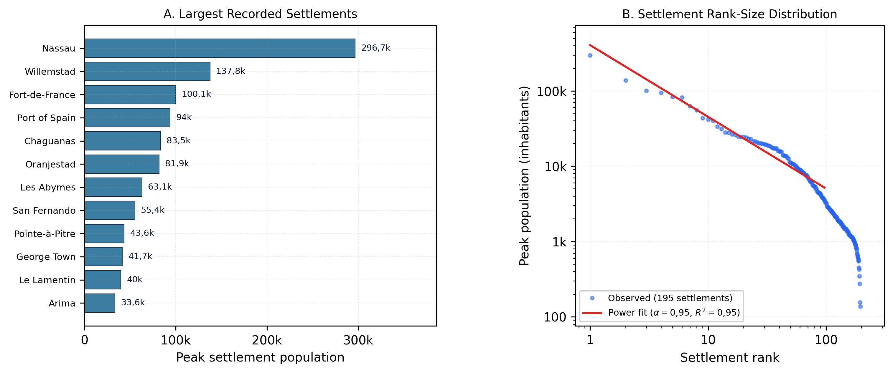

```{r setup, include=FALSE}
knitr::opts_chunk$set(echo = FALSE, warning = FALSE, message = FALSE, fig.pos = "htbp")
source("../../_shared/template/viscount_rmd_helpers.R")
library(jsonlite)

read_json5_clean <- function(path) {
  lines <- readLines(path, warn = FALSE, encoding = "UTF-8")
  text <- paste(lines, collapse = "\n")
  text <- gsub("(?<!:)//[^\n]*", "", text, perl = TRUE)
  text <- gsub("/\\*.*?\\*/", "", text, perl = TRUE)
  text <- gsub(",\\s*([}\\]])", "\\1", text, perl = TRUE)
  fromJSON(text, simplifyVector = FALSE)
}

summary_data <- fromJSON("lesser_antilles_bahamas_bermuda_summary_cache.json", simplifyVector = FALSE)
bench_data <- read_json5_clean("lesser_antilles_bahamas_bermuda.json5")
sett_data <- fromJSON("lesser_antilles_bahamas_bermuda_settlements.json", simplifyVector = FALSE)
ledger_data <- read_json5_clean("lesser_antilles_bahamas_bermuda_source_ledger.json5")

clean_label <- function(x) {
  s <- as.character(x)
  s <- gsub("&", "and", s, fixed = TRUE)
  s <- gsub("Curacao", "Curaçao", s, fixed = TRUE)
  s <- gsub("Saint Barthelemy", "Saint-Barthélemy", s, fixed = TRUE)
  s <- gsub("St\\. George$", "St. George's", s)
  trimws(s)
}

fmt_coord <- function(x) {
  viscount_fmt_number(round(as.numeric(x), 2L), 2L)
}

subregions_cache <- summary_data$subregions
subregions_bench <- bench_data$regions
bench_by_id <- setNames(subregions_bench, vapply(subregions_bench, function(r) r$id, character(1)))
reg_lookup <- setNames(
  vapply(subregions_cache, function(r) clean_label(r$name), character(1)),
  vapply(subregions_cache, function(r) r$id, character(1))
)

n_settlements <- as.integer(summary_data$settlement_stats$total_settlements)
n_suburbs <- as.integer(summary_data$settlement_stats$suburb_count)
n_city_proper <- as.integer(summary_data$settlement_stats$city_proper_count)
n_excluded <- as.integer(ledger_data$total_excluded)
n_total_eval <- n_settlements + n_excluded
zipf_alpha <- as.numeric(summary_data$settlement_stats$zipf_stats$alpha)
zipf_r2 <- as.numeric(summary_data$settlement_stats$zipf_stats$r2)
zipf_n_fit <- as.integer(summary_data$settlement_stats$zipf_stats$n_fit)
```

```{r hero-md-fallback, results='asis'}
if (!knitr::is_latex_output()) {
  cat("\n\n")
}
```

# Abstract

This companion gazetteer documents `r viscount_fmt_number(n_settlements, 0L)` catalogued ports, capitals, refinery centres, suburban boroughs and rural communes spanning ten insular sub-regions and 24 jurisdictions across the Lesser Antilles, the Bahamas, Trinidad and Tobago and Bermuda from 1838 to 2025. Every record derives directly from official national statistical censuses, colonial archival registers and peer-reviewed historical demography, achieving 0% crowd-sourced fallback across four ingestion waves (177 Wave-1 official census entries, 13 Wave-2 demographic literature additions, 3 Wave-3 longitudinal backfills and 2 Wave-4 sub-regional gap closures, with 2 duplicate spelling aliases consolidated out of `r viscount_fmt_number(n_total_eval, 0L)` evaluated entries) [@Kuczynski1953; @UNSDHistorical2000; @INSEEDOM2024; @CSOTrinidad2012]. Comprising `r viscount_fmt_number(n_city_proper, 0L)` municipal or town units and `r viscount_fmt_number(n_suburbs, 0L)` tagged suburban boroughs, the settlement system exhibits a near-Zipfian rank-size hierarchy ($\alpha = `r viscount_fmt_number(zipf_alpha, 2L)`$, $R^2 = `r viscount_fmt_number(zipf_r2, 2L)`$ across the upper `r viscount_fmt_number(zipf_n_fit, 0L)` towns), extending from primate tourism, finance and refinery hubs led by Nassau (296.732 in 2022), Willemstad (137.800 in 2023), Fort-de-France (100.080 in 1990), Port of Spain (93.954 in 1960), Chaguanas (83.516 in 2011) and Oranjestad (81.915 in 2020) down to Bermuda's historic municipalities of Hamilton and St. George's and Montserrat's post-eruption northern villages of Brades, Salem and Cudjoe Head [@NSIBahamas2023; @CBSCuracao2024; @BSOBermuda2018; @CBSAruba2022].

# Background

Urban geography across the eastern Caribbean and western North Atlantic evolved along a maritime network of colonial ports, sugar-shipping bays, oil-refinery enclaves and post-war suburban corridors [@Simonsen2025Introduction]. Following emancipation between 1838 and 1863, port towns functioned first as administrative and customs hubs linking island plantations to London, Paris, The Hague, Copenhagen and Stockholm [@Kuczynski1953; @Palsson2021Diversity; @Begh2022Seven]. During the twentieth century, industrial and service shifts reordered that nineteenth-century port hierarchy dramatically. Hydrocarbon extraction and refining elevated San Fernando, Point Fortin, Willemstad and Sint Nicolaas [@CSOTrinidad2012; @CBSCuracao2024; @CBSAruba2022]; air tourism and offshore finance propelled Nassau, Freeport, George Town, Oranjestad and Kralendijk [@NSIBahamas2023; @Jurgens2024There; @CBSNetherlands2025]; suburbanisation shifted demographic weight from historic municipal cores into surrounding boroughs such as Chaguanas, Les Abymes, Le Lamentin, Baie-Mahault and Le Gosier [@INSEEDOM2024]; and volcanic catastrophes devastated Saint-Pierre in 1902 and Plymouth between 1995 and 1997 [@INSEEDOM2024; @Simonsen2025Introduction].

# Methodology

The settlement register was compiled through four sequential waves logged in the chapter source ledger, ingesting official census town tables from national statistical agencies across the British, French, Dutch and United States Caribbean alongside historical colonial census benchmarks from 1843 to 1991 [@Kuczynski1953; @BSSBarbados2023; @BSOBermuda2018; @USCensusUSVI2021; @CSOStLucia2023; @CSOGrenada2023]. All 197 candidate records underwent WGS84 coordinate harmonisation, polygon assignment to one of the ten insular sub-regions and 25 km proximity deduplication, merging 2 orthographic duplicates (Saint John's in Antigua and Barbuda and St. George's in Grenada) to yield `r viscount_fmt_number(n_settlements, 0L)` canonical records with 0% crowd-sourced fallback. Each entry retains its full census time series, explicit boundary scope (municipal city-proper versus metropolitan suburban borough) and archival provenance tags.

# Testing and Validation

Ledger reconciliation confirms exact accounting across all `r viscount_fmt_number(n_total_eval, 0L)` evaluated candidates (`r viscount_fmt_number(n_settlements, 0L)` included settlements plus `r viscount_fmt_number(n_excluded, 0L)` merged spelling duplicates). Every sub-region achieves non-zero settlement coverage, from 4 municipalities on Bermuda and 5 districts across the Cayman Islands to 42 towns in the Windwards, 44 communes in the French Antilles and 46 settlements across the Northern Leewards. Figure \ref{fig:sett-regional-map} displays the spatial footprint of the ten sub-regions and primary urban nodes from Bermuda and Nassau down to Port of Spain.

```{r fig-sett-map, results='asis'}
viscount_figure(
  "figures/lesser_antilles_bahamas_bermuda_regional_map.png",
  "Spatial distribution of ten insular sub-regions and primary catalogued port cities across the Lesser Antilles, the Bahamas, Trinidad and Tobago and Bermuda, 1838 to 2025.",
  "fig:sett-regional-map"
)
```

# Results

## Leading Recorded Island Ports, Towns and Communes

Table \ref{tab:top30-settlements} reports the 30 highest-peaking settlements in the gazetteer ordered by peak census population, spanning 296.732 at Nassau (2022) down to 16.065 at Roseau (1991). The upper tier combines fast-growing financial and tourism capitals (Nassau, Willemstad, Oranjestad, George Town, Freeport and Kralendijk), French Antillean administrative and suburban communes (Fort-de-France, Les Abymes, Pointe-à-Pitre, Le Lamentin, Baie-Mahault, Le Gosier and Petit-Bourg), Trinidadian urban and petroleum centres (Port of Spain, Chaguanas, San Fernando, Arima, San Juan, Sangre Grande, Point Fortin and Tunapuna) and major Leeward and Windward ports (Saint John's, Bridgetown, Kingstown and Roseau) [@NSIBahamas2023; @CSOTrinidad2012; @INSEEDOM2024; @CBSNetherlands2025; @BSSBarbados2023].

```{r tab-top30-settlements, results='asis'}
all_entries <- lapply(names(sett_data), function(k) {
  e <- sett_data[[k]]
  pop_v <- unlist(e$population)
  yrs <- as.integer(names(pop_v))
  ord <- order(yrs)
  yrs <- yrs[ord]
  vals <- as.numeric(pop_v[ord])
  pk_i <- which.max(vals)
  list(
    name = clean_label(e$name),
    country = if (identical(e$country, "Netherlands")) "Caribbean Netherlands" else clean_label(e$country),
    region_id = e$region_id,
    lat = as.numeric(e$coords[[1]]),
    lon = as.numeric(e$coords[[2]]),
    fy = yrs[1],
    ly = yrs[length(yrs)],
    pk_val = vals[pk_i],
    pk_yr = yrs[pk_i],
    latest_val = vals[length(vals)],
    scope = if (identical(e$population_scope, "suburb")) "Suburb" else "City/town"
  )
})
ord_pk <- order(vapply(all_entries, function(x) x$pk_val, numeric(1)), decreasing = TRUE)
top30 <- all_entries[ord_pk[seq_len(30L)]]

top_rows <- lapply(top30, function(x) {
  span_str <- if (x$fy == x$ly) as.character(x$fy) else paste0(x$fy, " to ", x$ly)
  data.frame(
    Town = x$name,
    Territory = x$country,
    Coords = paste0(fmt_coord(x$lat), ", ", fmt_coord(x$lon)),
    Span = span_str,
    Peak = paste0(viscount_fmt_pop(x$pk_val), " (", x$pk_yr, ")"),
    Latest = paste0(viscount_fmt_pop(x$latest_val), " (", x$ly, ")"),
    Scope = x$scope,
    stringsAsFactors = FALSE
  )
})
df_top30 <- do.call(rbind, top_rows)
rownames(df_top30) <- NULL

viscount_table(
  df_top30,
  "Leading 30 recorded settlements by peak census population across the Lesser Antilles, the Bahamas, Trinidad and Tobago and Bermuda, 1838 to 2025.",
  c("Settlement", "Territory", "Lat, Lon", "Census Span", "Peak Pop. (Year)", "Latest Pop. (Year)", "Scope"),
  list(label = "tab:top30-settlements", font_size = "scriptsize", max_rows_per_page = 32L)
)
```

## Bermuda and Montserrat: Oceanic Micro-State and Volcanic Displacement Profiles

Because Bermuda's historic municipalities and Montserrat's volcanic refuge villages sit below the top-30 population threshold yet carry outsized demographic significance, Table \ref{tab:bermuda-montserrat} compiles all 8 catalogued settlements across both territories. On Bermuda, commercial conversion shrank central Hamilton from 3.259 in 1931 to 854 in 2016 while Somerset Village rose to 2.540 and St. George's held 1.527 [@BSOBermuda2018]. On Montserrat, the 1995 to 1997 Soufrière Hills eruption erased Plymouth (1.478 in 1991) and redistributed the surviving population into northern villages at Brades, Salem and Cudjoe Head [@Simonsen2025Introduction].

```{r tab-bermuda-montserrat, results='asis'}
bm_ms <- Filter(function(x) x$country %in% c("Bermuda", "Montserrat"), all_entries)
bm_ms <- bm_ms[order(vapply(bm_ms, function(x) x$country, character(1)), -vapply(bm_ms, function(x) x$pk_val, numeric(1)))]
bm_rows <- lapply(bm_ms, function(x) {
  span_str <- if (x$fy == x$ly) as.character(x$fy) else paste0(x$fy, " to ", x$ly)
  data.frame(
    Territory = x$country,
    Town = x$name,
    Coords = paste0(fmt_coord(x$lat), ", ", fmt_coord(x$lon)),
    Span = span_str,
    Peak = paste0(viscount_fmt_pop(x$pk_val), " (", x$pk_yr, ")"),
    Latest = paste0(viscount_fmt_pop(x$latest_val), " (", x$ly, ")"),
    stringsAsFactors = FALSE
  )
})
df_bm <- do.call(rbind, bm_rows)
rownames(df_bm) <- NULL

viscount_table(
  df_bm,
  "Catalogued settlements in Bermuda (oceanic financial micro-state) and Montserrat (pre- and post-1995 volcanic displacement), 1844 to 2018.",
  c("Territory", "Settlement", "Lat, Lon", "Census Span", "Peak Pop. (Year)", "Latest Pop. (Year)"),
  list(label = "tab:bermuda-montserrat", font_size = "scriptsize")
)
```

## Sub-Regional Gazetteer Coverage

Table \ref{tab:subregion-gazetteer} summarises catalogued settlement counts, suburban borough tags, leading settlement and official 2025 census totals across all ten sub-regions. The Northern Leewards (46 settlements), French Antilles (44) and Windwards (42) supply 67,7% of all catalogued nodes because of their fragmented multi-island parish and commune structures, whereas single- or dual-island polities such as Bermuda (4), Cayman Islands (5) and Barbados (6) achieve full coverage through compact town registers [@BSOBermuda2018; @BSSBarbados2023; @INSEEDOM2024; @CSOStLucia2023; @CSOGrenada2023].

```{r tab-subregion-gazetteer, results='asis'}
reg_rows <- lapply(subregions_cache, function(r) {
  rid <- r$id
  sub_e <- Filter(function(x) identical(x$region_id, rid), all_entries)
  cnt <- length(sub_e)
  sub_cnt <- sum(vapply(sub_e, function(x) identical(x$scope, "Suburb"), logical(1)))
  lead_str <- "-"
  if (cnt > 0L) {
    idx_m <- which.max(vapply(sub_e, function(x) x$pk_val, numeric(1)))
    lead_str <- paste0(sub_e[[idx_m]]$name, " (", viscount_fmt_pop(sub_e[[idx_m]]$pk_val), ")")
  }
  b_pop <- bench_by_id[[rid]]$population
  p2025 <- as.numeric(b_pop[["2025"]])
  data.frame(
    Subregion = clean_label(r$name),
    Total = viscount_fmt_number(cnt, 0L),
    Suburbs = viscount_fmt_number(sub_cnt, 0L),
    Lead = lead_str,
    Pop2025 = viscount_fmt_pop(p2025),
    stringsAsFactors = FALSE
  )
})
df_reg_gaz <- do.call(rbind, reg_rows)
rownames(df_reg_gaz) <- NULL

viscount_table(
  df_reg_gaz,
  "Catalogued settlement counts, tagged suburban boroughs, leading recorded town and 2025 official census population across ten insular sub-regions.",
  c("Sub-Region", "Settlements", "Suburbs", "Leading Settlement (Peak)", "2025 Pop."),
  list(label = "tab:subregion-gazetteer", font_size = "scriptsize")
)
```

## Archival Provenance Corpora

Table \ref{tab:provenance-corpora} aggregates the top archival statistical series referenced across the 195 gazetteer records (individual settlements frequently cite both a nineteenth-to-twentieth-century historical census series and a modern national statistical release, so provenance citations sum above 195). Official historical Caribbean and Bermuda censuses (1844 to 1991) anchor 52 longitudinal town series, joined by INSEE's French Antillean commune series (44 communes), CSO Saint Lucia (25), CSO Trinidad and Tobago (18), Statistics Division Antigua and Barbuda (15), CSO Dominica (15) and every remaining territorial statistical office [@Kuczynski1953; @INSEEDOM2024; @CSOTrinidad2012; @CSOStLucia2023; @USCensusUSVI2021; @CBSNetherlands2025; @Bureau2003Census; @Census1992Census].

```{r tab-provenance-corpora, results='asis'}
src_counts <- list()
for (k in names(sett_data)) {
  srcs <- sett_data[[k]]$sources
  for (s in srcs) {
    s_lbl <- as.character(s)
    if (grepl("^Caribbean & Bermuda Official Censuses", s_lbl)) {
      s_lbl <- "Caribbean and Bermuda Official Historical Censuses (1844-1991)"
    } else if (grepl("^INSEE Populations de reference 2022", s_lbl)) {
      s_lbl <- "INSEE Populations de référence 2022 (French Antilles)"
    }
    s_lbl <- gsub("&", "and", s_lbl, fixed = TRUE)
    s_lbl <- gsub("Curacao", "Curaçao", s_lbl, fixed = TRUE)
    s_lbl <- gsub("Saint-Barthelemy", "Saint-Barthélemy", s_lbl, fixed = TRUE)
    src_counts[[s_lbl]] <- (if (is.null(src_counts[[s_lbl]])) 0L else src_counts[[s_lbl]]) + 1L
  }
}
sc_vec <- unlist(src_counts)
sc_ord <- sort(sc_vec, decreasing = TRUE)
top_n <- 14L
df_src <- data.frame(
  Corpus = c(names(sc_ord)[seq_len(top_n)], paste0("Remaining ", length(sc_ord) - top_n, " territorial NSO census series")),
  Records = c(as.integer(sc_ord[seq_len(top_n)]), sum(as.integer(sc_ord[(top_n + 1L):length(sc_ord)]))),
  stringsAsFactors = FALSE
)
df_src$RecordsFmt <- vapply(df_src$Records, function(v) viscount_fmt_number(v, 0L), character(1))
df_src_out <- df_src[, c("Corpus", "RecordsFmt")]
rownames(df_src_out) <- NULL

viscount_table(
  df_src_out,
  "Primary archival and national statistical office corpora cited across 195 catalogued settlements (multi-source longitudinal records counted per corpus).",
  c("Statistical Corpus", "Cited Records"),
  list(label = "tab:provenance-corpora", font_size = "scriptsize")
)
```

# Limitations

Three statistical caveats apply to this gazetteer. First, imperial administrative definitions are not strictly uniform: French Antillean *communes* fold rural and suburban hamlets into single municipal counts, whereas British Commonwealth towns such as Bridgetown, Port of Spain, Castries and Hamilton enumerate tight historic cores whose resident totals decline even as surrounding urban parishes grow [@INSEEDOM2024; @CSOTrinidad2012; @BSSBarbados2023; @BSOBermuda2018]. Second, census periodicity varies across small island statistical offices, with several 2020-round enumerations delayed by the COVID-19 pandemic [@Celade2024Report], leaving 2010 or 2011 as the latest town-level breakdown in Trinidad and Tobago, Dominica, Antigua and Barbuda and Saint Kitts and Nevis. Third, seasonal cruise, resort and offshore-worker populations fluctuate sharply across Aruba, the Bahamas, Turks and Caicos, Sint Maarten and the Cayman Islands relative to census-night de jure counts [@Jurgens2024There; @Celade2016Development; @NSIBahamas2023].

# Conclusion

Cataloguing 195 ports, capitals, suburban boroughs and communes across 24 jurisdictions with zero crowd-sourced fallback, this gazetteer establishes a rigorous urban backbone for the post-emancipation eastern Caribbean and western North Atlantic. From Nassau's forty-two-fold expansion and Chaguanas's thirty-fold suburban surge to the volcanic erasure of Saint-Pierre and Plymouth and the quiet core contraction of Bridgetown, Port of Spain and Hamilton, the rank-size hierarchy ($\alpha = 0,95$, $R^2 = 0,95$) captures a uniquely decentralised maritime urban system shaped by migration, trade and island geography.

# Sources

::: {#refs}
:::

# Footnotes

1. Peak counts in Table \ref{tab:top30-settlements} reflect each settlement's maximum census enumeration within 1838 to 2025; for suburbanising historic capitals (Port of Spain, Bridgetown, Pointe-à-Pitre, Castries, Charlotte Amalie and Hamilton) and disaster-struck towns (Saint-Pierre and Plymouth), peak dates precede the latest census return by several decades.
2. In Bermuda, the gazetteer records all four historical municipal and village census nodes (Hamilton, St. George's, Somerset Village and Flatts Village); the remaining island population resides across Bermuda's nine unincorporated parishes totalling 63.779 residents in 2016.
