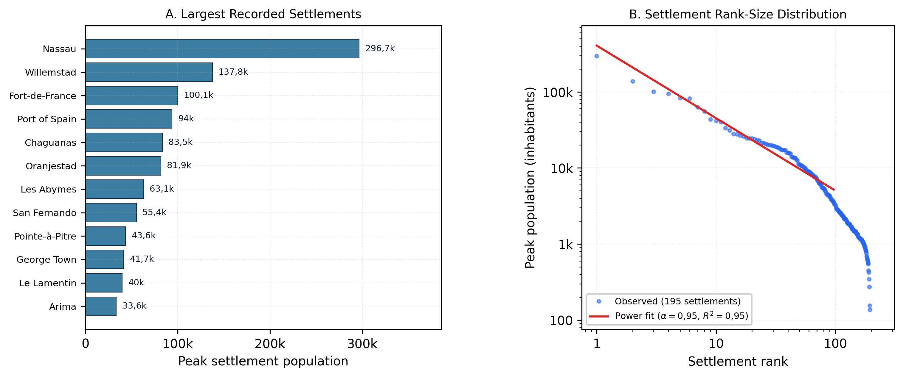
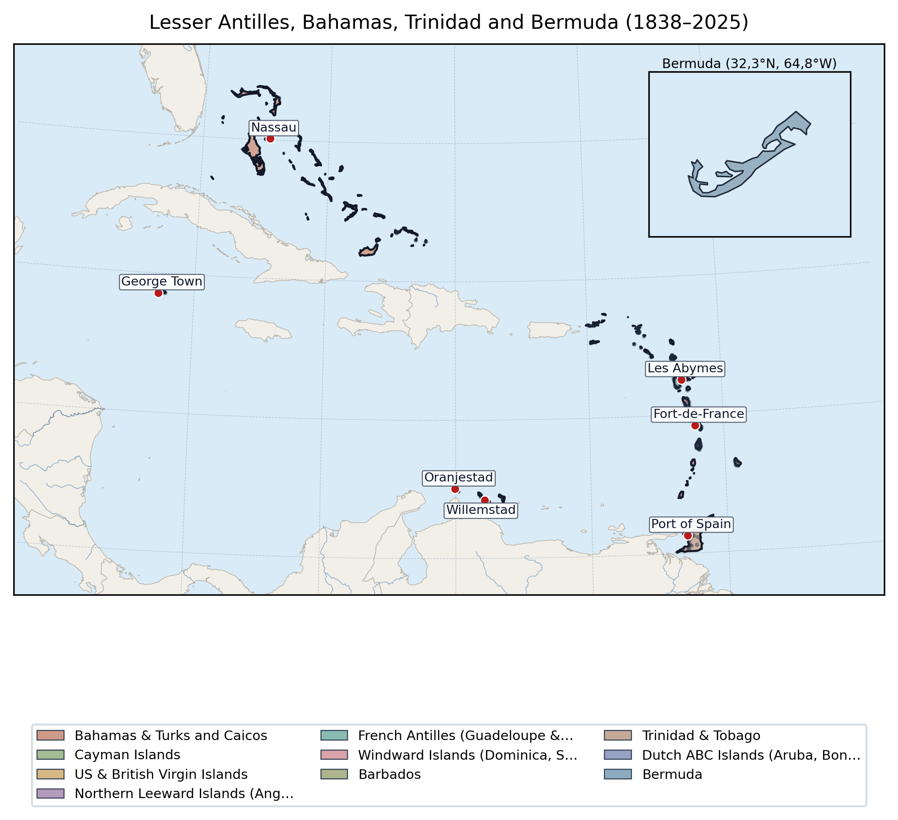

Lesser Antilles, Bahamas, Trinidad and Bermuda
================
Aust Kätzchen
23 November 2026

- [Abstract](#abstract)
- [Background](#background)
- [Methodology](#methodology)
- [Testing and Validation](#testing-and-validation)
- [Results](#results)
  - [Leading Recorded Island Ports, Towns and
    Communes](#leading-recorded-island-ports-towns-and-communes)
  - [Bermuda and Montserrat: Oceanic Micro-State and Volcanic
    Displacement
    Profiles](#bermuda-and-montserrat-oceanic-micro-state-and-volcanic-displacement-profiles)
  - [Sub-Regional Gazetteer Coverage](#sub-regional-gazetteer-coverage)
  - [Archival Provenance Corpora](#archival-provenance-corpora)
- [Limitations](#limitations)
- [Conclusion](#conclusion)
- [Sources](#sources)
- [Footnotes](#footnotes)

<figure>

<figcaption aria-hidden="true">Leading recorded island settlements and
rank-size distribution across 195 catalogued ports, towns and communes
from 1838 to 2025.</figcaption>
</figure>

# Abstract

This companion gazetteer documents 195 catalogued ports, capitals,
refinery centres, suburban boroughs and rural communes spanning ten
insular sub-regions and 24 jurisdictions across the Lesser Antilles, the
Bahamas, Trinidad and Tobago and Bermuda from 1838 to 2025. Every record
derives directly from official national statistical censuses, colonial
archival registers and peer-reviewed historical demography, achieving 0%
crowd-sourced fallback across four ingestion waves (177 Wave-1 official
census entries, 13 Wave-2 demographic literature additions, 3 Wave-3
longitudinal backfills and 2 Wave-4 sub-regional gap closures, with 2
duplicate spelling aliases consolidated out of 197 evaluated entries)
[\[1\]](#ref-Kuczynski1953)[\[2\]](#ref-UNSDHistorical2000)[\[3\]](#ref-INSEEDOM2024)[\[4\]](#ref-CSOTrinidad2012).
Comprising 187 municipal or town units and 8 tagged suburban boroughs,
the settlement system exhibits a near-Zipfian rank-size hierarchy
($\alpha = 0,95$, $R^2 = 0,95$ across the upper 97 towns), extending
from primate tourism, finance and refinery hubs led by Nassau (296.732
in 2022), Willemstad (137.800 in 2023), Fort-de-France (100.080 in
1990), Port of Spain (93.954 in 1960), Chaguanas (83.516 in 2011) and
Oranjestad (81.915 in 2020) down to Bermuda’s historic municipalities of
Hamilton and St. George’s and Montserrat’s post-eruption northern
villages of Brades, Salem and Cudjoe Head
[\[5\]](#ref-NSIBahamas2023)[\[6\]](#ref-CBSCuracao2024)[\[7\]](#ref-BSOBermuda2018)[\[8\]](#ref-CBSAruba2022).

# Background

Urban geography across the eastern Caribbean and western North Atlantic
evolved along a maritime network of colonial ports, sugar-shipping bays,
oil-refinery enclaves and post-war suburban corridors
[\[9\]](#ref-Simonsen2025Introduction). Following emancipation between
1838 and 1863, port towns functioned first as administrative and customs
hubs linking island plantations to London, Paris, The Hague, Copenhagen
and Stockholm
[\[1\]](#ref-Kuczynski1953)[\[10\]](#ref-Palsson2021Diversity)[\[11\]](#ref-Begh2022Seven).
During the twentieth century, industrial and service shifts reordered
that nineteenth-century port hierarchy dramatically. Hydrocarbon
extraction and refining elevated San Fernando, Point Fortin, Willemstad
and Sint Nicolaas
[\[4\]](#ref-CSOTrinidad2012)[\[6\]](#ref-CBSCuracao2024)[\[8\]](#ref-CBSAruba2022);
air tourism and offshore finance propelled Nassau, Freeport, George
Town, Oranjestad and Kralendijk
[\[5\]](#ref-NSIBahamas2023)[\[12\]](#ref-Jurgens2024There)[\[13\]](#ref-CBSNetherlands2025);
suburbanisation shifted demographic weight from historic municipal cores
into surrounding boroughs such as Chaguanas, Les Abymes, Le Lamentin,
Baie-Mahault and Le Gosier [\[3\]](#ref-INSEEDOM2024); and volcanic
catastrophes devastated Saint-Pierre in 1902 and Plymouth between 1995
and 1997
[\[3\]](#ref-INSEEDOM2024)[\[9\]](#ref-Simonsen2025Introduction).

# Methodology

The settlement register was compiled through four sequential waves
logged in the chapter source ledger, ingesting official census town
tables from national statistical agencies across the British, French,
Dutch and United States Caribbean alongside historical colonial census
benchmarks from 1843 to 1991
[\[1\]](#ref-Kuczynski1953)[\[7\]](#ref-BSOBermuda2018)[\[14\]](#ref-BSSBarbados2023)[\[15\]](#ref-USCensusUSVI2021)[\[16\]](#ref-CSOStLucia2023)[\[17\]](#ref-CSOGrenada2023).
All 197 candidate records underwent WGS84 coordinate harmonisation,
polygon assignment to one of the ten insular sub-regions and 25 km
proximity deduplication, merging 2 orthographic duplicates (Saint John’s
in Antigua and Barbuda and St. George’s in Grenada) to yield 195
canonical records with 0% crowd-sourced fallback. Each entry retains its
full census time series, explicit boundary scope (municipal city-proper
versus metropolitan suburban borough) and archival provenance tags.

# Testing and Validation

Ledger reconciliation confirms exact accounting across all 197 evaluated
candidates (195 included settlements plus 2 merged spelling duplicates).
Every sub-region achieves non-zero settlement coverage, from 4
municipalities on Bermuda and 5 districts across the Cayman Islands to
42 towns in the Windwards, 44 communes in the French Antilles and 46
settlements across the Northern Leewards. Figure displays the spatial
footprint of the ten sub-regions and primary urban nodes from Bermuda
and Nassau down to Port of Spain.

<!-- -->

# Results

## Leading Recorded Island Ports, Towns and Communes

Table reports the 30 highest-peaking settlements in the gazetteer
ordered by peak census population, spanning 296.732 at Nassau (2022)
down to 16.065 at Roseau (1991). The upper tier combines fast-growing
financial and tourism capitals (Nassau, Willemstad, Oranjestad, George
Town, Freeport and Kralendijk), French Antillean administrative and
suburban communes (Fort-de-France, Les Abymes, Pointe-à-Pitre, Le
Lamentin, Baie-Mahault, Le Gosier and Petit-Bourg), Trinidadian urban
and petroleum centres (Port of Spain, Chaguanas, San Fernando, Arima,
San Juan, Sangre Grande, Point Fortin and Tunapuna) and major Leeward
and Windward ports (Saint John’s, Bridgetown, Kingstown and Roseau)
[\[3\]](#ref-INSEEDOM2024)[\[4\]](#ref-CSOTrinidad2012)[\[5\]](#ref-NSIBahamas2023)[\[13\]](#ref-CBSNetherlands2025)[\[14\]](#ref-BSSBarbados2023).

| Settlement | Territory | Lat, Lon | Census Span | Peak Pop. (Year) | Latest Pop. (Year) | Scope |
|:---|:---|:---|:---|:---|:---|:---|
| **Nassau** | The Bahamas | 25,04, -77,36 | 1845 to 2022 | 296,7k (2022) | 296,7k (2022) | City/town |
| **Willemstad** | Curaçao | 12,11, -68,93 | 1860 to 2023 | 137,8k (2023) | 137,8k (2023) | City/town |
| **Fort-de-France** | Martinique | 14,61, -61,07 | 1853 to 2023 | 100,1k (1990) | 75,5k (2023) | City/town |
| **Port of Spain** | Trinidad and Tobago | 10,65, -61,5 | 1851 to 2011 | 94k (1960) | 37,1k (2011) | City/town |
| **Chaguanas** | Trinidad and Tobago | 10,52, -61,41 | 1946 to 2011 | 83,5k (2011) | 83,5k (2011) | Suburb |
| **Oranjestad** | Aruba | 12,52, -70,03 | 1860 to 2020 | 81,9k (2020) | 81,9k (2020) | City/town |
| **Les Abymes** | Guadeloupe | 16,27, -61,5 | 1982 to 2023 | 63,1k (1999) | 51,1k (2023) | Suburb |
| **San Fernando** | Trinidad and Tobago | 10,28, -61,46 | 1851 to 2011 | 55,4k (2000) | 48,8k (2011) | City/town |
| **Pointe-à-Pitre** | Guadeloupe | 16,24, -61,53 | 1853 to 2023 | 43,6k (1936) | 15k (2023) | City/town |
| **George Town** | Cayman Islands | 19,3, -81,38 | 1891 to 2023 | 41,7k (2023) | 41,7k (2023) | City/town |
| **Le Lamentin** | Martinique | 14,61, -61 | 1982 to 2023 | 40k (2015) | 39,4k (2023) | Suburb |
| **Arima** | Trinidad and Tobago | 10,64, -61,28 | 1891 to 2011 | 33,6k (2011) | 33,6k (2011) | City/town |
| **Baie-Mahault** | Guadeloupe | 16,27, -61,59 | 1982 to 2023 | 31,2k (2015) | 30,9k (2023) | Suburb |
| **Freeport** | The Bahamas | 26,53, -78,7 | 1963 to 2010 | 28k (2010) | 28k (2010) | City/town |
| **Le Gosier** | Guadeloupe | 16,21, -61,49 | 1982 to 2023 | 27,8k (2023) | 27,8k (2023) | Suburb |
| **Sint Nicolaas** | Aruba | 12,44, -69,91 | 1930 to 2020 | 26,6k (2010) | 25,8k (2020) | City/town |
| **Saint-Pierre** | Martinique | 14,74, -61,18 | 1853 to 2023 | 26k (1901) | 4k (2023) | City/town |
| **Petit-Bourg** | Guadeloupe | 16,19, -61,59 | 1982 to 2023 | 24,7k (2023) | 24,7k (2023) | City/town |
| **Saint John’s** | Antigua and Barbuda | 17,12, -61,84 | 1844 to 2011 | 24,5k (2001) | 22,2k (2011) | City/town |
| **Sainte-Anne** | Guadeloupe | 16,23, -61,39 | 1982 to 2023 | 24,4k (2022) | 24k (2023) | City/town |
| **Le Robert** | Martinique | 14,68, -60,94 | 1982 to 2023 | 24,1k (2007) | 21,6k (2023) | City/town |
| **Kralendijk** | Caribbean Netherlands | 12,15, -68,28 | 1890 to 2024 | 23,2k (2024) | 23,2k (2024) | City/town |
| **Le Moule** | Guadeloupe | 16,33, -61,35 | 1982 to 2023 | 23k (2023) | 23k (2023) | City/town |
| **San Juan** | Trinidad and Tobago | 10,65, -61,45 | 1960 to 2011 | 21,4k (1980) | 15,8k (2011) | Suburb |
| **Bridgetown** | Barbados | 13,1, -59,61 | 1844 to 2000 | 21,4k (1871) | 6k (2000) | City/town |
| **Sangre Grande** | Trinidad and Tobago | 10,59, -61,13 | 1946 to 2011 | 20,7k (2011) | 20,7k (2011) | City/town |
| **Point Fortin** | Trinidad and Tobago | 10,17, -61,68 | 1946 to 2011 | 20,2k (2011) | 20,2k (2011) | City/town |
| **Sainte-Marie** | Martinique | 14,78, -60,99 | 1982 to 2023 | 20,1k (1999) | 14,8k (2023) | City/town |
| **Sainte-Rose** | Guadeloupe | 16,33, -61,7 | 1982 to 2023 | 19,9k (2015) | 17,7k (2023) | City/town |
| **Capesterre-Belle-Eau** | Guadeloupe | 16,04, -61,56 | 1982 to 2023 | 19,6k (1999) | 17,7k (2023) | City/town |

Leading 30 recorded settlements by peak census population across the
Lesser Antilles, the Bahamas, Trinidad and Tobago and Bermuda, 1838 to
2025.

## Bermuda and Montserrat: Oceanic Micro-State and Volcanic Displacement Profiles

Because Bermuda’s historic municipalities and Montserrat’s volcanic
refuge villages sit below the top-30 population threshold yet carry
outsized demographic significance, Table compiles all 8 catalogued
settlements across both territories. On Bermuda, commercial conversion
shrank central Hamilton from 3.259 in 1931 to 854 in 2016 while Somerset
Village rose to 2.540 and St. George’s held 1.527
[\[7\]](#ref-BSOBermuda2018). On Montserrat, the 1995 to 1997 Soufrière
Hills eruption erased Plymouth (1.478 in 1991) and redistributed the
surviving population into northern villages at Brades, Salem and Cudjoe
Head [\[9\]](#ref-Simonsen2025Introduction).

| Territory | Settlement | Lat, Lon | Census Span | Peak Pop. (Year) | Latest Pop. (Year) |
|:---|:---|:---|:---|:---|:---|
| **Bermuda** | Hamilton | 32,29, -64,78 | 1851 to 2016 | 3,3k (1931) | 854 (2016) |
| **Bermuda** | Somerset Village | 32,3, -64,87 | 1891 to 2016 | 2,7k (2000) | 2,5k (2016) |
| **Bermuda** | St. George’s | 32,38, -64,68 | 1851 to 2016 | 2,1k (1891) | 1,5k (2016) |
| **Bermuda** | Flatts Village | 32,32, -64,74 | 1891 to 2016 | 1,3k (1991) | 1,3k (2016) |
| **Montserrat** | Plymouth | 16,71, -62,21 | 1844 to 1991 | 2,1k (1946) | 1,5k (1991) |
| **Montserrat** | Brades | 16,79, -62,21 | 2011 to 2018 | 449 (2011) | 393 (2018) |
| **Montserrat** | Salem | 16,75, -62,22 | 2011 to 2018 | 345 (2011) | 320 (2018) |
| **Montserrat** | Cudjoe Head | 16,77, -62,2 | 2011 to 2018 | 137 (2011) | 131 (2018) |

Catalogued settlements in Bermuda (oceanic financial micro-state) and
Montserrat (pre- and post-1995 volcanic displacement), 1844 to 2018.

## Sub-Regional Gazetteer Coverage

Table summarises catalogued settlement counts, suburban borough tags,
leading settlement and official 2025 census totals across all ten
sub-regions. The Northern Leewards (46 settlements), French Antilles
(44) and Windwards (42) supply 67,7% of all catalogued nodes because of
their fragmented multi-island parish and commune structures, whereas
single- or dual-island polities such as Bermuda (4), Cayman Islands (5)
and Barbados (6) achieve full coverage through compact town registers
[\[3\]](#ref-INSEEDOM2024)[\[7\]](#ref-BSOBermuda2018)[\[14\]](#ref-BSSBarbados2023)[\[16\]](#ref-CSOStLucia2023)[\[17\]](#ref-CSOGrenada2023).

| Sub-Region | Settlements | Suburbs | Leading Settlement (Peak) | 2025 Pop. |
|:---|:---|:---|:---|:---|
| **Bahamas and Turks and Caicos** | 14 | 0 | Nassau (296,7k) | 448k |
| **Bermuda** | 4 | 0 | Hamilton (3,3k) | 64,6k |
| **Cayman Islands** | 5 | 0 | George Town (41,7k) | 74,5k |
| **US and British Virgin Islands** | 7 | 0 | Charlotte Amalie (12,9k) | 124,5k |
| **Northern Leeward Islands (Anguilla to Montserrat)** | 46 | 0 | Saint John’s (24,5k) | 274k |
| **French Antilles (Guadeloupe and Martinique)** | 44 | 4 | Fort-de-France (100,1k) | 745k |
| **Windward Islands (Dominica, St Lucia, St Vincent, Grenada)** | 42 | 0 | Kingstown (17,3k) | 482k |
| **Barbados** | 6 | 0 | Bridgetown (21,4k) | 282,5k |
| **Trinidad and Tobago** | 18 | 4 | Port of Spain (94k) | 1,51M |
| **Dutch ABC Islands (Aruba, Bonaire and Curaçao)** | 9 | 0 | Willemstad (137,8k) | 292k |

Catalogued settlement counts, tagged suburban boroughs, leading recorded
town and 2025 official census population across ten insular sub-regions.

## Archival Provenance Corpora

Table aggregates the top archival statistical series referenced across
the 195 gazetteer records (individual settlements frequently cite both a
nineteenth-to-twentieth-century historical census series and a modern
national statistical release, so provenance citations sum above 195).
Official historical Caribbean and Bermuda censuses (1844 to 1991) anchor
52 longitudinal town series, joined by INSEE’s French Antillean commune
series (44 communes), CSO Saint Lucia (25), CSO Trinidad and Tobago
(18), Statistics Division Antigua and Barbuda (15), CSO Dominica (15)
and every remaining territorial statistical office
[\[1\]](#ref-Kuczynski1953)[\[3\]](#ref-INSEEDOM2024)[\[4\]](#ref-CSOTrinidad2012)[\[13\]](#ref-CBSNetherlands2025)[\[15\]](#ref-USCensusUSVI2021)[\[16\]](#ref-CSOStLucia2023)[\[18\]](#ref-Bureau2003Census)[\[19\]](#ref-Census1992Census).

| Statistical Corpus | Cited Records |
|:---|:---|
| **Caribbean and Bermuda Official Historical Censuses (1844-1991)** | 52 |
| **INSEE Populations de référence 2022 (French Antilles)** | 44 |
| **CSO Saint Lucia Censuses (Cities and Towns)** | 25 |
| **INSEE Guadeloupe Censuses (Communes 1967-2022)** | 23 |
| **INSEE Martinique Censuses (Communes 1967-2022)** | 21 |
| **CSO Trinidad and Tobago Censuses** | 18 |
| **Statistics Division Antigua and Barbuda Censuses** | 15 |
| **CSO Dominica Censuses** | 15 |
| **Anguilla Statistics Dept Censuses** | 9 |
| **Dept of Statistics Turks and Caicos Censuses** | 8 |
| **STAT Sint Maarten Censuses** | 7 |
| **Bahamas Dept of Statistics Censuses (Settlements)** | 6 |
| **Barbados Statistical Service Censuses** | 6 |
| **US Census Bureau USVI Censuses** | 6 |
| **Remaining 12 territorial NSO census series** | 34 |

Primary archival and national statistical office corpora cited across
195 catalogued settlements (multi-source longitudinal records counted
per corpus).

# Limitations

Three statistical caveats apply to this gazetteer. First, imperial
administrative definitions are not strictly uniform: French Antillean
*communes* fold rural and suburban hamlets into single municipal counts,
whereas British Commonwealth towns such as Bridgetown, Port of Spain,
Castries and Hamilton enumerate tight historic cores whose resident
totals decline even as surrounding urban parishes grow
[\[3\]](#ref-INSEEDOM2024)[\[4\]](#ref-CSOTrinidad2012)[\[7\]](#ref-BSOBermuda2018)[\[14\]](#ref-BSSBarbados2023).
Second, census periodicity varies across small island statistical
offices, with several 2020-round enumerations delayed by the COVID-19
pandemic [\[20\]](#ref-Celade2024Report), leaving 2010 or 2011 as the
latest town-level breakdown in Trinidad and Tobago, Dominica, Antigua
and Barbuda and Saint Kitts and Nevis. Third, seasonal cruise, resort
and offshore-worker populations fluctuate sharply across Aruba, the
Bahamas, Turks and Caicos, Sint Maarten and the Cayman Islands relative
to census-night de jure counts
[\[5\]](#ref-NSIBahamas2023)[\[12\]](#ref-Jurgens2024There)[\[21\]](#ref-Celade2016Development).

# Conclusion

Cataloguing 195 ports, capitals, suburban boroughs and communes across
24 jurisdictions with zero crowd-sourced fallback, this gazetteer
establishes a rigorous urban backbone for the post-emancipation eastern
Caribbean and western North Atlantic. From Nassau’s forty-two-fold
expansion and Chaguanas’s thirty-fold suburban surge to the volcanic
erasure of Saint-Pierre and Plymouth and the quiet core contraction of
Bridgetown, Port of Spain and Hamilton, the rank-size hierarchy
($\alpha = 0,95$, $R^2 = 0,95$) captures a uniquely decentralised
maritime urban system shaped by migration, trade and island geography.

# Sources

1.
Kuczynski, Robert René.
*Demographic Survey of the British Colonial Empire,
Volume III: West Indian and American Territories*. Oxford
University Press (Royal Institute of International Affairs), London,
1953, <https://archive.org/details/demographicsurve03kucz>.

2.
United Nations Statistics Division
(UNSD). “Demographic Yearbook Historical Supplement (1948–1997) &
Population Censuses’ Datasets.” United Nations, New York, 2000,
<https://unstats.un.org/unsd/demographic-social/products/dyb/>.

3.
Institut National de la
Statistique et des Études Économiques (INSEE).
“Recensements de la population – Séries historiques
Guadeloupe, Martinique, Saint-Martin et Saint-Barthélemy
(1936–2023).” INSEE, Paris, 2024, <https://www.insee.fr/>.

4.
Trinidad, Central Statistical
Office (CSO) of, and Tobago. “Population and
Housing Censuses of Trinidad and Tobago (1851–2011).” Ministry of
Planning; Sustainable Development, Port of Spain, 2012,
<https://cso.gov.tt/>.

5.
Bahamas National Statistical
Institute (formerly Department of Statistics).
“Census of Population and Housing of The Bahamas
(1845–2022).” Bahamas National Statistical Institute, Nassau,
2023, <https://www.bahamas.gov.bs/>.

6.
Central Bureau of Statistics (CBS)
Curaçao. “Population and Housing Censuses of
Curaçao (2011, 2023).” CBS Curaçao, Willemstad, 2024,
<https://www.cbs.cw/>.

7.
Department of Statistics,
Government of Bermuda. “Population and Housing
Censuses of Bermuda (1843–2016).” Government of Bermuda,
Hamilton, 2018, <https://www.gov.bm/department/statistics>.

8.
Central Bureau of Statistics (CBS)
Aruba. “Population and Housing Censuses of Aruba
(1991, 2000, 2010, 2020).” CBS Aruba, Oranjestad, 2022,
<https://cbs.aw/>.

9.
Simonsen, Gunvor, et al.
“Introduction: Small Islands, Proximity and
Connection in the Eastern Caribbean.” *Journal of Caribbean
History*, 2025, <https://doi.org/10.1353/jch.2025.a1000352>.

10.
Pålsson, Åle.
“Diversity and division: Digital mapping of
censuses in the Swedish Caribbean, 1835–1872.” *Atlantic
Studies*, 2021, <https://doi.org/10.1080/14788810.2021.1991772>.

11.
Bøegh, Kristoffer Friis, et al.
“Seven newly discovered 18th and 19th century
Virgin Islands Dutch Creole texts.” *Research at the University
of Copenhagen (University of Copenhagen)*, 2022,
<https://researchprofiles.ku.dk/da/publications/e80b9c3e-c5fe-4af6-85bf-79fba56d764f>.

12.
Jurgens, Sharona S., et al.
“Are there limits to growth of tourism on the
Caribbean islands? Case-study Aruba.” *Frontiers in Sustainable
Tourism*, 2024, <https://doi.org/10.3389/frsut.2024.1292383>.

13.
Centraal Bureau voor de Statistiek
(CBS) Netherlands. “Caribbean Netherlands;
population; sex, age, marital status (StatLine Table 83698ENG,
2011–2025).” Statistics Netherlands (CBS), The Hague, 2025,
<https://opendata.cbs.nl/ODataApi/odata/83698ENG/TypedDataSet>.

14.
Barbados Statistical Service
(BSS). “Population and Housing Censuses of Barbados
(1844–2021).” Barbados Statistical Service, Bridgetown, 2023,
<https://stats.gov.bb/>.

15.
United States Bureau of the
Census. “Census of the Virgin Islands of the United
States (Special Census 1917 & Decennial Censuses 1930–2020).”
U.S. Census Bureau, Washington, D.C., 2021,
<https://www.census.gov/programs-surveys/decennial-census/decade/2020/planning-management/release/2020-island-areas-data.html>.

16.
Central Statistical Office (CSO)
of Saint Lucia. “Population and Housing Censuses of
Saint Lucia (1970–2022).” CSO Saint Lucia, Castries, 2023,
<https://www.stats.gov.lc/>.

17.
Central Statistical Office (CSO)
of Grenada. “Population and Housing Censuses of
Grenada (1970–2022).” CSO Grenada, St. George’s, 2023,
<https://stats.gov.gd/>.

18.
United States Census Bureau.
“2000 Census of Population and Housing: U.S. Virgin
Islands Population and Housing Profile (PHC-4-VI).” *U.S.
Department of Commerce, Economics and Statistics Administration*, 2003,
<https://www2.census.gov/library/publications/2003/dec/phc-4-vi.pdf>.

19.
United States Bureau of the
Census. “1990 Census of Population and Housing:
Social and Economic Characteristics, Virgin Islands of the United States
(1990 CP-2-55).” *U.S. Department of Commerce, Bureau of the
Census*, 1992,
<https://www2.census.gov/library/publications/decennial/1990/cp-2/cp-2-55.pdf>.

20.
CELADE, CEPAL /.
“Report on the activities conducted by the Latin
American and Caribbean Demographic Centre (CELADE)-Population Division
of ECLAC during the period 2022–2024.” *UN ECLAC / CEPAL-CELADE*,
2024, <https://hdl.handle.net/11362/80456>.

21.
CELADE, CEPAL /.
“The development of population projections for the
Turks and Caicos Islands 2012-2027.” *UN ECLAC / CEPAL-CELADE*,
2016, <https://hdl.handle.net/11362/40406>.

# Footnotes

1.  Peak counts in Table reflect each settlement’s maximum census
    enumeration within 1838 to 2025; for suburbanising historic capitals
    (Port of Spain, Bridgetown, Pointe-à-Pitre, Castries, Charlotte
    Amalie and Hamilton) and disaster-struck towns (Saint-Pierre and
    Plymouth), peak dates precede the latest census return by several
    decades.
2.  In Bermuda, the gazetteer records all four historical municipal and
    village census nodes (Hamilton, St. George’s, Somerset Village and
    Flatts Village); the remaining island population resides across
    Bermuda’s nine unincorporated parishes totalling 63.779 residents in
    2016.
