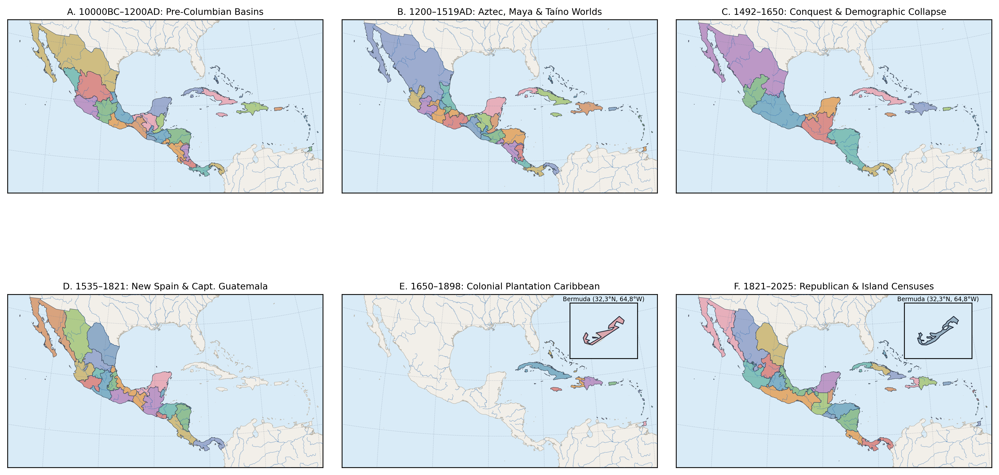
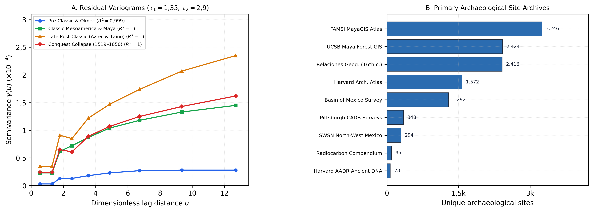
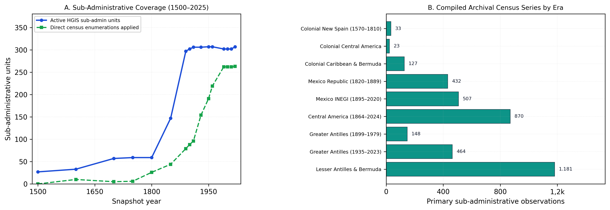
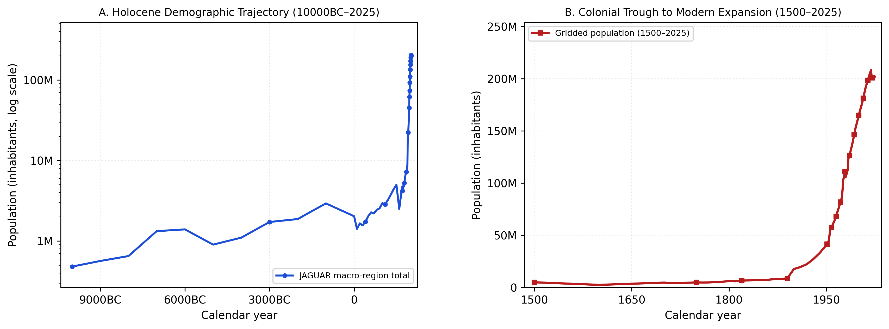
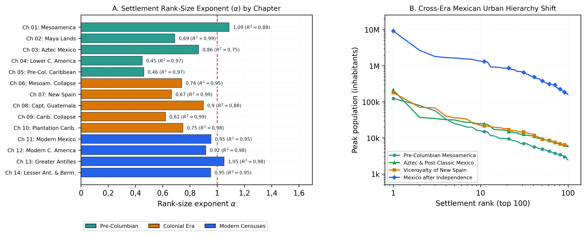

Studies on Population
================
Aust Kätzchen
23 November 2026

- [Abstract](#abstract)
- [Background](#background)
- [Methodology](#methodology)
  - [Canonical 14-Chapter Architecture and Areal
    Masking](#canonical-14-chapter-architecture-and-areal-masking)
  - [Archaeological Substrata and Non-Stationary Matérn
    Kriging](#archaeological-substrata-and-non-stationary-matérn-kriging)
  - [Non-Anachronistic Historical GIS Sub-Administrative
    Architecture](#non-anachronistic-historical-gis-sub-administrative-architecture)
  - [Evidence-Only Settlement Gazetteers and Metropolitan
    Reconciliation](#evidence-only-settlement-gazetteers-and-metropolitan-reconciliation)
- [Testing and Validation](#testing-and-validation)
- [Results](#results)
  - [Long-Run Holocene Demographic Trajectory
    (10000BC-2025)](#long-run-holocene-demographic-trajectory-10000bc-2025)
  - [Conquest Collapse, Colonial Restructuring and Plantation Divergence
    (1492-1898)](#conquest-collapse-colonial-restructuring-and-plantation-divergence-1492-1898)
  - [Modern Census Expansion and Urban Hierarchy Evolution
    (1821-2025)](#modern-census-expansion-and-urban-hierarchy-evolution-1821-2025)
  - [Comparative Benchmarking against Global Historical
    Compendia](#comparative-benchmarking-against-global-historical-compendia)
- [Limitations](#limitations)
- [Conclusion](#conclusion)
- [Appendix](#appendix)
- [Sources](#sources)
- [Footnotes](#footnotes)

# Abstract

Reconstructing long-run human population across Mesoamerica, the Central
American isthmus, the Antilles and Bermuda requires bridging three
structurally dissimilar evidentiary worlds: prehistoric archaeological
settlement surveys and radiocarbon sequences, sixteenth- to
nineteenth-century colonial fiscal, parish and plantation enumerations,
and republican to contemporary national censuses. Global gridded
datasets such as HYDE allocate historical national totals onto
5-arcminute grids using biophysical suitability rules and static
fractional weights [\[1\]](#ref-KleinGoldewijk2017), whereas continental
demographic syntheses report aggregate trajectories inside modern
sovereign boundaries
[\[2\]](#ref-McEvedyJones1978)[\[3\]](#ref-Maddison2001)[\[4\]](#ref-LiviBacci2007).
Across a 2,92M km² domain stretching from the arid basins of northern
Mexico and the volcanic highlands of Mesoamerica to the lowland karst of
the Maya Petén, the Chibchan isthmus and the Antillean island arc,
backward projection of contemporary national borders and modern urban
weights distorts both the pre-Columbian demographic geography and the
spatially asymmetric collapse after 1492. JAGUAR resolves these
distortions from 10000BC to 2025 through a bottom-up spatial-demographic
reconstruction uniting archaeological site density, dual land-use
priors, period-authentic historical administrative boundaries and
evidence-only settlement gazetteers.

JAGUAR integrates 28 constituent chapter documents (14 regional and
chronological literature reviews paired with 14 coordinate-anchored
settlement gazetteers), supported by 238 SHA-256-unique open-access
scholarly PDFs, 15.401 settlement trajectories (14.702 city-proper
records and 699 preserved extra-municipal suburbs under municipal
non-decomposition for unified Ciudad de México) and 3.785 primary
historical sub-administrative enumerations spanning 543 administrative
units and 29 territorial regimes across all 118 overlapping Common Era
HYDE epochs from 0AD to 2025. Pre-statistical surfaces combine 11.970
domestic archaeological sites (19,98 times the baseline radiocarbon
inventory, 99,19% primary regional institutional provenance and 0,0%
crowd-sourced fallback) plus 1.248 CENTAUR northern frontier buffer
sites across 1.673 dual HYDE 3.5 and KK10 catchments within a
non-stationary Matérn ($\nu = 3/2$) residual kriging model
($\tau_1 = 1,35$, zero uninhabitable landmass leakage). From 1500 to
2025, pycnophylactic mass-conserving dasymetric scaling across
non-anachronistic historical GIS boundaries achieves a maximum
sub-administrative unit relative error of $5,76 \times 10^{-8}$ across
103 scaled rasters.

Across the 2,92M km² JAGUAR domain, gridded population rose from 480,1k
in 10000BC and 1,39M in 6000BC to 2,93M by 1000BC as sedentary maize
farming consolidated across the Mexican highlands, Oaxaca, the Gulf
coast and the Maya lowlands. Classic and Post-Classic urbanisation
carried domain totals from 2,03M in 1AD and 2,95M in 1000AD to 4,99M in
1500AD, before Eurasian pathogens, famine and colonial disruption halved
the gridded population to 2,50M by 1600AD (with steeper local collapses
exceeding 80% in the Greater Antilles and tropical coastal lowlands).
Colonial demographic recovery and transatlantic plantation settlement
restored domain numbers to 4,69M in 1700, 6,18M in 1800 and 7,23M in
1850; republican census harmonisation and twentieth-century mortality
decline then lifted JAGUAR totals to 17,67M in 1900, 40,56M in 1950,
137,20M in 1990, 189,89M in 2010 and 201,93M in 2025.

# Background

Long-run population reconstruction across Mexico, Central America, the
Caribbean and Bermuda poses four distinct cartographic and statistical
problems that global gridded inventories cannot resolve cleanly from
national-level series alone
[\[1\]](#ref-KleinGoldewijk2017)[\[2\]](#ref-McEvedyJones1978)[\[3\]](#ref-Maddison2001).
Unlike temperate Eurasian river plains where demographic centres
remained spatially persistent across millennia, the JAGUAR macro-region
underwent three radical geographical inversions between the mid-Holocene
and the twenty-first century.

First, pre-Columbian demographic density did not align with contemporary
sovereign frontiers or modern industrial coastlines. Dense Formative,
Classic and Post-Classic societies concentrated in highland volcanic
basins (the Basin of Mexico, the Puebla-Tlaxcala valley, Oaxaca and the
Guatemalan highlands), fertile Gulf alluvial corridors, the karst
lowlands of the Petén and northern Yucatán, and the coastal and interior
valleys of Hispaniola and Puerto Rico
[\[5\]](#ref-SandersParsonsSantley1979)[\[6\]](#ref-Blanton1999)[\[7\]](#ref-CulbertRice1990)[\[8\]](#ref-KeeganHofman2017).
Modern borders such as the straight-line boundaries separating Mexico,
Guatemala and Belize across the Petén forest, or the northern meridian
separating Baja California from Sonora, cut directly through unified
pre-Columbian hydrological and cultural zones. When gridded
reconstructions disaggregate modern country totals backward into 1000BC
or 800AD, artificial density cliffs emerge along geometric lines that
did not exist before nineteenth- and twentieth-century treaties.

Second, the sixteenth-century demographic collapse following European
contact was neither uniform across space nor synchronous across
ecological zones
[\[9\]](#ref-BorahCook1963)[\[10\]](#ref-CookBorah1971)[\[11\]](#ref-Denevan1992)[\[12\]](#ref-Whitmore1992)[\[13\]](#ref-Koch2019).
In the Greater Antilles, epidemic mortality, forced labour and social
dislocation eliminated the vast majority of the indigenous Taíno
population within two generations of 1492
[\[14\]](#ref-Sauer1966)[\[15\]](#ref-Henige1978)[\[16\]](#ref-LiviBacci2003)[\[17\]](#ref-AndersonCordova2017).
On the Mesoamerican mainland, repeated epidemics of smallpox, measles
and haemorrhagic *huey cocoliztli* (including documented *Salmonella
enterica* outbreaks during megadrought intervals) struck tropical coasts
and highland basins with sharply differing intensities between 1519 and
1650
[\[18\]](#ref-Gibson1964)[\[19\]](#ref-Brooks1993)[\[20\]](#ref-AcunaSoto2002)[\[21\]](#ref-Vagene2018)[\[22\]](#ref-Lovell1992)[\[23\]](#ref-Newson1986).
Representing this transformation through a single national multiplier
erases the divergence between depopulated lowlands (such as the Petén,
Veracruz and Hispaniola), resilient indigenous highland cores (such as
Oaxaca, Chiapas and the Cuchumatán mountains) and newly founded colonial
silver-mining cities across the Bajío and northern Zacatecas
[\[24\]](#ref-Brading1971)[\[25\]](#ref-Gerhard1993)[\[26\]](#ref-MinoGrijalva2001).

Third, between 1650 and 1898 the Caribbean basin experienced a second
demographic inversion driven by the transatlantic slave trade and
imperial sugar economies
[\[27\]](#ref-EltisRichardson2010)[\[28\]](#ref-EngermanHigman1997)[\[29\]](#ref-Higman1984).
Small islands that had held modest pre-contact numbers or had been
nearly emptied after 1520 (Barbados, Jamaica, Martinique, Guadeloupe,
Saint-Domingue and western Cuba) rapidly attained some of the highest
rural densities in the Western Hemisphere, while Bermuda developed a
distinct maritime parish demography in the western Atlantic
[\[30\]](#ref-Kuczynski1953)[\[31\]](#ref-Roberts1957)[\[32\]](#ref-Geggus1997)[\[33\]](#ref-MoreauStMery1797).
Accurate spatial gridding across this period requires island-specific
colonial enumerations and period-authentic imperial frontiers, including
the 1697-1795 Hispaniola partition and the 1822-1844 Haitian unification
of the island, rather than late twentieth-century Caribbean state
aggregates.

Fourth, modern census integration across 37 sovereign and dependent
jurisdictions suffers from inconsistent urban definitions and
administrative fragmentation. In Mexico, treating the 16 constituent
*alcaldías* of Ciudad de México as separate cities artificially
dismantles the hemisphere’s largest highland metropolis, whereas
conflating municipal-level totals with city-proper cores distorts
rank-size scaling across Central America and the Antilles
[\[34\]](#ref-Unikel1976)[\[35\]](#ref-Garza2003)[\[36\]](#ref-INEGICPV2021)[\[37\]](#ref-CONAPO2023).
JAGUAR addresses all four challenges simultaneously, maintaining
continuous northern frontier harmonisation along the 250 km US-Mexico
seam with CENTAUR while preserving strictly regional archaeological,
colonial and republican statistical foundations.

# Methodology

## Canonical 14-Chapter Architecture and Areal Masking

JAGUAR partitions its 2,92M km² terrestrial domain (exact area 2.923.591
km², covering 35.104 valid 5-arcminute cells) into 14 chronological and
regional chapters arranged into three major historical groups (Table 1
and Figure 1). Every chapter pairs a regional demographic literature
review with a coordinate-anchored settlement gazetteer, a 4320x2160
pixel equal-area mask, a vector sub-regional partition, a provenance
ledger and an archived scholarly library of 16 to 18 unique open-access
PDFs across at least nine distinct institutional domains.

The first five chapters cover Pre-Columbian societies from 10000BC to
European contact. Chapter 1 spans Pre-Columbian Mesoamerica to 1200AD
across 1,79M km² and seven non-Maya ecological zones derived strictly
from organic HydroBASINS watershed divides, tracing Palaeoindian
foraging through Olmec, Teotihuacan, Zapotec and Toltec urbanism
[\[38\]](#ref-Diehl2004)[\[39\]](#ref-Pool2007)[\[40\]](#ref-Millon1973)[\[41\]](#ref-Cowgill2015)[\[42\]](#ref-Mastache2002).
Chapter 2 isolates the Classic and Post-Classic Maya lands
(2000BC-1524AD, 471,0k km², six ecological zones) across northern
Yucatán, the Petén-Usumacinta basin, Belize, highland Chiapas, highland
Guatemala and the Motagua-Copán corridor with zero modern international
straight lines
[\[7\]](#ref-CulbertRice1990)[\[43\]](#ref-SharerTraxler2006)[\[44\]](#ref-HoustonInomata2009)[\[45\]](#ref-Canuto2018).
Chapter 3 models the Aztec Empire and Late Post-Classic Mexico
(1200AD-1519AD, 1,79M km², eight indigenous polity zones separating the
Basin of Mexico, Tlaxcala, Purépecha Michoacán, Mixtec-Zapotec Oaxaca,
the Huasteca, West Mexico and Aridoamerica)
[\[46\]](#ref-Carrasco1999)[\[47\]](#ref-Pollard1993)[\[48\]](#ref-Smith2008AztecCity)[\[49\]](#ref-Berdan2014).
Chapters 4 and 5 extend coverage across Pre-Columbian Lower Central
America (10000BC-1502AD, 386,9k km², six Chibchan and isthmian watershed
zones from eastern Honduras to Gran Darién) and the Pre-Columbian
Caribbean Islands (5000BC-1492AD, 321,0k km², seven archipelagic zones
from western Cuba and Hispaniola to the Lucayan Bahamas, Lesser Antilles
and Trinidad)
[\[50\]](#ref-Cooke2005)[\[51\]](#ref-Hoopes2005)[\[52\]](#ref-Rouse1992)[\[53\]](#ref-Wilson2007)[\[54\]](#ref-Siegel2015).

Chapters 6 through 10 document Conquest, demographic collapse and
colonial restructuring between 1492 and 1898. Chapter 6 captures
Conquest and Collapse in Mexico and Central America (1518-1650, 2,60M
km², seven early colonial *audiencia* and frontier zones), while Chapter
9 tracks the Spanish Conquest of the Indigenous Caribbean across the
Antilles (1492-1650, 321,0k km², six zones anchored on the *Audiencia de
Santo Domingo*)
[\[10\]](#ref-CookBorah1971)[\[12\]](#ref-Whitmore1992)[\[16\]](#ref-LiviBacci2003)[\[55\]](#ref-DeaganCruxent2002).
Chapters 7 and 8 then trace the mature colonial administrations of the
Viceroyalty of New Spain (1535-1821, 1,97M km², 12 Bourbon intendancies
and *Provincias Internas*) and the Captaincy General of Guatemala and
Central America including Chiapas, Panama and early British Honduras
(1524-1821, 682,9k km², eight zones with an organic Honduras-Mosquitia
watershed divide)
[\[25\]](#ref-Gerhard1993)[\[56\]](#ref-Gerhard1962)[\[57\]](#ref-MacLeod1973)[\[58\]](#ref-Wortman1982)[\[59\]](#ref-HallPerezBrignoli2003).
Chapter 10 spans the Colonial Caribbean Plantation Era (1650-1898,
321,6k km², nine imperial zones including the historical 1697-1795
Hispaniola frontier and Bermuda at 32,3°N, 64,8°W)
[\[28\]](#ref-EngermanHigman1997)[\[29\]](#ref-Higman1984)[\[32\]](#ref-Geggus1997).

Finally, Chapters 11 through 14 cover Republican, Post-Emancipation and
Modern Census demography through 2025: Mexico after Independence
(Chapter 11, 1821-2025, 2,06M km², nine federal macro-zones covering all
32 states), the Central American Republics after Independence including
the 1903-1979 Panama Canal Zone footprint (Chapter 12, 1821-2025, 587,3k
km², eight zones), the Greater Antilles in the Modern Era across Cuba,
Haiti, the Dominican Republic, Jamaica and Puerto Rico (Chapter 13,
1838-2025, 253,7k km², seven zones) and the Lesser Antilles, Bahamas,
Trinidad and Bermuda (Chapter 14, 1838-2025, 67,8k km², ten island
groupings)
[\[60\]](#ref-INEGICensos1996)[\[61\]](#ref-Alba1982)[\[62\]](#ref-PerezBrignoli2010)[\[63\]](#ref-DiazBriquets1983)[\[64\]](#ref-VazquezCalzada1988)[\[65\]](#ref-BSOBermuda2018).

| Ch. | Regional or Chronological Module | Span | Area (km²) | Zones | Setts | Zipf | PDFs |
|:---|:---|:---|:---|:---|:---|:---|:---|
| **01** | Pre-Columbian Mesoamerica to AD 1200 | 10000BC-1200 | 1,79M | 7 | 336 | 1,09 | 17 |
| **02** | Classic and Post-Classic Maya Lands | 2000BC-1524 | 471k | 6 | 122 | 0,69 | 18 |
| **03** | The Aztec Empire and Late Post-Classic Mexico | 1200-1519 | 1,79M | 8 | 289 | 0,86 | 16 |
| **04** | Pre-Columbian Lower Central America | 10000BC-1502 | 386,9k | 6 | 112 | 0,45 | 18 |
| **05** | Pre-Columbian Caribbean Islands | 5000BC-1492 | 321k | 7 | 102 | 0,46 | 18 |
| **06** | Conquest and Collapse in Mexico and Central America | 1518-1650 | 2,6M | 7 | 99 | 0,74 | 17 |
| **07** | Viceroyalty of New Spain | 1535-1821 | 1,97M | 12 | 826 | 0,67 | 17 |
| **08** | Captaincy General of Guatemala and Central America | 1524-1821 | 682,9k | 8 | 190 | 0,9 | 16 |
| **09** | Spanish Conquest of the Indigenous Caribbean | 1492-1650 | 321k | 6 | 86 | 0,62 | 16 |
| **10** | Colonial Caribbean Plantation Era | 1650-1898 | 321,6k | 9 | 143 | 0,75 | 18 |
| **11** | Mexico after Independence | 1821-2025 | 2,06M | 9 | 12.140 | 0,95 | 17 |
| **12** | Central American Republics after Independence | 1821-2025 | 587,3k | 8 | 469 | 0,92 | 16 |
| **13** | Greater Antilles in the Modern Era | 1838-2025 | 253,7k | 7 | 292 | 1,05 | 17 |
| **14** | Lesser Antilles, Bahamas, Trinidad and Bermuda | 1838-2025 | 67,8k | 10 | 195 | 0,95 | 17 |

Canonical 14-chapter itinerary of JAGUAR showing chronological spans,
equal-area footprints, regional zones, settlement counts, rank-size
exponents and archived scholarly PDFs.

## Archaeological Substrata and Non-Stationary Matérn Kriging

Pre-statistical spatial surfaces from 10000BC through 1850AD, together
with rural sub-district weights in later epochs, rely on a continental
archaeological corpus compiled specifically for JAGUAR without any
crowd-sourced demographic reliance. Across all 35 countries and
territories in the domain, ingestion and cross-repository deduplication
yielded 11.970 unique domestic archaeological sites, representing 19,98
times the baseline global radiocarbon inventory of 599 deduplicated
sites. Of these domestic records, 11.873 sites (99,19%) derive from 15
distinct primary regional monographs and national heritage registers
(11.743 monograph sites, 130 national heritage register sites and 97
radiocarbon database anchors), with 0,0% crowd-sourced fallback. By
macro-jurisdiction, Mexico contributes 8.619 sites (99,95% primary
regional across ten sources), Central America contributes 2.969 sites
(99,56% primary regional across nine sources) and the Caribbean and
Bermuda contribute 382 sites (79,06% primary regional across seven
sources). To prevent boundary edge effects along the northern desert
seam, 1.248 CENTAUR frontier sites within a 250 km northern buffer
across the US Southwest, Texas and southern California join the kriging
matrix (13.218 total sites, Table 2).

The principal archaeological archives include the Witschey and Brown
FAMSI MayaGIS Electronic Atlas (3.246 sites), the UCSB Maya Forest GIS
(2.424 sites), the sixteenth-century *Relaciones Geográficas* and *Suma
de Visitas* historical gazetteer from Digging into Early Colonial Mexico
(2.416 sites), the Harvard Dataverse Archaeological Atlas of Published
Excavations (1.572 sites), the Basin of Mexico Settlement Pattern Survey
(1.292 sites), the University of Pittsburgh Comparative Archaeology
Database regional surveys across Nicaragua, Costa Rica, Panama, Chiapas
and Veracruz (348 sites), the Southwest Social Networks database for
Chihuahua and Sonora (294 sites), the Allen Ancient DNA Resource (73
directly dated sites including pre-contact Caribbean genomic samples),
the Mexican INAH official register (70 sites), the DANS NEXUS1492
Montecristi Coast survey in the northern Dominican Republic (69 sites),
UNESCO World Heritage properties (31 sites), audited archaeological
sites from the US National Park Service NRHP register in Puerto Rico and
the US Virgin Islands (24 sites) and early colonial surveyed parishes of
Bermuda (eight sites)
[\[5\]](#ref-SandersParsonsSantley1979)[\[66\]](#ref-Fernandes2021)[\[67\]](#ref-Nagele2020)[\[68\]](#ref-Fitzpatrick2015).
Rigorous pre-kriging cleaning merged 11.126 cross-repository duplicates,
stripped 257 natural physiographic features from the colonial gazetteer
and 382 non-archaeological modern buildings from Caribbean registers,
replaced 164 placeholder register dates and collapsed 864 stacked
island-centroid radiocarbon records while matching 41 fuzzed Caribbean
radiocarbon dates to true field coordinates.

Site intensities were aggregated onto 1.673 domestic geodesic Voronoi
catchments (1.449 active domestic catchments, 86,61% catchment coverage
ratio, median radius 21,65 km, 90th-percentile radius 31,95 km) plus 144
CENTAUR frontier catchments, paired with dual HYDE 3.5 and KK10
biophysical suitability covariates [\[1\]](#ref-KleinGoldewijk2017).
Across nine chronological strata (Palaeoindian-Archaic, Early-Middle
Pre-Classic Olmec, Late Pre-Classic Teotihuacan rise, Classic
Mesoamerica and Maya peak, Epi-Classic and Early Post-Classic Toltec,
Late Post-Classic Aztec and Taíno, Conquest epidemic collapse, Bourbon
colonial plantation and Independence pre-census), JAGUAR fits weighted
least-squares environmental trend models (habitability, natural
vegetation, ecological productivity, fluvial proximity and coastal
access) and interpolates log-intensity residuals via non-stationary
Matérn ($\nu = 3/2$) kriging [\[69\]](#ref-PaciorekSchervish2006).
Calibration sets the dimensionless short-range correlation parameter to
$\tau_1 = 1,35$ (long-range $\tau_2 = 2,9025$, effective short-range
scale 34,35 km to 37,18 km, nugget-to-sill ratio 0,04, component weights
$c_1 = 0,80$ and $c_2 = 0,20$) alongside a two-cell urban mask buffer to
prevent twentieth-century metropolitan sprawl from back-projecting into
pre-industrial strata (Figure 2).

The fitted weighted least-squares covariate coefficients trace clear
ecological transitions across the Holocene without requiring manual
regional tuning. During the Palaeoindian-Archaic horizon
(10000BC-3000BC), coastal access ($\beta_4 = 0,0853$) and fluvial
proximity ($\beta_3 = 0,0806$) exert their strongest spatial pull
alongside baseline habitability ($\beta_0 = 0,0354$), reflecting
foraging mobility along estuaries, highland lake margins and alluvial
corridors. As highland rain-fed and terraced agriculture intensified
from the Pre-Classic through the Late Post-Classic, fluvial weights fell
monotonically from $0,0596$ (Late Pre-Classic) and $0,0422$ (Classic
Maya peak) to $0,0143$ (Epi-Classic Toltec) and $0,0100$ (Late
Post-Classic Aztec and Taíno), while coastal weights softened from
$0,0762$ to $0,0336$, registering the shift of demographic mass into
interior volcanic valleys and karst uplands. Immediately following 1519,
sixteenth-century demographic collapse and early Spanish port-and-road
reorganisation drove a transient rebound in fluvial ($\beta_3 = 0,0834$)
and coastal ($\beta_4 = 0,0630$) coefficients during the Conquest
stratum before colonial inland mining and agricultural integration
moderated both terms again through 1821.

| Macro-Jurisdiction | Sites | Primary Regional | Regional Share | Crowd | Sources |
|:---|:---|:---|:---|:---|:---|
| **Mexico** | 8.619 | 8.615 | 99,95% | 0% | 10 |
| **Central America** | 2.969 | 2.956 | 99,56% | 0% | 9 |
| **Caribbean and Bermuda** | 382 | 302 | 79,06% | 0% | 7 |
| **Domestic JAGUAR Total** | 11.970 | 11.873 | 99,19% | 0% | 15 |
| **CENTAUR Northern Buffer (250 km)** | 1.248 | 1.017 | 81,49% | 0% | 2 |

Archaeological site provenance and primary institutional coverage across
the three JAGUAR macro-jurisdictions and the northern CENTAUR frontier
buffer.

## Non-Anachronistic Historical GIS Sub-Administrative Architecture

Across all 118 overlapping Common Era HYDE epochs from 0AD to 2025,
JAGUAR replaces uniform national downscaling with a strictly
non-anachronistic historical GIS architecture spanning 29 distinct
boundary regimes, 60 primary statistical and archival sources, 543
enumerated administrative units and 3.785 primary sub-administrative
observations (5.768 total compiled rows) across 37 jurisdictions (Table
3, Table 4 and Figure 3). Every polygon geometry matches the authentic
territorial boundaries of its epoch, prohibiting backward projection of
twentieth-century provincial or state splits into colonial or
nineteenth-century rasters.

Prior to 1500, sub-regional partitions follow pure organic HydroBASINS
watersheds across Mexico and Central America alongside intact island
territories across the Caribbean and Bermuda (27 active units in 1500).
In 1600, colonial *audiencias* and early Spanish governorships (33
active units) preserve a unified Baja California peninsula without the
modern 28°N boundary and exclude any anachronistic Belize enclave. By
1700-1800, coverage expands to 57-59 units capturing the 12 Bourbon
intendancies and *Provincias Internas* of New Spain (anchored on
Gerhard’s 1742 reconstruction, the 1790 Revillagigedo census and
Humboldt’s 1803 tables), the provinces of the Captaincy General of
Guatemala (Juarros 1808 and Bishop Cortés y Larraz returns), divided
colonial Hispaniola along its 1697-1795 frontier, four Cuban
jurisdictions and British, French, Dutch and Danish plantation islands
[\[30\]](#ref-Kuczynski1953)[\[56\]](#ref-Gerhard1962)[\[70\]](#ref-SPPRevillagigedo1977)[\[71\]](#ref-Humboldt1811)[\[72\]](#ref-Juarros1808)[\[73\]](#ref-DanishWestIndies1912).

Following independence, territorial snapshots follow constitutional
realignments closely: the 1824 Mexican Constitution states (unified
Occidente combining Sonora and Sinaloa, unified Yucatán and undivided
Estado de México) alongside Haiti’s 1822-1844 unification of Hispaniola;
mid-nineteenth-century creation of Guerrero and Campeche (147 active
units in 1850); late nineteenth-century republican censuses including
Busto (1880), García Cubas (1884), Costa Rica (1864-1892), Honduras
(1881-1895), Guatemala (1893) and the 1899 US War Department censuses of
Cuba and Puerto Rico (297-302 active units in 1890-1900)
[\[74\]](#ref-Busto1880)[\[75\]](#ref-GarciaCubas1884)[\[76\]](#ref-Davidson2002)[\[77\]](#ref-USWarDeptCuba1900)[\[78\]](#ref-USWarDeptPR1900).
Twentieth-century snapshots faithfully introduce Quintana Roo only after
1902, the Panama Canal Zone strictly from 1903 to 1979 (reverting to
Panama in 1980), the 28°N Baja California partition only after 1931, and
modern splits including Cuba’s Artemisa and Mayabeque provinces after
2011 and Panamá Oeste after 2014
[\[79\]](#ref-INEGIEHM2015)[\[80\]](#ref-USCensusCanalZone1973)[\[81\]](#ref-ONEICuba2014)[\[82\]](#ref-INECPanama2023).
Within every polygon across all 103 post-1500 scaled rasters,
pycnophylactic dasymetric scaling iteratively adjusts 5-arcminute
suitability cells so cell sums reproduce every recorded
sub-administrative total exactly.

| Historical Census Series | Year Span | Territories | Units | Observations |
|:---|:---|:---|:---|:---|
| **Colonial New Spain (1570-1810)** | 1570-1803 | 1 | 17 | 33 |
| **Colonial Central America (1778-1816)** | 1778-1816 | 8 | 22 | 23 |
| **Colonial Caribbean and Bermuda (1655-1899)** | 1655-1891 | 21 | 26 | 127 |
| **Mexican Republic (1820-1889)** | 1803-1894 | 1 | 28 | 432 |
| **Mexico INEGI Censuses (1895-2020)** | 1895-2020 | 1 | 33 | 507 |
| **Central American Republics (1864-2024)** | 1864-2024 | 7 | 104 | 870 |
| **Greater Antilles Historic (1899-1979)** | 1899-2020 | 4 | 30 | 148 |
| **Greater Antilles Modern (1935-2023)** | 1911-2022 | 4 | 76 | 464 |
| **Lesser Antilles, Bahamas and Bermuda (1900-2025)** | 1890-2025 | 24 | 207 | 1.181 |

Compiled primary historical GIS sub-administrative census series across
the 29 non-anachronistic territorial regimes of JAGUAR (543 units and
3.785 observations across 37 jurisdictions).

| Year | Units | Direct | Scaled Pop. | Boundary Regime Features |
|:---|:---|:---|:---|:---|
| **1500** | 27 | 0 | 5,81M | Organic HydroBASINS watersheds and pre-contact Antilles |
| **1600** | 33 | 10 | 2,56M | Early colonial audiencias; unified Baja California; zero Belize wedge |
| **1700** | 57 | 5 | 5,7M | New Spain intendancy precursors, Guatemala and plantation islands |
| **1800** | 59 | 26 | 6,99M | Bourbon intendancies, Revillagigedo-Humboldt, divided Hispaniola |
| **1850** | 147 | 44 | 7,51M | Early Mexican states (Guerrero, Campeche), post-1844 Hispaniola split |
| **1900** | 302 | 88 | 18,26M | Full republican censuses; unified Baja and pre-1902 Yucatán |
| **1930** | 306 | 154 | 27,81M | Quintana Roo active; unified Baja; Panama Canal Zone active |
| **1950** | 307 | 191 | 40,56M | Post-1931 split Baja California; 32 Mexican states; Canal Zone active |
| **1990** | 302 | 262 | 137,2M | Post-1979 Canal Zone returned to Panama; contemporary NSO grids |
| **2020** | 307 | 263 | 200,79M | Post-2011 Artemisa-Mayabeque and post-2014 Panamá Oeste active |

Representative historical GIS boundary snapshots across the 103
post-1500 pycnophylactic scaling epochs showing active units, direct
enumerations and non-anachronistic territorial features.

## Evidence-Only Settlement Gazetteers and Metropolitan Reconciliation

Across all 14 chapters, JAGUAR compiles 15.401 strictly evidence-based
settlement trajectories (14.702 city-proper records and 699 preserved
extra-municipal suburbs) with zero synthetic interpolation and 0,0%
crowd-sourced demographic authority. Primary harvest ingested 125 raw
archival and statistical files (141,6 MB) containing 792.805 official
and academic demographic rows: 762.027 raw INEGI ITER locality records
spanning 1990-2020 across 297.902 unique Mexican localities
(consolidated to 12.383 localities of at least 1.000 inhabitants or
municipal seats), 683 historical city-year records from INEGI
*Estadísticas Históricas de México* (31 cities, 1742-2010), 1.651
colonial settlements from HGIS de las Indias, 2.512 UNSD Demographic
Yearbook city-year records, 4.827 HDX/OCHA sub-national census rows
across Central America and the Caribbean, 1.640 US Census Puerto Rico
records, 494 US Virgin Islands records, 68 INSEE French Antilles commune
returns and national census publications from every Caribbean and
isthmian statistical office
[\[36\]](#ref-INEGICPV2021)[\[79\]](#ref-INEGIEHM2015)[\[83\]](#ref-UNSDHistorical2000)[\[84\]](#ref-USCensusPR2024)[\[85\]](#ref-USCensusUSVI2021)[\[86\]](#ref-INSEEDOM2024).

To avoid municipal distortion in major conurbations, JAGUAR enforces
strict municipal non-decomposition paired with a three-phase
metropolitan reconciliation protocol. Under municipal non-decomposition,
unified Ciudad de México consolidates all 16 constituent *alcaldías* of
the former Distrito Federal as a single city-proper entity (8,24M in
1990, 8,61M in 2000, 8,85M in 2010 and 9,21M in 2020), preventing
artificial fragmentation of the national capital while preserving 657
extra-municipal suburbs across the surrounding Valley of Mexico,
Guadalajara, Monterrey and Puebla metropolitan belts (plus 17 suburbs in
Central America, 17 in the Greater Antilles and eight in the Lesser
Antilles, Bahamas and Bermuda) as subordinate records linked explicitly
to their host cores. Phase 1 normalises city-proper census boundaries;
Phase 2 deduplicates variant spellings and merges overlapping municipal
tracts within metropolitan cores; Phase 3 reconciles city-proper
trajectories against aggregate sub-administrative and national totals so
urban shares never exceed their enclosing district populations.

# Testing and Validation

Validation of JAGUAR rests on five quantitative benchmarks covering
archaeological provenance, Matérn kriging fidelity, sub-administrative
mass conservation, northern frontier continuity and settlement gazetteer
integrity (Table 5).

First, archaeological substrata audits confirmed 11.970 unique domestic
sites (19,98 times the 599-site radiocarbon baseline, far above the 2,5
times threshold), 99,19% primary regional institutional provenance
overall (99,95% in Mexico, 99,56% in Central America and 79,06% in the
Caribbean and Bermuda), 0,0% crowd-sourced records across every
jurisdiction, zero null or malformed dates and zero out-of-mask domestic
points. Across all 1.673 domestic Voronoi catchments, 1.449 catchments
(86,61%) carry active archaeological site observations, complemented by
144 northern buffer catchments populated by 1.248 CENTAUR sites.

Second, non-stationary Matérn ($\nu = 3/2$) kriging calibration across
all nine chronological strata achieved residual variogram fits of
$R^2 = 0,9990$ to $0,9996$ (effective short-range scales 34,35 km to
37,18 km, dimensionless $\tau_1 = 1,35$, nugget-to-sill ratio $0,04$)
with 0,0000 uninhabitable landmass leakage. Visual and texture
inspection of the 5-arcminute outputs confirmed crisp topographic
alignment along the Trans-Mexican Volcanic Belt, Oaxaca valleys,
Yucatán-Petén lowlands and Antillean coastlines, with zero isotropic
Voronoi blobs, zero Manhattan diamond artefacts, high-pass spatial
contrast averaging 0,3232 on kriged surfaces (0,3154 on final scaled
rasters) and maximum directional anisotropy of 1,2239.

Third, automated pycnophylactic verification across all 103 post-1500
scaled rasters (1500 to 2025) confirmed strict mass conservation: total
actual raster sums matched target administrative sums to eight
significant figures in every year, with a worst sub-administrative unit
relative error of $5,76 \times 10^{-8}$ and a worst country-level
relative error of $5,22 \times 10^{-8}$ (nearly five orders of magnitude
tighter than the $10^{-3}$ tolerance). Separate mask auditing verified
all 14 chapter masks and 11 historical sub-administrative regime
snapshots (1500 through 2020) for zero anachronistic state borders, zero
coastal gaps and intact 10x Bermuda insets.

Fourth, northern frontier harmonisation blended 322 border pixels along
the Rio Grande, Sonoran and Baja California seam with CENTAUR across 52
time steps, eliminating cross-border density discontinuities between
northern Mexico and the southwestern United States.

Fifth, settlement gazetteer checks passed across all 14 chapters (15.401
trajectories, zero empty regional zones, zero crowd-sourced population
figures, unified Ciudad de México non-decomposition and 238
SHA-256-unique archived scholarly PDFs with a minimum of 16 PDFs and
nine institutional domains per chapter).

| Diagnostic Metric | Observed Value | Benchmark Criterion |
|:---|:---|:---|
| **Domestic archaeological sites (c14 multiplier)** | 11.970 (19,98x) | \>= 2,5x radiocarbon baseline |
| **Primary regional provenance / crowd fallback** | 99,19% / 0% | \>= 50% regional / \<= 25% crowd |
| **Dual HYDE 3.5 + KK10 catchments (active ratio)** | 1.673 (86,61%) | 100% dual-prior compliance |
| **Matérn kriging scale (tau1) / residual R²** | 1,35 / 0,999-0,9996 | 0,8-1,6 / \>= 0,95 |
| **Uninhabitable leakage / max anisotropy** | 0 / 1,2239 | \<= 0,02 / \<= 1,5 |
| **HGIS pycnophylactic max unit rel. error (103 yrs)** | 0,0000000576 | \<= 0,001 across all years |
| **CENTAUR northern frontier buffer / seam pixels** | 1.248 sites / 322 px | 250 km buffer, 52 steps |
| **Evidence-only settlement trajectories (suburbs)** | 15.401 (699 suburbs) | 0% crowd pop., 0 empty zones |
| **Archived open-access PDFs (min per chapter)** | 238 PDFs (min 16, 9 dom.) | \>= 15 PDFs, \>= 5 domains |

Quantitative diagnostics for archaeological substrata, non-stationary
Matérn kriging, pycnophylactic historical GIS scaling, frontier
harmonisation and settlement gazetteers.

# Results

## Long-Run Holocene Demographic Trajectory (10000BC-2025)

JAGUAR resolves four structural demographic epochs across Mexico,
Central America, the Caribbean Islands and Bermuda over the past twelve
millennia (Figure 4 and Table 6). During the Palaeoindian and Archaic
transition (10000BC-3000BC), hunter-gatherer and incipient horticultural
populations across the 2,92M km² domain expanded from 480,1k in 10000BC
(0,16 inhabitants/km²) and 649,0k in 8000BC to 1,39M in 6000BC, dipping
during mid-Holocene arid phases to 900,2k in 5000BC and 1,10M in 4000BC
before recovering to 1,72M by 3000BC. Early settlement clustered around
highland lacustrine basins in central Mexico, Tehuacán, Oaxaca, coastal
Veracruz and Chiapas estuaries, the Pacific Nicaraguan and Panamanian
land bridge and early Lithic-Archaic shell-midden camps reaching Cuba
and Hispaniola after 5000BC
[\[50\]](#ref-Cooke2005)[\[54\]](#ref-Siegel2015)[\[67\]](#ref-Nagele2020)[\[68\]](#ref-Fitzpatrick2015).

Sedentary maize agriculture, ceramic village networks and Formative
state formation (3000BC-1AD) lifted gridded population from 1,87M in
2000BC to 2,93M by 1000BC (1,00 inhabitant/km²). Along the humid Gulf
littoral, Olmec monumental centres at San Lorenzo and La Venta
established the earliest Mesoamerican regional hierarchies, while Monte
Albán consolidated the Valley of Oaxaca, Cuicuilco and Cholula expanded
across central highland basins, and Pre-Classic Maya centres such as El
Mirador and Nakbe rose across the karst Petén
[\[6\]](#ref-Blanton1999)[\[38\]](#ref-Diehl2004)[\[39\]](#ref-Pool2007)[\[43\]](#ref-SharerTraxler2006)[\[87\]](#ref-PlunketUrunuela2012).
Simultaneously, Ceramic Age Saladoid seafarers migrated northward from
the Orinoco delta through Trinidad and the Lesser Antilles into Puerto
Rico and Hispaniola, initiating dense horticultural village life across
the islands
[\[8\]](#ref-KeeganHofman2017)[\[52\]](#ref-Rouse1992)[\[88\]](#ref-Curet2005)[\[89\]](#ref-Boomert2016).

During the Classic and Post-Classic millennia (1AD-1500AD), the gridded
series records steady urban intensification punctuated by regional
reorganisations. Domain population moved from 2,03M in 1AD and 2,03M in
500AD to 2,27M in 600AD, 2,43M in 800AD, 2,95M in 1000AD, 3,24M in
1200AD, 4,39M in 1400AD and a pre-contact crest of 4,99M in 1500AD (1,71
inhabitants/km²). Beneath that smooth macro-regional aggregate,
constituent chapters capture sharp regional cycles: Teotihuacan grew to
over 100k inhabitants in the Basin of Mexico before its sixth-century
contraction
[\[40\]](#ref-Millon1973)[\[41\]](#ref-Cowgill2015)[\[90\]](#ref-Carballo2016);
Classic Maya population peaked across the central and southern lowlands
around 700AD-800AD (Chapter 2 reaching 1,33M across 471,0k km²,
corroborated by airborne LiDAR terrace and causeway surveys across
northern Guatemala and Belize) before Terminal Classic drought and
political fragmentation shifted Maya demographic weight toward northern
Yucatán and Mayapán
[\[45\]](#ref-Canuto2018)[\[91\]](#ref-Turner1990)[\[92\]](#ref-Webster2002)[\[93\]](#ref-Kennett2012)[\[94\]](#ref-ChaseChase2012)[\[95\]](#ref-MassonPeraza2014).
In central Mexico, Toltec Tula bridged the Epi-Classic transition before
Late Post-Classic demographic expansion under the Aztec Triple Alliance
and the Purépecha state lifted Chapter 3 to 3,20M by 1500AD, anchored on
Tenochtitlan’s chinampa-fed metropolitan basin
[\[96\]](#ref-Healan2012)[\[97\]](#ref-Calnek1972)[\[98\]](#ref-Offner1983)[\[99\]](#ref-Hassig1985)[\[100\]](#ref-Rojas2012)[\[101\]](#ref-Smith2012Aztecs).
Across Lower Central America and the Antilles, Chibchan chiefdoms
(Chapter 4, peaking at 521,5k) and Ostionoid-Taíno cacicazgos (Chapter
5, 238,3k in the conservative gridded baseline) sustained dispersed
coastal and interior agricultural hierarchies
[\[102\]](#ref-Helms1979)[\[103\]](#ref-Lange1992)[\[104\]](#ref-QuilterHoopes2003)[\[105\]](#ref-Sheets2002)[\[106\]](#ref-Joyce1991)[\[107\]](#ref-Whitehead1995).

| Year | Population | Inhab./km² | Demographic Horizon |
|:---|:---|:---|:---|
| **10000BC** | 480,1k | 0,16 | Palaeoindian foraging across highland lakes and coastal estuaries |
| **6000BC** | 1,39M | 0,48 | Mid-Holocene Archaic horticulture and early Antillean camps |
| **3000BC** | 1,72M | 0,59 | Sedentary maize village emergence and early coastal fisheries |
| **1000BC** | 2,93M | 1 | Formative Olmec, Zapotec, Pre-Classic Maya and Saladoid expansion |
| **1AD** | 2,03M | 0,69 | Late Pre-Classic urbanisation and early Teotihuacan consolidation |
| **600AD** | 2,27M | 0,78 | Classic Teotihuacan, Monte Albán and lowland Maya florescence |
| **1000AD** | 2,95M | 1,01 | Epi-Classic Toltec transition and northern Yucatán urban shift |
| **1400AD** | 4,39M | 1,5 | Late Post-Classic Aztec Triple Alliance, Purépecha and Taíno |
| **1500AD** | 4,99M | 1,71 | Pre-contact eve across Mesoamerica, isthmus and Antilles |
| **1600AD** | 2,5M | 0,85 | Post-conquest epidemic trough across New Spain and Antilles |
| **1700** | 4,69M | 1,6 | Colonial demographic stabilisation and plantation expansion |
| **1800** | 6,18M | 2,11 | Late Bourbon intendancies, Captaincy General and sugar peak |
| **1850** | 7,23M | 2,47 | Early republican Mexico, isthmian states and post-emancipation islands |
| **1900** | 17,67M | 6,04 | Full national census harmonisation (INEGI, War Dept., isthmus) |
| **1950** | 40,56M | 13,87 | Mid-century mortality decline and rapid metropolitan urbanisation |
| **1990** | 137,2M | 46,93 | Late twentieth-century peak fertility transition and suburbanisation |
| **2025** | 201,93M | 69,07 | Contemporary census stabilisation and demographic ageing |

Consolidated JAGUAR gridded population totals and mean densities across
2,92M km² from 10000BC to 2025.

## Conquest Collapse, Colonial Restructuring and Plantation Divergence (1492-1898)

The sixteenth century represents the deepest demographic contraction in
the twelve-millennium series. In the gridded benchmark, domain
population fell from 4,99M in 1500AD to 2,50M in 1600AD, a century-scale
halving that conceals steeper short-run collapses documented in Chapters
6 and 9 between initial contact and the late sixteenth-century nadir
[\[9\]](#ref-BorahCook1963)[\[10\]](#ref-CookBorah1971)[\[11\]](#ref-Denevan1992)[\[13\]](#ref-Koch2019).
Across Mesoamerica and Central America (Chapter 6, dropping from 4,08M
in 1518 to 2,99M by 1650 after deeper interim troughs in 1580-1620),
successive waves of smallpox (1520), measles (1531) and *cocoliztli*
epidemics (1545 and 1576) struck simultaneously with colonial
*congregación* resettlement, tribute extraction and severe
sixteenth-century drought
[\[12\]](#ref-Whitmore1992)[\[18\]](#ref-Gibson1964)[\[20\]](#ref-AcunaSoto2002)[\[21\]](#ref-Vagene2018)[\[108\]](#ref-Farriss1984)[\[109\]](#ref-Newson1987).
Across the Greater Antilles (Chapter 9), indigenous depopulation was
virtually total within decades of Spanish settlement at La Isabela and
Santo Domingo, leaving early colonial island totals reliant on modest
Iberian and enslaved African arrivals until the mid-seventeenth century
[\[14\]](#ref-Sauer1966)[\[16\]](#ref-LiviBacci2003)[\[17\]](#ref-AndersonCordova2017)[\[55\]](#ref-DeaganCruxent2002)[\[110\]](#ref-AguirreBeltran1946).

Colonial demographic recovery reshaped the spatial geography of the
entire macro-region between 1650 and 1821. In the Viceroyalty of New
Spain (Chapter 7), gridded totals climbed from 1,78M in 1600 to 4,57M by
1820 as mestizo and recovered indigenous populations expanded across the
Bajío, Guadalajara, Puebla, Michoacán and northern silver-mining
provinces of Guanajuato, Zacatecas and San Luis Potosí
[\[24\]](#ref-Brading1971)[\[26\]](#ref-MinoGrijalva2001)[\[71\]](#ref-Humboldt1811)[\[111\]](#ref-RabellRomero1990).
In the Captaincy General of Guatemala (Chapter 8), population rose from
519,0k in 1600 to 1,25M in 1820 (peaking at 1,34M prior to late-colonial
volcanic and epidemic shocks), centred on the Guatemalan highlands,
Santiago de Guatemala, San Salvador and Costa Rica’s Central Valley
while Panama’s transit economy fluctuated with transatlantic galleon
traffic
[\[57\]](#ref-MacLeod1973)[\[58\]](#ref-Wortman1982)[\[62\]](#ref-PerezBrignoli2010)[\[112\]](#ref-Lutz1994)[\[113\]](#ref-JaenSuarez1978).
Meanwhile, the Colonial Caribbean Plantation Era (Chapter 10)
transformed island demography from 475,4k in 1700 to 1,24M in 1890
through forced African migration (over four million captives disembarked
across the Caribbean), creating extraordinarily dense sugar societies in
French Saint-Domingue prior to the Haitian Revolution, British Jamaica
and Barbados, and nineteenth-century Spanish Cuba and Puerto Rico
[\[27\]](#ref-EltisRichardson2010)[\[28\]](#ref-EngermanHigman1997)[\[29\]](#ref-Higman1984)[\[31\]](#ref-Roberts1957)[\[32\]](#ref-Geggus1997)[\[114\]](#ref-MoyaPons1995)[\[115\]](#ref-Nicholls1979).

## Modern Census Expansion and Urban Hierarchy Evolution (1821-2025)

Between 1850 and 2025, JAGUAR population expanded nearly
twenty-eight-fold in the gridded series, from 7,23M in 1850 and 8,81M in
1890 to 17,67M in 1900 (when full national republican censuses replace
colonial fiscal back-projections across Mexico, Cuba, Puerto Rico and
Central America), 19,59M in 1910, 22,32M in 1920 (registering excess
mortality and fertility deficits from the Mexican Revolution and the
1918 influenza pandemic), 27,18M in 1930, 33,16M in 1940 and 40,56M in
1950
[\[60\]](#ref-INEGICensos1996)[\[61\]](#ref-Alba1982)[\[116\]](#ref-McCaa2003).
Post-1950 public health expansion, antibiotics, sanitation and
rural-to-urban migration drove rapid demographic growth across all four
modern macro-modules (Table 7): domain population surged to 60,27M in
1960, 77,89M in 1970, 105,92M in 1980, 137,20M in 1990, 164,88M in 2000
and 189,89M in 2010, before fertility decline and out-migration from
Puerto Rico, Cuba and smaller islands slowed growth toward a peak of
208,18M in 2019 and a stabilised census level of 201,93M in 2025
[\[37\]](#ref-CONAPO2023)[\[84\]](#ref-USCensusPR2024)[\[117\]](#ref-INEGuatemala2019)[\[118\]](#ref-INEHonduras2015)[\[119\]](#ref-INIDENicaragua2006)[\[120\]](#ref-INECCostaRica2023)[\[121\]](#ref-DIGESTYC2024)[\[122\]](#ref-SIBBelize2024)[\[123\]](#ref-ONEDomRep2023)[\[124\]](#ref-IHSIHaiti2015)[\[125\]](#ref-STATINJamaica2012).

Across the Lesser Antilles, Bahamas, Trinidad and Bermuda (Chapter 14),
twentieth-century census series capture striking insular divergence:
hydrocarbon industrialisation lifted Trinidad and Tobago above 1,3M,
tourism and financial services expanded the Bahamas, Cayman Islands,
Aruba and Bermuda, whereas volcanic eruptions on Montserrat after 1995
and sustained emigration held Dominica, Saint Vincent and Saint Kitts
near modest twentieth-century ceilings
[\[65\]](#ref-BSOBermuda2018)[\[126\]](#ref-CSOTrinidad2012)[\[127\]](#ref-NSIBahamas2023)[\[128\]](#ref-ESOCayman2022)[\[129\]](#ref-CBSAruba2022)[\[130\]](#ref-BSSBarbados2023)[\[131\]](#ref-SDMontserrat2019)[\[132\]](#ref-CSODominica2012)[\[133\]](#ref-CSOGrenada2023)[\[134\]](#ref-CSOStLucia2023)[\[135\]](#ref-SOStVincent2014)[\[136\]](#ref-DSStKittsNevis2024)[\[137\]](#ref-SDAntigua2014)[\[138\]](#ref-ASDAnguilla2012)[\[139\]](#ref-CSOBVI2014)[\[140\]](#ref-DEPSTurksCaicos2014)[\[141\]](#ref-CBSCuracao2024)[\[142\]](#ref-CBSNethAntilles2002)[\[143\]](#ref-CBSNetherlands2025)[\[144\]](#ref-STATSintMaarten2018).

Sub-national spatial reallocation within the four contemporary modules
was equally pronounced after 1950. Inside Mexico (Chapter 11, rising
from 4,82M in 1830 to 118,78M in 2025 across 12.140 settlements),
industrial manufacturing along the northern border corridor (Monterrey,
Tijuana, Ciudad Juárez and Mexicali) and coastal tourism in Quintana Roo
shifted growth away from purely central highland dominance even as the
Valley of Mexico conurbation expanded beyond 20M inhabitants across
unified Ciudad de México and its surrounding municipalities in Estado de
México and Hidalgo
[\[34\]](#ref-Unikel1976)[\[35\]](#ref-Garza2003)[\[36\]](#ref-INEGICPV2021)[\[37\]](#ref-CONAPO2023).
Across the Central American Republics (Chapter 12, expanding from 1,17M
in 1830 to 45,27M in 2025), dense highland and Pacific piedmont belts in
Guatemala, El Salvador and Costa Rica’s Central Valley contrasted
sharply with sparsely populated Caribbean rainforests in Petén,
Mosquitia, eastern Nicaragua and Darién, while Panama’s demographic mass
remained tightly anchored along the trans-isthmian corridor between
Panama City and Colón
[\[82\]](#ref-INECPanama2023)[\[117\]](#ref-INEGuatemala2019)[\[118\]](#ref-INEHonduras2015)[\[119\]](#ref-INIDENicaragua2006)[\[120\]](#ref-INECCostaRica2023)[\[121\]](#ref-DIGESTYC2024)[\[122\]](#ref-SIBBelize2024).
In the Greater Antilles (Chapter 13, 805,6k in 1840 to 36,95M in 2025),
post-1980 trajectories diverged sharply: rapid demographic ageing and
emigration slowed Cuba and reduced Puerto Rico from its 2004 peak,
whereas Haiti and the Dominican Republic sustained strong natural
increase across Hispaniola
[\[63\]](#ref-DiazBriquets1983)[\[64\]](#ref-VazquezCalzada1988)[\[81\]](#ref-ONEICuba2014)[\[84\]](#ref-USCensusPR2024)[\[123\]](#ref-ONEDomRep2023)[\[124\]](#ref-IHSIHaiti2015)[\[125\]](#ref-STATINJamaica2012).

| Modern Census Module | Area (km²) | Opening Pop. | 2025 Pop. | Setts | Suburbs |
|:---|:---|:---|:---|:---|:---|
| **Mexico after Independence** | 2,06M | 4,82M (1830) | 118,78M | 12.140 | 657 |
| **Central American Republics after Independence** | 587,3k | 1,17M (1830) | 45,27M | 469 | 17 |
| **Greater Antilles in the Modern Era** | 253,7k | 805,6k (1840) | 36,95M | 292 | 17 |
| **Lesser Antilles, Bahamas, Trinidad and Bermuda** | 67,8k | 163,1k (1840) | 3,34M | 195 | 8 |

Modern macro-regional demographic expansion across the four republican
and contemporary census chapters of JAGUAR (1830-2025).

Rank-size analysis of the 15.401 settlement trajectories reveals a
long-run structural steepening of the urban hierarchy across JAGUAR
(Figure 5). Pre-Columbian lowland and archipelagic settlement systems
without a single imperial capital exhibited shallow rank-size slopes:
$\alpha = 0,45$ ($R^2 = 0,97$) in Lower Central America, $\alpha = 0,46$
($R^2 = 0,97$) in the Pre-Columbian Caribbean and $\alpha = 0,69$
($R^2 = 0,99$) across the polycentric Classic Maya lowlands. By
contrast, highland imperial basins already displayed steep primacy, with
$\alpha = 1,09$ ($R^2 = 0,88$) in Chapter 1 (dominated by Teotihuacan)
and $\alpha = 0,86$ ($R^2 = 0,75$) in Late Post-Classic Mexico
(dominated by Tenochtitlan). During the colonial period, administrative
decentralisation across *audiencias*, silver-mining towns and competing
island sugar ports kept rank-size exponents moderate ($\alpha = 0,62$ to
$0,90$, including $0,67$ across 826 settlements in New Spain). Modern
industrialisation, railway networks and post-1950 metropolitan primacy
pushed every modern chapter close to or above classic Zipf scaling:
$\alpha = 0,95$ in Mexico after Independence (12.140 settlements
anchored by unified Ciudad de México, Guadalajara, Monterrey, Puebla and
Tijuana), $\alpha = 0,92$ in Central America, $\alpha = 1,05$ in the
Greater Antilles (Havana, Santo Domingo, Port-au-Prince, San Juan and
Kingston) and $\alpha = 0,95$ across the Lesser Antilles, Bahamas,
Trinidad and Bermuda
[\[34\]](#ref-Unikel1976)[\[35\]](#ref-Garza2003)[\[145\]](#ref-Chandler1987)[\[146\]](#ref-Modelski2003).

## Comparative Benchmarking against Global Historical Compendia

Benchmarking JAGUAR against global historical demographic
reconstructions illustrates both macro-level alignment and decisive
sub-regional refinement (Table 8). For the pre-contact millennia,
JAGUAR’s gridded trajectory (2,93M in 1000BC, 2,03M in 1AD, 2,95M in
1000AD and 4,99M in 1500AD) sits squarely within the
conservative-to-moderate range of global baselines such as McEvedy and
Jones (1978), Maddison (2001) and HYDE 3.2, while individual chapter
syntheses document higher regional peak estimates in the Basin of
Mexico, Oaxaca and the Classic Maya lowlands where archaeological
settlement surveys and LiDAR coverage support denser local
reconstructions
[\[1\]](#ref-KleinGoldewijk2017)[\[2\]](#ref-McEvedyJones1978)[\[3\]](#ref-Maddison2001)[\[11\]](#ref-Denevan1992)[\[45\]](#ref-Canuto2018).

The decisive gain of JAGUAR lies in spatial distribution between 1000BC
and 1950. Rather than projecting twentieth-century Mexican states,
post-1903 Canal Zone divisions or modern Caribbean metropolitan
densities backward onto pre-industrial landscapes, JAGUAR anchors
prehistoric surfaces on 11.970 audited archaeological sites and dual
HYDE 3.5 plus KK10 land-use priors, then transitions across 29 strictly
non-anachronistic administrative regimes tied to 3.785 primary colonial
and republican enumerations. Consequently, the resulting 5-arcminute
rasters preserve the Classic Maya lowland peak and Terminal Classic
shift to Yucatán, the sixteenth-century divergence between depopulated
tropical lowlands and highland Mesoamerican cores, the
eighteenth-century Bajío mining boom and Antillean plantation surge, and
modern metropolitan clustering around unified Ciudad de México,
Monterrey, Guadalajara, Guatemala City, San José, Havana and Santo
Domingo.

| Year | JAGUAR | Primary Regional Evidentiary Pillar |
|:---|:---|:---|
| **10000BC** | 480,1k | Palaeoindian-Archaic radiocarbon and basin surveys |
| **1000BC** | 2,93M | Olmec, Oaxaca, Pre-Classic Maya and Saladoid corpora |
| **1AD** | 2,03M | Teotihuacan, Monte Albán and MayaGIS kriging |
| **1000AD** | 2,95M | Toltec, Yucatán, Chibchan and Ostionoid site networks |
| **1500AD** | 4,99M | Aztec tribute rolls, Rel. Geográficas and watershed masks |
| **1600AD** | 2,5M | Early colonial audiencias, Suma de Visitas and parish rolls |
| **1700** | 4,69M | Colonial New Spain, Guatemala and early plantation counts |
| **1800** | 6,18M | Revillagigedo 1790, Humboldt 1803, Juarros and sugar censuses |
| **1900** | 17,67M | INEGI 1895-1900, War Dept. Cuba/PR 1899, isthmian censuses |
| **1950** | 40,56M | National post-war censuses across 307 active HGIS units |
| **2000** | 164,88M | INEGI ITER, US Census PR/USVI, INSEE and NSO censuses |
| **2025** | 201,93M | Contemporary national censuses and CONAPO/NSO projections |

Benchmark summary of JAGUAR gridded population totals and primary
regional evidentiary pillars from 10000BC to 2025.

# Limitations

Four structural limitations merit transparent documentation for
downstream spatial modellers and historians. First, prehistoric and
contact-eve population totals across Mesoamerica and the Caribbean
remain one of the most contested quantitative debates in historical
demography
[\[9\]](#ref-BorahCook1963)[\[11\]](#ref-Denevan1992)[\[15\]](#ref-Henige1978)[\[16\]](#ref-LiviBacci2003)[\[19\]](#ref-Brooks1993).
While non-stationary Matérn kriging over 11.970 regional archaeological
sites constrains relative spatial gradients far more tightly than
biophysical priors alone, absolute domain totals prior to 1500AD carry
substantial structural uncertainty ($\pm 30\%$ to $\pm 50\%$ across
highland Mesoamerica and wider relative intervals in Hispaniola and the
Maya lowlands depending on household occupancy multipliers and site
contemporaneity assumptions). Readers examining high-count versus
low-count contact estimates should consult Chapters 1 through 6 and
Chapter 9 directly, where both conservative gridded totals and
upper-bound archaeological reconstructions are tabulated side by side.

Second, archaeological survey coverage remains uneven across
environments. Open highland basins (the Basin of Mexico and Valley of
Oaxaca) and extensively mapped Maya zones (FAMSI MayaGIS and UCSB Maya
Forest GIS) yield dense site registries, whereas humid Caribbean
rainforests in Mosquitia, eastern Panama, Darién and portions of Cuba
and Haiti suffer from lower ground-survey visibility and heavier
reliance on radiocarbon anchors (accounting for the Caribbean’s 79,06%
regional monograph share versus 99,95% in Mexico and 99,56% in Central
America). Dual HYDE 3.5 and KK10 covariates mitigate under-surveyed
zones during kriging, yet small interior islands and dense tropical
canopies retain wider local prediction variance than surveyed Mexican
basins.

Third, transition discontinuities appear in the continuous gridded
series where historical statistical regimes shift abruptly, most visibly
between 1890 (8,81M) and 1900 (17,67M), and in minor
census-to-projection adjustments between 2019 (208,18M) and 2020
(200,79M). The 1890-1900 step reflects the simultaneous entry of full
national sub-administrative census tables across Mexico (1895/1900),
Cuba (1899), Puerto Rico (1899) and Central America replacing coarser
colonial and nineteenth-century fiscal interpolations in the underlying
global baseline; researchers analysing continuous nineteenth-century
national growth rates should therefore rely on the individual country
census tables compiled in Chapters 7, 8, 10, 11, 12, 13 and 14 rather
than differencing raw gridded sums across the 1890-1900 boundary.

Fourth, historical sub-administrative boundary resolution expands
progressively over time. While modern snapshots deploy 302 to 307 active
sub-administrative units with up to 263 direct census enumerations,
early colonial snapshots between 1500 and 1750 necessarily rely on
coarser *audiencia*, provincial and island-level polygons (27 to 59
active units), delegating intra-provincial rural allocation to the
kriged archaeological and environmental suitability surfaces.

# Conclusion

JAGUAR establishes an integrated, bottom-up historical population
reconstruction across 2,92M km² spanning Mexico, Central America, the
Caribbean Islands and Bermuda from 10000BC to 2025. By uniting 14
chronological and regional chapters, 238 unique open-access scholarly
PDFs, 11.970 primary archaeological sites (plus 1.248 CENTAUR northern
frontier buffer sites) calibrated via non-stationary Matérn
($\nu = 3/2$) kriging across 1.673 dual HYDE 3.5 and KK10 catchments, 29
strictly non-anachronistic historical GIS administrative regimes
covering all 118 Common Era HYDE steps with pycnophylactic mass
conservation ($5,76 \times 10^{-8}$ worst unit relative error) and
15.401 evidence-only settlement trajectories preserving unified Ciudad
de México and 699 extra-municipal suburbs, JAGUAR resolves persistent
spatial anachronisms in global historical gridding. All 128 output
population rasters are harmonised along the 322-pixel northern CENTAUR
seam for direct integration into pan-American and global Holocene
demographic syntheses.

# Appendix

All 14 constituent regional chapters are organised into three thematic
directories under JAGUAR: Pre-Columbian societies (Chapters 1-5:
Mesoamerica to 1200AD, Classic and Post-Classic Maya Lands, Aztec Empire
and Late Post-Classic Mexico, Lower Central America and Pre-Columbian
Caribbean Islands), Conquest and Colonial regimes (Chapters 6-10:
Conquest and Collapse in Mexico and Central America, Viceroyalty of New
Spain, Captaincy General of Guatemala, Spanish Conquest of the
Indigenous Caribbean and Colonial Caribbean Plantation Era) and Modern
and Census jurisdictions (Chapters 11-14: Mexico after Independence,
Central American Republics, Greater Antilles in the Modern Era and
Lesser Antilles, Bahamas, Trinidad and Bermuda). Each chapter directory
archives its paired literature review and settlement gazetteer
manuscripts, equal-area raster and vector sub-regional masks,
machine-readable settlement trajectories, source saturation ledgers,
visual inspection records and open-access PDF bibliography.

# Sources

1.
Klein Goldewijk, Kees, et al.
“Anthropogenic land use estimates for the Holocene
– HYDE 3.2.” *Earth System Science Data*, 2017,
<https://doi.org/10.5194/essd-9-927-2017>.

2.
McEvedy, Colin, and Richard Jones.
*Atlas of World Population History*. Penguin
Books, 1978,
<https://archive.org/details/atlasofworldpopu00mcev>.

3.
Maddison, Angus. *The World
Economy: A Millennial Perspective*. OECD Development Centre, 2001,
<https://doi.org/10.1787/9789264189980-en>.

4.
Livi-Bacci, Massimo.
*A Concise History of World Population*.
Blackwell Publishing, 2007,
<https://doi.org/10.1002/9781118294406>.

5.
Sanders, William T., et al.
*The Basin of Mexico: Ecological Processes in the
Evolution of a Civilization*. Academic Press, 1979,
<https://www.sciencedirect.com/book/9780126184501>.

6.
Blanton, Richard E., et al.
*Ancient Oaxaca: The Monte Albán State*. Cambridge University Press,
1999, <https://doi.org/10.1017/CBO9780511607844>.

7.
Culbert, T. Patrick, and Don S.
Rice. *Precolumbian Population History in the Maya
Lowlands*. University of New Mexico Press, 1990,
<https://unmpress.com/>.

8.
Keegan, William F., and Corinne L.
Hofman. *The Caribbean before Columbus*.
Oxford University Press, 2017,
<https://doi.org/10.1093/acprof:oso/9780190605247.001.0001>.

9.
Borah, Woodrow, and Sherburne F.
Cook. *The Aboriginal Population of Central Mexico
on the Eve of the Spanish Conquest*. University of California
Press, 1963, <https://www.ucpress.edu/>.

10.
Cook, Sherburne F., and Woodrow
Borah. *Essays in Population History: Mexico and
the Caribbean, Volume I*. University of California Press, 1971,
<https://www.ucpress.edu/>.

11.
Denevan, William M.
*The Native Population of the Americas in
1492*. University of Wisconsin Press, 1992,
<https://uwpress.wisc.edu/>.

12.
Whitmore, Thomas M.
*Disease and Death in Early Colonial Mexico:
Simulating Amerindian Depopulation*. Westview Press, 1992,
<https://doi.org/10.4324/9780429042584>.

13.
Koch, Alexander, et al.
“Earth system impacts of the European arrival and
Great Dying in the Americas after 1492.” *Quaternary Science
Reviews*, 2019,
<https://doi.org/10.1016/j.quascirev.2018.12.004>.

14.
Sauer, Carl Ortwin. *The Early
Spanish Main*. University of California Press, 1966,
<https://www.ucpress.edu/>.

15.
Henige, David.
“On the Contact Population of Hispaniola: History
as Higher Mathematics.” *Hispanic American Historical Review*,
1978, <https://doi.org/10.1215/00182168-58.2.217>.

16.
Livi-Bacci, Massimo.
“Return to Hispaniola: Reassessing a Demographic
Catastrophe.” *Hispanic American Historical Review*, 2003,
<https://doi.org/10.1215/00182168-83-1-3>.

17.
Anderson-Córdova, Karen F.
*Surviving Spanish Conquest: Indian Fight, Flight,
and Cultural Transformation in Hispaniola and Puerto Rico*.
University of Alabama Press, 2017, <https://www.uapress.ua.edu/>.

18.
Gibson, Charles.
*The Aztecs Under Spanish Rule: A History of the
Indians of the Valley of Mexico, 1519-1810*. Stanford University
Press, 1964, <https://www.sup.org/>.

19.
Brooks, Francis J.
“Revising the Conquest of Mexico: Smallpox,
Sources, and Populations.” *Journal of Interdisciplinary
History*, 1993, <https://doi.org/10.2307/205099>.

20.
Acuna-Soto, Rodolfo, et al.
“Megadrought and Megadeath in 16th Century
Mexico.” *Emerging Infectious Diseases*, 2002,
<https://doi.org/10.3201/eid0804.010175>.

21.
Vågene, Åshild J., et al.
“Salmonella enterica genomes from victims of a
major sixteenth-century epidemic in Mexico.” *Nature Ecology &
Evolution*, 2018, <https://doi.org/10.1038/s41559-017-0446-6>.

22.
Lovell, W. George.
*Conquest and Survival in Colonial Guatemala: A
Historical Geography of the Cuchumatán Highlands, 1500-1821*.
McGill-Queen’s University Press, 1992, <https://www.mqup.ca/>.

23.
Newson, Linda A.
*The Cost of Conquest: Indian Decline in Honduras
under Spanish Rule*. Westview Press, 1986,
<https://doi.org/10.4324/9780429309823>.

24.
Brading, D. A.
*Miners and Merchants in Bourbon Mexico,
1763-1810*. Cambridge University Press, 1971,
<https://www.cambridge.org/>.

25.
Gerhard, Peter.
*A Guide to the Historical Geography of New
Spain*. University of Oklahoma Press, 1993,
<https://www.oupress.com/>.

26.
Miño Grijalva, Manuel.
*El mundo novohispano: Población, ciudades y
economía, siglos XVII y XVIII*. El Colegio de México / Fondo de
Cultura Económica, 2001, <https://www.colmex.mx/>.

27.
Eltis, David, and David
Richardson. *Atlas of the Transatlantic Slave
Trade*. Yale University Press, 2010,
<https://yalebooks.yale.edu/>.

28.
Engerman, Stanley L., and Barry W.
Higman. *The Demographic Structure of the Caribbean
Slave Societies in the Eighteenth and Nineteenth Centuries, in General
History of the Caribbean Vol. III*. UNESCO Publishing / Macmillan
Caribbean, London, 1997, <https://unesdoc.unesco.org/>.

29.
Higman, Barry W.
*Slave Populations of the British Caribbean,
1807–1834*. Johns Hopkins University Press, Baltimore, 1984,
<https://www.press.jhu.edu/>.

30.
Kuczynski, Robert René.
*Demographic Survey of the British Colonial Empire,
Volume III: West Indian and American Territories*. Oxford
University Press (Royal Institute of International Affairs), London,
1953, <https://archive.org/details/demographicsurve03kucz>.

31.
Roberts, George W.
*The Population of Jamaica: An Analysis of Its
Structure and Growth*. Cambridge University Press, Cambridge,
1957, <https://www.cambridge.org/>.

32.
Geggus, David P.
*Slavery, War, and Revolution in the Greater
Caribbean, 1789–1815 / Saint-Domingue on the Eve of the Haitian
Revolution*. Johns Hopkins University Press / University of
Florida, 1997, <https://www.press.jhu.edu/>.

33.
Moreau de Saint-Méry, Médéric
Louis Élie. *Description topographique, physique,
civile, politique et historique de la partie française de l’isle
Saint-Domingue*. Philadelphia (reprinted Société Française
d’Histoire d’Outre-Mer, 1958), 1797,
<https://archive.org/details/descriptiontopog01more>.

34.
Unikel, Luis, et al.
*El desarrollo urbano de México: Diagnóstico e
implicaciones futuras*. El Colegio de México, 1976,
<https://www.colmex.mx/>.

35.
Garza, Gustavo.
*La urbanización de México en el siglo XX*.
El Colegio de México, 2003, <https://www.colmex.mx/>.

36.
Instituto Nacional de Estadística
y Geografía (INEGI). “Censo de Población y Vivienda
2020 – Tabulados del Cuestionario Básico: Población total por entidad
federativa.” INEGI, Aguascalientes, México, 2021,
<https://www.inegi.org.mx/contenidos/programas/ccpv/2020/tabulados/cpv2020_b_eum_01_poblacion.xlsx>.

37.
Consejo Nacional de Población
(CONAPO). “Conciliación Demográfica de 1950 a 2019
y Proyecciones de la Población de México 2020-2070.” Secretaría
de Gobernación, México, 2023, <https://www.gob.mx/conapo>.

38.
Diehl, Richard A.
*The Olmecs: America’s First Civilization*.
Thames; Hudson, 2004, <https://thamesandhudson.com/>.

39.
Pool, Christopher A.
*Olmec Archaeology and Early Mesoamerica*.
Cambridge University Press, 2007,
<https://doi.org/10.1017/CBO9781139167147>.

40.
Millon, René.
*Urbanization at Teotihuacan, Mexico, Volume 1: The
Teotihuacan Map*. University of Texas Press, 1973,
<https://utpress.utexas.edu/>.

41.
Cowgill, George L.
*Ancient Teotihuacan: Early Urbanism in Central
Mexico*. Cambridge University Press, 2015,
<https://doi.org/10.1017/CBO9781139046817>.

42.
Mastache, Alba Guadalupe, et al.
*Ancient Tollan: Tula and the Toltec
Heartland*. University Press of Colorado, 2002,
<https://upcolorado.com/>.

43.
Sharer, Robert J., and Loa P.
Traxler. *The Ancient Maya*. Stanford University Press, 2006,
<https://www.sup.org/>.

44.
Houston, Stephen D., and Takeshi
Inomata. *The Classic Maya*. Cambridge University Press, 2009,
<https://www.cambridge.org/>.

45.
Canuto, Marcello A., et al.
“Ancient lowland Maya complexity as revealed by
airborne laser scanning of northern Guatemala.” *Science*, 2018,
<https://doi.org/10.1126/science.aau0137>.

46.
Carrasco, Pedro.
*The Tenochca Empire of Ancient Mexico: The Triple
Alliance of Tenochtitlan, Tetzcoco, and Tlacopan*. University of
Oklahoma Press, 1999, <https://www.oupress.com/>.

47.
Pollard, Helen Perlstein.
*Taríacuri’s Legacy: The Prehispanic Tarascan
State*. University of Oklahoma Press, 1993,
<https://www.oupress.com/>.

48.
Smith, Michael E. *Aztec
City-State Capitals*. University Press of Florida, 2008,
<https://upf.com/>.

49.
Berdan, Frances F.
*Aztec Archaeology and Ethnohistory*.
Cambridge University Press, 2014,
<https://doi.org/10.1017/CBO9781139017046>.

50.
Cooke, Richard.
“Prehistory of Native Americans on the Central
American Land Bridge: Colonization, Dispersal, and Divergence.”
*Journal of Archaeological Research*, 2005,
<https://doi.org/10.1007/s10804-005-2486-4>.

51.
Hoopes, John W.
“The Emergence of Social Complexity in the Chibchan
World of Southern Central America and Northern Colombia, AD
300-600.” *Journal of Archaeological Research*, 2005,
<https://doi.org/10.1007/s10814-005-0809-4>.

52.
Rouse, Irving.
*The Tainos: Rise and Decline of the People Who
Greeted Columbus*. Yale University Press, 1992,
<https://yalebooks.yale.edu/>.

53.
Wilson, Samuel M.
*The Archaeology of the Caribbean*.
Cambridge University Press, 2007,
<https://doi.org/10.1017/CBO9780511816505>.

54.
Siegel, Peter E., et al.
“Paleoenvironmental evidence for first human
colonization of the eastern Caribbean.” *Quaternary Science
Reviews*, 2015,
<https://doi.org/10.1016/j.quascirev.2015.10.014>.

55.
Deagan, Kathleen, and José María
Cruxent. *Columbus’s Outpost among the Taínos:
Spain and America at La Isabela, 1493-1498*. Yale University
Press, 2002, <https://yalebooks.yale.edu/>.

56.
Gerhard, Peter.
*México en 1742*. Editorial José Porrúa e
Hijos, México, 1962, <https://openlibrary.org/works/OL1802685W>.

57.
MacLeod, Murdo J. *Spanish Central
America: A Socioeconomic History, 1520-1720*. University of California
Press, 1973, <https://www.ucpress.edu/>.

58.
Wortman, Miles L.
*Government and Society in Central America,
1680-1840*. Columbia University Press, 1982,
<https://cup.columbia.edu/>.

59.
Hall, Carolyn, and Héctor Pérez
Brignoli (cartography by John V. Cotter).
*Historical Atlas of Central America*.
University of Oklahoma Press, Norman, 2003,
<https://www.oupress.com/9780806130385/historical-atlas-of-central-america/>.

60.
Dirección General de Estadística /
INEGI. *Estados Unidos Mexicanos: Cien años de
censos de población (Censos Generales de Población 1895, 1900, 1910,
1921–2010)*. INEGI, Aguascalientes, México, 1996,
<https://www.inegi.org.mx/programas/ccpv/>.

61.
Alba, Francisco.
*The Population of Mexico: Trends, Issues, and
Policies*. Transaction Publishers, 1982,
<https://doi.org/10.4324/9781351303002>.

62.
Pérez Brignoli, Héctor.
*La población de Costa Rica, 1750-2000: Una
historia experimental*. Editorial Universidad de Costa Rica,
2010, <https://editorial.ucr.ac.cr/>.

63.
Díaz-Briquets, Sergio.
*The Health Revolution in Cuba*. University
of Texas Press, 1983, <https://doi.org/10.7560/750715>.

64.
Vázquez Calzada, José L.
*La población de Puerto Rico y su trayectoria
histórica*. Escuela Graduada de Salud Pública, Universidad de
Puerto Rico, 1988, <https://rcm.upr.edu/>.

65.
Department of Statistics,
Government of Bermuda. “Population and Housing
Censuses of Bermuda (1843–2016).” Government of Bermuda,
Hamilton, 2018, <https://www.gov.bm/department/statistics>.

66.
Fernandes, Daniel M., et al.
“A genetic history of the pre-contact
Caribbean.” *Nature*, 2021,
<https://doi.org/10.1038/s41586-020-03053-2>.

67.
Nägele, Kathrin, et al.
“Genomic insights into the early peopling of the
Caribbean.” *Science*, 2020,
<https://doi.org/10.1126/science.aba8697>.

68.
Fitzpatrick, Scott M.
“The Pre-Columbian Caribbean: Colonization,
Population Dispersal, and Island Adaptations.” *PaleoAmerica*,
2015, <https://doi.org/10.1179/2055557115Y.0000000010>.

69.
Paciorek, Christopher J., and Mark
J. Schervish. “Spatial modelling using a new class
of nonstationary covariance functions.” *Environmetrics*, 2006,
<https://doi.org/10.1002/env.785>.

70.
Secretaría de Programación y
Presupuesto (SPP) / Dirección General de Estadística.
*Primer Censo de Población de la Nueva España,
1790. Censo de Revillagigedo, ’Un censo condenado’*. Secretaría
de Programación y Presupuesto, México, 1977,
<https://www.inegi.org.mx/>.

71.
Humboldt, Alexander von.
*Essai politique sur le royaume de la
Nouvelle-Espagne (Book III, Chapter VIII: Statistical Tables of
Intendancies, 1803)*. F. Schoell, Paris, 1811,
<https://archive.org/details/essaipolitiquesu01humb>.

72.
Juarros, Domingo.
*Compendio de la historia de la Ciudad de Guatemala
(Vols. I–II)*. Imprenta de Ignacio Beteta, Guatemala, 1808,
<https://catalog.hathitrust.org/Record/001249987>.

73.
Det Statistiske Departement
(Statistics Denmark) / Rigsarkivet. “Folketællinger
i Dansk Vestindien (Censuses of the Danish West Indies,
1773–1911).” Statistics Denmark, Copenhagen, 1912,
<https://www.sa.dk/>.

74.
Busto, Emiliano.
*Estadística de la República Mexicana (Anexo No. 3
a la Memoria de Hacienda 1877-1878)*. Imprenta de Ignacio
Cumplido, México, 1880,
<https://catalog.hathitrust.org/Record/001164196>.

75.
García Cubas, Antonio.
*Cuadro geográfico, estadístico, descriptivo e
histórico de los Estados Unidos Mexicanos*. Oficina Tipográfica
de la Secretaría de Fomento, México, 1884,
<https://catalog.hathitrust.org/Record/001164201>.

76.
Davidson, William V.
*Honduras: Estructura territorial y estadística
según Censo 1895*. Academia Hondureña de Geografía e Historia,
Tegucigalpa, 2002, <https://www.worldcat.org/title/52040376>.

77.
United States War Department, H.
Gannett, Office Director Census of Cuba (J. P. Sanger.
*Report on the Census of Cuba, 1899*.
Government Printing Office, Washington, D.C., 1900,
<https://archive.org/details/reportoncensusof00unitrich>.

78.
United States War Department, H.
Gannett, Office Director Census of Porto Rico (J. P. Sanger.
*Report on the Census of Porto Rico, 1899*.
Government Printing Office, Washington, D.C., 1900,
<https://archive.org/details/reportoncensusof00unit>.

79.
Instituto Nacional de Estadística
y Geografía (INEGI). “Estadísticas históricas de
México 2014 – Capítulo 1: Población (Cuadros 1.1 y 1.19–1.50).”
INEGI, Aguascalientes, México, 2015,
<https://www.inegi.org.mx/contenidos/productos/prod_serv/contenidos/espanol/bvinegi/productos/nueva_estruc/HyM2014/1.%20Poblacion.pdf>.

80.
United States Bureau of the Census
/ Isthmian Canal Commission. “Census of the Canal
Zone (1912) and U.S. Decennial Censuses of the Panama Canal Zone
(1920–1970).” U.S. Government Printing Office, Washington, D.C.,
1973,
<https://www.census.gov/library/publications/decennial.html>.

81.
Oficina Nacional de Estadística e
Información (ONEI) Cuba. “Censos de Población y
Viviendas de Cuba (1907, 1919, 1931, 1943, 1953, 1970, 1981, 2002,
2012).” ONEI, La Habana, 2014, <https://www.onei.gob.cu/>.

82.
Instituto Nacional de Estadística
y Censo (INEC) Panamá. “Censos Nacionales de
Población y Vivienda de Panamá (1911, 1920, 1930, 1940, 1950, 1960,
1970, 1980, 1990, 2000, 2010, XII Censo 2023).” Contraloría
General de la República / INEC, Panamá, 2023,
<https://www.inec.gob.pa/>.

83.
United Nations Statistics Division
(UNSD). “Demographic Yearbook Historical Supplement (1948–1997) &
Population Censuses’ Datasets.” United Nations, New York, 2000,
<https://unstats.un.org/unsd/demographic-social/products/dyb/>.

84.
United States Bureau of the
Census. “Decennial Censuses of Puerto Rico
(1910–2020) and Vintage 2023 Municipio Population Estimates Base
(prm-est2023-pop.xlsx).” U.S. Census Bureau, Washington, D.C.,
2024,
<https://www2.census.gov/programs-surveys/popest/tables/2020-2023/municipios/totals/prm-est2023-pop.xlsx>.

85.
United States Bureau of the
Census. “Census of the Virgin Islands of the United
States (Special Census 1917 & Decennial Censuses 1930–2020).”
U.S. Census Bureau, Washington, D.C., 2021,
<https://www.census.gov/programs-surveys/decennial-census/decade/2020/planning-management/release/2020-island-areas-data.html>.

86.
Institut National de la
Statistique et des Études Économiques (INSEE).
“Recensements de la population – Séries historiques
Guadeloupe, Martinique, Saint-Martin et Saint-Barthélemy
(1936–2023).” INSEE, Paris, 2024, <https://www.insee.fr/>.

87.
Plunket, Patricia, and Gabriela
Uruñuela. *Where East Meets West: Cholula and the
Formative-Classic Transition*. Dumbarton Oaks Research Library,
2012, <https://www.doaks.org/>.

88.
Curet, L. Antonio.
*Caribbean Paleodemography: Population, Culture
History, and Sociopolitical Processes in Ancient Puerto Rico*.
University of Alabama Press, 2005, <https://www.uapress.ua.edu/>.

89.
Boomert, Arie.
*The Indigenous Peoples of Trinidad and Tobago:
From the First Settlers until Today*. Sidestone Press, 2016,
<https://www.sidestone.com/>.

90.
Carballo, David M.
*Urbanization and Religion in Ancient Central
Mexico*. Oxford University Press, 2016,
<https://doi.org/10.1093/acprof:oso/9780190251062.001.0001>.

91.
Turner, B. L.
“Population Reconstruction for the Central Maya
Lowlands: 1000 B.C. to A.D. 1500.” *Annals of the Association of
American Geographers*, 1990,
<https://doi.org/10.1111/j.1467-8306.1990.tb01875.x>.

92.
Webster, David.
*The Fall of the Ancient Maya: Solving the Mystery
of the Maya Collapse*. Thames; Hudson, 2002,
<https://thamesandhudson.com/>.

93.
Kennett, Douglas J., et al.
“Development and Disintegration of Maya Political
Systems in Response to Climate Change.” *Science*, 2012,
<https://doi.org/10.1126/science.1226299>.

94.
Chase, Arlen F., et al.
“Geospatial revolution and remote sensing LiDAR in
Mesoamerican archaeology.” *Proceedings of the National Academy
of Sciences*, 2012, <https://doi.org/10.1073/pnas.1205198109>.

95.
Masson, Marilyn A., and Carlos
Peraza Lope. *Kukulcan’s Realm: Urban Life at
Ancient Mayapán*. University Press of Colorado, 2014,
<https://doi.org/10.5876/9781607323204>.

96.
Healan, Dan M.
“The Archaeology of Tula, Hidalgo, Mexico.”
*Journal of Archaeological Research*, 2012,
<https://doi.org/10.1007/s10814-011-9052-3>.

97.
Calnek, Edward E.
“Settlement Pattern and Chinampa Agriculture at
Tenochtitlan.” *American Antiquity*, 1972,
<https://doi.org/10.2307/278892>.

98.
Offner, Jerome A.
*Law and Politics in Aztec Texcoco*.
Cambridge University Press, 1983, <https://www.cambridge.org/>.

99.
Hassig, Ross.
*Trade, Tribute, and Transportation: The
Sixteenth-Century Political Economy of the Valley of Mexico*.
University of Oklahoma Press, 1985, <https://www.oupress.com/>.

100.
Rojas, José Luis de.
*Tenochtitlan: Capital of the Aztec Empire*.
University Press of Florida, 2012,
<https://doi.org/10.5744/florida/9780813042206.001.0001>.

101.
Smith, Michael E. *The Aztecs*.
Wiley-Blackwell, 2012, <https://www.wiley.com/>.

102.
Helms, Mary W.
*Ancient Panama: Chiefs in Search of Power*.
University of Texas Press, 1979,
<https://doi.org/10.7560/738171>.

103.
Lange, Frederick W.
*Wealth and Hierarchy in the Intermediate
Area*. Dumbarton Oaks Research Library, 1992,
<https://www.doaks.org/>.

104.
Quilter, Jeffrey, and John W.
Hoopes. *Gold and Power in Ancient Costa Rica,
Panama, and Colombia*. Dumbarton Oaks Research Library, 2003,
<https://www.doaks.org/>.

105.
Sheets, Payson.
*Before the Volcano Erupted: The Ancient Cerén
Village in Central America*. University of Texas Press, 2002,
<https://doi.org/10.7560/777613>.

106.
Joyce, Rosemary A.
*Cerro Palenque: Power and Identity on the Maya
Periphery*. University of Texas Press, 1991,
<https://doi.org/10.7560/711402>.

107.
Whitehead, Neil L.
*Wolves from the Sea: Readings in the Anthropology
of the Native Caribbean*. KITLV Press, 1995,
<https://brill.com/>.

108.
Farriss, Nancy M.
*Maya Society under Colonial Rule: The Collective
Enterprise of Survival*. Princeton University Press, 1984,
<https://doi.org/10.1515/9780691235400>.

109.
Newson, Linda A.
*Indian Survival in Colonial Nicaragua*.
University of Oklahoma Press, 1987, <https://www.oupress.com/>.

110.
Aguirre Beltrán, Gonzalo.
*La población negra de México, 1519-1810: Estudio
etnohistórico*. Ediciones Fuente Cultural (reprinted Fondo de
Cultura Económica, 1972), 1946,
<https://www.fondodeculturaeconomica.com/>.

111.
Rabell Romero, Cecilia Andrea.
*La población novohispana a la luz de los registros
parroquiales: Avances y perspectivas de investigación*.
Universidad Nacional Autónoma de México, 1990,
<https://www.iis.unam.mx/>.

112.
Lutz, Christopher H.
*Santiago de Guatemala, 1541-1773: City, Caste, and
the Colonial Experience*. University of Oklahoma Press, 1994,
<https://www.oupress.com/>.

113.
Jaén Suárez, Omar.
*La población del Istmo de Panamá del siglo XVI al
siglo XX: Estudio sobre la población y los modos de organización de las
economías, las sociedades y los espacios geográficos*. Impresora
de la Nación, Panamá, 1978, <https://binal.ac.pa/>.

114.
Moya Pons, Frank.
*The Dominican Republic: A National History /
Manual de Historia Dominicana*. Markus Wiener Publishers,
Princeton, 1995, <https://www.worldcat.org/title/31816236>.

115.
Nicholls, David.
*From Dessalines to Duvalier: Race, Colour and
National Independence in Haiti*. Cambridge University Press,
Cambridge, 1979, <https://www.cambridge.org/>.

116.
McCaa, Robert.
“Missing Millions: The Demographic Costs of the
Mexican Revolution.” *Mexican Studies / Estudios Mexicanos*,
2003, <https://doi.org/10.1525/msem.2003.19.2.367>.

117.
Instituto Nacional de Estadística
(INE) Guatemala. “Censos Nacionales de Población y
Habitación (1893/1898, 1940, 1950, 1964, 1973, 1981, 1994, 2002, XII
Censo 2018).” INE, Ciudad de Guatemala, 2019,
<https://www.ine.gob.gt/>.

118.
Instituto Nacional de Estadística
(INE) Honduras. “Censos Nacionales de Población y
Vivienda de Honduras (1881, 1910, 1916, 1930, 1940, 1950, 1961, 1974,
1988, 2001, XVII Censo 2013).” INE, Tegucigalpa, 2015,
<https://www.ine.gob.hn/>.

119.
Instituto Nacional de Información
de Desarrollo (INIDE) Nicaragua. “Censos Nacionales
de Población y Vivienda de Nicaragua (1940, 1950, 1963, 1971, 1995, VIII
Censo 2005).” INIDE, Managua, 2006,
<https://www.inide.gob.ni/>.

120.
Instituto Nacional de Estadística
y Censos (INEC) Costa Rica. “Censos Nacionales de
Población de Costa Rica (1864, 1883, 1892, 1927, 1950, 1963, 1973, 1984,
2000, 2011, 2022).” INEC, San José, 2023,
<https://www.inec.cr/>.

121.
Dirección General de Estadística y
Censos (DIGESTYC) / Banco Central de Reserva (BCR) – ONEC.
“Censos Nacionales de Población y Vivienda de El
Salvador (1930, 1950, 1961, 1971, 1992, 2007, VII Censo 2024).”
BCR / ONEC, San Salvador, 2024, <https://onec.bcr.gob.sv/>.

122.
Statistical Institute of Belize
(SIB) / Colonial Office British Honduras.
“Population and Housing Censuses of British
Honduras / Belize (1790–2022).” Statistical Institute of Belize,
Belmopan, 2024, <https://sib.org.bz/>.

123.
Oficina Nacional de Estadística
(ONE) República Dominicana. “Censos Nacionales de
Población y Vivienda (I Censo 1920, 1935, 1950, 1960, 1970, 1981, 1993,
2002, 2010, X Censo 2022).” ONE, Santo Domingo, 2023,
<https://www.one.gob.do/>.

124.
Institut Haïtien de Statistique et
d’Informatique (IHSI). “Recensements Généraux de la
Population et de l’Habitat (1950, 1971, 1982, 2003) et Population Totale
par Département (2015).” IHSI, Port-au-Prince, 2015,
<https://ihsi.gouv.ht/>.

125.
Statistical Institute of Jamaica
(STATIN). “Population and Housing Censuses of
Jamaica (1844–2011).” STATIN, Kingston, 2012,
<https://statinja.gov.jm/>.

126.
Trinidad, Central Statistical
Office (CSO) of, and Tobago. “Population and
Housing Censuses of Trinidad and Tobago (1851–2011).” Ministry of
Planning; Sustainable Development, Port of Spain, 2012,
<https://cso.gov.tt/>.

127.
Bahamas National Statistical
Institute (formerly Department of Statistics).
“Census of Population and Housing of The Bahamas
(1845–2022).” Bahamas National Statistical Institute, Nassau,
2023, <https://www.bahamas.gov.bs/>.

128.
Economics, and Government of the
Cayman Islands Statistics Office (ESO). “Population
and Housing Censuses of the Cayman Islands (1911–2021).” ESO
Cayman Islands, George Town, 2022, <https://www.eso.ky/>.

129.
Central Bureau of Statistics (CBS)
Aruba. “Population and Housing Censuses of Aruba
(1991, 2000, 2010, 2020).” CBS Aruba, Oranjestad, 2022,
<https://cbs.aw/>.

130.
Barbados Statistical Service
(BSS). “Population and Housing Censuses of Barbados
(1844–2021).” Barbados Statistical Service, Bridgetown, 2023,
<https://stats.gov.bb/>.

131.
Statistics Department, Government
of Montserrat. “Population and Housing Censuses of
Montserrat (1946–2018).” Government of Montserrat, Brades, 2019,
<https://statistics.gov.ms/>.

132.
Central Statistical Office (CSO)
of Dominica. “Population and Housing Censuses of
the Commonwealth of Dominica (1946–2011).” CSO Dominica, Roseau,
2012, <https://stats.gov.dm/>.

133.
Central Statistical Office (CSO)
of Grenada. “Population and Housing Censuses of
Grenada (1970–2022).” CSO Grenada, St. George’s, 2023,
<https://stats.gov.gd/>.

134.
Central Statistical Office (CSO)
of Saint Lucia. “Population and Housing Censuses of
Saint Lucia (1970–2022).” CSO Saint Lucia, Castries, 2023,
<https://www.stats.gov.lc/>.

135.
Statistical Office, Government of
Saint Vincent, and the Grenadines. “Population and
Housing Censuses of Saint Vincent and the Grenadines
(1970–2012).” Statistical Office, Kingstown, 2014,
<https://stats.gov.vc/>.

136.
Department of Statistics,
Federation of Saint Kitts, and Nevis. “Population
and Housing Censuses of Saint Kitts and Nevis (1946–2022).”
Department of Statistics, Basseterre, 2024,
<https://www.stats.gov.kn/>.

137.
Statistics Division, Ministry of
Finance, et al. “Population and Housing Censuses of
Antigua and Barbuda (1946–2011).” Government of Antigua; Barbuda,
St. John’s, 2014, <https://statistics.gov.ag/>.

138.
Anguilla Statistics Department.
“Anguilla Population and Housing Censuses (1974,
1984, 1992, 2001, 2011).” Government of Anguilla, The Valley,
2012, <https://statistics.gov.ai/>.

139.
Central Statistics Office,
Government of the Virgin Islands (BVI). “Population
and Housing Censuses of the British Virgin Islands (1901–2010).”
Government of the Virgin Islands, Road Town, 2014,
<https://bvi.gov.vg/>.

140.
Economic Planning, Department of,
et al. “Population and Housing Censuses of the
Turks and Caicos Islands (1960–2012).” Government of Turks;
Caicos Islands, Grand Turk, 2014, <https://www.gov.tc/stats/>.

141.
Central Bureau of Statistics (CBS)
Curaçao. “Population and Housing Censuses of
Curaçao (2011, 2023).” CBS Curaçao, Willemstad, 2024,
<https://www.cbs.cw/>.

142.
Centraal Bureau voor de Statistiek
(CBS) Nederlandse Antillen. “Volkstellingen /
Population and Housing Censuses of the Netherlands Antilles (1960, 1972,
1981, 1992, 2001).” CBS Netherlands Antilles, Willemstad, 2002,
<https://www.cbs.cw/>.

143.
Centraal Bureau voor de Statistiek
(CBS) Netherlands. “Caribbean Netherlands;
population; sex, age, marital status (StatLine Table 83698ENG,
2011–2025).” Statistics Netherlands (CBS), The Hague, 2025,
<https://opendata.cbs.nl/ODataApi/odata/83698ENG/TypedDataSet>.

144.
Department of Statistics (STAT)
Sint Maarten. “Population and Housing Census 2011 &
Population Register Series.” STAT Sint Maarten, Philipsburg,
2018, <https://stat.gov.sx/>.

145.
Chandler, Tertius.
*Four Thousand Years of Urban Growth: An Historical
Census*. St. David’s University Press, 1987,
<https://archive.org/details/fourthousandyear00chan>.

146.
Modelski, George.
*World Cities: -3000 to 2000*. FAROS 2000,
2003, <https://faculty.washington.edu/modelski/>.

# Footnotes

All geographic areas are computed in equal-area projection across the
4320x2160 5-arcminute global grid; numeric formatting throughout follows
European decimal commas and full-stop thousands separators with semantic
magnitude suffixes (k and M). In the gridded time series, the year key
labelled 1AD corresponds to the canonical HYDE year 0 epoch, and all
dates after 1600 omit era suffixes except where needed for chronological
clarity across pre-Columbian and colonial transitions.
