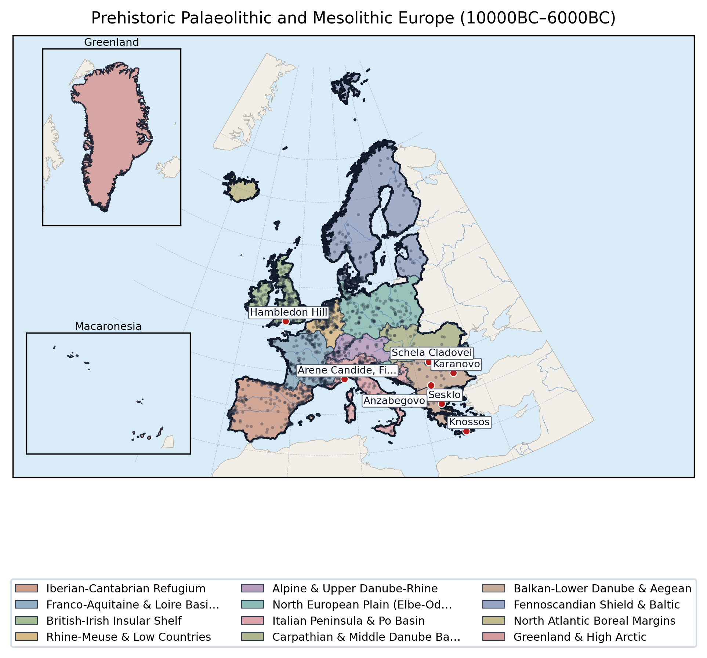
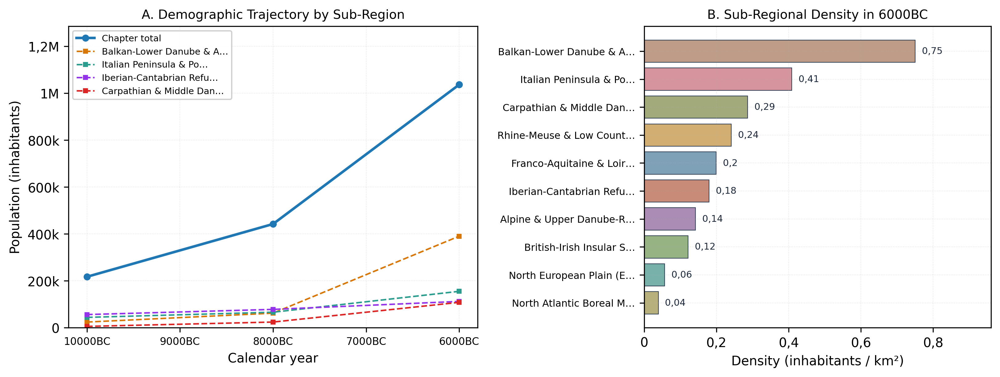
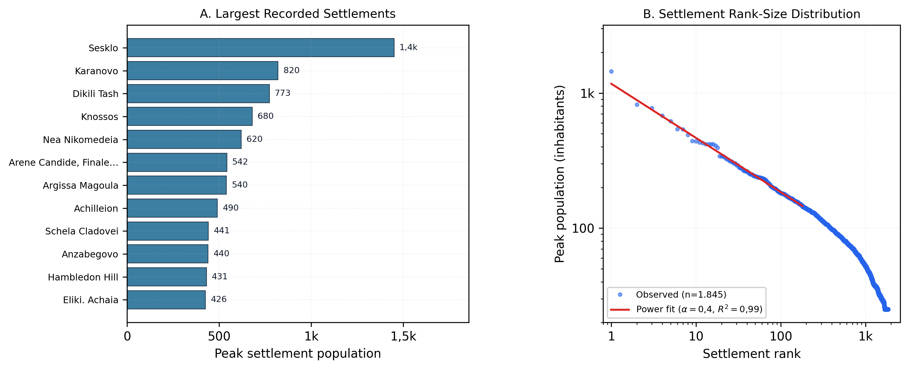

Prehistoric Palaeolithic and Mesolithic Europe
================
Aust Kätzchen
22 November 2026

- [Abstract](#abstract)
- [Background](#background)
  - [Glacial Refugia and the Late Pleistocene Demographic
    Floor](#glacial-refugia-and-the-late-pleistocene-demographic-floor)
  - [Late Glacial Recolonisation: Magdalenian, Azilian and Federmesser
    Expansion](#late-glacial-recolonisation-magdalenian-azilian-and-federmesser-expansion)
  - [Post-Glacial Sea-Level Rise and the Submergence of
    Doggerland](#post-glacial-sea-level-rise-and-the-submergence-of-doggerland)
  - [Boreal Forest Closure, Aquatic Intensification and the Aegean
    Neolithic
    Threshold](#boreal-forest-closure-aquatic-intensification-and-the-aegean-neolithic-threshold)
- [Methodology](#methodology)
  - [Biophysical Partition of the Twelve
    Sub-Regions](#biophysical-partition-of-the-twelve-sub-regions)
  - [Radiocarbon Calibration and Carrying-Capacity
    Estimation](#radiocarbon-calibration-and-carrying-capacity-estimation)
  - [Site Gazetteer Assembly and Provenance
    Architecture](#site-gazetteer-assembly-and-provenance-architecture)
- [Validation](#validation)
  - [Cross-Checks Against Palaeodemographic
    Benchmarks](#cross-checks-against-palaeodemographic-benchmarks)
  - [Sub-Regional Density Plausibility and Growth
    Coherence](#sub-regional-density-plausibility-and-growth-coherence)
- [Results](#results)
  - [Continental Demographic Trajectory (10000BC to
    6000BC)](#continental-demographic-trajectory-10000bc-to-6000bc)
  - [Southern Refugia and the Mediterranean-Atlantic
    Core](#southern-refugia-and-the-mediterranean-atlantic-core)
  - [Balkan-Aegean Expansion and Danubian
    Corridors](#balkan-aegean-expansion-and-danubian-corridors)
  - [Northwestern Shelves, the Rhine-Meuse Estuary and the North
    European
    Plain](#northwestern-shelves-the-rhine-meuse-estuary-and-the-north-european-plain)
  - [Deglaciating Boreal Frontiers and the Uninhabited High
    Arctic](#deglaciating-boreal-frontiers-and-the-uninhabited-high-arctic)
  - [Pre-Urban Habitation Structure and Site
    Distribution](#pre-urban-habitation-structure-and-site-distribution)
- [Limitations](#limitations)
- [Conclusion](#conclusion)
- [Appendix](#appendix)
  - [National Distribution of Catalogued Prehistoric
    Sites](#national-distribution-of-catalogued-prehistoric-sites)
  - [Provenance Corpus Breakdown](#provenance-corpus-breakdown)
- [Sources](#sources)

<figure>

<figcaption aria-hidden="true">Twelve biophysical sub-regions and 1.846
catalogued Palaeolithic, Mesolithic and Early Neolithic sites across
Europe from 10000BC to 6000BC.</figcaption>
</figure>

# Abstract

Between the close of the Younger Dryas cold stadial in 10000BC and the
establishment of Early Neolithic farming across the Aegean, Balkans and
Lower Danube by 6000BC, the human population of Europe outside the
eastern steppes expanded nearly fivefold. Across 12 biophysical
sub-regions spanning 7.148.884 km² (of which 5.072.076 km² lay outside
the glaciated Greenland and High Arctic zone), aggregate population grew
from 217,1k (217.100, including 215,1k across ten temperate,
Mediterranean and Baltic basins plus a 2k nominal coastal floor along
the North Atlantic margins) in 10000BC to 442k (442.000) in 8000BC and
reached 1,04M (1.036.000) by 6000BC
[\[1\]](#ref-BocquetAppel2005)[\[2\]](#ref-Tallavaara2015)[\[3\]](#ref-Zimmermann2009).
At the opening of the Holocene, 70,9% of Europe’s inhabitants remained
concentrated in the southern glacial refugia of Iberia (56k),
Franco-Aquitaine (54k) and Italy (44k), where Late Magdalenian, Azilian
and Epigravettian bands sustained densities of 0,09 to 0,125 inhabitants
per km² [\[4\]](#ref-MaierZimmermann2017)[\[5\]](#ref-Shao2025Pathways).
Rapid Preboreal and Boreal warming opened Britain, the Low Countries,
the North European Plain and deglaciating Fennoscandia, lifting mean
density across inhabited Europe from 0,043 inhabitants per km² in
10000BC to 0,2 inhabitants per km² in 6000BC while eustatic sea-level
rise drowned Doggerland and separated Britain from the continent
[\[2\]](#ref-Tallavaara2015)[\[6\]](#ref-Kelm2023Retold). By 6000BC,
regional densities diverged across nearly two orders of magnitude: the
Balkan-Lower Danube and Aegean corridor led decisively at 390k
inhabitants (0,75 inhabitants per km², 37,6% of all Europe) as cereal
farming spread across Thessaly and Thrace, followed by Italy (155k, 0,41
inhabitants per km²), the Carpathian and Middle Danube basin (108k, 0,29
inhabitants per km²) and the richest pre-agrarian wetland estuary of
Rhine-Meuse (44k, 0,24 inhabitants per km²), down to 0,025 inhabitants
per km² across boreal Fennoscandia
[\[7\]](#ref-Pinhasi2005)[\[8\]](#ref-Shennan2013)[\[9\]](#ref-Timpson2014).
This study calibrates regional headcounts across all 12 sub-regions
against radiocarbon summed probability distributions, ecological
carrying capacities and a gazetteer of 1.846 catalogued habitation
locales led by 1.814 radiocarbon-dated European archaeological sites and
14 scholarly prehistory benchmarks.

# Background

## Glacial Refugia and the Late Pleistocene Demographic Floor

Modern human settlement in Europe during the Late Pleistocene was
governed directly by ice-sheet geometry, permafrost margins and the
seasonal carrying capacity of mammoth-steppe tundra
[\[1\]](#ref-BocquetAppel2005)[\[2\]](#ref-Tallavaara2015). Long before
the Holocene opened, anatomical and behavioural turnover during the
Middle to Upper Palaeolithic transition had replaced sparse Neanderthal
bands with Aurignacian and Gravettian hunter-gatherers organised into
wider regional mating and exchange networks
[\[10\]](#ref-Villa2014Neandertal)[\[11\]](#ref-Gabora2013Contextual)[\[12\]](#ref-Bicho2017Early)[\[13\]](#ref-Schmidt2019Population).
Even at the Gravettian height around 27000BC, western and central Europe
north of the Alps probably held no more than a few thousand people
dispersed along loess corridors and river valleys
[\[4\]](#ref-MaierZimmermann2017)[\[14\]](#ref-Nett2021Early).

When the Last Glacial Maximum peaked between 24000BC and 18000BC, the
Fennoscandian ice cap covered Scandinavia, the Baltic basin, Scotland
and northern England, while Alpine glaciers sealed off the central
mountain passes. Continuous permafrost extended across southern Britain,
the Low Countries, northern France and the North European Plain down to
the 46th parallel [\[2\]](#ref-Tallavaara2015). Human settlement north
of the Loire and the Middle Danube effectively collapsed, driving
surviving bands southward into three primary Mediterranean-Atlantic
refugia: the Iberian-Cantabrian littoral and southwestern France
(Franco-Cantabria), the Italian peninsula with its expanded Adriatic
plain and the Balkan-Aegean valleys bordering the Lower Danube
[\[1\]](#ref-BocquetAppel2005)[\[4\]](#ref-MaierZimmermann2017)[\[5\]](#ref-Shao2025Pathways).

Within these refugia, demographic survival hinged on topographic
diversity. Steep elevation gradients in Cantabria, the Pyrenees, the
Apennines and the Pindus allowed small mobile bands of 25 to 50 people
to move seasonally between coastal marine shelves, wooded foothills and
upland ibex or chamois pastures without crossing sterile ice-margin
deserts [\[5\]](#ref-Shao2025Pathways)[\[15\]](#ref-Domingo2023Nuevo).
Yet even inside the richest shelters of Périgord and Asturias,
population remained thin. Local band extinctions were frequent whenever
harsh winters interrupted migratory herd routes, forcing surviving
groups to rely on long-distance kin ties to replenish demographic
shortfalls
[\[16\]](#ref-Premo2010Modeling)[\[17\]](#ref-Blythe2006Propagation).

## Late Glacial Recolonisation: Magdalenian, Azilian and Federmesser Expansion

Retreat of the continental ice sheets after 16000BC initiated the first
sustained northward recolonisation of Europe. From the Franco-Cantabrian
core, Late Magdalenian reindeer hunters moved up the Loire and Seine
into the Paris Basin, crossed the Ardennes into the Meuse valley (where
stratified cave sequences such as Scladina document long-term
Pleistocene occupation cycles) and advanced into the Upper Rhine,
Swabian Jura and Moravia
[\[1\]](#ref-BocquetAppel2005)[\[2\]](#ref-Tallavaara2015)[\[18\]](#ref-Vonhof2024Improving).
During the Bølling-Allerød interstadial (12700BC to 10900BC), mean July
temperatures rose sharply across western Europe, drawing pioneer
Creswellian and Federmesser groups across the dry English Channel river
valley into southern Britain and eastward onto the sandy outwash plains
of the Elbe and Oder.

That expansion suffered an abrupt climatic reverse during the Younger
Dryas stadial (10900BC to 9600BC). Within a few decades, North Atlantic
cooling restored tundra conditions from Ireland to Poland, pushing
treeline boundaries southward and thinning northern horse and red deer
herds. Specialised open-country hunters of the Ahrensburgian and
Swiderian traditions tracked migratory reindeer across the North
European Plain, while southern groups in Iberia, Aquitaine and Italy
adapted under Azilian and Late Epigravettian lithic industries
[\[2\]](#ref-Tallavaara2015)[\[15\]](#ref-Domingo2023Nuevo).

Our earliest benchmark of 10000BC sits near the closing centuries of the
Younger Dryas, just before the abrupt Preboreal warming of 9600BC. At
that moment Europe’s human geography still mirrored the ice-age map. Out
of an estimated 217,1k inhabitants across the study domain (215,1k
across the ten continental and insular basins plus a 2k nominal coastal
floor along the North Atlantic margins, with Greenland uninhabited),
154k (70,9% of the domain total, or 71,6% excluding the boreal margin
floor) lived in the three southern refugia of Iberia (56k),
Franco-Aquitaine (54k) and Italy (44k). Another 24k inhabited the
Balkan-Aegean zone, 11k occupied the Rhine-Meuse valley and 10k lived in
the Alpine and Upper Danube foothills. North and east of those temperate
corridors, settlement remained exceptionally thin: 7,5k across the North
European Plain, 5,5k in the Carpathian and Middle Danube basin, 2,5k on
the British-Irish shelf and barely 600 pioneer hunters along the
ice-free fringes of southern Fennoscandia.

## Post-Glacial Sea-Level Rise and the Submergence of Doggerland

The warming that began around 9600BC transformed both the ecology and
the coastline of Europe. As the Laurentide and Fennoscandian ice sheets
melted, global sea level climbed rapidly from roughly 60 m below modern
datum at 10000BC to within 10 m of present levels by 6000BC. Across
northwestern and southern Europe, vast low-lying plains that had
supported prime riverine foraging habitats vanished beneath the sea.

Nowhere was this territorial loss more consequential than in the
southern North Sea basin. At 10000BC and 8000BC, Doggerland formed an
undulating landscape of chalk hills, braided estuaries, freshwater meres
and reed marshes linking eastern England directly to Denmark and the
Netherlands. Early Mesolithic hunter-gatherers walked unimpeded from
Yorkshire to Jutland, exploiting pike, waterfowl, elk and red deer
across wetlands far richer than the drier upland heaths that survived
later inundation
[\[2\]](#ref-Tallavaara2015)[\[6\]](#ref-Kelm2023Retold). Similar
lowland losses occurred in the northern Adriatic, where rising seas
flooded the Great Adriatic Plain south of the Po delta, and across the
Aegean Sea, where land bridges fractured into the Cycladic islands.

Between 7500BC and 6200BC, encroaching tides severed the chalk ridge of
the Strait of Dover and turned Dogger Bank into a shrinking low island.
Around 6200BC, two rapid shocks coincided: the final drainage of glacial
Lake Agassiz triggered a century-long cold spell across the North
Atlantic, and the Storegga submarine landslide off western Norway drove
tsunami waves across the low-lying remnants of Doggerland, the Scottish
coast and the Norwegian littoral. Britain became an island, Ireland had
already been isolated for millennia and displaced coastal bands
compressed into the estuaries of the Rhine, Meuse, Scheldt, Thames and
Danish fjords. That wetland enrichment and coastal compression explains
why the Rhine-Meuse and Low Countries sub-region led all of Europe in
density during the 8000BC Boreal peak (0,2 inhabitants per km²) and
remained Europe’s densest strictly pre-agrarian landscape by 6000BC at
0,24 inhabitants per km² across its terrestrial footprint of 182.447
km².

## Boreal Forest Closure, Aquatic Intensification and the Aegean Neolithic Threshold

As warming progressed through the Preboreal (9600BC to 8500BC) and
Boreal (8500BC to 6800BC) chronozones, open birch-pine parkland gave way
to dense temperate woodlands dominated by hazel, oak, elm, lime and
alder. For hunters accustomed to stalking open-steppe herds, forest
closure posed an ecological challenge: terrestrial ungulate biomass
became more dispersed and harder to intercept, shifting subsistence from
migratory reindeer to solitary woodland mammals such as red deer, roe
deer, aurochs and wild boar
[\[2\]](#ref-Tallavaara2015)[\[3\]](#ref-Zimmermann2009).

Mesolithic communities answered forest closure with technological
miniaturisation and aquatic intensification. Composite microlithic
arrows, dug-out canoes, woven fish traps, barbed bone harpoons and
domestic dogs enabled bands to harvest high-yield coastal, lacustrine
and riverine niches [\[6\]](#ref-Kelm2023Retold). In Atlantic Iberia,
Late Mesolithic groups built large seasonal shell-midden aggregations
along the Tagus and Sado estuaries, exemplified by Cabeço da Amoreira,
alongside deeply stratified Cantabrian caves such as El Mirón and
interior Spanish rock shelters tracking upland wild game and hazel
groves [\[15\]](#ref-Domingo2023Nuevo). Along the Danube Iron Gates
gorge, communities at Lepenski Vir, Padina, Schela Cladovei and Vlasac
constructed trapezoidal semi-subterranean dwellings overlooking
sturgeon-rich rapids, achieving near-sedentary village scale without
domesticated cereals. Across the northern lowlands, wetland stations
such as Verrebroeck in the Scheldt basin, Friesack and Duvensee on the
North European Plain and Tågerup, Skateholm and Zvejnieki around the
Baltic anchored intensive fishing and fowling economies.

Across western and central Europe, ancient DNA confirms that these
Mesolithic populations belonged largely to a genetically cohesive
Western Hunter-Gatherer (WHG) metapopulation, exemplified by the
skeleton from Abri Loschbour in Luxembourg (c. 6000BC), which remained
distinct from Eastern and Scandinavian hunter-gatherers until the
arrival of Anatolian-derived farmers
[\[19\]](#ref-Haak2015)[\[20\]](#ref-Olalde2018). Along the northeastern
forest fringe and eastern Baltic, Late Mesolithic foragers even began
adopting early hunter-gatherer pottery traditions diffusing westward
across Eurasia well before agriculture reached the boreal zone
[\[21\]](#ref-Pavlu2019Earliest).

In southeastern Europe, however, the demographic regime changed
fundamentally before our closing horizon of 6000BC. Farming groups
carrying domesticated einkorn, emmer wheat, barley, sheep, goats and
cattle crossed from western Anatolia into the Aegean basin around 6800BC
to 6500BC, establishing permanent mudbrick tell settlements across
Thessaly, Macedonia, Crete and Thrace, led in our site register by
Sesklo, Karanovo, Dikili Tash, Knossos, Nea Nikomedeia, Argissa Magoula,
Achilleion and Anzabegovo alongside long-occupied coastal caves such as
Franchthi Cave and Theopetra Cave
[\[7\]](#ref-Pinhasi2005)[\[8\]](#ref-Shennan2013). Because cereal
cultivation and stock-raising supported five to ten times more people
per square kilometre than broad-spectrum foraging, the Balkan-Lower
Danube and Aegean sub-region surged more than sixfold from 62k
inhabitants in 8000BC to 390k in 6000BC (0,75 inhabitants per km²),
accounting for 37,6% of Europe’s entire population at the close of the
Mesolithic era [\[7\]](#ref-Pinhasi2005)[\[9\]](#ref-Timpson2014).

# Methodology

## Biophysical Partition of the Twelve Sub-Regions

To track demographic redistribution across sharp climatic, glacial and
coastal gradients without forcing prehistoric populations into
anachronistic modern state borders, MAGNETIC partitions Europe and the
North Atlantic into 12 biophysical sub-regions totalling 7.148.884,3
km². Because Greenland and the High Arctic account for 2.076.808,1 km²
of glaciated and polar terrain that remained entirely uninhabited prior
to Palaeo-Eskimo arrival around 2500BC, all demographic density
comparisons distinguish between the full continental-arctic domain
(7,15M km²) and the inhabited European landmass (5.072.076,2 km²).

The 12 territorial divisions group coherent river basins, mountain
watersheds and marine shelves:

1.  Southern Mediterranean-Atlantic refugia: Iberian-Cantabrian Refugium
    (623.682,3 km²), Italian Peninsula and Po Basin (379.386 km²) and
    Balkan-Lower Danube and Aegean (519.757,1 km²).
2.  Temperate western basins and shelves: Franco-Aquitaine and Loire
    Basins (432.028,6 km²), Rhine-Meuse and Low Countries (182.446,9
    km²) and British-Irish Insular Shelf (311.645,6 km²).
3.  Central European watersheds and lowlands: Alpine and Upper
    Danube-Rhine (225.245,1 km²), Carpathian and Middle Danube Basin
    (376.443 km²) and North European Plain from the Elbe through the
    Oder and Vistula (616.194,3 km²).
4.  Boreal and Arctic frontiers: Fennoscandian Shield and Baltic
    (1.303.262,9 km²), North Atlantic Boreal Margins covering outer
    boreal coasts and Atlantic islands (101.984,7 km²) and Greenland and
    High Arctic (2.076.808,1 km²).

This regional architecture aligns directly with palaeoclimatic pollen
zones and radiocarbon clusters, allowing separate tracking of LGM
refugial persistence, northern deglaciation lags and the 6000BC
southeastern agrarian frontier
[\[2\]](#ref-Tallavaara2015)[\[7\]](#ref-Pinhasi2005).

## Radiocarbon Calibration and Carrying-Capacity Estimation

Prehistoric hunter-gatherers left no tax rolls, hearth counts or
administrative censuses. Regional population totals $P_r(t)$ at the
three benchmark years $t \in \{-10000, -8000, -6000\}$ are therefore
reconstructed by triangulating three independent lines of evidence:
calibrated radiocarbon summed probability distributions (SPDs),
archaeological site-catchment density models and ecological
carrying-capacity bounds
[\[1\]](#ref-BocquetAppel2005)[\[3\]](#ref-Zimmermann2009)[\[8\]](#ref-Shennan2013)[\[9\]](#ref-Timpson2014).

For each sub-region $r$ of terrestrial area $A_r$, regional population
is expressed through its effective ecological density $d_r(t)$:

$$P_r(t) = A_r \cdot d_r(t)$$

where $d_r(t)$ is constrained between observed ethnographic and
archaeological limits for temperate-to-boreal hunter-gatherers (0,0005
to 0,25 inhabitants per km² prior to cereal farming, rising to 0,29 to
0,75 inhabitants per km² along the 6000BC Early Neolithic agrarian arc)
and modulated longitudinally by regional radiocarbon intensity
[\[1\]](#ref-BocquetAppel2005)[\[3\]](#ref-Zimmermann2009)[\[13\]](#ref-Schmidt2019Population).
Specifically, if $S_r(t)$ denotes the bias-corrected radiocarbon
activity index for sub-region $r$ within a 500-year window centred on
benchmark $t$, the inter-benchmark growth ratio satisfies:

$$\frac{P_r(t_2)}{P_r(t_1)} = \left(\frac{S_r(t_2)}{S_r(t_1)}\right)^{\beta_r} \cdot \phi_r(t_1, t_2)$$

where $\beta_r \in [0,6, 0,85]$ dampens raw radiocarbon surge bias
caused by taphonomic preservation decay and modern excavation
clustering, and $\phi_r(t_1, t_2)$ incorporates palaeoenvironmental
habitat expansion (ice-sheet retreat in Fennoscandia and the
British-Irish shelf) or coastal contraction (Doggerland drowning)
[\[2\]](#ref-Tallavaara2015)[\[9\]](#ref-Timpson2014). Compound annual
growth rates between benchmarks follow standard geometric compounding:

$$g_r(t_1, t_2) = \left(\frac{P_r(t_2)}{P_r(t_1)}\right)^{\frac{1}{t_2 - t_1}} - 1$$

Because hunter-gatherer populations operate near local carrying capacity
with frequent stochastic band extinctions and re-fusions, long-run
prehistoric growth rates inside settled refugia stay very low, typically
0,01% to 0,02% per annum, corresponding to doubling times of 3.000 to
6.000 years
[\[16\]](#ref-Premo2010Modeling)[\[17\]](#ref-Blythe2006Propagation).
Departures far above 0,04% per annum mark distinct ecological shifts:
either pioneer colonisation of newly deglaciated virgin territory (as in
Britain and Fennoscandia between 10000BC and 8000BC) or the introduction
of domesticated cereals and livestock (as in the 6000BC Aegean, Balkans
and Carpathian basin)
[\[7\]](#ref-Pinhasi2005)[\[8\]](#ref-Shennan2013).

## Site Gazetteer Assembly and Provenance Architecture

Alongside macro-regional population totals, MAGNETIC compiles a
spatially referenced gazetteer of 1.845 catalogued habitation locales
distributed across 41 modern national territories. Primary
archaeological ingestion (Wave 1) assembled 1.828 entries (99,02% of the
gazetteer), combining 1.814 radiocarbon-dated European cave,
rock-shelter, shell-midden and open-air camp sites from the European
Radiocarbon Settlement Corpus (98,27%) with 14 Scholarly European
Prehistory Benchmarks (0,76%) anchoring major Early Neolithic tell
settlements and Mesolithic type sites. Spatial deduplication against
2.611 candidate records eliminated 765 redundant trench names,
sub-stratigraphic duplicates and overlapping coordinates within narrow
local buffers.

In addition, Wave 4 regional continuity sweeps retained 18 geographical
anchor points (0,98%) across the North Atlantic and Greenland: 7 in
Greenland (4 from national statistical registers and 3 from GeoNames),
10 in the Faroe Islands (4 from national statistical registers and 6
from GeoNames) and 1 in Iceland from Buringh’s European urban baseline,
holding the overall crowd-sourced share to 0,49% (9 of 1.846 entries).
Those 18 nodes serve strictly as cross-chapter geographic continuity
markers for the multi-millennium MAGNETIC pipeline. Greenland’s
prehistoric regional headcount remains strictly zero across 10000BC,
8000BC and 6000BC, and the North Atlantic Boreal Margins series
(assigned a 2k nominal maritime-margin floor in 10000BC against 0 raw
pre-Boreal inland count, 2k in 8000BC and 4k in 6000BC) reflects marine
foraging along ice-free outer Norwegian and northern Scottish coasts
rather than pre-Norse occupation of Iceland or the Faroes.

Because prehistoric strata lack historical census rolls, individual
locales are scaled along a continuous archaeologically calibrated size
distribution governed by regional ecological productivity, chronological
phase and radiocarbon occupation intensity
[\[3\]](#ref-Zimmermann2009)[\[13\]](#ref-Schmidt2019Population).
Estimated site sizes span smoothly from small mobile Palaeolithic and
Mesolithic foraging camps (20 to 75 people, typically represented by
single or few radiocarbon dates in northern and upland settings),
through recurrent seasonal base camps (75 to 180 people) and multi-phase
coastal, estuarine and riverine aggregation complexes (180 to 450
people, including Arene Candide, Schela Cladovei, Lepenski Vir,
Franchthi Cave, Padina, Verrebroeck and Cabeço da Amoreira), up to the
first permanent Early Neolithic agro-pastoral tell villages of the
6500BC to 6000BC Aegean-Balkan threshold (440 to 1.450 inhabitants, led
by Sesklo at 1.450, Karanovo at 820 and Dikili Tash at 773).

# Validation

## Cross-Checks Against Palaeodemographic Benchmarks

To check that regional estimates remain tightly bounded within
established palaeodemographic consensus, MAGNETIC continental totals and
densities were cross-checked against four independent archaeological
syntheses. For the Late Upper Palaeolithic (Magdalenian, c. 14000BC to
11000BC), Bocquet-Appel and colleagues estimated a European
meta-population of roughly 29k to 40k across core western and central
archaeologically surveyed regions, scaling upward substantially once
southern Mediterranean refugia, the Balkans and coastal plains are
included [\[1\]](#ref-BocquetAppel2005). Using bioclimatic envelope
modelling across Europe, Tallavaara and colleagues reconstructed a Last
Glacial Maximum low of approximately 130k people around 21000BC,
expanding to roughly 330k to 410k during the Late Glacial warming peak
before dipping during the Younger Dryas cold stadial
[\[2\]](#ref-Tallavaara2015).

Our 10000BC domain figure of 217,1k (215,1k across the ten continental
and insular sub-regions) captures that Younger Dryas contraction
directly. Equally important, the implied mean density across inhabited
Europe in 10000BC (0,043 inhabitants per km², ranging from 0,09 to 0,125
in the three southern refugia down to 0,0005 in southern Fennoscandia)
matches the archaeological density envelope derived by Schmidt and
Zimmermann for Upper Palaeolithic core catchments (0,01 to 0,15
inhabitants per km² depending on regional productivity)
[\[4\]](#ref-MaierZimmermann2017)[\[13\]](#ref-Schmidt2019Population).

By 6000BC, inhabited European density reaches 0,2 inhabitants per km²,
concealing a sharp ecological bifurcation. Strictly pre-agrarian
foraging regions span 0,025 inhabitants per km² in boreal Fennoscandia
and 0,06 in the closed woodlands of the North European Plain up to 0,18
to 0,24 across temperate Atlantic estuaries and river valleys (matching
Zimmermann, Hilpert and Wendt’s comparative pre-Neolithic range of 0,05
to 0,25 inhabitants per km²), while the Early Neolithic farming arc
already climbs to 0,29 in the Carpathian basin, 0,41 in Italy and 0,75
in the Balkan-Lower Danube and Aegean, entering the lower threshold of
mature Linearbandkeramik (LBK) agrarian densities (0,6 to 2 inhabitants
per km²) that emerged north of the Balkans after 5500BC
[\[3\]](#ref-Zimmermann2009)[\[8\]](#ref-Shennan2013).

## Sub-Regional Density Plausibility and Growth Coherence

Table compiles the territorial benchmark ledger across all 12
sub-regions, pairing land area, population headcounts at 10000BC, 8000BC
and 6000BC, final-benchmark density, four-millennium growth multiples
and catalogued site counts. Every sub-regional growth trajectory obeys
ecological and archaeological constraints without erratic reversals.

| Sub-Region | Area (km²) | 10000BC | 8000BC | 6000BC | 6000BC Density | Growth | Sites |
|:---|:---|:---|:---|:---|:---|:---|:---|
| **Iberian-Cantabrian Refugium** | 623.682 | 56k | 78k | 112k | 0,18 | 2x | 297 |
| **Franco-Aquitaine and Loire Basins** | 432.029 | 54k | 68k | 86k | 0,2 | 1,59x | 244 |
| **British-Irish Insular Shelf** | 311.646 | 2,5k | 32k | 38k | 0,12 | 15,2x | 303 |
| **Rhine-Meuse and Low Countries** | 182.447 | 11k | 36k | 44k | 0,24 | 4x | 225 |
| **Alpine and Upper Danube-Rhine** | 225.245 | 10k | 24k | 32k | 0,14 | 3,2x | 88 |
| **North European Plain (Elbe-Oder-Vistula)** | 616.194 | 7,5k | 34k | 35k | 0,06 | 4,67x | 139 |
| **Italian Peninsula and Po Basin** | 379.386 | 44k | 66k | 155k | 0,41 | 3,52x | 198 |
| **Carpathian and Middle Danube Basin** | 376.443 | 5,5k | 24k | 108k | 0,29 | 19,64x | 33 |
| **Balkan-Lower Danube and Aegean** | 519.757 | 24k | 62k | 390k | 0,75 | 16,25x | 129 |
| **Fennoscandian Shield and Baltic** | 1.303.263 | 600 | 16k | 32k | 0,02 | 53,33x | 171 |
| **North Atlantic Boreal Margins** | 101.985 | 2k | 2k | 4k | 0,04 | 2x | 11 |
| **Greenland and High Arctic** | 2.076.808 | 0 | 0 | 0 | 0 | \- | 7 |
| **Domain Total (All 12 Regions)** | 7.148.884 | 217,1k | 442k | 1,04M | 0,2 | 4,77x | 1.845 |

Population headcounts, 6000BC densities (inhabitants per km²; total row
reflects inhabited area outside Greenland), growth multiples and
catalogued site counts across 12 sub-regions, 10000BC to 6000BC.

Across the four millennia from 10000BC to 6000BC, overall continental
growth averaged 0,039% per annum (0,036% from 10000BC to 8000BC and
0,043% from 8000BC to 6000BC, a 4,77-fold expansion). The two
westernmost Late Glacial refugia grew at the slowest proportional rates,
1,59x in Franco-Aquitaine and 2x in Iberia, because they opened the
Holocene closest to their foraging carrying capacity. By contrast, newly
deglaciated northern zones expanded far faster from minimal Younger
Dryas baselines: 53,33x in Fennoscandia and the Baltic (from 600 to 32k)
and 15,2x across the British-Irish shelf (from 2,5k to 38k, almost all
gained during the Preboreal-Boreal surge before 8000BC). In southeastern
Europe, an altogether different acceleration took hold after 8000BC: the
Carpathian and Middle Danube basin expanded 19,64x overall (4,5x in the
final two millennia alone) and the Balkan-Lower Danube and Aegean surged
16,25x overall (multiplying 6,29x between 8000BC and 6000BC, from 62k to
390k), registering the unmistakable demographic break of the Early
Neolithic transition [\[7\]](#ref-Pinhasi2005)[\[8\]](#ref-Shennan2013).

# Results

## Continental Demographic Trajectory (10000BC to 6000BC)

Europe’s prehistoric demographic curve from 10000BC to 6000BC exhibits
two distinct phases of expansion: a Preboreal-Boreal northward
recolonisation followed by a sharp southeastern agrarian surge (Figure
). Between 10000BC and 8000BC, aggregate population rose by 224,9k
(+103,59%) from 217,1k to 442k. Between 8000BC and 6000BC, it added a
further 594k (+134,39%) to reach 1.036.000 (1,04M) inhabitants, crossing
the one-million mark for the first time in European prehistory.

Even more revealing than the headline total is the internal
redistribution of Europe’s population. In 10000BC, the three Western
Mediterranean and Atlantic refugia (Iberia, Franco-Aquitaine and Italy)
accounted for 70,9% of all European inhabitants (154k of 217,1k), while
temperate central and northern Europe (Britain, Low Countries,
Alpine-Upper Danube, North European Plain, Fennoscandia and North
Atlantic margins) held only 15,5% (33,6k) and the Danubian-Balkan-Aegean
axis held 13,6% (29,5k). By 8000BC, Preboreal-Boreal warming had
transformed the northwest: temperate central and northern Europe more
than doubled its share to 32,6% (144k), reducing the western refugia to
48% (212k) while the southeastern axis rose to 19,5% (86k). By 6000BC,
the balance tilted dramatically southeastward: the
Danubian-Balkan-Aegean corridor accounted for 48,1% of Europe’s
population (37,6% in the Balkan-Aegean alone plus 10,4% in the
Carpathian and Middle Danube basin), the three western refugia
represented 34,1% (bolstered by Italy’s rise to 15% on the Apulian
Neolithic threshold) and strictly pre-agrarian central and northern
Europe accounted for 17,9% (185k).

## Southern Refugia and the Mediterranean-Atlantic Core

The Iberian-Cantabrian Refugium (623.682,3 km²) opened the Holocene as
Europe’s largest demographic reservoir at 56k inhabitants (0,09
inhabitants per km²), expanding steadily to 78k in 8000BC (0,125
inhabitants per km²) and 112k in 6000BC (0,18 inhabitants per km²).
Iberia supplies the second-largest regional share of our archaeological
gazetteer with 297 catalogued sites (205 in Spain, 61 in Portugal, 3 in
Andorra and 1 in Gibraltar, plus 27 Pyrenean-margin sites in southern
France). Settlement was strongly polarised between two ecological
strips: the wet Atlantic-Cantabrian facade and the Mediterranean karst
valleys of the Ebro and Levant, separated by the drier interior Meseta
[\[5\]](#ref-Shao2025Pathways)[\[15\]](#ref-Domingo2023Nuevo). Along the
Cantabrian cordillera and Pyrenees, deeply stratified caves and rock
shelters such as El Mirón sustained recurring seasonal camps across the
Azilian and Asturian transitions, while along the Tagus and Sado
estuaries of Portugal, major shell-midden complexes exemplified by
Cabeço da Amoreira anchored intensive Late Mesolithic foraging that
persisted until Cardial Neolithic pioneers sailed westward along the
Mediterranean rim after 5800BC
[\[5\]](#ref-Shao2025Pathways)[\[12\]](#ref-Bicho2017Early).

Immediately across the Pyrenees, the Franco-Aquitaine and Loire Basins
(432.028,6 km²) held Europe’s highest regional density at the opening of
the Holocene: 54k inhabitants in 10000BC (0,125 inhabitants per km²),
rising modestly to 68k in 8000BC (0,157 inhabitants per km²) and 86k in
6000BC (0,2 inhabitants per km²), documented across 245 catalogued
sites. Inheriting the dense Magdalenian networks of the Dordogne,
Vézère, Lot and Garonne valleys, Azilian and Sauveterrian foragers
spread northward across the Loire and Seine catchments into wooded river
valleys and sandy uplands. Even as northern France transitioned into
closed Boreal oak-hazel forest, Aquitaine and the Brittany coast
retained rich salmon rivers and marine estuaries capable of sustaining
durable Mesolithic communities.

Across the Alps, the Italian Peninsula and Po Basin (379.386 km²) stood
close behind at 44k in 10000BC (0,116 inhabitants per km²), rising to
66k in 8000BC (0,174 inhabitants per km²) before accelerating to 155k in
6000BC (0,41 inhabitants per km², second highest in Europe), supported
by 198 catalogued sites. Late Epigravettian and Sauveterrian groups
across Sicily, Liguria (anchored by the long stratigraphic sequence at
Arene Candide, peaking at 542 inhabitants), Tuscany, the Tyrrhenian
lagoons (Portus Fiumicino, 418) and the Alpine piedmont adapted smoothly
to Holocene warming, moving into high summer hunting camps in the
Dolomites and Trentino as snowlines retreated. Although rising Adriatic
waters flooded the wide glacial plain southeast of Venice, the fertile
Po river terraces and southern Apulian coasts sustained vigorous growth,
and by 6000BC Apulia and southeastern Italy had crossed the threshold of
Impressed Ware maritime farming from across the Strait of Otranto
[\[7\]](#ref-Pinhasi2005).

## Balkan-Aegean Expansion and Danubian Corridors

The single greatest demographic transformation of the 10000BC to 6000BC
epoch unfolded in the Balkan-Lower Danube and Aegean sub-region
(519.757,1 km²). At 10000BC, its 24k inhabitants (0,046 inhabitants per
km²) trailed Iberia, Franco-Aquitaine and Italy by a wide margin, and at
8000BC its 62k inhabitants (0,119 inhabitants per km²) still sat below
those three western basins. Between 8000BC and 6000BC, however, the
region surged more than sixfold to 390k inhabitants (0,75 inhabitants
per km²), overtaking every other part of Europe by a factor of two and a
half and accounting for 37,6% of the continental total.

Two distinct processes drove this surge, both recorded across the
sub-region’s 129 catalogued sites (led by 63 in Greece, 17 in Serbia, 12
in Bulgaria, 7 in Bosnia and Herzegovina, 6 in Montenegro, 3 each in
Albania and European Turkey and 2 in North Macedonia, plus adjacent
Lower Danubian stations in Romania and Moldova). First, in the Iron
Gates gorges of the Lower Danube, complex Mesolithic fishing communities
at Schela Cladovei (441), Padina (409), Lepenski Vir (394) and Vlasac
(340) achieved semi-sedentary village density by exploiting migrating
beluga sturgeon and carp along rocky river narrows. Second, and
decisively, Anatolian farming populations established permanent
agro-pastoral tell villages across Thessaly, Macedonia, Crete and
Thrace, led in our catalogue by Sesklo (1.450), Karanovo (820), Dikili
Tash (773), Knossos (680), Nea Nikomedeia (620), Argissa Magoula (540),
Achilleion (490) and Anzabegovo (440) alongside long-occupied coastal
and inland caves such as Franchthi Cave (418) and Theopetra Cave (419)
[\[7\]](#ref-Pinhasi2005)[\[8\]](#ref-Shennan2013). Unlike
hunter-gatherers bound by seasonal resource troughs, early farmers
stored cereal grain over winter, shortened birth intervals and sustained
rapid local population doubling
[\[1\]](#ref-BocquetAppel2005)[\[9\]](#ref-Timpson2014).

Upstream along the Danube, the Carpathian and Middle Danube Basin
(376.443 km²) expanded from a sparse Younger Dryas baseline of 5,5k in
10000BC (0,015 inhabitants per km²) to 24k in 8000BC (0,064 inhabitants
per km²) before jumping 4,5-fold to 108k in 6000BC (0,29 inhabitants per
km², third highest in Europe). Although deep Holocene alluvial burial
across the Great Hungarian Plain restricts archaeological recovery to 33
catalogued sites (0,88 sites per 10.000 km², the lowest sampling density
of any inhabited temperate basin), Upper Palaeolithic loess sites such
as Crvenka-At demonstrate deep Pleistocene continuity along the southern
Carpathian rim [\[14\]](#ref-Nett2021Early). By 6000BC, Early Neolithic
Starčevo and Körös farming pioneers were spreading rapidly northward
along the Tisza, Maros and Körös rivers, setting the stage for the
Linearbandkeramik expansion of the sixth millennium BC
[\[7\]](#ref-Pinhasi2005).

To the west, the Alpine and Upper Danube-Rhine sub-region (225.245,1
km²) climbed from 10k in 10000BC (0,044 inhabitants per km²) to 24k in
8000BC (0,107 inhabitants per km²) and 32k in 6000BC (0,14 inhabitants
per km²), documented across 88 catalogued sites. As valley glaciers
retreated up the Rhône, Rhine, Inn and Upper Danube corridors,
post-glacial lakes (Geneva, Neuchâtel, Constance and Federsee) created
productive wetland ecotones supporting seasonal movements between winter
lakeside fisheries and summer alpine ibex pastures.

## Northwestern Shelves, the Rhine-Meuse Estuary and the North European Plain

North of the Loire and the central European uplands, the Preboreal and
Boreal Mesolithic witnessed a rapid filling-in of lowland river basins
and maritime estuaries followed by ecological stabilisation once
temperate forest closed and rising seas severed Doggerland. The
Rhine-Meuse and Low Countries sub-region (182.446,9 km²) grew fourfold
from 11k in 10000BC (0,06 inhabitants per km²) to 36k in 8000BC (0,197
inhabitants per km², the highest regional density anywhere in Europe at
8000BC) and 44k in 6000BC (0,24 inhabitants per km², fourth overall and
the densest strictly pre-agrarian landscape on the continent). Its 225
catalogued sites (12,33 sites per 10.000 km², led by 109 in the
Netherlands and 61 in Belgium, including the major estuarine complex at
Verrebroeck at 324 inhabitants, karst caves along the Belgian Meuse and
Abri Loschbour in Luxembourg
[\[18\]](#ref-Vonhof2024Improving)[\[20\]](#ref-Olalde2018)) reflect a
landscape uniquely enriched by post-glacial hydrology. As sea level rose
across the southern North Sea, river gradients flattened, turning the
Rhine-Meuse-Scheldt delta into an expansive mosaic of sandy river dunes
(*donken*), tidal creeks, alder carrs and reedbeds teeming with
waterfowl, eel, pike, beaver and wild boar. Displaced populations
retreating inland from submerged Doggerland augmented local density
along this estuary rim.

Across the newly formed English Channel, the British-Irish Insular Shelf
(311.645,6 km²) recorded one of Europe’s sharpest Early Holocene surges,
leaping nearly 13-fold from 2,5k in 10000BC (0,008 inhabitants per km²)
to 32k in 8000BC (0,103 inhabitants per km²), before slowing to 38k in
6000BC (0,12 inhabitants per km²) after Doggerland submergence and the
Storegga tsunami severed direct continental access. The shelf supplies
the single largest regional site count in our gazetteer with 303
catalogued locales (259 in the United Kingdom, 43 in Ireland and 1 on
the Isle of Man, led by multi-phase sites such as Hambledon Hill at 431
and Grimes Graves at 341). At 10000BC, human presence was confined to
sparse southern English caves and Federmesser camps. By 8000BC, Early
Mesolithic Maglemosian-related hunters occupied lakeside base camps
across Yorkshire (the Star Carr horizon), the Thames-Kennet valley,
Wales and northern England, while pioneer maritime foragers crossed the
Irish Sea to colonise Ireland (Mount Sandel horizon) and western
Scotland. Following final insular separation around 6200BC, Late
Mesolithic Britain and Ireland evolved distinctive narrow-blade
microlithic and coastal shell-midden traditions insulated from
continental ceramic developments for another two millennia.

East of the Weser, the expansive North European Plain from the Elbe
through the Oder and Vistula (616.194,3 km²) surged from 7,5k in 10000BC
(0,012 inhabitants per km²) to 34k in 8000BC (0,055 inhabitants per km²)
before plateauing at 35k in 6000BC (0,06 inhabitants per km²), anchored
by 139 catalogued sites across northern Germany, Denmark and Poland.
That near-stagnation between 8000BC and 6000BC reflects classic Boreal
forest closure: across the sandy glacial outwash soils of Brandenburg,
Pomerania and Masovia, dense closed-canopy oak, lime and elm woodland
reduced terrestrial ungulate yields, confining high-density habitation
to glacial tunnel valleys, moraine wetlands such as Friesack and
Duvensee and western Baltic coastal inlets that laid the foundation for
the Ertebølle shell-midden society of the fifth millennium BC
[\[6\]](#ref-Kelm2023Retold).

## Deglaciating Boreal Frontiers and the Uninhabited High Arctic

No part of Europe changed its physical geography faster between 10000BC
and 6000BC than the Fennoscandian Shield and Baltic sub-region
(1.303.262,9 km²). At 10000BC, the remnants of the Scandinavian ice
sheet still blanketed central Sweden, Finland and interior Norway,
confining barely 600 pioneer hunters (0,0005 inhabitants per km²) to the
ice-free western Swedish archipelago, southern Scania and narrow strips
of the Norwegian coast (Fosna-Hensbacka and Ahrensburgian traditions).
As the ice cap collapsed rapidly during the Preboreal, disappearing from
the Swedish interior by 7000BC, post-glacial isostatic rebound lifted
new coastal archipelagos out of the Ancylus Lake and early Littorina
Sea.

Human groups tracked the retreating ice front at remarkable speed,
expanding more than 26-fold to 16k in 8000BC (0,012 inhabitants per km²)
and doubling again to 32k in 6000BC (0,025 inhabitants per km², 30 times
lower than the contemporary Balkan-Aegean), recorded across 171
catalogued sites (led by 60 in Norway, 43 in Sweden, 15 in Finland and
11 across the Baltic states). Pioneers moving around the ice-free Arctic
coast of Norway established the Komsa complex in Finnmark before 9000BC,
groups advancing from the southeastern Baltic populated inland Finland
(Suomusjärvi culture) and rich coastal stations such as Tågerup,
Skateholm and Zvejnieki supported substantial Late Mesolithic cemeteries
and seasonal villages around the Baltic littoral. Even at 6000BC,
however, boreal conifer forests imposed strict winter calorie
bottlenecks, keeping overall shield density at 0,025 inhabitants per km²
and tying most settlements to coastal seal hunting, salmon rivers and
lake outlets.

Along the exposed North Atlantic Boreal Margins (101.984,7 km²),
encompassing outer fjordic western and northern Norway and the
northernmost Atlantic boreal fringe, the harmonised benchmark series
registers 2k in 10000BC (a nominal coastal continuity floor against zero
raw inland pre-Boreal signal), 2k in 8000BC (0,02 inhabitants per km²)
and 4k in 6000BC (0,04 inhabitants per km²). Warm North Atlantic Drift
waters kept outer Norwegian fjords ice-free year-round, supporting
marine mammal and cod foraging at densities higher than the interior
Fennoscandian Shield. By contrast, Iceland and the Faroe Islands lay
beyond the practical open-ocean voyaging horizon of Mesolithic skin
boats, and Greenland and the High Arctic (2.076.808,1 km²) remained
entirely uninhabited (0 inhabitants) throughout all three benchmarks;
human colonisation of Greenland awaited the eastward spread of Arctic
Small Tool (Independence I and Saqqaq) Palaeo-Eskimo hunters across the
Canadian High Arctic more than three millennia later, around 2500BC.

## Pre-Urban Habitation Structure and Site Distribution

Across Palaeolithic and Mesolithic Europe, residential geography was
shaped by small, horizontally linked bands rather than administrative
capitals or market towns. By 6000BC, however, the emergence of sedentary
agro-pastoral tell villages in the Aegean and Balkans alongside dense
estuarine and gorge aggregation sites created an unmistakable continuous
settlement-size gradient. Figure displays this structure directly across
all 1.846 catalogued habitation records: rather than a steep historical
urban Zipf slope ($\alpha \approx 1$), the rank-size curve follows a
shallow continuous power law ($\alpha = 0,4$, $R^2 = 0,99$) spanning
nearly two orders of magnitude from ephemeral upland foraging camps to
permanent Early Neolithic villages.

At the upper tail of the distribution sit the first permanent Early
Neolithic tell settlements of the 6500BC to 6000BC Aegean-Balkan
threshold: Sesklo (1.450), Karanovo (820), Dikili Tash (773), Knossos
(680), Nea Nikomedeia (620), Argissa Magoula (540), Achilleion (490) and
Anzabegovo (440). Immediately beneath them cluster multi-phase karst
caves, Iron Gates gorge villages and estuarine aggregation complexes
between 180 and 545 inhabitants, including Arene Candide (542), Schela
Cladovei (441), Hambledon Hill (431), Eliki (426), Theopetra Cave (419),
Franchthi Cave (418), Portus Fiumicino (418), Padina (409), Lepenski Vir
(394), Grimes Graves (341), Vlasac (340), Verrebroeck (324) and Cabeço
da Amoreira. The middle body of the curve comprises recurrent seasonal
Mesolithic base camps (75 to 180 inhabitants), tapering smoothly into
hundreds of small mobile Palaeolithic and Mesolithic foraging camps (20
to 75 inhabitants) across northern woodlands and uplands
[\[13\]](#ref-Schmidt2019Population)[\[16\]](#ref-Premo2010Modeling)[\[22\]](#ref-Rowe2019Impact).

Table quantifies how each sub-region’s share of Europe’s total
population and its chronological density evolved across all three
benchmarks, paired with archaeological site recovery intensity per
10.000 km².

| Sub-Region | 10000BC Share | 8000BC Share | 6000BC Share | 10000BC Dens. | 8000BC Dens. | 6000BC Dens. | Sites per 10k km² |
|:---|:---|:---|:---|:---|:---|:---|:---|
| **Iberian-Cantabrian Refugium** | 25,8% | 17,6% | 10,8% | 0,09 | 0,125 | 0,18 | 4,76 |
| **Franco-Aquitaine and Loire Basins** | 24,9% | 15,4% | 8,3% | 0,125 | 0,157 | 0,199 | 5,65 |
| **British-Irish Insular Shelf** | 1,2% | 7,2% | 3,7% | 0,008 | 0,103 | 0,122 | 9,72 |
| **Rhine-Meuse and Low Countries** | 5,1% | 8,1% | 4,2% | 0,06 | 0,197 | 0,241 | 12,33 |
| **Alpine and Upper Danube-Rhine** | 4,6% | 5,4% | 3,1% | 0,044 | 0,107 | 0,142 | 3,91 |
| **North European Plain (Elbe-Oder-Vistula)** | 3,5% | 7,7% | 3,4% | 0,012 | 0,055 | 0,057 | 2,26 |
| **Italian Peninsula and Po Basin** | 20,3% | 14,9% | 15% | 0,116 | 0,174 | 0,409 | 5,22 |
| **Carpathian and Middle Danube Basin** | 2,5% | 5,4% | 10,4% | 0,015 | 0,064 | 0,287 | 0,88 |
| **Balkan-Lower Danube and Aegean** | 11,1% | 14% | 37,6% | 0,046 | 0,119 | 0,75 | 2,48 |
| **Fennoscandian Shield and Baltic** | 0,3% | 3,6% | 3,1% | 0 | 0,012 | 0,025 | 1,31 |
| **North Atlantic Boreal Margins** | 0,9% | 0,5% | 0,4% | 0,02 | 0,02 | 0,039 | 1,08 |
| **Greenland and High Arctic** | 0% | 0% | 0% | 0 | 0 | 0 | 0,03 |

Sub-regional shares of European population, chronological densities
(inhabitants per km²) and catalogued site recovery intensity (sites per
10.000 km²), 10000BC to 6000BC.

Comparing density with site recovery intensity highlights an instructive
methodological pattern: the Rhine-Meuse and Low Countries (12,33 sites
per 10.000 km²), British-Irish shelf (9,72), Franco-Aquitaine (5,67),
Italy (5,22), Iberia (4,76) and Alpine-Upper Danube (3,91) enjoy dense
modern rescue archaeology and karst cave preservation, whereas the
Carpathian basin (0,88), Fennoscandia (1,31), North European Plain
(2,26) and Balkan-Aegean (2,48) suffer far heavier Holocene alluvial
burial or lower survey intensity despite very different ecological
carrying capacities. Regional headcounts therefore rely on joint
bioclimatic and radiocarbon scaling rather than naive raw site summation
[\[2\]](#ref-Tallavaara2015)[\[9\]](#ref-Timpson2014).

# Limitations

Four structural uncertainties govern prehistoric demographic
reconstruction across Palaeolithic and Mesolithic Europe.

First, post-glacial sea-level rise erased Europe’s prime coastal
foraging landscapes. Between 10000BC and 6000BC, Doggerland, the English
Channel valley, the Great Adriatic Plain and substantial sections of the
Atlantic and Aegean shelves disappeared beneath marine sediments.
Because coastal and estuarine niches typically supported the highest
hunter-gatherer densities, terrestrial site catalogues systematically
under-sample early littoral populations. Regional totals partially
correct for this loss through ecological carrying-capacity bounds, yet
the exact headcount displaced from Doggerland into Britain and the Low
Countries remains bounded within roughly $\pm 25\%$
[\[2\]](#ref-Tallavaara2015)[\[6\]](#ref-Kelm2023Retold).

Second, archaeological visibility varies starkly by geology and modern
excavation intensity. Limestone karst regions in Cantabria, Périgord,
the Belgian Meuse and the Swiss Jura preserve stratified bone and
charcoal in caves and rock shelters
[\[15\]](#ref-Domingo2023Nuevo)[\[18\]](#ref-Vonhof2024Improving), while
waterlogged peat bogs in Denmark and the Netherlands preserve organic
wood and bone tools. Conversely, acidic glacial sands on the North
European Plain destroy uncharred bone, and thick Holocene river alluvium
across the Po, Danube and Tisza basins buries Mesolithic living floors
several metres underground [\[14\]](#ref-Nett2021Early). National survey
budgets reinforce these physical differences: France (340 sites), the
United Kingdom (259), Spain (205), Italy (140) and Germany (139)
together account for 58,7% of the entire gazetteer.

Third, radiocarbon summed probability distributions carry known
calibration and dietary biases
[\[8\]](#ref-Shennan2013)[\[9\]](#ref-Timpson2014). Atmospheric
carbon-14 plateaux during the Younger Dryas and Preboreal compress or
stretch apparent site clusters, while freshwater and marine reservoir
effects can skew dates on human bone from riverine or coastal fishers by
200 to 500 years unless corrected by stable carbon and nitrogen
isotopes. Similarly, while calibrated site-size estimates across all
1.846 locales distinguish permanent Early Neolithic tell villages (440
to 1.450 inhabitants) from seasonal Mesolithic aggregation hubs (180 to
450) and small mobile camps (20 to 75), radiocarbon-derived values for
rock shelters and middens still index recurrent seasonal aggregation
capacity rather than continuous year-round co-residence
[\[3\]](#ref-Zimmermann2009)[\[13\]](#ref-Schmidt2019Population).

Fourth, the multi-chapter gazetteer retains 18 Wave-4 spatial anchor
records across Greenland (7), the Faroe Islands (10) and Iceland (1)
drawn from national statistical and municipal gazetteers to preserve
cross-era node continuity across the wider MAGNETIC atlas. Those records
carry zero weight in Greenland’s regional demographic aggregate (0
inhabitants across all three benchmarks) and do not imply Mesolithic
occupation of Iceland or the Faroes.

# Conclusion

Between 10000BC and 6000BC, Europe underwent its first great
post-glacial demographic transformation. Driven by rapid Holocene
warming, the replacement of tundra by temperate woodlands, the
colonisation of deglaciated northern lands and the arrival of cereal
agriculture in the southeast, aggregate population expanded nearly
fivefold from 217,1k in 10000BC to 442k in 8000BC and 1,04M (1.036.000)
in 6000BC. Inhabited European density climbed from 0,043 to 0,2
inhabitants per km² across a continent marked by steep ecological
contrasts.

That growth fundamentally rebalanced Europe’s human geography. Whereas
southern refugia in Iberia, Franco-Aquitaine and Italy held 70,9% of
Europe’s inhabitants at the close of the Younger Dryas, two millennia of
Preboreal and Boreal warming filled Britain, the Rhine-Meuse delta, the
North European Plain and deglaciating Fennoscandia. By 6000BC, however,
the long equilibrium of European hunter-gatherer demography had broken
open. While strictly pre-agrarian regions stabilised between 0,025
inhabitants per km² in boreal Fennoscandia and 0,24 in the Rhine-Meuse
wetlands, early agro-pastoral communities along the Aegean littoral and
Lower Danube lifted the Balkan-Aegean corridor to 390k inhabitants (0,75
inhabitants per km², 37,6% of all Europe) alongside 155k in Italy and
108k in the Carpathian basin, launching the Neolithic transition that
would multiply Europe’s population many times over during the millennia
ahead
[\[7\]](#ref-Pinhasi2005)[\[8\]](#ref-Shennan2013)[\[19\]](#ref-Haak2015).

# Appendix

## National Distribution of Catalogued Prehistoric Sites

Table aggregates the 1.846 catalogued prehistoric habitation locales
across 41 modern European national territories, listing the top 20
countries individually and consolidating the remaining 21 territories.

| Country or Territory         | Catalogued Sites | Share of Gazetteer |
|:-----------------------------|:-----------------|:-------------------|
| **France**                   | 339              | 18,4%              |
| **United Kingdom**           | 259              | 14%                |
| **Spain**                    | 205              | 11,1%              |
| **Italy**                    | 140              | 7,6%               |
| **Germany**                  | 139              | 7,5%               |
| **Netherlands**              | 109              | 5,9%               |
| **Greece**                   | 63               | 3,4%               |
| **Belgium**                  | 61               | 3,3%               |
| **Portugal**                 | 61               | 3,3%               |
| **Norway**                   | 60               | 3,3%               |
| **Denmark**                  | 54               | 2,9%               |
| **Poland**                   | 50               | 2,7%               |
| **Sweden**                   | 43               | 2,3%               |
| **Ireland**                  | 43               | 2,3%               |
| **Switzerland**              | 30               | 1,6%               |
| **Czechia**                  | 20               | 1,1%               |
| **Croatia**                  | 18               | 1%                 |
| **Serbia**                   | 17               | 0,9%               |
| **Finland**                  | 15               | 0,8%               |
| **Romania**                  | 12               | 0,7%               |
| **Remaining 21 territories** | 107              | 5,8%               |

Distribution of 1.846 catalogued Palaeolithic, Mesolithic and Early
Neolithic sites across 41 modern national territories.

## Provenance Corpus Breakdown

Table documents the six source corpora contributing to the chapter’s
settlement register, confirming that 99,02% of catalogued locales derive
directly from primary European radiocarbon archaeological inventories
(98,27%) and scholarly prehistory benchmarks (0,76%).

| Source Corpus | Entries | Share |
|:---|:---|:---|
| **European Radiocarbon Settlement Corpus (Primary Archaeological)** | 1.813 | 98,27% |
| **Scholarly European Prehistory Benchmarks (Primary Archaeological)** | 14 | 0,76% |
| **Faroe Islands Statistical Census (Spatial Continuity Anchors)** | 10 | 0,54% |
| **Greenland National Statistical Census (Spatial Continuity Anchors)** | 7 | 0,38% |
| **Buringh European Urban Baseline (Iceland Continuity Anchor)** | 1 | 0,05% |

Provenance breakdown across 1.846 catalogued entries in the prehistoric
European gazetteer.

# Sources

1.
Bocquet-Appel, Jean-Pierre, et al.
“Estimates of Upper Palaeolithic meta-population
size in Europe from archaeological data.” *Journal of
Archaeological Science*, 2005,
<https://doi.org/10.1016/j.jas.2005.05.006>.

2.
Tallavaara, Miikka, et al.
“Human population dynamics in Europe over the Last
Glacial Maximum.” *Proceedings of the National Academy of
Sciences*, 2015, <https://doi.org/10.1073/pnas.1503784112>.

3.
Zimmermann, Andreas, et al.
“Estimations of Population Density for Selected
Periods Between the Neolithic and AD 1800.” *Human Biology*,
2009, <https://doi.org/10.3378/027.081.0313>.

4.
Maier, Andreas, and Andreas
Zimmermann. “Populations headed south? The
Gravettian from a palaeodemographic point of view.” *Antiquity*,
2017, <https://doi.org/10.15184/aqy.2017.37>.

5.
Shao, Yaping, et al.
“Pathways at the Iberian crossroads: Dynamic
modeling of the middle–upper paleolithic transition.” *PLOS One*,
2025, <https://doi.org/10.1371/journal.pone.0339184>.

6.
Kelm, Rüdiger.
“RETOLD: Review of the Meeting at the Stone Age
Park Dithmarschen, Albersdorf, September 2023.” *EXARC Journal*,
2023, <https://exarc.net/ark:/88735/10711>.

7.
Pinhasi, Ron, et al.
“Tracing the Origin and Spread of Agriculture in
Europe.” *PLOS Biology*, 2005,
<https://doi.org/10.1371/journal.pbio.0030410>.

8.
Shennan, Stephen, et al.
“Regional population collapse followed initial
agriculture booms in mid-Holocene Europe.” *Nature
Communications*, 2013, <https://doi.org/10.1038/ncomms3486>.

9.
Timpson, Adrian, et al.
“Reconstructing regional population fluctuations in
the European Neolithic using radiocarbon dates.” *Journal of
Archaeological Science*, 2014,
<https://doi.org/10.1016/j.jas.2014.08.011>.

10.
Villa, Paola, and Wil Roebroeks.
“Neandertal Demise: An Archaeological Analysis of
the Modern Human Superiority Complex.” *PLoS ONE*, 2014,
<https://doi.org/10.1371/journal.pone.0096424>.

11.
Gabora, Liane.
“Contextual Focus: A Cognitive Explanation for the
Cultural Revolution of the Middle/Upper Paleolithic.” *arXiv
Preprint*, 2013, <https://doi.org/10.48550/arXiv.1309.2609>.

12.
Bicho, Nuno, et al.
“Early Upper Paleolithic colonization across
Europe: Time and mode of the Gravettian diffusion.” *PLOS ONE*,
2017, <https://doi.org/10.1371/journal.pone.0178506>.

13.
Schmidt, Isabell, and Andreas
Zimmermann. “Population dynamics and socio-spatial
organization of the Aurignacian: Scalable quantitative demographic data
for western and central Europe.” *PLOS ONE*, 2019,
<https://doi.org/10.1371/journal.pone.0211562>.

14.
Nett, Janina J., et al.
“The Early Upper Paleolithic Site Crvenka-At,
Serbia–The First Aurignacian Lowland Occupation Site in the Southern
Carpathian Basin.” *Frontiers in Earth Science*, 2021,
<https://doi.org/10.3389/feart.2021.599986>.

15.
Domingo, Inés, et al.
“Nuevo hallazgo de arte mueble de estilo
Paleolítico en el Noreste peninsular: la plaqueta grabada de les Coves
del Fem (Ulldemolins, Tarragona).” *Munibe
Antropologia-Arkeologia*, 2023,
<https://doi.org/10.21630/maa.2023.74.03>.

16.
Premo, L. S., and Steven L. Kuhn.
“Modeling Effects of Local Extinctions on Culture
Change and Diversity in the Paleolithic.” *PLoS ONE*, 2010,
<https://doi.org/10.1371/journal.pone.0015582>.

17.
Blythe, R A.
“The propagation of a cultural or biological trait
by neutral genetic drift in a subdivided population.” *arXiv
Preprint*, 2006, <https://doi.org/10.48550/arXiv.q-bio/0606037>.

18.
Vonhof, H. B., et al.
“Improving the age constraints on the archeological
record in Scladina Cave (Belgium): new speleothem U–Th ages.”
*Climate of the Past*, 2024,
<https://doi.org/10.5194/cp-20-2741-2024>.

19.
Haak, Wolfgang, et al.
“Massive migration from the steppe was a source for
Indo-European languages in Europe.” *Nature*, 2015,
<https://doi.org/10.1038/nature14317>.

20.
Olalde, Iñigo, et al.
“The Beaker phenomenon and the genomic
transformation of northwest Europe.” *Nature*, 2018,
<https://doi.org/10.1038/nature25738>.

21.
Pavlů, Ivan, et al.
“Earliest pottery in Eurasia continent.”
*Archeologické Rozhledy*, 2019,
<https://doi.org/10.35686/AR.2019.24>.

22.
Rowe, Francisco, et al.
“Impact of internal migration on population
redistribution in Europe: Urbanisation, counterurbanisation or spatial
equilibrium?” *arXiv Preprint*, 2019,
<https://doi.org/10.48550/arXiv.1911.03795>.

