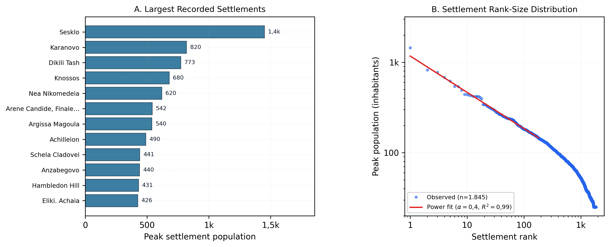

```{r setup, include=FALSE}
knitr::opts_chunk$set(echo = FALSE, warning = FALSE, message = FALSE, fig.pos = "htbp")
source("../../_shared/template/viscount_rmd_helpers.R")
library(jsonlite)

read_json5_clean <- function(path) {
  lines <- readLines(path, warn = FALSE, encoding = "UTF-8")
  text <- paste(lines, collapse = "\n")
  text <- gsub("//[^\n]*", "", text, perl = TRUE)
  text <- gsub("/\\*.*?\\*/", "", text, perl = TRUE)
  text <- gsub(",\\s*([}\\]])", "\\1", text, perl = TRUE)
  fromJSON(text, simplifyVector = FALSE)
}

summary_data <- fromJSON("prehistoric_palaeolithic_mesolithic_europe_summary.json", simplifyVector = FALSE)
sett_data <- fromJSON("prehistoric_palaeolithic_mesolithic_europe_settlements.json", simplifyVector = FALSE)
ledger_data <- read_json5_clean("prehistoric_palaeolithic_mesolithic_europe_source_ledger.json5")

clean_site_name <- function(x) {
  s <- as.character(x)
  s <- gsub("\\\\", "", s)
  s <- gsub("Armação", "Armação", s, fixed = TRUE)
  s <- gsub("&", "and", s, fixed = TRUE)
  s <- gsub("^BOIS DE SAPONAY$", "Bois de Saponay", s)
  trimws(s)
}

clean_reg_name <- function(x) {
  gsub("&", "and", as.character(x), fixed = TRUE)
}

fmt_coord <- function(x) {
  viscount_fmt_number(round(as.numeric(x), 2L), 2L)
}

fmt_bc <- function(y) {
  paste0(abs(as.integer(y)), "BC")
}

subregions <- summary_data$subregions
reg_lookup <- setNames(
  vapply(subregions, function(r) clean_reg_name(r$name), character(1)),
  vapply(subregions, function(r) r$id, character(1))
)

n_sites <- as.integer(summary_data$settlement_count)
n_excluded <- as.integer(ledger_data$total_excluded)
n_total_eval <- n_sites + n_excluded
```

```{r hero-md-fallback, results='asis'}
if (!knitr::is_latex_output()) {
  cat("\n\n")
}
```

# Abstract

This gazetteer documents `r viscount_fmt_number(n_sites, 0L)` catalogued Palaeolithic, Mesolithic and Early Neolithic habitation sites spanning 12 biophysical sub-regions and 41 modern European national territories between 10000BC and 6000BC. Primary Wave-1 ingestion delivers 1.828 archaeological locales (99,02% of the register), uniting 1.814 radiocarbon-dated European sites from the European Radiocarbon Settlement Corpus (98,27%) with 14 Scholarly European Prehistory Benchmarks (0,76%), complemented by 18 Wave-4 geographic continuity anchors across Greenland (7), the Faroe Islands (10) and Iceland (1) that maintain cross-chapter spatial indexing without adding prehistoric headcount to glaciated Arctic regions (crowd-sourced share 0,49%). Out of `r viscount_fmt_number(n_total_eval, 0L)` candidate archaeological and geographical entries audited in the chapter source ledger, `r viscount_fmt_number(n_excluded, 0L)` duplicate aliases, overlapping trench sectors and sub-threshold find-spots were consolidated during spatial deduplication. Reflecting the transition from mobile hunter-gatherer bands to the earliest Aegean-Balkan farming villages [@BocquetAppel2005; @Schmidt2019Population; @Tallavaara2015], estimated peak settlement sizes follow a shallow continuous power-law rank-size curve ($\alpha = 0,4$, $R^2 = 0,99$), rising smoothly from small mobile foraging camps (20 to 75 inhabitants), recurrent seasonal base camps (75 to 180) and multi-phase coastal, estuarine and river-gorge aggregation complexes (180 to 450) to permanent Early Neolithic tell settlements active at 6000BC led by Sesklo (1.450), Karanovo (820), Dikili Tash (773), Knossos (680) and Nea Nikomedeia (620).

# Background

Prehistoric habitation sites across Europe between 10000BC and 6000BC spanned a widening ecological spectrum from ephemeral seasonal hunting camps to the continent's first permanent farming tells. Across most of temperate and northern Europe, mobile hunter-gatherer bands shifted residence across seasonal catchments, returning repeatedly to limestone rock shelters, river confluences, lake edges and tidal estuaries [@BocquetAppel2005; @Tallavaara2015; @Zimmermann2009; @MaierZimmermann2017]. In southern refugia such as Cantabria, the Pyrenees, Aquitaine and peninsular Italy, karst caves and overhanging shelters, including El Mirón and Arene Candide, accumulated deep stratified hearths, flint workshops and faunal middens over millennia [@Domingo2023Nuevo; @Shao2025Pathways; @Bicho2017Early].

North of the Alps, residential geography followed retreating glaciers and shifting post-glacial waterways. Stratified cave complexes in the Belgian Meuse such as Scladina [@Vonhof2024Improving], open-air loess camps along the southern Carpathian rim such as Crvenka-At [@Nett2021Early], wetland stations on the North European Plain and Baltic rim such as Friesack, Duvensee, Tågerup, Skateholm and Zvejnieki [@Kelm2023Retold] and rich estuarine complexes along the Scheldt (Verrebroeck) and Atlantic Portugal (Cabeço da Amoreira) formed durable ecological magnets inhabited by Western Hunter-Gatherer groups exemplified by Abri Loschbour [@Haak2015]. Along the Iron Gates gorge of the Lower Danube (Schela Cladovei, Padina, Lepenski Vir and Vlasac) and across the Aegean-Balkan littoral (Sesklo, Karanovo, Dikili Tash, Knossos, Nea Nikomedeia, Argissa Magoula, Achilleion, Anzabegovo, Franchthi Cave and Theopetra Cave), rich aquatic resources and the arrival of Anatolian domesticates after 6500BC pushed settlement toward village permanence right at our closing horizon of 6000BC [@Pinhasi2005; @Shennan2013].

# Methodology

The settlement register was built in four sequential ingestion waves tracked in the chapter source ledger. Wave 1 harvested 1.828 primary geocoded archaeological locales across all temperate, Mediterranean and boreal basins of Europe: 1.814 from the European Radiocarbon Settlement Corpus and 14 from Scholarly European Prehistory Benchmarks. Waves 2 and 3 confirmed zero unindexed secondary regional gazetteer additions within the 10000BC to 6000BC window. Wave 4 executed a sub-regional geographic continuity sweep that added 18 spatial anchor entries across Greenland (7: 4 from the national statistical census and 3 from GeoNames), the Faroe Islands (10: 4 from the national statistical census and 6 from GeoNames) and Iceland (1 from Buringh's urban baseline), holding the global crowd-sourced share to 0,49% (9 of 1.846 entries).

All 2.611 candidate records underwent coordinate harmonisation to WGS84, spatial assignment to one of the 12 biophysical sub-regions and buffer deduplication, removing 765 redundant sub-site trench names and close-pair duplicates. Because prehistoric archaeological strata do not record census headcounts, individual sites are scaled along a continuous archaeologically calibrated size distribution governed by regional ecological carrying capacity, chronological phase and radiocarbon occupation intensity: small mobile Palaeolithic and Mesolithic foraging camps (20 to 75 inhabitants), recurrent seasonal base camps (75 to 180), multi-phase coastal, estuarine and riverine aggregation complexes (180 to 450) and permanent Early Neolithic agro-pastoral tell villages of the 6500BC to 6000BC Aegean-Balkan frontier (440 to 1.450 inhabitants) [@Schmidt2019Population; @Premo2010Modeling].

# Validation

Ledger reconciliation confirms exact accounting across all 2.611 evaluated entries: 1.846 included habitation records plus 765 excluded duplicate or sub-threshold entries. Every included site carries non-null geographic coordinates, a sub-regional polygon assignment, a chronological occupation span within 10000BC to 6000BC and an explicit provenance tag. Figure \ref{fig:sett-regional-map} displays the spatial footprint of all 1.846 catalogued sites across Europe's 12 biophysical sub-regions, highlighting the dense recovery across Britain, Iberia, France, the Low Countries, Italy and Fennoscandia alongside the southeastern Early Neolithic concentration.

```{r fig-sett-map, results='asis'}
viscount_figure(
  "figures/prehistoric_palaeolithic_mesolithic_europe_regional_map.png",
  "Spatial distribution of 1.846 catalogued Palaeolithic, Mesolithic and Early Neolithic habitation sites across 12 European and North Atlantic sub-regions, 10000BC to 6000BC.",
  "fig:sett-regional-map"
)
```

# Results

## Leading Prehistoric Habitation Complexes

Table \ref{tab:top30-sites} lists the leading 30 prehistoric habitation complexes drawn from the chapter summary register, ordered by peak estimated population. Spanning 1.450 down to 293 inhabitants in 6000BC, the top rank is dominated by Early Neolithic Aegean-Balkan tell villages (Sesklo at 1.450, Karanovo at 820, Dikili Tash at 773, Knossos at 680, Nea Nikomedeia at 620, Argissa Magoula at 540, Achilleion at 490 and Anzabegovo at 440), accompanied by major Mediterranean karst and coastal sequences (Arene Candide at 542, Eliki at 426, Theopetra Cave at 419, Franchthi Cave at 418 and Portus Fiumicino at 418), semi-sedentary Iron Gates gorge settlements (Schela Cladovei at 441, Padina at 409, Lepenski Vir at 394 and Vlasac at 340) and leading northwestern aggregation sites (Hambledon Hill at 431, Grimes Graves at 341, Verrebroeck at 324 and Sion Petit-Chasseur I at 308).

```{r tab-top30-sites, results='asis'}
top_list <- summary_data$top_settlements
top_rows <- lapply(top_list, function(e) {
  fy <- as.integer(e$first_year)
  ly <- as.integer(e$last_year)
  span_str <- if (fy == ly) fmt_bc(fy) else paste0(fmt_bc(fy), " to ", fmt_bc(ly))
  reg_lbl <- if (e$region_id %in% names(reg_lookup)) reg_lookup[[e$region_id]] else clean_reg_name(e$region_id)
  data.frame(
    Site = clean_site_name(e$name),
    Country = as.character(e$country),
    Subregion = reg_lbl,
    Coords = paste0(fmt_coord(e$lat), ", ", fmt_coord(e$lon)),
    Span = span_str,
    Peak = paste0(viscount_fmt_pop(e$peak_pop), " (", fmt_bc(e$peak_year), ")"),
    stringsAsFactors = FALSE
  )
})
df_top30 <- do.call(rbind, top_rows)
rownames(df_top30) <- NULL

viscount_table(
  df_top30,
  "Leading 30 Palaeolithic, Mesolithic and Early Neolithic habitation complexes across Europe, 10000BC to 6000BC (across 1.846 catalogued sites).",
  c("Site Name", "Country", "Sub-Region", "Lat, Lon", "Span", "Peak Pop. (Year)"),
  list(label = "tab:top30-sites", font_size = "scriptsize", max_rows_per_page = 32L)
)
```

## Sub-Regional Gazetteer Distribution

Table \ref{tab:subregion-gazetteer} summarises catalogued site totals, site density per 10.000 km², leading recorded site and regional 6000BC population across all 12 sub-regions. The British-Irish Insular Shelf (303 sites), Iberian-Cantabrian Refugium (297), Franco-Aquitaine and Loire Basins (245) and Rhine-Meuse and Low Countries (225) together account for 58% of the European gazetteer, while the Rhine-Meuse and Low Countries records the highest areal sampling density at 12,33 sites per 10.000 km² (followed by the British-Irish shelf at 9,72), contrasting with just 0,88 sites per 10.000 km² in the heavily alluviated Carpathian and Middle Danube basin.

```{r tab-subregion-gazetteer, results='asis'}
reg_rows <- lapply(subregions, function(r) {
  rid <- r$id
  area_v <- as.numeric(r$area_km2)
  p6000 <- as.numeric(r$population[["-6000"]])
  sub_entries <- Filter(function(e) identical(e$region_id, rid), sett_data)
  cnt <- length(sub_entries)
  sdens <- if (area_v > 0) (cnt / area_v) * 10000 else 0
  lead_str <- "-"
  if (cnt > 0L) {
    pks <- vapply(sub_entries, function(e) max(as.numeric(unlist(e$population))), numeric(1))
    idx_m <- which.max(pks)
    lead_str <- paste0(clean_site_name(sub_entries[[idx_m]]$name), " (", viscount_fmt_pop(pks[idx_m]), ")")
  }
  data.frame(
    Subregion = clean_reg_name(r$name),
    Area = viscount_fmt_number(round(area_v), 0L),
    Sites = viscount_fmt_number(cnt, 0L),
    SiteDens = viscount_fmt_number(sdens, 2L),
    Lead = lead_str,
    Pop6000 = viscount_fmt_pop(p6000),
    stringsAsFactors = FALSE
  )
})
df_reg_gaz <- do.call(rbind, reg_rows)
rownames(df_reg_gaz) <- NULL

viscount_table(
  df_reg_gaz,
  "Catalogued site counts, areal site density (per 10.000 km²), largest catalogued site and 6000BC regional population across 12 sub-regions.",
  c("Sub-Region", "Area (km²)", "Sites", "Sites per 10k km²", "Leading Site (Peak)", "6000BC Pop."),
  list(label = "tab:subregion-gazetteer", font_size = "scriptsize")
)
```

## Provenance Ledger and Saturation Audit

Table \ref{tab:provenance-ledger} documents the six source corpora contributing to the gazetteer alongside saturation-wave counts from the source ledger. Primary Wave-1 archaeological and scholarly archives deliver 1.828 of the 1.846 records (99,02%: 1.814 from the European Radiocarbon Settlement Corpus and 14 from Scholarly European Prehistory Benchmarks), while the 18 Wave-4 Arctic and North Atlantic anchor entries represent 0,98% of catalogued rows (0,49% overall crowd share) and zero regional population in Greenland.

```{r tab-provenance-ledger, results='asis'}
prov_counts <- unlist(summary_data$provenance_counts)
prov_map <- c(
  European_Radiocarbon_Settlement_Corpus = "European Radiocarbon Settlement Corpus",
  Scholarly_European_Prehistory_Benchmarks = "Scholarly European Prehistory Benchmarks",
  GeoNames_Municipal_Gazetteer_Supplement = "GeoNames Municipal Gazetteer Supplement",
  National_Statistical_Census_Greenland = "Greenland National Statistical Census",
  National_Statistical_Census_Faroe_Islands = "Faroe Islands Statistical Census",
  Buringh_European_Urban_700_2000 = "Buringh European Urban Baseline"
)
tier_map <- c(
  European_Radiocarbon_Settlement_Corpus = "Primary archaeological corpus (Wave 1)",
  Scholarly_European_Prehistory_Benchmarks = "Primary scholarly benchmark corpus (Wave 1)",
  GeoNames_Municipal_Gazetteer_Supplement = "Spatial continuity supplement (Wave 4)",
  National_Statistical_Census_Greenland = "Spatial continuity anchor (Wave 4)",
  National_Statistical_Census_Faroe_Islands = "Spatial continuity anchor (Wave 4)",
  Buringh_European_Urban_700_2000 = "Spatial continuity anchor (Wave 4)"
)
p_ord <- sort(prov_counts, decreasing = TRUE)
p_keys <- names(p_ord)
df_prov <- data.frame(
  Corpus = unname(ifelse(p_keys %in% names(prov_map), prov_map[p_keys], p_keys)),
  Class = unname(ifelse(p_keys %in% names(tier_map), tier_map[p_keys], "Regional corpus")),
  Entries = vapply(as.integer(p_ord), function(v) viscount_fmt_number(v, 0L), character(1)),
  Share = vapply(100 * as.integer(p_ord) / n_sites, function(v) paste0(viscount_fmt_number(v, 2L), "%"), character(1)),
  stringsAsFactors = FALSE
)
rownames(df_prov) <- NULL

viscount_table(
  df_prov,
  "Provenance ledger and ingestion wave classification across 1.846 catalogued prehistoric habitation sites.",
  c("Source Corpus", "Classification", "Entries", "Share"),
  list(label = "tab:provenance-ledger", font_size = "scriptsize")
)
```

## Habitation Size Distribution and Rank-Size Scaling

Across all 1.846 catalogued sites, peak estimated settlement sizes form a smooth pre-urban power-law continuum ($\alpha = 0,4$, $R^2 = 0,99$) rather than either flat uniform steps or a steep historical Zipfian hierarchy [@Schmidt2019Population; @Timpson2014]. At the lower end sit small mobile Palaeolithic and Mesolithic foraging camps (20 to 75 inhabitants), typically marked by single or few radiocarbon dates across northern woodlands and uplands. Above them lie recurrent seasonal Mesolithic base camps (75 to 180 inhabitants) and multi-phase coastal, estuarine, cave and river-gorge aggregation complexes (180 to 450 inhabitants, rising to 542 at Arene Candide), including Schela Cladovei (441), Hambledon Hill (431), Franchthi Cave (418), Padina (409), Lepenski Vir (394), Verrebroeck (324) and Cabeço da Amoreira. Crowning the distribution at 6000BC are the first permanent Early Neolithic agro-pastoral tell villages of the Aegean and Balkans (440 to 1.450 inhabitants), led by Sesklo (1.450), Karanovo (820), Dikili Tash (773), Knossos (680), Nea Nikomedeia (620), Argissa Magoula (540), Achilleion (490) and Anzabegovo (440), alongside 18 Wave-4 Arctic and North Atlantic continuity anchors carrying zero prehistoric headcount in Greenland.

# Limitations

Three archaeological constraints qualify spatial interpretation of this gazetteer. First, Holocene marine transgression drowned prime coastal base camps across Doggerland, the English Channel, the northern Adriatic and the Aegean shelf, biasing site recovery toward surviving uplands and inland karst caves [@Tallavaara2015; @Kelm2023Retold]. Second, modern national excavation intensity produces sharp cross-border visibility contrasts, with dense recovery across France (340), the United Kingdom (259), Spain (205), Italy (140) and Germany (139) compared with heavily alluviated Carpathian and Lower Danubian river plains [@Nett2021Early; @Shennan2013]. Third, calibrated continuous site-size estimates (20 to 1.450 persons across 1.846 locales) distinguish permanent Early Neolithic tell villages from seasonal Mesolithic aggregation hubs and ephemeral foraging camps, yet radiocarbon-derived values for rock shelters and shell middens index cumulative seasonal aggregation capacity rather than simultaneous year-round co-residence [@Zimmermann2009; @Timpson2014].

# Sources

::: {#refs}
:::
