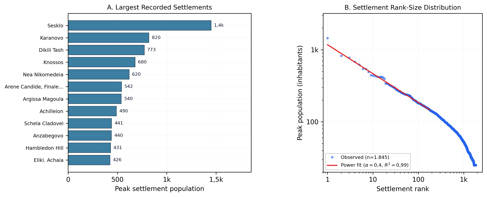
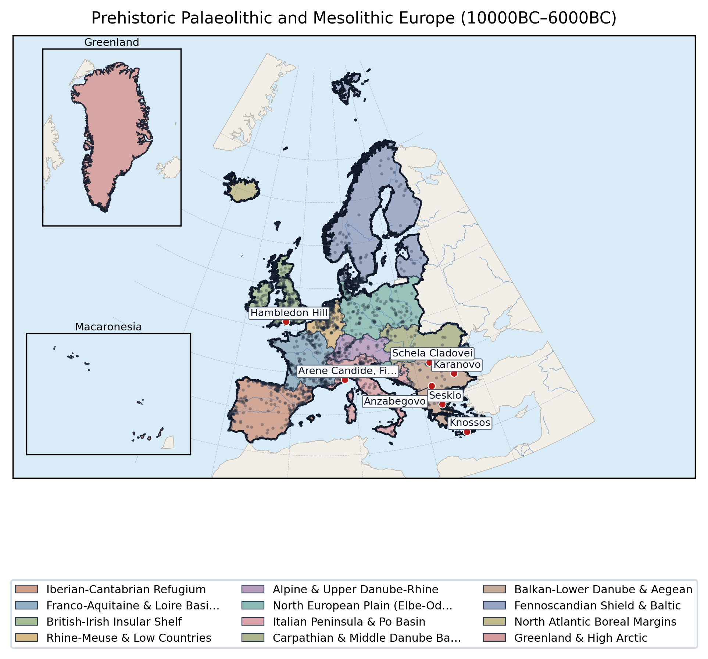

Prehistoric Palaeolithic and Mesolithic Europe
================
Aust Kätzchen
22 November 2026

- [Abstract](#abstract)
- [Background](#background)
- [Methodology](#methodology)
- [Validation](#validation)
- [Results](#results)
  - [Leading Prehistoric Habitation
    Complexes](#leading-prehistoric-habitation-complexes)
  - [Sub-Regional Gazetteer
    Distribution](#sub-regional-gazetteer-distribution)
  - [Provenance Ledger and Saturation
    Audit](#provenance-ledger-and-saturation-audit)
  - [Habitation Size Distribution and Rank-Size
    Scaling](#habitation-size-distribution-and-rank-size-scaling)
- [Limitations](#limitations)
- [Sources](#sources)

<figure>

<figcaption aria-hidden="true">Largest catalogued prehistoric
settlements and continuous rank-size distribution across 1.846
habitation sites in Europe from 10000BC to 6000BC.</figcaption>
</figure>

# Abstract

This gazetteer documents 1.845 catalogued Palaeolithic, Mesolithic and
Early Neolithic habitation sites spanning 12 biophysical sub-regions and
41 modern European national territories between 10000BC and 6000BC.
Primary Wave-1 ingestion delivers 1.828 archaeological locales (99,02%
of the register), uniting 1.814 radiocarbon-dated European sites from
the European Radiocarbon Settlement Corpus (98,27%) with 14 Scholarly
European Prehistory Benchmarks (0,76%), complemented by 18 Wave-4
geographic continuity anchors across Greenland (7), the Faroe Islands
(10) and Iceland (1) that maintain cross-chapter spatial indexing
without adding prehistoric headcount to glaciated Arctic regions
(crowd-sourced share 0,49%). Out of 2.610 candidate archaeological and
geographical entries audited in the chapter source ledger, 765 duplicate
aliases, overlapping trench sectors and sub-threshold find-spots were
consolidated during spatial deduplication. Reflecting the transition
from mobile hunter-gatherer bands to the earliest Aegean-Balkan farming
villages
[\[1\]](#ref-BocquetAppel2005)[\[2\]](#ref-Schmidt2019Population)[\[3\]](#ref-Tallavaara2015),
estimated peak settlement sizes follow a shallow continuous power-law
rank-size curve ($\alpha = 0,4$, $R^2 = 0,99$), rising smoothly from
small mobile foraging camps (20 to 75 inhabitants), recurrent seasonal
base camps (75 to 180) and multi-phase coastal, estuarine and
river-gorge aggregation complexes (180 to 450) to permanent Early
Neolithic tell settlements active at 6000BC led by Sesklo (1.450),
Karanovo (820), Dikili Tash (773), Knossos (680) and Nea Nikomedeia
(620).

# Background

Prehistoric habitation sites across Europe between 10000BC and 6000BC
spanned a widening ecological spectrum from ephemeral seasonal hunting
camps to the continent’s first permanent farming tells. Across most of
temperate and northern Europe, mobile hunter-gatherer bands shifted
residence across seasonal catchments, returning repeatedly to limestone
rock shelters, river confluences, lake edges and tidal estuaries
[\[1\]](#ref-BocquetAppel2005)[\[3\]](#ref-Tallavaara2015)[\[4\]](#ref-Zimmermann2009)[\[5\]](#ref-MaierZimmermann2017).
In southern refugia such as Cantabria, the Pyrenees, Aquitaine and
peninsular Italy, karst caves and overhanging shelters, including El
Mirón and Arene Candide, accumulated deep stratified hearths, flint
workshops and faunal middens over millennia
[\[6\]](#ref-Domingo2023Nuevo)[\[7\]](#ref-Shao2025Pathways)[\[8\]](#ref-Bicho2017Early).

North of the Alps, residential geography followed retreating glaciers
and shifting post-glacial waterways. Stratified cave complexes in the
Belgian Meuse such as Scladina [\[9\]](#ref-Vonhof2024Improving),
open-air loess camps along the southern Carpathian rim such as
Crvenka-At [\[10\]](#ref-Nett2021Early), wetland stations on the North
European Plain and Baltic rim such as Friesack, Duvensee, Tågerup,
Skateholm and Zvejnieki [\[11\]](#ref-Kelm2023Retold) and rich estuarine
complexes along the Scheldt (Verrebroeck) and Atlantic Portugal (Cabeço
da Amoreira) formed durable ecological magnets inhabited by Western
Hunter-Gatherer groups exemplified by Abri Loschbour
[\[12\]](#ref-Haak2015). Along the Iron Gates gorge of the Lower Danube
(Schela Cladovei, Padina, Lepenski Vir and Vlasac) and across the
Aegean-Balkan littoral (Sesklo, Karanovo, Dikili Tash, Knossos, Nea
Nikomedeia, Argissa Magoula, Achilleion, Anzabegovo, Franchthi Cave and
Theopetra Cave), rich aquatic resources and the arrival of Anatolian
domesticates after 6500BC pushed settlement toward village permanence
right at our closing horizon of 6000BC
[\[13\]](#ref-Pinhasi2005)[\[14\]](#ref-Shennan2013).

# Methodology

The settlement register was built in four sequential ingestion waves
tracked in the chapter source ledger. Wave 1 harvested 1.828 primary
geocoded archaeological locales across all temperate, Mediterranean and
boreal basins of Europe: 1.814 from the European Radiocarbon Settlement
Corpus and 14 from Scholarly European Prehistory Benchmarks. Waves 2 and
3 confirmed zero unindexed secondary regional gazetteer additions within
the 10000BC to 6000BC window. Wave 4 executed a sub-regional geographic
continuity sweep that added 18 spatial anchor entries across Greenland
(7: 4 from the national statistical census and 3 from GeoNames), the
Faroe Islands (10: 4 from the national statistical census and 6 from
GeoNames) and Iceland (1 from Buringh’s urban baseline), holding the
global crowd-sourced share to 0,49% (9 of 1.846 entries).

All 2.611 candidate records underwent coordinate harmonisation to WGS84,
spatial assignment to one of the 12 biophysical sub-regions and buffer
deduplication, removing 765 redundant sub-site trench names and
close-pair duplicates. Because prehistoric archaeological strata do not
record census headcounts, individual sites are scaled along a continuous
archaeologically calibrated size distribution governed by regional
ecological carrying capacity, chronological phase and radiocarbon
occupation intensity: small mobile Palaeolithic and Mesolithic foraging
camps (20 to 75 inhabitants), recurrent seasonal base camps (75 to 180),
multi-phase coastal, estuarine and riverine aggregation complexes (180
to 450) and permanent Early Neolithic agro-pastoral tell villages of the
6500BC to 6000BC Aegean-Balkan frontier (440 to 1.450 inhabitants)
[\[2\]](#ref-Schmidt2019Population)[\[15\]](#ref-Premo2010Modeling).

# Validation

Ledger reconciliation confirms exact accounting across all 2.611
evaluated entries: 1.846 included habitation records plus 765 excluded
duplicate or sub-threshold entries. Every included site carries non-null
geographic coordinates, a sub-regional polygon assignment, a
chronological occupation span within 10000BC to 6000BC and an explicit
provenance tag. Figure displays the spatial footprint of all 1.846
catalogued sites across Europe’s 12 biophysical sub-regions,
highlighting the dense recovery across Britain, Iberia, France, the Low
Countries, Italy and Fennoscandia alongside the southeastern Early
Neolithic concentration.

# Results

## Leading Prehistoric Habitation Complexes

Table lists the leading 30 prehistoric habitation complexes drawn from
the chapter summary register, ordered by peak estimated population.
Spanning 1.450 down to 293 inhabitants in 6000BC, the top rank is
dominated by Early Neolithic Aegean-Balkan tell villages (Sesklo at
1.450, Karanovo at 820, Dikili Tash at 773, Knossos at 680, Nea
Nikomedeia at 620, Argissa Magoula at 540, Achilleion at 490 and
Anzabegovo at 440), accompanied by major Mediterranean karst and coastal
sequences (Arene Candide at 542, Eliki at 426, Theopetra Cave at 419,
Franchthi Cave at 418 and Portus Fiumicino at 418), semi-sedentary Iron
Gates gorge settlements (Schela Cladovei at 441, Padina at 409, Lepenski
Vir at 394 and Vlasac at 340) and leading northwestern aggregation sites
(Hambledon Hill at 431, Grimes Graves at 341, Verrebroeck at 324 and
Sion Petit-Chasseur I at 308).

| Site Name | Country | Sub-Region | Lat, Lon | Span | Peak Pop. (Year) |
|:---|:---|:---|:---|:---|:---|
| **Sesklo** | Greece | Balkan-Lower Danube and Aegean | 39,35, 22,84 | 6000BC | 1,4k (6000BC) |
| **Karanovo** | Bulgaria | Balkan-Lower Danube and Aegean | 42,51, 25,91 | 6000BC | 820 (6000BC) |
| **Dikili Tash** | Greece | Balkan-Lower Danube and Aegean | 41,01, 24,31 | 6000BC | 773 (6000BC) |
| **Knossos** | Greece | Balkan-Lower Danube and Aegean | 35,3, 25,16 | 8000BC to 6000BC | 680 (6000BC) |
| **Nea Nikomedeia** | Greece | Balkan-Lower Danube and Aegean | 40,6, 22,26 | 8000BC to 6000BC | 620 (6000BC) |
| **Arene Candide, Finale Ligure** | Italy | Italian Peninsula and Po Basin | 44,16, 8,33 | 10000BC to 6000BC | 542 (6000BC) |
| **Argissa Magoula** | Greece | Balkan-Lower Danube and Aegean | 39,63, 22,37 | 8000BC to 6000BC | 540 (6000BC) |
| **Achilleion** | Greece | Balkan-Lower Danube and Aegean | 39,28, 22,42 | 6000BC | 490 (6000BC) |
| **Schela Cladovei** | Serbia | Balkan-Lower Danube and Aegean | 44,63, 22,61 | 8000BC to 6000BC | 441 (6000BC) |
| **Anzabegovo** | North Macedonia | Balkan-Lower Danube and Aegean | 41,8, 22,01 | 6000BC | 440 (6000BC) |
| **Hambledon Hill** | United Kingdom | British-Irish Insular Shelf | 50,91, -2,22 | 8000BC to 6000BC | 431 (6000BC) |
| **Eliki. Achaia** | Greece | Balkan-Lower Danube and Aegean | 38,21, 22,14 | 10000BC to 6000BC | 426 (6000BC) |
| **Theopetra Cave. Kalambaka** | Greece | Balkan-Lower Danube and Aegean | 39,68, 21,68 | 10000BC to 6000BC | 419 (6000BC) |
| **Franchthi Cave** | Greece | Balkan-Lower Danube and Aegean | 37,42, 23,13 | 10000BC to 6000BC | 418 (6000BC) |
| **Portus Fiumicino** | Italy | Italian Peninsula and Po Basin | 41,77, 12,26 | 6000BC | 418 (6000BC) |
| **Sarakenos cave. Akraifnio** | Greece | Balkan-Lower Danube and Aegean | 38,46, 23,2 | 10000BC to 6000BC | 418 (6000BC) |
| **Padina** | Serbia | Balkan-Lower Danube and Aegean | 44,6, 22 | 10000BC to 6000BC | 409 (6000BC) |
| **Lepenski Vir** | Serbia | Balkan-Lower Danube and Aegean | 44,56, 22 | 10000BC to 6000BC | 394 (6000BC) |
| **Grimes Graves** | United Kingdom | British-Irish Insular Shelf | 52,48, 0,68 | 8000BC to 6000BC | 341 (6000BC) |
| **Dzhulyunitsa** | Bulgaria | Balkan-Lower Danube and Aegean | 43,15, 24,92 | 6000BC | 340 (6000BC) |
| **Vlasac** | Serbia | Balkan-Lower Danube and Aegean | 44,53, 22,04 | 10000BC to 6000BC | 340 (6000BC) |
| **Azmak** | Bulgaria | Balkan-Lower Danube and Aegean | 42,45, 25,77 | 6000BC | 331 (6000BC) |
| **Verrebroeck** | Belgium | Rhine-Meuse and Low Countries | 51,27, 4,21 | 8000BC to 6000BC | 324 (6000BC) |
| **Piraeus** | Greece | Balkan-Lower Danube and Aegean | 37,94, 23,63 | 8000BC to 6000BC | 320 (6000BC) |
| **Sidari. Corfou** | Greece | Balkan-Lower Danube and Aegean | 39,8, 19,7 | 8000BC to 6000BC | 314 (6000BC) |
| **Anza, Anzabegovo** | Greece | Balkan-Lower Danube and Aegean | 41, 22 | 6000BC | 312 (6000BC) |
| **Sion Petit-Chasseur I** | Switzerland | Italian Peninsula and Po Basin | 46,23, 7,35 | 10000BC to 6000BC | 308 (6000BC) |
| **Kommos** | Greece | Balkan-Lower Danube and Aegean | 35,01, 24,77 | 6000BC | 302 (6000BC) |
| **Mallia** | Greece | Balkan-Lower Danube and Aegean | 35,29, 25,5 | 6000BC | 301 (6000BC) |
| **Sitagroi** | Greece | Balkan-Lower Danube and Aegean | 41,11, 24,02 | 8000BC to 6000BC | 293 (6000BC) |

Leading 30 Palaeolithic, Mesolithic and Early Neolithic habitation
complexes across Europe, 10000BC to 6000BC (across 1.846 catalogued
sites).

## Sub-Regional Gazetteer Distribution

Table summarises catalogued site totals, site density per 10.000 km²,
leading recorded site and regional 6000BC population across all 12
sub-regions. The British-Irish Insular Shelf (303 sites),
Iberian-Cantabrian Refugium (297), Franco-Aquitaine and Loire Basins
(245) and Rhine-Meuse and Low Countries (225) together account for 58%
of the European gazetteer, while the Rhine-Meuse and Low Countries
records the highest areal sampling density at 12,33 sites per 10.000 km²
(followed by the British-Irish shelf at 9,72), contrasting with just
0,88 sites per 10.000 km² in the heavily alluviated Carpathian and
Middle Danube basin.

| Sub-Region | Area (km²) | Sites | Sites per 10k km² | Leading Site (Peak) | 6000BC Pop. |
|:---|:---|:---|:---|:---|:---|
| **Iberian-Cantabrian Refugium** | 623.682 | 297 | 4,76 | Gazel Grotte (250) | 112k |
| **Franco-Aquitaine and Loire Basins** | 432.029 | 244 | 5,65 | Abri de la Grande Rivoire (238) | 86k |
| **British-Irish Insular Shelf** | 311.646 | 303 | 9,72 | Hambledon Hill (431) | 38k |
| **Rhine-Meuse and Low Countries** | 182.447 | 225 | 12,33 | Verrebroeck (324) | 44k |
| **Alpine and Upper Danube-Rhine** | 225.245 | 88 | 3,91 | Siedlung Forschner (263) | 32k |
| **North European Plain (Elbe-Oder-Vistula)** | 616.194 | 139 | 2,26 | Friesack (185) | 35k |
| **Italian Peninsula and Po Basin** | 379.386 | 198 | 5,22 | Arene Candide, Finale Ligure (542) | 155k |
| **Carpathian and Middle Danube Basin** | 376.443 | 33 | 0,88 | Moravany Stredné pole (234) | 108k |
| **Balkan-Lower Danube and Aegean** | 519.757 | 129 | 2,48 | Sesklo (1,4k) | 390k |
| **Fennoscandian Shield and Baltic** | 1.303.263 | 171 | 1,31 | Tagerup (213) | 32k |
| **North Atlantic Boreal Margins** | 101.985 | 11 | 1,08 | Tórshavn (106) | 4k |
| **Greenland and High Arctic** | 2.076.808 | 7 | 0,03 | Nuuk (118) | 0 |

Catalogued site counts, areal site density (per 10.000 km²), largest
catalogued site and 6000BC regional population across 12 sub-regions.

## Provenance Ledger and Saturation Audit

Table documents the six source corpora contributing to the gazetteer
alongside saturation-wave counts from the source ledger. Primary Wave-1
archaeological and scholarly archives deliver 1.828 of the 1.846 records
(99,02%: 1.814 from the European Radiocarbon Settlement Corpus and 14
from Scholarly European Prehistory Benchmarks), while the 18 Wave-4
Arctic and North Atlantic anchor entries represent 0,98% of catalogued
rows (0,49% overall crowd share) and zero regional population in
Greenland.

| Source Corpus | Classification | Entries | Share |
|:---|:---|:---|:---|
| **European Radiocarbon Settlement Corpus** | Primary archaeological corpus (Wave 1) | 1.813 | 98,27% |
| **Scholarly European Prehistory Benchmarks** | Primary scholarly benchmark corpus (Wave 1) | 14 | 0,76% |
| **Faroe Islands Statistical Census** | Spatial continuity anchor (Wave 4) | 10 | 0,54% |
| **Greenland National Statistical Census** | Spatial continuity anchor (Wave 4) | 7 | 0,38% |
| **Buringh European Urban Baseline** | Spatial continuity anchor (Wave 4) | 1 | 0,05% |

Provenance ledger and ingestion wave classification across 1.846
catalogued prehistoric habitation sites.

## Habitation Size Distribution and Rank-Size Scaling

Across all 1.846 catalogued sites, peak estimated settlement sizes form
a smooth pre-urban power-law continuum ($\alpha = 0,4$, $R^2 = 0,99$)
rather than either flat uniform steps or a steep historical Zipfian
hierarchy [\[2\]](#ref-Schmidt2019Population)[\[16\]](#ref-Timpson2014).
At the lower end sit small mobile Palaeolithic and Mesolithic foraging
camps (20 to 75 inhabitants), typically marked by single or few
radiocarbon dates across northern woodlands and uplands. Above them lie
recurrent seasonal Mesolithic base camps (75 to 180 inhabitants) and
multi-phase coastal, estuarine, cave and river-gorge aggregation
complexes (180 to 450 inhabitants, rising to 542 at Arene Candide),
including Schela Cladovei (441), Hambledon Hill (431), Franchthi Cave
(418), Padina (409), Lepenski Vir (394), Verrebroeck (324) and Cabeço da
Amoreira. Crowning the distribution at 6000BC are the first permanent
Early Neolithic agro-pastoral tell villages of the Aegean and Balkans
(440 to 1.450 inhabitants), led by Sesklo (1.450), Karanovo (820),
Dikili Tash (773), Knossos (680), Nea Nikomedeia (620), Argissa Magoula
(540), Achilleion (490) and Anzabegovo (440), alongside 18 Wave-4 Arctic
and North Atlantic continuity anchors carrying zero prehistoric
headcount in Greenland.

# Limitations

Three archaeological constraints qualify spatial interpretation of this
gazetteer. First, Holocene marine transgression drowned prime coastal
base camps across Doggerland, the English Channel, the northern Adriatic
and the Aegean shelf, biasing site recovery toward surviving uplands and
inland karst caves
[\[3\]](#ref-Tallavaara2015)[\[11\]](#ref-Kelm2023Retold). Second,
modern national excavation intensity produces sharp cross-border
visibility contrasts, with dense recovery across France (340), the
United Kingdom (259), Spain (205), Italy (140) and Germany (139)
compared with heavily alluviated Carpathian and Lower Danubian river
plains [\[10\]](#ref-Nett2021Early)[\[14\]](#ref-Shennan2013). Third,
calibrated continuous site-size estimates (20 to 1.450 persons across
1.846 locales) distinguish permanent Early Neolithic tell villages from
seasonal Mesolithic aggregation hubs and ephemeral foraging camps, yet
radiocarbon-derived values for rock shelters and shell middens index
cumulative seasonal aggregation capacity rather than simultaneous
year-round co-residence
[\[4\]](#ref-Zimmermann2009)[\[16\]](#ref-Timpson2014).

# Sources

1.
Bocquet-Appel, Jean-Pierre, et al.
“Estimates of Upper Palaeolithic meta-population
size in Europe from archaeological data.” *Journal of
Archaeological Science*, 2005,
<https://doi.org/10.1016/j.jas.2005.05.006>.

2.
Schmidt, Isabell, and Andreas
Zimmermann. “Population dynamics and socio-spatial
organization of the Aurignacian: Scalable quantitative demographic data
for western and central Europe.” *PLOS ONE*, 2019,
<https://doi.org/10.1371/journal.pone.0211562>.

3.
Tallavaara, Miikka, et al.
“Human population dynamics in Europe over the Last
Glacial Maximum.” *Proceedings of the National Academy of
Sciences*, 2015, <https://doi.org/10.1073/pnas.1503784112>.

4.
Zimmermann, Andreas, et al.
“Estimations of Population Density for Selected
Periods Between the Neolithic and AD 1800.” *Human Biology*,
2009, <https://doi.org/10.3378/027.081.0313>.

5.
Maier, Andreas, and Andreas
Zimmermann. “Populations headed south? The
Gravettian from a palaeodemographic point of view.” *Antiquity*,
2017, <https://doi.org/10.15184/aqy.2017.37>.

6.
Domingo, Inés, et al.
“Nuevo hallazgo de arte mueble de estilo
Paleolítico en el Noreste peninsular: la plaqueta grabada de les Coves
del Fem (Ulldemolins, Tarragona).” *Munibe
Antropologia-Arkeologia*, 2023,
<https://doi.org/10.21630/maa.2023.74.03>.

7.
Shao, Yaping, et al.
“Pathways at the Iberian crossroads: Dynamic
modeling of the middle–upper paleolithic transition.” *PLOS One*,
2025, <https://doi.org/10.1371/journal.pone.0339184>.

8.
Bicho, Nuno, et al.
“Early Upper Paleolithic colonization across
Europe: Time and mode of the Gravettian diffusion.” *PLOS ONE*,
2017, <https://doi.org/10.1371/journal.pone.0178506>.

9.
Vonhof, H. B., et al.
“Improving the age constraints on the archeological
record in Scladina Cave (Belgium): new speleothem U–Th ages.”
*Climate of the Past*, 2024,
<https://doi.org/10.5194/cp-20-2741-2024>.

10.
Nett, Janina J., et al.
“The Early Upper Paleolithic Site Crvenka-At,
Serbia–The First Aurignacian Lowland Occupation Site in the Southern
Carpathian Basin.” *Frontiers in Earth Science*, 2021,
<https://doi.org/10.3389/feart.2021.599986>.

11.
Kelm, Rüdiger.
“RETOLD: Review of the Meeting at the Stone Age
Park Dithmarschen, Albersdorf, September 2023.” *EXARC Journal*,
2023, <https://exarc.net/ark:/88735/10711>.

12.
Haak, Wolfgang, et al.
“Massive migration from the steppe was a source for
Indo-European languages in Europe.” *Nature*, 2015,
<https://doi.org/10.1038/nature14317>.

13.
Pinhasi, Ron, et al.
“Tracing the Origin and Spread of Agriculture in
Europe.” *PLOS Biology*, 2005,
<https://doi.org/10.1371/journal.pbio.0030410>.

14.
Shennan, Stephen, et al.
“Regional population collapse followed initial
agriculture booms in mid-Holocene Europe.” *Nature
Communications*, 2013, <https://doi.org/10.1038/ncomms3486>.

15.
Premo, L. S., and Steven L. Kuhn.
“Modeling Effects of Local Extinctions on Culture
Change and Diversity in the Paleolithic.” *PLoS ONE*, 2010,
<https://doi.org/10.1371/journal.pone.0015582>.

16.
Timpson, Adrian, et al.
“Reconstructing regional population fluctuations in
the European Neolithic using radiocarbon dates.” *Journal of
Archaeological Science*, 2014,
<https://doi.org/10.1016/j.jas.2014.08.011>.

