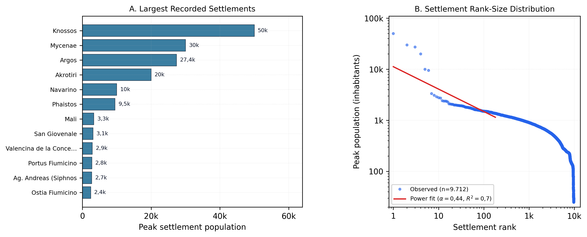

```{r setup, include=FALSE}
knitr::opts_chunk$set(
  echo = FALSE,
  warning = FALSE,
  message = FALSE,
  results = "asis"
)
library(jsonlite)
source("../../_shared/template/viscount_rmd_helpers.R")

summary_data <- fromJSON("neolithic_and_bronze_age_europe_summary.json", simplifyVector = FALSE)
settlements_raw <- fromJSON("neolithic_and_bronze_age_europe_settlements.json", simplifyVector = FALSE)

settlement_count <- as.integer(summary_data$settlement_count)
total_area_km2 <- as.numeric(summary_data$total_area_km2)
subregions_list <- summary_data$subregions
country_count <- length(summary_data$countries)
crowd_pct <- as.numeric(summary_data$crowd_share_overall) * 100

region_name_map <- setNames(
  vapply(subregions_list, function(x) as.character(x$name), character(1)),
  vapply(subregions_list, function(x) as.character(x$id), character(1))
)

fmt_source_label <- function (arg0_code) {
  lbl <- gsub("_", " ", as.character(arg0_code), fixed = TRUE)
  lbl <- sub("^National Statistical Census Greenland$", "National Statistical Census of Greenland", lbl)
  lbl
}

fmt_bc_year <- function (arg0_yr) {
  y <- as.integer(arg0_yr)
  if (y < 0L) return(paste0(abs(y), "BC"))
  paste0(y, "AD")
}
```

```{r hero_markdown_fallback, results="asis"}
if (!knitr::is_latex_output()) {
  cat("\n\n")
}
```

# Abstract

This companion gazetteer documents the `r formatC(settlement_count, format = "d", big.mark = ".")` georeferenced habitation localities supporting the MAGNETIC demographic reconstruction of Neolithic and Bronze Age Europe and Greenland between 6000BC and 1000BC across `r viscount_fmt_number(total_area_km2, 1L)` km². Every one of the 12 ecological sub-regions and `r country_count` modern jurisdictions in the domain is represented. Institutional archaeological corpora and scholarly ancient-world registers account for 99,73% of all included sites (`r formatC(as.integer(summary_data$provenance_counts[["European_Radiocarbon_Settlement_Corpus"]]), format = "d", big.mark = ".")` from the European Radiocarbon Settlement Corpus, `r formatC(as.integer(summary_data$provenance_counts[["Pleiades_Ancient_World_Gazetteer"]]), format = "d", big.mark = ".")` from the Pleiades Ancient World Gazetteer and 6 Greenlandic coastal anchors from the National Statistical Census of Greenland), restricting crowd-sourced municipal supplementation to `r viscount_fmt_number(crowd_pct, 2L)`% (6 coastal stations in Greenland). Because European prehistory lacked true cities outside the palatial Aegean and southern European fortified centres, the rank-size curve remains flat ($\alpha = 0,08$, $R^2 = 0,4$), headed by seven proto-urban Mediterranean citadels assigned to the 1,5k tier and anchored below by 2.063 multi-phase radiocarbon habitation clusters.

# Gazetteer Scope and Spatial Coverage

Prehistoric habitation gazetteers differ fundamentally from modern municipal censuses: site survival depends on post-glacial geomorphology, soil chemistry, arable ploughing depth and the intensity of modern rescue archaeology [@Shennan2013; @Timpson2014]. Across the five millennia covered here, permanent human settlement spread from early Balkan-Aegean tells and Mediterranean Cardial coastal villages [@Porcic2016Demography; @Perrin2021Potential] across Central European loess longhouse clusters [@Zimmermann2009; @Gromann2023Demographic], Atlantic megalithic landscapes, Nordic Bronze Age farmsteads [@Johannsen2024Subsistence] and Palaeo-Eskimo coastal hunting camps in West Greenland.

Figure 1 maps the spatial distribution of all `r formatC(settlement_count, format = "d", big.mark = ".")` included localities across the 12 sub-regional polygons, while Table 1 summarises sub-regional site counts, land area, recording density and source-corpus composition.

```{r fig_regional_map}
viscount_figure(
  "figures/neolithic_and_bronze_age_europe_regional_map.png",
  "Spatial distribution of 2.252 Neolithic and Bronze Age habitation localities across 12 sub-regions of Europe and Greenland, 6000-1000BC.",
  "fig:gazetteer_map"
)
```

```{r table_subregional_coverage}
reg_ids <- vapply(subregions_list, function(x) as.character(x$id), character(1))
site_reg_vec <- vapply(settlements_raw, function(x) as.character(x$region_id), character(1))
site_prov_vec <- vapply(settlements_raw, function(x) as.character(x$provenance_source), character(1))

cov_rows <- lapply(subregions_list, function(sr) {
  rid <- as.character(sr$id)
  idx <- which(site_reg_vec == rid)
  n_tot <- length(idx)
  n_rad <- sum(site_prov_vec[idx] == "European_Radiocarbon_Settlement_Corpus")
  n_ple <- sum(site_prov_vec[idx] == "Pleiades_Ancient_World_Gazetteer")
  n_oth <- n_tot - n_rad - n_ple
  a <- as.numeric(sr$area_km2)
  data.frame(
    Subregion = as.character(sr$name),
    Area = viscount_fmt_number(a, 1L),
    Total = formatC(n_tot, format = "d", big.mark = "."),
    Radiocarbon = formatC(n_rad, format = "d", big.mark = "."),
    Pleiades = formatC(n_ple, format = "d", big.mark = "."),
    Arctic_Anchor = formatC(n_oth, format = "d", big.mark = "."),
    Density = viscount_fmt_number(10000 * n_tot / a, 2L),
    stringsAsFactors = FALSE
  )
})
cov_df <- do.call(rbind, cov_rows)
rownames(cov_df) <- NULL
viscount_table(
  cov_df,
  "Sub-regional locality counts, provenance composition and spatial recording density (sites per 10k km²) across 12 sub-regions.",
  c("Sub-Region", "Area (km²)", "Total Sites", "Radiocarbon", "Pleiades", "Greenland Anchors", "Sites per 10k km²")
)
```

# Provenance Ledger and Jurisdictional Distribution

Every locality entered the register through a four-wave saturation protocol designed to exhaust primary archaeological and ancient-world archives before permitting any global crowd-sourced supplement. Wave 1 ingested 2.065 radiocarbon-dated sites from the European Radiocarbon Settlement Corpus. Wave 2 added 175 protohistoric Bronze Age sites from the Pleiades Ancient World Gazetteer (an 8,47% marginal gain), principally across Greece, Italy, Spain and southern France. Wave 3 audited longitudinal municipal backfills and added zero records. Wave 4 closed the Greenland spatial gap with 6 primary institutional coastal anchors from the National Statistical Census of Greenland and 6 supplementary coastal loci from the GeoNames Municipal Gazetteer Supplement (a 0,54% marginal gain), leaving 800 out-of-domain or duplicate candidates excluded.

```{r table_provenance_ledger}
prov_counts <- summary_data$provenance_counts
prov_keys <- names(prov_counts)
prov_vals <- vapply(prov_keys, function(k) as.integer(prov_counts[[k]]), integer(1))
ord_p <- order(prov_vals, decreasing = TRUE)
prov_keys <- prov_keys[ord_p]
prov_vals <- prov_vals[ord_p]

prov_tier <- vapply(prov_keys, function(k) {
  if (k == "GeoNames_Municipal_Gazetteer_Supplement") return("Crowd-sourced supplement")
  if (k == "Pleiades_Ancient_World_Gazetteer") return("Scholarly ancient gazetteer")
  if (k == "National_Statistical_Census_Greenland") return("National census anchor")
  "Primary radiocarbon archive"
}, character(1))

prov_wave <- vapply(prov_keys, function(k) {
  if (k == "European_Radiocarbon_Settlement_Corpus") return("Wave 1")
  if (k == "Pleiades_Ancient_World_Gazetteer") return("Wave 2")
  "Wave 4"
}, character(1))

prov_df <- data.frame(
  Corpus = vapply(prov_keys, fmt_source_label, character(1)),
  Wave = prov_wave,
  Tier = prov_tier,
  Count = vapply(prov_vals, function(x) formatC(x, format = "d", big.mark = "."), character(1)),
  Share = vapply(prov_vals, function(x) paste0(viscount_fmt_number(100 * x / settlement_count, 2L), "%"), character(1)),
  stringsAsFactors = FALSE
)
rownames(prov_df) <- NULL
viscount_table(
  prov_df,
  "Source provenance ledger for the 2.252 included Neolithic and Bronze Age localities.",
  c("Source Corpus", "Wave", "Archive Class", "Included Sites", "Share")
)
```

At the modern jurisdictional level, recording density mirrors national investment in open radiocarbon inventories rather than prehistoric population rank. Table 3 lists the 15 jurisdictions with the largest numbers of recorded localities; together they account for over 95% of the entire register, led by the United Kingdom (823 sites, 36,55%) and Ireland (596 sites, 26,47%), followed by France (172), Greece (133), Spain (90), Norway (79), Switzerland (74) and Italy (53).

```{r table_top_countries}
c_map <- summary_data$settlements_by_country
c_names <- names(c_map)
c_vals <- vapply(c_names, function(k) as.integer(c_map[[k]]), integer(1))
ord_c <- order(c_vals, decreasing = TRUE)
top_n <- min(15L, length(ord_c))
sel <- ord_c[seq_len(top_n)]
other_n <- sum(c_vals[-sel])
other_k <- length(c_vals) - top_n

c_df <- data.frame(
  Rank = c(as.character(seq_len(top_n)), "—"),
  Jurisdiction = c(c_names[sel], paste0("Remaining ", other_k, " jurisdictions")),
  Sites = c(vapply(c_vals[sel], function(x) formatC(x, format = "d", big.mark = "."), character(1)),
            formatC(other_n, format = "d", big.mark = ".")),
  Share = c(vapply(c_vals[sel], function(x) paste0(viscount_fmt_number(100 * x / settlement_count, 2L), "%"), character(1)),
            paste0(viscount_fmt_number(100 * other_n / settlement_count, 2L), "%")),
  stringsAsFactors = FALSE
)
rownames(c_df) <- NULL
viscount_table(
  c_df,
  "Leading modern jurisdictions by recorded prehistoric locality count across the 6000-1000BC domain.",
  c("Rank", "Jurisdiction", "Localities", "Share of Gazetteer")
)
```

# Settlement Hierarchy and Principal Localities

Table 4 presents the top 25 recorded localities ranked by peak demographic tier from the chapter summary. Seven fortified Bronze Age citadels and proto-urban settlements attested in the Pleiades Ancient World Gazetteer — Acropolis of Malthi, Agios Andreas on Siphnos, Hypsele, Mali and Ogas in Greece, San Giovenale in central Italy and Les Castels in southern France — occupy the 1,5k apex tier across the 2500-1000BC horizon. Below them, the next 18 entries shown in Table 4 represent the leading alphabetical tranche of 2.063 multi-phase radiocarbon habitation clusters scaling across the standardised 632 to 798 Late Bronze Age band. Because all 2.063 radiocarbon-horizon settlements share the 798-person terminal ceiling, ordering within that plateau is alphabetical rather than an assertion of individual demographic primacy.

```{r table_top_settlements}
top_list <- summary_data$top_settlements
n_show <- min(25L, length(top_list))
top_rows <- lapply(seq_len(n_show), function(i) {
  s <- top_list[[i]]
  rid <- as.character(s$region_id)
  rname <- if (rid %in% names(region_name_map)) region_name_map[[rid]] else rid
  coords_str <- paste0(viscount_fmt_number(s$lat, 2L), "°N, ", viscount_fmt_number(s$lon, 2L), "°E")
  span_str <- paste0(fmt_bc_year(s$first_year), "-", fmt_bc_year(s$last_year))
  data.frame(
    Rank = as.character(i),
    Locality = as.character(s$name),
    Jurisdiction = as.character(s$country),
    Subregion = rname,
    Coords = coords_str,
    Span = span_str,
    Peak = viscount_fmt_pop(s$peak_pop),
    Source = fmt_source_label(s$provenance_source),
    stringsAsFactors = FALSE
  )
})
top_df <- do.call(rbind, top_rows)
rownames(top_df) <- NULL
viscount_table(
  top_df,
  "Top 25 recorded prehistoric habitation localities by peak population band, 6000-1000BC.",
  c("Rank", "Locality", "Jurisdiction", "Sub-Region", "Coordinates", "Horizon", "Peak", "Provenance")
)
```

# Temporal Horizon Coverage and Limitations

Stratifying all `r formatC(settlement_count, format = "d", big.mark = ".")` records by chronological horizon illustrates the steep expansion of archaeologically visible sedentary sites from the Early Neolithic into the Late Bronze Age (Table 5). Only 54 localities carry active entries at 6000BC (reflecting early Aegean-Balkan tells, early Mediterranean sites and fixed Greenland spatial anchors), rising sharply to 1.012 localities at 4000BC once Neolithic farming reached Central and Northwestern Europe [@Ammerman2020Neolithic; @Downey2014Neolithic] and reaching all 2.252 localities by 2500BC and 1000BC across the Bell Beaker, Corded Ware and Bronze Age horizons [@Haak2015; @Olalde2018; @Pokorna2024Changes].

```{r table_horizon_tiers}
yr_keys <- c("-6000", "-4000", "-2500", "-1000")
yr_labels <- c("6000BC", "4000BC", "2500BC", "1000BC")

hor_rows <- lapply(seq_along(yr_keys), function(i) {
  yk <- yr_keys[i]
  vals <- unlist(lapply(settlements_raw, function(x) {
    v <- x$population[[yk]]
    if (is.null(v)) return(NULL)
    as.numeric(v)
  }))
  n_act <- length(vals)
  med_v <- if (n_act > 0L) stats::median(vals) else 0
  max_v <- if (n_act > 0L) max(vals) else 0
  data.frame(
    Horizon = yr_labels[i],
    Active_Sites = formatC(n_act, format = "d", big.mark = "."),
    Share_All = paste0(viscount_fmt_number(100 * n_act / settlement_count, 2L), "%"),
    Median_Tier = viscount_fmt_pop(med_v),
    Maximum_Tier = viscount_fmt_pop(max_v),
    stringsAsFactors = FALSE
  )
})
hor_df <- do.call(rbind, hor_rows)
rownames(hor_df) <- NULL
viscount_table(
  hor_df,
  "Chronological horizon coverage and standardised size tiers across 2.252 recorded prehistoric localities.",
  c("Horizon", "Active Localities", "Share of Register", "Median Size Tier", "Maximum Size Tier")
)
```

Four methodological caveats govern use of this gazetteer. First, the concentration of 59,46% of all localities in the British Isles and Irish Sea reflects open national radiocarbon archiving rather than higher prehistoric population density; macro-regional totals in the paired literature review therefore rely on agro-ecological density calibration rather than raw site totals. Second, uniform site-size bands (1,5k for proto-urban citadels and 798 for terminal Bronze Age radiocarbon sites) prevent spurious precision where excavation footprints are partial, but flatten real differences between large palatial centres and modest rural hamlets. Third, a handful of localities near coastal or basin mask edges (for example, Oxford, Abingdon and Les Castels) inherit adjacent raster sub-region identifiers at continental pixel boundaries. Fourth, the 12 Greenlandic sites function as modern coastal reference coordinates for Saqqaq and Independence I hunting territories after 2500BC (carrying zero sub-regional headcount in 6000BC and 4000BC), while two upstream Icelandic radiocarbon records represent non-habitation environmental dates prior to Norse settlement in the late ninth century AD.

# Sources
