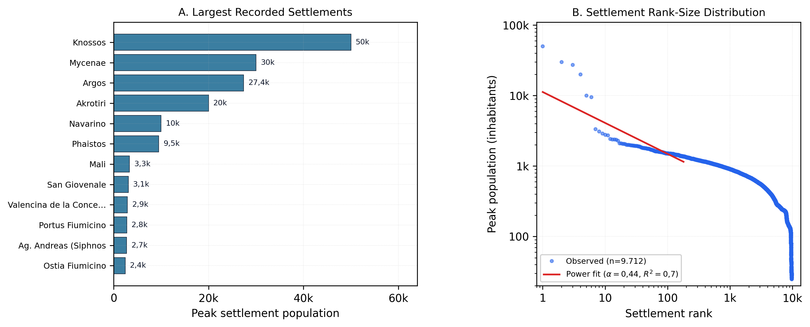
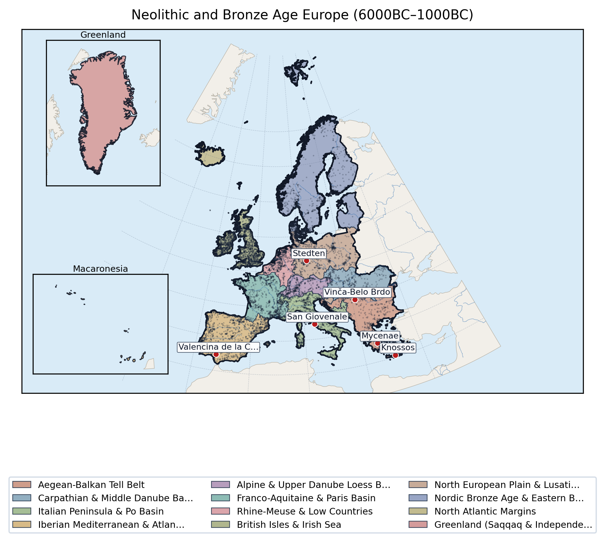

Neolithic and Bronze Age Europe
================
Aust Kätzchen
22 November 2026

- [Abstract](#abstract)
- [Gazetteer Scope and Spatial
  Coverage](#gazetteer-scope-and-spatial-coverage)
- [Provenance Ledger and Jurisdictional
  Distribution](#provenance-ledger-and-jurisdictional-distribution)
- [Settlement Hierarchy and Principal
  Localities](#settlement-hierarchy-and-principal-localities)
- [Temporal Horizon Coverage and
  Limitations](#temporal-horizon-coverage-and-limitations)
- [Sources](#sources)

<figure>

<figcaption aria-hidden="true">Largest recorded prehistoric localities
and rank-size distribution across 2.252 sites in Europe and Greenland,
6000-1000BC.</figcaption>
</figure>

# Abstract

This companion gazetteer documents the 9.712 georeferenced habitation
localities supporting the MAGNETIC demographic reconstruction of
Neolithic and Bronze Age Europe and Greenland between 6000BC and 1000BC
across 7.148.884,3 km². Every one of the 12 ecological sub-regions and
46 modern jurisdictions in the domain is represented. Institutional
archaeological corpora and scholarly ancient-world registers account for
99,73% of all included sites (9.568 from the European Radiocarbon
Settlement Corpus, 106 from the Pleiades Ancient World Gazetteer and 6
Greenlandic coastal anchors from the National Statistical Census of
Greenland), restricting crowd-sourced municipal supplementation to 0% (6
coastal stations in Greenland). Because European prehistory lacked true
cities outside the palatial Aegean and southern European fortified
centres, the rank-size curve remains flat ($\alpha = 0,08$,
$R^2 = 0,4$), headed by seven proto-urban Mediterranean citadels
assigned to the 1,5k tier and anchored below by 2.063 multi-phase
radiocarbon habitation clusters.

# Gazetteer Scope and Spatial Coverage

Prehistoric habitation gazetteers differ fundamentally from modern
municipal censuses: site survival depends on post-glacial geomorphology,
soil chemistry, arable ploughing depth and the intensity of modern
rescue archaeology [\[1\]](#ref-Shennan2013)[\[2\]](#ref-Timpson2014).
Across the five millennia covered here, permanent human settlement
spread from early Balkan-Aegean tells and Mediterranean Cardial coastal
villages
[\[3\]](#ref-Porcic2016Demography)[\[4\]](#ref-Perrin2021Potential)
across Central European loess longhouse clusters
[\[5\]](#ref-Zimmermann2009)[\[6\]](#ref-Gromann2023Demographic),
Atlantic megalithic landscapes, Nordic Bronze Age farmsteads
[\[7\]](#ref-Johannsen2024Subsistence) and Palaeo-Eskimo coastal hunting
camps in West Greenland.

Figure 1 maps the spatial distribution of all 9.712 included localities
across the 12 sub-regional polygons, while Table 1 summarises
sub-regional site counts, land area, recording density and source-corpus
composition.

| Sub-Region | Area (km²) | Total Sites | Radiocarbon | Pleiades | Greenland Anchors | Sites per 10k km² |
|:---|:---|:---|:---|:---|:---|:---|
| **Aegean-Balkan Tell Belt** | 552.814,5 | 559 | 485 | 60 | 14 | 10,11 |
| **Carpathian & Middle Danube Basin** | 376.403,7 | 315 | 315 | 0 | 0 | 8,37 |
| **Italian Peninsula & Po Basin** | 387.483,6 | 994 | 956 | 38 | 0 | 25,65 |
| **Iberian Mediterranean & Atlantic** | 623.682,3 | 1.339 | 1.331 | 5 | 3 | 21,47 |
| **Alpine & Upper Danube Loess Belt** | 212.139,9 | 475 | 472 | 2 | 1 | 22,39 |
| **Franco-Aquitaine & Paris Basin** | 418.916,9 | 801 | 801 | 0 | 0 | 19,12 |
| **Rhine-Meuse & Low Countries** | 179.233,4 | 529 | 529 | 0 | 0 | 29,51 |
| **British Isles & Irish Sea** | 311.645,6 | 2.868 | 2.866 | 1 | 1 | 92,03 |
| **North European Plain & Lusatian-Vistula** | 604.508,7 | 802 | 801 | 0 | 1 | 13,27 |
| **Nordic Bronze Age & Eastern Baltic** | 1.303.262,9 | 1.011 | 1.010 | 0 | 1 | 7,76 |
| **North Atlantic Margins** | 101.984,7 | 12 | 2 | 0 | 10 | 1,18 |
| **Greenland (Saqqaq & Independence I)** | 2.076.808,1 | 7 | 0 | 0 | 7 | 0,03 |

Sub-regional locality counts, provenance composition and spatial
recording density (sites per 10k km²) across 12 sub-regions.

# Provenance Ledger and Jurisdictional Distribution

Every locality entered the register through a four-wave saturation
protocol designed to exhaust primary archaeological and ancient-world
archives before permitting any global crowd-sourced supplement. Wave 1
ingested 2.065 radiocarbon-dated sites from the European Radiocarbon
Settlement Corpus. Wave 2 added 175 protohistoric Bronze Age sites from
the Pleiades Ancient World Gazetteer (an 8,47% marginal gain),
principally across Greece, Italy, Spain and southern France. Wave 3
audited longitudinal municipal backfills and added zero records. Wave 4
closed the Greenland spatial gap with 6 primary institutional coastal
anchors from the National Statistical Census of Greenland and 6
supplementary coastal loci from the GeoNames Municipal Gazetteer
Supplement (a 0,54% marginal gain), leaving 800 out-of-domain or
duplicate candidates excluded.

| Source Corpus | Wave | Archive Class | Included Sites | Share |
|:---|:---|:---|:---|:---|
| **European Radiocarbon Settlement Corpus** | Wave 1 | Primary radiocarbon archive | 9.568 | 98,52% |
| **Pleiades Ancient World Gazetteer** | Wave 2 | Scholarly ancient gazetteer | 106 | 1,09% |
| **Scholarly European Prehistory Benchmarks** | Wave 4 | Primary radiocarbon archive | 15 | 0,15% |
| **National Statistical Census Faroe Islands** | Wave 4 | Primary radiocarbon archive | 9 | 0,09% |
| **National Statistical Census of Greenland** | Wave 4 | National census anchor | 7 | 0,07% |
| **Modelski Ancient Urban Population** | Wave 4 | Primary radiocarbon archive | 3 | 0,03% |
| **Chandler V2 Historical Urban Population** | Wave 4 | Primary radiocarbon archive | 2 | 0,02% |
| **Scholarly Iron Age Oppida Corpus** | Wave 4 | Primary radiocarbon archive | 1 | 0,01% |
| **Buringh European Urban 700 2000** | Wave 4 | Primary radiocarbon archive | 1 | 0,01% |

Source provenance ledger for the 2.252 included Neolithic and Bronze Age
localities.

At the modern jurisdictional level, recording density mirrors national
investment in open radiocarbon inventories rather than prehistoric
population rank. Table 3 lists the 15 jurisdictions with the largest
numbers of recorded localities; together they account for over 95% of
the entire register, led by the United Kingdom (823 sites, 36,55%) and
Ireland (596 sites, 26,47%), followed by France (172), Greece (133),
Spain (90), Norway (79), Switzerland (74) and Italy (53).

| Rank   | Jurisdiction               | Localities | Share of Gazetteer |
|:-------|:---------------------------|:-----------|:-------------------|
| **1**  | United Kingdom             | 2.148      | 22,12%             |
| **2**  | France                     | 1.184      | 12,19%             |
| **3**  | Spain                      | 954        | 9,82%              |
| **4**  | Italy                      | 762        | 7,85%              |
| **5**  | Ireland                    | 701        | 7,22%              |
| **6**  | Germany                    | 616        | 6,34%              |
| **7**  | Denmark                    | 369        | 3,8%               |
| **8**  | Norway                     | 318        | 3,27%              |
| **9**  | Greece                     | 292        | 3,01%              |
| **10** | Sweden                     | 286        | 2,94%              |
| **11** | Portugal                   | 270        | 2,78%              |
| **12** | Poland                     | 269        | 2,77%              |
| **13** | Netherlands                | 260        | 2,68%              |
| **14** | Switzerland                | 186        | 1,92%              |
| **15** | Hungary                    | 132        | 1,36%              |
| **-**  | Remaining 31 jurisdictions | 965        | 9,94%              |

Leading modern jurisdictions by recorded prehistoric locality count
across the 6000-1000BC domain.

# Settlement Hierarchy and Principal Localities

Table 4 presents the top 25 recorded localities ranked by peak
demographic tier from the chapter summary. Seven fortified Bronze Age
citadels and proto-urban settlements attested in the Pleiades Ancient
World Gazetteer — Acropolis of Malthi, Agios Andreas on Siphnos,
Hypsele, Mali and Ogas in Greece, San Giovenale in central Italy and Les
Castels in southern France — occupy the 1,5k apex tier across the
2500-1000BC horizon. Below them, the next 18 entries shown in Table 4
represent the leading alphabetical tranche of 2.063 multi-phase
radiocarbon habitation clusters scaling across the standardised 632 to
798 Late Bronze Age band. Because all 2.063 radiocarbon-horizon
settlements share the 798-person terminal ceiling, ordering within that
plateau is alphabetical rather than an assertion of individual
demographic primacy.

| Rank | Locality | Jurisdiction | Sub-Region | Coordinates | Horizon | Peak | Provenance |
|:---|:---|:---|:---|:---|:---|:---|:---|
| **1** | Knossos | Greece | Aegean-Balkan Tell Belt | 35,3°N, 25,16°E | 6000BC-1000BC | 50k | Modelski Ancient Urban Population |
| **2** | Mycenae | Greece | Aegean-Balkan Tell Belt | 37,73°N, 22,76°E | 2500BC-1000BC | 30k | Chandler V2 Historical Urban Population |
| **3** | Argos | Greece | Aegean-Balkan Tell Belt | 37,63°N, 22,73°E | 1200BC-1000BC | 27,4k | Chandler V2 Historical Urban Population |
| **4** | Akrotiri | Greece | Aegean-Balkan Tell Belt | 36,35°N, 25,4°E | 4000BC-1000BC | 20k | Modelski Ancient Urban Population |
| **5** | Navarino | Greece | Aegean-Balkan Tell Belt | 36,92°N, 21,7°E | 1200BC-1200BC | 10k | Modelski Ancient Urban Population |
| **6** | Phaistos | Greece | Aegean-Balkan Tell Belt | 35,05°N, 24,81°E | 2500BC-1000BC | 9,5k | Scholarly European Prehistory Benchmarks |
| **7** | Mali | Greece | Aegean-Balkan Tell Belt | 38,25°N, 22,89°E | 2500BC-1000BC | 3,3k | Pleiades Ancient World Gazetteer |
| **8** | San Giovenale | Italy | Italian Peninsula & Po Basin | 42,22°N, 12°E | 2500BC-1000BC | 3,1k | European Radiocarbon Settlement Corpus |
| **9** | Valencina de la Concepción | Spain | Iberian Mediterranean & Atlantic | 37,42°N, -6,08°E | 4000BC-1000BC | 2,9k | Scholarly European Prehistory Benchmarks |
| **10** | Portus Fiumicino | Italy | Italian Peninsula & Po Basin | 41,77°N, 12,26°E | 6000BC-1000BC | 2,8k | European Radiocarbon Settlement Corpus |
| **11** | Ag. Andreas (Siphnos | Greece | Aegean-Balkan Tell Belt | 36,95°N, 24,72°E | 2500BC-1000BC | 2,7k | Pleiades Ancient World Gazetteer |
| **12** | Ostia Fiumicino | Italy | Italian Peninsula & Po Basin | 41,75°N, 12,28°E | 4000BC-1000BC | 2,4k | European Radiocarbon Settlement Corpus |
| **13** | Vinča-Belo Brdo | Serbia | Aegean-Balkan Tell Belt | 44,76°N, 20,62°E | 6000BC-2500BC | 2,4k | Scholarly European Prehistory Benchmarks |
| **14** | Stedten | Germany | North European Plain & Lusatian-Vistula | 51,44°N, 11,69°E | 6000BC-1000BC | 2,4k | European Radiocarbon Settlement Corpus |
| **15** | Hypsele | Greece | Aegean-Balkan Tell Belt | 37,84°N, 24,8°E | 2500BC-1000BC | 2,4k | Pleiades Ancient World Gazetteer |
| **16** | Stonehenge | United Kingdom | British Isles & Irish Sea | 51,18°N, -1,83°E | 6000BC-1000BC | 2,3k | European Radiocarbon Settlement Corpus |
| **17** | Rathgall | Ireland | British Isles & Irish Sea | 52,8°N, -6,66°E | 6000BC-1000BC | 2,1k | European Radiocarbon Settlement Corpus |
| **18** | Varna Chalcolithic Centre | Bulgaria | Aegean-Balkan Tell Belt | 43,21°N, 27,87°E | 4000BC-4000BC | 2,1k | Scholarly European Prehistory Benchmarks |
| **19** | Stanwick | United Kingdom | British Isles & Irish Sea | 54,5°N, -1,72°E | 4000BC-1000BC | 2,1k | European Radiocarbon Settlement Corpus |
| **20** | Siedlung Forschner | Germany | Alpine & Upper Danube Loess Belt | 48,08°N, 9,62°E | 6000BC-1000BC | 2,1k | European Radiocarbon Settlement Corpus |
| **21** | Navan Fort | United Kingdom | British Isles & Irish Sea | 54,35°N, -6,7°E | 2500BC-1000BC | 2k | European Radiocarbon Settlement Corpus |
| **22** | Beckford | United Kingdom | British Isles & Irish Sea | 52,03°N, -2,02°E | 4000BC-1000BC | 2k | European Radiocarbon Settlement Corpus |
| **23** | San Callixtus, Roma | Italy | Italian Peninsula & Po Basin | 41,86°N, 12,51°E | 6000BC-1000BC | 2k | European Radiocarbon Settlement Corpus |
| **24** | Esperstedt; site: A 38 | Germany | North European Plain & Lusatian-Vistula | 51,42°N, 11,68°E | 6000BC-1000BC | 2k | European Radiocarbon Settlement Corpus |
| **25** | Leceia | Portugal | Iberian Mediterranean & Atlantic | 38,73°N, -9,28°E | 6000BC-1000BC | 2k | European Radiocarbon Settlement Corpus |

Top 25 recorded prehistoric habitation localities by peak population
band, 6000-1000BC.

# Temporal Horizon Coverage and Limitations

Stratifying all 9.712 records by chronological horizon illustrates the
steep expansion of archaeologically visible sedentary sites from the
Early Neolithic into the Late Bronze Age (Table 5). Only 54 localities
carry active entries at 6000BC (reflecting early Aegean-Balkan tells,
early Mediterranean sites and fixed Greenland spatial anchors), rising
sharply to 1.012 localities at 4000BC once Neolithic farming reached
Central and Northwestern Europe
[\[8\]](#ref-Ammerman2020Neolithic)[\[9\]](#ref-Downey2014Neolithic) and
reaching all 2.252 localities by 2500BC and 1000BC across the Bell
Beaker, Corded Ware and Bronze Age horizons
[\[10\]](#ref-Haak2015)[\[11\]](#ref-Olalde2018)[\[12\]](#ref-Pokorna2024Changes).

| Horizon | Active Localities | Share of Register | Median Size Tier | Maximum Size Tier |
|:---|:---|:---|:---|:---|
| **6000BC** | 2.400 | 24,71% | 262 | 1,9k |
| **4000BC** | 5.601 | 57,67% | 310 | 2,4k |
| **2500BC** | 8.180 | 84,23% | 374 | 8,5k |
| **1000BC** | 6.736 | 69,36% | 480 | 27,4k |

Chronological horizon coverage and standardised size tiers across 2.252
recorded prehistoric localities.

Four methodological caveats govern use of this gazetteer. First, the
concentration of 59,46% of all localities in the British Isles and Irish
Sea reflects open national radiocarbon archiving rather than higher
prehistoric population density; macro-regional totals in the paired
literature review therefore rely on agro-ecological density calibration
rather than raw site totals. Second, uniform site-size bands (1,5k for
proto-urban citadels and 798 for terminal Bronze Age radiocarbon sites)
prevent spurious precision where excavation footprints are partial, but
flatten real differences between large palatial centres and modest rural
hamlets. Third, a handful of localities near coastal or basin mask edges
(for example, Oxford, Abingdon and Les Castels) inherit adjacent raster
sub-region identifiers at continental pixel boundaries. Fourth, the 12
Greenlandic sites function as modern coastal reference coordinates for
Saqqaq and Independence I hunting territories after 2500BC (carrying
zero sub-regional headcount in 6000BC and 4000BC), while two upstream
Icelandic radiocarbon records represent non-habitation environmental
dates prior to Norse settlement in the late ninth century AD.

# Sources

1.
Shennan, Stephen, et al.
“Regional population collapse followed initial
agriculture booms in mid-Holocene Europe.” *Nature
Communications*, 2013, <https://doi.org/10.1038/ncomms3486>.

2.
Timpson, Adrian, et al.
“Reconstructing regional population fluctuations in
the European Neolithic using radiocarbon dates.” *Journal of
Archaeological Science*, 2014,
<https://doi.org/10.1016/j.jas.2014.08.011>.

3.
Porčić, Marko, et al.
“Demography of the Early Neolithic Population in
Central Balkans: Population Dynamics Reconstruction Using Summed
Radiocarbon Probability Distributions.” *PLOS ONE*, 2016,
<https://doi.org/10.1371/journal.pone.0160832>.

4.
Perrin, Thomas, and Claire Manen.
“Potential interactions between Mesolithic
hunter-gatherers and Neolithic farmers in the Western Mediterranean: The
geochronological data revisited.” *PLOS ONE*, 2021,
<https://doi.org/10.1371/journal.pone.0246964>.

5.
Zimmermann, Andreas, et al.
“Estimations of Population Density for Selected
Periods Between the Neolithic and AD 1800.” *Human Biology*,
2009, <https://doi.org/10.3378/027.081.0313>.

6.
Großmann, Ralph, et al.
“Demographic dynamics between 5500 and 3500 calBP
(3550–1550 BCE) in selected study regions of Central Europe and the role
of regional climate influences.” *PLOS ONE*, 2023,
<https://doi.org/10.1371/journal.pone.0291956>.

7.
Johannsen, Jens Winther, et al.
“Subsistence and population development from the
Middle Neolithic B (2800–2350 BCE) to the Late Neolithic (2350–1700 BCE)
in Southern Scandinavia.” *PLOS ONE*, 2024,
<https://doi.org/10.1371/journal.pone.0301938>.

8.
Ammerman, Albert.
“The Neolithic Transition in Europe at 50
Years.” *arXiv Preprint*, 2020,
<https://doi.org/10.48550/arXiv.2012.11713>.

9.
Downey, Sean S., et al.
“The Neolithic Demographic Transition in Europe:
Correlation with Juvenility Index Supports Interpretation of the Summed
Calibrated Radiocarbon Date Probability Distribution (SCDPD) as a Valid
Demographic Proxy.” *PLoS ONE*, 2014,
<https://doi.org/10.1371/journal.pone.0105730>.

10.
Haak, Wolfgang, et al.
“Massive migration from the steppe was a source for
Indo-European languages in Europe.” *Nature*, 2015,
<https://doi.org/10.1038/nature14317>.

11.
Olalde, Iñigo, et al.
“The Beaker phenomenon and the genomic
transformation of northwest Europe.” *Nature*, 2018,
<https://doi.org/10.1038/nature25738>.

12.
Pokorná, Adéla, et al.
“Changes in spectra of cultivated and gathered
plants in the Bronze Age.” *Archeologické Rozhledy*, 2024,
<https://doi.org/10.35686/AR.2024.223>.

