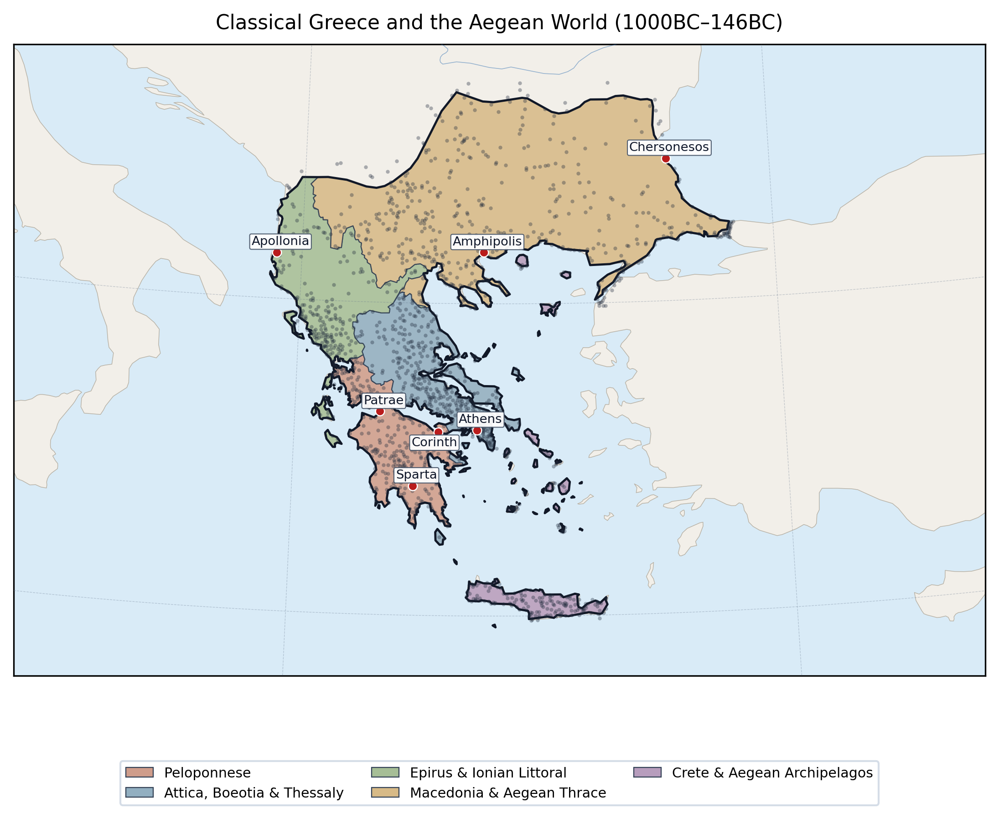

```{r setup, include=FALSE}
knitr::opts_chunk$set(echo = FALSE, warning = FALSE, message = FALSE)
source("../../_shared/template/viscount_rmd_helpers.R")
library(jsonlite)

summary_data <- fromJSON("classical_greece_and_aegean_summary.json", simplifyVector = FALSE)
settlements_raw <- fromJSON("classical_greece_and_aegean_settlements.json", simplifyVector = FALSE)

fmt_bc <- function (yr) {
  y <- as.integer(yr)
  if (y < 0L) paste0(abs(y), "BC") else paste0(y, "AD")
}

fmt_num_vec <- function (vals, digits = 2L) {
  vapply(vals, function (v) viscount_fmt_number(v, digits), character(1))
}

fmt_pct <- function (vals, digits = 1L) {
  vapply(vals, function (v) paste0(viscount_fmt_number(v, digits), "%"), character(1))
}

subregion_ids <- vapply(summary_data$subregions, function (x) as.character(x$id), character(1))
subregion_names <- vapply(summary_data$subregions, function (x) as.character(x$name), character(1))
subregion_areas <- vapply(summary_data$subregions, function (x) as.numeric(x$area_km2), numeric(1))
pop_1000 <- vapply(summary_data$subregions, function (x) as.numeric(x$population[["-1000"]]), numeric(1))
pop_500 <- vapply(summary_data$subregions, function (x) as.numeric(x$population[["-500"]]), numeric(1))
pop_350 <- vapply(summary_data$subregions, function (x) as.numeric(x$population[["-350"]]), numeric(1))
pop_146 <- vapply(summary_data$subregions, function (x) as.numeric(x$population[["-146"]]), numeric(1))

total_area <- as.numeric(summary_data$total_area_km2)
tot_1000 <- as.numeric(summary_data$domain_totals[["-1000"]])
tot_500 <- as.numeric(summary_data$domain_totals[["-500"]])
tot_350 <- as.numeric(summary_data$domain_totals[["-350"]])
tot_146 <- as.numeric(summary_data$domain_totals[["-146"]])
n_settlements <- as.integer(summary_data$settlement_count)

reg_lookup <- setNames(subregion_names, subregion_ids)
prov_labels <- c(
  DARE_Digital_Atlas_Roman_Empire = "Digital Atlas of the Roman Empire",
  Pleiades_Ancient_World_Gazetteer = "Pleiades Ancient World Gazetteer",
  European_Radiocarbon_Settlement_Corpus = "European Radiocarbon Settlement Corpus"
)

sett_reg <- vapply(settlements_raw, function (x) as.character(x$region_id), character(1))
sett_prov <- vapply(settlements_raw, function (x) as.character(x$provenance_source), character(1))
sett_ctry <- vapply(settlements_raw, function (x) as.character(x$country), character(1))
```

```{r hero_markdown_fallback, results='asis'}
if (!knitr::is_latex_output()) {
  cat("\n\n")
}
```

# Abstract

Between the Early Iron Age trough of 1000BC and the Roman destruction of Corinth in 146BC, the Aegean basin and its Balkan margins experienced the sharpest demographic cycle of Mediterranean antiquity prior to the High Empire. Across a study area of `r viscount_fmt_number(total_area, 1L)` km² spanning five sub-regions—Attica, Boeotia and Central Greece; the Peloponnese; Epirus and the Ionian littoral; Macedonia and Aegean Thrace; Crete and the Aegean archipelagos—population rose from `r viscount_fmt_pop(tot_1000)` in 1000BC (`r viscount_fmt_number(tot_1000 / total_area, 1L)` persons per km²) to `r viscount_fmt_pop(tot_500)` by 500BC and peaked at `r viscount_fmt_pop(tot_350)` around 350BC (`r viscount_fmt_number(tot_350 / total_area, 2L)` persons per km²). Intensive polis agriculture, maritime grain imports from the Black Sea and Sicily, chattel slavery and helotage pushed local densities in Crete, the Cyclades, the Peloponnese and Central Greece beyond 28 to 42 persons per km². Thereafter, Macedonian imperial recruitment, sustained emigration into Ptolemaic and Seleucid territories, chronic internecine warfare, deliberate family limitation and Roman military devastation reduced the domain by 20,8% to `r viscount_fmt_pop(tot_146)` by 146BC (`r viscount_fmt_number(tot_146 / total_area, 2L)` persons per km²). MAGNETIC anchors these regional benchmarks against walled-polis carrying capacity, intensive rural surface surveys, palynological sequences, military levy records and a geo-referenced gazetteer of `r viscount_fmt_number(n_settlements, 0L)` classical settlements drawn exclusively from scholarly registries.

# Background

The demographic history of Greece and the Aegean between 1000BC and 146BC traces a clean bell curve superimposed on a deeply fractured limestone terrain. Mountain chains divide the Greek peninsula into dozens of small alluvial basins and coastal pockets, few of them exceeding a few hundred km², while the Aegean Sea knits together hundreds of islands and peninsulas into a single cabotage zone [@Nielbock2017Navigation]. Across the whole `r viscount_fmt_number(total_area, 1L)` km² domain, arable land rarely exceeded a quarter of total surface area, and biennial fallow limited dryland cereal harvests across the southern mainland. Yet within these ecological boundaries, the Greek city-state culture achieved densities unmatched anywhere else in first-millennium Europe north of Sicily and Campania [@Hansen2006; @Scheidel2007].

## Protogeometric Recovery and Iron Age Demography (1000-750BC)

At the start of the first millennium BC, the Aegean was still emerging from the severe demographic contraction that followed the collapse of Mycenaean palatial administration around 1200BC. Major Bronze Age citadels in the Argolid, Messenia and Boeotia lay abandoned or reduced to hamlets, long-distance palace redistribution had vanished and total regional population stood near `r viscount_fmt_pop(tot_1000)`, corresponding to an average density of `r viscount_fmt_number(tot_1000 / total_area, 1L)` persons per km². Southern mainland plains retained scarcely a third of their Late Helladic IIIB numbers, while hill refuges on Crete such as Karphi and fortified island promontories such as Ag. Andreas on Siphnos and Hypsele on Andros sheltered fragmented farming and pastoral communities.

Recovery gathered pace during the tenth and ninth centuries BC. The transition from scarce tin-bronze to widely available iron tools lowered the cost of clearing scrubland, ploughing heavy valley soils and sinking wells across drier calcareous plains. Archaeobotanical sequences from northern Greece show that Bronze and Early Iron Age cultivators diversified into drought-tolerant broomcorn and foxtail millet alongside hulled barley and emmer wheat, buffering households against Mediterranean inter-annual rainfall failure [@Karanikola2026Earliest]. Along the littoral, craft and maritime nodes revived quickly: settlements such as Lefkandi on Euboea, Athens, Argos, Knossos and Cape Kolonna on Aegina maintained coastal trade, metallurgical production and purple-dye processing inherited from Late Bronze Age workshops [@Berger2024More]. By 800BC, cemetery series in Attica, the Argolid and the Cyclades display a sharp rise in formal burials. Part of that burial surge reflects broadened access to formal funerary rites among non-elite households, yet parallel increases in rural sherd densities, well construction and nucleation across Boeotia and the Argive Plain confirm genuine biological growth [@Bintliff1997; @Vignola2022Late].

## Archaic Colonisation and Polis Formation (750-500BC)

Between 750BC and 500BC, the Aegean entered its fastest sustained expansion of antiquity. Over the five centuries from 1000BC to 500BC, total domain population multiplied by 2,68 from `r viscount_fmt_pop(tot_1000)` to `r viscount_fmt_pop(tot_500)`, implying a net compound growth rate close to 0,2% per annum. In pre-industrial Mediterranean populations where life expectancy at birth hovered between 20 and 30 years and total fertility averaged five to six live births per surviving woman, a sustained growth rate of 0,2% per year sits near the upper ceiling attainable without major sanitary breakthroughs [@Scheidel2007; @BagnallFrier1994].

Population pressure on narrow coastal plains drove two complementary adjustments: agricultural intensification at home and overseas colonisation abroad. On the mainland and islands, farmers converted marginal hillsides into stone-terraced olive groves and vineyards, lengthening the agricultural calendar and raising calorific output per hectare. High-resolution pollen cores from ancient Lake Lerna in the Argive Plain record a marked expansion of Olea and cereal indicators during the Archaic and Classical centuries alongside sustained clearance of lowland oak and maquis [@Vignola2022Late]. Simultaneously, Chalcis, Eretria, Corinth, Megara, Achaea, Thera, Paros, Rhodes and Ionian cities despatched scores of organised settlements (apoikiai) to southern Italy, Sicily, the Chalkidike peninsula, the Thracian coast (Abdera, Maroneia, Ainos), the Hellespont and the Black Sea littoral [@Hansen2006].

Viewed strictly in headcount terms, Archaic colonisation exported only a modest fraction of mainland natural increase—perhaps 30k to 60k adult males and accompanying settlers across two centuries—yet its macroeconomic feedback on Aegean carrying capacity was decisive. Overseas daughter cities turned the northern Black Sea steppe, Sicily and eastern Thrace into reliable grain, timber, salt-fish and metal suppliers. Ceramic amphora distributions across the fourth-century Black Sea and Aegean circuits reveal the scale of reciprocal wine and olive-oil exports exchanged for bulk cereals [@Nemtsev2017Trade]. By 500BC, the core Greek regions of Attica, Boeotia, the Peloponnese and the Aegean islands already held `r viscount_fmt_pop(pop_500[1] + pop_500[2] + pop_500[5])`, or 64,6% of the domain total on 37,5% of its land area.

## Classical Zenith, Hoplite Manpower and Unfree Labour (500-350BC)

Growth moderated after 500BC as prime agricultural valleys approached Malthusian saturation, yet the domain still added `r viscount_fmt_pop(tot_350 - tot_500)` inhabitants over the next 150 years (0,14% annual growth), reaching its classical zenith of `r viscount_fmt_pop(tot_350)` around 350BC. At that peak, roughly 800 to 900 independent poleis and federal cantons operated across the mainland, islands and Thracian littoral [@Hansen2006]. Most poleis were modest agro-towns of 1k to 5k residents cultivating territories of 25 to 200 km², where citizens walked daily from walled urban centres to fragmented plots. A handful of commercial and imperial hubs broke clean through local subsistence ceilings: Athens with its port of Piraeus, Corinth, Thebes, Argos, Olynthos, Rhodes and Syracuse outside the Aegean domain [@BowmanWilson2011].

Attica illustrates the demographic mechanics of an import-dependent classical metropolis. On roughly 2.400 km² of dry limestone terrain, fifth-century Attica supported between 30k and 45k adult male citizens at the outbreak of the Peloponnesian War in 431BC, falling temporarily after the devastating plague of 430-426BC—which killed perhaps a quarter to a third of the crowded urban and fleet-serving populace—before recovering to roughly 30k adult male citizens in the mid-fourth century [@Hansen2006; @Harper2017]. Applying standard ancient life-table multipliers of 3,5 to 4 total free persons per adult male aged 18 and over yields 110k to 160k citizen-family members [@BagnallFrier1994; @LoCascio1994]. Adding 10k to 15k resident foreign metics (perhaps 25k to 40k including families) and an enslaved workforce of 80k to 120k employed in the Laurion silver mines, artisan workshops, domestic service and farming brings peak Attic population to 250k to 330k—over 100 persons per km², at least half of whom depended on imported Pontic, Thracian or Sicilian grain [@Hansen2006; @Scheidel2007].

Neighbouring mainland powers displayed sharply contrasting social ratios. Boeotia, with richer alluvial soils around Lake Copais and the Asopos valley, fielded 11k hoplites and 1,1k cavalry at the start of the fourth century (395BC), supported by a broader smallholder citizenry and a smaller chattel-slave proportion than Attica; intensive Boeotian surface surveys indicate rural farmstead densities at their highest recorded level in the entire Holocene between 450BC and 300BC [@Bintliff1997].

In the Peloponnese, Sparta pursued an altogether different demographic path. At Plataea in 479BC, Lacedaemon mobilised 5k full Spartiate hoplites alongside 5k perioikoi and 35k lightly armed helots; by the battle of Leuctra in 371BC, concentration of kleroi estates, dowry inheritance, the catastrophic earthquake of 464BC and war losses had compressed the Spartiate citizen body to fewer than 1,5k adult males, even as the combined Peloponnesian population reached `r viscount_fmt_pop(pop_350[2])`. Physiological analyses of classical heavy-armour combat explain why polis manpower pools were narrow: only fit adult males between roughly 18 and 49 years of age could sustain hoplite phalanx exertion in bronze panoply, binding effective military recruitment tightly to roughly 20-25% of the free male population [@Flouris2024Analysis; @DeLigt2012].

```{r tbl_polis_profiles, results='asis'}
df_polis <- data.frame(
  Polity = c(
    "Attica (Athens and Piraeus)",
    "Boeotian Confederacy",
    "Laconia and Messenia (Sparta)",
    "Corinthia",
    "Rhodes (post-408BC synoecism)"
  ),
  Area = c("2.400", "2.580", "8.400", "880", "1.400"),
  Citizens = c("30k-45k", "18k-22k", "1,5k-8k", "10k-12k", "12k-15k"),
  UnfreeShare = c("30-35%", "15-20%", "55-65%", "30-40%", "25-30%"),
  TotalPop = c("250k-330k", "140k-170k", "190k-240k", "70k-90k", "80k-100k"),
  Density = c("104-138", "54-66", "23-29", "80-102", "57-71"),
  stringsAsFactors = FALSE
)
rownames(df_polis) <- NULL

viscount_table(
  df_polis,
  "Representative classical Greek polity profiles (450-350BC): territory, adult male citizens, unfree share and implied density.",
  c("Polity", "Territory (km²)", "Adult Male Citizens", "Unfree Share", "Total Population", "Density (per km²)")
)
```

## Macedonian Ascendancy, Hellenistic Emigration and Roman Conquest (350-146BC)

The mid-fourth century marked a structural turning point in both political power and regional demographic balance. Under Philip II (359-336BC), the Argead kingdom unified Upper and Lower Macedonia, annexed the fertile Strymon plain and the Pangaeon gold and silver districts, absorbed the Chalkidike poleis after the sack of Olynthos in 348BC and expanded into Thrace. Macedonia and Aegean Thrace reached `r viscount_fmt_pop(pop_350[4])` by 350BC, overtaking Attica, Boeotia and Central Greece (`r viscount_fmt_pop(pop_350[1])`) as the single most populous sub-region of the domain. Monumental Doric construction booms on both shores of the Aegean during the fourth century mirror this final peak of classical civic wealth [@Buyukozer2019Anadolu].

From 334BC onward, Alexander's conquest of the Achaemenid Empire and the formation of the Antigonid, Ptolemaic and Seleucid kingdoms reversed three centuries of mainland demographic accumulation. Between 334BC and 250BC, an estimated 200k to 300k Macedonian, Thessalian, Arcadian, Aetolian and Cretan soldiers, colonists, administrators and artisans emigrated permanently to Egypt, Syria, Mesopotamia and western Anatolia [@Scheidel2007]. Ptolemaic naval hegemony across the Cyclades, Samos and Crete maintained permanent Aegean garrisons and redirected island manpower and commercial networks toward Alexandria [@Glomb2018Ptolemaic]. Because emigration drained disproportionately young adult males and marriageable couples, it depressed birth cohorts across mainland Greece for generations.

By the mid-second century BC, the historian Polybius explicitly lamented widespread *oliganthropia* (shortage of people) across Greece, attributing deserted cities and uncultivated fields not merely to war or epidemic but to deliberate fertility restriction, delayed marriage and the refusal of landowning families to raise more than one or two children lest estates be subdivided [@Scheidel2007; @Bintliff1997]. Intensive archaeological surveys in Boeotia, the southern Argolid, Laconia, Melos and western Samos corroborate Polybius's testimony: small fourth-century rural farmsteads disappeared across large tracts of the countryside between 250BC and 150BC, while remaining holdings consolidated into fewer, larger estates and pollen spectra from Lake Lerna register partial scrub regeneration [@Bintliff1997; @Vignola2022Late; @Loy2025Field].

Roman military intervention turned gradual structural decline into acute demographic shock. The Second and Third Macedonian Wars devastated Thessaly and Lower Macedonia, culminating in the battle of Pydna (168BC) and the partition of the Macedonian kingdom into four isolated republics. In 167BC, the Roman consul Lucius Aemilius Paullus systematically sacked 70 towns of the Molossian league in Epirus and marched 150.000 captives into Italian slavery—a single punitive operation that removed nearly a third of Epirus's inland populace. Finally, the Achaean War ended in 146BC with Lucius Mummius's razing of Corinth, the enslavement of its surviving citizens and the annexation of Greece under the Roman governor of Macedonia [@Hanson2016]. By 146BC, domain population had fallen to `r viscount_fmt_pop(tot_146)`, a cumulative net loss of `r viscount_fmt_pop(tot_350 - tot_146)` inhabitants (-20,8%) from the 350BC peak, with the sharpest contractions in the Peloponnese (-28,2%) and Central Greece (-26,1%).

# Methodology

MAGNETIC reconstructs classical Aegean population trajectories by combining bottom-up archaeological proxies with top-down ecological and institutional constraints across five geographically bounded sub-regions totalling `r viscount_fmt_number(total_area, 1L)` km². Sub-regional boundaries follow primary physiographic watersheds and ancient political-ethnic zones rather than modern national borders: Attica, Boeotia and Central Greece (`r viscount_fmt_number(subregion_areas[1], 1L)` km², including Thessaly, Phocis, Locris and Euboea), the Peloponnese (`r viscount_fmt_number(subregion_areas[2], 1L)` km², including Aetolian-Acarnanian Gulf margins), Epirus and the Ionian Littoral (`r viscount_fmt_number(subregion_areas[3], 1L)` km², extending into southern Illyria across modern Albania and Montenegro), Macedonia and Aegean Thrace (`r viscount_fmt_number(subregion_areas[4], 1L)` km², encompassing the Vardar-Axios, Strymon and Nestos basins into North Macedonia, southern Bulgaria and European Turkey) and Crete with the Aegean Archipelagos (`r viscount_fmt_number(subregion_areas[5], 1L)` km²).

Four benchmark dates anchor the temporal curve: 1000BC (Early Iron Age Protogeometric trough), 500BC (late Archaic expansion immediately prior to the Persian Wars), 350BC (Late Classical demographic maximum on the eve of Macedonian hegemony) and 146BC (Roman annexation following the destruction of Corinth). Each benchmark synthesises four independent strands of evidence:

1. **Walled-area and polis-inventory scaling**: Following Hansen's shotgun method for the Greek polis world, intramural walled areas of surveyed poleis are converted into urban populations using calibrated habitation ratios (roughly 40-50% built residential area within fortified circuits at 150-200 persons per inhabited hectare) and paired with rural hinterland shares derived from territory size [@Hansen2006; @BowmanWilson2011].
2. **Intensive rural field-survey curves**: Diachronic site-count and off-site sherd-density profiles from Boeotia, the southern Argolid, Methana, Laconia, Messenia, Keos and western Samos calibrate the relative amplitude of the Archaic rise, the fourth-century peak and the Late Hellenistic countryside contraction [@Bintliff1997; @Loy2025Field]. Because surface ceramic assemblages span multi-century stylistic phases, raw site counts are damped for time-averaging bias before conversion into synchronous population estimates [@Madsen2012Unbiased].
3. **Military, epigraphic and census multipliers**: Documented classical hoplite musters, Boeotian federal quotas, Athenian ephebic and grain-dole figures alongside Hellenistic Doric epigraphic dossiers are translated into total free populations via Coale-Demeny Model West life tables (levels 2-4, life expectancy at birth 22-28 years), where adult males aged 18-49 comprise roughly 22-25% of the free community [@BagnallFrier1994; @LoCascio1994; @DeLigt2012; @Maffei2023Database]. Unfree populations (chattel slaves and helots) are modelled sub-regionally, ranging from 30-35% in commercial hubs like Attica and Corinth down to 5-15% in pastoral Epirus and interior Thrace [@Scheidel2007].
4. **Radiocarbon and palaeoenvironmental constraints**: For the 1000BC baseline, summed radiocarbon site distributions and palynological records from Lake Lerna and northern Greece bound Early Iron Age settlement density and cereal-olive clearance [@Shennan2013; @Vignola2022Late; @Karanikola2026Earliest].

To anchor spatial allocation inside each sub-region, MAGNETIC compiles a non-crowdsourced gazetteer of `r viscount_fmt_number(n_settlements, 0L)` geo-referenced sites drawn strictly from three scholarly registries: the Digital Atlas of the Roman Empire (1.291 classical and Hellenistic-continuing settlements), the Pleiades Ancient World Gazetteer (109 fortified acropolis and urban centres) and the European Radiocarbon Settlement Corpus (77 Early Iron Age and Archaic village sites). Within the gazetteer itself, sites receive standardised archaeological site-class baseline tiers (6k for major fortified Pleiades citadels, 2,5k for secondary Pleiades centres, 2,2k for DARE classical settlements and 550 for radiocarbon hamlets). Crucially, these site-class tiers act as a spatial weighting armature rather than literal census counts of every individual polis; macro-regional totals are governed by the four-strand demographic budget summarised in Table 2.

```{r tbl_subregions, results='asis'}
df_sub <- data.frame(
  Subregion = subregion_names,
  Area = fmt_num_vec(subregion_areas, 1L),
  Y1000 = vapply(pop_1000, viscount_fmt_pop, character(1)),
  Y500 = vapply(pop_500, viscount_fmt_pop, character(1)),
  Y350 = vapply(pop_350, viscount_fmt_pop, character(1)),
  Y146 = vapply(pop_146, viscount_fmt_pop, character(1)),
  PeakDens = fmt_num_vec(pop_350 / subregion_areas, 2L),
  stringsAsFactors = FALSE
)
df_sub <- rbind(
  df_sub,
  data.frame(
    Subregion = "Total Aegean Domain",
    Area = viscount_fmt_number(total_area, 1L),
    Y1000 = viscount_fmt_pop(tot_1000),
    Y500 = viscount_fmt_pop(tot_500),
    Y350 = viscount_fmt_pop(tot_350),
    Y146 = viscount_fmt_pop(tot_146),
    PeakDens = viscount_fmt_number(tot_350 / total_area, 2L),
    stringsAsFactors = FALSE
  )
)
rownames(df_sub) <- NULL

viscount_table(
  df_sub,
  "Sub-regional area, benchmark populations (1000-146BC) and peak density at 350BC across the Classical Aegean domain.",
  c("Sub-region", "Area (km²)", "1000BC", "500BC", "350BC", "146BC", "350BC Density (per km²)")
)
```

# Validation

Evaluating a classical regional series requires triangulation across agrarian carrying capacity, urban scaling, comparative Mediterranean demographics and military mobilisation ceilings. No single ancient document yields an empire-wide headcount before Augustus; confidence therefore rests on whether independent biological, ecological and institutional bounds converge on the same narrow corridor.

First, the `r viscount_fmt_pop(tot_350)` peak at 350BC aligns closely with Hansen's polis-inventory calculations. Hansen estimates roughly 3,5M to 4M inhabitants for mainland Greece, Macedonia, Epirus, Crete and the Aegean islands in the mid-fourth century, rising to 7,5M-10M only when western Greek colonies in Sicily and Magna Graecia plus Asia Minor and the Black Sea are included [@Hansen2006]. Our domain includes Aegean Thrace up to the lower Hebros and southern Illyrian coastal margins—adding roughly 350k to 500k inhabitants beyond narrow Hellenic borders—so a `r viscount_fmt_pop(tot_350)` ceiling sits squarely in the middle of modern scholarly consensus [@Scheidel2007; @Bintliff1997].

Second, an agrarian carrying-capacity check confirms both the plausibility of the peak and the necessity of maritime grain imports. Across `r viscount_fmt_number(total_area, 1L)` km², roughly 22% of the terrain (about `r viscount_fmt_number(total_area * 0.22, 0L)` km², or 4,55M hectares) was arable under classical technology. Under biennial fallow, half of that arable stock (2,28M hectares) was sown each year. Assuming net consumable yields of 600 to 700 kg of barley-equivalent per sown hectare after seed retention and storage losses, and an annual subsistence requirement of 250 kg grain-equivalent per capita (accounting for olives, legumes, wine and livestock supplementing cereals), domestic agriculture could feed roughly 5,5M people only in peak rainfall years if every arable hectare grew grain. Once olive orchards, vineyards, pasture, fallow shortfalls and transport friction between inland basins are deducted, sustainable domestic cereal capacity falls to roughly 3,2M to 3,6M persons [@BowmanWilson2011; @Scheidel2007]. The 400k to 800k surplus above local grain equilibrium at 350BC matches precisely the scale of attested Black Sea, Thracian, Egyptian and Sicilian grain imports reaching Athens, Corinth, Aegina, Rhodes and the Cycladic islands [@Nemtsev2017Trade; @Nielbock2017Navigation].

Third, sub-regional density ratios respect comparative Mediterranean ecological gradients. At 350BC, Crete and the Aegean Archipelagos attained 42,02 persons per km², the Peloponnese 29,83 and Central Greece 28,17—densities comparable to fourth-century Campania and Sicily and consistent with intensive polyculture on coastal alluvial terraces [@DeLigt2012; @Hanson2016]. By contrast, upland Epirus remained at 9,71 persons per km² and broad Macedonia-Thrace at 13,19 persons per km², reflecting shorter growing seasons, transhumant pastoralism across the Pindus and Rhodope ranges and lower urban clustering.

Fourth, military levy cross-checks corroborate the fourth-century totals. At Chaeronea (338BC) and in the campaigns of Philip II and Alexander, Macedonia and Thessaly alone fielded over 40k trained heavy infantry and cavalry simultaneously, while the combined southern Greek coalition of Athens, Thebes, Corinth, Megara and Achaea put another 35k to 40k citizen and mercenary troops into the field. Under standard classical mobilisation rates of 10-15% of adult male citizens in major campaigns and a total-to-adult-male ratio near 4 (excluding slaves), those field armies imply a free population of at least 2,6M to 3M across the mainland, which—combined with 600k-800k enslaved persons and 690k islanders—converges tightly on `r viscount_fmt_pop(tot_350)` [@Hansen2006; @DeLigt2012; @Flouris2024Analysis].

Table 3 reports compound annual growth rates across each interval, peak-to-trough percentage contractions from 350BC to 146BC and implied benchmark densities. Figure 1 displays the stacked aggregate trajectory and individual sub-regional curves across the full 854-year span.

```{r tbl_growth_validation, results='asis'}
cagr_1000_500 <- ((pop_500 / pop_1000)^(1 / 500) - 1) * 100
cagr_500_350 <- ((pop_350 / pop_500)^(1 / 150) - 1) * 100
cagr_350_146 <- ((pop_146 / pop_350)^(1 / 204) - 1) * 100
chg_350_146 <- ((pop_146 - pop_350) / pop_350) * 100

tot_cagr1 <- ((tot_500 / tot_1000)^(1 / 500) - 1) * 100
tot_cagr2 <- ((tot_350 / tot_500)^(1 / 150) - 1) * 100
tot_cagr3 <- ((tot_146 / tot_350)^(1 / 204) - 1) * 100
tot_chg <- ((tot_146 - tot_350) / tot_350) * 100

df_val <- data.frame(
  Subregion = c(subregion_names, "Total Aegean Domain"),
  D1000 = fmt_num_vec(c(pop_1000 / subregion_areas, tot_1000 / total_area), 2L),
  D146 = fmt_num_vec(c(pop_146 / subregion_areas, tot_146 / total_area), 2L),
  R1 = fmt_pct(c(cagr_1000_500, tot_cagr1), 2L),
  R2 = fmt_pct(c(cagr_500_350, tot_cagr2), 2L),
  R3 = fmt_pct(c(cagr_350_146, tot_cagr3), 2L),
  Drop = fmt_pct(c(chg_350_146, tot_chg), 1L),
  stringsAsFactors = FALSE
)
rownames(df_val) <- NULL

viscount_table(
  df_val,
  "Sub-regional densities at 1000BC and 146BC, annualised growth rates by phase and net contraction from 350BC to 146BC.",
  c("Sub-region", "1000BC (per km²)", "146BC (per km²)", "1000-500BC (%/yr)", "500-350BC (%/yr)", "350-146BC (%/yr)", "350-146BC Change")
)
```

```{r fig_trajectory, results='asis'}
viscount_figure(
  "figures/classical_greece_and_aegean_population_trajectory.png",
  "Aggregate and sub-regional population trajectories across Classical Greece and the Aegean world from 1000BC to 146BC.",
  "fig:trajectory"
)
```

# Results

## Aggregate Aegean Trajectory (1000-146BC)

Over the 854 years from the Protogeometric horizon to Roman annexation, total population across the five Aegean sub-regions rose by 233,3% from `r viscount_fmt_pop(tot_1000)` in 1000BC to `r viscount_fmt_pop(tot_350)` in 350BC, before receding by 20,8% to `r viscount_fmt_pop(tot_146)` in 146BC. Three structural features distinguish this trajectory from northern temperate Europe during the same millennium. First, the bulk of demographic expansion occurred early: 72,1% of the total net gain between 1000BC and 350BC had already been achieved by 500BC, demonstrating that the Archaic age—not the High Classical fifth century—was the principal engine of biological growth. Second, the peak of 350BC was genuinely pan-Aegean, with all five sub-regions attaining their ancient maxima simultaneously despite sharp divergences in political organisation (from hyper-urbanised democratic Athens to ethnos-based federal Epirus and monarchic Macedonia). Third, the post-350BC downturn redistributed demographic gravity northward: whereas the three southern Greek sub-regions (Central Greece, the Peloponnese and the Islands) accounted for 64,6% of the domain in 500BC and 61,5% in 350BC, their combined share slipped to 57,7% by 146BC while Macedonia and Aegean Thrace rose from 23,6% in 500BC to 30% in 146BC.

## Attica, Boeotia and Central Greece

Covering `r viscount_fmt_number(subregion_areas[1], 1L)` km² from the Isthmus of Corinth across Attica, Boeotia, Euboea, Phocis, Locris and the Thessalian plains, Central Greece grew from `r viscount_fmt_pop(pop_1000[1])` in 1000BC (7,96 persons per km²) to `r viscount_fmt_pop(pop_500[1])` in 500BC (23,88 persons per km²) and `r viscount_fmt_pop(pop_350[1])` in 350BC (28,17 persons per km²)—a 3,54-fold expansion. This sub-region holds the densest concentration of sites in the MAGNETIC gazetteer (`r viscount_fmt_number(summary_data$settlements_by_region$attica_boeotia_central, 0L)` settlements, or 33,1% of the domain total, averaging 14,97 recorded sites per 1.000 km²). Major nodes included Athens and Piraeus, Thebes (centred on the Cadmea), Eretria and Chalcis on Euboea, Orchomenos, Haliartos, Akraiphiai, Chaeronea, Daulis, Krisa, Lilaia, Halos, Larissa and Atrax in Thessaly.

Two contrasting engines drove Central Greek density. In Attica and Euboea, maritime commerce, silver mining at Laurion and imported Black Sea wheat sustained an urban agglomeration centred on Athens and Piraeus that accounted for roughly a third of the sub-region's population on less than a twelfth of its territory [@Hansen2006; @Nemtsev2017Trade]. In Boeotia and Thessaly, broad inland plains supported dense networks of medium-sized agricultural poleis and fortified rural demes such as Aphidna and Phyle [@Bintliff1997]. During the Hellenistic period, however, Central Greece suffered heavily: Alexander's destruction of Thebes in 335BC, repeated Antigonid and Aetolian campaigns across Phocis and Boeotia, the decline of Laurion silver output and rural estate consolidation trimmed population by 26,1% (240k persons) down to `r viscount_fmt_pop(pop_146[1])` (20,82 persons per km²) by 146BC.

## Peloponnese

Spanning `r viscount_fmt_number(subregion_areas[2], 1L)` km², the Peloponnese tracked Central Greece almost identically during the expansion phase, rising 3,54-fold from `r viscount_fmt_pop(pop_1000[2])` in 1000BC (8,42 persons per km²) to `r viscount_fmt_pop(pop_500[2])` in 500BC (25,27 persons per km²) and peaking at `r viscount_fmt_pop(pop_350[2])` in 350BC (29,83 persons per km²). Its `r viscount_fmt_number(summary_data$settlements_by_region$peloponnese, 0L)` recorded settlements (15,02 per 1.000 km², the highest site density in the gazetteer) span the maritime commercial hubs of Corinth, Sicyon and Patrai, the densely cultivated Argive, Elean and Messenian lowlands, the inland Arcadian uplands around Kleitor, Mantinea, Tegea and the newly synoecised Megalopolis (founded 371BC) as well as the Spartan Eurotas valley.

The Peloponnese illustrates how institutional shocks amplified ecological vulnerability. The liberation of Messenia by Epaminondas in 369BC and the construction of fortified Messene (marked by the monumental Arcadian Gate) briefly redistributed population westward out of Spartan control while maintaining high regional totals through 350BC. Yet over the following two centuries the peninsula endured the steepest proportional collapse of any Aegean sub-region, losing 240k inhabitants (-28,2%) to fall to `r viscount_fmt_pop(pop_146[2])` (21,41 persons per km²) in 146BC. Arcadian and Peloponnesian mercenary recruitment into Ptolemaic and Seleucid armies drained mountain villages continuously after 323BC, the Cleomenic and Social Wars ravaged Laconia and Achaea while the sack of Corinth in 146BC annihilated the peninsula's foremost trading port [@Hanson2016; @Vignola2022Late].

## Epirus and the Ionian Littoral

Stretching over `r viscount_fmt_number(subregion_areas[3], 1L)` km² along the rugged Pindus watershed, the Ionian islands and the southern Illyrian coast, Epirus and the Ionian Littoral remained the least densely peopled sub-region throughout antiquity. Population expanded from `r viscount_fmt_pop(pop_1000[3])` in 1000BC (3,38 persons per km²) to `r viscount_fmt_pop(pop_500[3])` in 500BC (8,02 persons per km²) and reached `r viscount_fmt_pop(pop_350[3])` at 350BC (9,71 persons per km²). Within this predominantly pastoral and village-based ethnos society—divided among Molossians, Thesprotians and Chaonians—nucleated urbanisation was concentrated along the coastal colonies of Corcyra, Ambracia, Leukas, Apollonia and Epidamnos and later royal inland centres such as Passaron, Dodona and Phoenice.

The gazetteer captures `r viscount_fmt_number(summary_data$settlements_by_region$epirus_ionian, 0L)` settlements across the sub-region (4,62 per 1.000 km²), including 73 sites in modern Albania and 4 in Montenegro alongside Greek Epirus and the Ionian islands. Epirus actually enjoyed a late fourth- and early third-century efflorescence under the Molossian kingdom of Pyrrhus (307-272BC), when urban fortification and stone theatre building peaked. That delayed trajectory buffered the early Hellenistic dip but left the sub-region exposed to Rome's reprisal in 167BC, when Aemilius Paullus destroyed 70 Molossian settlements and enslaved 150.000 Epirotes. Even allowing for partial survival in coastal Chaonia, Corcyra and southern Illyria, the blow cut the sub-region back by 15,2% from its 350BC mark to `r viscount_fmt_pop(pop_146[3])` (8,23 persons per km²) by 146BC.

## Macedonia and Aegean Thrace

Accounting for `r viscount_fmt_number(subregion_areas[4], 1L)` km² (39,6% of the entire study area), Macedonia and Aegean Thrace possessed the largest contiguous alluvial plains in the Aegean world—the Emathian plain around Pella and Aigai, the Axios-Vardar corridor, the Strymon basin anchored by Amphipolis and Gazoros, the Draman plain of Philippi and the Nestos-Hebros lowlands. Starting from `r viscount_fmt_pop(pop_1000[4])` in 1000BC (3,91 persons per km²), the north expanded steadily to `r viscount_fmt_pop(pop_500[4])` in 500BC (9,28 persons per km²) as Greek colonies dotted the Chalkidike and Thracian littoral (Olynthos, Potidaea, Abdera, Maroneia, Thasos's peraia) and inland Odrysian and Macedonian kingdoms consolidated agrarian surpluses [@Karanikola2026Earliest; @Purece2024Known].

By 350BC, Philip II's urban foundations, marsh drainage in the Philippi basin and military integration raised the sub-region to `r viscount_fmt_pop(pop_350[4])` (13,19 persons per km²), making Macedonia and Aegean Thrace the most populous of the five sub-regions. Although Alexander's eastern levies and Cassander's and Antigonus's wars cost tens of thousands of young Macedonian men—and although the Galatian invasion of 279BC and the Roman conquest of 168BC inflicted heavy disruption—broader land reserves and continued rural immigration from upland Illyrian and Thracian tribes limited net decline between 350BC and 146BC to 12% (`r viscount_fmt_pop(pop_146[4])`, or 11,6 persons per km²). With only `r viscount_fmt_number(summary_data$settlements_by_region$macedonia_thrace, 0L)` recorded settlements (2,28 per 1.000 km²), the north exhibits the lowest archaeological site density in the gazetteer—a reflection of larger nucleated villages, non-polis tribal settlement patterns and lighter intensive surface survey compared with southern Greece.

## Crete and the Aegean Archipelagos

Occupying just `r viscount_fmt_number(subregion_areas[5], 1L)` km² (7,9% of total land area), Crete and the Aegean Archipelagos maintained the highest sustained population density in the classical Aegean at every single benchmark: 13,4 persons per km² in 1000BC (`r viscount_fmt_pop(pop_1000[5])`), 35,32 in 500BC (`r viscount_fmt_pop(pop_500[5])`), 42,02 at the 350BC zenith (`r viscount_fmt_pop(pop_350[5])`) and 32,88 in 146BC (`r viscount_fmt_pop(pop_146[5])`). Easy maritime connectivity enabled small islands to specialise in wine, olive oil, marble, obsidian, silver (Siphnos), textiles and transit trade while importing staple grain whenever local harvests failed [@Nielbock2017Navigation; @Loy2025Field].

The sub-region's `r viscount_fmt_number(summary_data$settlements_by_region$crete_aegean_islands, 0L)` recorded sites (9,38 per 1.000 km²) include Crete's dense network of over 40 Doric poleis (Knossos, Gortyn, Phaistos, Kydonia, Lyttos, Eleutherna); the major eastern islands of Rhodes (synoecised in 408BC into a premier commercial republic), Lesbos, Chios, Samos and Kos; plus Cycladic centres such as Naxos, Paros (Koukounaries), Andros (Hypsele), Siphnos (Ag. Andreas), Thera, Delos and Karpathos (Brykous) [@Maffei2023Database; @Loy2025Field]. During the third and second centuries BC, while mainland rural densities sagged, Rhodes and—after 166BC—the Roman-declared free port of Delos enjoyed explosive commercial booms, even as smaller Cycladic islands suffered piracy, Ptolemaic and Macedonian naval requisitions and emigration, producing an aggregate sub-regional decline of 21,7% between 350BC and 146BC [@Glomb2018Ptolemaic; @Hanson2016].

Figure 2 illustrates the rank-size and sub-regional settlement profile of the gazetteer, while Table 4 details settlement coverage and registry provenance across all five sub-regions.

```{r fig_urban, results='asis'}
viscount_figure(
  "figures/classical_greece_and_aegean_urban_hierarchy.png",
  "Settlement rank-size distribution and sub-regional site counts across the 1.477-site Classical Aegean gazetteer (1000-146BC).",
  "fig:urban"
)
```

```{r tbl_settlement_coverage, results='asis'}
dare_by_reg <- vapply(subregion_ids, function (rid) sum(sett_reg == rid & sett_prov == "DARE_Digital_Atlas_Roman_Empire"), integer(1))
plei_by_reg <- vapply(subregion_ids, function (rid) sum(sett_reg == rid & sett_prov == "Pleiades_Ancient_World_Gazetteer"), integer(1))
c14_by_reg <- vapply(subregion_ids, function (rid) sum(sett_reg == rid & sett_prov == "European_Radiocarbon_Settlement_Corpus"), integer(1))
tot_by_reg <- dare_by_reg + plei_by_reg + c14_by_reg

df_cov <- data.frame(
  Subregion = c(subregion_names, "Total Aegean Domain"),
  Sites = fmt_num_vec(c(tot_by_reg, sum(tot_by_reg)), 0L),
  Share = fmt_pct(c(tot_by_reg / sum(tot_by_reg) * 100, 100), 1L),
  SiteDens = fmt_num_vec(c(tot_by_reg / subregion_areas * 1000, sum(tot_by_reg) / total_area * 1000), 2L),
  DARE = fmt_num_vec(c(dare_by_reg, sum(dare_by_reg)), 0L),
  Pleiades = fmt_num_vec(c(plei_by_reg, sum(plei_by_reg)), 0L),
  Radiocarbon = fmt_num_vec(c(c14_by_reg, sum(c14_by_reg)), 0L),
  stringsAsFactors = FALSE
)
rownames(df_cov) <- NULL

viscount_table(
  df_cov,
  "Spatial settlement coverage and scholarly registry provenance across the five Aegean sub-regions.",
  c("Sub-region", "Sites", "Share", "Sites per 1.000 km²", "DARE", "Pleiades", "Radiocarbon")
)
```

# Limitations

Four structural uncertainties bound precision across the 1000-146BC reconstruction and must be weighed when comparing sub-regional figures.

First, ancient Greece generated no systematic empire-wide censuses comparable to Roman imperial declarations or Ptolemaic household registers [@BagnallFrier1994; @LoCascio1994]. Written figures survive overwhelmingly for military levies, Athenian grain distributions and exceptional political grants, forcing demographic historians to extrapolate women, children, elderly residents and resident foreigners through model life tables. Shifting assumed life expectancy at birth from 22 to 28 years alters the adult-male-to-total-population multiplier by roughly 10-15% [@Scheidel2007].

Second, unfree populations carry wide confidence intervals. In commercial poleis such as Athens, Corinth, Chios and Aegina, and in helot-dependent Laconia and Messenia, enslaved people probably comprised between a quarter and a third of total inhabitants at 400-350BC, yet archaeological signatures of slave quarters are virtually indistinguishable from modest free households [@Hansen2006; @Scheidel2007]. A 10-percentage-point shift in assumed slave shares across Attica and the Peloponnese alone would swing the 350BC domain peak by 200k to 300k inhabitants.

Third, archaeological survey coverage is markedly uneven across the `r viscount_fmt_number(total_area, 1L)` km² domain. Attica, Boeotia and the Peloponnese account for 917 of the `r viscount_fmt_number(n_settlements, 0L)` gazetteer settlements (62,1%) despite occupying just 29,6% of the territory, reflecting a century of intensive pedestrian fieldwork in southern Greece [@Bintliff1997]. Conversely, interior Macedonia, western Thrace and upland Epirus remain far more lightly surveyed, leaving small villages and non-monumental Thracian or Illyrian settlements under-represented in spatial point layers [@Purece2024Known].

Fourth, the gazetteer's standardised site-class population tiers (6k for major fortified Pleiades acropolis sites, 2,5k for secondary Pleiades centres, 2,2k for DARE classical sites and 550 for radiocarbon hamlets) intentionally truncate the upper tail of the classical urban hierarchy. Metropoleis such as fifth-century Athens-Piraeus (100k-150k urban-suburban residents), fourth-century Corinth (50k-70k), Rhodes (40k-60k), Thebes (30k-45k) and Pella (30k-40k) far exceeded the uniform 6k fortified-polis tier, while multi-century ceramic date brackets introduce time-averaging smoothing across the 500BC and 200BC spatial slices [@Madsen2012Unbiased; @Hanson2016]. Regional totals in MAGNETIC therefore rely on carrying-capacity and polis-census budgets rather than unadjusted sums of schematic site tiers.

# Conclusion

Between 1000BC and 146BC, Classical Greece and the Aegean world passed through a full pre-industrial demographic cycle—tripling from `r viscount_fmt_pop(tot_1000)` in the Protogeometric trough to `r viscount_fmt_pop(tot_350)` at the fourth-century zenith before contracting by 20,8% to `r viscount_fmt_pop(tot_146)` on the eve of Roman provincial rule. That ascent rested on three pillars: terraced Mediterranean polyculture that wrung extraordinary yields from narrow limestone basins, maritime integration that tapped Pontic and Sicilian grain surpluses and the dense institutional clustering of several hundred independent poleis.

When Macedonian imperial conquests opened the vast agrarian plains of Egypt and western Asia to Greek settlement after 334BC, the Aegean lost its relative pull, exporting prime-age cohorts precisely as domestic estates consolidated and Roman military campaigns shattered Epirus, Macedonia and the Achaean League. By 146BC, the southern Greek heartlands had fallen below their 500BC headcount and demographic gravity had tilted durably toward the alluvial basins of Macedonia and Thrace; the Aegean entered the Roman Mediterranean at roughly four-fifths of its classical ceiling—a level southern Greece would not clearly surpass until the Late Antique revival after 350AD.

# Appendix

## Territorial Reconciliation and Registry Provenance

All `r viscount_fmt_number(n_settlements, 0L)` settlements in the Classical Aegean gazetteer derive from peer-reviewed academic inventories, with 0% crowd-sourced records. Because ancient regional boundaries cross modern political frontiers, Table 5 reconciles the gazetteer across the eight modern European territories overlapping the `r viscount_fmt_number(total_area, 1L)` km² study mask, cross-tabulated by primary registry source. Seventeen supplementary archival studies housed in the chapter repository inform the archaeobotanical, epigraphic, palynological and survey-methodological calibrations cited in the main text.

```{r tbl_country_reconciliation, results='asis'}
ctry_names <- names(summary_data$settlements_by_country)
ctry_totals <- vapply(ctry_names, function (cn) as.integer(summary_data$settlements_by_country[[cn]]), integer(1))
ord <- order(ctry_totals, decreasing = TRUE)
ctry_names <- ctry_names[ord]
ctry_totals <- ctry_totals[ord]

c_dare <- vapply(ctry_names, function (cn) sum(sett_ctry == cn & sett_prov == "DARE_Digital_Atlas_Roman_Empire"), integer(1))
c_plei <- vapply(ctry_names, function (cn) sum(sett_ctry == cn & sett_prov == "Pleiades_Ancient_World_Gazetteer"), integer(1))
c_c14 <- vapply(ctry_names, function (cn) sum(sett_ctry == cn & sett_prov == "European_Radiocarbon_Settlement_Corpus"), integer(1))

df_ctry <- data.frame(
  Territory = c(ctry_names, "Total Aegean Domain"),
  Sites = fmt_num_vec(c(ctry_totals, sum(ctry_totals)), 0L),
  Share = fmt_pct(c(ctry_totals / sum(ctry_totals) * 100, 100), 2L),
  DARE = fmt_num_vec(c(c_dare, sum(c_dare)), 0L),
  Pleiades = fmt_num_vec(c(c_plei, sum(c_plei)), 0L),
  Radiocarbon = fmt_num_vec(c(c_c14, sum(c_c14)), 0L),
  stringsAsFactors = FALSE
)
rownames(df_ctry) <- NULL

viscount_table(
  df_ctry,
  "Distribution of the 1.477 Classical Aegean settlements by modern European territory and source registry.",
  c("Modern Territory", "Total Sites", "Share", "DARE", "Pleiades", "Radiocarbon")
)
```

## Chronological Horizon and Site-Class Tier Summary

Within the spatial settlement file, chronological coverage concentrates on three reference horizons: 80 settlements carry Protogeometric or Early Iron Age occupations at 1000BC (77 radiocarbon sites plus three early fortified island and Messenian acropolises), 1.444 sites register active occupation at 500BC and 1.439 sites remain occupied into the Hellenistic horizon at 200BC. Table 6 summarises the four standardised archaeological site-class baseline tiers linking the coordinate gazetteer to the regional carrying-capacity benchmarks.

```{r tbl_tier_summary, results='asis'}
peak_pops <- vapply(settlements_raw, function (x) {
  vals <- as.numeric(unlist(x$population))
  if (length(vals) == 0L) 0 else max(vals, na.rm = TRUE)
}, numeric(1))

tier_vals <- sort(unique(peak_pops), decreasing = TRUE)
tier_counts <- vapply(tier_vals, function (tv) sum(peak_pops == tv), integer(1))
tier_labels <- c(
  "Major fortified polis and acropolis tier",
  "Secondary urban and sanctuary tier",
  "Classical and Hellenistic-continuing DARE tier",
  "Early Iron Age radiocarbon village tier"
)
tier_reg <- c(
  "Pleiades Ancient World Gazetteer",
  "Pleiades Ancient World Gazetteer",
  "Digital Atlas of the Roman Empire",
  "European Radiocarbon Settlement Corpus"
)

df_tiers <- data.frame(
  Class = tier_labels[seq_along(tier_vals)],
  Registry = tier_reg[seq_along(tier_vals)],
  Baseline = vapply(tier_vals, viscount_fmt_pop, character(1)),
  Count = fmt_num_vec(tier_counts, 0L),
  Share = fmt_pct(tier_counts / sum(tier_counts) * 100, 1L),
  stringsAsFactors = FALSE
)
rownames(df_tiers) <- NULL

viscount_table(
  df_tiers,
  "Standardised archaeological site-class baseline tiers across the 1.477-site Classical Aegean gazetteer.",
  c("Site-Class Tier", "Primary Registry", "Baseline Prior", "Sites", "Share")
)
```

# Sources
