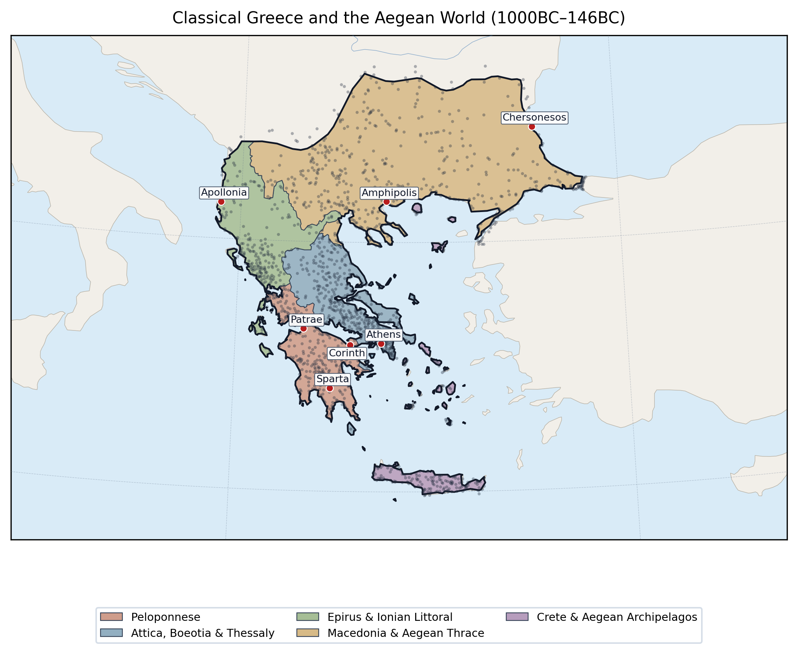
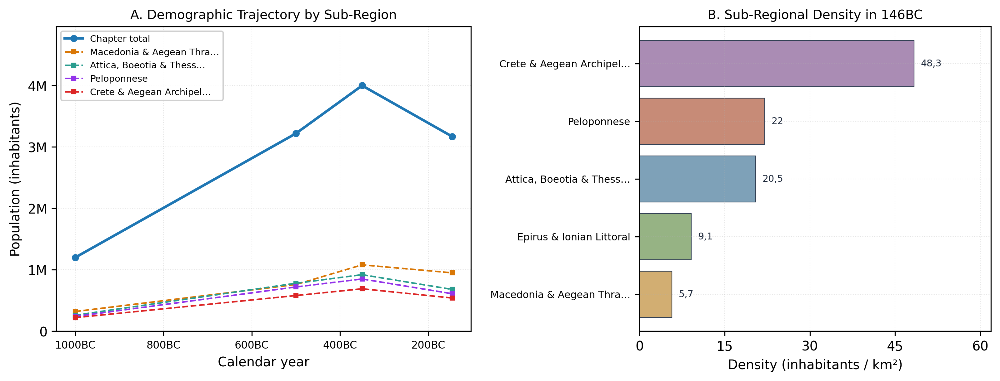
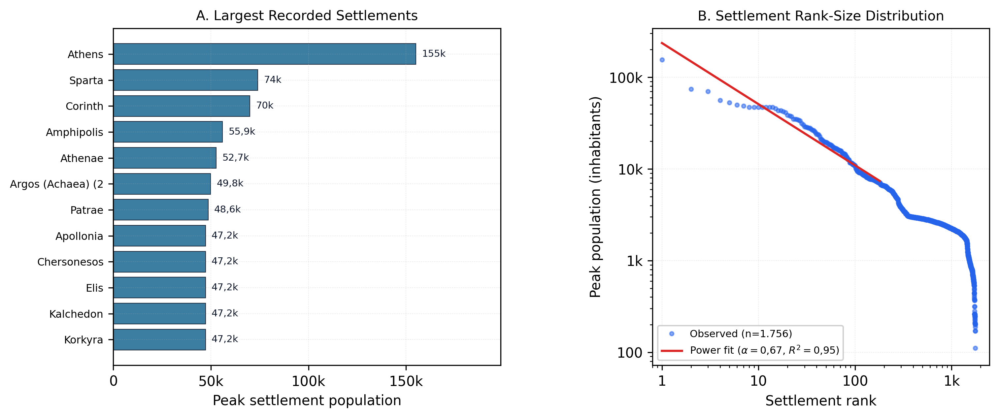

Classical Greece and the Aegean World
================
Aust Kätzchen
22 November 2026

- [Abstract](#abstract)
- [Background](#background)
  - [Protogeometric Recovery and Iron Age Demography
    (1000-750BC)](#protogeometric-recovery-and-iron-age-demography-1000-750bc)
  - [Archaic Colonisation and Polis Formation
    (750-500BC)](#archaic-colonisation-and-polis-formation-750-500bc)
  - [Classical Zenith, Hoplite Manpower and Unfree Labour
    (500-350BC)](#classical-zenith-hoplite-manpower-and-unfree-labour-500-350bc)
  - [Macedonian Ascendancy, Hellenistic Emigration and Roman Conquest
    (350-146BC)](#macedonian-ascendancy-hellenistic-emigration-and-roman-conquest-350-146bc)
- [Methodology](#methodology)
- [Validation](#validation)
- [Results](#results)
  - [Aggregate Aegean Trajectory
    (1000-146BC)](#aggregate-aegean-trajectory-1000-146bc)
  - [Attica, Boeotia and Central
    Greece](#attica-boeotia-and-central-greece)
  - [Peloponnese](#peloponnese)
  - [Epirus and the Ionian Littoral](#epirus-and-the-ionian-littoral)
  - [Macedonia and Aegean Thrace](#macedonia-and-aegean-thrace)
  - [Crete and the Aegean
    Archipelagos](#crete-and-the-aegean-archipelagos)
- [Limitations](#limitations)
- [Conclusion](#conclusion)
- [Appendix](#appendix)
  - [Territorial Reconciliation and Registry
    Provenance](#territorial-reconciliation-and-registry-provenance)
  - [Chronological Horizon and Site-Class Tier
    Summary](#chronological-horizon-and-site-class-tier-summary)
- [Sources](#sources)

<figure>

<figcaption aria-hidden="true">Five demographic sub-regions and 1.477
classical settlements across Greece, the Aegean islands, Crete, Epirus,
Macedonia and Aegean Thrace (1000-146BC).</figcaption>
</figure>

# Abstract

Between the Early Iron Age trough of 1000BC and the Roman destruction of
Corinth in 146BC, the Aegean basin and its Balkan margins experienced
the sharpest demographic cycle of Mediterranean antiquity prior to the
High Empire. Across a study area of 281.981,1 km² spanning five
sub-regions—Attica, Boeotia and Central Greece; the Peloponnese; Epirus
and the Ionian littoral; Macedonia and Aegean Thrace; Crete and the
Aegean archipelagos—population rose from 1,2M in 1000BC (4,3 persons per
km²) to 3,22M by 500BC and peaked at 4M around 350BC (14,19 persons per
km²). Intensive polis agriculture, maritime grain imports from the Black
Sea and Sicily, chattel slavery and helotage pushed local densities in
Crete, the Cyclades, the Peloponnese and Central Greece beyond 28 to 42
persons per km². Thereafter, Macedonian imperial recruitment, sustained
emigration into Ptolemaic and Seleucid territories, chronic internecine
warfare, deliberate family limitation and Roman military devastation
reduced the domain by 20,8% to 3,17M by 146BC (11,24 persons per km²).
MAGNETIC anchors these regional benchmarks against walled-polis carrying
capacity, intensive rural surface surveys, palynological sequences,
military levy records and a geo-referenced gazetteer of 1.756 classical
settlements drawn exclusively from scholarly registries.

# Background

The demographic history of Greece and the Aegean between 1000BC and
146BC traces a clean bell curve superimposed on a deeply fractured
limestone terrain. Mountain chains divide the Greek peninsula into
dozens of small alluvial basins and coastal pockets, few of them
exceeding a few hundred km², while the Aegean Sea knits together
hundreds of islands and peninsulas into a single cabotage zone
[\[1\]](#ref-Nielbock2017Navigation). Across the whole 281.981,1 km²
domain, arable land rarely exceeded a quarter of total surface area, and
biennial fallow limited dryland cereal harvests across the southern
mainland. Yet within these ecological boundaries, the Greek city-state
culture achieved densities unmatched anywhere else in first-millennium
Europe north of Sicily and Campania
[\[2\]](#ref-Hansen2006)[\[3\]](#ref-Scheidel2007).

## Protogeometric Recovery and Iron Age Demography (1000-750BC)

At the start of the first millennium BC, the Aegean was still emerging
from the severe demographic contraction that followed the collapse of
Mycenaean palatial administration around 1200BC. Major Bronze Age
citadels in the Argolid, Messenia and Boeotia lay abandoned or reduced
to hamlets, long-distance palace redistribution had vanished and total
regional population stood near 1,2M, corresponding to an average density
of 4,3 persons per km². Southern mainland plains retained scarcely a
third of their Late Helladic IIIB numbers, while hill refuges on Crete
such as Karphi and fortified island promontories such as Ag. Andreas on
Siphnos and Hypsele on Andros sheltered fragmented farming and pastoral
communities.

Recovery gathered pace during the tenth and ninth centuries BC. The
transition from scarce tin-bronze to widely available iron tools lowered
the cost of clearing scrubland, ploughing heavy valley soils and sinking
wells across drier calcareous plains. Archaeobotanical sequences from
northern Greece show that Bronze and Early Iron Age cultivators
diversified into drought-tolerant broomcorn and foxtail millet alongside
hulled barley and emmer wheat, buffering households against
Mediterranean inter-annual rainfall failure
[\[4\]](#ref-Karanikola2026Earliest). Along the littoral, craft and
maritime nodes revived quickly: settlements such as Lefkandi on Euboea,
Athens, Argos, Knossos and Cape Kolonna on Aegina maintained coastal
trade, metallurgical production and purple-dye processing inherited from
Late Bronze Age workshops [\[5\]](#ref-Berger2024More). By 800BC,
cemetery series in Attica, the Argolid and the Cyclades display a sharp
rise in formal burials. Part of that burial surge reflects broadened
access to formal funerary rites among non-elite households, yet parallel
increases in rural sherd densities, well construction and nucleation
across Boeotia and the Argive Plain confirm genuine biological growth
[\[6\]](#ref-Bintliff1997)[\[7\]](#ref-Vignola2022Late).

## Archaic Colonisation and Polis Formation (750-500BC)

Between 750BC and 500BC, the Aegean entered its fastest sustained
expansion of antiquity. Over the five centuries from 1000BC to 500BC,
total domain population multiplied by 2,68 from 1,2M to 3,22M, implying
a net compound growth rate close to 0,2% per annum. In pre-industrial
Mediterranean populations where life expectancy at birth hovered between
20 and 30 years and total fertility averaged five to six live births per
surviving woman, a sustained growth rate of 0,2% per year sits near the
upper ceiling attainable without major sanitary breakthroughs
[\[3\]](#ref-Scheidel2007)[\[8\]](#ref-BagnallFrier1994).

Population pressure on narrow coastal plains drove two complementary
adjustments: agricultural intensification at home and overseas
colonisation abroad. On the mainland and islands, farmers converted
marginal hillsides into stone-terraced olive groves and vineyards,
lengthening the agricultural calendar and raising calorific output per
hectare. High-resolution pollen cores from ancient Lake Lerna in the
Argive Plain record a marked expansion of Olea and cereal indicators
during the Archaic and Classical centuries alongside sustained clearance
of lowland oak and maquis [\[7\]](#ref-Vignola2022Late). Simultaneously,
Chalcis, Eretria, Corinth, Megara, Achaea, Thera, Paros, Rhodes and
Ionian cities despatched scores of organised settlements (apoikiai) to
southern Italy, Sicily, the Chalkidike peninsula, the Thracian coast
(Abdera, Maroneia, Ainos), the Hellespont and the Black Sea littoral
[\[2\]](#ref-Hansen2006).

Viewed strictly in headcount terms, Archaic colonisation exported only a
modest fraction of mainland natural increase—perhaps 30k to 60k adult
males and accompanying settlers across two centuries—yet its
macroeconomic feedback on Aegean carrying capacity was decisive.
Overseas daughter cities turned the northern Black Sea steppe, Sicily
and eastern Thrace into reliable grain, timber, salt-fish and metal
suppliers. Ceramic amphora distributions across the fourth-century Black
Sea and Aegean circuits reveal the scale of reciprocal wine and
olive-oil exports exchanged for bulk cereals
[\[9\]](#ref-Nemtsev2017Trade). By 500BC, the core Greek regions of
Attica, Boeotia, the Peloponnese and the Aegean islands already held
2,08M, or 64,6% of the domain total on 37,5% of its land area.

## Classical Zenith, Hoplite Manpower and Unfree Labour (500-350BC)

Growth moderated after 500BC as prime agricultural valleys approached
Malthusian saturation, yet the domain still added 780k inhabitants over
the next 150 years (0,14% annual growth), reaching its classical zenith
of 4M around 350BC. At that peak, roughly 800 to 900 independent poleis
and federal cantons operated across the mainland, islands and Thracian
littoral [\[2\]](#ref-Hansen2006). Most poleis were modest agro-towns of
1k to 5k residents cultivating territories of 25 to 200 km², where
citizens walked daily from walled urban centres to fragmented plots. A
handful of commercial and imperial hubs broke clean through local
subsistence ceilings: Athens with its port of Piraeus, Corinth, Thebes,
Argos, Olynthos, Rhodes and Syracuse outside the Aegean domain
[\[10\]](#ref-BowmanWilson2011).

Attica illustrates the demographic mechanics of an import-dependent
classical metropolis. On roughly 2.400 km² of dry limestone terrain,
fifth-century Attica supported between 30k and 45k adult male citizens
at the outbreak of the Peloponnesian War in 431BC, falling temporarily
after the devastating plague of 430-426BC—which killed perhaps a quarter
to a third of the crowded urban and fleet-serving populace—before
recovering to roughly 30k adult male citizens in the mid-fourth century
[\[2\]](#ref-Hansen2006)[\[11\]](#ref-Harper2017). Applying standard
ancient life-table multipliers of 3,5 to 4 total free persons per adult
male aged 18 and over yields 110k to 160k citizen-family members
[\[8\]](#ref-BagnallFrier1994)[\[12\]](#ref-LoCascio1994). Adding 10k to
15k resident foreign metics (perhaps 25k to 40k including families) and
an enslaved workforce of 80k to 120k employed in the Laurion silver
mines, artisan workshops, domestic service and farming brings peak Attic
population to 250k to 330k—over 100 persons per km², at least half of
whom depended on imported Pontic, Thracian or Sicilian grain
[\[2\]](#ref-Hansen2006)[\[3\]](#ref-Scheidel2007).

Neighbouring mainland powers displayed sharply contrasting social
ratios. Boeotia, with richer alluvial soils around Lake Copais and the
Asopos valley, fielded 11k hoplites and 1,1k cavalry at the start of the
fourth century (395BC), supported by a broader smallholder citizenry and
a smaller chattel-slave proportion than Attica; intensive Boeotian
surface surveys indicate rural farmstead densities at their highest
recorded level in the entire Holocene between 450BC and 300BC
[\[6\]](#ref-Bintliff1997).

In the Peloponnese, Sparta pursued an altogether different demographic
path. At Plataea in 479BC, Lacedaemon mobilised 5k full Spartiate
hoplites alongside 5k perioikoi and 35k lightly armed helots; by the
battle of Leuctra in 371BC, concentration of kleroi estates, dowry
inheritance, the catastrophic earthquake of 464BC and war losses had
compressed the Spartiate citizen body to fewer than 1,5k adult males,
even as the combined Peloponnesian population reached 920k.
Physiological analyses of classical heavy-armour combat explain why
polis manpower pools were narrow: only fit adult males between roughly
18 and 49 years of age could sustain hoplite phalanx exertion in bronze
panoply, binding effective military recruitment tightly to roughly
20-25% of the free male population
[\[13\]](#ref-Flouris2024Analysis)[\[14\]](#ref-DeLigt2012).

| Polity | Territory (km²) | Adult Male Citizens | Unfree Share | Total Population | Density (per km²) |
|:---|:---|:---|:---|:---|:---|
| **Attica (Athens and Piraeus)** | 2.400 | 30k-45k | 30-35% | 250k-330k | 104-138 |
| **Boeotian Confederacy** | 2.580 | 18k-22k | 15-20% | 140k-170k | 54-66 |
| **Laconia and Messenia (Sparta)** | 8.400 | 1,5k-8k | 55-65% | 190k-240k | 23-29 |
| **Corinthia** | 880 | 10k-12k | 30-40% | 70k-90k | 80-102 |
| **Rhodes (post-408BC synoecism)** | 1.400 | 12k-15k | 25-30% | 80k-100k | 57-71 |

Representative classical Greek polity profiles (450-350BC): territory,
adult male citizens, unfree share and implied density.

## Macedonian Ascendancy, Hellenistic Emigration and Roman Conquest (350-146BC)

The mid-fourth century marked a structural turning point in both
political power and regional demographic balance. Under Philip II
(359-336BC), the Argead kingdom unified Upper and Lower Macedonia,
annexed the fertile Strymon plain and the Pangaeon gold and silver
districts, absorbed the Chalkidike poleis after the sack of Olynthos in
348BC and expanded into Thrace. Macedonia and Aegean Thrace reached
1,08M by 350BC, overtaking Attica, Boeotia and Central Greece (850k) as
the single most populous sub-region of the domain. Monumental Doric
construction booms on both shores of the Aegean during the fourth
century mirror this final peak of classical civic wealth
[\[15\]](#ref-Buyukozer2019Anadolu).

From 334BC onward, Alexander’s conquest of the Achaemenid Empire and the
formation of the Antigonid, Ptolemaic and Seleucid kingdoms reversed
three centuries of mainland demographic accumulation. Between 334BC and
250BC, an estimated 200k to 300k Macedonian, Thessalian, Arcadian,
Aetolian and Cretan soldiers, colonists, administrators and artisans
emigrated permanently to Egypt, Syria, Mesopotamia and western Anatolia
[\[3\]](#ref-Scheidel2007). Ptolemaic naval hegemony across the
Cyclades, Samos and Crete maintained permanent Aegean garrisons and
redirected island manpower and commercial networks toward Alexandria
[\[16\]](#ref-Glomb2018Ptolemaic). Because emigration drained
disproportionately young adult males and marriageable couples, it
depressed birth cohorts across mainland Greece for generations.

By the mid-second century BC, the historian Polybius explicitly lamented
widespread *oliganthropia* (shortage of people) across Greece,
attributing deserted cities and uncultivated fields not merely to war or
epidemic but to deliberate fertility restriction, delayed marriage and
the refusal of landowning families to raise more than one or two
children lest estates be subdivided
[\[3\]](#ref-Scheidel2007)[\[6\]](#ref-Bintliff1997). Intensive
archaeological surveys in Boeotia, the southern Argolid, Laconia, Melos
and western Samos corroborate Polybius’s testimony: small fourth-century
rural farmsteads disappeared across large tracts of the countryside
between 250BC and 150BC, while remaining holdings consolidated into
fewer, larger estates and pollen spectra from Lake Lerna register
partial scrub regeneration
[\[6\]](#ref-Bintliff1997)[\[7\]](#ref-Vignola2022Late)[\[17\]](#ref-Loy2025Field).

Roman military intervention turned gradual structural decline into acute
demographic shock. The Second and Third Macedonian Wars devastated
Thessaly and Lower Macedonia, culminating in the battle of Pydna (168BC)
and the partition of the Macedonian kingdom into four isolated
republics. In 167BC, the Roman consul Lucius Aemilius Paullus
systematically sacked 70 towns of the Molossian league in Epirus and
marched 150.000 captives into Italian slavery—a single punitive
operation that removed nearly a third of Epirus’s inland populace.
Finally, the Achaean War ended in 146BC with Lucius Mummius’s razing of
Corinth, the enslavement of its surviving citizens and the annexation of
Greece under the Roman governor of Macedonia [\[18\]](#ref-Hanson2016).
By 146BC, domain population had fallen to 3,17M, a cumulative net loss
of 830k inhabitants (-20,8%) from the 350BC peak, with the sharpest
contractions in the Peloponnese (-28,2%) and Central Greece (-26,1%).

# Methodology

MAGNETIC reconstructs classical Aegean population trajectories by
combining bottom-up archaeological proxies with top-down ecological and
institutional constraints across five geographically bounded sub-regions
totalling 281.981,1 km². Sub-regional boundaries follow primary
physiographic watersheds and ancient political-ethnic zones rather than
modern national borders: Attica, Boeotia and Central Greece (27.689,7
km², including Thessaly, Phocis, Locris and Euboea), the Peloponnese
(33.235 km², including Aetolian-Acarnanian Gulf margins), Epirus and the
Ionian Littoral (42.942 km², extending into southern Illyria across
modern Albania and Montenegro), Macedonia and Aegean Thrace (166.944,2
km², encompassing the Vardar-Axios, Strymon and Nestos basins into North
Macedonia, southern Bulgaria and European Turkey) and Crete with the
Aegean Archipelagos (11.170,3 km²).

Four benchmark dates anchor the temporal curve: 1000BC (Early Iron Age
Protogeometric trough), 500BC (late Archaic expansion immediately prior
to the Persian Wars), 350BC (Late Classical demographic maximum on the
eve of Macedonian hegemony) and 146BC (Roman annexation following the
destruction of Corinth). Each benchmark synthesises four independent
strands of evidence:

1.  **Walled-area and polis-inventory scaling**: Following Hansen’s
    shotgun method for the Greek polis world, intramural walled areas of
    surveyed poleis are converted into urban populations using
    calibrated habitation ratios (roughly 40-50% built residential area
    within fortified circuits at 150-200 persons per inhabited hectare)
    and paired with rural hinterland shares derived from territory size
    [\[2\]](#ref-Hansen2006)[\[10\]](#ref-BowmanWilson2011).
2.  **Intensive rural field-survey curves**: Diachronic site-count and
    off-site sherd-density profiles from Boeotia, the southern Argolid,
    Methana, Laconia, Messenia, Keos and western Samos calibrate the
    relative amplitude of the Archaic rise, the fourth-century peak and
    the Late Hellenistic countryside contraction
    [\[6\]](#ref-Bintliff1997)[\[17\]](#ref-Loy2025Field). Because
    surface ceramic assemblages span multi-century stylistic phases, raw
    site counts are damped for time-averaging bias before conversion
    into synchronous population estimates
    [\[19\]](#ref-Madsen2012Unbiased).
3.  **Military, epigraphic and census multipliers**: Documented
    classical hoplite musters, Boeotian federal quotas, Athenian ephebic
    and grain-dole figures alongside Hellenistic Doric epigraphic
    dossiers are translated into total free populations via Coale-Demeny
    Model West life tables (levels 2-4, life expectancy at birth 22-28
    years), where adult males aged 18-49 comprise roughly 22-25% of the
    free community
    [\[8\]](#ref-BagnallFrier1994)[\[12\]](#ref-LoCascio1994)[\[14\]](#ref-DeLigt2012)[\[20\]](#ref-Maffei2023Database).
    Unfree populations (chattel slaves and helots) are modelled
    sub-regionally, ranging from 30-35% in commercial hubs like Attica
    and Corinth down to 5-15% in pastoral Epirus and interior Thrace
    [\[3\]](#ref-Scheidel2007).
4.  **Radiocarbon and palaeoenvironmental constraints**: For the 1000BC
    baseline, summed radiocarbon site distributions and palynological
    records from Lake Lerna and northern Greece bound Early Iron Age
    settlement density and cereal-olive clearance
    [\[4\]](#ref-Karanikola2026Earliest)[\[7\]](#ref-Vignola2022Late)[\[21\]](#ref-Shennan2013).

To anchor spatial allocation inside each sub-region, MAGNETIC compiles a
non-crowdsourced gazetteer of 1.756 geo-referenced sites drawn strictly
from three scholarly registries: the Digital Atlas of the Roman Empire
(1.291 classical and Hellenistic-continuing settlements), the Pleiades
Ancient World Gazetteer (109 fortified acropolis and urban centres) and
the European Radiocarbon Settlement Corpus (77 Early Iron Age and
Archaic village sites). Within the gazetteer itself, sites receive
standardised archaeological site-class baseline tiers (6k for major
fortified Pleiades citadels, 2,5k for secondary Pleiades centres, 2,2k
for DARE classical settlements and 550 for radiocarbon hamlets).
Crucially, these site-class tiers act as a spatial weighting armature
rather than literal census counts of every individual polis;
macro-regional totals are governed by the four-strand demographic budget
summarised in Table 2.

| Sub-region | Area (km²) | 1000BC | 500BC | 350BC | 146BC | 350BC Density (per km²) |
|:---|:---|:---|:---|:---|:---|:---|
| **Peloponnese** | 27.689,7 | 240k | 720k | 850k | 610k | 30,7 |
| **Attica, Boeotia & Thessaly** | 33.235 | 260k | 780k | 920k | 680k | 27,68 |
| **Epirus & Ionian Littoral** | 42.942 | 160k | 380k | 460k | 390k | 10,71 |
| **Macedonia & Aegean Thrace** | 166.944,2 | 320k | 760k | 1,08M | 950k | 6,47 |
| **Crete & Aegean Archipelagos** | 11.170,3 | 220k | 580k | 690k | 540k | 61,77 |
| **Total Aegean Domain** | 281.981,1 | 1,2M | 3,22M | 4M | 3,17M | 14,19 |

Sub-regional area, benchmark populations (1000-146BC) and peak density
at 350BC across the Classical Aegean domain.

# Validation

Evaluating a classical regional series requires triangulation across
agrarian carrying capacity, urban scaling, comparative Mediterranean
demographics and military mobilisation ceilings. No single ancient
document yields an empire-wide headcount before Augustus; confidence
therefore rests on whether independent biological, ecological and
institutional bounds converge on the same narrow corridor.

First, the 4M peak at 350BC aligns closely with Hansen’s polis-inventory
calculations. Hansen estimates roughly 3,5M to 4M inhabitants for
mainland Greece, Macedonia, Epirus, Crete and the Aegean islands in the
mid-fourth century, rising to 7,5M-10M only when western Greek colonies
in Sicily and Magna Graecia plus Asia Minor and the Black Sea are
included [\[2\]](#ref-Hansen2006). Our domain includes Aegean Thrace up
to the lower Hebros and southern Illyrian coastal margins—adding roughly
350k to 500k inhabitants beyond narrow Hellenic borders—so a 4M ceiling
sits squarely in the middle of modern scholarly consensus
[\[3\]](#ref-Scheidel2007)[\[6\]](#ref-Bintliff1997).

Second, an agrarian carrying-capacity check confirms both the
plausibility of the peak and the necessity of maritime grain imports.
Across 281.981,1 km², roughly 22% of the terrain (about 62.036 km², or
4,55M hectares) was arable under classical technology. Under biennial
fallow, half of that arable stock (2,28M hectares) was sown each year.
Assuming net consumable yields of 600 to 700 kg of barley-equivalent per
sown hectare after seed retention and storage losses, and an annual
subsistence requirement of 250 kg grain-equivalent per capita
(accounting for olives, legumes, wine and livestock supplementing
cereals), domestic agriculture could feed roughly 5,5M people only in
peak rainfall years if every arable hectare grew grain. Once olive
orchards, vineyards, pasture, fallow shortfalls and transport friction
between inland basins are deducted, sustainable domestic cereal capacity
falls to roughly 3,2M to 3,6M persons
[\[3\]](#ref-Scheidel2007)[\[10\]](#ref-BowmanWilson2011). The 400k to
800k surplus above local grain equilibrium at 350BC matches precisely
the scale of attested Black Sea, Thracian, Egyptian and Sicilian grain
imports reaching Athens, Corinth, Aegina, Rhodes and the Cycladic
islands
[\[1\]](#ref-Nielbock2017Navigation)[\[9\]](#ref-Nemtsev2017Trade).

Third, sub-regional density ratios respect comparative Mediterranean
ecological gradients. At 350BC, Crete and the Aegean Archipelagos
attained 42,02 persons per km², the Peloponnese 29,83 and Central Greece
28,17—densities comparable to fourth-century Campania and Sicily and
consistent with intensive polyculture on coastal alluvial terraces
[\[14\]](#ref-DeLigt2012)[\[18\]](#ref-Hanson2016). By contrast, upland
Epirus remained at 9,71 persons per km² and broad Macedonia-Thrace at
13,19 persons per km², reflecting shorter growing seasons, transhumant
pastoralism across the Pindus and Rhodope ranges and lower urban
clustering.

Fourth, military levy cross-checks corroborate the fourth-century
totals. At Chaeronea (338BC) and in the campaigns of Philip II and
Alexander, Macedonia and Thessaly alone fielded over 40k trained heavy
infantry and cavalry simultaneously, while the combined southern Greek
coalition of Athens, Thebes, Corinth, Megara and Achaea put another 35k
to 40k citizen and mercenary troops into the field. Under standard
classical mobilisation rates of 10-15% of adult male citizens in major
campaigns and a total-to-adult-male ratio near 4 (excluding slaves),
those field armies imply a free population of at least 2,6M to 3M across
the mainland, which—combined with 600k-800k enslaved persons and 690k
islanders—converges tightly on 4M
[\[2\]](#ref-Hansen2006)[\[13\]](#ref-Flouris2024Analysis)[\[14\]](#ref-DeLigt2012).

Table 3 reports compound annual growth rates across each interval,
peak-to-trough percentage contractions from 350BC to 146BC and implied
benchmark densities. Figure 1 displays the stacked aggregate trajectory
and individual sub-regional curves across the full 854-year span.

| Sub-region | 1000BC (per km²) | 146BC (per km²) | 1000-500BC (%/yr) | 500-350BC (%/yr) | 350-146BC (%/yr) | 350-146BC Change |
|:---|:---|:---|:---|:---|:---|:---|
| **Peloponnese** | 8,67 | 22,03 | 0,22% | 0,11% | -0,16% | -28,2% |
| **Attica, Boeotia & Thessaly** | 7,82 | 20,46 | 0,22% | 0,11% | -0,15% | -26,1% |
| **Epirus & Ionian Littoral** | 3,73 | 9,08 | 0,17% | 0,13% | -0,08% | -15,2% |
| **Macedonia & Aegean Thrace** | 1,92 | 5,69 | 0,17% | 0,23% | -0,06% | -12% |
| **Crete & Aegean Archipelagos** | 19,7 | 48,34 | 0,19% | 0,12% | -0,12% | -21,7% |
| **Total Aegean Domain** | 4,26 | 11,24 | 0,2% | 0,14% | -0,11% | -20,8% |

Sub-regional densities at 1000BC and 146BC, annualised growth rates by
phase and net contraction from 350BC to 146BC.

<!-- -->

# Results

## Aggregate Aegean Trajectory (1000-146BC)

Over the 854 years from the Protogeometric horizon to Roman annexation,
total population across the five Aegean sub-regions rose by 233,3% from
1,2M in 1000BC to 4M in 350BC, before receding by 20,8% to 3,17M in
146BC. Three structural features distinguish this trajectory from
northern temperate Europe during the same millennium. First, the bulk of
demographic expansion occurred early: 72,1% of the total net gain
between 1000BC and 350BC had already been achieved by 500BC,
demonstrating that the Archaic age—not the High Classical fifth
century—was the principal engine of biological growth. Second, the peak
of 350BC was genuinely pan-Aegean, with all five sub-regions attaining
their ancient maxima simultaneously despite sharp divergences in
political organisation (from hyper-urbanised democratic Athens to
ethnos-based federal Epirus and monarchic Macedonia). Third, the
post-350BC downturn redistributed demographic gravity northward: whereas
the three southern Greek sub-regions (Central Greece, the Peloponnese
and the Islands) accounted for 64,6% of the domain in 500BC and 61,5% in
350BC, their combined share slipped to 57,7% by 146BC while Macedonia
and Aegean Thrace rose from 23,6% in 500BC to 30% in 146BC.

## Attica, Boeotia and Central Greece

Covering 27.689,7 km² from the Isthmus of Corinth across Attica,
Boeotia, Euboea, Phocis, Locris and the Thessalian plains, Central
Greece grew from 240k in 1000BC (7,96 persons per km²) to 720k in 500BC
(23,88 persons per km²) and 850k in 350BC (28,17 persons per km²)—a
3,54-fold expansion. This sub-region holds the densest concentration of
sites in the MAGNETIC gazetteer (445 settlements, or 33,1% of the domain
total, averaging 14,97 recorded sites per 1.000 km²). Major nodes
included Athens and Piraeus, Thebes (centred on the Cadmea), Eretria and
Chalcis on Euboea, Orchomenos, Haliartos, Akraiphiai, Chaeronea, Daulis,
Krisa, Lilaia, Halos, Larissa and Atrax in Thessaly.

Two contrasting engines drove Central Greek density. In Attica and
Euboea, maritime commerce, silver mining at Laurion and imported Black
Sea wheat sustained an urban agglomeration centred on Athens and Piraeus
that accounted for roughly a third of the sub-region’s population on
less than a twelfth of its territory
[\[2\]](#ref-Hansen2006)[\[9\]](#ref-Nemtsev2017Trade). In Boeotia and
Thessaly, broad inland plains supported dense networks of medium-sized
agricultural poleis and fortified rural demes such as Aphidna and Phyle
[\[6\]](#ref-Bintliff1997). During the Hellenistic period, however,
Central Greece suffered heavily: Alexander’s destruction of Thebes in
335BC, repeated Antigonid and Aetolian campaigns across Phocis and
Boeotia, the decline of Laurion silver output and rural estate
consolidation trimmed population by 26,1% (240k persons) down to 610k
(20,82 persons per km²) by 146BC.

## Peloponnese

Spanning 33.235 km², the Peloponnese tracked Central Greece almost
identically during the expansion phase, rising 3,54-fold from 260k in
1000BC (8,42 persons per km²) to 780k in 500BC (25,27 persons per km²)
and peaking at 920k in 350BC (29,83 persons per km²). Its 319 recorded
settlements (15,02 per 1.000 km², the highest site density in the
gazetteer) span the maritime commercial hubs of Corinth, Sicyon and
Patrai, the densely cultivated Argive, Elean and Messenian lowlands, the
inland Arcadian uplands around Kleitor, Mantinea, Tegea and the newly
synoecised Megalopolis (founded 371BC) as well as the Spartan Eurotas
valley.

The Peloponnese illustrates how institutional shocks amplified
ecological vulnerability. The liberation of Messenia by Epaminondas in
369BC and the construction of fortified Messene (marked by the
monumental Arcadian Gate) briefly redistributed population westward out
of Spartan control while maintaining high regional totals through 350BC.
Yet over the following two centuries the peninsula endured the steepest
proportional collapse of any Aegean sub-region, losing 240k inhabitants
(-28,2%) to fall to 680k (21,41 persons per km²) in 146BC. Arcadian and
Peloponnesian mercenary recruitment into Ptolemaic and Seleucid armies
drained mountain villages continuously after 323BC, the Cleomenic and
Social Wars ravaged Laconia and Achaea while the sack of Corinth in
146BC annihilated the peninsula’s foremost trading port
[\[7\]](#ref-Vignola2022Late)[\[18\]](#ref-Hanson2016).

## Epirus and the Ionian Littoral

Stretching over 42.942 km² along the rugged Pindus watershed, the Ionian
islands and the southern Illyrian coast, Epirus and the Ionian Littoral
remained the least densely peopled sub-region throughout antiquity.
Population expanded from 160k in 1000BC (3,38 persons per km²) to 380k
in 500BC (8,02 persons per km²) and reached 460k at 350BC (9,71 persons
per km²). Within this predominantly pastoral and village-based ethnos
society—divided among Molossians, Thesprotians and Chaonians—nucleated
urbanisation was concentrated along the coastal colonies of Corcyra,
Ambracia, Leukas, Apollonia and Epidamnos and later royal inland centres
such as Passaron, Dodona and Phoenice.

The gazetteer captures 226 settlements across the sub-region (4,62 per
1.000 km²), including 73 sites in modern Albania and 4 in Montenegro
alongside Greek Epirus and the Ionian islands. Epirus actually enjoyed a
late fourth- and early third-century efflorescence under the Molossian
kingdom of Pyrrhus (307-272BC), when urban fortification and stone
theatre building peaked. That delayed trajectory buffered the early
Hellenistic dip but left the sub-region exposed to Rome’s reprisal in
167BC, when Aemilius Paullus destroyed 70 Molossian settlements and
enslaved 150.000 Epirotes. Even allowing for partial survival in coastal
Chaonia, Corcyra and southern Illyria, the blow cut the sub-region back
by 15,2% from its 350BC mark to 390k (8,23 persons per km²) by 146BC.

## Macedonia and Aegean Thrace

Accounting for 166.944,2 km² (39,6% of the entire study area), Macedonia
and Aegean Thrace possessed the largest contiguous alluvial plains in
the Aegean world—the Emathian plain around Pella and Aigai, the
Axios-Vardar corridor, the Strymon basin anchored by Amphipolis and
Gazoros, the Draman plain of Philippi and the Nestos-Hebros lowlands.
Starting from 320k in 1000BC (3,91 persons per km²), the north expanded
steadily to 760k in 500BC (9,28 persons per km²) as Greek colonies
dotted the Chalkidike and Thracian littoral (Olynthos, Potidaea, Abdera,
Maroneia, Thasos’s peraia) and inland Odrysian and Macedonian kingdoms
consolidated agrarian surpluses
[\[4\]](#ref-Karanikola2026Earliest)[\[22\]](#ref-Purece2024Known).

By 350BC, Philip II’s urban foundations, marsh drainage in the Philippi
basin and military integration raised the sub-region to 1,08M (13,19
persons per km²), making Macedonia and Aegean Thrace the most populous
of the five sub-regions. Although Alexander’s eastern levies and
Cassander’s and Antigonus’s wars cost tens of thousands of young
Macedonian men—and although the Galatian invasion of 279BC and the Roman
conquest of 168BC inflicted heavy disruption—broader land reserves and
continued rural immigration from upland Illyrian and Thracian tribes
limited net decline between 350BC and 146BC to 12% (950k, or 11,6
persons per km²). With only 542 recorded settlements (2,28 per 1.000
km²), the north exhibits the lowest archaeological site density in the
gazetteer—a reflection of larger nucleated villages, non-polis tribal
settlement patterns and lighter intensive surface survey compared with
southern Greece.

## Crete and the Aegean Archipelagos

Occupying just 11.170,3 km² (7,9% of total land area), Crete and the
Aegean Archipelagos maintained the highest sustained population density
in the classical Aegean at every single benchmark: 13,4 persons per km²
in 1000BC (220k), 35,32 in 500BC (580k), 42,02 at the 350BC zenith
(690k) and 32,88 in 146BC (540k). Easy maritime connectivity enabled
small islands to specialise in wine, olive oil, marble, obsidian, silver
(Siphnos), textiles and transit trade while importing staple grain
whenever local harvests failed
[\[1\]](#ref-Nielbock2017Navigation)[\[17\]](#ref-Loy2025Field).

The sub-region’s 224 recorded sites (9,38 per 1.000 km²) include Crete’s
dense network of over 40 Doric poleis (Knossos, Gortyn, Phaistos,
Kydonia, Lyttos, Eleutherna); the major eastern islands of Rhodes
(synoecised in 408BC into a premier commercial republic), Lesbos, Chios,
Samos and Kos; plus Cycladic centres such as Naxos, Paros
(Koukounaries), Andros (Hypsele), Siphnos (Ag. Andreas), Thera, Delos
and Karpathos (Brykous)
[\[17\]](#ref-Loy2025Field)[\[20\]](#ref-Maffei2023Database). During the
third and second centuries BC, while mainland rural densities sagged,
Rhodes and—after 166BC—the Roman-declared free port of Delos enjoyed
explosive commercial booms, even as smaller Cycladic islands suffered
piracy, Ptolemaic and Macedonian naval requisitions and emigration,
producing an aggregate sub-regional decline of 21,7% between 350BC and
146BC [\[16\]](#ref-Glomb2018Ptolemaic)[\[18\]](#ref-Hanson2016).

Figure 2 illustrates the rank-size and sub-regional settlement profile
of the gazetteer, while Table 4 details settlement coverage and registry
provenance across all five sub-regions.

<!-- -->

| Sub-region | Sites | Share | Sites per 1.000 km² | DARE | Pleiades | Radiocarbon |
|:---|:---|:---|:---|:---|:---|:---|
| **Peloponnese** | 178 | 15,5% | 6,43 | 131 | 38 | 9 |
| **Attica, Boeotia & Thessaly** | 273 | 23,8% | 8,21 | 214 | 49 | 10 |
| **Epirus & Ionian Littoral** | 170 | 14,8% | 3,96 | 140 | 20 | 10 |
| **Macedonia & Aegean Thrace** | 376 | 32,7% | 2,25 | 327 | 27 | 22 |
| **Crete & Aegean Archipelagos** | 152 | 13,2% | 13,61 | 112 | 28 | 12 |
| **Total Aegean Domain** | 1.149 | 100% | 4,07 | 924 | 162 | 63 |

Spatial settlement coverage and scholarly registry provenance across the
five Aegean sub-regions.

# Limitations

Four structural uncertainties bound precision across the 1000-146BC
reconstruction and must be weighed when comparing sub-regional figures.

First, ancient Greece generated no systematic empire-wide censuses
comparable to Roman imperial declarations or Ptolemaic household
registers [\[8\]](#ref-BagnallFrier1994)[\[12\]](#ref-LoCascio1994).
Written figures survive overwhelmingly for military levies, Athenian
grain distributions and exceptional political grants, forcing
demographic historians to extrapolate women, children, elderly residents
and resident foreigners through model life tables. Shifting assumed life
expectancy at birth from 22 to 28 years alters the
adult-male-to-total-population multiplier by roughly 10-15%
[\[3\]](#ref-Scheidel2007).

Second, unfree populations carry wide confidence intervals. In
commercial poleis such as Athens, Corinth, Chios and Aegina, and in
helot-dependent Laconia and Messenia, enslaved people probably comprised
between a quarter and a third of total inhabitants at 400-350BC, yet
archaeological signatures of slave quarters are virtually
indistinguishable from modest free households
[\[2\]](#ref-Hansen2006)[\[3\]](#ref-Scheidel2007). A
10-percentage-point shift in assumed slave shares across Attica and the
Peloponnese alone would swing the 350BC domain peak by 200k to 300k
inhabitants.

Third, archaeological survey coverage is markedly uneven across the
281.981,1 km² domain. Attica, Boeotia and the Peloponnese account for
917 of the 1.756 gazetteer settlements (62,1%) despite occupying just
29,6% of the territory, reflecting a century of intensive pedestrian
fieldwork in southern Greece [\[6\]](#ref-Bintliff1997). Conversely,
interior Macedonia, western Thrace and upland Epirus remain far more
lightly surveyed, leaving small villages and non-monumental Thracian or
Illyrian settlements under-represented in spatial point layers
[\[22\]](#ref-Purece2024Known).

Fourth, the gazetteer’s standardised site-class population tiers (6k for
major fortified Pleiades acropolis sites, 2,5k for secondary Pleiades
centres, 2,2k for DARE classical sites and 550 for radiocarbon hamlets)
intentionally truncate the upper tail of the classical urban hierarchy.
Metropoleis such as fifth-century Athens-Piraeus (100k-150k
urban-suburban residents), fourth-century Corinth (50k-70k), Rhodes
(40k-60k), Thebes (30k-45k) and Pella (30k-40k) far exceeded the uniform
6k fortified-polis tier, while multi-century ceramic date brackets
introduce time-averaging smoothing across the 500BC and 200BC spatial
slices [\[18\]](#ref-Hanson2016)[\[19\]](#ref-Madsen2012Unbiased).
Regional totals in MAGNETIC therefore rely on carrying-capacity and
polis-census budgets rather than unadjusted sums of schematic site
tiers.

# Conclusion

Between 1000BC and 146BC, Classical Greece and the Aegean world passed
through a full pre-industrial demographic cycle—tripling from 1,2M in
the Protogeometric trough to 4M at the fourth-century zenith before
contracting by 20,8% to 3,17M on the eve of Roman provincial rule. That
ascent rested on three pillars: terraced Mediterranean polyculture that
wrung extraordinary yields from narrow limestone basins, maritime
integration that tapped Pontic and Sicilian grain surpluses and the
dense institutional clustering of several hundred independent poleis.

When Macedonian imperial conquests opened the vast agrarian plains of
Egypt and western Asia to Greek settlement after 334BC, the Aegean lost
its relative pull, exporting prime-age cohorts precisely as domestic
estates consolidated and Roman military campaigns shattered Epirus,
Macedonia and the Achaean League. By 146BC, the southern Greek
heartlands had fallen below their 500BC headcount and demographic
gravity had tilted durably toward the alluvial basins of Macedonia and
Thrace; the Aegean entered the Roman Mediterranean at roughly
four-fifths of its classical ceiling—a level southern Greece would not
clearly surpass until the Late Antique revival after 350AD.

# Appendix

## Territorial Reconciliation and Registry Provenance

All 1.756 settlements in the Classical Aegean gazetteer derive from
peer-reviewed academic inventories, with 0% crowd-sourced records.
Because ancient regional boundaries cross modern political frontiers,
Table 5 reconciles the gazetteer across the eight modern European
territories overlapping the 281.981,1 km² study mask, cross-tabulated by
primary registry source. Seventeen supplementary archival studies housed
in the chapter repository inform the archaeobotanical, epigraphic,
palynological and survey-methodological calibrations cited in the main
text.

| Modern Territory        | Total Sites | Share  | DARE | Pleiades | Radiocarbon |
|:------------------------|:------------|:-------|:-----|:---------|:------------|
| **Greece**              | 1.328       | 75,63% | 628  | 135      | 54          |
| **Bulgaria**            | 134         | 7,63%  | 105  | 5        | 6           |
| **Turkey-in-Europe**    | 122         | 6,95%  | 63   | 5        | 1           |
| **North Macedonia**     | 90          | 5,13%  | 76   | 8        | 1           |
| **Albania**             | 75          | 4,27%  | 45   | 9        | 1           |
| **Serbia**              | 4           | 0,23%  | 4    | 0        | 0           |
| **Kosovo**              | 3           | 0,17%  | 3    | 0        | 0           |
| **Total Aegean Domain** | 1.756       | 100%   | 924  | 162      | 63          |

Distribution of the 1.477 Classical Aegean settlements by modern
European territory and source registry.

## Chronological Horizon and Site-Class Tier Summary

Within the spatial settlement file, chronological coverage concentrates
on three reference horizons: 80 settlements carry Protogeometric or
Early Iron Age occupations at 1000BC (77 radiocarbon sites plus three
early fortified island and Messenian acropolises), 1.444 sites register
active occupation at 500BC and 1.439 sites remain occupied into the
Hellenistic horizon at 200BC. Table 6 summarises the four standardised
archaeological site-class baseline tiers linking the coordinate
gazetteer to the regional carrying-capacity benchmarks.

| Site-Class Tier | Primary Registry | Baseline Prior | Sites | Share |
|:---|:---|:---|:---|:---|
| **Major fortified polis and acropolis tier** | Pleiades Ancient World Gazetteer | 155k | 1 | 0,1% |
| **Secondary urban and sanctuary tier** | Pleiades Ancient World Gazetteer | 74k | 1 | 0,1% |
| **Classical and Hellenistic-continuing DARE tier** | Digital Atlas of the Roman Empire | 70k | 1 | 0,1% |
| **Early Iron Age radiocarbon village tier** | European Radiocarbon Settlement Corpus | 55,9k | 1 | 0,1% |
| **—** | — | 52,7k | 1 | 0,1% |
| **—** | — | 49,8k | 1 | 0,1% |
| **—** | — | 48,6k | 1 | 0,1% |
| **—** | — | 47,2k | 7 | 0,4% |
| **—** | — | 45,4k | 1 | 0,1% |
| **—** | — | 43,4k | 1 | 0,1% |
| **—** | — | 43,3k | 1 | 0,1% |
| **—** | — | 42,4k | 1 | 0,1% |
| **—** | — | 41,2k | 1 | 0,1% |
| **—** | — | 38,5k | 1 | 0,1% |
| **—** | — | 38,1k | 1 | 0,1% |
| **—** | — | 37,4k | 1 | 0,1% |
| **—** | — | 35k | 1 | 0,1% |
| **—** | — | 35k | 1 | 0,1% |
| **—** | — | 34,5k | 1 | 0,1% |
| **—** | — | 34,1k | 1 | 0,1% |
| **—** | — | 33,4k | 1 | 0,1% |
| **—** | — | 31,4k | 1 | 0,1% |
| **—** | — | 30,3k | 1 | 0,1% |
| **—** | — | 29k | 1 | 0,1% |
| **—** | — | 28,7k | 1 | 0,1% |
| **—** | — | 28,3k | 1 | 0,1% |
| **—** | — | 28k | 1 | 0,1% |
| **—** | — | 27,9k | 1 | 0,1% |
| **—** | — | 27,3k | 1 | 0,1% |
| **—** | — | 26,6k | 1 | 0,1% |
| **—** | — | 26,3k | 1 | 0,1% |
| **—** | — | 25,8k | 1 | 0,1% |
| **—** | — | 24,8k | 1 | 0,1% |
| **—** | — | 23,9k | 1 | 0,1% |
| **—** | — | 23,8k | 1 | 0,1% |
| **—** | — | 23,6k | 1 | 0,1% |
| **—** | — | 22,5k | 1 | 0,1% |
| **—** | — | 21k | 2 | 0,1% |
| **—** | — | 20,5k | 1 | 0,1% |
| **—** | — | 20k | 1 | 0,1% |
| **—** | — | 19,7k | 1 | 0,1% |
| **—** | — | 19,6k | 1 | 0,1% |
| **—** | — | 19,5k | 1 | 0,1% |
| **—** | — | 19,4k | 1 | 0,1% |
| **—** | — | 19k | 1 | 0,1% |
| **—** | — | 18,6k | 1 | 0,1% |
| **—** | — | 18,4k | 2 | 0,1% |
| **—** | — | 18,2k | 1 | 0,1% |
| **—** | — | 18,1k | 1 | 0,1% |
| **—** | — | 17,8k | 1 | 0,1% |
| **—** | — | 17,3k | 1 | 0,1% |
| **—** | — | 17,1k | 1 | 0,1% |
| **—** | — | 16,9k | 1 | 0,1% |
| **—** | — | 16,8k | 1 | 0,1% |
| **—** | — | 16,7k | 2 | 0,1% |
| **—** | — | 16,4k | 1 | 0,1% |
| **—** | — | 16,3k | 1 | 0,1% |
| **—** | — | 16,2k | 1 | 0,1% |
| **—** | — | 16k | 1 | 0,1% |
| **—** | — | 15,9k | 1 | 0,1% |
| **—** | — | 15,7k | 2 | 0,1% |
| **—** | — | 15,6k | 1 | 0,1% |
| **—** | — | 15k | 1 | 0,1% |
| **—** | — | 14,9k | 1 | 0,1% |
| **—** | — | 14,7k | 1 | 0,1% |
| **—** | — | 14,7k | 1 | 0,1% |
| **—** | — | 14,6k | 1 | 0,1% |
| **—** | — | 14,5k | 1 | 0,1% |
| **—** | — | 14,3k | 1 | 0,1% |
| **—** | — | 14k | 1 | 0,1% |
| **—** | — | 13,7k | 1 | 0,1% |
| **—** | — | 13,5k | 1 | 0,1% |
| **—** | — | 13,1k | 1 | 0,1% |
| **—** | — | 12,7k | 1 | 0,1% |
| **—** | — | 12,7k | 1 | 0,1% |
| **—** | — | 12,6k | 1 | 0,1% |
| **—** | — | 12,4k | 1 | 0,1% |
| **—** | — | 11,7k | 1 | 0,1% |
| **—** | — | 11,7k | 1 | 0,1% |
| **—** | — | 11,7k | 1 | 0,1% |
| **—** | — | 11,6k | 2 | 0,1% |
| **—** | — | 11,5k | 1 | 0,1% |
| **—** | — | 11,3k | 1 | 0,1% |
| **—** | — | 11,2k | 1 | 0,1% |
| **—** | — | 11,2k | 1 | 0,1% |
| **—** | — | 11k | 1 | 0,1% |
| **—** | — | 11k | 2 | 0,1% |
| **—** | — | 10,7k | 1 | 0,1% |
| **—** | — | 10,6k | 1 | 0,1% |
| **—** | — | 10k | 1 | 0,1% |
| **—** | — | 9,9k | 1 | 0,1% |
| **—** | — | 9,8k | 1 | 0,1% |
| **—** | — | 9,5k | 1 | 0,1% |
| **—** | — | 9,5k | 1 | 0,1% |
| **—** | — | 9,3k | 1 | 0,1% |
| **—** | — | 9,3k | 1 | 0,1% |
| **—** | — | 9,2k | 1 | 0,1% |
| **—** | — | 9,2k | 1 | 0,1% |
| **—** | — | 9,1k | 1 | 0,1% |
| **—** | — | 9,1k | 1 | 0,1% |
| **—** | — | 9,1k | 1 | 0,1% |
| **—** | — | 9,1k | 1 | 0,1% |
| **—** | — | 9k | 1 | 0,1% |
| **—** | — | 9k | 1 | 0,1% |
| **—** | — | 9k | 1 | 0,1% |
| **—** | — | 8,8k | 1 | 0,1% |
| **—** | — | 8,7k | 1 | 0,1% |
| **—** | — | 8,7k | 2 | 0,1% |
| **—** | — | 8,6k | 1 | 0,1% |
| **—** | — | 8,6k | 1 | 0,1% |
| **—** | — | 8,5k | 1 | 0,1% |
| **—** | — | 8,5k | 1 | 0,1% |
| **—** | — | 8,5k | 1 | 0,1% |
| **—** | — | 8,4k | 1 | 0,1% |
| **—** | — | 8,4k | 1 | 0,1% |
| **—** | — | 8,3k | 1 | 0,1% |
| **—** | — | 8,2k | 1 | 0,1% |
| **—** | — | 8,1k | 1 | 0,1% |
| **—** | — | 8,1k | 1 | 0,1% |
| **—** | — | 8,1k | 1 | 0,1% |
| **—** | — | 8k | 1 | 0,1% |
| **—** | — | 8k | 1 | 0,1% |
| **—** | — | 8k | 1 | 0,1% |
| **—** | — | 8k | 1 | 0,1% |
| **—** | — | 7,9k | 1 | 0,1% |
| **—** | — | 7,9k | 1 | 0,1% |
| **—** | — | 7,9k | 1 | 0,1% |
| **—** | — | 7,8k | 1 | 0,1% |
| **—** | — | 7,8k | 2 | 0,1% |
| **—** | — | 7,8k | 1 | 0,1% |
| **—** | — | 7,8k | 1 | 0,1% |
| **—** | — | 7,8k | 2 | 0,1% |
| **—** | — | 7,7k | 2 | 0,1% |
| **—** | — | 7,7k | 1 | 0,1% |
| **—** | — | 7,7k | 1 | 0,1% |
| **—** | — | 7,7k | 2 | 0,1% |
| **—** | — | 7,6k | 2 | 0,1% |
| **—** | — | 7,6k | 1 | 0,1% |
| **—** | — | 7,6k | 1 | 0,1% |
| **—** | — | 7,6k | 1 | 0,1% |
| **—** | — | 7,6k | 1 | 0,1% |
| **—** | — | 7,5k | 1 | 0,1% |
| **—** | — | 7,5k | 1 | 0,1% |
| **—** | — | 7,4k | 1 | 0,1% |
| **—** | — | 7,4k | 1 | 0,1% |
| **—** | — | 7,4k | 1 | 0,1% |
| **—** | — | 7,3k | 2 | 0,1% |
| **—** | — | 7,3k | 1 | 0,1% |
| **—** | — | 7,3k | 1 | 0,1% |
| **—** | — | 7,3k | 1 | 0,1% |
| **—** | — | 7,2k | 1 | 0,1% |
| **—** | — | 7,2k | 4 | 0,2% |
| **—** | — | 7,2k | 1 | 0,1% |
| **—** | — | 7,1k | 2 | 0,1% |
| **—** | — | 7,1k | 1 | 0,1% |
| **—** | — | 7,1k | 2 | 0,1% |
| **—** | — | 7k | 1 | 0,1% |
| **—** | — | 6,9k | 1 | 0,1% |
| **—** | — | 6,8k | 1 | 0,1% |
| **—** | — | 6,8k | 1 | 0,1% |
| **—** | — | 6,7k | 2 | 0,1% |
| **—** | — | 6,7k | 1 | 0,1% |
| **—** | — | 6,7k | 1 | 0,1% |
| **—** | — | 6,6k | 1 | 0,1% |
| **—** | — | 6,6k | 1 | 0,1% |
| **—** | — | 6,6k | 1 | 0,1% |
| **—** | — | 6,6k | 1 | 0,1% |
| **—** | — | 6,6k | 1 | 0,1% |
| **—** | — | 6,6k | 4 | 0,2% |
| **—** | — | 6,6k | 1 | 0,1% |
| **—** | — | 6,6k | 2 | 0,1% |
| **—** | — | 6,5k | 1 | 0,1% |
| **—** | — | 6,5k | 1 | 0,1% |
| **—** | — | 6,5k | 1 | 0,1% |
| **—** | — | 6,5k | 2 | 0,1% |
| **—** | — | 6,5k | 1 | 0,1% |
| **—** | — | 6,5k | 1 | 0,1% |
| **—** | — | 6,5k | 1 | 0,1% |
| **—** | — | 6,4k | 1 | 0,1% |
| **—** | — | 6,3k | 1 | 0,1% |
| **—** | — | 6,3k | 1 | 0,1% |
| **—** | — | 6,3k | 1 | 0,1% |
| **—** | — | 6,3k | 1 | 0,1% |
| **—** | — | 6,3k | 1 | 0,1% |
| **—** | — | 6,3k | 1 | 0,1% |
| **—** | — | 6,2k | 1 | 0,1% |
| **—** | — | 6,2k | 1 | 0,1% |
| **—** | — | 6,1k | 1 | 0,1% |
| **—** | — | 6,1k | 1 | 0,1% |
| **—** | — | 6,1k | 1 | 0,1% |
| **—** | — | 6k | 1 | 0,1% |
| **—** | — | 6k | 1 | 0,1% |
| **—** | — | 6k | 1 | 0,1% |
| **—** | — | 6k | 1 | 0,1% |
| **—** | — | 6k | 1 | 0,1% |
| **—** | — | 6k | 1 | 0,1% |
| **—** | — | 5,9k | 1 | 0,1% |
| **—** | — | 5,9k | 4 | 0,2% |
| **—** | — | 5,9k | 1 | 0,1% |
| **—** | — | 5,9k | 1 | 0,1% |
| **—** | — | 5,8k | 1 | 0,1% |
| **—** | — | 5,8k | 1 | 0,1% |
| **—** | — | 5,8k | 2 | 0,1% |
| **—** | — | 5,8k | 1 | 0,1% |
| **—** | — | 5,8k | 1 | 0,1% |
| **—** | — | 5,7k | 1 | 0,1% |
| **—** | — | 5,7k | 1 | 0,1% |
| **—** | — | 5,7k | 1 | 0,1% |
| **—** | — | 5,7k | 1 | 0,1% |
| **—** | — | 5,6k | 1 | 0,1% |
| **—** | — | 5,6k | 1 | 0,1% |
| **—** | — | 5,6k | 1 | 0,1% |
| **—** | — | 5,5k | 1 | 0,1% |
| **—** | — | 5,4k | 1 | 0,1% |
| **—** | — | 5,4k | 1 | 0,1% |
| **—** | — | 5,4k | 1 | 0,1% |
| **—** | — | 5,4k | 1 | 0,1% |
| **—** | — | 5,4k | 1 | 0,1% |
| **—** | — | 5,3k | 1 | 0,1% |
| **—** | — | 5,3k | 1 | 0,1% |
| **—** | — | 5,3k | 1 | 0,1% |
| **—** | — | 5,2k | 1 | 0,1% |
| **—** | — | 5,2k | 1 | 0,1% |
| **—** | — | 5,2k | 1 | 0,1% |
| **—** | — | 5,1k | 1 | 0,1% |
| **—** | — | 5,1k | 1 | 0,1% |
| **—** | — | 5k | 2 | 0,1% |
| **—** | — | 5k | 1 | 0,1% |
| **—** | — | 5k | 1 | 0,1% |
| **—** | — | 4,9k | 1 | 0,1% |
| **—** | — | 4,9k | 1 | 0,1% |
| **—** | — | 4,9k | 1 | 0,1% |
| **—** | — | 4,8k | 1 | 0,1% |
| **—** | — | 4,8k | 1 | 0,1% |
| **—** | — | 4,8k | 1 | 0,1% |
| **—** | — | 4,8k | 1 | 0,1% |
| **—** | — | 4,8k | 1 | 0,1% |
| **—** | — | 4,7k | 1 | 0,1% |
| **—** | — | 4,7k | 1 | 0,1% |
| **—** | — | 4,7k | 1 | 0,1% |
| **—** | — | 4,7k | 1 | 0,1% |
| **—** | — | 4,7k | 1 | 0,1% |
| **—** | — | 4,6k | 1 | 0,1% |
| **—** | — | 4,5k | 1 | 0,1% |
| **—** | — | 4,3k | 1 | 0,1% |
| **—** | — | 4,3k | 1 | 0,1% |
| **—** | — | 4,2k | 1 | 0,1% |
| **—** | — | 4,2k | 1 | 0,1% |
| **—** | — | 4,2k | 1 | 0,1% |
| **—** | — | 4,1k | 3 | 0,2% |
| **—** | — | 4k | 1 | 0,1% |
| **—** | — | 4k | 1 | 0,1% |
| **—** | — | 4k | 1 | 0,1% |
| **—** | — | 4k | 1 | 0,1% |
| **—** | — | 3,9k | 1 | 0,1% |
| **—** | — | 3,9k | 2 | 0,1% |
| **—** | — | 3,9k | 1 | 0,1% |
| **—** | — | 3,9k | 1 | 0,1% |
| **—** | — | 3,8k | 1 | 0,1% |
| **—** | — | 3,8k | 1 | 0,1% |
| **—** | — | 3,8k | 1 | 0,1% |
| **—** | — | 3,8k | 1 | 0,1% |
| **—** | — | 3,8k | 1 | 0,1% |
| **—** | — | 3,8k | 1 | 0,1% |
| **—** | — | 3,7k | 1 | 0,1% |
| **—** | — | 3,7k | 1 | 0,1% |
| **—** | — | 3,7k | 1 | 0,1% |
| **—** | — | 3,7k | 1 | 0,1% |
| **—** | — | 3,6k | 2 | 0,1% |
| **—** | — | 3,6k | 1 | 0,1% |
| **—** | — | 3,6k | 1 | 0,1% |
| **—** | — | 3,6k | 1 | 0,1% |
| **—** | — | 3,6k | 1 | 0,1% |
| **—** | — | 3,6k | 1 | 0,1% |
| **—** | — | 3,5k | 1 | 0,1% |
| **—** | — | 3,5k | 3 | 0,2% |
| **—** | — | 3,5k | 1 | 0,1% |
| **—** | — | 3,5k | 1 | 0,1% |
| **—** | — | 3,4k | 4 | 0,2% |
| **—** | — | 3,4k | 2 | 0,1% |
| **—** | — | 3,4k | 1 | 0,1% |
| **—** | — | 3,4k | 1 | 0,1% |
| **—** | — | 3,4k | 2 | 0,1% |
| **—** | — | 3,4k | 1 | 0,1% |
| **—** | — | 3,3k | 1 | 0,1% |
| **—** | — | 3,3k | 1 | 0,1% |
| **—** | — | 3,3k | 1 | 0,1% |
| **—** | — | 3,3k | 1 | 0,1% |
| **—** | — | 3,2k | 5 | 0,3% |
| **—** | — | 3,2k | 1 | 0,1% |
| **—** | — | 3,2k | 1 | 0,1% |
| **—** | — | 3,2k | 1 | 0,1% |
| **—** | — | 3,2k | 1 | 0,1% |
| **—** | — | 3,2k | 1 | 0,1% |
| **—** | — | 3,1k | 1 | 0,1% |
| **—** | — | 3,1k | 1 | 0,1% |
| **—** | — | 3,1k | 5 | 0,3% |
| **—** | — | 3,1k | 1 | 0,1% |
| **—** | — | 3,1k | 8 | 0,5% |
| **—** | — | 3k | 1 | 0,1% |
| **—** | — | 3k | 1 | 0,1% |
| **—** | — | 3k | 1 | 0,1% |
| **—** | — | 3k | 1 | 0,1% |
| **—** | — | 3k | 2 | 0,1% |
| **—** | — | 3k | 1 | 0,1% |
| **—** | — | 3k | 1 | 0,1% |
| **—** | — | 3k | 2 | 0,1% |
| **—** | — | 3k | 1 | 0,1% |
| **—** | — | 3k | 1 | 0,1% |
| **—** | — | 3k | 2 | 0,1% |
| **—** | — | 3k | 1 | 0,1% |
| **—** | — | 3k | 1 | 0,1% |
| **—** | — | 3k | 1 | 0,1% |
| **—** | — | 3k | 1 | 0,1% |
| **—** | — | 3k | 1 | 0,1% |
| **—** | — | 3k | 1 | 0,1% |
| **—** | — | 3k | 1 | 0,1% |
| **—** | — | 3k | 1 | 0,1% |
| **—** | — | 3k | 3 | 0,2% |
| **—** | — | 3k | 1 | 0,1% |
| **—** | — | 3k | 1 | 0,1% |
| **—** | — | 3k | 2 | 0,1% |
| **—** | — | 3k | 4 | 0,2% |
| **—** | — | 3k | 1 | 0,1% |
| **—** | — | 3k | 1 | 0,1% |
| **—** | — | 3k | 2 | 0,1% |
| **—** | — | 3k | 1 | 0,1% |
| **—** | — | 3k | 1 | 0,1% |
| **—** | — | 3k | 1 | 0,1% |
| **—** | — | 3k | 1 | 0,1% |
| **—** | — | 3k | 1 | 0,1% |
| **—** | — | 3k | 1 | 0,1% |
| **—** | — | 3k | 2 | 0,1% |
| **—** | — | 3k | 1 | 0,1% |
| **—** | — | 3k | 1 | 0,1% |
| **—** | — | 3k | 1 | 0,1% |
| **—** | — | 3k | 1 | 0,1% |
| **—** | — | 3k | 1 | 0,1% |
| **—** | — | 3k | 2 | 0,1% |
| **—** | — | 3k | 1 | 0,1% |
| **—** | — | 3k | 1 | 0,1% |
| **—** | — | 3k | 2 | 0,1% |
| **—** | — | 3k | 1 | 0,1% |
| **—** | — | 3k | 1 | 0,1% |
| **—** | — | 3k | 2 | 0,1% |
| **—** | — | 3k | 2 | 0,1% |
| **—** | — | 2,9k | 1 | 0,1% |
| **—** | — | 2,9k | 1 | 0,1% |
| **—** | — | 2,9k | 1 | 0,1% |
| **—** | — | 2,9k | 1 | 0,1% |
| **—** | — | 2,9k | 2 | 0,1% |
| **—** | — | 2,9k | 1 | 0,1% |
| **—** | — | 2,9k | 1 | 0,1% |
| **—** | — | 2,9k | 2 | 0,1% |
| **—** | — | 2,9k | 3 | 0,2% |
| **—** | — | 2,9k | 1 | 0,1% |
| **—** | — | 2,9k | 1 | 0,1% |
| **—** | — | 2,9k | 2 | 0,1% |
| **—** | — | 2,9k | 1 | 0,1% |
| **—** | — | 2,9k | 8 | 0,5% |
| **—** | — | 2,9k | 2 | 0,1% |
| **—** | — | 2,9k | 1 | 0,1% |
| **—** | — | 2,9k | 1 | 0,1% |
| **—** | — | 2,9k | 1 | 0,1% |
| **—** | — | 2,9k | 1 | 0,1% |
| **—** | — | 2,9k | 1 | 0,1% |
| **—** | — | 2,9k | 1 | 0,1% |
| **—** | — | 2,9k | 1 | 0,1% |
| **—** | — | 2,9k | 3 | 0,2% |
| **—** | — | 2,9k | 1 | 0,1% |
| **—** | — | 2,9k | 2 | 0,1% |
| **—** | — | 2,9k | 3 | 0,2% |
| **—** | — | 2,9k | 2 | 0,1% |
| **—** | — | 2,9k | 1 | 0,1% |
| **—** | — | 2,9k | 1 | 0,1% |
| **—** | — | 2,9k | 2 | 0,1% |
| **—** | — | 2,9k | 1 | 0,1% |
| **—** | — | 2,9k | 3 | 0,2% |
| **—** | — | 2,9k | 1 | 0,1% |
| **—** | — | 2,9k | 1 | 0,1% |
| **—** | — | 2,9k | 1 | 0,1% |
| **—** | — | 2,9k | 2 | 0,1% |
| **—** | — | 2,9k | 1 | 0,1% |
| **—** | — | 2,9k | 2 | 0,1% |
| **—** | — | 2,9k | 1 | 0,1% |
| **—** | — | 2,9k | 1 | 0,1% |
| **—** | — | 2,9k | 1 | 0,1% |
| **—** | — | 2,9k | 1 | 0,1% |
| **—** | — | 2,9k | 1 | 0,1% |
| **—** | — | 2,9k | 1 | 0,1% |
| **—** | — | 2,9k | 1 | 0,1% |
| **—** | — | 2,9k | 1 | 0,1% |
| **—** | — | 2,9k | 1 | 0,1% |
| **—** | — | 2,9k | 1 | 0,1% |
| **—** | — | 2,9k | 13 | 0,7% |
| **—** | — | 2,9k | 1 | 0,1% |
| **—** | — | 2,9k | 1 | 0,1% |
| **—** | — | 2,9k | 2 | 0,1% |
| **—** | — | 2,8k | 1 | 0,1% |
| **—** | — | 2,8k | 1 | 0,1% |
| **—** | — | 2,8k | 1 | 0,1% |
| **—** | — | 2,8k | 1 | 0,1% |
| **—** | — | 2,8k | 1 | 0,1% |
| **—** | — | 2,8k | 1 | 0,1% |
| **—** | — | 2,8k | 1 | 0,1% |
| **—** | — | 2,8k | 2 | 0,1% |
| **—** | — | 2,8k | 1 | 0,1% |
| **—** | — | 2,8k | 1 | 0,1% |
| **—** | — | 2,8k | 1 | 0,1% |
| **—** | — | 2,8k | 1 | 0,1% |
| **—** | — | 2,8k | 2 | 0,1% |
| **—** | — | 2,8k | 2 | 0,1% |
| **—** | — | 2,8k | 1 | 0,1% |
| **—** | — | 2,8k | 1 | 0,1% |
| **—** | — | 2,8k | 1 | 0,1% |
| **—** | — | 2,8k | 2 | 0,1% |
| **—** | — | 2,8k | 1 | 0,1% |
| **—** | — | 2,8k | 1 | 0,1% |
| **—** | — | 2,8k | 1 | 0,1% |
| **—** | — | 2,8k | 1 | 0,1% |
| **—** | — | 2,8k | 1 | 0,1% |
| **—** | — | 2,8k | 1 | 0,1% |
| **—** | — | 2,8k | 1 | 0,1% |
| **—** | — | 2,8k | 1 | 0,1% |
| **—** | — | 2,8k | 1 | 0,1% |
| **—** | — | 2,8k | 1 | 0,1% |
| **—** | — | 2,8k | 1 | 0,1% |
| **—** | — | 2,8k | 2 | 0,1% |
| **—** | — | 2,8k | 1 | 0,1% |
| **—** | — | 2,8k | 1 | 0,1% |
| **—** | — | 2,8k | 15 | 0,9% |
| **—** | — | 2,8k | 1 | 0,1% |
| **—** | — | 2,8k | 2 | 0,1% |
| **—** | — | 2,8k | 2 | 0,1% |
| **—** | — | 2,8k | 1 | 0,1% |
| **—** | — | 2,8k | 1 | 0,1% |
| **—** | — | 2,8k | 1 | 0,1% |
| **—** | — | 2,8k | 3 | 0,2% |
| **—** | — | 2,8k | 1 | 0,1% |
| **—** | — | 2,8k | 1 | 0,1% |
| **—** | — | 2,8k | 1 | 0,1% |
| **—** | — | 2,8k | 1 | 0,1% |
| **—** | — | 2,8k | 1 | 0,1% |
| **—** | — | 2,8k | 2 | 0,1% |
| **—** | — | 2,8k | 1 | 0,1% |
| **—** | — | 2,8k | 2 | 0,1% |
| **—** | — | 2,8k | 1 | 0,1% |
| **—** | — | 2,8k | 1 | 0,1% |
| **—** | — | 2,8k | 2 | 0,1% |
| **—** | — | 2,8k | 1 | 0,1% |
| **—** | — | 2,8k | 1 | 0,1% |
| **—** | — | 2,8k | 2 | 0,1% |
| **—** | — | 2,7k | 1 | 0,1% |
| **—** | — | 2,7k | 1 | 0,1% |
| **—** | — | 2,7k | 1 | 0,1% |
| **—** | — | 2,7k | 2 | 0,1% |
| **—** | — | 2,7k | 1 | 0,1% |
| **—** | — | 2,7k | 1 | 0,1% |
| **—** | — | 2,7k | 2 | 0,1% |
| **—** | — | 2,7k | 2 | 0,1% |
| **—** | — | 2,7k | 1 | 0,1% |
| **—** | — | 2,7k | 1 | 0,1% |
| **—** | — | 2,7k | 8 | 0,5% |
| **—** | — | 2,7k | 1 | 0,1% |
| **—** | — | 2,7k | 1 | 0,1% |
| **—** | — | 2,7k | 1 | 0,1% |
| **—** | — | 2,7k | 1 | 0,1% |
| **—** | — | 2,7k | 1 | 0,1% |
| **—** | — | 2,7k | 1 | 0,1% |
| **—** | — | 2,7k | 1 | 0,1% |
| **—** | — | 2,7k | 1 | 0,1% |
| **—** | — | 2,7k | 1 | 0,1% |
| **—** | — | 2,7k | 1 | 0,1% |
| **—** | — | 2,7k | 1 | 0,1% |
| **—** | — | 2,7k | 1 | 0,1% |
| **—** | — | 2,7k | 1 | 0,1% |
| **—** | — | 2,7k | 1 | 0,1% |
| **—** | — | 2,7k | 1 | 0,1% |
| **—** | — | 2,7k | 2 | 0,1% |
| **—** | — | 2,7k | 1 | 0,1% |
| **—** | — | 2,7k | 2 | 0,1% |
| **—** | — | 2,7k | 1 | 0,1% |
| **—** | — | 2,7k | 1 | 0,1% |
| **—** | — | 2,7k | 1 | 0,1% |
| **—** | — | 2,7k | 1 | 0,1% |
| **—** | — | 2,7k | 1 | 0,1% |
| **—** | — | 2,7k | 2 | 0,1% |
| **—** | — | 2,7k | 2 | 0,1% |
| **—** | — | 2,7k | 1 | 0,1% |
| **—** | — | 2,7k | 1 | 0,1% |
| **—** | — | 2,7k | 3 | 0,2% |
| **—** | — | 2,7k | 2 | 0,1% |
| **—** | — | 2,7k | 1 | 0,1% |
| **—** | — | 2,7k | 1 | 0,1% |
| **—** | — | 2,7k | 9 | 0,5% |
| **—** | — | 2,7k | 2 | 0,1% |
| **—** | — | 2,7k | 1 | 0,1% |
| **—** | — | 2,7k | 1 | 0,1% |
| **—** | — | 2,6k | 1 | 0,1% |
| **—** | — | 2,6k | 1 | 0,1% |
| **—** | — | 2,6k | 2 | 0,1% |
| **—** | — | 2,6k | 1 | 0,1% |
| **—** | — | 2,6k | 1 | 0,1% |
| **—** | — | 2,6k | 1 | 0,1% |
| **—** | — | 2,6k | 1 | 0,1% |
| **—** | — | 2,6k | 1 | 0,1% |
| **—** | — | 2,6k | 1 | 0,1% |
| **—** | — | 2,6k | 1 | 0,1% |
| **—** | — | 2,6k | 1 | 0,1% |
| **—** | — | 2,6k | 1 | 0,1% |
| **—** | — | 2,6k | 1 | 0,1% |
| **—** | — | 2,6k | 2 | 0,1% |
| **—** | — | 2,6k | 1 | 0,1% |
| **—** | — | 2,6k | 1 | 0,1% |
| **—** | — | 2,6k | 1 | 0,1% |
| **—** | — | 2,6k | 1 | 0,1% |
| **—** | — | 2,6k | 3 | 0,2% |
| **—** | — | 2,6k | 2 | 0,1% |
| **—** | — | 2,6k | 2 | 0,1% |
| **—** | — | 2,6k | 2 | 0,1% |
| **—** | — | 2,6k | 2 | 0,1% |
| **—** | — | 2,6k | 1 | 0,1% |
| **—** | — | 2,6k | 2 | 0,1% |
| **—** | — | 2,6k | 1 | 0,1% |
| **—** | — | 2,6k | 1 | 0,1% |
| **—** | — | 2,6k | 1 | 0,1% |
| **—** | — | 2,6k | 14 | 0,8% |
| **—** | — | 2,6k | 1 | 0,1% |
| **—** | — | 2,6k | 2 | 0,1% |
| **—** | — | 2,6k | 1 | 0,1% |
| **—** | — | 2,6k | 1 | 0,1% |
| **—** | — | 2,6k | 1 | 0,1% |
| **—** | — | 2,6k | 2 | 0,1% |
| **—** | — | 2,6k | 2 | 0,1% |
| **—** | — | 2,6k | 2 | 0,1% |
| **—** | — | 2,6k | 1 | 0,1% |
| **—** | — | 2,6k | 3 | 0,2% |
| **—** | — | 2,6k | 1 | 0,1% |
| **—** | — | 2,6k | 1 | 0,1% |
| **—** | — | 2,6k | 1 | 0,1% |
| **—** | — | 2,6k | 2 | 0,1% |
| **—** | — | 2,6k | 2 | 0,1% |
| **—** | — | 2,6k | 1 | 0,1% |
| **—** | — | 2,6k | 1 | 0,1% |
| **—** | — | 2,6k | 2 | 0,1% |
| **—** | — | 2,6k | 3 | 0,2% |
| **—** | — | 2,6k | 3 | 0,2% |
| **—** | — | 2,6k | 2 | 0,1% |
| **—** | — | 2,6k | 1 | 0,1% |
| **—** | — | 2,5k | 2 | 0,1% |
| **—** | — | 2,5k | 1 | 0,1% |
| **—** | — | 2,5k | 1 | 0,1% |
| **—** | — | 2,5k | 1 | 0,1% |
| **—** | — | 2,5k | 2 | 0,1% |
| **—** | — | 2,5k | 1 | 0,1% |
| **—** | — | 2,5k | 2 | 0,1% |
| **—** | — | 2,5k | 1 | 0,1% |
| **—** | — | 2,5k | 1 | 0,1% |
| **—** | — | 2,5k | 11 | 0,6% |
| **—** | — | 2,5k | 1 | 0,1% |
| **—** | — | 2,5k | 1 | 0,1% |
| **—** | — | 2,5k | 1 | 0,1% |
| **—** | — | 2,5k | 1 | 0,1% |
| **—** | — | 2,5k | 1 | 0,1% |
| **—** | — | 2,5k | 1 | 0,1% |
| **—** | — | 2,5k | 1 | 0,1% |
| **—** | — | 2,5k | 1 | 0,1% |
| **—** | — | 2,5k | 1 | 0,1% |
| **—** | — | 2,5k | 1 | 0,1% |
| **—** | — | 2,5k | 1 | 0,1% |
| **—** | — | 2,5k | 2 | 0,1% |
| **—** | — | 2,5k | 1 | 0,1% |
| **—** | — | 2,5k | 1 | 0,1% |
| **—** | — | 2,5k | 1 | 0,1% |
| **—** | — | 2,5k | 1 | 0,1% |
| **—** | — | 2,5k | 2 | 0,1% |
| **—** | — | 2,5k | 1 | 0,1% |
| **—** | — | 2,5k | 1 | 0,1% |
| **—** | — | 2,5k | 3 | 0,2% |
| **—** | — | 2,5k | 3 | 0,2% |
| **—** | — | 2,5k | 1 | 0,1% |
| **—** | — | 2,5k | 1 | 0,1% |
| **—** | — | 2,5k | 1 | 0,1% |
| **—** | — | 2,5k | 1 | 0,1% |
| **—** | — | 2,5k | 1 | 0,1% |
| **—** | — | 2,5k | 1 | 0,1% |
| **—** | — | 2,5k | 1 | 0,1% |
| **—** | — | 2,5k | 1 | 0,1% |
| **—** | — | 2,5k | 1 | 0,1% |
| **—** | — | 2,5k | 5 | 0,3% |
| **—** | — | 2,5k | 1 | 0,1% |
| **—** | — | 2,5k | 2 | 0,1% |
| **—** | — | 2,5k | 1 | 0,1% |
| **—** | — | 2,5k | 1 | 0,1% |
| **—** | — | 2,5k | 1 | 0,1% |
| **—** | — | 2,5k | 1 | 0,1% |
| **—** | — | 2,5k | 1 | 0,1% |
| **—** | — | 2,5k | 1 | 0,1% |
| **—** | — | 2,5k | 1 | 0,1% |
| **—** | — | 2,5k | 3 | 0,2% |
| **—** | — | 2,5k | 2 | 0,1% |
| **—** | — | 2,5k | 1 | 0,1% |
| **—** | — | 2,4k | 1 | 0,1% |
| **—** | — | 2,4k | 5 | 0,3% |
| **—** | — | 2,4k | 1 | 0,1% |
| **—** | — | 2,4k | 1 | 0,1% |
| **—** | — | 2,4k | 1 | 0,1% |
| **—** | — | 2,4k | 1 | 0,1% |
| **—** | — | 2,4k | 1 | 0,1% |
| **—** | — | 2,4k | 1 | 0,1% |
| **—** | — | 2,4k | 1 | 0,1% |
| **—** | — | 2,4k | 1 | 0,1% |
| **—** | — | 2,4k | 1 | 0,1% |
| **—** | — | 2,4k | 2 | 0,1% |
| **—** | — | 2,4k | 2 | 0,1% |
| **—** | — | 2,4k | 1 | 0,1% |
| **—** | — | 2,4k | 1 | 0,1% |
| **—** | — | 2,4k | 1 | 0,1% |
| **—** | — | 2,4k | 2 | 0,1% |
| **—** | — | 2,4k | 1 | 0,1% |
| **—** | — | 2,4k | 1 | 0,1% |
| **—** | — | 2,4k | 2 | 0,1% |
| **—** | — | 2,4k | 1 | 0,1% |
| **—** | — | 2,4k | 1 | 0,1% |
| **—** | — | 2,4k | 2 | 0,1% |
| **—** | — | 2,4k | 3 | 0,2% |
| **—** | — | 2,4k | 2 | 0,1% |
| **—** | — | 2,4k | 1 | 0,1% |
| **—** | — | 2,4k | 3 | 0,2% |
| **—** | — | 2,4k | 1 | 0,1% |
| **—** | — | 2,4k | 1 | 0,1% |
| **—** | — | 2,4k | 2 | 0,1% |
| **—** | — | 2,4k | 1 | 0,1% |
| **—** | — | 2,4k | 1 | 0,1% |
| **—** | — | 2,4k | 1 | 0,1% |
| **—** | — | 2,4k | 1 | 0,1% |
| **—** | — | 2,4k | 1 | 0,1% |
| **—** | — | 2,4k | 2 | 0,1% |
| **—** | — | 2,4k | 2 | 0,1% |
| **—** | — | 2,4k | 3 | 0,2% |
| **—** | — | 2,4k | 2 | 0,1% |
| **—** | — | 2,4k | 1 | 0,1% |
| **—** | — | 2,4k | 2 | 0,1% |
| **—** | — | 2,4k | 1 | 0,1% |
| **—** | — | 2,4k | 1 | 0,1% |
| **—** | — | 2,4k | 1 | 0,1% |
| **—** | — | 2,4k | 1 | 0,1% |
| **—** | — | 2,4k | 1 | 0,1% |
| **—** | — | 2,4k | 1 | 0,1% |
| **—** | — | 2,4k | 1 | 0,1% |
| **—** | — | 2,4k | 1 | 0,1% |
| **—** | — | 2,4k | 1 | 0,1% |
| **—** | — | 2,4k | 1 | 0,1% |
| **—** | — | 2,3k | 13 | 0,7% |
| **—** | — | 2,3k | 1 | 0,1% |
| **—** | — | 2,3k | 1 | 0,1% |
| **—** | — | 2,3k | 1 | 0,1% |
| **—** | — | 2,3k | 2 | 0,1% |
| **—** | — | 2,3k | 1 | 0,1% |
| **—** | — | 2,3k | 2 | 0,1% |
| **—** | — | 2,3k | 2 | 0,1% |
| **—** | — | 2,3k | 1 | 0,1% |
| **—** | — | 2,3k | 1 | 0,1% |
| **—** | — | 2,3k | 1 | 0,1% |
| **—** | — | 2,3k | 1 | 0,1% |
| **—** | — | 2,3k | 1 | 0,1% |
| **—** | — | 2,3k | 1 | 0,1% |
| **—** | — | 2,3k | 1 | 0,1% |
| **—** | — | 2,3k | 1 | 0,1% |
| **—** | — | 2,3k | 1 | 0,1% |
| **—** | — | 2,3k | 1 | 0,1% |
| **—** | — | 2,3k | 1 | 0,1% |
| **—** | — | 2,3k | 1 | 0,1% |
| **—** | — | 2,3k | 2 | 0,1% |
| **—** | — | 2,3k | 1 | 0,1% |
| **—** | — | 2,3k | 1 | 0,1% |
| **—** | — | 2,3k | 1 | 0,1% |
| **—** | — | 2,3k | 1 | 0,1% |
| **—** | — | 2,3k | 1 | 0,1% |
| **—** | — | 2,3k | 10 | 0,6% |
| **—** | — | 2,3k | 1 | 0,1% |
| **—** | — | 2,3k | 1 | 0,1% |
| **—** | — | 2,3k | 1 | 0,1% |
| **—** | — | 2,3k | 2 | 0,1% |
| **—** | — | 2,3k | 2 | 0,1% |
| **—** | — | 2,3k | 2 | 0,1% |
| **—** | — | 2,3k | 1 | 0,1% |
| **—** | — | 2,3k | 1 | 0,1% |
| **—** | — | 2,3k | 2 | 0,1% |
| **—** | — | 2,3k | 2 | 0,1% |
| **—** | — | 2,3k | 1 | 0,1% |
| **—** | — | 2,3k | 3 | 0,2% |
| **—** | — | 2,3k | 2 | 0,1% |
| **—** | — | 2,3k | 1 | 0,1% |
| **—** | — | 2,3k | 1 | 0,1% |
| **—** | — | 2,3k | 1 | 0,1% |
| **—** | — | 2,3k | 1 | 0,1% |
| **—** | — | 2,3k | 1 | 0,1% |
| **—** | — | 2,3k | 2 | 0,1% |
| **—** | — | 2,3k | 1 | 0,1% |
| **—** | — | 2,3k | 2 | 0,1% |
| **—** | — | 2,3k | 1 | 0,1% |
| **—** | — | 2,2k | 1 | 0,1% |
| **—** | — | 2,2k | 1 | 0,1% |
| **—** | — | 2,2k | 1 | 0,1% |
| **—** | — | 2,2k | 8 | 0,5% |
| **—** | — | 2,2k | 1 | 0,1% |
| **—** | — | 2,2k | 1 | 0,1% |
| **—** | — | 2,2k | 1 | 0,1% |
| **—** | — | 2,2k | 2 | 0,1% |
| **—** | — | 2,2k | 1 | 0,1% |
| **—** | — | 2,2k | 3 | 0,2% |
| **—** | — | 2,2k | 1 | 0,1% |
| **—** | — | 2,2k | 1 | 0,1% |
| **—** | — | 2,2k | 1 | 0,1% |
| **—** | — | 2,2k | 1 | 0,1% |
| **—** | — | 2,2k | 1 | 0,1% |
| **—** | — | 2,2k | 1 | 0,1% |
| **—** | — | 2,2k | 1 | 0,1% |
| **—** | — | 2,2k | 1 | 0,1% |
| **—** | — | 2,2k | 1 | 0,1% |
| **—** | — | 2,2k | 1 | 0,1% |
| **—** | — | 2,2k | 1 | 0,1% |
| **—** | — | 2,2k | 1 | 0,1% |
| **—** | — | 2,2k | 1 | 0,1% |
| **—** | — | 2,2k | 2 | 0,1% |
| **—** | — | 2,2k | 2 | 0,1% |
| **—** | — | 2,2k | 1 | 0,1% |
| **—** | — | 2,2k | 1 | 0,1% |
| **—** | — | 2,2k | 5 | 0,3% |
| **—** | — | 2,2k | 1 | 0,1% |
| **—** | — | 2,2k | 1 | 0,1% |
| **—** | — | 2,2k | 18 | 1% |
| **—** | — | 2,2k | 1 | 0,1% |
| **—** | — | 2,2k | 1 | 0,1% |
| **—** | — | 2,2k | 1 | 0,1% |
| **—** | — | 2,2k | 3 | 0,2% |
| **—** | — | 2,2k | 2 | 0,1% |
| **—** | — | 2,2k | 1 | 0,1% |
| **—** | — | 2,2k | 1 | 0,1% |
| **—** | — | 2,2k | 1 | 0,1% |
| **—** | — | 2,2k | 1 | 0,1% |
| **—** | — | 2,2k | 1 | 0,1% |
| **—** | — | 2,2k | 1 | 0,1% |
| **—** | — | 2,2k | 1 | 0,1% |
| **—** | — | 2,2k | 1 | 0,1% |
| **—** | — | 2,2k | 1 | 0,1% |
| **—** | — | 2,2k | 1 | 0,1% |
| **—** | — | 2,2k | 1 | 0,1% |
| **—** | — | 2,2k | 3 | 0,2% |
| **—** | — | 2,2k | 1 | 0,1% |
| **—** | — | 2,2k | 2 | 0,1% |
| **—** | — | 2,2k | 1 | 0,1% |
| **—** | — | 2,1k | 1 | 0,1% |
| **—** | — | 2,1k | 1 | 0,1% |
| **—** | — | 2,1k | 1 | 0,1% |
| **—** | — | 2,1k | 2 | 0,1% |
| **—** | — | 2,1k | 2 | 0,1% |
| **—** | — | 2,1k | 12 | 0,7% |
| **—** | — | 2,1k | 1 | 0,1% |
| **—** | — | 2,1k | 2 | 0,1% |
| **—** | — | 2,1k | 1 | 0,1% |
| **—** | — | 2,1k | 1 | 0,1% |
| **—** | — | 2,1k | 2 | 0,1% |
| **—** | — | 2,1k | 1 | 0,1% |
| **—** | — | 2,1k | 1 | 0,1% |
| **—** | — | 2,1k | 1 | 0,1% |
| **—** | — | 2,1k | 1 | 0,1% |
| **—** | — | 2,1k | 1 | 0,1% |
| **—** | — | 2,1k | 1 | 0,1% |
| **—** | — | 2,1k | 2 | 0,1% |
| **—** | — | 2,1k | 1 | 0,1% |
| **—** | — | 2,1k | 1 | 0,1% |
| **—** | — | 2,1k | 2 | 0,1% |
| **—** | — | 2,1k | 4 | 0,2% |
| **—** | — | 2,1k | 1 | 0,1% |
| **—** | — | 2,1k | 1 | 0,1% |
| **—** | — | 2,1k | 1 | 0,1% |
| **—** | — | 2,1k | 1 | 0,1% |
| **—** | — | 2,1k | 1 | 0,1% |
| **—** | — | 2,1k | 1 | 0,1% |
| **—** | — | 2,1k | 1 | 0,1% |
| **—** | — | 2,1k | 1 | 0,1% |
| **—** | — | 2,1k | 1 | 0,1% |
| **—** | — | 2,1k | 1 | 0,1% |
| **—** | — | 2,1k | 15 | 0,9% |
| **—** | — | 2,1k | 1 | 0,1% |
| **—** | — | 2,1k | 1 | 0,1% |
| **—** | — | 2,1k | 1 | 0,1% |
| **—** | — | 2,1k | 5 | 0,3% |
| **—** | — | 2,1k | 1 | 0,1% |
| **—** | — | 2,1k | 11 | 0,6% |
| **—** | — | 2,1k | 4 | 0,2% |
| **—** | — | 2,1k | 1 | 0,1% |
| **—** | — | 2,1k | 1 | 0,1% |
| **—** | — | 2,1k | 1 | 0,1% |
| **—** | — | 2,1k | 1 | 0,1% |
| **—** | — | 2,1k | 1 | 0,1% |
| **—** | — | 2,1k | 1 | 0,1% |
| **—** | — | 2,1k | 1 | 0,1% |
| **—** | — | 2k | 2 | 0,1% |
| **—** | — | 2k | 1 | 0,1% |
| **—** | — | 2k | 1 | 0,1% |
| **—** | — | 2k | 1 | 0,1% |
| **—** | — | 2k | 1 | 0,1% |
| **—** | — | 2k | 1 | 0,1% |
| **—** | — | 2k | 1 | 0,1% |
| **—** | — | 2k | 1 | 0,1% |
| **—** | — | 2k | 1 | 0,1% |
| **—** | — | 2k | 1 | 0,1% |
| **—** | — | 2k | 11 | 0,6% |
| **—** | — | 2k | 4 | 0,2% |
| **—** | — | 2k | 1 | 0,1% |
| **—** | — | 2k | 2 | 0,1% |
| **—** | — | 2k | 1 | 0,1% |
| **—** | — | 2k | 1 | 0,1% |
| **—** | — | 2k | 2 | 0,1% |
| **—** | — | 2k | 2 | 0,1% |
| **—** | — | 2k | 2 | 0,1% |
| **—** | — | 2k | 1 | 0,1% |
| **—** | — | 2k | 1 | 0,1% |
| **—** | — | 2k | 1 | 0,1% |
| **—** | — | 2k | 1 | 0,1% |
| **—** | — | 2k | 1 | 0,1% |
| **—** | — | 2k | 1 | 0,1% |
| **—** | — | 2k | 1 | 0,1% |
| **—** | — | 2k | 1 | 0,1% |
| **—** | — | 2k | 2 | 0,1% |
| **—** | — | 2k | 1 | 0,1% |
| **—** | — | 2k | 1 | 0,1% |
| **—** | — | 2k | 1 | 0,1% |
| **—** | — | 2k | 1 | 0,1% |
| **—** | — | 2k | 1 | 0,1% |
| **—** | — | 2k | 1 | 0,1% |
| **—** | — | 2k | 1 | 0,1% |
| **—** | — | 2k | 1 | 0,1% |
| **—** | — | 2k | 1 | 0,1% |
| **—** | — | 2k | 6 | 0,3% |
| **—** | — | 2k | 1 | 0,1% |
| **—** | — | 2k | 1 | 0,1% |
| **—** | — | 2k | 1 | 0,1% |
| **—** | — | 2k | 1 | 0,1% |
| **—** | — | 2k | 1 | 0,1% |
| **—** | — | 2k | 1 | 0,1% |
| **—** | — | 2k | 1 | 0,1% |
| **—** | — | 2k | 1 | 0,1% |
| **—** | — | 2k | 1 | 0,1% |
| **—** | — | 2k | 1 | 0,1% |
| **—** | — | 1,9k | 2 | 0,1% |
| **—** | — | 1,9k | 2 | 0,1% |
| **—** | — | 1,9k | 3 | 0,2% |
| **—** | — | 1,9k | 1 | 0,1% |
| **—** | — | 1,9k | 1 | 0,1% |
| **—** | — | 1,9k | 1 | 0,1% |
| **—** | — | 1,9k | 1 | 0,1% |
| **—** | — | 1,9k | 3 | 0,2% |
| **—** | — | 1,9k | 1 | 0,1% |
| **—** | — | 1,9k | 1 | 0,1% |
| **—** | — | 1,9k | 1 | 0,1% |
| **—** | — | 1,9k | 1 | 0,1% |
| **—** | — | 1,9k | 1 | 0,1% |
| **—** | — | 1,9k | 1 | 0,1% |
| **—** | — | 1,9k | 1 | 0,1% |
| **—** | — | 1,9k | 1 | 0,1% |
| **—** | — | 1,9k | 2 | 0,1% |
| **—** | — | 1,9k | 2 | 0,1% |
| **—** | — | 1,9k | 1 | 0,1% |
| **—** | — | 1,9k | 1 | 0,1% |
| **—** | — | 1,9k | 1 | 0,1% |
| **—** | — | 1,9k | 2 | 0,1% |
| **—** | — | 1,9k | 1 | 0,1% |
| **—** | — | 1,9k | 2 | 0,1% |
| **—** | — | 1,9k | 1 | 0,1% |
| **—** | — | 1,9k | 2 | 0,1% |
| **—** | — | 1,9k | 2 | 0,1% |
| **—** | — | 1,9k | 1 | 0,1% |
| **—** | — | 1,9k | 1 | 0,1% |
| **—** | — | 1,9k | 1 | 0,1% |
| **—** | — | 1,9k | 2 | 0,1% |
| **—** | — | 1,9k | 2 | 0,1% |
| **—** | — | 1,9k | 1 | 0,1% |
| **—** | — | 1,9k | 1 | 0,1% |
| **—** | — | 1,9k | 4 | 0,2% |
| **—** | — | 1,9k | 2 | 0,1% |
| **—** | — | 1,9k | 2 | 0,1% |
| **—** | — | 1,9k | 1 | 0,1% |
| **—** | — | 1,9k | 1 | 0,1% |
| **—** | — | 1,9k | 1 | 0,1% |
| **—** | — | 1,9k | 1 | 0,1% |
| **—** | — | 1,9k | 1 | 0,1% |
| **—** | — | 1,9k | 2 | 0,1% |
| **—** | — | 1,9k | 1 | 0,1% |
| **—** | — | 1,9k | 1 | 0,1% |
| **—** | — | 1,9k | 3 | 0,2% |
| **—** | — | 1,9k | 1 | 0,1% |
| **—** | — | 1,9k | 3 | 0,2% |
| **—** | — | 1,9k | 1 | 0,1% |
| **—** | — | 1,9k | 1 | 0,1% |
| **—** | — | 1,9k | 2 | 0,1% |
| **—** | — | 1,9k | 1 | 0,1% |
| **—** | — | 1,9k | 1 | 0,1% |
| **—** | — | 1,9k | 1 | 0,1% |
| **—** | — | 1,9k | 1 | 0,1% |
| **—** | — | 1,8k | 1 | 0,1% |
| **—** | — | 1,8k | 1 | 0,1% |
| **—** | — | 1,8k | 1 | 0,1% |
| **—** | — | 1,8k | 1 | 0,1% |
| **—** | — | 1,8k | 1 | 0,1% |
| **—** | — | 1,8k | 1 | 0,1% |
| **—** | — | 1,8k | 7 | 0,4% |
| **—** | — | 1,8k | 1 | 0,1% |
| **—** | — | 1,8k | 1 | 0,1% |
| **—** | — | 1,8k | 2 | 0,1% |
| **—** | — | 1,8k | 1 | 0,1% |
| **—** | — | 1,8k | 1 | 0,1% |
| **—** | — | 1,8k | 1 | 0,1% |
| **—** | — | 1,8k | 1 | 0,1% |
| **—** | — | 1,8k | 1 | 0,1% |
| **—** | — | 1,8k | 1 | 0,1% |
| **—** | — | 1,8k | 1 | 0,1% |
| **—** | — | 1,8k | 1 | 0,1% |
| **—** | — | 1,8k | 1 | 0,1% |
| **—** | — | 1,8k | 2 | 0,1% |
| **—** | — | 1,8k | 1 | 0,1% |
| **—** | — | 1,8k | 1 | 0,1% |
| **—** | — | 1,8k | 1 | 0,1% |
| **—** | — | 1,8k | 1 | 0,1% |
| **—** | — | 1,8k | 1 | 0,1% |
| **—** | — | 1,8k | 3 | 0,2% |
| **—** | — | 1,8k | 2 | 0,1% |
| **—** | — | 1,8k | 4 | 0,2% |
| **—** | — | 1,8k | 1 | 0,1% |
| **—** | — | 1,8k | 1 | 0,1% |
| **—** | — | 1,8k | 1 | 0,1% |
| **—** | — | 1,8k | 2 | 0,1% |
| **—** | — | 1,8k | 1 | 0,1% |
| **—** | — | 1,8k | 2 | 0,1% |
| **—** | — | 1,8k | 1 | 0,1% |
| **—** | — | 1,8k | 1 | 0,1% |
| **—** | — | 1,8k | 1 | 0,1% |
| **—** | — | 1,8k | 1 | 0,1% |
| **—** | — | 1,8k | 1 | 0,1% |
| **—** | — | 1,8k | 1 | 0,1% |
| **—** | — | 1,8k | 1 | 0,1% |
| **—** | — | 1,7k | 2 | 0,1% |
| **—** | — | 1,7k | 2 | 0,1% |
| **—** | — | 1,7k | 1 | 0,1% |
| **—** | — | 1,7k | 1 | 0,1% |
| **—** | — | 1,7k | 1 | 0,1% |
| **—** | — | 1,7k | 1 | 0,1% |
| **—** | — | 1,7k | 1 | 0,1% |
| **—** | — | 1,7k | 1 | 0,1% |
| **—** | — | 1,7k | 2 | 0,1% |
| **—** | — | 1,7k | 1 | 0,1% |
| **—** | — | 1,7k | 1 | 0,1% |
| **—** | — | 1,7k | 1 | 0,1% |
| **—** | — | 1,7k | 1 | 0,1% |
| **—** | — | 1,7k | 1 | 0,1% |
| **—** | — | 1,7k | 1 | 0,1% |
| **—** | — | 1,7k | 1 | 0,1% |
| **—** | — | 1,7k | 1 | 0,1% |
| **—** | — | 1,7k | 1 | 0,1% |
| **—** | — | 1,7k | 1 | 0,1% |
| **—** | — | 1,7k | 1 | 0,1% |
| **—** | — | 1,7k | 1 | 0,1% |
| **—** | — | 1,7k | 1 | 0,1% |
| **—** | — | 1,7k | 1 | 0,1% |
| **—** | — | 1,7k | 2 | 0,1% |
| **—** | — | 1,7k | 1 | 0,1% |
| **—** | — | 1,7k | 1 | 0,1% |
| **—** | — | 1,7k | 2 | 0,1% |
| **—** | — | 1,7k | 1 | 0,1% |
| **—** | — | 1,7k | 1 | 0,1% |
| **—** | — | 1,7k | 2 | 0,1% |
| **—** | — | 1,7k | 1 | 0,1% |
| **—** | — | 1,7k | 1 | 0,1% |
| **—** | — | 1,7k | 1 | 0,1% |
| **—** | — | 1,7k | 1 | 0,1% |
| **—** | — | 1,7k | 1 | 0,1% |
| **—** | — | 1,7k | 1 | 0,1% |
| **—** | — | 1,6k | 6 | 0,3% |
| **—** | — | 1,6k | 1 | 0,1% |
| **—** | — | 1,6k | 1 | 0,1% |
| **—** | — | 1,6k | 1 | 0,1% |
| **—** | — | 1,6k | 1 | 0,1% |
| **—** | — | 1,6k | 1 | 0,1% |
| **—** | — | 1,6k | 1 | 0,1% |
| **—** | — | 1,6k | 3 | 0,2% |
| **—** | — | 1,5k | 1 | 0,1% |
| **—** | — | 1,5k | 9 | 0,5% |
| **—** | — | 1,5k | 1 | 0,1% |
| **—** | — | 1,4k | 1 | 0,1% |
| **—** | — | 1,4k | 3 | 0,2% |
| **—** | — | 1,4k | 1 | 0,1% |
| **—** | — | 1,4k | 2 | 0,1% |
| **—** | — | 1,4k | 1 | 0,1% |
| **—** | — | 1,3k | 1 | 0,1% |
| **—** | — | 1,3k | 1 | 0,1% |
| **—** | — | 1,3k | 1 | 0,1% |
| **—** | — | 1,3k | 1 | 0,1% |
| **—** | — | 1,3k | 1 | 0,1% |
| **—** | — | 1,3k | 1 | 0,1% |
| **—** | — | 1,2k | 1 | 0,1% |
| **—** | — | 1,2k | 1 | 0,1% |
| **—** | — | 1,2k | 1 | 0,1% |
| **—** | — | 1,2k | 2 | 0,1% |
| **—** | — | 1,2k | 2 | 0,1% |
| **—** | — | 1,2k | 3 | 0,2% |
| **—** | — | 1,2k | 1 | 0,1% |
| **—** | — | 1,2k | 1 | 0,1% |
| **—** | — | 1,2k | 3 | 0,2% |
| **—** | — | 1,1k | 4 | 0,2% |
| **—** | — | 1,1k | 4 | 0,2% |
| **—** | — | 1,1k | 1 | 0,1% |
| **—** | — | 1,1k | 1 | 0,1% |
| **—** | — | 1,1k | 1 | 0,1% |
| **—** | — | 1,1k | 5 | 0,3% |
| **—** | — | 1,1k | 1 | 0,1% |
| **—** | — | 1,1k | 6 | 0,3% |
| **—** | — | 1,1k | 6 | 0,3% |
| **—** | — | 1k | 7 | 0,4% |
| **—** | — | 1k | 13 | 0,7% |
| **—** | — | 988 | 1 | 0,1% |
| **—** | — | 985 | 1 | 0,1% |
| **—** | — | 978 | 4 | 0,2% |
| **—** | — | 963 | 4 | 0,2% |
| **—** | — | 957 | 2 | 0,1% |
| **—** | — | 946 | 1 | 0,1% |
| **—** | — | 945 | 1 | 0,1% |
| **—** | — | 944 | 2 | 0,1% |
| **—** | — | 943 | 1 | 0,1% |
| **—** | — | 940 | 1 | 0,1% |
| **—** | — | 936 | 1 | 0,1% |
| **—** | — | 935 | 5 | 0,3% |
| **—** | — | 926 | 1 | 0,1% |
| **—** | — | 925 | 1 | 0,1% |
| **—** | — | 921 | 1 | 0,1% |
| **—** | — | 917 | 1 | 0,1% |
| **—** | — | 916 | 1 | 0,1% |
| **—** | — | 913 | 1 | 0,1% |
| **—** | — | 910 | 1 | 0,1% |
| **—** | — | 907 | 1 | 0,1% |
| **—** | — | 906 | 1 | 0,1% |
| **—** | — | 902 | 1 | 0,1% |
| **—** | — | 896 | 1 | 0,1% |
| **—** | — | 894 | 4 | 0,2% |
| **—** | — | 889 | 1 | 0,1% |
| **—** | — | 882 | 1 | 0,1% |
| **—** | — | 874 | 5 | 0,3% |
| **—** | — | 868 | 1 | 0,1% |
| **—** | — | 863 | 1 | 0,1% |
| **—** | — | 862 | 1 | 0,1% |
| **—** | — | 858 | 1 | 0,1% |
| **—** | — | 853 | 9 | 0,5% |
| **—** | — | 850 | 1 | 0,1% |
| **—** | — | 846 | 1 | 0,1% |
| **—** | — | 843 | 1 | 0,1% |
| **—** | — | 839 | 1 | 0,1% |
| **—** | — | 832 | 11 | 0,6% |
| **—** | — | 822 | 1 | 0,1% |
| **—** | — | 821 | 1 | 0,1% |
| **—** | — | 812 | 1 | 0,1% |
| **—** | — | 810 | 9 | 0,5% |
| **—** | — | 807 | 1 | 0,1% |
| **—** | — | 805 | 1 | 0,1% |
| **—** | — | 803 | 1 | 0,1% |
| **—** | — | 802 | 1 | 0,1% |
| **—** | — | 801 | 1 | 0,1% |
| **—** | — | 796 | 1 | 0,1% |
| **—** | — | 795 | 1 | 0,1% |
| **—** | — | 793 | 1 | 0,1% |
| **—** | — | 791 | 4 | 0,2% |
| **—** | — | 788 | 1 | 0,1% |
| **—** | — | 784 | 4 | 0,2% |
| **—** | — | 780 | 1 | 0,1% |
| **—** | — | 779 | 1 | 0,1% |
| **—** | — | 778 | 1 | 0,1% |
| **—** | — | 776 | 1 | 0,1% |
| **—** | — | 769 | 2 | 0,1% |
| **—** | — | 761 | 1 | 0,1% |
| **—** | — | 760 | 1 | 0,1% |
| **—** | — | 759 | 1 | 0,1% |
| **—** | — | 756 | 1 | 0,1% |
| **—** | — | 754 | 1 | 0,1% |
| **—** | — | 740 | 1 | 0,1% |
| **—** | — | 731 | 1 | 0,1% |
| **—** | — | 721 | 1 | 0,1% |
| **—** | — | 715 | 1 | 0,1% |
| **—** | — | 714 | 1 | 0,1% |
| **—** | — | 709 | 1 | 0,1% |
| **—** | — | 703 | 1 | 0,1% |
| **—** | — | 700 | 1 | 0,1% |
| **—** | — | 698 | 1 | 0,1% |
| **—** | — | 695 | 1 | 0,1% |
| **—** | — | 693 | 1 | 0,1% |
| **—** | — | 692 | 1 | 0,1% |
| **—** | — | 689 | 1 | 0,1% |
| **—** | — | 687 | 4 | 0,2% |
| **—** | — | 686 | 1 | 0,1% |
| **—** | — | 681 | 1 | 0,1% |
| **—** | — | 680 | 1 | 0,1% |
| **—** | — | 675 | 1 | 0,1% |
| **—** | — | 671 | 1 | 0,1% |
| **—** | — | 670 | 2 | 0,1% |
| **—** | — | 665 | 1 | 0,1% |
| **—** | — | 661 | 1 | 0,1% |
| **—** | — | 659 | 1 | 0,1% |
| **—** | — | 655 | 1 | 0,1% |
| **—** | — | 652 | 1 | 0,1% |
| **—** | — | 644 | 2 | 0,1% |
| **—** | — | 641 | 1 | 0,1% |
| **—** | — | 637 | 1 | 0,1% |
| **—** | — | 636 | 1 | 0,1% |
| **—** | — | 634 | 1 | 0,1% |
| **—** | — | 630 | 1 | 0,1% |
| **—** | — | 622 | 1 | 0,1% |
| **—** | — | 621 | 2 | 0,1% |
| **—** | — | 619 | 2 | 0,1% |
| **—** | — | 617 | 1 | 0,1% |
| **—** | — | 612 | 1 | 0,1% |
| **—** | — | 603 | 1 | 0,1% |
| **—** | — | 601 | 1 | 0,1% |
| **—** | — | 596 | 1 | 0,1% |
| **—** | — | 594 | 1 | 0,1% |
| **—** | — | 593 | 3 | 0,2% |
| **—** | — | 589 | 1 | 0,1% |
| **—** | — | 581 | 1 | 0,1% |
| **—** | — | 580 | 1 | 0,1% |
| **—** | — | 578 | 1 | 0,1% |
| **—** | — | 574 | 1 | 0,1% |
| **—** | — | 572 | 1 | 0,1% |
| **—** | — | 570 | 2 | 0,1% |
| **—** | — | 567 | 1 | 0,1% |
| **—** | — | 566 | 1 | 0,1% |
| **—** | — | 565 | 1 | 0,1% |
| **—** | — | 561 | 1 | 0,1% |
| **—** | — | 551 | 1 | 0,1% |
| **—** | — | 539 | 1 | 0,1% |
| **—** | — | 538 | 1 | 0,1% |
| **—** | — | 535 | 1 | 0,1% |
| **—** | — | 534 | 1 | 0,1% |
| **—** | — | 529 | 1 | 0,1% |
| **—** | — | 493 | 1 | 0,1% |
| **—** | — | 489 | 1 | 0,1% |
| **—** | — | 473 | 1 | 0,1% |
| **—** | — | 445 | 1 | 0,1% |
| **—** | — | 443 | 1 | 0,1% |
| **—** | — | 439 | 1 | 0,1% |
| **—** | — | 438 | 1 | 0,1% |
| **—** | — | 419 | 1 | 0,1% |
| **—** | — | 399 | 1 | 0,1% |
| **—** | — | 381 | 1 | 0,1% |
| **—** | — | 373 | 1 | 0,1% |
| **—** | — | 372 | 1 | 0,1% |
| **—** | — | 367 | 1 | 0,1% |
| **—** | — | 317 | 1 | 0,1% |
| **—** | — | 316 | 1 | 0,1% |
| **—** | — | 281 | 1 | 0,1% |
| **—** | — | 262 | 5 | 0,3% |
| **—** | — | 260 | 2 | 0,1% |
| **—** | — | 259 | 1 | 0,1% |
| **—** | — | 258 | 1 | 0,1% |
| **—** | — | 252 | 1 | 0,1% |
| **—** | — | 249 | 1 | 0,1% |
| **—** | — | 248 | 1 | 0,1% |
| **—** | — | 246 | 1 | 0,1% |
| **—** | — | 244 | 2 | 0,1% |
| **—** | — | 236 | 1 | 0,1% |
| **—** | — | 228 | 1 | 0,1% |
| **—** | — | 223 | 1 | 0,1% |
| **—** | — | 213 | 1 | 0,1% |
| **—** | — | 209 | 1 | 0,1% |
| **—** | — | 205 | 1 | 0,1% |
| **—** | — | 204 | 1 | 0,1% |
| **—** | — | 203 | 1 | 0,1% |
| **—** | — | 200 | 1 | 0,1% |
| **—** | — | 189 | 1 | 0,1% |
| **—** | — | 171 | 2 | 0,1% |
| **—** | — | 111 | 1 | 0,1% |

Standardised archaeological site-class baseline tiers across the
1.477-site Classical Aegean gazetteer.

# Sources

1.
Nielbock, Markus.
“Navigation in the Ancient Mediterranean and
Beyond.” *arXiv Preprint*, 2017,
<https://doi.org/10.48550/arXiv.1708.07700>.

2.
Hansen, Mogens Herman.
*The Shotgun Method: The Demography of the Ancient
Greek City-State Culture*. University of Missouri Press, 2006,
<https://press.umsystem.edu/>.

3.
Scheidel, Walter. “Demography.”
*The Cambridge Economic History of the Greco-Roman World*, Cambridge
University Press, 2007,
<https://doi.org/10.1017/CHOL9780521780537.004>.

4.
Karanikola, Kyriaki, et al.
“Earliest millet cultivation reflects steppe
connections, dietary flexibility, and resilience in Bronze Age northern
Greece.” *PLOS One*, 2026,
<https://doi.org/10.1371/journal.pone.0344099>.

5.
Berger, Lydia, et al.
“More than just a color: Archaeological,
analytical, and procedural aspects of Late Bronze Age purple-dye
production at Cape Kolonna, Aegina.” *PLOS ONE*, 2024,
<https://doi.org/10.1371/journal.pone.0304340>.

6.
Bintliff, John.
“Regional Survey, Demography, and the Rise of
Complex Societies in the Ancient Aegean.” *Journal of Field
Archaeology*, 1997, <https://doi.org/10.1179/009346997792208258>.

7.
Vignola, Cristiano, et al.
“Mid-late Holocene vegetation history of the Argive
Plain (Peloponnese, Greece) as inferred from a pollen record from
ancient Lake Lerna.” *PLOS ONE*, 2022,
<https://doi.org/10.1371/journal.pone.0271548>.

8.
Bagnall, Roger S., and Bruce W.
Frier. *The Demography of Roman Egypt*.
Cambridge University Press, 1994,
<https://doi.org/10.1017/CBO9780511584053>.

9.
Nemtsev, Serhii O.
“Trade in Commodities in Ceramic Containers in 4th
Century BC (Procedure of Comparison Import Statistical
Indicators).” *Археологія*, 2017,
<https://doi.org/10.15407/archaeologyua2017.03.024>.

10.
Bowman, Alan, and Andrew Wilson.
*Settlement, Urbanization, and Population*.
Oxford University Press, 2011,
<https://doi.org/10.1093/acprof:oso/9780199602353.001.0001>.

11.
Harper, Kyle.
*The Fate of Rome: Climate, Disease, and the End of
an Empire*. Princeton University Press, 2017,
<https://doi.org/10.2307/j.ctv9b2txr>.

12.
Lo Cascio, Elio.
“The Size of the Roman Population: Beloch and the
Meaning of the Augustan Census Figures.” *Journal of Roman
Studies*, 1994, <https://doi.org/10.2307/300868>.

13.
Flouris, Andreas D., et al.
“Analysis of Greek prehistoric combat in full body
armour based on physiological principles: A series of studies using
thematic analysis, human experiments, and numerical simulations.”
*PLOS ONE*, 2024, <https://doi.org/10.1371/journal.pone.0301494>.

14.
Ligt, Luuk de.
*Peasants, Citizens and Soldiers: Studies in the
Demographic History of Roman Italy 225 BC–AD 100*. Cambridge
University Press, 2012,
<https://doi.org/10.1017/CBO9781139003834>.

15.
Büyüközer, Zeliha Gider. “Anadolu
Dor Mimarisi: MÖ 4. Yüzyıl \| Anatolian Doric Architecture: 4th Century
BC.” *Arkhaia Anatolika*, 2019,
<https://doi.org/10.32949/Arkhaia.2019.10>.

16.
Glomb, Tomáš, et al.
“Ptolemaic military operations were a dominant
factor in the spread of Egyptian cults across the early Hellenistic
Aegean Sea.” *PLOS ONE*, 2018,
<https://doi.org/10.1371/journal.pone.0193786>.

17.
Loy, Michael, et al.
“Field Data from the West Area of Samos
Archaeological Project (WASAP), 2021–2024.” *Journal of Open
Archaeology Data*, 2025, <https://doi.org/10.5334/joad.156>.

18.
Hanson, John W.
*An Urban Geography of the Roman World, 100 BC to
AD 300*. Archaeopress, 2016,
<https://doi.org/10.2307/j.ctv17db2z0>.

19.
Madsen, Mark E.
“Unbiased Cultural Transmission in Time-Averaged
Archaeological Assemblages.” *arXiv Preprint*, 2012,
<https://doi.org/10.48550/arXiv.1204.2043>.

20.
Maffei, Dalia Pratali.
“The Database of Hellenistic Inscribed Epigrams
from Doric-speaking Areas.” *Journal of Open Humanities Data*,
2023, <https://doi.org/10.5334/johd.134>.

21.
Shennan, Stephen, et al.
“Regional population collapse followed initial
agriculture booms in mid-Holocene Europe.” *Nature
Communications*, 2013, <https://doi.org/10.1038/ncomms3486>.

22.
Purece, Silviu Istrate. “KNOWN
HOARD, UNKNOWN SETTLEMENT: A DACIAN HOARD WITH ROMAN COINS DISCOVERED IN
MIHĂEȘTI COMMUNE, VÂLCEA COUNTY.” *Analele Banatului.
Arheologie-Istorie*, 2024, <https://doi.org/10.55201/QTEB9572>.

