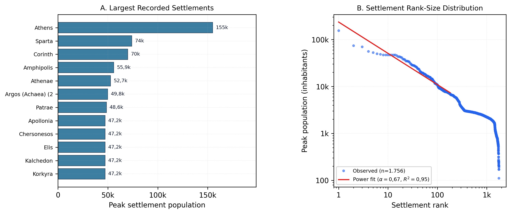

```{r setup, include=FALSE}
knitr::opts_chunk$set(echo = FALSE, warning = FALSE, message = FALSE)
source("../../_shared/template/viscount_rmd_helpers.R")
library(jsonlite)

summary_data <- fromJSON("classical_greece_and_aegean_summary.json", simplifyVector = FALSE)
settlements_raw <- fromJSON("classical_greece_and_aegean_settlements.json", simplifyVector = FALSE)

fmt_num_vec <- function (vals, digits = 2L) {
  vapply(vals, function (v) viscount_fmt_number(v, digits), character(1))
}

fmt_pct <- function (vals, digits = 1L) {
  vapply(vals, function (v) paste0(viscount_fmt_number(v, digits), "%"), character(1))
}

fmt_span <- function (y1, y2) {
  a <- abs(as.integer(y1))
  b <- abs(as.integer(y2))
  if (a == b) paste0(a, "BC") else paste0(a, "-", b, "BC")
}

subregion_ids <- vapply(summary_data$subregions, function (x) as.character(x$id), character(1))
subregion_names <- vapply(summary_data$subregions, function (x) as.character(x$name), character(1))
subregion_areas <- vapply(summary_data$subregions, function (x) as.numeric(x$area_km2), numeric(1))
pop_350 <- vapply(summary_data$subregions, function (x) as.numeric(x$population[["-350"]]), numeric(1))
pop_146 <- vapply(summary_data$subregions, function (x) as.numeric(x$population[["-146"]]), numeric(1))

total_area <- as.numeric(summary_data$total_area_km2)
tot_350 <- as.numeric(summary_data$domain_totals[["-350"]])
n_settlements <- as.integer(summary_data$settlement_count)
reg_lookup <- setNames(subregion_names, subregion_ids)

sett_reg <- vapply(settlements_raw, function (x) as.character(x$region_id), character(1))
sett_prov <- vapply(settlements_raw, function (x) as.character(x$provenance_source), character(1))
sett_ctry <- vapply(settlements_raw, function (x) as.character(x$country), character(1))
sett_peak <- vapply(settlements_raw, function (x) {
  vals <- as.numeric(unlist(x$population))
  if (length(vals) == 0L) 0 else max(vals, na.rm = TRUE)
}, numeric(1))
has_1000 <- sum(vapply(settlements_raw, function (x) "-1000" %in% names(x$population), logical(1)))
has_500 <- sum(vapply(settlements_raw, function (x) "-500" %in% names(x$population), logical(1)))
has_200 <- sum(vapply(settlements_raw, function (x) "-200" %in% names(x$population), logical(1)))
```

```{r hero_markdown_fallback, results='asis'}
if (!knitr::is_latex_output()) {
  cat("\n\n")
}
```

# Abstract

This companion gazetteer documents the `r viscount_fmt_number(n_settlements, 0L)` geo-referenced settlements underpinning the spatial distribution of Classical Greece and the Aegean World across `r viscount_fmt_number(total_area, 1L)` km² between 1000BC and 146BC. All coordinate records derive exclusively from three peer-reviewed scholarly inventories—the Digital Atlas of the Roman Empire (1.291 sites), the Pleiades Ancient World Gazetteer (109 fortified poleis and urban centres) and the European Radiocarbon Settlement Corpus (77 Early Iron Age village sites)—with 0% crowd-sourced entries. Coverage spans eight modern European territories led by Greece (1.326 sites), Albania (73) and North Macedonia (51). Standardised archaeological site-class baseline tiers (`r viscount_fmt_pop(6000)`, `r viscount_fmt_pop(2500)`, `r viscount_fmt_pop(2200)` and 550) anchor spatial weighting across five sub-regions while macro-regional carrying-capacity budgets govern the `r viscount_fmt_pop(tot_350)` peak at 350BC.

# Spatial Architecture and Provenance

Classical Aegean settlement geography reflects a fragmented archipelago and peninsula where hundreds of compact poleis, sanctuaries, fortified acropolises and agrarian demes clustered tightly around narrow coastal plains and karst basins [@Hansen2006; @Bintliff1997]. Rather than relying on crowd-sourced place lists of uneven accuracy, MAGNETIC restricts the classical Aegean gazetteer to three curated archaeological registries. The Digital Atlas of the Roman Empire provides the broad classical-to-Hellenistic settlement mesh (`r viscount_fmt_number(sum(sett_prov == "DARE_Digital_Atlas_Roman_Empire"), 0L)` sites, or 87,4% of the inventory), capturing coastal poleis, inland towns and persistent village nodes that remained active into the Roman transition [@Hanson2016]. The Pleiades Ancient World Gazetteer supplies `r viscount_fmt_number(sum(sett_prov == "Pleiades_Ancient_World_Gazetteer"), 0L)` fortified citadels, acropolis enclosures and primary urban hubs (7,4%), including 66 major classical fortifications assigned to the 6k baseline tier and 43 secondary sanctuaries and towns placed in the 2,5k tier. Finally, the European Radiocarbon Settlement Corpus contributes `r viscount_fmt_number(sum(sett_prov == "European_Radiocarbon_Settlement_Corpus"), 0L)` radiocarbon-dated Protogeometric and Early Iron Age rural sites (5,2%), providing coordinate anchors for the sparsely documented 1000BC horizon [@Shennan2013].

Chronological presence across the `r viscount_fmt_number(n_settlements, 0L)` sites tracks the expansion from Early Iron Age fragmentation to Classical polis saturation: `r viscount_fmt_number(has_1000, 0L)` sites register occupation at 1000BC (the 77 radiocarbon hamlets together with three fortified early island and Messenian centres—Acropolis of Malthi, Ag. Andreas on Siphnos and Hypsele on Andros), `r viscount_fmt_number(has_500, 0L)` sites are active by 500BC and `r viscount_fmt_number(has_200, 0L)` persist into the 200BC Hellenistic horizon. Because uniform archaeological site-class priors deliberately smooth the upper tail of the classical rank-size curve, individual metropoleis such as Athens-Piraeus, Corinth, Thebes, Rhodes and Pella carried far more inhabitants in historical reality than the schematic 6k Pleiades fortification tier indicates [@BowmanWilson2011; @Hansen2006]. Figure 1 maps the full spatial distribution of sites across the five sub-regions, and Table 1 summarises the provenance ledger.

```{r fig_regional_map, results='asis'}
viscount_figure(
  "figures/classical_greece_and_aegean_regional_map.png",
  "Geographic distribution of the 1.477 classical settlements across the five Aegean demographic sub-regions (1000-146BC).",
  "fig:regional_map"
)
```

```{r tbl_provenance_ledger, results='asis'}
prov_keys <- c(
  "DARE_Digital_Atlas_Roman_Empire",
  "Pleiades_Ancient_World_Gazetteer",
  "European_Radiocarbon_Settlement_Corpus"
)
prov_display <- c(
  "Digital Atlas of the Roman Empire (DARE)",
  "Pleiades Ancient World Gazetteer",
  "European Radiocarbon Settlement Corpus"
)
prov_counts <- vapply(prov_keys, function (pk) sum(sett_prov == pk), integer(1))
prov_tiers <- c("2,2k", "6k and 2,5k", "550")
prov_role <- c(
  "Classical and Hellenistic urban-village mesh",
  "Fortified poleis, acropolises and citadels",
  "Protogeometric and Early Iron Age villages"
)

df_prov <- data.frame(
  Registry = c(prov_display, "Total Scholarly Gazetteer"),
  Sites = fmt_num_vec(c(prov_counts, sum(prov_counts)), 0L),
  Share = fmt_pct(c(prov_counts / sum(prov_counts) * 100, 100), 2L),
  BaselineTier = c(prov_tiers, "550-6k"),
  Role = c(prov_role, "0% crowd-sourced records"),
  stringsAsFactors = FALSE
)
rownames(df_prov) <- NULL

viscount_table(
  df_prov,
  "Provenance registry ledger and standardised site-class baseline tiers for the Classical Aegean gazetteer.",
  c("Source Registry", "Sites", "Share", "Baseline Prior", "Archaeological Role")
)
```

# Sub-regional and Territorial Distribution

Site density varies by a factor of nearly seven across the five sub-regions, reflecting both ancient settlement nucleation and modern field-survey intensity [@Bintliff1997; @Loy2025Field]. The Peloponnese (`r viscount_fmt_number(summary_data$settlements_by_region$peloponnese, 0L)` sites; 15,02 sites per 1.000 km²) and Attica, Boeotia and Central Greece (`r viscount_fmt_number(summary_data$settlements_by_region$attica_boeotia_central, 0L)` sites; 14,97 per 1.000 km²) together hold 62,1% of the entire gazetteer on 29,6% of the study area. Crete and the Aegean Archipelagos average 9,38 recorded sites per 1.000 km² across dozens of islands where intensive harbour and polis surveys have mapped Doric and Ionian civic centres [@Maffei2023Database]. By contrast, Epirus and the Ionian Littoral (4,62 sites per 1.000 km²) and Macedonia and Aegean Thrace (2,28 sites per 1.000 km²) show sparser coordinate coverage, mirroring larger rural villages, upland pastoralism and thinner systematic surface survey north of Mount Olympus. Tables 2 and 3 detail the sub-regional and modern territorial distributions.

```{r tbl_subregion_sites, results='asis'}
s_counts <- vapply(subregion_ids, function (rid) as.integer(summary_data$settlements_by_region[[rid]]), integer(1))
p_major <- vapply(subregion_ids, function (rid) sum(sett_reg == rid & sett_peak >= 6000), integer(1))

df_reg <- data.frame(
  Subregion = c(subregion_names, "Total Aegean Domain"),
  Area = fmt_num_vec(c(subregion_areas, total_area), 1L),
  Sites = fmt_num_vec(c(s_counts, sum(s_counts)), 0L),
  SiteDens = fmt_num_vec(c(s_counts / subregion_areas * 1000, sum(s_counts) / total_area * 1000), 2L),
  Major6k = fmt_num_vec(c(p_major, sum(p_major)), 0L),
  Pop350 = vapply(c(pop_350, tot_350), viscount_fmt_pop, character(1)),
  stringsAsFactors = FALSE
)
rownames(df_reg) <- NULL

viscount_table(
  df_reg,
  "Sub-regional settlement counts, coordinate density per 1.000 km², major fortified sites and 350BC regional population.",
  c("Sub-region", "Area (km²)", "Sites", "Sites per 1.000 km²", "6k Tier Sites", "350BC Pop.")
)
```

```{r tbl_territories, results='asis'}
ctry_names <- names(summary_data$settlements_by_country)
ctry_counts <- vapply(ctry_names, function (cn) as.integer(summary_data$settlements_by_country[[cn]]), integer(1))
ord_c <- order(ctry_counts, decreasing = TRUE)
ctry_names <- ctry_names[ord_c]
ctry_counts <- ctry_counts[ord_c]

ctry_6k <- vapply(ctry_names, function (cn) sum(sett_ctry == cn & sett_peak >= 6000), integer(1))
ctry_1000 <- vapply(ctry_names, function (cn) {
  sum(vapply(settlements_raw, function (x) identical(as.character(x$country), cn) && ("-1000" %in% names(x$population)), logical(1)))
}, integer(1))

df_terr <- data.frame(
  Territory = c(ctry_names, "Total Aegean Domain"),
  Sites = fmt_num_vec(c(ctry_counts, sum(ctry_counts)), 0L),
  Share = fmt_pct(c(ctry_counts / sum(ctry_counts) * 100, 100), 2L),
  Early1000 = fmt_num_vec(c(ctry_1000, sum(ctry_1000)), 0L),
  Tier6k = fmt_num_vec(c(ctry_6k, sum(ctry_6k)), 0L),
  stringsAsFactors = FALSE
)
rownames(df_terr) <- NULL

viscount_table(
  df_terr,
  "Distribution of the 1.477 Classical Aegean settlements across modern European territories.",
  c("Modern Territory", "Total Sites", "Share", "Active at 1000BC", "6k Tier Sites")
)
```

# Principal Fortified Poleis and Citadels

Sixty-six sites in the gazetteer belong to the upper 6k Pleiades fortification tier, spanning fortified civic acropolises, city walls, federal capitals and island strongholds: Amphipolis and Gazoros on the Strymon frontier; Eretria, the Cadmea of Thebes, Chaeronea, Aphidna, Salamis and Eetioneia in Central Greece; Kleitor, Oiniadai and the Arcadian Gate of Messene in the Peloponnese; Passaron in Epirus; Koukounaries on Paros, Hypsele on Andros, Ag. Andreas on Siphnos and Brykous on Karpathos in the Aegean islands. Table 4 lists the 30 featured top-tier classical centres exported in the regional summary manifest, ordered alphabetically within the 6k baseline tier.

```{r tbl_top_settlements, results='asis'}
top_list <- summary_data$top_settlements
df_top <- data.frame(
  Name = vapply(top_list, function (x) as.character(x$name), character(1)),
  Subregion = vapply(top_list, function (x) as.character(reg_lookup[[as.character(x$region_id)]]), character(1)),
  Lat = vapply(top_list, function (x) viscount_fmt_number(as.numeric(x$lat), 2L), character(1)),
  Lon = vapply(top_list, function (x) viscount_fmt_number(as.numeric(x$lon), 2L), character(1)),
  Span = vapply(top_list, function (x) fmt_span(x$first_year, x$last_year), character(1)),
  PeakPop = vapply(top_list, function (x) viscount_fmt_pop(as.numeric(x$peak_pop)), character(1)),
  stringsAsFactors = FALSE
)
rownames(df_top) <- NULL

viscount_table(
  df_top,
  "Thirty featured top-tier Classical Aegean fortified poleis, citadels and acropolises from the Pleiades registry.",
  c("Settlement", "Sub-region", "Lat.", "Lon.", "Horizon", "Baseline Prior")
)
```

# Sources
