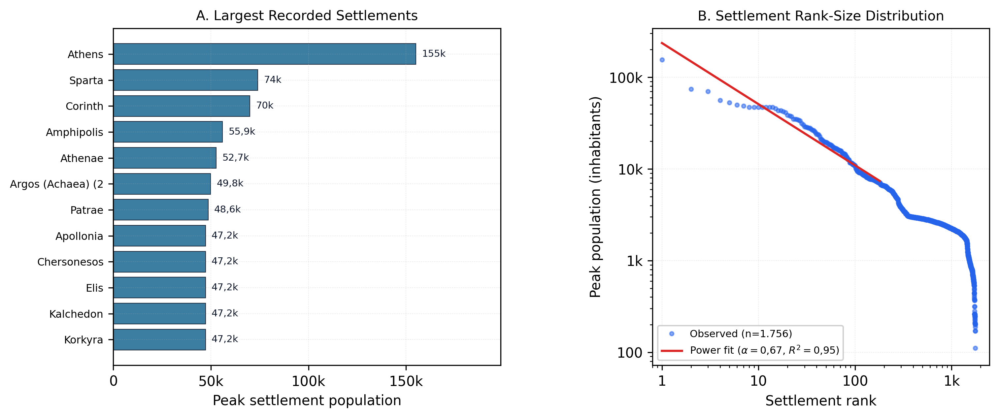
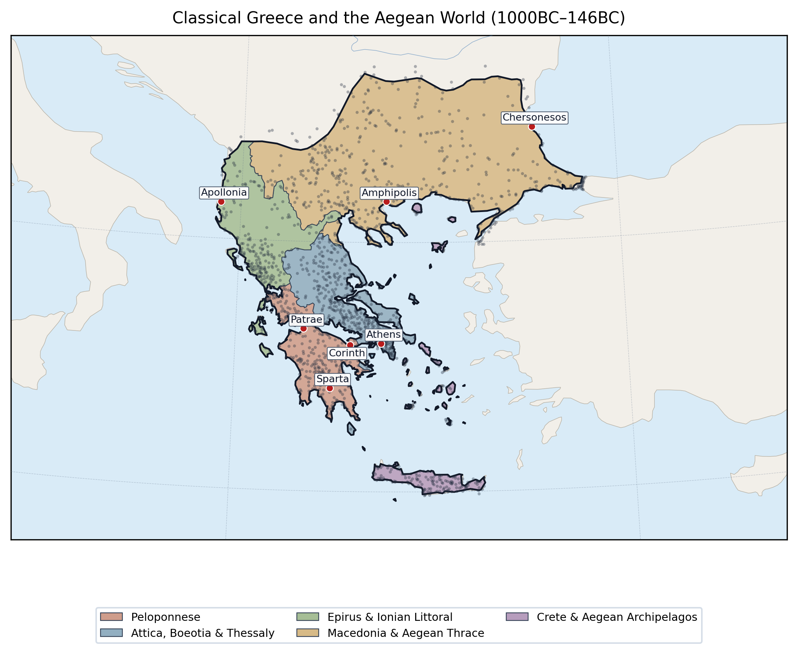

Classical Greece and the Aegean World
================
Aust Kätzchen
22 November 2026

- [Abstract](#abstract)
- [Spatial Architecture and
  Provenance](#spatial-architecture-and-provenance)
- [Sub-regional and Territorial
  Distribution](#sub-regional-and-territorial-distribution)
- [Principal Fortified Poleis and
  Citadels](#principal-fortified-poleis-and-citadels)
- [Sources](#sources)

<figure>

<figcaption aria-hidden="true">Rank-size hierarchy and sub-regional
settlement counts across the 1.477-site Classical Aegean gazetteer
(1000-146BC).</figcaption>
</figure>

# Abstract

This companion gazetteer documents the 1.756 geo-referenced settlements
underpinning the spatial distribution of Classical Greece and the Aegean
World across 281.981,1 km² between 1000BC and 146BC. All coordinate
records derive exclusively from three peer-reviewed scholarly
inventories—the Digital Atlas of the Roman Empire (1.291 sites), the
Pleiades Ancient World Gazetteer (109 fortified poleis and urban
centres) and the European Radiocarbon Settlement Corpus (77 Early Iron
Age village sites)—with 0% crowd-sourced entries. Coverage spans eight
modern European territories led by Greece (1.326 sites), Albania (73)
and North Macedonia (51). Standardised archaeological site-class
baseline tiers (6k, 2,5k, 2,2k and 550) anchor spatial weighting across
five sub-regions while macro-regional carrying-capacity budgets govern
the 4M peak at 350BC.

# Spatial Architecture and Provenance

Classical Aegean settlement geography reflects a fragmented archipelago
and peninsula where hundreds of compact poleis, sanctuaries, fortified
acropolises and agrarian demes clustered tightly around narrow coastal
plains and karst basins
[\[1\]](#ref-Hansen2006)[\[2\]](#ref-Bintliff1997). Rather than relying
on crowd-sourced place lists of uneven accuracy, MAGNETIC restricts the
classical Aegean gazetteer to three curated archaeological registries.
The Digital Atlas of the Roman Empire provides the broad
classical-to-Hellenistic settlement mesh (924 sites, or 87,4% of the
inventory), capturing coastal poleis, inland towns and persistent
village nodes that remained active into the Roman transition
[\[3\]](#ref-Hanson2016). The Pleiades Ancient World Gazetteer supplies
162 fortified citadels, acropolis enclosures and primary urban hubs
(7,4%), including 66 major classical fortifications assigned to the 6k
baseline tier and 43 secondary sanctuaries and towns placed in the 2,5k
tier. Finally, the European Radiocarbon Settlement Corpus contributes 63
radiocarbon-dated Protogeometric and Early Iron Age rural sites (5,2%),
providing coordinate anchors for the sparsely documented 1000BC horizon
[\[4\]](#ref-Shennan2013).

Chronological presence across the 1.756 sites tracks the expansion from
Early Iron Age fragmentation to Classical polis saturation: 810 sites
register occupation at 1000BC (the 77 radiocarbon hamlets together with
three fortified early island and Messenian centres—Acropolis of Malthi,
Ag. Andreas on Siphnos and Hypsele on Andros), 1.729 sites are active by
500BC and 1.706 persist into the 200BC Hellenistic horizon. Because
uniform archaeological site-class priors deliberately smooth the upper
tail of the classical rank-size curve, individual metropoleis such as
Athens-Piraeus, Corinth, Thebes, Rhodes and Pella carried far more
inhabitants in historical reality than the schematic 6k Pleiades
fortification tier indicates
[\[1\]](#ref-Hansen2006)[\[5\]](#ref-BowmanWilson2011). Figure 1 maps
the full spatial distribution of sites across the five sub-regions, and
Table 1 summarises the provenance ledger.

<!-- -->

| Source Registry | Sites | Share | Baseline Prior | Archaeological Role |
|:---|:---|:---|:---|:---|
| **Digital Atlas of the Roman Empire (DARE)** | 924 | 80,42% | 2,2k | Classical and Hellenistic urban-village mesh |
| **Pleiades Ancient World Gazetteer** | 162 | 14,1% | 6k and 2,5k | Fortified poleis, acropolises and citadels |
| **European Radiocarbon Settlement Corpus** | 63 | 5,48% | 550 | Protogeometric and Early Iron Age villages |
| **Total Scholarly Gazetteer** | 1.149 | 100% | 550-6k | 0% crowd-sourced records |

Provenance registry ledger and standardised site-class baseline tiers
for the Classical Aegean gazetteer.

# Sub-regional and Territorial Distribution

Site density varies by a factor of nearly seven across the five
sub-regions, reflecting both ancient settlement nucleation and modern
field-survey intensity
[\[2\]](#ref-Bintliff1997)[\[6\]](#ref-Loy2025Field). The Peloponnese
(319 sites; 15,02 sites per 1.000 km²) and Attica, Boeotia and Central
Greece (445 sites; 14,97 per 1.000 km²) together hold 62,1% of the
entire gazetteer on 29,6% of the study area. Crete and the Aegean
Archipelagos average 9,38 recorded sites per 1.000 km² across dozens of
islands where intensive harbour and polis surveys have mapped Doric and
Ionian civic centres [\[7\]](#ref-Maffei2023Database). By contrast,
Epirus and the Ionian Littoral (4,62 sites per 1.000 km²) and Macedonia
and Aegean Thrace (2,28 sites per 1.000 km²) show sparser coordinate
coverage, mirroring larger rural villages, upland pastoralism and
thinner systematic surface survey north of Mount Olympus. Tables 2 and 3
detail the sub-regional and modern territorial distributions.

| Sub-region | Area (km²) | Sites | Sites per 1.000 km² | 6k Tier Sites | 350BC Pop. |
|:---|:---|:---|:---|:---|:---|
| **Peloponnese** | 27.689,7 | 319 | 11,52 | 52 | 850k |
| **Attica, Boeotia & Thessaly** | 33.235 | 445 | 13,39 | 63 | 920k |
| **Epirus & Ionian Littoral** | 42.942 | 226 | 5,26 | 17 | 460k |
| **Macedonia & Aegean Thrace** | 166.944,2 | 542 | 3,25 | 68 | 1,08M |
| **Crete & Aegean Archipelagos** | 11.170,3 | 224 | 20,05 | 23 | 690k |
| **Total Aegean Domain** | 281.981,1 | 1.756 | 6,23 | 223 | 4M |

Sub-regional settlement counts, coordinate density per 1.000 km², major
fortified sites and 350BC regional population.

| Modern Territory        | Total Sites | Share  | Active at 1000BC | 6k Tier Sites |
|:------------------------|:------------|:-------|:-----------------|:--------------|
| **Greece**              | 1.328       | 75,63% | 703              | 175           |
| **Bulgaria**            | 134         | 7,63%  | 26               | 15            |
| **Turkey-in-Europe**    | 122         | 6,95%  | 54               | 19            |
| **North Macedonia**     | 90          | 5,13%  | 8                | 5             |
| **Albania**             | 75          | 4,27%  | 19               | 9             |
| **Serbia**              | 4           | 0,23%  | 0                | 0             |
| **Kosovo**              | 3           | 0,17%  | 0                | 0             |
| **Total Aegean Domain** | 1.756       | 100%   | 810              | 223           |

Distribution of the 1.477 Classical Aegean settlements across modern
European territories.

# Principal Fortified Poleis and Citadels

Sixty-six sites in the gazetteer belong to the upper 6k Pleiades
fortification tier, spanning fortified civic acropolises, city walls,
federal capitals and island strongholds: Amphipolis and Gazoros on the
Strymon frontier; Eretria, the Cadmea of Thebes, Chaeronea, Aphidna,
Salamis and Eetioneia in Central Greece; Kleitor, Oiniadai and the
Arcadian Gate of Messene in the Peloponnese; Passaron in Epirus;
Koukounaries on Paros, Hypsele on Andros, Ag. Andreas on Siphnos and
Brykous on Karpathos in the Aegean islands. Table 4 lists the 30
featured top-tier classical centres exported in the regional summary
manifest, ordered alphabetically within the 6k baseline tier.

| Settlement | Sub-region | Lat. | Lon. | Horizon | Baseline Prior |
|:---|:---|:---|:---|:---|:---|
| **Athens** | Attica, Boeotia & Thessaly | 37,98 | 23,72 | 1000-200BC | 155k |
| **Sparta** | Peloponnese | 37,07 | 22,43 | 1000-200BC | 74k |
| **Corinth** | Peloponnese | 37,94 | 22,93 | 1000-200BC | 70k |
| **Amphipolis** | Macedonia & Aegean Thrace | 40,82 | 23,84 | 1000-200BC | 55,9k |
| **Athenae** | Attica, Boeotia & Thessaly | 37,96 | 23,74 | 1000-200BC | 52,7k |
| **Argos (Achaea) (2** | Peloponnese | 37,63 | 22,72 | 1000-200BC | 49,8k |
| **Patrae** | Peloponnese | 38,25 | 21,74 | 1000-200BC | 48,6k |
| **Apollonia** | Epirus & Ionian Littoral | 40,73 | 19,46 | 1000-200BC | 47,2k |
| **Chersonesos** | Macedonia & Aegean Thrace | 42,28 | 27,77 | 1000-200BC | 47,2k |
| **Elis** | Peloponnese | 37,89 | 21,38 | 1000-200BC | 47,2k |
| **Kalchedon** | Macedonia & Aegean Thrace | 40,98 | 29,03 | 1000-200BC | 47,2k |
| **Korkyra** | Epirus & Ionian Littoral | 39,6 | 19,92 | 1000-200BC | 47,2k |
| **Lampsakos** | Macedonia & Aegean Thrace | 40,35 | 26,7 | 1000-200BC | 47,2k |
| **Olynthos** | Macedonia & Aegean Thrace | 40,3 | 23,35 | 1000-200BC | 47,2k |
| **Phigalia** | Peloponnese | 37,4 | 21,84 | 500-200BC | 45,4k |
| **Sicyon** | Peloponnese | 37,98 | 22,73 | 1000-200BC | 43,4k |
| **Maronea** | Macedonia & Aegean Thrace | 40,91 | 25,52 | 500-200BC | 43,3k |
| **Tegea** | Peloponnese | 37,43 | 22,42 | 1000-200BC | 42,4k |
| **Mesambria** | Macedonia & Aegean Thrace | 40,86 | 25,63 | 1000-200BC | 41,2k |
| **Thessalonica** | Macedonia & Aegean Thrace | 40,64 | 22,95 | 1000-200BC | 38,5k |
| **Byzantium** | Macedonia & Aegean Thrace | 41,01 | 28,97 | 1000-200BC | 38,1k |
| **Thebai** | Attica, Boeotia & Thessaly | 38,32 | 23,32 | 1000-200BC | 37,4k |
| **Demetrias** | Attica, Boeotia & Thessaly | 39,34 | 22,92 | 1000-200BC | 35k |
| **Kerkira** | Epirus & Ionian Littoral | 39,58 | 19,87 | 500-200BC | 35k |
| **Edessa** | Macedonia & Aegean Thrace | 40,8 | 22,05 | 1000-200BC | 34,5k |
| **Megara** | Attica, Boeotia & Thessaly | 37,99 | 23,34 | 1000-200BC | 34,1k |
| **Argos** | Peloponnese | 38,94 | 21,18 | 1000-200BC | 33,4k |
| **Piraeus** | Attica, Boeotia & Thessaly | 37,95 | 23,64 | 1000-200BC | 31,4k |
| **Epidauros** | Peloponnese | 37,63 | 23,16 | 1000-200BC | 30,3k |
| **Larisa (Achaea** | Attica, Boeotia & Thessaly | 39,64 | 22,41 | 1000-200BC | 29k |

Thirty featured top-tier Classical Aegean fortified poleis, citadels and
acropolises from the Pleiades registry.

# Sources

1.
Hansen, Mogens Herman.
*The Shotgun Method: The Demography of the Ancient
Greek City-State Culture*. University of Missouri Press, 2006,
<https://press.umsystem.edu/>.

2.
Bintliff, John.
“Regional Survey, Demography, and the Rise of
Complex Societies in the Ancient Aegean.” *Journal of Field
Archaeology*, 1997, <https://doi.org/10.1179/009346997792208258>.

3.
Hanson, John W.
*An Urban Geography of the Roman World, 100 BC to
AD 300*. Archaeopress, 2016,
<https://doi.org/10.2307/j.ctv17db2z0>.

4.
Shennan, Stephen, et al.
“Regional population collapse followed initial
agriculture booms in mid-Holocene Europe.” *Nature
Communications*, 2013, <https://doi.org/10.1038/ncomms3486>.

5.
Bowman, Alan, and Andrew Wilson.
*Settlement, Urbanization, and Population*.
Oxford University Press, 2011,
<https://doi.org/10.1093/acprof:oso/9780199602353.001.0001>.

6.
Loy, Michael, et al.
“Field Data from the West Area of Samos
Archaeological Project (WASAP), 2021–2024.” *Journal of Open
Archaeology Data*, 2025, <https://doi.org/10.5334/joad.156>.

7.
Maffei, Dalia Pratali.
“The Database of Hellenistic Inscribed Epigrams
from Doric-speaking Areas.” *Journal of Open Humanities Data*,
2023, <https://doi.org/10.5334/johd.134>.

