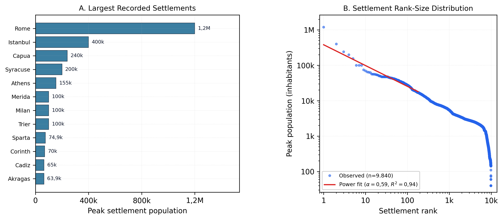

```{r setup, include=FALSE}
knitr::opts_chunk$set(
  echo = FALSE,
  message = FALSE,
  warning = FALSE
)

source("../../_shared/template/viscount_rmd_helpers.R")
library(jsonlite)

summary_data <- fromJSON("iron_age_and_roman_europe_summary.json", simplifyVector = FALSE)
settlements_raw <- fromJSON("iron_age_and_roman_europe_settlements.json", simplifyVector = FALSE)

subregions_list <- summary_data$subregions
total_area_km2 <- as.numeric(summary_data$total_area_km2)
settlement_count <- as.integer(summary_data$settlement_count)
domain_totals <- summary_data$domain_totals

region_name_map <- setNames(
  vapply(subregions_list, function (r) gsub(" & ", " and ", r$name, fixed = TRUE), character(1)),
  vapply(subregions_list, function (r) r$id, character(1))
)

fmt_pct <- function (val, digits = 1L) {
  paste0(viscount_fmt_number(val, digits), "%")
}

fmt_year <- function (yr) {
  y <- as.integer(yr)
  if (y < 0L) return(paste0(abs(y), "BC"))
  if (y == 0L) return("1AD")
  paste0(y, "AD")
}

clean_provenance <- function (key) {
  if (identical(key, "European_Radiocarbon_Settlement_Corpus")) {
    return("European Radiocarbon Settlement Corpus")
  }
  if (identical(key, "DARE_Digital_Atlas_Roman_Empire")) {
    return("Digital Atlas of the Roman Empire")
  }
  if (identical(key, "Pleiades_Ancient_World_Gazetteer")) {
    return("Pleiades Ancient World Gazetteer")
  }
  gsub("_", " ", key, fixed = TRUE)
}
```

```{r hero-md-fallback, echo=FALSE, results='asis'}
if (!knitr::is_latex_output()) {
  cat(
    "\n\n\n"
  )
}
```

# Abstract

This companion settlement gazetteer documents the `r viscount_fmt_number(settlement_count, 0L)` geocoded Iron Age and Roman European archaeological loci compiled across 11 sub-regions and 30 modern states and territories between 1000BC and 400AD. Every record originates from one of three curated scholarly sources with zero crowdsourced entries: the European Radiocarbon Settlement Corpus (2.593 rural and prehistoric occupation loci assigned a 550 hamlet prior), the Digital Atlas of the Roman Empire (1.623 provincial centres, municipia, forts and road stations assigned a 2,2k tier) and the Pleiades Ancient World Gazetteer (276 classical cities, acropoleis and sanctuaries stratified into 143 top-tier 6k fortifications and 133 intermediate 2,5k centres). Active site counts peak at 3.228 loci in 200BC during the late La Tène and Republican urban horizon before receding to 2.556 active loci by 400AD. Tabulations below detail the provenance ledger, chronological slice coverage, sub-regional and national spatial sampling density and a representative sample of 25 top-tier fortified classical centres.

# Gazetteer Architecture and Provenance Ledger

Classical urban catalogues demonstrate that the Roman Empire sustained more than 1.300 legally constituted cities alongside thousands of smaller vici, forts, villas and rural hamlets [@Hanson2016; @BowmanWilson2011; @Hansen2006]. Because direct census counts survive only for a handful of Mediterranean metropoleis, MAGNETIC separates regional population estimation from point-level spatial anchoring. Regional headcounts (rising from 11,31M in 1000BC to 40,15M in 200AD and falling to 30,5M in 400AD) are anchored independently from historical-demographic synthesis [@Scheidel2007; @DeLigt2012], while the 4.492-site spatial gazetteer maps archaeological settlement footprints across the landscape.

Each corpus contributes a distinct layer of the ancient settlement hierarchy. The European Radiocarbon Settlement Corpus supplies 57,7% of all records, capturing rural farmsteads, enclosed villages and prehistoric occupation horizons dated by calibrated radiocarbon probabilities [@Shennan2013]. The Digital Atlas of the Roman Empire contributes 36,1% of all sites, concentrating on Roman provincial civitas capitals, veteran colonies, legionary bases and road stations. The Pleiades Ancient World Gazetteer accounts for the remaining 6,1%, supplying high-precision classical Greek, Etruscan, Iberian, Gallic and Roman fortified urban sites and acropoleis. Table 1 summarises the provenance and categorical tier distribution computed directly from the settlement inventory.

```{r tbl-provenance-tiers, echo=FALSE, results='asis'}
prov_vec <- vapply(settlements_raw, function (s) as.character(s$provenance_source), character(1))
peak_vec <- vapply(settlements_raw, function (s) {
  vals <- unlist(s$population, use.names = FALSE)
  as.integer(max(as.numeric(vals)))
}, integer(1))

combo_df <- aggregate(
  x = list(Sites = rep(1L, length(prov_vec))),
  by = list(Provenance = prov_vec, PeakTier = peak_vec),
  FUN = sum
)
combo_df <- combo_df[order(-combo_df$PeakTier, -combo_df$Sites), ]

tier_role <- vapply(combo_df$PeakTier, function (pk) {
  if (pk >= 6000L) return("Fortified classical acropolis or walled city")
  if (pk >= 2500L) return("Intermediate classical town or sanctuary")
  if (pk >= 2200L) return("Roman municipium, vicus, fort or road station")
  return("Radiocarbon-dated Iron Age or rural hamlet")
}, character(1))

df_prov_tiers <- data.frame(
  Corpus = vapply(combo_df$Provenance, clean_provenance, character(1)),
  Tier = vapply(combo_df$PeakTier, viscount_fmt_pop, character(1)),
  Sites = vapply(combo_df$Sites, viscount_fmt_number, character(1), arg1_digits = 0L),
  Share = vapply(combo_df$Sites / settlement_count * 100, fmt_pct, character(1), digits = 1L),
  Role = tier_role,
  stringsAsFactors = FALSE
)
df_prov_tiers <- rbind(
  df_prov_tiers,
  data.frame(
    Corpus = "Total Gazetteer",
    Tier = "4 discrete tiers",
    Sites = viscount_fmt_number(settlement_count, 0L),
    Share = "100%",
    Role = "Zero crowdsourced entries",
    stringsAsFactors = FALSE
  )
)
rownames(df_prov_tiers) <- NULL

viscount_table(
  df_prov_tiers,
  caption = "Provenance and categorical size-tier ledger of the 4.492-site Iron Age and Roman European settlement gazetteer.",
  col_names = c("Scholarly Corpus", "Peak Tier", "Sites", "Share", "Typological Scope")
)
```

# Chronological Horizon Coverage

Across the six chronological horizons represented in the settlement inventory (1000BC, 500BC, 200BC, 1AD, 200AD and 400AD), recorded site activity rises sharply during the first half of the first millennium BC, reaches its maximum in 200BC (3.228 active sites, 71,9% of the entire corpus) and declines gently through the High Empire (2.826 sites in 200AD) into Late Antiquity (2.556 sites in 400AD). The earlier peak in raw site counts relative to the 200AD population maximum reflects the heavy share of radiocarbon-dated British and Iberian Iron Age rural loci, many of which drop out of radiocarbon sequences once Roman wheel-thrown pottery and coinage replace radiocarbon dating as the primary archaeological chronological marker [@Shennan2013; @Bintliff1997]. Table 2 records active loci and summed categorical weights across all six horizons.

```{r tbl-temporal-slices, echo=FALSE, results='asis'}
slice_years <- c(-1000L, -500L, -200L, 1L, 200L, 400L)
slice_rows <- lapply(slice_years, function (yr) {
  y_key <- as.character(yr)
  active_vals <- vapply(settlements_raw, function (s) {
    v <- s$population[[y_key]]
    if (is.null(v)) NA_real_ else as.numeric(v)
  }, numeric(1))
  present <- !is.na(active_vals)
  n_act <- sum(present)
  n_urban <- sum(present & active_vals >= 2200)
  tier_sum <- sum(active_vals[present])
  data.frame(
    Horizon = fmt_year(yr),
    ActiveSites = viscount_fmt_number(n_act, 0L),
    ShareCorpus = fmt_pct(n_act / settlement_count * 100, 1L),
    UrbanTier = viscount_fmt_number(n_urban, 0L),
    TierWeightSum = viscount_fmt_pop(tier_sum),
    stringsAsFactors = FALSE
  )
})
df_slices <- do.call(rbind, slice_rows)
rownames(df_slices) <- NULL

viscount_table(
  df_slices,
  caption = "Active archaeological settlement counts and categorical tier sums across the six chronological slices (1000BC–400AD).",
  col_names = c("Horizon", "Active Sites", "Share of Corpus", "Sites at 2,2k+ Tier", "Summed Tier Weight")
)
```

# Sub-Regional and National Spatial Distribution

Figure 1 maps the 4.492 settlement loci across the 11 historical sub-regions, illustrating a marked northwest-to-southeast sampling gradient. Modern excavation intensity and open-access radiocarbon databases concentrate loci densely in Britannia (1.567 sites, or 68,43 loci per 10.000 km²), Hispania Baetica (347 sites, 30,93 per 10.000 km²) and Hispania Tarraconensis and Lusitania (1.042 sites, 21,63 per 10.000 km²). By contrast, classical Italian urban hubs such as Bononia and Rome's Tyrrhenian hinterland [@Sparavigna2019Bononia] and Greek poleis [@Hansen2006] are represented chiefly through curated classical atlases, yielding 11,66 loci per 10.000 km² in Cisalpine and Peninsular Italia and 11,26 per 10.000 km² in Achaea, Epirus and Macedonia, while the lower Danubian provinces record only 2,08 loci per 10.000 km².

```{r fig-regional-map, echo=FALSE, results='asis'}
viscount_figure(
  "figures/iron_age_and_roman_europe_regional_map.png",
  caption = "Spatial distribution of 4.492 Iron Age and Roman European settlement loci across the 11 historical sub-regions from 1000BC to 400AD.",
  label = "fig:iron_age_settlements_map"
)
```

Tables 3 and 4 report the sub-regional and leading modern national counts drawn directly from the chapter ledger. Together, the United Kingdom (1.561 sites, including major Roman civic centres such as Eboracum and Londinium [@Thompson2025Unique]), Spain (959), Portugal (430), Italy (382) and France (372) account for 82,5% of all geocoded records.

```{r tbl-subregional-sites, echo=FALSE, results='asis'}
rows_sr <- lapply(subregions_list, function (r) {
  a <- as.numeric(r$area_km2)
  n_s <- as.integer(summary_data$settlements_by_region[[r$id]])
  p200 <- as.numeric(r$population[["200"]])
  p400 <- as.numeric(r$population[["400"]])
  data.frame(
    SubRegion = gsub(" & ", " and ", r$name, fixed = TRUE),
    Area = viscount_fmt_number(a, 0L),
    Sites = viscount_fmt_number(n_s, 0L),
    Share = fmt_pct(n_s / settlement_count * 100, 1L),
    SiteDens = viscount_fmt_number(n_s / (a / 10000), 2L),
    Pop200 = viscount_fmt_pop(p200),
    Pop400 = viscount_fmt_pop(p400),
    stringsAsFactors = FALSE
  )
})
df_sr <- do.call(rbind, rows_sr)
df_sr <- rbind(
  df_sr,
  data.frame(
    SubRegion = "Chapter Total",
    Area = viscount_fmt_number(total_area_km2, 0L),
    Sites = viscount_fmt_number(settlement_count, 0L),
    Share = "100%",
    SiteDens = viscount_fmt_number(settlement_count / (total_area_km2 / 10000), 2L),
    Pop200 = viscount_fmt_pop(domain_totals[["200"]]),
    Pop400 = viscount_fmt_pop(domain_totals[["400"]]),
    stringsAsFactors = FALSE
  )
)
rownames(df_sr) <- NULL

viscount_table(
  df_sr,
  caption = "Sub-regional distribution of 4.492 archaeological settlement loci alongside peak (200AD) and Late Antique (400AD) population totals.",
  col_names = c("Sub-Region", "Area (km²)", "Sites", "Share", "Sites per 10.000 km²", "200AD Pop", "400AD Pop")
)
```

```{r tbl-country-coverage, echo=FALSE, results='asis'}
cntry_list <- summary_data$settlements_by_country
cntry_names <- names(cntry_list)
cntry_vals <- vapply(cntry_list, as.integer, integer(1))
ord_c <- order(cntry_vals, decreasing = TRUE)
top_n <- min(15L, length(ord_c))
top_idx <- ord_c[seq_len(top_n)]
rem_sites <- sum(cntry_vals[-top_idx])

df_cntry <- data.frame(
  Rank = as.character(seq_len(top_n)),
  State = cntry_names[top_idx],
  Sites = vapply(cntry_vals[top_idx], viscount_fmt_number, character(1), arg1_digits = 0L),
  Share = vapply(cntry_vals[top_idx] / settlement_count * 100, fmt_pct, character(1), digits = 1L),
  stringsAsFactors = FALSE
)
df_cntry <- rbind(
  df_cntry,
  data.frame(
    Rank = "16–30",
    State = "Remaining 15 states and territories",
    Sites = viscount_fmt_number(rem_sites, 0L),
    Share = fmt_pct(rem_sites / settlement_count * 100, 1L),
    stringsAsFactors = FALSE
  ),
  data.frame(
    Rank = "Total",
    State = "All 30 states and territories",
    Sites = viscount_fmt_number(settlement_count, 0L),
    Share = "100%",
    stringsAsFactors = FALSE
  )
)
rownames(df_cntry) <- NULL

viscount_table(
  df_cntry,
  caption = "Top 15 modern states and territories by recorded Iron Age and Roman settlement count.",
  col_names = c("Rank", "Modern State or Territory", "Recorded Sites", "Share of Corpus")
)
```

# Top-Tier Fortified and Classical Centres

Within the 4.492-site gazetteer, 143 classical urban and fortified loci drawn from the Pleiades Ancient World Gazetteer share the top categorical prior of 6k inhabitants. Because these entries tie at the upper tier prior, alphabetical ordering governs the representative 25-site extract displayed in Table 5, highlighting fortified Greek poleis (Eretria, Amphipolis, Akraiphiai, Chaeronea, Halos, Passaron, Selinus), Italian oppida and municipia (Aletrium, Circeii, Arpinum, Rusellae, Canosa), Gallic road-side oppida (Ambrussum), Iberian walled towns (Andelos) and northern British fortified stations (Cataractonium). In demographic interpretation, these fortified anchors complement the wider provincial urban hierarchy of imperial coloniae and municipia documented in the companion literature review [@Hanson2016; @BowmanWilson2011].

```{r tbl-top-settlements, echo=FALSE, results='asis'}
top_list <- summary_data$top_settlements
n_show <- min(25L, length(top_list))
rows_top <- lapply(top_list[seq_len(n_show)], function (s) {
  lat_s <- viscount_fmt_number(as.numeric(s$lat), 2L)
  lon_s <- viscount_fmt_number(as.numeric(s$lon), 2L)
  reg_lbl <- region_name_map[[s$region_id]]
  if (is.null(reg_lbl)) reg_lbl <- gsub("_", " ", s$region_id, fixed = TRUE)
  span_lbl <- paste0(fmt_year(s$first_year), "–", fmt_year(s$last_year))
  data.frame(
    Settlement = as.character(s$name),
    Country = as.character(s$country),
    SubRegion = reg_lbl,
    Coords = paste0(lat_s, "°, ", lon_s, "°"),
    Span = span_lbl,
    PeakTier = viscount_fmt_pop(s$peak_pop),
    Corpus = "Pleiades",
    stringsAsFactors = FALSE
  )
})
df_top <- do.call(rbind, rows_top)
rownames(df_top) <- NULL

viscount_table(
  df_top,
  caption = "Representative sample of 25 fortified urban and classical centres from the 143 top-tier (6k) Pleiades settlement records.",
  col_names = c("Settlement", "Country", "Sub-Region", "Coordinates", "Span", "Peak Tier", "Corpus")
)
```

# Sources

<div id="refs"></div>
