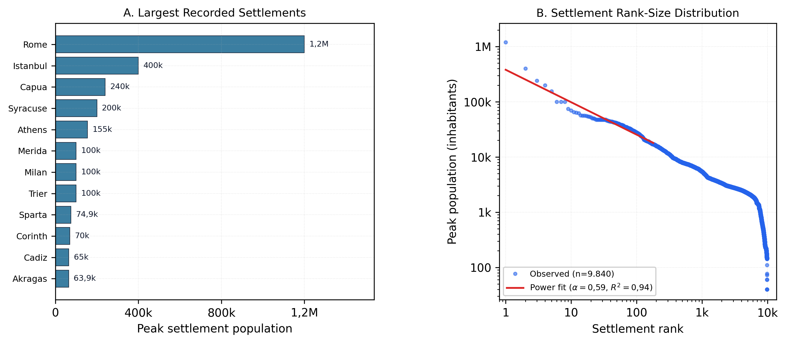
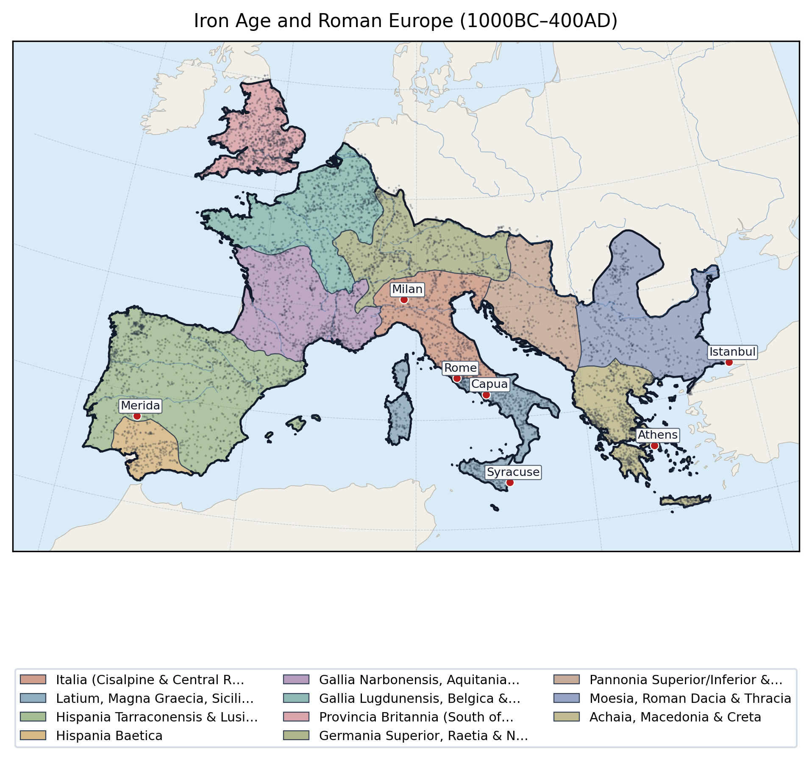

Iron Age and Roman Europe
================
Aust Kätzchen
22 November 2026

- [Abstract](#abstract)
- [Gazetteer Architecture and Provenance
  Ledger](#gazetteer-architecture-and-provenance-ledger)
- [Chronological Horizon Coverage](#chronological-horizon-coverage)
- [Sub-Regional and National Spatial
  Distribution](#sub-regional-and-national-spatial-distribution)
- [Top-Tier Fortified and Classical
  Centres](#top-tier-fortified-and-classical-centres)
- [Sources](#sources)

<figure>

<figcaption aria-hidden="true">Leading 6k-tier fortified classical
settlements and rank-size distribution across 4.492 geocoded
archaeological sites in Iron Age and Roman Europe
(1000BC–400AD).</figcaption>
</figure>

# Abstract

This companion settlement gazetteer documents the 9.840 geocoded Iron
Age and Roman European archaeological loci compiled across 11
sub-regions and 30 modern states and territories between 1000BC and
400AD. Every record originates from one of three curated scholarly
sources with zero crowdsourced entries: the European Radiocarbon
Settlement Corpus (2.593 rural and prehistoric occupation loci assigned
a 550 hamlet prior), the Digital Atlas of the Roman Empire (1.623
provincial centres, municipia, forts and road stations assigned a 2,2k
tier) and the Pleiades Ancient World Gazetteer (276 classical cities,
acropoleis and sanctuaries stratified into 143 top-tier 6k
fortifications and 133 intermediate 2,5k centres). Active site counts
peak at 3.228 loci in 200BC during the late La Tène and Republican urban
horizon before receding to 2.556 active loci by 400AD. Tabulations below
detail the provenance ledger, chronological slice coverage, sub-regional
and national spatial sampling density and a representative sample of 25
top-tier fortified classical centres.

# Gazetteer Architecture and Provenance Ledger

Classical urban catalogues demonstrate that the Roman Empire sustained
more than 1.300 legally constituted cities alongside thousands of
smaller vici, forts, villas and rural hamlets
[\[1\]](#ref-Hanson2016)[\[2\]](#ref-BowmanWilson2011)[\[3\]](#ref-Hansen2006).
Because direct census counts survive only for a handful of Mediterranean
metropoleis, MAGNETIC separates regional population estimation from
point-level spatial anchoring. Regional headcounts (rising from 11,31M
in 1000BC to 40,15M in 200AD and falling to 30,5M in 400AD) are anchored
independently from historical-demographic synthesis
[\[4\]](#ref-Scheidel2007)[\[5\]](#ref-DeLigt2012), while the 4.492-site
spatial gazetteer maps archaeological settlement footprints across the
landscape.

Each corpus contributes a distinct layer of the ancient settlement
hierarchy. The European Radiocarbon Settlement Corpus supplies 57,7% of
all records, capturing rural farmsteads, enclosed villages and
prehistoric occupation horizons dated by calibrated radiocarbon
probabilities [\[6\]](#ref-Shennan2013). The Digital Atlas of the Roman
Empire contributes 36,1% of all sites, concentrating on Roman provincial
civitas capitals, veteran colonies, legionary bases and road stations.
The Pleiades Ancient World Gazetteer accounts for the remaining 6,1%,
supplying high-precision classical Greek, Etruscan, Iberian, Gallic and
Roman fortified urban sites and acropoleis. Table 1 summarises the
provenance and categorical tier distribution computed directly from the
settlement inventory.

| Scholarly Corpus | Peak Tier | Sites | Share | Typological Scope |
|:---|:---|:---|:---|:---|
| **Modelski Ancient Urban Population** | 1,2M | 1 | 0% | Fortified classical acropolis or walled city |
| **Modelski Ancient Urban Population** | 400k | 1 | 0% | Fortified classical acropolis or walled city |
| **Modelski Ancient Urban Population** | 240k | 1 | 0% | Fortified classical acropolis or walled city |
| **Modelski Ancient Urban Population** | 200k | 1 | 0% | Fortified classical acropolis or walled city |
| **Chandler V2 Historical Urban Population** | 155k | 1 | 0% | Fortified classical acropolis or walled city |
| **Modelski Ancient Urban Population** | 100k | 3 | 0% | Fortified classical acropolis or walled city |
| **OXREP Hanson 2016 Roman Cities** | 74,9k | 1 | 0% | Fortified classical acropolis or walled city |
| **Chandler V2 Historical Urban Population** | 70k | 1 | 0% | Fortified classical acropolis or walled city |
| **Chandler V2 Historical Urban Population** | 65k | 1 | 0% | Fortified classical acropolis or walled city |
| **Stanford POLIS Hansen 2006 Greek Poleis** | 63,9k | 1 | 0% | Fortified classical acropolis or walled city |
| **Euratlas Historical Cities 0CE** | 62,1k | 1 | 0% | Fortified classical acropolis or walled city |
| **OXREP Hanson 2016 Roman Cities** | 56,6k | 1 | 0% | Fortified classical acropolis or walled city |
| **Euratlas Historical Cities 0CE** | 56,3k | 1 | 0% | Fortified classical acropolis or walled city |
| **Euratlas Historical Cities 0CE** | 55,9k | 1 | 0% | Fortified classical acropolis or walled city |
| **Euratlas Historical Cities 0CE** | 55,6k | 1 | 0% | Fortified classical acropolis or walled city |
| **Euratlas Historical Cities 0CE** | 54,4k | 1 | 0% | Fortified classical acropolis or walled city |
| **OXREP Hanson 2016 Roman Cities** | 53,7k | 1 | 0% | Fortified classical acropolis or walled city |
| **Euratlas Historical Cities 0CE** | 52,5k | 1 | 0% | Fortified classical acropolis or walled city |
| **OXREP Hanson 2016 Roman Cities** | 50,4k | 1 | 0% | Fortified classical acropolis or walled city |
| **Chandler V2 Historical Urban Population** | 50k | 1 | 0% | Fortified classical acropolis or walled city |
| **OXREP Hanson 2016 Roman Cities** | 49,2k | 1 | 0% | Fortified classical acropolis or walled city |
| **Stanford POLIS Hansen 2006 Greek Poleis** | 47,2k | 10 | 0,1% | Fortified classical acropolis or walled city |
| **Euratlas Historical Cities 0CE** | 47,2k | 1 | 0% | Fortified classical acropolis or walled city |
| **OXREP Hanson 2016 Roman Cities** | 46k | 1 | 0% | Fortified classical acropolis or walled city |
| **Euratlas Historical Cities 400CE** | 46k | 1 | 0% | Fortified classical acropolis or walled city |
| **Chandler V2 Historical Urban Population** | 45k | 1 | 0% | Fortified classical acropolis or walled city |
| **OXREP Hanson 2016 Roman Cities** | 44,8k | 1 | 0% | Fortified classical acropolis or walled city |
| **OXREP Hanson 2016 Roman Cities** | 44,4k | 1 | 0% | Fortified classical acropolis or walled city |
| **Chandler V2 Historical Urban Population** | 44k | 1 | 0% | Fortified classical acropolis or walled city |
| **OXREP Hanson 2016 Roman Cities** | 43,9k | 1 | 0% | Fortified classical acropolis or walled city |
| **OXREP Hanson 2016 Roman Cities** | 43,8k | 1 | 0% | Fortified classical acropolis or walled city |
| **Euratlas Historical Cities 400CE** | 43,4k | 1 | 0% | Fortified classical acropolis or walled city |
| **OXREP Hanson 2016 Roman Cities** | 42,9k | 1 | 0% | Fortified classical acropolis or walled city |
| **OXREP Hanson 2016 Roman Cities** | 42,6k | 1 | 0% | Fortified classical acropolis or walled city |
| **Euratlas Historical Cities 0CE** | 42,6k | 1 | 0% | Fortified classical acropolis or walled city |
| **Chandler V2 Historical Urban Population** | 42k | 1 | 0% | Fortified classical acropolis or walled city |
| **Euratlas Historical Cities 400CE** | 41,9k | 1 | 0% | Fortified classical acropolis or walled city |
| **OXREP Hanson 2016 Roman Cities** | 41,3k | 1 | 0% | Fortified classical acropolis or walled city |
| **Stanford POLIS Hansen 2006 Greek Poleis** | 41,2k | 1 | 0% | Fortified classical acropolis or walled city |
| **OXREP Hanson 2016 Roman Cities** | 40,7k | 1 | 0% | Fortified classical acropolis or walled city |
| **OXREP Hanson 2016 Roman Cities** | 40,2k | 1 | 0% | Fortified classical acropolis or walled city |
| **OXREP Hanson 2016 Roman Cities** | 40k | 1 | 0% | Fortified classical acropolis or walled city |
| **Chandler V2 Historical Urban Population** | 40k | 1 | 0% | Fortified classical acropolis or walled city |
| **OXREP Hanson 2016 Roman Cities** | 39,3k | 1 | 0% | Fortified classical acropolis or walled city |
| **OXREP Hanson 2016 Roman Cities** | 38,9k | 1 | 0% | Fortified classical acropolis or walled city |
| **Euratlas Historical Cities 0CE** | 38,5k | 1 | 0% | Fortified classical acropolis or walled city |
| **OXREP Hanson 2016 Roman Cities** | 38,4k | 1 | 0% | Fortified classical acropolis or walled city |
| **OXREP Hanson 2016 Roman Cities** | 38,3k | 1 | 0% | Fortified classical acropolis or walled city |
| **Chandler V2 Historical Urban Population** | 38k | 1 | 0% | Fortified classical acropolis or walled city |
| **Euratlas Historical Cities 400CE** | 37,5k | 1 | 0% | Fortified classical acropolis or walled city |
| **Stanford POLIS Hansen 2006 Greek Poleis** | 37,4k | 1 | 0% | Fortified classical acropolis or walled city |
| **OXREP Hanson 2016 Roman Cities** | 37k | 1 | 0% | Fortified classical acropolis or walled city |
| **OXREP Hanson 2016 Roman Cities** | 36,6k | 1 | 0% | Fortified classical acropolis or walled city |
| **OXREP Hanson 2016 Roman Cities** | 35,4k | 1 | 0% | Fortified classical acropolis or walled city |
| **OXREP Hanson 2016 Roman Cities** | 35,4k | 1 | 0% | Fortified classical acropolis or walled city |
| **Chandler V2 Historical Urban Population** | 35k | 3 | 0% | Fortified classical acropolis or walled city |
| **OXREP Hanson 2016 Roman Cities** | 35k | 1 | 0% | Fortified classical acropolis or walled city |
| **OXREP Hanson 2016 Roman Cities** | 34,6k | 1 | 0% | Fortified classical acropolis or walled city |
| **OXREP Hanson 2016 Roman Cities** | 34,1k | 1 | 0% | Fortified classical acropolis or walled city |
| **Chandler V2 Historical Urban Population** | 33,5k | 1 | 0% | Fortified classical acropolis or walled city |
| **Stanford POLIS Hansen 2006 Greek Poleis** | 33,4k | 1 | 0% | Fortified classical acropolis or walled city |
| **OXREP Hanson 2016 Roman Cities** | 33,4k | 1 | 0% | Fortified classical acropolis or walled city |
| **OXREP Hanson 2016 Roman Cities** | 33,1k | 1 | 0% | Fortified classical acropolis or walled city |
| **OXREP Hanson 2016 Roman Cities** | 33,1k | 1 | 0% | Fortified classical acropolis or walled city |
| **OXREP Hanson 2016 Roman Cities** | 33k | 1 | 0% | Fortified classical acropolis or walled city |
| **OXREP Hanson 2016 Roman Cities** | 32,6k | 1 | 0% | Fortified classical acropolis or walled city |
| **Stanford POLIS Hansen 2006 Greek Poleis** | 32,4k | 1 | 0% | Fortified classical acropolis or walled city |
| **OXREP Hanson 2016 Roman Cities** | 32,2k | 1 | 0% | Fortified classical acropolis or walled city |
| **OXREP Hanson 2016 Roman Cities** | 31,8k | 1 | 0% | Fortified classical acropolis or walled city |
| **Stanford POLIS Hansen 2006 Greek Poleis** | 31,5k | 1 | 0% | Fortified classical acropolis or walled city |
| **OXREP Hanson 2016 Roman Cities** | 30,9k | 1 | 0% | Fortified classical acropolis or walled city |
| **OXREP Hanson 2016 Roman Cities** | 30,9k | 1 | 0% | Fortified classical acropolis or walled city |
| **OXREP Hanson 2016 Roman Cities** | 30,9k | 1 | 0% | Fortified classical acropolis or walled city |
| **Stanford POLIS Hansen 2006 Greek Poleis** | 30,3k | 1 | 0% | Fortified classical acropolis or walled city |
| **Chandler V2 Historical Urban Population** | 30k | 2 | 0% | Fortified classical acropolis or walled city |
| **OXREP Hanson 2016 Roman Cities** | 30k | 1 | 0% | Fortified classical acropolis or walled city |
| **OXREP Hanson 2016 Roman Cities** | 29,8k | 1 | 0% | Fortified classical acropolis or walled city |
| **OXREP Hanson 2016 Roman Cities** | 29,5k | 1 | 0% | Fortified classical acropolis or walled city |
| **OXREP Hanson 2016 Roman Cities** | 29,3k | 1 | 0% | Fortified classical acropolis or walled city |
| **OXREP Hanson 2016 Roman Cities** | 29,3k | 1 | 0% | Fortified classical acropolis or walled city |
| **OXREP Hanson 2016 Roman Cities** | 28,9k | 1 | 0% | Fortified classical acropolis or walled city |
| **Stanford POLIS Hansen 2006 Greek Poleis** | 28,3k | 1 | 0% | Fortified classical acropolis or walled city |
| **OXREP Hanson 2016 Roman Cities** | 28,2k | 1 | 0% | Fortified classical acropolis or walled city |
| **OXREP Hanson 2016 Roman Cities** | 28,2k | 1 | 0% | Fortified classical acropolis or walled city |
| **Stanford POLIS Hansen 2006 Greek Poleis** | 28k | 1 | 0% | Fortified classical acropolis or walled city |
| **OXREP Hanson 2016 Roman Cities** | 27,9k | 1 | 0% | Fortified classical acropolis or walled city |
| **OXREP Hanson 2016 Roman Cities** | 27,3k | 1 | 0% | Fortified classical acropolis or walled city |
| **OXREP Hanson 2016 Roman Cities** | 27,3k | 1 | 0% | Fortified classical acropolis or walled city |
| **OXREP Hanson 2016 Roman Cities** | 27,3k | 1 | 0% | Fortified classical acropolis or walled city |
| **OXREP Hanson 2016 Roman Cities** | 27k | 1 | 0% | Fortified classical acropolis or walled city |
| **OXREP Hanson 2016 Roman Cities** | 27k | 1 | 0% | Fortified classical acropolis or walled city |
| **OXREP Hanson 2016 Roman Cities** | 26,7k | 1 | 0% | Fortified classical acropolis or walled city |
| **OXREP Hanson 2016 Roman Cities** | 26,4k | 1 | 0% | Fortified classical acropolis or walled city |
| **OXREP Hanson 2016 Roman Cities** | 26,2k | 1 | 0% | Fortified classical acropolis or walled city |
| **OXREP Hanson 2016 Roman Cities** | 25,9k | 1 | 0% | Fortified classical acropolis or walled city |
| **OXREP Hanson 2016 Roman Cities** | 25,8k | 1 | 0% | Fortified classical acropolis or walled city |
| **Stanford POLIS Hansen 2006 Greek Poleis** | 25,8k | 1 | 0% | Fortified classical acropolis or walled city |
| **OXREP Hanson 2016 Roman Cities** | 25,1k | 1 | 0% | Fortified classical acropolis or walled city |
| **OXREP Hanson 2016 Roman Cities** | 25,1k | 1 | 0% | Fortified classical acropolis or walled city |
| **Stanford POLIS Hansen 2006 Greek Poleis** | 24,6k | 1 | 0% | Fortified classical acropolis or walled city |
| **OXREP Hanson 2016 Roman Cities** | 24,6k | 1 | 0% | Fortified classical acropolis or walled city |
| **OXREP Hanson 2016 Roman Cities** | 24,1k | 1 | 0% | Fortified classical acropolis or walled city |
| **OXREP Hanson 2016 Roman Cities** | 24,1k | 1 | 0% | Fortified classical acropolis or walled city |
| **OXREP Hanson 2016 Roman Cities** | 24,1k | 1 | 0% | Fortified classical acropolis or walled city |
| **Stanford POLIS Hansen 2006 Greek Poleis** | 23,9k | 1 | 0% | Fortified classical acropolis or walled city |
| **OXREP Hanson 2016 Roman Cities** | 23,6k | 1 | 0% | Fortified classical acropolis or walled city |
| **Stanford POLIS Hansen 2006 Greek Poleis** | 23,6k | 1 | 0% | Fortified classical acropolis or walled city |
| **OXREP Hanson 2016 Roman Cities** | 23,4k | 1 | 0% | Fortified classical acropolis or walled city |
| **OXREP Hanson 2016 Roman Cities** | 22,8k | 1 | 0% | Fortified classical acropolis or walled city |
| **Stanford POLIS Hansen 2006 Greek Poleis** | 22,6k | 1 | 0% | Fortified classical acropolis or walled city |
| **Euratlas Historical Cities 0CE** | 22,4k | 1 | 0% | Fortified classical acropolis or walled city |
| **Stanford POLIS Hansen 2006 Greek Poleis** | 22,2k | 1 | 0% | Fortified classical acropolis or walled city |
| **OXREP Hanson 2016 Roman Cities** | 22k | 1 | 0% | Fortified classical acropolis or walled city |
| **OXREP Hanson 2016 Roman Cities** | 21,3k | 1 | 0% | Fortified classical acropolis or walled city |
| **OXREP Hanson 2016 Roman Cities** | 21k | 1 | 0% | Fortified classical acropolis or walled city |
| **OXREP Hanson 2016 Roman Cities** | 20,7k | 1 | 0% | Fortified classical acropolis or walled city |
| **Euratlas Historical Cities 0CE** | 20,6k | 1 | 0% | Fortified classical acropolis or walled city |
| **OXREP Hanson 2016 Roman Cities** | 20,6k | 1 | 0% | Fortified classical acropolis or walled city |
| **Euratlas Historical Cities 0CE** | 20,5k | 1 | 0% | Fortified classical acropolis or walled city |
| **OXREP Hanson 2016 Roman Cities** | 20,5k | 1 | 0% | Fortified classical acropolis or walled city |
| **Stanford POLIS Hansen 2006 Greek Poleis** | 20,5k | 1 | 0% | Fortified classical acropolis or walled city |
| **OXREP Hanson 2016 Roman Cities** | 20,2k | 1 | 0% | Fortified classical acropolis or walled city |
| **OXREP Hanson 2016 Roman Cities** | 19,9k | 1 | 0% | Fortified classical acropolis or walled city |
| **OXREP Hanson 2016 Roman Cities** | 19,9k | 1 | 0% | Fortified classical acropolis or walled city |
| **OXREP Hanson 2016 Roman Cities** | 19,8k | 1 | 0% | Fortified classical acropolis or walled city |
| **OXREP Hanson 2016 Roman Cities** | 19,7k | 1 | 0% | Fortified classical acropolis or walled city |
| **OXREP Hanson 2016 Roman Cities** | 19,6k | 1 | 0% | Fortified classical acropolis or walled city |
| **OXREP Hanson 2016 Roman Cities** | 19,6k | 1 | 0% | Fortified classical acropolis or walled city |
| **Euratlas Historical Cities 0CE** | 19,6k | 1 | 0% | Fortified classical acropolis or walled city |
| **Euratlas Historical Cities 0CE** | 19,4k | 1 | 0% | Fortified classical acropolis or walled city |
| **Stanford POLIS Hansen 2006 Greek Poleis** | 19,4k | 1 | 0% | Fortified classical acropolis or walled city |
| **OXREP Hanson 2016 Roman Cities** | 19,3k | 1 | 0% | Fortified classical acropolis or walled city |
| **OXREP Hanson 2016 Roman Cities** | 19,3k | 2 | 0% | Fortified classical acropolis or walled city |
| **OXREP Hanson 2016 Roman Cities** | 19,2k | 1 | 0% | Fortified classical acropolis or walled city |
| **OXREP Hanson 2016 Roman Cities** | 19,2k | 1 | 0% | Fortified classical acropolis or walled city |
| **OXREP Hanson 2016 Roman Cities** | 19,2k | 1 | 0% | Fortified classical acropolis or walled city |
| **Euratlas Historical Cities 0CE** | 19,2k | 1 | 0% | Fortified classical acropolis or walled city |
| **OXREP Hanson 2016 Roman Cities** | 18,9k | 1 | 0% | Fortified classical acropolis or walled city |
| **Euratlas Historical Cities 0CE** | 18,9k | 1 | 0% | Fortified classical acropolis or walled city |
| **OXREP Hanson 2016 Roman Cities** | 18,8k | 1 | 0% | Fortified classical acropolis or walled city |
| **Euratlas Historical Cities 0CE** | 18,7k | 1 | 0% | Fortified classical acropolis or walled city |
| **OXREP Hanson 2016 Roman Cities** | 18,5k | 1 | 0% | Fortified classical acropolis or walled city |
| **Stanford POLIS Hansen 2006 Greek Poleis** | 18,4k | 2 | 0% | Fortified classical acropolis or walled city |
| **OXREP Hanson 2016 Roman Cities** | 18,4k | 1 | 0% | Fortified classical acropolis or walled city |
| **Euratlas Historical Cities 400CE** | 18,2k | 1 | 0% | Fortified classical acropolis or walled city |
| **Stanford POLIS Hansen 2006 Greek Poleis** | 18,1k | 1 | 0% | Fortified classical acropolis or walled city |
| **OXREP Hanson 2016 Roman Cities** | 18,1k | 1 | 0% | Fortified classical acropolis or walled city |
| **Euratlas Historical Cities 0CE** | 18k | 1 | 0% | Fortified classical acropolis or walled city |
| **OXREP Hanson 2016 Roman Cities** | 17,9k | 1 | 0% | Fortified classical acropolis or walled city |
| **OXREP Hanson 2016 Roman Cities** | 17,8k | 1 | 0% | Fortified classical acropolis or walled city |
| **Stanford POLIS Hansen 2006 Greek Poleis** | 17,8k | 1 | 0% | Fortified classical acropolis or walled city |
| **OXREP Hanson 2016 Roman Cities** | 17,8k | 1 | 0% | Fortified classical acropolis or walled city |
| **OXREP Hanson 2016 Roman Cities** | 17,7k | 1 | 0% | Fortified classical acropolis or walled city |
| **Euratlas Historical Cities 0CE** | 17,6k | 1 | 0% | Fortified classical acropolis or walled city |
| **OXREP Hanson 2016 Roman Cities** | 17,5k | 1 | 0% | Fortified classical acropolis or walled city |
| **OXREP Hanson 2016 Roman Cities** | 17,5k | 1 | 0% | Fortified classical acropolis or walled city |
| **Euratlas Historical Cities 0CE** | 17,2k | 1 | 0% | Fortified classical acropolis or walled city |
| **OXREP Hanson 2016 Roman Cities** | 17,1k | 1 | 0% | Fortified classical acropolis or walled city |
| **OXREP Hanson 2016 Roman Cities** | 17,1k | 1 | 0% | Fortified classical acropolis or walled city |
| **Euratlas Historical Cities 400CE** | 17,1k | 1 | 0% | Fortified classical acropolis or walled city |
| **OXREP Hanson 2016 Roman Cities** | 17,1k | 3 | 0% | Fortified classical acropolis or walled city |
| **Stanford POLIS Hansen 2006 Greek Poleis** | 17,1k | 1 | 0% | Fortified classical acropolis or walled city |
| **Euratlas Historical Cities 0CE** | 17k | 1 | 0% | Fortified classical acropolis or walled city |
| **OXREP Hanson 2016 Roman Cities** | 17k | 1 | 0% | Fortified classical acropolis or walled city |
| **Euratlas Historical Cities 0CE** | 16,9k | 1 | 0% | Fortified classical acropolis or walled city |
| **OXREP Hanson 2016 Roman Cities** | 16,9k | 1 | 0% | Fortified classical acropolis or walled city |
| **Euratlas Historical Cities 0CE** | 16,9k | 1 | 0% | Fortified classical acropolis or walled city |
| **OXREP Hanson 2016 Roman Cities** | 16,7k | 1 | 0% | Fortified classical acropolis or walled city |
| **Stanford POLIS Hansen 2006 Greek Poleis** | 16,7k | 2 | 0% | Fortified classical acropolis or walled city |
| **OXREP Hanson 2016 Roman Cities** | 16,7k | 1 | 0% | Fortified classical acropolis or walled city |
| **OXREP Hanson 2016 Roman Cities** | 16,5k | 1 | 0% | Fortified classical acropolis or walled city |
| **OXREP Hanson 2016 Roman Cities** | 16,5k | 1 | 0% | Fortified classical acropolis or walled city |
| **OXREP Hanson 2016 Roman Cities** | 16,4k | 1 | 0% | Fortified classical acropolis or walled city |
| **OXREP Hanson 2016 Roman Cities** | 16,4k | 1 | 0% | Fortified classical acropolis or walled city |
| **Stanford POLIS Hansen 2006 Greek Poleis** | 16,4k | 1 | 0% | Fortified classical acropolis or walled city |
| **OXREP Hanson 2016 Roman Cities** | 16,4k | 1 | 0% | Fortified classical acropolis or walled city |
| **OXREP Hanson 2016 Roman Cities** | 16,2k | 1 | 0% | Fortified classical acropolis or walled city |
| **OXREP Hanson 2016 Roman Cities** | 16,2k | 1 | 0% | Fortified classical acropolis or walled city |
| **Euratlas Historical Cities 0CE** | 16,1k | 1 | 0% | Fortified classical acropolis or walled city |
| **Stanford POLIS Hansen 2006 Greek Poleis** | 16k | 1 | 0% | Fortified classical acropolis or walled city |
| **OXREP Hanson 2016 Roman Cities** | 16k | 1 | 0% | Fortified classical acropolis or walled city |
| **OXREP Hanson 2016 Roman Cities** | 15,8k | 1 | 0% | Fortified classical acropolis or walled city |
| **Euratlas Historical Cities 0CE** | 15,8k | 1 | 0% | Fortified classical acropolis or walled city |
| **Euratlas Historical Cities 400CE** | 15,8k | 1 | 0% | Fortified classical acropolis or walled city |
| **Stanford POLIS Hansen 2006 Greek Poleis** | 15,7k | 2 | 0% | Fortified classical acropolis or walled city |
| **OXREP Hanson 2016 Roman Cities** | 15,7k | 1 | 0% | Fortified classical acropolis or walled city |
| **OXREP Hanson 2016 Roman Cities** | 15,6k | 1 | 0% | Fortified classical acropolis or walled city |
| **Stanford POLIS Hansen 2006 Greek Poleis** | 15,6k | 1 | 0% | Fortified classical acropolis or walled city |
| **OXREP Hanson 2016 Roman Cities** | 15,5k | 1 | 0% | Fortified classical acropolis or walled city |
| **Euratlas Historical Cities 400CE** | 15,5k | 1 | 0% | Fortified classical acropolis or walled city |
| **Euratlas Historical Cities 400CE** | 15,5k | 1 | 0% | Fortified classical acropolis or walled city |
| **Euratlas Historical Cities 400CE** | 15,5k | 1 | 0% | Fortified classical acropolis or walled city |
| **Euratlas Historical Cities 400CE** | 15,4k | 1 | 0% | Fortified classical acropolis or walled city |
| **OXREP Hanson 2016 Roman Cities** | 15,4k | 1 | 0% | Fortified classical acropolis or walled city |
| **Stanford POLIS Hansen 2006 Greek Poleis** | 15,4k | 1 | 0% | Fortified classical acropolis or walled city |
| **Euratlas Historical Cities 0CE** | 15,3k | 1 | 0% | Fortified classical acropolis or walled city |
| **Euratlas Historical Cities 400CE** | 15,2k | 1 | 0% | Fortified classical acropolis or walled city |
| **OXREP Hanson 2016 Roman Cities** | 15,1k | 1 | 0% | Fortified classical acropolis or walled city |
| **OXREP Hanson 2016 Roman Cities** | 15k | 1 | 0% | Fortified classical acropolis or walled city |
| **Scholarly European Prehistory Benchmarks** | 15k | 1 | 0% | Fortified classical acropolis or walled city |
| **OXREP Hanson 2016 Roman Cities** | 14,9k | 1 | 0% | Fortified classical acropolis or walled city |
| **Euratlas Historical Cities 400CE** | 14,8k | 1 | 0% | Fortified classical acropolis or walled city |
| **Euratlas Historical Cities 0CE** | 14,8k | 1 | 0% | Fortified classical acropolis or walled city |
| **Stanford POLIS Hansen 2006 Greek Poleis** | 14,7k | 1 | 0% | Fortified classical acropolis or walled city |
| **Euratlas Historical Cities 0CE** | 14,7k | 1 | 0% | Fortified classical acropolis or walled city |
| **Stanford POLIS Hansen 2006 Greek Poleis** | 14,7k | 1 | 0% | Fortified classical acropolis or walled city |
| **Euratlas Historical Cities 0CE** | 14,6k | 1 | 0% | Fortified classical acropolis or walled city |
| **OXREP Hanson 2016 Roman Cities** | 14,6k | 1 | 0% | Fortified classical acropolis or walled city |
| **Stanford POLIS Hansen 2006 Greek Poleis** | 14,6k | 1 | 0% | Fortified classical acropolis or walled city |
| **Euratlas Historical Cities 0CE** | 14,6k | 1 | 0% | Fortified classical acropolis or walled city |
| **OXREP Hanson 2016 Roman Cities** | 14,6k | 1 | 0% | Fortified classical acropolis or walled city |
| **OXREP Hanson 2016 Roman Cities** | 14,5k | 1 | 0% | Fortified classical acropolis or walled city |
| **Stanford POLIS Hansen 2006 Greek Poleis** | 14,5k | 1 | 0% | Fortified classical acropolis or walled city |
| **Stanford POLIS Hansen 2006 Greek Poleis** | 14,3k | 1 | 0% | Fortified classical acropolis or walled city |
| **Euratlas Historical Cities 400CE** | 14,2k | 1 | 0% | Fortified classical acropolis or walled city |
| **OXREP Hanson 2016 Roman Cities** | 14,1k | 1 | 0% | Fortified classical acropolis or walled city |
| **OXREP Hanson 2016 Roman Cities** | 14,1k | 1 | 0% | Fortified classical acropolis or walled city |
| **OXREP Hanson 2016 Roman Cities** | 14,1k | 1 | 0% | Fortified classical acropolis or walled city |
| **OXREP Hanson 2016 Roman Cities** | 14,1k | 1 | 0% | Fortified classical acropolis or walled city |
| **OXREP Hanson 2016 Roman Cities** | 14k | 1 | 0% | Fortified classical acropolis or walled city |
| **OXREP Hanson 2016 Roman Cities** | 14k | 1 | 0% | Fortified classical acropolis or walled city |
| **Stanford POLIS Hansen 2006 Greek Poleis** | 14k | 1 | 0% | Fortified classical acropolis or walled city |
| **OXREP Hanson 2016 Roman Cities** | 13,9k | 1 | 0% | Fortified classical acropolis or walled city |
| **Euratlas Historical Cities 400CE** | 13,8k | 1 | 0% | Fortified classical acropolis or walled city |
| **Euratlas Historical Cities 0CE** | 13,8k | 1 | 0% | Fortified classical acropolis or walled city |
| **OXREP Hanson 2016 Roman Cities** | 13,7k | 1 | 0% | Fortified classical acropolis or walled city |
| **OXREP Hanson 2016 Roman Cities** | 13,7k | 1 | 0% | Fortified classical acropolis or walled city |
| **OXREP Hanson 2016 Roman Cities** | 13,7k | 1 | 0% | Fortified classical acropolis or walled city |
| **OXREP Hanson 2016 Roman Cities** | 13,6k | 1 | 0% | Fortified classical acropolis or walled city |
| **Euratlas Historical Cities 0CE** | 13,6k | 1 | 0% | Fortified classical acropolis or walled city |
| **OXREP Hanson 2016 Roman Cities** | 13,5k | 1 | 0% | Fortified classical acropolis or walled city |
| **OXREP Hanson 2016 Roman Cities** | 13,5k | 1 | 0% | Fortified classical acropolis or walled city |
| **Euratlas Historical Cities 400CE** | 13,4k | 1 | 0% | Fortified classical acropolis or walled city |
| **OXREP Hanson 2016 Roman Cities** | 13,4k | 1 | 0% | Fortified classical acropolis or walled city |
| **OXREP Hanson 2016 Roman Cities** | 13,3k | 1 | 0% | Fortified classical acropolis or walled city |
| **Euratlas Historical Cities 0CE** | 13,3k | 1 | 0% | Fortified classical acropolis or walled city |
| **OXREP Hanson 2016 Roman Cities** | 13,3k | 1 | 0% | Fortified classical acropolis or walled city |
| **OXREP Hanson 2016 Roman Cities** | 13,2k | 1 | 0% | Fortified classical acropolis or walled city |
| **OXREP Hanson 2016 Roman Cities** | 13,2k | 1 | 0% | Fortified classical acropolis or walled city |
| **OXREP Hanson 2016 Roman Cities** | 13,2k | 1 | 0% | Fortified classical acropolis or walled city |
| **Euratlas Historical Cities 0CE** | 13,1k | 1 | 0% | Fortified classical acropolis or walled city |
| **OXREP Hanson 2016 Roman Cities** | 13,1k | 1 | 0% | Fortified classical acropolis or walled city |
| **OXREP Hanson 2016 Roman Cities** | 13,1k | 1 | 0% | Fortified classical acropolis or walled city |
| **OXREP Hanson 2016 Roman Cities** | 13k | 1 | 0% | Fortified classical acropolis or walled city |
| **OXREP Hanson 2016 Roman Cities** | 12,9k | 1 | 0% | Fortified classical acropolis or walled city |
| **OXREP Hanson 2016 Roman Cities** | 12,9k | 1 | 0% | Fortified classical acropolis or walled city |
| **OXREP Hanson 2016 Roman Cities** | 12,9k | 1 | 0% | Fortified classical acropolis or walled city |
| **OXREP Hanson 2016 Roman Cities** | 12,9k | 1 | 0% | Fortified classical acropolis or walled city |
| **OXREP Hanson 2016 Roman Cities** | 12,9k | 1 | 0% | Fortified classical acropolis or walled city |
| **OXREP Hanson 2016 Roman Cities** | 12,8k | 1 | 0% | Fortified classical acropolis or walled city |
| **OXREP Hanson 2016 Roman Cities** | 12,8k | 1 | 0% | Fortified classical acropolis or walled city |
| **Euratlas Historical Cities 400CE** | 12,7k | 1 | 0% | Fortified classical acropolis or walled city |
| **OXREP Hanson 2016 Roman Cities** | 12,6k | 1 | 0% | Fortified classical acropolis or walled city |
| **Stanford POLIS Hansen 2006 Greek Poleis** | 12,6k | 2 | 0% | Fortified classical acropolis or walled city |
| **OXREP Hanson 2016 Roman Cities** | 12,6k | 1 | 0% | Fortified classical acropolis or walled city |
| **OXREP Hanson 2016 Roman Cities** | 12,6k | 1 | 0% | Fortified classical acropolis or walled city |
| **OXREP Hanson 2016 Roman Cities** | 12,5k | 1 | 0% | Fortified classical acropolis or walled city |
| **OXREP Hanson 2016 Roman Cities** | 12,5k | 1 | 0% | Fortified classical acropolis or walled city |
| **OXREP Hanson 2016 Roman Cities** | 12,4k | 3 | 0% | Fortified classical acropolis or walled city |
| **Euratlas Historical Cities 400CE** | 12,4k | 1 | 0% | Fortified classical acropolis or walled city |
| **OXREP Hanson 2016 Roman Cities** | 12,3k | 1 | 0% | Fortified classical acropolis or walled city |
| **OXREP Hanson 2016 Roman Cities** | 12,2k | 1 | 0% | Fortified classical acropolis or walled city |
| **OXREP Hanson 2016 Roman Cities** | 12,2k | 1 | 0% | Fortified classical acropolis or walled city |
| **Stanford POLIS Hansen 2006 Greek Poleis** | 12,1k | 1 | 0% | Fortified classical acropolis or walled city |
| **OXREP Hanson 2016 Roman Cities** | 12k | 1 | 0% | Fortified classical acropolis or walled city |
| **Scholarly Iron Age Oppida Corpus** | 12k | 1 | 0% | Fortified classical acropolis or walled city |
| **OXREP Hanson 2016 Roman Cities** | 12k | 1 | 0% | Fortified classical acropolis or walled city |
| **Euratlas Historical Cities 400CE** | 12k | 1 | 0% | Fortified classical acropolis or walled city |
| **OXREP Hanson 2016 Roman Cities** | 11,9k | 1 | 0% | Fortified classical acropolis or walled city |
| **OXREP Hanson 2016 Roman Cities** | 11,8k | 2 | 0% | Fortified classical acropolis or walled city |
| **OXREP Hanson 2016 Roman Cities** | 11,8k | 1 | 0% | Fortified classical acropolis or walled city |
| **OXREP Hanson 2016 Roman Cities** | 11,8k | 1 | 0% | Fortified classical acropolis or walled city |
| **Euratlas Historical Cities 400CE** | 11,7k | 1 | 0% | Fortified classical acropolis or walled city |
| **OXREP Hanson 2016 Roman Cities** | 11,7k | 1 | 0% | Fortified classical acropolis or walled city |
| **Pleiades Ancient World Gazetteer** | 11,7k | 2 | 0% | Fortified classical acropolis or walled city |
| **Stanford POLIS Hansen 2006 Greek Poleis** | 11,7k | 1 | 0% | Fortified classical acropolis or walled city |
| **Stanford POLIS Hansen 2006 Greek Poleis** | 11,7k | 1 | 0% | Fortified classical acropolis or walled city |
| **OXREP Hanson 2016 Roman Cities** | 11,7k | 1 | 0% | Fortified classical acropolis or walled city |
| **OXREP Hanson 2016 Roman Cities** | 11,6k | 1 | 0% | Fortified classical acropolis or walled city |
| **OXREP Hanson 2016 Roman Cities** | 11,6k | 1 | 0% | Fortified classical acropolis or walled city |
| **OXREP Hanson 2016 Roman Cities** | 11,5k | 1 | 0% | Fortified classical acropolis or walled city |
| **Euratlas Historical Cities 400CE** | 11,5k | 1 | 0% | Fortified classical acropolis or walled city |
| **OXREP Hanson 2016 Roman Cities** | 11,5k | 1 | 0% | Fortified classical acropolis or walled city |
| **Stanford POLIS Hansen 2006 Greek Poleis** | 11,5k | 1 | 0% | Fortified classical acropolis or walled city |
| **OXREP Hanson 2016 Roman Cities** | 11,4k | 1 | 0% | Fortified classical acropolis or walled city |
| **OXREP Hanson 2016 Roman Cities** | 11,4k | 2 | 0% | Fortified classical acropolis or walled city |
| **Pleiades Ancient World Gazetteer** | 11,4k | 1 | 0% | Fortified classical acropolis or walled city |
| **OXREP Hanson 2016 Roman Cities** | 11,3k | 1 | 0% | Fortified classical acropolis or walled city |
| **OXREP Hanson 2016 Roman Cities** | 11,3k | 1 | 0% | Fortified classical acropolis or walled city |
| **OXREP Hanson 2016 Roman Cities** | 11,2k | 1 | 0% | Fortified classical acropolis or walled city |
| **OXREP Hanson 2016 Roman Cities** | 11,2k | 1 | 0% | Fortified classical acropolis or walled city |
| **Euratlas Historical Cities 400CE** | 11,2k | 1 | 0% | Fortified classical acropolis or walled city |
| **Stanford POLIS Hansen 2006 Greek Poleis** | 11,1k | 1 | 0% | Fortified classical acropolis or walled city |
| **Pleiades Ancient World Gazetteer** | 11,1k | 2 | 0% | Fortified classical acropolis or walled city |
| **OXREP Hanson 2016 Roman Cities** | 11,1k | 1 | 0% | Fortified classical acropolis or walled city |
| **OXREP Hanson 2016 Roman Cities** | 11,1k | 1 | 0% | Fortified classical acropolis or walled city |
| **Stanford POLIS Hansen 2006 Greek Poleis** | 11k | 1 | 0% | Fortified classical acropolis or walled city |
| **OXREP Hanson 2016 Roman Cities** | 11k | 1 | 0% | Fortified classical acropolis or walled city |
| **OXREP Hanson 2016 Roman Cities** | 11k | 1 | 0% | Fortified classical acropolis or walled city |
| **OXREP Hanson 2016 Roman Cities** | 10,9k | 1 | 0% | Fortified classical acropolis or walled city |
| **OXREP Hanson 2016 Roman Cities** | 10,8k | 1 | 0% | Fortified classical acropolis or walled city |
| **OXREP Hanson 2016 Roman Cities** | 10,8k | 1 | 0% | Fortified classical acropolis or walled city |
| **OXREP Hanson 2016 Roman Cities** | 10,7k | 2 | 0% | Fortified classical acropolis or walled city |
| **OXREP Hanson 2016 Roman Cities** | 10,6k | 1 | 0% | Fortified classical acropolis or walled city |
| **OXREP Hanson 2016 Roman Cities** | 10,6k | 1 | 0% | Fortified classical acropolis or walled city |
| **OXREP Hanson 2016 Roman Cities** | 10,6k | 1 | 0% | Fortified classical acropolis or walled city |
| **OXREP Hanson 2016 Roman Cities** | 10,5k | 1 | 0% | Fortified classical acropolis or walled city |
| **OXREP Hanson 2016 Roman Cities** | 10,5k | 1 | 0% | Fortified classical acropolis or walled city |
| **OXREP Hanson 2016 Roman Cities** | 10,4k | 1 | 0% | Fortified classical acropolis or walled city |
| **OXREP Hanson 2016 Roman Cities** | 10,4k | 1 | 0% | Fortified classical acropolis or walled city |
| **Euratlas Historical Cities 400CE** | 10,4k | 1 | 0% | Fortified classical acropolis or walled city |
| **OXREP Hanson 2016 Roman Cities** | 10,3k | 1 | 0% | Fortified classical acropolis or walled city |
| **Pleiades Ancient World Gazetteer** | 10,3k | 1 | 0% | Fortified classical acropolis or walled city |
| **OXREP Hanson 2016 Roman Cities** | 10,3k | 1 | 0% | Fortified classical acropolis or walled city |
| **OXREP Hanson 2016 Roman Cities** | 10,3k | 1 | 0% | Fortified classical acropolis or walled city |
| **Pleiades Ancient World Gazetteer** | 10,3k | 1 | 0% | Fortified classical acropolis or walled city |
| **OXREP Hanson 2016 Roman Cities** | 10,2k | 1 | 0% | Fortified classical acropolis or walled city |
| **OXREP Hanson 2016 Roman Cities** | 10,2k | 2 | 0% | Fortified classical acropolis or walled city |
| **OXREP Hanson 2016 Roman Cities** | 10,2k | 1 | 0% | Fortified classical acropolis or walled city |
| **Pleiades Ancient World Gazetteer** | 10,2k | 1 | 0% | Fortified classical acropolis or walled city |
| **OXREP Hanson 2016 Roman Cities** | 10k | 2 | 0% | Fortified classical acropolis or walled city |
| **Pleiades Ancient World Gazetteer** | 9,9k | 1 | 0% | Fortified classical acropolis or walled city |
| **Stanford POLIS Hansen 2006 Greek Poleis** | 9,9k | 1 | 0% | Fortified classical acropolis or walled city |
| **OXREP Hanson 2016 Roman Cities** | 9,8k | 1 | 0% | Fortified classical acropolis or walled city |
| **OXREP Hanson 2016 Roman Cities** | 9,8k | 1 | 0% | Fortified classical acropolis or walled city |
| **OXREP Hanson 2016 Roman Cities** | 9,8k | 1 | 0% | Fortified classical acropolis or walled city |
| **OXREP Hanson 2016 Roman Cities** | 9,8k | 1 | 0% | Fortified classical acropolis or walled city |
| **OXREP Hanson 2016 Roman Cities** | 9,7k | 1 | 0% | Fortified classical acropolis or walled city |
| **OXREP Hanson 2016 Roman Cities** | 9,7k | 1 | 0% | Fortified classical acropolis or walled city |
| **OXREP Hanson 2016 Roman Cities** | 9,7k | 1 | 0% | Fortified classical acropolis or walled city |
| **OXREP Hanson 2016 Roman Cities** | 9,7k | 1 | 0% | Fortified classical acropolis or walled city |
| **Digital Atlas of the Roman Empire** | 9,6k | 1 | 0% | Fortified classical acropolis or walled city |
| **OXREP Hanson 2016 Roman Cities** | 9,6k | 1 | 0% | Fortified classical acropolis or walled city |
| **Digital Atlas of the Roman Empire** | 9,6k | 1 | 0% | Fortified classical acropolis or walled city |
| **OXREP Hanson 2016 Roman Cities** | 9,6k | 1 | 0% | Fortified classical acropolis or walled city |
| **OXREP Hanson 2016 Roman Cities** | 9,6k | 1 | 0% | Fortified classical acropolis or walled city |
| **Digital Atlas of the Roman Empire** | 9,6k | 1 | 0% | Fortified classical acropolis or walled city |
| **OXREP Hanson 2016 Roman Cities** | 9,5k | 2 | 0% | Fortified classical acropolis or walled city |
| **OXREP Hanson 2016 Roman Cities** | 9,5k | 1 | 0% | Fortified classical acropolis or walled city |
| **Pleiades Ancient World Gazetteer** | 9,5k | 1 | 0% | Fortified classical acropolis or walled city |
| **Scholarly Iron Age Oppida Corpus** | 9,5k | 1 | 0% | Fortified classical acropolis or walled city |
| **OXREP Hanson 2016 Roman Cities** | 9,5k | 2 | 0% | Fortified classical acropolis or walled city |
| **Digital Atlas of the Roman Empire** | 9,5k | 1 | 0% | Fortified classical acropolis or walled city |
| **OXREP Hanson 2016 Roman Cities** | 9,4k | 1 | 0% | Fortified classical acropolis or walled city |
| **Digital Atlas of the Roman Empire** | 9,4k | 1 | 0% | Fortified classical acropolis or walled city |
| **Digital Atlas of the Roman Empire** | 9,4k | 1 | 0% | Fortified classical acropolis or walled city |
| **OXREP Hanson 2016 Roman Cities** | 9,4k | 2 | 0% | Fortified classical acropolis or walled city |
| **Pleiades Ancient World Gazetteer** | 9,4k | 1 | 0% | Fortified classical acropolis or walled city |
| **Digital Atlas of the Roman Empire** | 9,4k | 1 | 0% | Fortified classical acropolis or walled city |
| **OXREP Hanson 2016 Roman Cities** | 9,3k | 2 | 0% | Fortified classical acropolis or walled city |
| **OXREP Hanson 2016 Roman Cities** | 9,3k | 1 | 0% | Fortified classical acropolis or walled city |
| **OXREP Hanson 2016 Roman Cities** | 9,3k | 1 | 0% | Fortified classical acropolis or walled city |
| **Digital Atlas of the Roman Empire** | 9,3k | 1 | 0% | Fortified classical acropolis or walled city |
| **Digital Atlas of the Roman Empire** | 9,3k | 1 | 0% | Fortified classical acropolis or walled city |
| **OXREP Hanson 2016 Roman Cities** | 9,3k | 1 | 0% | Fortified classical acropolis or walled city |
| **Stanford POLIS Hansen 2006 Greek Poleis** | 9,3k | 1 | 0% | Fortified classical acropolis or walled city |
| **Pleiades Ancient World Gazetteer** | 9,3k | 1 | 0% | Fortified classical acropolis or walled city |
| **OXREP Hanson 2016 Roman Cities** | 9,3k | 1 | 0% | Fortified classical acropolis or walled city |
| **Digital Atlas of the Roman Empire** | 9,2k | 1 | 0% | Fortified classical acropolis or walled city |
| **OXREP Hanson 2016 Roman Cities** | 9,2k | 1 | 0% | Fortified classical acropolis or walled city |
| **OXREP Hanson 2016 Roman Cities** | 9,2k | 1 | 0% | Fortified classical acropolis or walled city |
| **OXREP Hanson 2016 Roman Cities** | 9,2k | 1 | 0% | Fortified classical acropolis or walled city |
| **Digital Atlas of the Roman Empire** | 9,2k | 1 | 0% | Fortified classical acropolis or walled city |
| **OXREP Hanson 2016 Roman Cities** | 9,2k | 2 | 0% | Fortified classical acropolis or walled city |
| **OXREP Hanson 2016 Roman Cities** | 9,2k | 1 | 0% | Fortified classical acropolis or walled city |
| **Digital Atlas of the Roman Empire** | 9,2k | 1 | 0% | Fortified classical acropolis or walled city |
| **OXREP Hanson 2016 Roman Cities** | 9,1k | 2 | 0% | Fortified classical acropolis or walled city |
| **OXREP Hanson 2016 Roman Cities** | 9,1k | 1 | 0% | Fortified classical acropolis or walled city |
| **Pleiades Ancient World Gazetteer** | 9,1k | 1 | 0% | Fortified classical acropolis or walled city |
| **OXREP Hanson 2016 Roman Cities** | 9k | 1 | 0% | Fortified classical acropolis or walled city |
| **Digital Atlas of the Roman Empire** | 9k | 1 | 0% | Fortified classical acropolis or walled city |
| **Digital Atlas of the Roman Empire** | 9k | 1 | 0% | Fortified classical acropolis or walled city |
| **OXREP Hanson 2016 Roman Cities** | 9k | 1 | 0% | Fortified classical acropolis or walled city |
| **Pleiades Ancient World Gazetteer** | 9k | 1 | 0% | Fortified classical acropolis or walled city |
| **Stanford POLIS Hansen 2006 Greek Poleis** | 9k | 1 | 0% | Fortified classical acropolis or walled city |
| **OXREP Hanson 2016 Roman Cities** | 8,9k | 1 | 0% | Fortified classical acropolis or walled city |
| **Digital Atlas of the Roman Empire** | 8,9k | 1 | 0% | Fortified classical acropolis or walled city |
| **OXREP Hanson 2016 Roman Cities** | 8,9k | 1 | 0% | Fortified classical acropolis or walled city |
| **Digital Atlas of the Roman Empire** | 8,9k | 1 | 0% | Fortified classical acropolis or walled city |
| **OXREP Hanson 2016 Roman Cities** | 8,8k | 1 | 0% | Fortified classical acropolis or walled city |
| **OXREP Hanson 2016 Roman Cities** | 8,8k | 1 | 0% | Fortified classical acropolis or walled city |
| **Digital Atlas of the Roman Empire** | 8,8k | 1 | 0% | Fortified classical acropolis or walled city |
| **Digital Atlas of the Roman Empire** | 8,8k | 1 | 0% | Fortified classical acropolis or walled city |
| **Digital Atlas of the Roman Empire** | 8,8k | 1 | 0% | Fortified classical acropolis or walled city |
| **OXREP Hanson 2016 Roman Cities** | 8,8k | 1 | 0% | Fortified classical acropolis or walled city |
| **Pleiades Ancient World Gazetteer** | 8,8k | 2 | 0% | Fortified classical acropolis or walled city |
| **Digital Atlas of the Roman Empire** | 8,8k | 1 | 0% | Fortified classical acropolis or walled city |
| **OXREP Hanson 2016 Roman Cities** | 8,8k | 2 | 0% | Fortified classical acropolis or walled city |
| **Digital Atlas of the Roman Empire** | 8,7k | 1 | 0% | Fortified classical acropolis or walled city |
| **OXREP Hanson 2016 Roman Cities** | 8,7k | 1 | 0% | Fortified classical acropolis or walled city |
| **OXREP Hanson 2016 Roman Cities** | 8,7k | 1 | 0% | Fortified classical acropolis or walled city |
| **Digital Atlas of the Roman Empire** | 8,7k | 1 | 0% | Fortified classical acropolis or walled city |
| **OXREP Hanson 2016 Roman Cities** | 8,7k | 1 | 0% | Fortified classical acropolis or walled city |
| **Digital Atlas of the Roman Empire** | 8,7k | 2 | 0% | Fortified classical acropolis or walled city |
| **Digital Atlas of the Roman Empire** | 8,7k | 1 | 0% | Fortified classical acropolis or walled city |
| **OXREP Hanson 2016 Roman Cities** | 8,7k | 1 | 0% | Fortified classical acropolis or walled city |
| **OXREP Hanson 2016 Roman Cities** | 8,6k | 1 | 0% | Fortified classical acropolis or walled city |
| **OXREP Hanson 2016 Roman Cities** | 8,6k | 1 | 0% | Fortified classical acropolis or walled city |
| **OXREP Hanson 2016 Roman Cities** | 8,6k | 1 | 0% | Fortified classical acropolis or walled city |
| **OXREP Hanson 2016 Roman Cities** | 8,6k | 1 | 0% | Fortified classical acropolis or walled city |
| **OXREP Hanson 2016 Roman Cities** | 8,5k | 1 | 0% | Fortified classical acropolis or walled city |
| **OXREP Hanson 2016 Roman Cities** | 8,5k | 1 | 0% | Fortified classical acropolis or walled city |
| **OXREP Hanson 2016 Roman Cities** | 8,5k | 1 | 0% | Fortified classical acropolis or walled city |
| **Pleiades Ancient World Gazetteer** | 8,5k | 1 | 0% | Fortified classical acropolis or walled city |
| **OXREP Hanson 2016 Roman Cities** | 8,5k | 1 | 0% | Fortified classical acropolis or walled city |
| **OXREP Hanson 2016 Roman Cities** | 8,5k | 1 | 0% | Fortified classical acropolis or walled city |
| **Digital Atlas of the Roman Empire** | 8,4k | 1 | 0% | Fortified classical acropolis or walled city |
| **OXREP Hanson 2016 Roman Cities** | 8,4k | 1 | 0% | Fortified classical acropolis or walled city |
| **OXREP Hanson 2016 Roman Cities** | 8,4k | 4 | 0% | Fortified classical acropolis or walled city |
| **OXREP Hanson 2016 Roman Cities** | 8,4k | 2 | 0% | Fortified classical acropolis or walled city |
| **OXREP Hanson 2016 Roman Cities** | 8,4k | 1 | 0% | Fortified classical acropolis or walled city |
| **Digital Atlas of the Roman Empire** | 8,3k | 1 | 0% | Fortified classical acropolis or walled city |
| **OXREP Hanson 2016 Roman Cities** | 8,3k | 2 | 0% | Fortified classical acropolis or walled city |
| **OXREP Hanson 2016 Roman Cities** | 8,3k | 2 | 0% | Fortified classical acropolis or walled city |
| **OXREP Hanson 2016 Roman Cities** | 8,3k | 3 | 0% | Fortified classical acropolis or walled city |
| **Digital Atlas of the Roman Empire** | 8,3k | 1 | 0% | Fortified classical acropolis or walled city |
| **OXREP Hanson 2016 Roman Cities** | 8,3k | 2 | 0% | Fortified classical acropolis or walled city |
| **OXREP Hanson 2016 Roman Cities** | 8,2k | 1 | 0% | Fortified classical acropolis or walled city |
| **OXREP Hanson 2016 Roman Cities** | 8,2k | 1 | 0% | Fortified classical acropolis or walled city |
| **Euratlas Historical Cities 0CE** | 8,2k | 1 | 0% | Fortified classical acropolis or walled city |
| **OXREP Hanson 2016 Roman Cities** | 8,2k | 1 | 0% | Fortified classical acropolis or walled city |
| **Euratlas Historical Cities 0CE** | 8,2k | 1 | 0% | Fortified classical acropolis or walled city |
| **OXREP Hanson 2016 Roman Cities** | 8,2k | 1 | 0% | Fortified classical acropolis or walled city |
| **OXREP Hanson 2016 Roman Cities** | 8,2k | 1 | 0% | Fortified classical acropolis or walled city |
| **OXREP Hanson 2016 Roman Cities** | 8,2k | 1 | 0% | Fortified classical acropolis or walled city |
| **Euratlas Historical Cities 0CE** | 8,2k | 1 | 0% | Fortified classical acropolis or walled city |
| **OXREP Hanson 2016 Roman Cities** | 8,2k | 1 | 0% | Fortified classical acropolis or walled city |
| **Euratlas Historical Cities 0CE** | 8,1k | 1 | 0% | Fortified classical acropolis or walled city |
| **Euratlas Historical Cities 0CE** | 8,1k | 1 | 0% | Fortified classical acropolis or walled city |
| **OXREP Hanson 2016 Roman Cities** | 8,1k | 1 | 0% | Fortified classical acropolis or walled city |
| **OXREP Hanson 2016 Roman Cities** | 8,1k | 3 | 0% | Fortified classical acropolis or walled city |
| **OXREP Hanson 2016 Roman Cities** | 8,1k | 1 | 0% | Fortified classical acropolis or walled city |
| **OXREP Hanson 2016 Roman Cities** | 8,1k | 1 | 0% | Fortified classical acropolis or walled city |
| **OXREP Hanson 2016 Roman Cities** | 8,1k | 2 | 0% | Fortified classical acropolis or walled city |
| **OXREP Hanson 2016 Roman Cities** | 8,1k | 1 | 0% | Fortified classical acropolis or walled city |
| **OXREP Hanson 2016 Roman Cities** | 8,1k | 1 | 0% | Fortified classical acropolis or walled city |
| **OXREP Hanson 2016 Roman Cities** | 8,1k | 1 | 0% | Fortified classical acropolis or walled city |
| **OXREP Hanson 2016 Roman Cities** | 8k | 1 | 0% | Fortified classical acropolis or walled city |
| **Digital Atlas of the Roman Empire** | 8k | 1 | 0% | Fortified classical acropolis or walled city |
| **OXREP Hanson 2016 Roman Cities** | 8k | 1 | 0% | Fortified classical acropolis or walled city |
| **Digital Atlas of the Roman Empire** | 8k | 1 | 0% | Fortified classical acropolis or walled city |
| **Euratlas Historical Cities 0CE** | 8k | 1 | 0% | Fortified classical acropolis or walled city |
| **Pleiades Ancient World Gazetteer** | 8k | 1 | 0% | Fortified classical acropolis or walled city |
| **Euratlas Historical Cities 0CE** | 8k | 1 | 0% | Fortified classical acropolis or walled city |
| **Euratlas Historical Cities 0CE** | 8k | 1 | 0% | Fortified classical acropolis or walled city |
| **OXREP Hanson 2016 Roman Cities** | 7,9k | 1 | 0% | Fortified classical acropolis or walled city |
| **Euratlas Historical Cities 0CE** | 7,9k | 1 | 0% | Fortified classical acropolis or walled city |
| **Stanford POLIS Hansen 2006 Greek Poleis** | 7,9k | 1 | 0% | Fortified classical acropolis or walled city |
| **Euratlas Historical Cities 0CE** | 7,9k | 1 | 0% | Fortified classical acropolis or walled city |
| **Euratlas Historical Cities 0CE** | 7,9k | 1 | 0% | Fortified classical acropolis or walled city |
| **Euratlas Historical Cities 0CE** | 7,9k | 1 | 0% | Fortified classical acropolis or walled city |
| **Euratlas Historical Cities 0CE** | 7,9k | 1 | 0% | Fortified classical acropolis or walled city |
| **Euratlas Historical Cities 0CE** | 7,9k | 2 | 0% | Fortified classical acropolis or walled city |
| **Pleiades Ancient World Gazetteer** | 7,9k | 1 | 0% | Fortified classical acropolis or walled city |
| **OXREP Hanson 2016 Roman Cities** | 7,9k | 1 | 0% | Fortified classical acropolis or walled city |
| **Euratlas Historical Cities 0CE** | 7,9k | 1 | 0% | Fortified classical acropolis or walled city |
| **Euratlas Historical Cities 0CE** | 7,9k | 1 | 0% | Fortified classical acropolis or walled city |
| **Stanford POLIS Hansen 2006 Greek Poleis** | 7,9k | 1 | 0% | Fortified classical acropolis or walled city |
| **Digital Atlas of the Roman Empire** | 7,9k | 1 | 0% | Fortified classical acropolis or walled city |
| **OXREP Hanson 2016 Roman Cities** | 7,9k | 1 | 0% | Fortified classical acropolis or walled city |
| **Pleiades Ancient World Gazetteer** | 7,8k | 2 | 0% | Fortified classical acropolis or walled city |
| **OXREP Hanson 2016 Roman Cities** | 7,8k | 2 | 0% | Fortified classical acropolis or walled city |
| **Euratlas Historical Cities 0CE** | 7,8k | 1 | 0% | Fortified classical acropolis or walled city |
| **Euratlas Historical Cities 0CE** | 7,8k | 1 | 0% | Fortified classical acropolis or walled city |
| **OXREP Hanson 2016 Roman Cities** | 7,8k | 1 | 0% | Fortified classical acropolis or walled city |
| **OXREP Hanson 2016 Roman Cities** | 7,8k | 2 | 0% | Fortified classical acropolis or walled city |
| **Scholarly Iron Age Oppida Corpus** | 7,8k | 1 | 0% | Fortified classical acropolis or walled city |
| **Euratlas Historical Cities 0CE** | 7,8k | 1 | 0% | Fortified classical acropolis or walled city |
| **Euratlas Historical Cities 0CE** | 7,8k | 1 | 0% | Fortified classical acropolis or walled city |
| **Stanford POLIS Hansen 2006 Greek Poleis** | 7,8k | 2 | 0% | Fortified classical acropolis or walled city |
| **Pleiades Ancient World Gazetteer** | 7,8k | 1 | 0% | Fortified classical acropolis or walled city |
| **Pleiades Ancient World Gazetteer** | 7,8k | 1 | 0% | Fortified classical acropolis or walled city |
| **OXREP Hanson 2016 Roman Cities** | 7,8k | 1 | 0% | Fortified classical acropolis or walled city |
| **OXREP Hanson 2016 Roman Cities** | 7,8k | 2 | 0% | Fortified classical acropolis or walled city |
| **OXREP Hanson 2016 Roman Cities** | 7,8k | 1 | 0% | Fortified classical acropolis or walled city |
| **Euratlas Historical Cities 0CE** | 7,8k | 1 | 0% | Fortified classical acropolis or walled city |
| **Euratlas Historical Cities 0CE** | 7,7k | 1 | 0% | Fortified classical acropolis or walled city |
| **Stanford POLIS Hansen 2006 Greek Poleis** | 7,7k | 1 | 0% | Fortified classical acropolis or walled city |
| **Euratlas Historical Cities 0CE** | 7,7k | 2 | 0% | Fortified classical acropolis or walled city |
| **OXREP Hanson 2016 Roman Cities** | 7,7k | 2 | 0% | Fortified classical acropolis or walled city |
| **Digital Atlas of the Roman Empire** | 7,7k | 1 | 0% | Fortified classical acropolis or walled city |
| **Digital Atlas of the Roman Empire** | 7,7k | 1 | 0% | Fortified classical acropolis or walled city |
| **Euratlas Historical Cities 0CE** | 7,7k | 1 | 0% | Fortified classical acropolis or walled city |
| **Pleiades Ancient World Gazetteer** | 7,7k | 1 | 0% | Fortified classical acropolis or walled city |
| **OXREP Hanson 2016 Roman Cities** | 7,7k | 1 | 0% | Fortified classical acropolis or walled city |
| **OXREP Hanson 2016 Roman Cities** | 7,7k | 2 | 0% | Fortified classical acropolis or walled city |
| **OXREP Hanson 2016 Roman Cities** | 7,7k | 2 | 0% | Fortified classical acropolis or walled city |
| **OXREP Hanson 2016 Roman Cities** | 7,7k | 6 | 0,1% | Fortified classical acropolis or walled city |
| **Digital Atlas of the Roman Empire** | 7,6k | 1 | 0% | Fortified classical acropolis or walled city |
| **OXREP Hanson 2016 Roman Cities** | 7,6k | 1 | 0% | Fortified classical acropolis or walled city |
| **Stanford POLIS Hansen 2006 Greek Poleis** | 7,6k | 2 | 0% | Fortified classical acropolis or walled city |
| **OXREP Hanson 2016 Roman Cities** | 7,6k | 1 | 0% | Fortified classical acropolis or walled city |
| **Euratlas Historical Cities 0CE** | 7,6k | 1 | 0% | Fortified classical acropolis or walled city |
| **Euratlas Historical Cities 0CE** | 7,6k | 1 | 0% | Fortified classical acropolis or walled city |
| **OXREP Hanson 2016 Roman Cities** | 7,6k | 1 | 0% | Fortified classical acropolis or walled city |
| **Euratlas Historical Cities 0CE** | 7,6k | 1 | 0% | Fortified classical acropolis or walled city |
| **Euratlas Historical Cities 0CE** | 7,6k | 1 | 0% | Fortified classical acropolis or walled city |
| **Digital Atlas of the Roman Empire** | 7,6k | 1 | 0% | Fortified classical acropolis or walled city |
| **Pleiades Ancient World Gazetteer** | 7,6k | 1 | 0% | Fortified classical acropolis or walled city |
| **OXREP Hanson 2016 Roman Cities** | 7,5k | 4 | 0% | Fortified classical acropolis or walled city |
| **OXREP Hanson 2016 Roman Cities** | 7,5k | 1 | 0% | Fortified classical acropolis or walled city |
| **OXREP Hanson 2016 Roman Cities** | 7,5k | 1 | 0% | Fortified classical acropolis or walled city |
| **OXREP Hanson 2016 Roman Cities** | 7,5k | 1 | 0% | Fortified classical acropolis or walled city |
| **OXREP Hanson 2016 Roman Cities** | 7,5k | 4 | 0% | Fortified classical acropolis or walled city |
| **Digital Atlas of the Roman Empire** | 7,5k | 1 | 0% | Fortified classical acropolis or walled city |
| **Euratlas Historical Cities 0CE** | 7,5k | 1 | 0% | Fortified classical acropolis or walled city |
| **Euratlas Historical Cities 0CE** | 7,5k | 1 | 0% | Fortified classical acropolis or walled city |
| **OXREP Hanson 2016 Roman Cities** | 7,5k | 1 | 0% | Fortified classical acropolis or walled city |
| **Euratlas Historical Cities 0CE** | 7,5k | 1 | 0% | Fortified classical acropolis or walled city |
| **Digital Atlas of the Roman Empire** | 7,5k | 1 | 0% | Fortified classical acropolis or walled city |
| **Digital Atlas of the Roman Empire** | 7,5k | 1 | 0% | Fortified classical acropolis or walled city |
| **Euratlas Historical Cities 0CE** | 7,5k | 1 | 0% | Fortified classical acropolis or walled city |
| **Digital Atlas of the Roman Empire** | 7,5k | 1 | 0% | Fortified classical acropolis or walled city |
| **OXREP Hanson 2016 Roman Cities** | 7,5k | 1 | 0% | Fortified classical acropolis or walled city |
| **Euratlas Historical Cities 0CE** | 7,5k | 1 | 0% | Fortified classical acropolis or walled city |
| **Euratlas Historical Cities 0CE** | 7,5k | 1 | 0% | Fortified classical acropolis or walled city |
| **Digital Atlas of the Roman Empire** | 7,5k | 1 | 0% | Fortified classical acropolis or walled city |
| **OXREP Hanson 2016 Roman Cities** | 7,5k | 1 | 0% | Fortified classical acropolis or walled city |
| **Euratlas Historical Cities 0CE** | 7,5k | 1 | 0% | Fortified classical acropolis or walled city |
| **Euratlas Historical Cities 0CE** | 7,5k | 1 | 0% | Fortified classical acropolis or walled city |
| **Euratlas Historical Cities 0CE** | 7,4k | 1 | 0% | Fortified classical acropolis or walled city |
| **OXREP Hanson 2016 Roman Cities** | 7,4k | 1 | 0% | Fortified classical acropolis or walled city |
| **Digital Atlas of the Roman Empire** | 7,4k | 1 | 0% | Fortified classical acropolis or walled city |
| **Euratlas Historical Cities 0CE** | 7,4k | 1 | 0% | Fortified classical acropolis or walled city |
| **Euratlas Historical Cities 0CE** | 7,4k | 1 | 0% | Fortified classical acropolis or walled city |
| **OXREP Hanson 2016 Roman Cities** | 7,4k | 1 | 0% | Fortified classical acropolis or walled city |
| **Euratlas Historical Cities 0CE** | 7,4k | 1 | 0% | Fortified classical acropolis or walled city |
| **Pleiades Ancient World Gazetteer** | 7,4k | 1 | 0% | Fortified classical acropolis or walled city |
| **Digital Atlas of the Roman Empire** | 7,4k | 1 | 0% | Fortified classical acropolis or walled city |
| **Euratlas Historical Cities 0CE** | 7,4k | 1 | 0% | Fortified classical acropolis or walled city |
| **Euratlas Historical Cities 0CE** | 7,4k | 1 | 0% | Fortified classical acropolis or walled city |
| **OXREP Hanson 2016 Roman Cities** | 7,4k | 2 | 0% | Fortified classical acropolis or walled city |
| **Euratlas Historical Cities 0CE** | 7,4k | 1 | 0% | Fortified classical acropolis or walled city |
| **Euratlas Historical Cities 0CE** | 7,4k | 1 | 0% | Fortified classical acropolis or walled city |
| **OXREP Hanson 2016 Roman Cities** | 7,4k | 1 | 0% | Fortified classical acropolis or walled city |
| **Digital Atlas of the Roman Empire** | 7,4k | 1 | 0% | Fortified classical acropolis or walled city |
| **Euratlas Historical Cities 0CE** | 7,4k | 1 | 0% | Fortified classical acropolis or walled city |
| **OXREP Hanson 2016 Roman Cities** | 7,4k | 1 | 0% | Fortified classical acropolis or walled city |
| **OXREP Hanson 2016 Roman Cities** | 7,4k | 1 | 0% | Fortified classical acropolis or walled city |
| **Euratlas Historical Cities 0CE** | 7,4k | 1 | 0% | Fortified classical acropolis or walled city |
| **Stanford POLIS Hansen 2006 Greek Poleis** | 7,3k | 1 | 0% | Fortified classical acropolis or walled city |
| **Stanford POLIS Hansen 2006 Greek Poleis** | 7,3k | 2 | 0% | Fortified classical acropolis or walled city |
| **Euratlas Historical Cities 0CE** | 7,3k | 1 | 0% | Fortified classical acropolis or walled city |
| **Euratlas Historical Cities 0CE** | 7,3k | 1 | 0% | Fortified classical acropolis or walled city |
| **Digital Atlas of the Roman Empire** | 7,3k | 1 | 0% | Fortified classical acropolis or walled city |
| **Euratlas Historical Cities 0CE** | 7,3k | 1 | 0% | Fortified classical acropolis or walled city |
| **Digital Atlas of the Roman Empire** | 7,3k | 1 | 0% | Fortified classical acropolis or walled city |
| **Euratlas Historical Cities 0CE** | 7,3k | 1 | 0% | Fortified classical acropolis or walled city |
| **OXREP Hanson 2016 Roman Cities** | 7,3k | 3 | 0% | Fortified classical acropolis or walled city |
| **Stanford POLIS Hansen 2006 Greek Poleis** | 7,3k | 1 | 0% | Fortified classical acropolis or walled city |
| **OXREP Hanson 2016 Roman Cities** | 7,3k | 1 | 0% | Fortified classical acropolis or walled city |
| **OXREP Hanson 2016 Roman Cities** | 7,3k | 1 | 0% | Fortified classical acropolis or walled city |
| **Digital Atlas of the Roman Empire** | 7,3k | 1 | 0% | Fortified classical acropolis or walled city |
| **Digital Atlas of the Roman Empire** | 7,3k | 1 | 0% | Fortified classical acropolis or walled city |
| **Euratlas Historical Cities 0CE** | 7,3k | 1 | 0% | Fortified classical acropolis or walled city |
| **Euratlas Historical Cities 0CE** | 7,3k | 1 | 0% | Fortified classical acropolis or walled city |
| **Euratlas Historical Cities 0CE** | 7,3k | 1 | 0% | Fortified classical acropolis or walled city |
| **OXREP Hanson 2016 Roman Cities** | 7,2k | 1 | 0% | Fortified classical acropolis or walled city |
| **Euratlas Historical Cities 0CE** | 7,2k | 1 | 0% | Fortified classical acropolis or walled city |
| **OXREP Hanson 2016 Roman Cities** | 7,2k | 1 | 0% | Fortified classical acropolis or walled city |
| **OXREP Hanson 2016 Roman Cities** | 7,2k | 1 | 0% | Fortified classical acropolis or walled city |
| **Stanford POLIS Hansen 2006 Greek Poleis** | 7,2k | 4 | 0% | Fortified classical acropolis or walled city |
| **Digital Atlas of the Roman Empire** | 7,2k | 1 | 0% | Fortified classical acropolis or walled city |
| **OXREP Hanson 2016 Roman Cities** | 7,2k | 1 | 0% | Fortified classical acropolis or walled city |
| **Pleiades Ancient World Gazetteer** | 7,2k | 1 | 0% | Fortified classical acropolis or walled city |
| **OXREP Hanson 2016 Roman Cities** | 7,2k | 1 | 0% | Fortified classical acropolis or walled city |
| **Euratlas Historical Cities 0CE** | 7,2k | 1 | 0% | Fortified classical acropolis or walled city |
| **Digital Atlas of the Roman Empire** | 7,2k | 1 | 0% | Fortified classical acropolis or walled city |
| **Euratlas Historical Cities 0CE** | 7,2k | 1 | 0% | Fortified classical acropolis or walled city |
| **OXREP Hanson 2016 Roman Cities** | 7,1k | 2 | 0% | Fortified classical acropolis or walled city |
| **Euratlas Historical Cities 0CE** | 7,1k | 1 | 0% | Fortified classical acropolis or walled city |
| **OXREP Hanson 2016 Roman Cities** | 7,1k | 1 | 0% | Fortified classical acropolis or walled city |
| **Digital Atlas of the Roman Empire** | 7,1k | 1 | 0% | Fortified classical acropolis or walled city |
| **Euratlas Historical Cities 0CE** | 7,1k | 1 | 0% | Fortified classical acropolis or walled city |
| **OXREP Hanson 2016 Roman Cities** | 7,1k | 1 | 0% | Fortified classical acropolis or walled city |
| **OXREP Hanson 2016 Roman Cities** | 7,1k | 2 | 0% | Fortified classical acropolis or walled city |
| **OXREP Hanson 2016 Roman Cities** | 7,1k | 1 | 0% | Fortified classical acropolis or walled city |
| **Digital Atlas of the Roman Empire** | 7,1k | 1 | 0% | Fortified classical acropolis or walled city |
| **Euratlas Historical Cities 0CE** | 7,1k | 1 | 0% | Fortified classical acropolis or walled city |
| **Euratlas Historical Cities 0CE** | 7,1k | 1 | 0% | Fortified classical acropolis or walled city |
| **Digital Atlas of the Roman Empire** | 7,1k | 1 | 0% | Fortified classical acropolis or walled city |
| **Euratlas Historical Cities 0CE** | 7,1k | 1 | 0% | Fortified classical acropolis or walled city |
| **OXREP Hanson 2016 Roman Cities** | 7,1k | 6 | 0,1% | Fortified classical acropolis or walled city |
| **Euratlas Historical Cities 0CE** | 7,1k | 1 | 0% | Fortified classical acropolis or walled city |
| **OXREP Hanson 2016 Roman Cities** | 7,1k | 2 | 0% | Fortified classical acropolis or walled city |
| **Digital Atlas of the Roman Empire** | 7,1k | 1 | 0% | Fortified classical acropolis or walled city |
| **Euratlas Historical Cities 0CE** | 7,1k | 1 | 0% | Fortified classical acropolis or walled city |
| **Euratlas Historical Cities 0CE** | 7,1k | 1 | 0% | Fortified classical acropolis or walled city |
| **OXREP Hanson 2016 Roman Cities** | 7k | 3 | 0% | Fortified classical acropolis or walled city |
| **Euratlas Historical Cities 0CE** | 7k | 1 | 0% | Fortified classical acropolis or walled city |
| **Euratlas Historical Cities 0CE** | 7k | 1 | 0% | Fortified classical acropolis or walled city |
| **OXREP Hanson 2016 Roman Cities** | 7k | 1 | 0% | Fortified classical acropolis or walled city |
| **Digital Atlas of the Roman Empire** | 7k | 1 | 0% | Fortified classical acropolis or walled city |
| **OXREP Hanson 2016 Roman Cities** | 7k | 1 | 0% | Fortified classical acropolis or walled city |
| **Digital Atlas of the Roman Empire** | 7k | 1 | 0% | Fortified classical acropolis or walled city |
| **Euratlas Historical Cities 0CE** | 7k | 1 | 0% | Fortified classical acropolis or walled city |
| **OXREP Hanson 2016 Roman Cities** | 7k | 1 | 0% | Fortified classical acropolis or walled city |
| **OXREP Hanson 2016 Roman Cities** | 6,9k | 4 | 0% | Fortified classical acropolis or walled city |
| **Euratlas Historical Cities 0CE** | 6,9k | 1 | 0% | Fortified classical acropolis or walled city |
| **Digital Atlas of the Roman Empire** | 6,9k | 1 | 0% | Fortified classical acropolis or walled city |
| **Euratlas Historical Cities 0CE** | 6,9k | 1 | 0% | Fortified classical acropolis or walled city |
| **Euratlas Historical Cities 0CE** | 6,9k | 1 | 0% | Fortified classical acropolis or walled city |
| **Euratlas Historical Cities 0CE** | 6,9k | 1 | 0% | Fortified classical acropolis or walled city |
| **Euratlas Historical Cities 0CE** | 6,9k | 2 | 0% | Fortified classical acropolis or walled city |
| **Digital Atlas of the Roman Empire** | 6,9k | 1 | 0% | Fortified classical acropolis or walled city |
| **Euratlas Historical Cities 0CE** | 6,9k | 1 | 0% | Fortified classical acropolis or walled city |
| **Digital Atlas of the Roman Empire** | 6,9k | 1 | 0% | Fortified classical acropolis or walled city |
| **Euratlas Historical Cities 0CE** | 6,9k | 1 | 0% | Fortified classical acropolis or walled city |
| **Euratlas Historical Cities 0CE** | 6,9k | 1 | 0% | Fortified classical acropolis or walled city |
| **Digital Atlas of the Roman Empire** | 6,9k | 1 | 0% | Fortified classical acropolis or walled city |
| **OXREP Hanson 2016 Roman Cities** | 6,9k | 1 | 0% | Fortified classical acropolis or walled city |
| **Digital Atlas of the Roman Empire** | 6,9k | 1 | 0% | Fortified classical acropolis or walled city |
| **OXREP Hanson 2016 Roman Cities** | 6,9k | 1 | 0% | Fortified classical acropolis or walled city |
| **Euratlas Historical Cities 0CE** | 6,9k | 1 | 0% | Fortified classical acropolis or walled city |
| **Digital Atlas of the Roman Empire** | 6,9k | 1 | 0% | Fortified classical acropolis or walled city |
| **Euratlas Historical Cities 0CE** | 6,9k | 1 | 0% | Fortified classical acropolis or walled city |
| **Euratlas Historical Cities 0CE** | 6,8k | 1 | 0% | Fortified classical acropolis or walled city |
| **OXREP Hanson 2016 Roman Cities** | 6,8k | 1 | 0% | Fortified classical acropolis or walled city |
| **Digital Atlas of the Roman Empire** | 6,8k | 1 | 0% | Fortified classical acropolis or walled city |
| **OXREP Hanson 2016 Roman Cities** | 6,8k | 1 | 0% | Fortified classical acropolis or walled city |
| **OXREP Hanson 2016 Roman Cities** | 6,8k | 4 | 0% | Fortified classical acropolis or walled city |
| **Digital Atlas of the Roman Empire** | 6,8k | 1 | 0% | Fortified classical acropolis or walled city |
| **OXREP Hanson 2016 Roman Cities** | 6,8k | 1 | 0% | Fortified classical acropolis or walled city |
| **Pleiades Ancient World Gazetteer** | 6,8k | 1 | 0% | Fortified classical acropolis or walled city |
| **Digital Atlas of the Roman Empire** | 6,8k | 1 | 0% | Fortified classical acropolis or walled city |
| **Euratlas Historical Cities 0CE** | 6,8k | 1 | 0% | Fortified classical acropolis or walled city |
| **OXREP Hanson 2016 Roman Cities** | 6,8k | 1 | 0% | Fortified classical acropolis or walled city |
| **Digital Atlas of the Roman Empire** | 6,8k | 1 | 0% | Fortified classical acropolis or walled city |
| **Pleiades Ancient World Gazetteer** | 6,8k | 1 | 0% | Fortified classical acropolis or walled city |
| **Pleiades Ancient World Gazetteer** | 6,7k | 1 | 0% | Fortified classical acropolis or walled city |
| **Stanford POLIS Hansen 2006 Greek Poleis** | 6,7k | 2 | 0% | Fortified classical acropolis or walled city |
| **Euratlas Historical Cities 0CE** | 6,7k | 1 | 0% | Fortified classical acropolis or walled city |
| **OXREP Hanson 2016 Roman Cities** | 6,7k | 2 | 0% | Fortified classical acropolis or walled city |
| **Euratlas Historical Cities 0CE** | 6,7k | 1 | 0% | Fortified classical acropolis or walled city |
| **Digital Atlas of the Roman Empire** | 6,7k | 1 | 0% | Fortified classical acropolis or walled city |
| **Digital Atlas of the Roman Empire** | 6,7k | 1 | 0% | Fortified classical acropolis or walled city |
| **Euratlas Historical Cities 0CE** | 6,7k | 2 | 0% | Fortified classical acropolis or walled city |
| **Euratlas Historical Cities 0CE** | 6,7k | 1 | 0% | Fortified classical acropolis or walled city |
| **OXREP Hanson 2016 Roman Cities** | 6,7k | 5 | 0,1% | Fortified classical acropolis or walled city |
| **Euratlas Historical Cities 0CE** | 6,7k | 1 | 0% | Fortified classical acropolis or walled city |
| **Euratlas Historical Cities 0CE** | 6,7k | 1 | 0% | Fortified classical acropolis or walled city |
| **OXREP Hanson 2016 Roman Cities** | 6,7k | 1 | 0% | Fortified classical acropolis or walled city |
| **OXREP Hanson 2016 Roman Cities** | 6,7k | 2 | 0% | Fortified classical acropolis or walled city |
| **Stanford POLIS Hansen 2006 Greek Poleis** | 6,6k | 1 | 0% | Fortified classical acropolis or walled city |
| **Digital Atlas of the Roman Empire** | 6,6k | 1 | 0% | Fortified classical acropolis or walled city |
| **Euratlas Historical Cities 0CE** | 6,6k | 1 | 0% | Fortified classical acropolis or walled city |
| **Euratlas Historical Cities 0CE** | 6,6k | 1 | 0% | Fortified classical acropolis or walled city |
| **Euratlas Historical Cities 0CE** | 6,6k | 1 | 0% | Fortified classical acropolis or walled city |
| **Euratlas Historical Cities 0CE** | 6,6k | 1 | 0% | Fortified classical acropolis or walled city |
| **OXREP Hanson 2016 Roman Cities** | 6,6k | 1 | 0% | Fortified classical acropolis or walled city |
| **Stanford POLIS Hansen 2006 Greek Poleis** | 6,6k | 1 | 0% | Fortified classical acropolis or walled city |
| **Euratlas Historical Cities 0CE** | 6,6k | 1 | 0% | Fortified classical acropolis or walled city |
| **Euratlas Historical Cities 0CE** | 6,6k | 1 | 0% | Fortified classical acropolis or walled city |
| **OXREP Hanson 2016 Roman Cities** | 6,6k | 1 | 0% | Fortified classical acropolis or walled city |
| **Stanford POLIS Hansen 2006 Greek Poleis** | 6,6k | 4 | 0% | Fortified classical acropolis or walled city |
| **Digital Atlas of the Roman Empire** | 6,6k | 1 | 0% | Fortified classical acropolis or walled city |
| **OXREP Hanson 2016 Roman Cities** | 6,6k | 1 | 0% | Fortified classical acropolis or walled city |
| **OXREP Hanson 2016 Roman Cities** | 6,6k | 1 | 0% | Fortified classical acropolis or walled city |
| **Digital Atlas of the Roman Empire** | 6,6k | 1 | 0% | Fortified classical acropolis or walled city |
| **Stanford POLIS Hansen 2006 Greek Poleis** | 6,6k | 1 | 0% | Fortified classical acropolis or walled city |
| **OXREP Hanson 2016 Roman Cities** | 6,6k | 3 | 0% | Fortified classical acropolis or walled city |
| **Digital Atlas of the Roman Empire** | 6,6k | 1 | 0% | Fortified classical acropolis or walled city |
| **Euratlas Historical Cities 0CE** | 6,6k | 1 | 0% | Fortified classical acropolis or walled city |
| **Pleiades Ancient World Gazetteer** | 6,6k | 1 | 0% | Fortified classical acropolis or walled city |
| **Euratlas Historical Cities 0CE** | 6,6k | 1 | 0% | Fortified classical acropolis or walled city |
| **Euratlas Historical Cities 0CE** | 6,5k | 1 | 0% | Fortified classical acropolis or walled city |
| **Euratlas Historical Cities 0CE** | 6,5k | 1 | 0% | Fortified classical acropolis or walled city |
| **OXREP Hanson 2016 Roman Cities** | 6,5k | 1 | 0% | Fortified classical acropolis or walled city |
| **OXREP Hanson 2016 Roman Cities** | 6,5k | 1 | 0% | Fortified classical acropolis or walled city |
| **Euratlas Historical Cities 0CE** | 6,5k | 1 | 0% | Fortified classical acropolis or walled city |
| **Digital Atlas of the Roman Empire** | 6,5k | 1 | 0% | Fortified classical acropolis or walled city |
| **Euratlas Historical Cities 0CE** | 6,5k | 1 | 0% | Fortified classical acropolis or walled city |
| **OXREP Hanson 2016 Roman Cities** | 6,5k | 1 | 0% | Fortified classical acropolis or walled city |
| **Scholarly Iron Age Oppida Corpus** | 6,5k | 1 | 0% | Fortified classical acropolis or walled city |
| **OXREP Hanson 2016 Roman Cities** | 6,5k | 1 | 0% | Fortified classical acropolis or walled city |
| **Digital Atlas of the Roman Empire** | 6,5k | 1 | 0% | Fortified classical acropolis or walled city |
| **Euratlas Historical Cities 0CE** | 6,5k | 1 | 0% | Fortified classical acropolis or walled city |
| **OXREP Hanson 2016 Roman Cities** | 6,5k | 1 | 0% | Fortified classical acropolis or walled city |
| **Digital Atlas of the Roman Empire** | 6,5k | 1 | 0% | Fortified classical acropolis or walled city |
| **Euratlas Historical Cities 400CE** | 6,5k | 1 | 0% | Fortified classical acropolis or walled city |
| **OXREP Hanson 2016 Roman Cities** | 6,5k | 1 | 0% | Fortified classical acropolis or walled city |
| **Euratlas Historical Cities 0CE** | 6,5k | 1 | 0% | Fortified classical acropolis or walled city |
| **OXREP Hanson 2016 Roman Cities** | 6,4k | 3 | 0% | Fortified classical acropolis or walled city |
| **Stanford POLIS Hansen 2006 Greek Poleis** | 6,4k | 1 | 0% | Fortified classical acropolis or walled city |
| **Euratlas Historical Cities 0CE** | 6,4k | 2 | 0% | Fortified classical acropolis or walled city |
| **Digital Atlas of the Roman Empire** | 6,4k | 1 | 0% | Fortified classical acropolis or walled city |
| **Euratlas Historical Cities 0CE** | 6,4k | 1 | 0% | Fortified classical acropolis or walled city |
| **Euratlas Historical Cities 0CE** | 6,4k | 1 | 0% | Fortified classical acropolis or walled city |
| **OXREP Hanson 2016 Roman Cities** | 6,4k | 1 | 0% | Fortified classical acropolis or walled city |
| **Digital Atlas of the Roman Empire** | 6,4k | 2 | 0% | Fortified classical acropolis or walled city |
| **OXREP Hanson 2016 Roman Cities** | 6,4k | 1 | 0% | Fortified classical acropolis or walled city |
| **Euratlas Historical Cities 0CE** | 6,4k | 1 | 0% | Fortified classical acropolis or walled city |
| **Digital Atlas of the Roman Empire** | 6,4k | 1 | 0% | Fortified classical acropolis or walled city |
| **Digital Atlas of the Roman Empire** | 6,4k | 1 | 0% | Fortified classical acropolis or walled city |
| **OXREP Hanson 2016 Roman Cities** | 6,4k | 1 | 0% | Fortified classical acropolis or walled city |
| **Euratlas Historical Cities 0CE** | 6,3k | 1 | 0% | Fortified classical acropolis or walled city |
| **OXREP Hanson 2016 Roman Cities** | 6,3k | 1 | 0% | Fortified classical acropolis or walled city |
| **OXREP Hanson 2016 Roman Cities** | 6,3k | 1 | 0% | Fortified classical acropolis or walled city |
| **Euratlas Historical Cities 0CE** | 6,3k | 3 | 0% | Fortified classical acropolis or walled city |
| **OXREP Hanson 2016 Roman Cities** | 6,3k | 1 | 0% | Fortified classical acropolis or walled city |
| **OXREP Hanson 2016 Roman Cities** | 6,3k | 10 | 0,1% | Fortified classical acropolis or walled city |
| **OXREP Hanson 2016 Roman Cities** | 6,3k | 1 | 0% | Fortified classical acropolis or walled city |
| **OXREP Hanson 2016 Roman Cities** | 6,3k | 1 | 0% | Fortified classical acropolis or walled city |
| **Stanford POLIS Hansen 2006 Greek Poleis** | 6,3k | 1 | 0% | Fortified classical acropolis or walled city |
| **Pleiades Ancient World Gazetteer** | 6,3k | 1 | 0% | Fortified classical acropolis or walled city |
| **Euratlas Historical Cities 0CE** | 6,3k | 1 | 0% | Fortified classical acropolis or walled city |
| **OXREP Hanson 2016 Roman Cities** | 6,3k | 1 | 0% | Fortified classical acropolis or walled city |
| **OXREP Hanson 2016 Roman Cities** | 6,3k | 1 | 0% | Fortified classical acropolis or walled city |
| **Digital Atlas of the Roman Empire** | 6,3k | 1 | 0% | Fortified classical acropolis or walled city |
| **Euratlas Historical Cities 0CE** | 6,3k | 1 | 0% | Fortified classical acropolis or walled city |
| **Stanford POLIS Hansen 2006 Greek Poleis** | 6,3k | 1 | 0% | Fortified classical acropolis or walled city |
| **Euratlas Historical Cities 0CE** | 6,3k | 1 | 0% | Fortified classical acropolis or walled city |
| **Euratlas Historical Cities 0CE** | 6,3k | 1 | 0% | Fortified classical acropolis or walled city |
| **OXREP Hanson 2016 Roman Cities** | 6,2k | 1 | 0% | Fortified classical acropolis or walled city |
| **Digital Atlas of the Roman Empire** | 6,2k | 1 | 0% | Fortified classical acropolis or walled city |
| **Pleiades Ancient World Gazetteer** | 6,2k | 1 | 0% | Fortified classical acropolis or walled city |
| **Digital Atlas of the Roman Empire** | 6,2k | 1 | 0% | Fortified classical acropolis or walled city |
| **Euratlas Historical Cities 0CE** | 6,2k | 1 | 0% | Fortified classical acropolis or walled city |
| **Digital Atlas of the Roman Empire** | 6,2k | 1 | 0% | Fortified classical acropolis or walled city |
| **Euratlas Historical Cities 0CE** | 6,2k | 1 | 0% | Fortified classical acropolis or walled city |
| **Digital Atlas of the Roman Empire** | 6,2k | 1 | 0% | Fortified classical acropolis or walled city |
| **Euratlas Historical Cities 0CE** | 6,2k | 1 | 0% | Fortified classical acropolis or walled city |
| **Euratlas Historical Cities 0CE** | 6,2k | 2 | 0% | Fortified classical acropolis or walled city |
| **Euratlas Historical Cities 400CE** | 6,2k | 1 | 0% | Fortified classical acropolis or walled city |
| **Digital Atlas of the Roman Empire** | 6,2k | 1 | 0% | Fortified classical acropolis or walled city |
| **Euratlas Historical Cities 0CE** | 6,2k | 2 | 0% | Fortified classical acropolis or walled city |
| **Stanford POLIS Hansen 2006 Greek Poleis** | 6,2k | 1 | 0% | Fortified classical acropolis or walled city |
| **Euratlas Historical Cities 0CE** | 6,2k | 1 | 0% | Fortified classical acropolis or walled city |
| **Euratlas Historical Cities 0CE** | 6,2k | 1 | 0% | Fortified classical acropolis or walled city |
| **OXREP Hanson 2016 Roman Cities** | 6,2k | 1 | 0% | Fortified classical acropolis or walled city |
| **Digital Atlas of the Roman Empire** | 6,2k | 1 | 0% | Fortified classical acropolis or walled city |
| **Digital Atlas of the Roman Empire** | 6,2k | 1 | 0% | Fortified classical acropolis or walled city |
| **Euratlas Historical Cities 0CE** | 6,2k | 1 | 0% | Fortified classical acropolis or walled city |
| **Euratlas Historical Cities 0CE** | 6,2k | 1 | 0% | Fortified classical acropolis or walled city |
| **Euratlas Historical Cities 0CE** | 6,2k | 1 | 0% | Fortified classical acropolis or walled city |
| **OXREP Hanson 2016 Roman Cities** | 6,1k | 1 | 0% | Fortified classical acropolis or walled city |
| **Digital Atlas of the Roman Empire** | 6,1k | 2 | 0% | Fortified classical acropolis or walled city |
| **Euratlas Historical Cities 0CE** | 6,1k | 1 | 0% | Fortified classical acropolis or walled city |
| **Pleiades Ancient World Gazetteer** | 6,1k | 1 | 0% | Fortified classical acropolis or walled city |
| **Euratlas Historical Cities 0CE** | 6,1k | 2 | 0% | Fortified classical acropolis or walled city |
| **Digital Atlas of the Roman Empire** | 6,1k | 1 | 0% | Fortified classical acropolis or walled city |
| **Euratlas Historical Cities 400CE** | 6,1k | 1 | 0% | Fortified classical acropolis or walled city |
| **Euratlas Historical Cities 0CE** | 6,1k | 1 | 0% | Fortified classical acropolis or walled city |
| **Euratlas Historical Cities 400CE** | 6,1k | 1 | 0% | Fortified classical acropolis or walled city |
| **Digital Atlas of the Roman Empire** | 6,1k | 1 | 0% | Fortified classical acropolis or walled city |
| **Euratlas Historical Cities 0CE** | 6,1k | 1 | 0% | Fortified classical acropolis or walled city |
| **OXREP Hanson 2016 Roman Cities** | 6,1k | 2 | 0% | Fortified classical acropolis or walled city |
| **OXREP Hanson 2016 Roman Cities** | 6,1k | 2 | 0% | Fortified classical acropolis or walled city |
| **Euratlas Historical Cities 0CE** | 6,1k | 1 | 0% | Fortified classical acropolis or walled city |
| **Euratlas Historical Cities 0CE** | 6,1k | 1 | 0% | Fortified classical acropolis or walled city |
| **Euratlas Historical Cities 0CE** | 6,1k | 1 | 0% | Fortified classical acropolis or walled city |
| **Euratlas Historical Cities 0CE** | 6k | 1 | 0% | Fortified classical acropolis or walled city |
| **OXREP Hanson 2016 Roman Cities** | 6k | 1 | 0% | Fortified classical acropolis or walled city |
| **OXREP Hanson 2016 Roman Cities** | 6k | 2 | 0% | Fortified classical acropolis or walled city |
| **Euratlas Historical Cities 0CE** | 6k | 1 | 0% | Fortified classical acropolis or walled city |
| **Euratlas Historical Cities 0CE** | 6k | 1 | 0% | Fortified classical acropolis or walled city |
| **Euratlas Historical Cities 0CE** | 6k | 1 | 0% | Fortified classical acropolis or walled city |
| **Digital Atlas of the Roman Empire** | 6k | 1 | 0% | Fortified classical acropolis or walled city |
| **Digital Atlas of the Roman Empire** | 6k | 1 | 0% | Fortified classical acropolis or walled city |
| **OXREP Hanson 2016 Roman Cities** | 6k | 1 | 0% | Fortified classical acropolis or walled city |
| **Digital Atlas of the Roman Empire** | 6k | 1 | 0% | Fortified classical acropolis or walled city |
| **Digital Atlas of the Roman Empire** | 6k | 1 | 0% | Fortified classical acropolis or walled city |
| **Digital Atlas of the Roman Empire** | 6k | 1 | 0% | Fortified classical acropolis or walled city |
| **Digital Atlas of the Roman Empire** | 6k | 1 | 0% | Fortified classical acropolis or walled city |
| **Stanford POLIS Hansen 2006 Greek Poleis** | 6k | 1 | 0% | Intermediate classical town or sanctuary |
| **Euratlas Historical Cities 400CE** | 6k | 1 | 0% | Intermediate classical town or sanctuary |
| **OXREP Hanson 2016 Roman Cities** | 6k | 2 | 0% | Intermediate classical town or sanctuary |
| **OXREP Hanson 2016 Roman Cities** | 6k | 1 | 0% | Intermediate classical town or sanctuary |
| **OXREP Hanson 2016 Roman Cities** | 5,9k | 1 | 0% | Intermediate classical town or sanctuary |
| **Euratlas Historical Cities 400CE** | 5,9k | 1 | 0% | Intermediate classical town or sanctuary |
| **OXREP Hanson 2016 Roman Cities** | 5,9k | 1 | 0% | Intermediate classical town or sanctuary |
| **Euratlas Historical Cities 0CE** | 5,9k | 1 | 0% | Intermediate classical town or sanctuary |
| **Euratlas Historical Cities 0CE** | 5,9k | 1 | 0% | Intermediate classical town or sanctuary |
| **OXREP Hanson 2016 Roman Cities** | 5,9k | 2 | 0% | Intermediate classical town or sanctuary |
| **Stanford POLIS Hansen 2006 Greek Poleis** | 5,9k | 2 | 0% | Intermediate classical town or sanctuary |
| **Digital Atlas of the Roman Empire** | 5,9k | 1 | 0% | Intermediate classical town or sanctuary |
| **Euratlas Historical Cities 0CE** | 5,9k | 1 | 0% | Intermediate classical town or sanctuary |
| **OXREP Hanson 2016 Roman Cities** | 5,9k | 2 | 0% | Intermediate classical town or sanctuary |
| **OXREP Hanson 2016 Roman Cities** | 5,9k | 1 | 0% | Intermediate classical town or sanctuary |
| **Euratlas Historical Cities 0CE** | 5,9k | 1 | 0% | Intermediate classical town or sanctuary |
| **Pleiades Ancient World Gazetteer** | 5,9k | 1 | 0% | Intermediate classical town or sanctuary |
| **Euratlas Historical Cities 0CE** | 5,9k | 1 | 0% | Intermediate classical town or sanctuary |
| **OXREP Hanson 2016 Roman Cities** | 5,8k | 1 | 0% | Intermediate classical town or sanctuary |
| **Euratlas Historical Cities 400CE** | 5,8k | 1 | 0% | Intermediate classical town or sanctuary |
| **Euratlas Historical Cities 400CE** | 5,8k | 1 | 0% | Intermediate classical town or sanctuary |
| **Euratlas Historical Cities 400CE** | 5,8k | 1 | 0% | Intermediate classical town or sanctuary |
| **Euratlas Historical Cities 0CE** | 5,8k | 1 | 0% | Intermediate classical town or sanctuary |
| **OXREP Hanson 2016 Roman Cities** | 5,8k | 1 | 0% | Intermediate classical town or sanctuary |
| **Scholarly Iron Age Oppida Corpus** | 5,8k | 1 | 0% | Intermediate classical town or sanctuary |
| **OXREP Hanson 2016 Roman Cities** | 5,8k | 1 | 0% | Intermediate classical town or sanctuary |
| **OXREP Hanson 2016 Roman Cities** | 5,8k | 1 | 0% | Intermediate classical town or sanctuary |
| **OXREP Hanson 2016 Roman Cities** | 5,8k | 3 | 0% | Intermediate classical town or sanctuary |
| **Euratlas Historical Cities 0CE** | 5,8k | 1 | 0% | Intermediate classical town or sanctuary |
| **Euratlas Historical Cities 400CE** | 5,8k | 1 | 0% | Intermediate classical town or sanctuary |
| **OXREP Hanson 2016 Roman Cities** | 5,8k | 1 | 0% | Intermediate classical town or sanctuary |
| **Digital Atlas of the Roman Empire** | 5,7k | 1 | 0% | Intermediate classical town or sanctuary |
| **Euratlas Historical Cities 0CE** | 5,7k | 1 | 0% | Intermediate classical town or sanctuary |
| **Digital Atlas of the Roman Empire** | 5,7k | 2 | 0% | Intermediate classical town or sanctuary |
| **Stanford POLIS Hansen 2006 Greek Poleis** | 5,7k | 1 | 0% | Intermediate classical town or sanctuary |
| **Euratlas Historical Cities 0CE** | 5,7k | 1 | 0% | Intermediate classical town or sanctuary |
| **Euratlas Historical Cities 0CE** | 5,7k | 1 | 0% | Intermediate classical town or sanctuary |
| **Euratlas Historical Cities 0CE** | 5,7k | 1 | 0% | Intermediate classical town or sanctuary |
| **Euratlas Historical Cities 0CE** | 5,7k | 1 | 0% | Intermediate classical town or sanctuary |
| **Euratlas Historical Cities 0CE** | 5,7k | 1 | 0% | Intermediate classical town or sanctuary |
| **Euratlas Historical Cities 0CE** | 5,7k | 1 | 0% | Intermediate classical town or sanctuary |
| **Euratlas Historical Cities 0CE** | 5,7k | 1 | 0% | Intermediate classical town or sanctuary |
| **OXREP Hanson 2016 Roman Cities** | 5,7k | 1 | 0% | Intermediate classical town or sanctuary |
| **Euratlas Historical Cities 0CE** | 5,7k | 1 | 0% | Intermediate classical town or sanctuary |
| **OXREP Hanson 2016 Roman Cities** | 5,7k | 1 | 0% | Intermediate classical town or sanctuary |
| **Digital Atlas of the Roman Empire** | 5,7k | 1 | 0% | Intermediate classical town or sanctuary |
| **Digital Atlas of the Roman Empire** | 5,7k | 1 | 0% | Intermediate classical town or sanctuary |
| **Euratlas Historical Cities 400CE** | 5,7k | 1 | 0% | Intermediate classical town or sanctuary |
| **Euratlas Historical Cities 0CE** | 5,7k | 1 | 0% | Intermediate classical town or sanctuary |
| **Euratlas Historical Cities 400CE** | 5,7k | 1 | 0% | Intermediate classical town or sanctuary |
| **Digital Atlas of the Roman Empire** | 5,7k | 1 | 0% | Intermediate classical town or sanctuary |
| **Stanford POLIS Hansen 2006 Greek Poleis** | 5,7k | 1 | 0% | Intermediate classical town or sanctuary |
| **Digital Atlas of the Roman Empire** | 5,7k | 1 | 0% | Intermediate classical town or sanctuary |
| **Euratlas Historical Cities 0CE** | 5,7k | 1 | 0% | Intermediate classical town or sanctuary |
| **Euratlas Historical Cities 0CE** | 5,7k | 1 | 0% | Intermediate classical town or sanctuary |
| **OXREP Hanson 2016 Roman Cities** | 5,7k | 1 | 0% | Intermediate classical town or sanctuary |
| **OXREP Hanson 2016 Roman Cities** | 5,7k | 1 | 0% | Intermediate classical town or sanctuary |
| **Digital Atlas of the Roman Empire** | 5,6k | 1 | 0% | Intermediate classical town or sanctuary |
| **OXREP Hanson 2016 Roman Cities** | 5,6k | 2 | 0% | Intermediate classical town or sanctuary |
| **Digital Atlas of the Roman Empire** | 5,6k | 1 | 0% | Intermediate classical town or sanctuary |
| **Euratlas Historical Cities 0CE** | 5,6k | 1 | 0% | Intermediate classical town or sanctuary |
| **Euratlas Historical Cities 400CE** | 5,6k | 1 | 0% | Intermediate classical town or sanctuary |
| **OXREP Hanson 2016 Roman Cities** | 5,6k | 1 | 0% | Intermediate classical town or sanctuary |
| **OXREP Hanson 2016 Roman Cities** | 5,6k | 1 | 0% | Intermediate classical town or sanctuary |
| **Euratlas Historical Cities 0CE** | 5,6k | 1 | 0% | Intermediate classical town or sanctuary |
| **OXREP Hanson 2016 Roman Cities** | 5,6k | 1 | 0% | Intermediate classical town or sanctuary |
| **Euratlas Historical Cities 0CE** | 5,6k | 1 | 0% | Intermediate classical town or sanctuary |
| **Euratlas Historical Cities 0CE** | 5,6k | 1 | 0% | Intermediate classical town or sanctuary |
| **Euratlas Historical Cities 0CE** | 5,5k | 1 | 0% | Intermediate classical town or sanctuary |
| **OXREP Hanson 2016 Roman Cities** | 5,5k | 1 | 0% | Intermediate classical town or sanctuary |
| **Stanford POLIS Hansen 2006 Greek Poleis** | 5,5k | 1 | 0% | Intermediate classical town or sanctuary |
| **Euratlas Historical Cities 0CE** | 5,5k | 1 | 0% | Intermediate classical town or sanctuary |
| **OXREP Hanson 2016 Roman Cities** | 5,5k | 1 | 0% | Intermediate classical town or sanctuary |
| **Digital Atlas of the Roman Empire** | 5,5k | 1 | 0% | Intermediate classical town or sanctuary |
| **Euratlas Historical Cities 400CE** | 5,5k | 1 | 0% | Intermediate classical town or sanctuary |
| **OXREP Hanson 2016 Roman Cities** | 5,5k | 1 | 0% | Intermediate classical town or sanctuary |
| **Euratlas Historical Cities 0CE** | 5,5k | 1 | 0% | Intermediate classical town or sanctuary |
| **OXREP Hanson 2016 Roman Cities** | 5,5k | 1 | 0% | Intermediate classical town or sanctuary |
| **Euratlas Historical Cities 0CE** | 5,5k | 1 | 0% | Intermediate classical town or sanctuary |
| **Euratlas Historical Cities 400CE** | 5,5k | 1 | 0% | Intermediate classical town or sanctuary |
| **Euratlas Historical Cities 0CE** | 5,5k | 1 | 0% | Intermediate classical town or sanctuary |
| **OXREP Hanson 2016 Roman Cities** | 5,5k | 1 | 0% | Intermediate classical town or sanctuary |
| **Scholarly Iron Age Oppida Corpus** | 5,5k | 1 | 0% | Intermediate classical town or sanctuary |
| **Euratlas Historical Cities 0CE** | 5,5k | 1 | 0% | Intermediate classical town or sanctuary |
| **Euratlas Historical Cities 0CE** | 5,5k | 2 | 0% | Intermediate classical town or sanctuary |
| **OXREP Hanson 2016 Roman Cities** | 5,5k | 1 | 0% | Intermediate classical town or sanctuary |
| **Euratlas Historical Cities 400CE** | 5,5k | 1 | 0% | Intermediate classical town or sanctuary |
| **Euratlas Historical Cities 400CE** | 5,5k | 1 | 0% | Intermediate classical town or sanctuary |
| **Euratlas Historical Cities 0CE** | 5,5k | 1 | 0% | Intermediate classical town or sanctuary |
| **Digital Atlas of the Roman Empire** | 5,5k | 1 | 0% | Intermediate classical town or sanctuary |
| **OXREP Hanson 2016 Roman Cities** | 5,5k | 1 | 0% | Intermediate classical town or sanctuary |
| **Euratlas Historical Cities 0CE** | 5,5k | 1 | 0% | Intermediate classical town or sanctuary |
| **Euratlas Historical Cities 400CE** | 5,5k | 1 | 0% | Intermediate classical town or sanctuary |
| **OXREP Hanson 2016 Roman Cities** | 5,4k | 1 | 0% | Intermediate classical town or sanctuary |
| **Euratlas Historical Cities 400CE** | 5,4k | 1 | 0% | Intermediate classical town or sanctuary |
| **OXREP Hanson 2016 Roman Cities** | 5,4k | 1 | 0% | Intermediate classical town or sanctuary |
| **Pleiades Ancient World Gazetteer** | 5,4k | 1 | 0% | Intermediate classical town or sanctuary |
| **Digital Atlas of the Roman Empire** | 5,4k | 1 | 0% | Intermediate classical town or sanctuary |
| **OXREP Hanson 2016 Roman Cities** | 5,4k | 1 | 0% | Intermediate classical town or sanctuary |
| **Euratlas Historical Cities 0CE** | 5,4k | 1 | 0% | Intermediate classical town or sanctuary |
| **Pleiades Ancient World Gazetteer** | 5,4k | 1 | 0% | Intermediate classical town or sanctuary |
| **Digital Atlas of the Roman Empire** | 5,4k | 1 | 0% | Intermediate classical town or sanctuary |
| **Euratlas Historical Cities 0CE** | 5,4k | 1 | 0% | Intermediate classical town or sanctuary |
| **OXREP Hanson 2016 Roman Cities** | 5,4k | 1 | 0% | Intermediate classical town or sanctuary |
| **Euratlas Historical Cities 0CE** | 5,4k | 1 | 0% | Intermediate classical town or sanctuary |
| **OXREP Hanson 2016 Roman Cities** | 5,4k | 1 | 0% | Intermediate classical town or sanctuary |
| **Digital Atlas of the Roman Empire** | 5,4k | 1 | 0% | Intermediate classical town or sanctuary |
| **OXREP Hanson 2016 Roman Cities** | 5,4k | 1 | 0% | Intermediate classical town or sanctuary |
| **OXREP Hanson 2016 Roman Cities** | 5,4k | 1 | 0% | Intermediate classical town or sanctuary |
| **OXREP Hanson 2016 Roman Cities** | 5,4k | 1 | 0% | Intermediate classical town or sanctuary |
| **Euratlas Historical Cities 0CE** | 5,4k | 2 | 0% | Intermediate classical town or sanctuary |
| **Euratlas Historical Cities 400CE** | 5,4k | 1 | 0% | Intermediate classical town or sanctuary |
| **Euratlas Historical Cities 0CE** | 5,4k | 1 | 0% | Intermediate classical town or sanctuary |
| **OXREP Hanson 2016 Roman Cities** | 5,4k | 1 | 0% | Intermediate classical town or sanctuary |
| **OXREP Hanson 2016 Roman Cities** | 5,3k | 2 | 0% | Intermediate classical town or sanctuary |
| **OXREP Hanson 2016 Roman Cities** | 5,3k | 1 | 0% | Intermediate classical town or sanctuary |
| **Euratlas Historical Cities 0CE** | 5,3k | 1 | 0% | Intermediate classical town or sanctuary |
| **OXREP Hanson 2016 Roman Cities** | 5,3k | 2 | 0% | Intermediate classical town or sanctuary |
| **OXREP Hanson 2016 Roman Cities** | 5,3k | 1 | 0% | Intermediate classical town or sanctuary |
| **Stanford POLIS Hansen 2006 Greek Poleis** | 5,3k | 1 | 0% | Intermediate classical town or sanctuary |
| **Euratlas Historical Cities 400CE** | 5,3k | 1 | 0% | Intermediate classical town or sanctuary |
| **Euratlas Historical Cities 400CE** | 5,3k | 1 | 0% | Intermediate classical town or sanctuary |
| **Euratlas Historical Cities 400CE** | 5,3k | 1 | 0% | Intermediate classical town or sanctuary |
| **Euratlas Historical Cities 0CE** | 5,3k | 1 | 0% | Intermediate classical town or sanctuary |
| **Euratlas Historical Cities 0CE** | 5,3k | 1 | 0% | Intermediate classical town or sanctuary |
| **OXREP Hanson 2016 Roman Cities** | 5,3k | 2 | 0% | Intermediate classical town or sanctuary |
| **Euratlas Historical Cities 0CE** | 5,3k | 1 | 0% | Intermediate classical town or sanctuary |
| **Euratlas Historical Cities 400CE** | 5,3k | 1 | 0% | Intermediate classical town or sanctuary |
| **Euratlas Historical Cities 0CE** | 5,3k | 1 | 0% | Intermediate classical town or sanctuary |
| **OXREP Hanson 2016 Roman Cities** | 5,3k | 1 | 0% | Intermediate classical town or sanctuary |
| **Pleiades Ancient World Gazetteer** | 5,2k | 1 | 0% | Intermediate classical town or sanctuary |
| **Euratlas Historical Cities 400CE** | 5,2k | 1 | 0% | Intermediate classical town or sanctuary |
| **Digital Atlas of the Roman Empire** | 5,2k | 1 | 0% | Intermediate classical town or sanctuary |
| **OXREP Hanson 2016 Roman Cities** | 5,2k | 1 | 0% | Intermediate classical town or sanctuary |
| **Euratlas Historical Cities 0CE** | 5,2k | 1 | 0% | Intermediate classical town or sanctuary |
| **OXREP Hanson 2016 Roman Cities** | 5,2k | 2 | 0% | Intermediate classical town or sanctuary |
| **Euratlas Historical Cities 0CE** | 5,2k | 1 | 0% | Intermediate classical town or sanctuary |
| **Euratlas Historical Cities 0CE** | 5,2k | 1 | 0% | Intermediate classical town or sanctuary |
| **Euratlas Historical Cities 0CE** | 5,2k | 1 | 0% | Intermediate classical town or sanctuary |
| **Euratlas Historical Cities 0CE** | 5,2k | 1 | 0% | Intermediate classical town or sanctuary |
| **Euratlas Historical Cities 400CE** | 5,2k | 1 | 0% | Intermediate classical town or sanctuary |
| **OXREP Hanson 2016 Roman Cities** | 5,2k | 1 | 0% | Intermediate classical town or sanctuary |
| **OXREP Hanson 2016 Roman Cities** | 5,2k | 1 | 0% | Intermediate classical town or sanctuary |
| **OXREP Hanson 2016 Roman Cities** | 5,1k | 1 | 0% | Intermediate classical town or sanctuary |
| **Euratlas Historical Cities 0CE** | 5,1k | 1 | 0% | Intermediate classical town or sanctuary |
| **OXREP Hanson 2016 Roman Cities** | 5,1k | 1 | 0% | Intermediate classical town or sanctuary |
| **Euratlas Historical Cities 0CE** | 5,1k | 1 | 0% | Intermediate classical town or sanctuary |
| **Euratlas Historical Cities 0CE** | 5,1k | 1 | 0% | Intermediate classical town or sanctuary |
| **Euratlas Historical Cities 400CE** | 5,1k | 1 | 0% | Intermediate classical town or sanctuary |
| **Digital Atlas of the Roman Empire** | 5,1k | 1 | 0% | Intermediate classical town or sanctuary |
| **Pleiades Ancient World Gazetteer** | 5,1k | 1 | 0% | Intermediate classical town or sanctuary |
| **OXREP Hanson 2016 Roman Cities** | 5,1k | 1 | 0% | Intermediate classical town or sanctuary |
| **Euratlas Historical Cities 400CE** | 5,1k | 1 | 0% | Intermediate classical town or sanctuary |
| **OXREP Hanson 2016 Roman Cities** | 5,1k | 1 | 0% | Intermediate classical town or sanctuary |
| **OXREP Hanson 2016 Roman Cities** | 5,1k | 1 | 0% | Intermediate classical town or sanctuary |
| **Stanford POLIS Hansen 2006 Greek Poleis** | 5k | 2 | 0% | Intermediate classical town or sanctuary |
| **Euratlas Historical Cities 0CE** | 5k | 1 | 0% | Intermediate classical town or sanctuary |
| **Euratlas Historical Cities 0CE** | 5k | 1 | 0% | Intermediate classical town or sanctuary |
| **Euratlas Historical Cities 0CE** | 5k | 1 | 0% | Intermediate classical town or sanctuary |
| **Euratlas Historical Cities 0CE** | 5k | 1 | 0% | Intermediate classical town or sanctuary |
| **Euratlas Historical Cities 0CE** | 5k | 1 | 0% | Intermediate classical town or sanctuary |
| **OXREP Hanson 2016 Roman Cities** | 5k | 1 | 0% | Intermediate classical town or sanctuary |
| **OXREP Hanson 2016 Roman Cities** | 5k | 1 | 0% | Intermediate classical town or sanctuary |
| **Digital Atlas of the Roman Empire** | 5k | 1 | 0% | Intermediate classical town or sanctuary |
| **OXREP Hanson 2016 Roman Cities** | 5k | 1 | 0% | Intermediate classical town or sanctuary |
| **Pleiades Ancient World Gazetteer** | 5k | 1 | 0% | Intermediate classical town or sanctuary |
| **OXREP Hanson 2016 Roman Cities** | 5k | 1 | 0% | Intermediate classical town or sanctuary |
| **Pleiades Ancient World Gazetteer** | 5k | 1 | 0% | Intermediate classical town or sanctuary |
| **Euratlas Historical Cities 400CE** | 5k | 1 | 0% | Intermediate classical town or sanctuary |
| **Euratlas Historical Cities 400CE** | 5k | 1 | 0% | Intermediate classical town or sanctuary |
| **Euratlas Historical Cities 400CE** | 5k | 1 | 0% | Intermediate classical town or sanctuary |
| **OXREP Hanson 2016 Roman Cities** | 5k | 1 | 0% | Intermediate classical town or sanctuary |
| **Pleiades Ancient World Gazetteer** | 5k | 1 | 0% | Intermediate classical town or sanctuary |
| **OXREP Hanson 2016 Roman Cities** | 4,9k | 2 | 0% | Intermediate classical town or sanctuary |
| **Digital Atlas of the Roman Empire** | 4,9k | 1 | 0% | Intermediate classical town or sanctuary |
| **Pleiades Ancient World Gazetteer** | 4,9k | 1 | 0% | Intermediate classical town or sanctuary |
| **OXREP Hanson 2016 Roman Cities** | 4,9k | 1 | 0% | Intermediate classical town or sanctuary |
| **Euratlas Historical Cities 400CE** | 4,9k | 1 | 0% | Intermediate classical town or sanctuary |
| **Euratlas Historical Cities 400CE** | 4,9k | 1 | 0% | Intermediate classical town or sanctuary |
| **Stanford POLIS Hansen 2006 Greek Poleis** | 4,9k | 1 | 0% | Intermediate classical town or sanctuary |
| **Stanford POLIS Hansen 2006 Greek Poleis** | 4,9k | 1 | 0% | Intermediate classical town or sanctuary |
| **Euratlas Historical Cities 400CE** | 4,9k | 1 | 0% | Intermediate classical town or sanctuary |
| **Euratlas Historical Cities 0CE** | 4,9k | 1 | 0% | Intermediate classical town or sanctuary |
| **Pleiades Ancient World Gazetteer** | 4,9k | 1 | 0% | Intermediate classical town or sanctuary |
| **Euratlas Historical Cities 0CE** | 4,9k | 1 | 0% | Intermediate classical town or sanctuary |
| **OXREP Hanson 2016 Roman Cities** | 4,9k | 2 | 0% | Intermediate classical town or sanctuary |
| **Pleiades Ancient World Gazetteer** | 4,9k | 1 | 0% | Intermediate classical town or sanctuary |
| **OXREP Hanson 2016 Roman Cities** | 4,9k | 2 | 0% | Intermediate classical town or sanctuary |
| **OXREP Hanson 2016 Roman Cities** | 4,9k | 1 | 0% | Intermediate classical town or sanctuary |
| **OXREP Hanson 2016 Roman Cities** | 4,9k | 1 | 0% | Intermediate classical town or sanctuary |
| **Euratlas Historical Cities 400CE** | 4,9k | 1 | 0% | Intermediate classical town or sanctuary |
| **OXREP Hanson 2016 Roman Cities** | 4,8k | 5 | 0,1% | Intermediate classical town or sanctuary |
| **Digital Atlas of the Roman Empire** | 4,8k | 1 | 0% | Intermediate classical town or sanctuary |
| **Euratlas Historical Cities 0CE** | 4,8k | 1 | 0% | Intermediate classical town or sanctuary |
| **Pleiades Ancient World Gazetteer** | 4,8k | 1 | 0% | Intermediate classical town or sanctuary |
| **Digital Atlas of the Roman Empire** | 4,8k | 1 | 0% | Intermediate classical town or sanctuary |
| **Pleiades Ancient World Gazetteer** | 4,8k | 1 | 0% | Intermediate classical town or sanctuary |
| **Euratlas Historical Cities 400CE** | 4,8k | 1 | 0% | Intermediate classical town or sanctuary |
| **Euratlas Historical Cities 400CE** | 4,8k | 1 | 0% | Intermediate classical town or sanctuary |
| **Stanford POLIS Hansen 2006 Greek Poleis** | 4,8k | 1 | 0% | Intermediate classical town or sanctuary |
| **Digital Atlas of the Roman Empire** | 4,8k | 1 | 0% | Intermediate classical town or sanctuary |
| **Euratlas Historical Cities 0CE** | 4,8k | 1 | 0% | Intermediate classical town or sanctuary |
| **OXREP Hanson 2016 Roman Cities** | 4,8k | 1 | 0% | Intermediate classical town or sanctuary |
| **OXREP Hanson 2016 Roman Cities** | 4,8k | 1 | 0% | Intermediate classical town or sanctuary |
| **Euratlas Historical Cities 400CE** | 4,8k | 1 | 0% | Intermediate classical town or sanctuary |
| **OXREP Hanson 2016 Roman Cities** | 4,8k | 1 | 0% | Intermediate classical town or sanctuary |
| **Euratlas Historical Cities 0CE** | 4,7k | 1 | 0% | Intermediate classical town or sanctuary |
| **OXREP Hanson 2016 Roman Cities** | 4,7k | 1 | 0% | Intermediate classical town or sanctuary |
| **OXREP Hanson 2016 Roman Cities** | 4,7k | 1 | 0% | Intermediate classical town or sanctuary |
| **OXREP Hanson 2016 Roman Cities** | 4,7k | 1 | 0% | Intermediate classical town or sanctuary |
| **Euratlas Historical Cities 400CE** | 4,7k | 1 | 0% | Intermediate classical town or sanctuary |
| **Digital Atlas of the Roman Empire** | 4,7k | 1 | 0% | Intermediate classical town or sanctuary |
| **Pleiades Ancient World Gazetteer** | 4,7k | 1 | 0% | Intermediate classical town or sanctuary |
| **Euratlas Historical Cities 400CE** | 4,7k | 1 | 0% | Intermediate classical town or sanctuary |
| **OXREP Hanson 2016 Roman Cities** | 4,7k | 1 | 0% | Intermediate classical town or sanctuary |
| **OXREP Hanson 2016 Roman Cities** | 4,7k | 2 | 0% | Intermediate classical town or sanctuary |
| **Stanford POLIS Hansen 2006 Greek Poleis** | 4,7k | 1 | 0% | Intermediate classical town or sanctuary |
| **OXREP Hanson 2016 Roman Cities** | 4,7k | 1 | 0% | Intermediate classical town or sanctuary |
| **OXREP Hanson 2016 Roman Cities** | 4,7k | 1 | 0% | Intermediate classical town or sanctuary |
| **Stanford POLIS Hansen 2006 Greek Poleis** | 4,7k | 1 | 0% | Intermediate classical town or sanctuary |
| **Stanford POLIS Hansen 2006 Greek Poleis** | 4,7k | 1 | 0% | Intermediate classical town or sanctuary |
| **OXREP Hanson 2016 Roman Cities** | 4,7k | 1 | 0% | Intermediate classical town or sanctuary |
| **Pleiades Ancient World Gazetteer** | 4,7k | 1 | 0% | Intermediate classical town or sanctuary |
| **Euratlas Historical Cities 0CE** | 4,7k | 1 | 0% | Intermediate classical town or sanctuary |
| **OXREP Hanson 2016 Roman Cities** | 4,7k | 1 | 0% | Intermediate classical town or sanctuary |
| **Euratlas Historical Cities 400CE** | 4,7k | 1 | 0% | Intermediate classical town or sanctuary |
| **OXREP Hanson 2016 Roman Cities** | 4,7k | 1 | 0% | Intermediate classical town or sanctuary |
| **OXREP Hanson 2016 Roman Cities** | 4,7k | 1 | 0% | Intermediate classical town or sanctuary |
| **OXREP Hanson 2016 Roman Cities** | 4,7k | 1 | 0% | Intermediate classical town or sanctuary |
| **Digital Atlas of the Roman Empire** | 4,6k | 1 | 0% | Intermediate classical town or sanctuary |
| **OXREP Hanson 2016 Roman Cities** | 4,6k | 3 | 0% | Intermediate classical town or sanctuary |
| **Pleiades Ancient World Gazetteer** | 4,6k | 1 | 0% | Intermediate classical town or sanctuary |
| **Pleiades Ancient World Gazetteer** | 4,6k | 1 | 0% | Intermediate classical town or sanctuary |
| **OXREP Hanson 2016 Roman Cities** | 4,6k | 1 | 0% | Intermediate classical town or sanctuary |
| **Euratlas Historical Cities 400CE** | 4,6k | 1 | 0% | Intermediate classical town or sanctuary |
| **Euratlas Historical Cities 0CE** | 4,6k | 1 | 0% | Intermediate classical town or sanctuary |
| **Digital Atlas of the Roman Empire** | 4,6k | 1 | 0% | Intermediate classical town or sanctuary |
| **Scholarly Iron Age Oppida Corpus** | 4,6k | 1 | 0% | Intermediate classical town or sanctuary |
| **OXREP Hanson 2016 Roman Cities** | 4,6k | 2 | 0% | Intermediate classical town or sanctuary |
| **OXREP Hanson 2016 Roman Cities** | 4,6k | 1 | 0% | Intermediate classical town or sanctuary |
| **Pleiades Ancient World Gazetteer** | 4,6k | 1 | 0% | Intermediate classical town or sanctuary |
| **OXREP Hanson 2016 Roman Cities** | 4,6k | 1 | 0% | Intermediate classical town or sanctuary |
| **OXREP Hanson 2016 Roman Cities** | 4,6k | 1 | 0% | Intermediate classical town or sanctuary |
| **Euratlas Historical Cities 400CE** | 4,6k | 1 | 0% | Intermediate classical town or sanctuary |
| **OXREP Hanson 2016 Roman Cities** | 4,5k | 2 | 0% | Intermediate classical town or sanctuary |
| **Euratlas Historical Cities 400CE** | 4,5k | 1 | 0% | Intermediate classical town or sanctuary |
| **Digital Atlas of the Roman Empire** | 4,5k | 1 | 0% | Intermediate classical town or sanctuary |
| **OXREP Hanson 2016 Roman Cities** | 4,5k | 1 | 0% | Intermediate classical town or sanctuary |
| **OXREP Hanson 2016 Roman Cities** | 4,5k | 1 | 0% | Intermediate classical town or sanctuary |
| **Pleiades Ancient World Gazetteer** | 4,5k | 1 | 0% | Intermediate classical town or sanctuary |
| **OXREP Hanson 2016 Roman Cities** | 4,5k | 1 | 0% | Intermediate classical town or sanctuary |
| **OXREP Hanson 2016 Roman Cities** | 4,5k | 1 | 0% | Intermediate classical town or sanctuary |
| **OXREP Hanson 2016 Roman Cities** | 4,5k | 2 | 0% | Intermediate classical town or sanctuary |
| **Euratlas Historical Cities 0CE** | 4,5k | 1 | 0% | Intermediate classical town or sanctuary |
| **Euratlas Historical Cities 400CE** | 4,5k | 1 | 0% | Intermediate classical town or sanctuary |
| **OXREP Hanson 2016 Roman Cities** | 4,5k | 1 | 0% | Intermediate classical town or sanctuary |
| **OXREP Hanson 2016 Roman Cities** | 4,4k | 1 | 0% | Intermediate classical town or sanctuary |
| **OXREP Hanson 2016 Roman Cities** | 4,4k | 1 | 0% | Intermediate classical town or sanctuary |
| **Euratlas Historical Cities 400CE** | 4,4k | 1 | 0% | Intermediate classical town or sanctuary |
| **Euratlas Historical Cities 400CE** | 4,4k | 1 | 0% | Intermediate classical town or sanctuary |
| **OXREP Hanson 2016 Roman Cities** | 4,4k | 1 | 0% | Intermediate classical town or sanctuary |
| **Pleiades Ancient World Gazetteer** | 4,4k | 2 | 0% | Intermediate classical town or sanctuary |
| **Pleiades Ancient World Gazetteer** | 4,4k | 1 | 0% | Intermediate classical town or sanctuary |
| **OXREP Hanson 2016 Roman Cities** | 4,4k | 1 | 0% | Intermediate classical town or sanctuary |
| **Digital Atlas of the Roman Empire** | 4,4k | 1 | 0% | Intermediate classical town or sanctuary |
| **Digital Atlas of the Roman Empire** | 4,4k | 1 | 0% | Intermediate classical town or sanctuary |
| **OXREP Hanson 2016 Roman Cities** | 4,4k | 1 | 0% | Intermediate classical town or sanctuary |
| **Pleiades Ancient World Gazetteer** | 4,4k | 1 | 0% | Intermediate classical town or sanctuary |
| **OXREP Hanson 2016 Roman Cities** | 4,4k | 1 | 0% | Intermediate classical town or sanctuary |
| **Digital Atlas of the Roman Empire** | 4,4k | 1 | 0% | Intermediate classical town or sanctuary |
| **Digital Atlas of the Roman Empire** | 4,4k | 1 | 0% | Intermediate classical town or sanctuary |
| **OXREP Hanson 2016 Roman Cities** | 4,4k | 1 | 0% | Intermediate classical town or sanctuary |
| **Euratlas Historical Cities 400CE** | 4,4k | 1 | 0% | Intermediate classical town or sanctuary |
| **Euratlas Historical Cities 400CE** | 4,3k | 1 | 0% | Intermediate classical town or sanctuary |
| **Digital Atlas of the Roman Empire** | 4,3k | 2 | 0% | Intermediate classical town or sanctuary |
| **OXREP Hanson 2016 Roman Cities** | 4,3k | 1 | 0% | Intermediate classical town or sanctuary |
| **OXREP Hanson 2016 Roman Cities** | 4,3k | 1 | 0% | Intermediate classical town or sanctuary |
| **Digital Atlas of the Roman Empire** | 4,3k | 1 | 0% | Intermediate classical town or sanctuary |
| **Digital Atlas of the Roman Empire** | 4,3k | 1 | 0% | Intermediate classical town or sanctuary |
| **Digital Atlas of the Roman Empire** | 4,3k | 1 | 0% | Intermediate classical town or sanctuary |
| **Digital Atlas of the Roman Empire** | 4,3k | 1 | 0% | Intermediate classical town or sanctuary |
| **Digital Atlas of the Roman Empire** | 4,3k | 1 | 0% | Intermediate classical town or sanctuary |
| **Digital Atlas of the Roman Empire** | 4,3k | 1 | 0% | Intermediate classical town or sanctuary |
| **Digital Atlas of the Roman Empire** | 4,3k | 2 | 0% | Intermediate classical town or sanctuary |
| **Digital Atlas of the Roman Empire** | 4,3k | 1 | 0% | Intermediate classical town or sanctuary |
| **OXREP Hanson 2016 Roman Cities** | 4,3k | 1 | 0% | Intermediate classical town or sanctuary |
| **Digital Atlas of the Roman Empire** | 4,3k | 2 | 0% | Intermediate classical town or sanctuary |
| **Digital Atlas of the Roman Empire** | 4,3k | 1 | 0% | Intermediate classical town or sanctuary |
| **OXREP Hanson 2016 Roman Cities** | 4,3k | 1 | 0% | Intermediate classical town or sanctuary |
| **OXREP Hanson 2016 Roman Cities** | 4,3k | 1 | 0% | Intermediate classical town or sanctuary |
| **Digital Atlas of the Roman Empire** | 4,3k | 1 | 0% | Intermediate classical town or sanctuary |
| **Digital Atlas of the Roman Empire** | 4,3k | 1 | 0% | Intermediate classical town or sanctuary |
| **Digital Atlas of the Roman Empire** | 4,3k | 2 | 0% | Intermediate classical town or sanctuary |
| **OXREP Hanson 2016 Roman Cities** | 4,3k | 1 | 0% | Intermediate classical town or sanctuary |
| **OXREP Hanson 2016 Roman Cities** | 4,3k | 1 | 0% | Intermediate classical town or sanctuary |
| **Digital Atlas of the Roman Empire** | 4,3k | 1 | 0% | Intermediate classical town or sanctuary |
| **Euratlas Historical Cities 400CE** | 4,3k | 1 | 0% | Intermediate classical town or sanctuary |
| **OXREP Hanson 2016 Roman Cities** | 4,3k | 1 | 0% | Intermediate classical town or sanctuary |
| **Digital Atlas of the Roman Empire** | 4,3k | 1 | 0% | Intermediate classical town or sanctuary |
| **Pleiades Ancient World Gazetteer** | 4,3k | 1 | 0% | Intermediate classical town or sanctuary |
| **Digital Atlas of the Roman Empire** | 4,3k | 1 | 0% | Intermediate classical town or sanctuary |
| **Digital Atlas of the Roman Empire** | 4,3k | 2 | 0% | Intermediate classical town or sanctuary |
| **Digital Atlas of the Roman Empire** | 4,2k | 1 | 0% | Intermediate classical town or sanctuary |
| **OXREP Hanson 2016 Roman Cities** | 4,2k | 1 | 0% | Intermediate classical town or sanctuary |
| **Digital Atlas of the Roman Empire** | 4,2k | 1 | 0% | Intermediate classical town or sanctuary |
| **Digital Atlas of the Roman Empire** | 4,2k | 3 | 0% | Intermediate classical town or sanctuary |
| **Digital Atlas of the Roman Empire** | 4,2k | 1 | 0% | Intermediate classical town or sanctuary |
| **OXREP Hanson 2016 Roman Cities** | 4,2k | 1 | 0% | Intermediate classical town or sanctuary |
| **Digital Atlas of the Roman Empire** | 4,2k | 1 | 0% | Intermediate classical town or sanctuary |
| **OXREP Hanson 2016 Roman Cities** | 4,2k | 1 | 0% | Intermediate classical town or sanctuary |
| **Euratlas Historical Cities 400CE** | 4,2k | 1 | 0% | Intermediate classical town or sanctuary |
| **Digital Atlas of the Roman Empire** | 4,2k | 1 | 0% | Intermediate classical town or sanctuary |
| **Digital Atlas of the Roman Empire** | 4,2k | 1 | 0% | Intermediate classical town or sanctuary |
| **OXREP Hanson 2016 Roman Cities** | 4,2k | 1 | 0% | Intermediate classical town or sanctuary |
| **Digital Atlas of the Roman Empire** | 4,2k | 1 | 0% | Intermediate classical town or sanctuary |
| **OXREP Hanson 2016 Roman Cities** | 4,2k | 2 | 0% | Intermediate classical town or sanctuary |
| **Digital Atlas of the Roman Empire** | 4,2k | 1 | 0% | Intermediate classical town or sanctuary |
| **Digital Atlas of the Roman Empire** | 4,2k | 2 | 0% | Intermediate classical town or sanctuary |
| **Digital Atlas of the Roman Empire** | 4,2k | 1 | 0% | Intermediate classical town or sanctuary |
| **Digital Atlas of the Roman Empire** | 4,2k | 1 | 0% | Intermediate classical town or sanctuary |
| **OXREP Hanson 2016 Roman Cities** | 4,2k | 1 | 0% | Intermediate classical town or sanctuary |
| **Digital Atlas of the Roman Empire** | 4,2k | 1 | 0% | Intermediate classical town or sanctuary |
| **Digital Atlas of the Roman Empire** | 4,2k | 1 | 0% | Intermediate classical town or sanctuary |
| **Digital Atlas of the Roman Empire** | 4,2k | 1 | 0% | Intermediate classical town or sanctuary |
| **OXREP Hanson 2016 Roman Cities** | 4,2k | 2 | 0% | Intermediate classical town or sanctuary |
| **Digital Atlas of the Roman Empire** | 4,2k | 1 | 0% | Intermediate classical town or sanctuary |
| **Digital Atlas of the Roman Empire** | 4,2k | 1 | 0% | Intermediate classical town or sanctuary |
| **Digital Atlas of the Roman Empire** | 4,2k | 1 | 0% | Intermediate classical town or sanctuary |
| **Digital Atlas of the Roman Empire** | 4,2k | 2 | 0% | Intermediate classical town or sanctuary |
| **Digital Atlas of the Roman Empire** | 4,2k | 1 | 0% | Intermediate classical town or sanctuary |
| **Scholarly European Prehistory Benchmarks** | 4,2k | 1 | 0% | Intermediate classical town or sanctuary |
| **Digital Atlas of the Roman Empire** | 4,2k | 1 | 0% | Intermediate classical town or sanctuary |
| **OXREP Hanson 2016 Roman Cities** | 4,2k | 1 | 0% | Intermediate classical town or sanctuary |
| **OXREP Hanson 2016 Roman Cities** | 4,2k | 1 | 0% | Intermediate classical town or sanctuary |
| **OXREP Hanson 2016 Roman Cities** | 4,2k | 2 | 0% | Intermediate classical town or sanctuary |
| **Digital Atlas of the Roman Empire** | 4,2k | 1 | 0% | Intermediate classical town or sanctuary |
| **Digital Atlas of the Roman Empire** | 4,2k | 2 | 0% | Intermediate classical town or sanctuary |
| **Digital Atlas of the Roman Empire** | 4,2k | 1 | 0% | Intermediate classical town or sanctuary |
| **Digital Atlas of the Roman Empire** | 4,2k | 1 | 0% | Intermediate classical town or sanctuary |
| **Euratlas Historical Cities 400CE** | 4,2k | 1 | 0% | Intermediate classical town or sanctuary |
| **Digital Atlas of the Roman Empire** | 4,2k | 1 | 0% | Intermediate classical town or sanctuary |
| **Digital Atlas of the Roman Empire** | 4,2k | 2 | 0% | Intermediate classical town or sanctuary |
| **Digital Atlas of the Roman Empire** | 4,2k | 1 | 0% | Intermediate classical town or sanctuary |
| **Digital Atlas of the Roman Empire** | 4,2k | 1 | 0% | Intermediate classical town or sanctuary |
| **Digital Atlas of the Roman Empire** | 4,2k | 1 | 0% | Intermediate classical town or sanctuary |
| **Digital Atlas of the Roman Empire** | 4,2k | 1 | 0% | Intermediate classical town or sanctuary |
| **OXREP Hanson 2016 Roman Cities** | 4,2k | 1 | 0% | Intermediate classical town or sanctuary |
| **Digital Atlas of the Roman Empire** | 4,2k | 1 | 0% | Intermediate classical town or sanctuary |
| **Digital Atlas of the Roman Empire** | 4,2k | 1 | 0% | Intermediate classical town or sanctuary |
| **Digital Atlas of the Roman Empire** | 4,2k | 1 | 0% | Intermediate classical town or sanctuary |
| **Digital Atlas of the Roman Empire** | 4,2k | 1 | 0% | Intermediate classical town or sanctuary |
| **Digital Atlas of the Roman Empire** | 4,2k | 1 | 0% | Intermediate classical town or sanctuary |
| **Digital Atlas of the Roman Empire** | 4,1k | 1 | 0% | Intermediate classical town or sanctuary |
| **Digital Atlas of the Roman Empire** | 4,1k | 3 | 0% | Intermediate classical town or sanctuary |
| **Digital Atlas of the Roman Empire** | 4,1k | 1 | 0% | Intermediate classical town or sanctuary |
| **Digital Atlas of the Roman Empire** | 4,1k | 1 | 0% | Intermediate classical town or sanctuary |
| **Euratlas Historical Cities 400CE** | 4,1k | 1 | 0% | Intermediate classical town or sanctuary |
| **OXREP Hanson 2016 Roman Cities** | 4,1k | 1 | 0% | Intermediate classical town or sanctuary |
| **Digital Atlas of the Roman Empire** | 4,1k | 1 | 0% | Intermediate classical town or sanctuary |
| **Digital Atlas of the Roman Empire** | 4,1k | 1 | 0% | Intermediate classical town or sanctuary |
| **OXREP Hanson 2016 Roman Cities** | 4,1k | 2 | 0% | Intermediate classical town or sanctuary |
| **OXREP Hanson 2016 Roman Cities** | 4,1k | 1 | 0% | Intermediate classical town or sanctuary |
| **Digital Atlas of the Roman Empire** | 4,1k | 1 | 0% | Intermediate classical town or sanctuary |
| **Digital Atlas of the Roman Empire** | 4,1k | 1 | 0% | Intermediate classical town or sanctuary |
| **Digital Atlas of the Roman Empire** | 4,1k | 1 | 0% | Intermediate classical town or sanctuary |
| **Digital Atlas of the Roman Empire** | 4,1k | 2 | 0% | Intermediate classical town or sanctuary |
| **Digital Atlas of the Roman Empire** | 4,1k | 1 | 0% | Intermediate classical town or sanctuary |
| **Pleiades Ancient World Gazetteer** | 4,1k | 4 | 0% | Intermediate classical town or sanctuary |
| **OXREP Hanson 2016 Roman Cities** | 4,1k | 1 | 0% | Intermediate classical town or sanctuary |
| **Digital Atlas of the Roman Empire** | 4,1k | 1 | 0% | Intermediate classical town or sanctuary |
| **Digital Atlas of the Roman Empire** | 4,1k | 1 | 0% | Intermediate classical town or sanctuary |
| **Digital Atlas of the Roman Empire** | 4,1k | 1 | 0% | Intermediate classical town or sanctuary |
| **Digital Atlas of the Roman Empire** | 4,1k | 1 | 0% | Intermediate classical town or sanctuary |
| **Digital Atlas of the Roman Empire** | 4,1k | 1 | 0% | Intermediate classical town or sanctuary |
| **Digital Atlas of the Roman Empire** | 4,1k | 1 | 0% | Intermediate classical town or sanctuary |
| **OXREP Hanson 2016 Roman Cities** | 4,1k | 1 | 0% | Intermediate classical town or sanctuary |
| **Digital Atlas of the Roman Empire** | 4,1k | 1 | 0% | Intermediate classical town or sanctuary |
| **Euratlas Historical Cities 400CE** | 4,1k | 1 | 0% | Intermediate classical town or sanctuary |
| **Digital Atlas of the Roman Empire** | 4,1k | 1 | 0% | Intermediate classical town or sanctuary |
| **Digital Atlas of the Roman Empire** | 4,1k | 1 | 0% | Intermediate classical town or sanctuary |
| **Digital Atlas of the Roman Empire** | 4,1k | 1 | 0% | Intermediate classical town or sanctuary |
| **Digital Atlas of the Roman Empire** | 4,1k | 4 | 0% | Intermediate classical town or sanctuary |
| **Digital Atlas of the Roman Empire** | 4,1k | 1 | 0% | Intermediate classical town or sanctuary |
| **Digital Atlas of the Roman Empire** | 4,1k | 1 | 0% | Intermediate classical town or sanctuary |
| **OXREP Hanson 2016 Roman Cities** | 4,1k | 1 | 0% | Intermediate classical town or sanctuary |
| **Digital Atlas of the Roman Empire** | 4,1k | 1 | 0% | Intermediate classical town or sanctuary |
| **Digital Atlas of the Roman Empire** | 4,1k | 3 | 0% | Intermediate classical town or sanctuary |
| **Digital Atlas of the Roman Empire** | 4,1k | 1 | 0% | Intermediate classical town or sanctuary |
| **OXREP Hanson 2016 Roman Cities** | 4,1k | 1 | 0% | Intermediate classical town or sanctuary |
| **Digital Atlas of the Roman Empire** | 4,1k | 1 | 0% | Intermediate classical town or sanctuary |
| **Digital Atlas of the Roman Empire** | 4,1k | 1 | 0% | Intermediate classical town or sanctuary |
| **Digital Atlas of the Roman Empire** | 4,1k | 2 | 0% | Intermediate classical town or sanctuary |
| **Digital Atlas of the Roman Empire** | 4,1k | 1 | 0% | Intermediate classical town or sanctuary |
| **Digital Atlas of the Roman Empire** | 4,1k | 1 | 0% | Intermediate classical town or sanctuary |
| **Digital Atlas of the Roman Empire** | 4,1k | 2 | 0% | Intermediate classical town or sanctuary |
| **Digital Atlas of the Roman Empire** | 4,1k | 1 | 0% | Intermediate classical town or sanctuary |
| **Digital Atlas of the Roman Empire** | 4,1k | 1 | 0% | Intermediate classical town or sanctuary |
| **Euratlas Historical Cities 400CE** | 4,1k | 1 | 0% | Intermediate classical town or sanctuary |
| **Digital Atlas of the Roman Empire** | 4,1k | 1 | 0% | Intermediate classical town or sanctuary |
| **Digital Atlas of the Roman Empire** | 4,1k | 1 | 0% | Intermediate classical town or sanctuary |
| **Digital Atlas of the Roman Empire** | 4,1k | 2 | 0% | Intermediate classical town or sanctuary |
| **Digital Atlas of the Roman Empire** | 4,1k | 3 | 0% | Intermediate classical town or sanctuary |
| **Digital Atlas of the Roman Empire** | 4,1k | 1 | 0% | Intermediate classical town or sanctuary |
| **Digital Atlas of the Roman Empire** | 4,1k | 1 | 0% | Intermediate classical town or sanctuary |
| **Euratlas Historical Cities 400CE** | 4,1k | 1 | 0% | Intermediate classical town or sanctuary |
| **Digital Atlas of the Roman Empire** | 4k | 1 | 0% | Intermediate classical town or sanctuary |
| **Digital Atlas of the Roman Empire** | 4k | 1 | 0% | Intermediate classical town or sanctuary |
| **Digital Atlas of the Roman Empire** | 4k | 1 | 0% | Intermediate classical town or sanctuary |
| **Digital Atlas of the Roman Empire** | 4k | 1 | 0% | Intermediate classical town or sanctuary |
| **Digital Atlas of the Roman Empire** | 4k | 1 | 0% | Intermediate classical town or sanctuary |
| **Digital Atlas of the Roman Empire** | 4k | 1 | 0% | Intermediate classical town or sanctuary |
| **OXREP Hanson 2016 Roman Cities** | 4k | 1 | 0% | Intermediate classical town or sanctuary |
| **Digital Atlas of the Roman Empire** | 4k | 1 | 0% | Intermediate classical town or sanctuary |
| **Stanford POLIS Hansen 2006 Greek Poleis** | 4k | 1 | 0% | Intermediate classical town or sanctuary |
| **Digital Atlas of the Roman Empire** | 4k | 1 | 0% | Intermediate classical town or sanctuary |
| **Digital Atlas of the Roman Empire** | 4k | 1 | 0% | Intermediate classical town or sanctuary |
| **Digital Atlas of the Roman Empire** | 4k | 2 | 0% | Intermediate classical town or sanctuary |
| **Digital Atlas of the Roman Empire** | 4k | 1 | 0% | Intermediate classical town or sanctuary |
| **Digital Atlas of the Roman Empire** | 4k | 1 | 0% | Intermediate classical town or sanctuary |
| **OXREP Hanson 2016 Roman Cities** | 4k | 1 | 0% | Intermediate classical town or sanctuary |
| **Digital Atlas of the Roman Empire** | 4k | 1 | 0% | Intermediate classical town or sanctuary |
| **Digital Atlas of the Roman Empire** | 4k | 1 | 0% | Intermediate classical town or sanctuary |
| **OXREP Hanson 2016 Roman Cities** | 4k | 1 | 0% | Intermediate classical town or sanctuary |
| **Digital Atlas of the Roman Empire** | 4k | 1 | 0% | Intermediate classical town or sanctuary |
| **Digital Atlas of the Roman Empire** | 4k | 2 | 0% | Intermediate classical town or sanctuary |
| **Digital Atlas of the Roman Empire** | 4k | 1 | 0% | Intermediate classical town or sanctuary |
| **Digital Atlas of the Roman Empire** | 4k | 1 | 0% | Intermediate classical town or sanctuary |
| **Digital Atlas of the Roman Empire** | 4k | 1 | 0% | Intermediate classical town or sanctuary |
| **Stanford POLIS Hansen 2006 Greek Poleis** | 4k | 1 | 0% | Intermediate classical town or sanctuary |
| **Digital Atlas of the Roman Empire** | 4k | 2 | 0% | Intermediate classical town or sanctuary |
| **Digital Atlas of the Roman Empire** | 4k | 1 | 0% | Intermediate classical town or sanctuary |
| **Digital Atlas of the Roman Empire** | 4k | 1 | 0% | Intermediate classical town or sanctuary |
| **Digital Atlas of the Roman Empire** | 4k | 1 | 0% | Intermediate classical town or sanctuary |
| **Digital Atlas of the Roman Empire** | 4k | 1 | 0% | Intermediate classical town or sanctuary |
| **Digital Atlas of the Roman Empire** | 4k | 1 | 0% | Intermediate classical town or sanctuary |
| **Digital Atlas of the Roman Empire** | 4k | 2 | 0% | Intermediate classical town or sanctuary |
| **Digital Atlas of the Roman Empire** | 4k | 1 | 0% | Intermediate classical town or sanctuary |
| **Euratlas Historical Cities 400CE** | 4k | 1 | 0% | Intermediate classical town or sanctuary |
| **Digital Atlas of the Roman Empire** | 4k | 3 | 0% | Intermediate classical town or sanctuary |
| **Digital Atlas of the Roman Empire** | 4k | 1 | 0% | Intermediate classical town or sanctuary |
| **Digital Atlas of the Roman Empire** | 4k | 1 | 0% | Intermediate classical town or sanctuary |
| **Digital Atlas of the Roman Empire** | 4k | 1 | 0% | Intermediate classical town or sanctuary |
| **Digital Atlas of the Roman Empire** | 4k | 1 | 0% | Intermediate classical town or sanctuary |
| **Digital Atlas of the Roman Empire** | 4k | 2 | 0% | Intermediate classical town or sanctuary |
| **OXREP Hanson 2016 Roman Cities** | 4k | 2 | 0% | Intermediate classical town or sanctuary |
| **Digital Atlas of the Roman Empire** | 4k | 1 | 0% | Intermediate classical town or sanctuary |
| **Digital Atlas of the Roman Empire** | 4k | 1 | 0% | Intermediate classical town or sanctuary |
| **Digital Atlas of the Roman Empire** | 4k | 1 | 0% | Intermediate classical town or sanctuary |
| **Digital Atlas of the Roman Empire** | 4k | 1 | 0% | Intermediate classical town or sanctuary |
| **Digital Atlas of the Roman Empire** | 4k | 1 | 0% | Intermediate classical town or sanctuary |
| **Digital Atlas of the Roman Empire** | 4k | 1 | 0% | Intermediate classical town or sanctuary |
| **Digital Atlas of the Roman Empire** | 4k | 1 | 0% | Intermediate classical town or sanctuary |
| **Digital Atlas of the Roman Empire** | 4k | 1 | 0% | Intermediate classical town or sanctuary |
| **Digital Atlas of the Roman Empire** | 4k | 1 | 0% | Intermediate classical town or sanctuary |
| **Digital Atlas of the Roman Empire** | 4k | 1 | 0% | Intermediate classical town or sanctuary |
| **Digital Atlas of the Roman Empire** | 4k | 2 | 0% | Intermediate classical town or sanctuary |
| **Digital Atlas of the Roman Empire** | 4k | 2 | 0% | Intermediate classical town or sanctuary |
| **Digital Atlas of the Roman Empire** | 4k | 1 | 0% | Intermediate classical town or sanctuary |
| **Stanford POLIS Hansen 2006 Greek Poleis** | 4k | 1 | 0% | Intermediate classical town or sanctuary |
| **OXREP Hanson 2016 Roman Cities** | 4k | 1 | 0% | Intermediate classical town or sanctuary |
| **Digital Atlas of the Roman Empire** | 3,9k | 1 | 0% | Intermediate classical town or sanctuary |
| **Digital Atlas of the Roman Empire** | 3,9k | 1 | 0% | Intermediate classical town or sanctuary |
| **Digital Atlas of the Roman Empire** | 3,9k | 1 | 0% | Intermediate classical town or sanctuary |
| **OXREP Hanson 2016 Roman Cities** | 3,9k | 1 | 0% | Intermediate classical town or sanctuary |
| **Digital Atlas of the Roman Empire** | 3,9k | 1 | 0% | Intermediate classical town or sanctuary |
| **Digital Atlas of the Roman Empire** | 3,9k | 1 | 0% | Intermediate classical town or sanctuary |
| **Digital Atlas of the Roman Empire** | 3,9k | 1 | 0% | Intermediate classical town or sanctuary |
| **Digital Atlas of the Roman Empire** | 3,9k | 3 | 0% | Intermediate classical town or sanctuary |
| **OXREP Hanson 2016 Roman Cities** | 3,9k | 1 | 0% | Intermediate classical town or sanctuary |
| **Digital Atlas of the Roman Empire** | 3,9k | 1 | 0% | Intermediate classical town or sanctuary |
| **Digital Atlas of the Roman Empire** | 3,9k | 1 | 0% | Intermediate classical town or sanctuary |
| **OXREP Hanson 2016 Roman Cities** | 3,9k | 1 | 0% | Intermediate classical town or sanctuary |
| **Digital Atlas of the Roman Empire** | 3,9k | 2 | 0% | Intermediate classical town or sanctuary |
| **OXREP Hanson 2016 Roman Cities** | 3,9k | 2 | 0% | Intermediate classical town or sanctuary |
| **Pleiades Ancient World Gazetteer** | 3,9k | 1 | 0% | Intermediate classical town or sanctuary |
| **Euratlas Historical Cities 400CE** | 3,9k | 1 | 0% | Intermediate classical town or sanctuary |
| **Pleiades Ancient World Gazetteer** | 3,9k | 2 | 0% | Intermediate classical town or sanctuary |
| **Digital Atlas of the Roman Empire** | 3,9k | 1 | 0% | Intermediate classical town or sanctuary |
| **OXREP Hanson 2016 Roman Cities** | 3,9k | 1 | 0% | Intermediate classical town or sanctuary |
| **Pleiades Ancient World Gazetteer** | 3,9k | 3 | 0% | Intermediate classical town or sanctuary |
| **Digital Atlas of the Roman Empire** | 3,9k | 1 | 0% | Intermediate classical town or sanctuary |
| **Digital Atlas of the Roman Empire** | 3,9k | 1 | 0% | Intermediate classical town or sanctuary |
| **Digital Atlas of the Roman Empire** | 3,9k | 2 | 0% | Intermediate classical town or sanctuary |
| **Digital Atlas of the Roman Empire** | 3,9k | 1 | 0% | Intermediate classical town or sanctuary |
| **Digital Atlas of the Roman Empire** | 3,9k | 1 | 0% | Intermediate classical town or sanctuary |
| **Pleiades Ancient World Gazetteer** | 3,9k | 1 | 0% | Intermediate classical town or sanctuary |
| **Digital Atlas of the Roman Empire** | 3,9k | 1 | 0% | Intermediate classical town or sanctuary |
| **Digital Atlas of the Roman Empire** | 3,9k | 1 | 0% | Intermediate classical town or sanctuary |
| **Pleiades Ancient World Gazetteer** | 3,9k | 1 | 0% | Intermediate classical town or sanctuary |
| **Digital Atlas of the Roman Empire** | 3,9k | 1 | 0% | Intermediate classical town or sanctuary |
| **Digital Atlas of the Roman Empire** | 3,9k | 1 | 0% | Intermediate classical town or sanctuary |
| **Digital Atlas of the Roman Empire** | 3,9k | 1 | 0% | Intermediate classical town or sanctuary |
| **Digital Atlas of the Roman Empire** | 3,9k | 1 | 0% | Intermediate classical town or sanctuary |
| **OXREP Hanson 2016 Roman Cities** | 3,9k | 1 | 0% | Intermediate classical town or sanctuary |
| **Digital Atlas of the Roman Empire** | 3,9k | 1 | 0% | Intermediate classical town or sanctuary |
| **Digital Atlas of the Roman Empire** | 3,9k | 1 | 0% | Intermediate classical town or sanctuary |
| **OXREP Hanson 2016 Roman Cities** | 3,9k | 1 | 0% | Intermediate classical town or sanctuary |
| **Digital Atlas of the Roman Empire** | 3,9k | 3 | 0% | Intermediate classical town or sanctuary |
| **Digital Atlas of the Roman Empire** | 3,9k | 3 | 0% | Intermediate classical town or sanctuary |
| **Digital Atlas of the Roman Empire** | 3,9k | 1 | 0% | Intermediate classical town or sanctuary |
| **OXREP Hanson 2016 Roman Cities** | 3,9k | 1 | 0% | Intermediate classical town or sanctuary |
| **OXREP Hanson 2016 Roman Cities** | 3,9k | 1 | 0% | Intermediate classical town or sanctuary |
| **Digital Atlas of the Roman Empire** | 3,9k | 2 | 0% | Intermediate classical town or sanctuary |
| **Digital Atlas of the Roman Empire** | 3,9k | 3 | 0% | Intermediate classical town or sanctuary |
| **Digital Atlas of the Roman Empire** | 3,9k | 1 | 0% | Intermediate classical town or sanctuary |
| **Digital Atlas of the Roman Empire** | 3,9k | 1 | 0% | Intermediate classical town or sanctuary |
| **Digital Atlas of the Roman Empire** | 3,9k | 1 | 0% | Intermediate classical town or sanctuary |
| **OXREP Hanson 2016 Roman Cities** | 3,9k | 1 | 0% | Intermediate classical town or sanctuary |
| **OXREP Hanson 2016 Roman Cities** | 3,9k | 3 | 0% | Intermediate classical town or sanctuary |
| **Digital Atlas of the Roman Empire** | 3,9k | 1 | 0% | Intermediate classical town or sanctuary |
| **Digital Atlas of the Roman Empire** | 3,9k | 1 | 0% | Intermediate classical town or sanctuary |
| **Digital Atlas of the Roman Empire** | 3,9k | 1 | 0% | Intermediate classical town or sanctuary |
| **Digital Atlas of the Roman Empire** | 3,9k | 1 | 0% | Intermediate classical town or sanctuary |
| **Digital Atlas of the Roman Empire** | 3,9k | 2 | 0% | Intermediate classical town or sanctuary |
| **Digital Atlas of the Roman Empire** | 3,9k | 1 | 0% | Intermediate classical town or sanctuary |
| **Digital Atlas of the Roman Empire** | 3,9k | 1 | 0% | Intermediate classical town or sanctuary |
| **OXREP Hanson 2016 Roman Cities** | 3,9k | 3 | 0% | Intermediate classical town or sanctuary |
| **Digital Atlas of the Roman Empire** | 3,9k | 2 | 0% | Intermediate classical town or sanctuary |
| **Digital Atlas of the Roman Empire** | 3,9k | 2 | 0% | Intermediate classical town or sanctuary |
| **Pleiades Ancient World Gazetteer** | 3,9k | 1 | 0% | Intermediate classical town or sanctuary |
| **Digital Atlas of the Roman Empire** | 3,9k | 1 | 0% | Intermediate classical town or sanctuary |
| **OXREP Hanson 2016 Roman Cities** | 3,9k | 2 | 0% | Intermediate classical town or sanctuary |
| **Digital Atlas of the Roman Empire** | 3,9k | 2 | 0% | Intermediate classical town or sanctuary |
| **Digital Atlas of the Roman Empire** | 3,9k | 1 | 0% | Intermediate classical town or sanctuary |
| **Digital Atlas of the Roman Empire** | 3,8k | 3 | 0% | Intermediate classical town or sanctuary |
| **Digital Atlas of the Roman Empire** | 3,8k | 2 | 0% | Intermediate classical town or sanctuary |
| **Digital Atlas of the Roman Empire** | 3,8k | 1 | 0% | Intermediate classical town or sanctuary |
| **Digital Atlas of the Roman Empire** | 3,8k | 1 | 0% | Intermediate classical town or sanctuary |
| **Digital Atlas of the Roman Empire** | 3,8k | 1 | 0% | Intermediate classical town or sanctuary |
| **Digital Atlas of the Roman Empire** | 3,8k | 1 | 0% | Intermediate classical town or sanctuary |
| **Digital Atlas of the Roman Empire** | 3,8k | 1 | 0% | Intermediate classical town or sanctuary |
| **OXREP Hanson 2016 Roman Cities** | 3,8k | 1 | 0% | Intermediate classical town or sanctuary |
| **Digital Atlas of the Roman Empire** | 3,8k | 1 | 0% | Intermediate classical town or sanctuary |
| **Digital Atlas of the Roman Empire** | 3,8k | 2 | 0% | Intermediate classical town or sanctuary |
| **OXREP Hanson 2016 Roman Cities** | 3,8k | 1 | 0% | Intermediate classical town or sanctuary |
| **Digital Atlas of the Roman Empire** | 3,8k | 1 | 0% | Intermediate classical town or sanctuary |
| **Digital Atlas of the Roman Empire** | 3,8k | 1 | 0% | Intermediate classical town or sanctuary |
| **Pleiades Ancient World Gazetteer** | 3,8k | 1 | 0% | Intermediate classical town or sanctuary |
| **Digital Atlas of the Roman Empire** | 3,8k | 2 | 0% | Intermediate classical town or sanctuary |
| **Digital Atlas of the Roman Empire** | 3,8k | 2 | 0% | Intermediate classical town or sanctuary |
| **Digital Atlas of the Roman Empire** | 3,8k | 1 | 0% | Intermediate classical town or sanctuary |
| **Digital Atlas of the Roman Empire** | 3,8k | 1 | 0% | Intermediate classical town or sanctuary |
| **Digital Atlas of the Roman Empire** | 3,8k | 1 | 0% | Intermediate classical town or sanctuary |
| **OXREP Hanson 2016 Roman Cities** | 3,8k | 1 | 0% | Intermediate classical town or sanctuary |
| **Digital Atlas of the Roman Empire** | 3,8k | 1 | 0% | Intermediate classical town or sanctuary |
| **Digital Atlas of the Roman Empire** | 3,8k | 2 | 0% | Intermediate classical town or sanctuary |
| **Pleiades Ancient World Gazetteer** | 3,8k | 1 | 0% | Intermediate classical town or sanctuary |
| **Digital Atlas of the Roman Empire** | 3,8k | 1 | 0% | Intermediate classical town or sanctuary |
| **OXREP Hanson 2016 Roman Cities** | 3,8k | 6 | 0,1% | Intermediate classical town or sanctuary |
| **Digital Atlas of the Roman Empire** | 3,8k | 1 | 0% | Intermediate classical town or sanctuary |
| **Digital Atlas of the Roman Empire** | 3,8k | 1 | 0% | Intermediate classical town or sanctuary |
| **Digital Atlas of the Roman Empire** | 3,8k | 3 | 0% | Intermediate classical town or sanctuary |
| **Pleiades Ancient World Gazetteer** | 3,8k | 1 | 0% | Intermediate classical town or sanctuary |
| **Digital Atlas of the Roman Empire** | 3,8k | 1 | 0% | Intermediate classical town or sanctuary |
| **Digital Atlas of the Roman Empire** | 3,8k | 1 | 0% | Intermediate classical town or sanctuary |
| **Digital Atlas of the Roman Empire** | 3,8k | 1 | 0% | Intermediate classical town or sanctuary |
| **Scholarly European Prehistory Benchmarks** | 3,8k | 1 | 0% | Intermediate classical town or sanctuary |
| **Digital Atlas of the Roman Empire** | 3,8k | 1 | 0% | Intermediate classical town or sanctuary |
| **Pleiades Ancient World Gazetteer** | 3,8k | 1 | 0% | Intermediate classical town or sanctuary |
| **Digital Atlas of the Roman Empire** | 3,8k | 1 | 0% | Intermediate classical town or sanctuary |
| **OXREP Hanson 2016 Roman Cities** | 3,8k | 2 | 0% | Intermediate classical town or sanctuary |
| **Digital Atlas of the Roman Empire** | 3,8k | 1 | 0% | Intermediate classical town or sanctuary |
| **Digital Atlas of the Roman Empire** | 3,8k | 1 | 0% | Intermediate classical town or sanctuary |
| **Digital Atlas of the Roman Empire** | 3,8k | 2 | 0% | Intermediate classical town or sanctuary |
| **Digital Atlas of the Roman Empire** | 3,8k | 1 | 0% | Intermediate classical town or sanctuary |
| **Digital Atlas of the Roman Empire** | 3,8k | 2 | 0% | Intermediate classical town or sanctuary |
| **Digital Atlas of the Roman Empire** | 3,8k | 1 | 0% | Intermediate classical town or sanctuary |
| **Digital Atlas of the Roman Empire** | 3,8k | 1 | 0% | Intermediate classical town or sanctuary |
| **Digital Atlas of the Roman Empire** | 3,8k | 2 | 0% | Intermediate classical town or sanctuary |
| **Digital Atlas of the Roman Empire** | 3,8k | 2 | 0% | Intermediate classical town or sanctuary |
| **Digital Atlas of the Roman Empire** | 3,8k | 1 | 0% | Intermediate classical town or sanctuary |
| **Digital Atlas of the Roman Empire** | 3,8k | 1 | 0% | Intermediate classical town or sanctuary |
| **Digital Atlas of the Roman Empire** | 3,8k | 2 | 0% | Intermediate classical town or sanctuary |
| **Digital Atlas of the Roman Empire** | 3,8k | 1 | 0% | Intermediate classical town or sanctuary |
| **Digital Atlas of the Roman Empire** | 3,8k | 2 | 0% | Intermediate classical town or sanctuary |
| **OXREP Hanson 2016 Roman Cities** | 3,8k | 2 | 0% | Intermediate classical town or sanctuary |
| **Stanford POLIS Hansen 2006 Greek Poleis** | 3,8k | 1 | 0% | Intermediate classical town or sanctuary |
| **Digital Atlas of the Roman Empire** | 3,8k | 1 | 0% | Intermediate classical town or sanctuary |
| **Digital Atlas of the Roman Empire** | 3,8k | 1 | 0% | Intermediate classical town or sanctuary |
| **Digital Atlas of the Roman Empire** | 3,8k | 1 | 0% | Intermediate classical town or sanctuary |
| **Digital Atlas of the Roman Empire** | 3,8k | 3 | 0% | Intermediate classical town or sanctuary |
| **Digital Atlas of the Roman Empire** | 3,8k | 2 | 0% | Intermediate classical town or sanctuary |
| **Digital Atlas of the Roman Empire** | 3,8k | 1 | 0% | Intermediate classical town or sanctuary |
| **Digital Atlas of the Roman Empire** | 3,8k | 2 | 0% | Intermediate classical town or sanctuary |
| **Digital Atlas of the Roman Empire** | 3,8k | 3 | 0% | Intermediate classical town or sanctuary |
| **OXREP Hanson 2016 Roman Cities** | 3,8k | 1 | 0% | Intermediate classical town or sanctuary |
| **Digital Atlas of the Roman Empire** | 3,8k | 1 | 0% | Intermediate classical town or sanctuary |
| **Digital Atlas of the Roman Empire** | 3,8k | 1 | 0% | Intermediate classical town or sanctuary |
| **Digital Atlas of the Roman Empire** | 3,8k | 1 | 0% | Intermediate classical town or sanctuary |
| **Digital Atlas of the Roman Empire** | 3,7k | 1 | 0% | Intermediate classical town or sanctuary |
| **Pleiades Ancient World Gazetteer** | 3,7k | 1 | 0% | Intermediate classical town or sanctuary |
| **Digital Atlas of the Roman Empire** | 3,7k | 1 | 0% | Intermediate classical town or sanctuary |
| **Digital Atlas of the Roman Empire** | 3,7k | 3 | 0% | Intermediate classical town or sanctuary |
| **OXREP Hanson 2016 Roman Cities** | 3,7k | 3 | 0% | Intermediate classical town or sanctuary |
| **Digital Atlas of the Roman Empire** | 3,7k | 1 | 0% | Intermediate classical town or sanctuary |
| **Digital Atlas of the Roman Empire** | 3,7k | 3 | 0% | Intermediate classical town or sanctuary |
| **Digital Atlas of the Roman Empire** | 3,7k | 1 | 0% | Intermediate classical town or sanctuary |
| **Digital Atlas of the Roman Empire** | 3,7k | 1 | 0% | Intermediate classical town or sanctuary |
| **Digital Atlas of the Roman Empire** | 3,7k | 1 | 0% | Intermediate classical town or sanctuary |
| **Digital Atlas of the Roman Empire** | 3,7k | 1 | 0% | Intermediate classical town or sanctuary |
| **Digital Atlas of the Roman Empire** | 3,7k | 3 | 0% | Intermediate classical town or sanctuary |
| **OXREP Hanson 2016 Roman Cities** | 3,7k | 1 | 0% | Intermediate classical town or sanctuary |
| **Digital Atlas of the Roman Empire** | 3,7k | 1 | 0% | Intermediate classical town or sanctuary |
| **Digital Atlas of the Roman Empire** | 3,7k | 2 | 0% | Intermediate classical town or sanctuary |
| **Digital Atlas of the Roman Empire** | 3,7k | 3 | 0% | Intermediate classical town or sanctuary |
| **OXREP Hanson 2016 Roman Cities** | 3,7k | 1 | 0% | Intermediate classical town or sanctuary |
| **Digital Atlas of the Roman Empire** | 3,7k | 1 | 0% | Intermediate classical town or sanctuary |
| **Digital Atlas of the Roman Empire** | 3,7k | 1 | 0% | Intermediate classical town or sanctuary |
| **Digital Atlas of the Roman Empire** | 3,7k | 1 | 0% | Intermediate classical town or sanctuary |
| **Digital Atlas of the Roman Empire** | 3,7k | 1 | 0% | Intermediate classical town or sanctuary |
| **Digital Atlas of the Roman Empire** | 3,7k | 2 | 0% | Intermediate classical town or sanctuary |
| **OXREP Hanson 2016 Roman Cities** | 3,7k | 1 | 0% | Intermediate classical town or sanctuary |
| **Digital Atlas of the Roman Empire** | 3,7k | 1 | 0% | Intermediate classical town or sanctuary |
| **Digital Atlas of the Roman Empire** | 3,7k | 1 | 0% | Intermediate classical town or sanctuary |
| **Digital Atlas of the Roman Empire** | 3,7k | 1 | 0% | Intermediate classical town or sanctuary |
| **OXREP Hanson 2016 Roman Cities** | 3,7k | 2 | 0% | Intermediate classical town or sanctuary |
| **Digital Atlas of the Roman Empire** | 3,7k | 1 | 0% | Intermediate classical town or sanctuary |
| **Digital Atlas of the Roman Empire** | 3,7k | 1 | 0% | Intermediate classical town or sanctuary |
| **Digital Atlas of the Roman Empire** | 3,7k | 1 | 0% | Intermediate classical town or sanctuary |
| **Stanford POLIS Hansen 2006 Greek Poleis** | 3,7k | 1 | 0% | Intermediate classical town or sanctuary |
| **Digital Atlas of the Roman Empire** | 3,7k | 1 | 0% | Intermediate classical town or sanctuary |
| **Digital Atlas of the Roman Empire** | 3,7k | 2 | 0% | Intermediate classical town or sanctuary |
| **Digital Atlas of the Roman Empire** | 3,7k | 3 | 0% | Intermediate classical town or sanctuary |
| **Digital Atlas of the Roman Empire** | 3,7k | 2 | 0% | Intermediate classical town or sanctuary |
| **Euratlas Historical Cities 400CE** | 3,7k | 1 | 0% | Intermediate classical town or sanctuary |
| **Pleiades Ancient World Gazetteer** | 3,7k | 1 | 0% | Intermediate classical town or sanctuary |
| **Digital Atlas of the Roman Empire** | 3,7k | 1 | 0% | Intermediate classical town or sanctuary |
| **Digital Atlas of the Roman Empire** | 3,7k | 2 | 0% | Intermediate classical town or sanctuary |
| **OXREP Hanson 2016 Roman Cities** | 3,7k | 4 | 0% | Intermediate classical town or sanctuary |
| **Digital Atlas of the Roman Empire** | 3,7k | 1 | 0% | Intermediate classical town or sanctuary |
| **Digital Atlas of the Roman Empire** | 3,7k | 1 | 0% | Intermediate classical town or sanctuary |
| **Digital Atlas of the Roman Empire** | 3,7k | 2 | 0% | Intermediate classical town or sanctuary |
| **OXREP Hanson 2016 Roman Cities** | 3,7k | 1 | 0% | Intermediate classical town or sanctuary |
| **Digital Atlas of the Roman Empire** | 3,7k | 2 | 0% | Intermediate classical town or sanctuary |
| **Digital Atlas of the Roman Empire** | 3,7k | 1 | 0% | Intermediate classical town or sanctuary |
| **OXREP Hanson 2016 Roman Cities** | 3,7k | 1 | 0% | Intermediate classical town or sanctuary |
| **Digital Atlas of the Roman Empire** | 3,7k | 1 | 0% | Intermediate classical town or sanctuary |
| **Digital Atlas of the Roman Empire** | 3,7k | 1 | 0% | Intermediate classical town or sanctuary |
| **Digital Atlas of the Roman Empire** | 3,7k | 3 | 0% | Intermediate classical town or sanctuary |
| **Digital Atlas of the Roman Empire** | 3,7k | 1 | 0% | Intermediate classical town or sanctuary |
| **Digital Atlas of the Roman Empire** | 3,7k | 1 | 0% | Intermediate classical town or sanctuary |
| **OXREP Hanson 2016 Roman Cities** | 3,7k | 1 | 0% | Intermediate classical town or sanctuary |
| **Digital Atlas of the Roman Empire** | 3,7k | 1 | 0% | Intermediate classical town or sanctuary |
| **OXREP Hanson 2016 Roman Cities** | 3,7k | 1 | 0% | Intermediate classical town or sanctuary |
| **Digital Atlas of the Roman Empire** | 3,7k | 2 | 0% | Intermediate classical town or sanctuary |
| **OXREP Hanson 2016 Roman Cities** | 3,7k | 1 | 0% | Intermediate classical town or sanctuary |
| **Digital Atlas of the Roman Empire** | 3,7k | 2 | 0% | Intermediate classical town or sanctuary |
| **Digital Atlas of the Roman Empire** | 3,7k | 1 | 0% | Intermediate classical town or sanctuary |
| **Digital Atlas of the Roman Empire** | 3,7k | 3 | 0% | Intermediate classical town or sanctuary |
| **Digital Atlas of the Roman Empire** | 3,7k | 1 | 0% | Intermediate classical town or sanctuary |
| **Digital Atlas of the Roman Empire** | 3,7k | 1 | 0% | Intermediate classical town or sanctuary |
| **Digital Atlas of the Roman Empire** | 3,7k | 1 | 0% | Intermediate classical town or sanctuary |
| **Digital Atlas of the Roman Empire** | 3,7k | 1 | 0% | Intermediate classical town or sanctuary |
| **Digital Atlas of the Roman Empire** | 3,7k | 1 | 0% | Intermediate classical town or sanctuary |
| **Digital Atlas of the Roman Empire** | 3,7k | 1 | 0% | Intermediate classical town or sanctuary |
| **Digital Atlas of the Roman Empire** | 3,7k | 1 | 0% | Intermediate classical town or sanctuary |
| **OXREP Hanson 2016 Roman Cities** | 3,7k | 1 | 0% | Intermediate classical town or sanctuary |
| **Digital Atlas of the Roman Empire** | 3,6k | 2 | 0% | Intermediate classical town or sanctuary |
| **OXREP Hanson 2016 Roman Cities** | 3,6k | 1 | 0% | Intermediate classical town or sanctuary |
| **OXREP Hanson 2016 Roman Cities** | 3,6k | 1 | 0% | Intermediate classical town or sanctuary |
| **Digital Atlas of the Roman Empire** | 3,6k | 1 | 0% | Intermediate classical town or sanctuary |
| **Digital Atlas of the Roman Empire** | 3,6k | 2 | 0% | Intermediate classical town or sanctuary |
| **Digital Atlas of the Roman Empire** | 3,6k | 1 | 0% | Intermediate classical town or sanctuary |
| **Digital Atlas of the Roman Empire** | 3,6k | 1 | 0% | Intermediate classical town or sanctuary |
| **Digital Atlas of the Roman Empire** | 3,6k | 1 | 0% | Intermediate classical town or sanctuary |
| **Stanford POLIS Hansen 2006 Greek Poleis** | 3,6k | 1 | 0% | Intermediate classical town or sanctuary |
| **Digital Atlas of the Roman Empire** | 3,6k | 1 | 0% | Intermediate classical town or sanctuary |
| **Digital Atlas of the Roman Empire** | 3,6k | 1 | 0% | Intermediate classical town or sanctuary |
| **Digital Atlas of the Roman Empire** | 3,6k | 1 | 0% | Intermediate classical town or sanctuary |
| **Digital Atlas of the Roman Empire** | 3,6k | 2 | 0% | Intermediate classical town or sanctuary |
| **Digital Atlas of the Roman Empire** | 3,6k | 1 | 0% | Intermediate classical town or sanctuary |
| **Digital Atlas of the Roman Empire** | 3,6k | 2 | 0% | Intermediate classical town or sanctuary |
| **OXREP Hanson 2016 Roman Cities** | 3,6k | 1 | 0% | Intermediate classical town or sanctuary |
| **Digital Atlas of the Roman Empire** | 3,6k | 1 | 0% | Intermediate classical town or sanctuary |
| **Digital Atlas of the Roman Empire** | 3,6k | 2 | 0% | Intermediate classical town or sanctuary |
| **Digital Atlas of the Roman Empire** | 3,6k | 1 | 0% | Intermediate classical town or sanctuary |
| **Digital Atlas of the Roman Empire** | 3,6k | 3 | 0% | Intermediate classical town or sanctuary |
| **Digital Atlas of the Roman Empire** | 3,6k | 1 | 0% | Intermediate classical town or sanctuary |
| **Digital Atlas of the Roman Empire** | 3,6k | 1 | 0% | Intermediate classical town or sanctuary |
| **Digital Atlas of the Roman Empire** | 3,6k | 1 | 0% | Intermediate classical town or sanctuary |
| **Digital Atlas of the Roman Empire** | 3,6k | 2 | 0% | Intermediate classical town or sanctuary |
| **Digital Atlas of the Roman Empire** | 3,6k | 1 | 0% | Intermediate classical town or sanctuary |
| **Digital Atlas of the Roman Empire** | 3,6k | 2 | 0% | Intermediate classical town or sanctuary |
| **Digital Atlas of the Roman Empire** | 3,6k | 2 | 0% | Intermediate classical town or sanctuary |
| **Digital Atlas of the Roman Empire** | 3,6k | 1 | 0% | Intermediate classical town or sanctuary |
| **Stanford POLIS Hansen 2006 Greek Poleis** | 3,6k | 1 | 0% | Intermediate classical town or sanctuary |
| **Digital Atlas of the Roman Empire** | 3,6k | 1 | 0% | Intermediate classical town or sanctuary |
| **Digital Atlas of the Roman Empire** | 3,6k | 2 | 0% | Intermediate classical town or sanctuary |
| **OXREP Hanson 2016 Roman Cities** | 3,6k | 1 | 0% | Intermediate classical town or sanctuary |
| **Digital Atlas of the Roman Empire** | 3,6k | 1 | 0% | Intermediate classical town or sanctuary |
| **OXREP Hanson 2016 Roman Cities** | 3,6k | 2 | 0% | Intermediate classical town or sanctuary |
| **Digital Atlas of the Roman Empire** | 3,6k | 1 | 0% | Intermediate classical town or sanctuary |
| **Digital Atlas of the Roman Empire** | 3,6k | 2 | 0% | Intermediate classical town or sanctuary |
| **Euratlas Historical Cities 400CE** | 3,6k | 1 | 0% | Intermediate classical town or sanctuary |
| **OXREP Hanson 2016 Roman Cities** | 3,6k | 1 | 0% | Intermediate classical town or sanctuary |
| **Digital Atlas of the Roman Empire** | 3,6k | 2 | 0% | Intermediate classical town or sanctuary |
| **Digital Atlas of the Roman Empire** | 3,6k | 1 | 0% | Intermediate classical town or sanctuary |
| **Digital Atlas of the Roman Empire** | 3,6k | 1 | 0% | Intermediate classical town or sanctuary |
| **Digital Atlas of the Roman Empire** | 3,6k | 1 | 0% | Intermediate classical town or sanctuary |
| **Scholarly Iron Age Oppida Corpus** | 3,6k | 1 | 0% | Intermediate classical town or sanctuary |
| **Digital Atlas of the Roman Empire** | 3,6k | 3 | 0% | Intermediate classical town or sanctuary |
| **Digital Atlas of the Roman Empire** | 3,6k | 1 | 0% | Intermediate classical town or sanctuary |
| **OXREP Hanson 2016 Roman Cities** | 3,6k | 2 | 0% | Intermediate classical town or sanctuary |
| **Digital Atlas of the Roman Empire** | 3,6k | 1 | 0% | Intermediate classical town or sanctuary |
| **OXREP Hanson 2016 Roman Cities** | 3,6k | 3 | 0% | Intermediate classical town or sanctuary |
| **Digital Atlas of the Roman Empire** | 3,6k | 2 | 0% | Intermediate classical town or sanctuary |
| **Digital Atlas of the Roman Empire** | 3,6k | 1 | 0% | Intermediate classical town or sanctuary |
| **Digital Atlas of the Roman Empire** | 3,6k | 1 | 0% | Intermediate classical town or sanctuary |
| **Digital Atlas of the Roman Empire** | 3,6k | 1 | 0% | Intermediate classical town or sanctuary |
| **Digital Atlas of the Roman Empire** | 3,6k | 2 | 0% | Intermediate classical town or sanctuary |
| **Digital Atlas of the Roman Empire** | 3,6k | 1 | 0% | Intermediate classical town or sanctuary |
| **Digital Atlas of the Roman Empire** | 3,6k | 1 | 0% | Intermediate classical town or sanctuary |
| **OXREP Hanson 2016 Roman Cities** | 3,6k | 1 | 0% | Intermediate classical town or sanctuary |
| **Digital Atlas of the Roman Empire** | 3,6k | 1 | 0% | Intermediate classical town or sanctuary |
| **Digital Atlas of the Roman Empire** | 3,6k | 2 | 0% | Intermediate classical town or sanctuary |
| **Digital Atlas of the Roman Empire** | 3,6k | 1 | 0% | Intermediate classical town or sanctuary |
| **Digital Atlas of the Roman Empire** | 3,6k | 2 | 0% | Intermediate classical town or sanctuary |
| **OXREP Hanson 2016 Roman Cities** | 3,6k | 2 | 0% | Intermediate classical town or sanctuary |
| **Digital Atlas of the Roman Empire** | 3,6k | 1 | 0% | Intermediate classical town or sanctuary |
| **Digital Atlas of the Roman Empire** | 3,6k | 1 | 0% | Intermediate classical town or sanctuary |
| **Digital Atlas of the Roman Empire** | 3,6k | 2 | 0% | Intermediate classical town or sanctuary |
| **Digital Atlas of the Roman Empire** | 3,6k | 1 | 0% | Intermediate classical town or sanctuary |
| **Digital Atlas of the Roman Empire** | 3,6k | 2 | 0% | Intermediate classical town or sanctuary |
| **Digital Atlas of the Roman Empire** | 3,6k | 1 | 0% | Intermediate classical town or sanctuary |
| **Digital Atlas of the Roman Empire** | 3,6k | 3 | 0% | Intermediate classical town or sanctuary |
| **Digital Atlas of the Roman Empire** | 3,6k | 1 | 0% | Intermediate classical town or sanctuary |
| **OXREP Hanson 2016 Roman Cities** | 3,6k | 1 | 0% | Intermediate classical town or sanctuary |
| **Digital Atlas of the Roman Empire** | 3,5k | 2 | 0% | Intermediate classical town or sanctuary |
| **Digital Atlas of the Roman Empire** | 3,5k | 1 | 0% | Intermediate classical town or sanctuary |
| **Digital Atlas of the Roman Empire** | 3,5k | 1 | 0% | Intermediate classical town or sanctuary |
| **OXREP Hanson 2016 Roman Cities** | 3,5k | 1 | 0% | Intermediate classical town or sanctuary |
| **Digital Atlas of the Roman Empire** | 3,5k | 4 | 0% | Intermediate classical town or sanctuary |
| **OXREP Hanson 2016 Roman Cities** | 3,5k | 1 | 0% | Intermediate classical town or sanctuary |
| **Digital Atlas of the Roman Empire** | 3,5k | 2 | 0% | Intermediate classical town or sanctuary |
| **Digital Atlas of the Roman Empire** | 3,5k | 2 | 0% | Intermediate classical town or sanctuary |
| **Digital Atlas of the Roman Empire** | 3,5k | 1 | 0% | Intermediate classical town or sanctuary |
| **OXREP Hanson 2016 Roman Cities** | 3,5k | 1 | 0% | Intermediate classical town or sanctuary |
| **Digital Atlas of the Roman Empire** | 3,5k | 1 | 0% | Intermediate classical town or sanctuary |
| **Digital Atlas of the Roman Empire** | 3,5k | 2 | 0% | Intermediate classical town or sanctuary |
| **OXREP Hanson 2016 Roman Cities** | 3,5k | 2 | 0% | Intermediate classical town or sanctuary |
| **Digital Atlas of the Roman Empire** | 3,5k | 1 | 0% | Intermediate classical town or sanctuary |
| **Digital Atlas of the Roman Empire** | 3,5k | 2 | 0% | Intermediate classical town or sanctuary |
| **Digital Atlas of the Roman Empire** | 3,5k | 1 | 0% | Intermediate classical town or sanctuary |
| **Digital Atlas of the Roman Empire** | 3,5k | 2 | 0% | Intermediate classical town or sanctuary |
| **Digital Atlas of the Roman Empire** | 3,5k | 1 | 0% | Intermediate classical town or sanctuary |
| **Digital Atlas of the Roman Empire** | 3,5k | 1 | 0% | Intermediate classical town or sanctuary |
| **Euratlas Historical Cities 0CE** | 3,5k | 1 | 0% | Intermediate classical town or sanctuary |
| **Stanford POLIS Hansen 2006 Greek Poleis** | 3,5k | 3 | 0% | Intermediate classical town or sanctuary |
| **Digital Atlas of the Roman Empire** | 3,5k | 2 | 0% | Intermediate classical town or sanctuary |
| **Digital Atlas of the Roman Empire** | 3,5k | 1 | 0% | Intermediate classical town or sanctuary |
| **OXREP Hanson 2016 Roman Cities** | 3,5k | 1 | 0% | Intermediate classical town or sanctuary |
| **Digital Atlas of the Roman Empire** | 3,5k | 1 | 0% | Intermediate classical town or sanctuary |
| **Digital Atlas of the Roman Empire** | 3,5k | 1 | 0% | Intermediate classical town or sanctuary |
| **Digital Atlas of the Roman Empire** | 3,5k | 1 | 0% | Intermediate classical town or sanctuary |
| **Digital Atlas of the Roman Empire** | 3,5k | 2 | 0% | Intermediate classical town or sanctuary |
| **Digital Atlas of the Roman Empire** | 3,5k | 1 | 0% | Intermediate classical town or sanctuary |
| **Digital Atlas of the Roman Empire** | 3,5k | 1 | 0% | Intermediate classical town or sanctuary |
| **Digital Atlas of the Roman Empire** | 3,5k | 1 | 0% | Intermediate classical town or sanctuary |
| **Digital Atlas of the Roman Empire** | 3,5k | 1 | 0% | Intermediate classical town or sanctuary |
| **OXREP Hanson 2016 Roman Cities** | 3,5k | 1 | 0% | Intermediate classical town or sanctuary |
| **Digital Atlas of the Roman Empire** | 3,5k | 4 | 0% | Intermediate classical town or sanctuary |
| **Digital Atlas of the Roman Empire** | 3,5k | 2 | 0% | Intermediate classical town or sanctuary |
| **Digital Atlas of the Roman Empire** | 3,5k | 2 | 0% | Intermediate classical town or sanctuary |
| **Digital Atlas of the Roman Empire** | 3,5k | 1 | 0% | Intermediate classical town or sanctuary |
| **Digital Atlas of the Roman Empire** | 3,5k | 1 | 0% | Intermediate classical town or sanctuary |
| **Digital Atlas of the Roman Empire** | 3,5k | 2 | 0% | Intermediate classical town or sanctuary |
| **Pleiades Ancient World Gazetteer** | 3,5k | 2 | 0% | Intermediate classical town or sanctuary |
| **Digital Atlas of the Roman Empire** | 3,5k | 1 | 0% | Intermediate classical town or sanctuary |
| **OXREP Hanson 2016 Roman Cities** | 3,5k | 1 | 0% | Intermediate classical town or sanctuary |
| **Stanford POLIS Hansen 2006 Greek Poleis** | 3,5k | 1 | 0% | Intermediate classical town or sanctuary |
| **Digital Atlas of the Roman Empire** | 3,5k | 2 | 0% | Intermediate classical town or sanctuary |
| **Digital Atlas of the Roman Empire** | 3,5k | 3 | 0% | Intermediate classical town or sanctuary |
| **OXREP Hanson 2016 Roman Cities** | 3,5k | 1 | 0% | Intermediate classical town or sanctuary |
| **Digital Atlas of the Roman Empire** | 3,5k | 2 | 0% | Intermediate classical town or sanctuary |
| **Digital Atlas of the Roman Empire** | 3,5k | 1 | 0% | Intermediate classical town or sanctuary |
| **Digital Atlas of the Roman Empire** | 3,5k | 2 | 0% | Intermediate classical town or sanctuary |
| **Digital Atlas of the Roman Empire** | 3,5k | 1 | 0% | Intermediate classical town or sanctuary |
| **OXREP Hanson 2016 Roman Cities** | 3,5k | 1 | 0% | Intermediate classical town or sanctuary |
| **Digital Atlas of the Roman Empire** | 3,5k | 1 | 0% | Intermediate classical town or sanctuary |
| **Digital Atlas of the Roman Empire** | 3,5k | 1 | 0% | Intermediate classical town or sanctuary |
| **OXREP Hanson 2016 Roman Cities** | 3,5k | 1 | 0% | Intermediate classical town or sanctuary |
| **Digital Atlas of the Roman Empire** | 3,5k | 1 | 0% | Intermediate classical town or sanctuary |
| **OXREP Hanson 2016 Roman Cities** | 3,5k | 1 | 0% | Intermediate classical town or sanctuary |
| **Digital Atlas of the Roman Empire** | 3,5k | 1 | 0% | Intermediate classical town or sanctuary |
| **Digital Atlas of the Roman Empire** | 3,5k | 1 | 0% | Intermediate classical town or sanctuary |
| **Digital Atlas of the Roman Empire** | 3,5k | 1 | 0% | Intermediate classical town or sanctuary |
| **Digital Atlas of the Roman Empire** | 3,5k | 1 | 0% | Intermediate classical town or sanctuary |
| **Digital Atlas of the Roman Empire** | 3,5k | 1 | 0% | Intermediate classical town or sanctuary |
| **OXREP Hanson 2016 Roman Cities** | 3,5k | 1 | 0% | Intermediate classical town or sanctuary |
| **Digital Atlas of the Roman Empire** | 3,5k | 2 | 0% | Intermediate classical town or sanctuary |
| **Digital Atlas of the Roman Empire** | 3,5k | 1 | 0% | Intermediate classical town or sanctuary |
| **Digital Atlas of the Roman Empire** | 3,4k | 4 | 0% | Intermediate classical town or sanctuary |
| **Digital Atlas of the Roman Empire** | 3,4k | 2 | 0% | Intermediate classical town or sanctuary |
| **Euratlas Historical Cities 0CE** | 3,4k | 1 | 0% | Intermediate classical town or sanctuary |
| **Digital Atlas of the Roman Empire** | 3,4k | 3 | 0% | Intermediate classical town or sanctuary |
| **Stanford POLIS Hansen 2006 Greek Poleis** | 3,4k | 3 | 0% | Intermediate classical town or sanctuary |
| **Digital Atlas of the Roman Empire** | 3,4k | 1 | 0% | Intermediate classical town or sanctuary |
| **OXREP Hanson 2016 Roman Cities** | 3,4k | 1 | 0% | Intermediate classical town or sanctuary |
| **Digital Atlas of the Roman Empire** | 3,4k | 2 | 0% | Intermediate classical town or sanctuary |
| **OXREP Hanson 2016 Roman Cities** | 3,4k | 2 | 0% | Intermediate classical town or sanctuary |
| **Digital Atlas of the Roman Empire** | 3,4k | 1 | 0% | Intermediate classical town or sanctuary |
| **Digital Atlas of the Roman Empire** | 3,4k | 1 | 0% | Intermediate classical town or sanctuary |
| **OXREP Hanson 2016 Roman Cities** | 3,4k | 1 | 0% | Intermediate classical town or sanctuary |
| **Digital Atlas of the Roman Empire** | 3,4k | 1 | 0% | Intermediate classical town or sanctuary |
| **Digital Atlas of the Roman Empire** | 3,4k | 2 | 0% | Intermediate classical town or sanctuary |
| **Digital Atlas of the Roman Empire** | 3,4k | 1 | 0% | Intermediate classical town or sanctuary |
| **Digital Atlas of the Roman Empire** | 3,4k | 1 | 0% | Intermediate classical town or sanctuary |
| **Digital Atlas of the Roman Empire** | 3,4k | 2 | 0% | Intermediate classical town or sanctuary |
| **Digital Atlas of the Roman Empire** | 3,4k | 1 | 0% | Intermediate classical town or sanctuary |
| **OXREP Hanson 2016 Roman Cities** | 3,4k | 1 | 0% | Intermediate classical town or sanctuary |
| **Digital Atlas of the Roman Empire** | 3,4k | 2 | 0% | Intermediate classical town or sanctuary |
| **OXREP Hanson 2016 Roman Cities** | 3,4k | 2 | 0% | Intermediate classical town or sanctuary |
| **Digital Atlas of the Roman Empire** | 3,4k | 1 | 0% | Intermediate classical town or sanctuary |
| **Digital Atlas of the Roman Empire** | 3,4k | 1 | 0% | Intermediate classical town or sanctuary |
| **Digital Atlas of the Roman Empire** | 3,4k | 2 | 0% | Intermediate classical town or sanctuary |
| **Digital Atlas of the Roman Empire** | 3,4k | 1 | 0% | Intermediate classical town or sanctuary |
| **Digital Atlas of the Roman Empire** | 3,4k | 2 | 0% | Intermediate classical town or sanctuary |
| **Digital Atlas of the Roman Empire** | 3,4k | 1 | 0% | Intermediate classical town or sanctuary |
| **Digital Atlas of the Roman Empire** | 3,4k | 1 | 0% | Intermediate classical town or sanctuary |
| **Digital Atlas of the Roman Empire** | 3,4k | 1 | 0% | Intermediate classical town or sanctuary |
| **Stanford POLIS Hansen 2006 Greek Poleis** | 3,4k | 1 | 0% | Intermediate classical town or sanctuary |
| **Digital Atlas of the Roman Empire** | 3,4k | 1 | 0% | Intermediate classical town or sanctuary |
| **Digital Atlas of the Roman Empire** | 3,4k | 1 | 0% | Intermediate classical town or sanctuary |
| **OXREP Hanson 2016 Roman Cities** | 3,4k | 1 | 0% | Intermediate classical town or sanctuary |
| **Digital Atlas of the Roman Empire** | 3,4k | 2 | 0% | Intermediate classical town or sanctuary |
| **Digital Atlas of the Roman Empire** | 3,4k | 1 | 0% | Intermediate classical town or sanctuary |
| **Euratlas Historical Cities 0CE** | 3,4k | 1 | 0% | Intermediate classical town or sanctuary |
| **AWMC Late Antique Spanish Bishoprics** | 3,4k | 18 | 0,2% | Intermediate classical town or sanctuary |
| **Digital Atlas of the Roman Empire** | 3,4k | 1 | 0% | Intermediate classical town or sanctuary |
| **Scholarly Iron Age Oppida Corpus** | 3,4k | 1 | 0% | Intermediate classical town or sanctuary |
| **Euratlas Historical Cities 0CE** | 3,4k | 1 | 0% | Intermediate classical town or sanctuary |
| **Digital Atlas of the Roman Empire** | 3,4k | 2 | 0% | Intermediate classical town or sanctuary |
| **Digital Atlas of the Roman Empire** | 3,4k | 1 | 0% | Intermediate classical town or sanctuary |
| **Digital Atlas of the Roman Empire** | 3,4k | 1 | 0% | Intermediate classical town or sanctuary |
| **Digital Atlas of the Roman Empire** | 3,4k | 2 | 0% | Intermediate classical town or sanctuary |
| **Digital Atlas of the Roman Empire** | 3,4k | 2 | 0% | Intermediate classical town or sanctuary |
| **Digital Atlas of the Roman Empire** | 3,4k | 1 | 0% | Intermediate classical town or sanctuary |
| **Digital Atlas of the Roman Empire** | 3,4k | 1 | 0% | Intermediate classical town or sanctuary |
| **Digital Atlas of the Roman Empire** | 3,4k | 1 | 0% | Intermediate classical town or sanctuary |
| **Digital Atlas of the Roman Empire** | 3,4k | 1 | 0% | Intermediate classical town or sanctuary |
| **Digital Atlas of the Roman Empire** | 3,4k | 1 | 0% | Intermediate classical town or sanctuary |
| **Digital Atlas of the Roman Empire** | 3,4k | 2 | 0% | Intermediate classical town or sanctuary |
| **Digital Atlas of the Roman Empire** | 3,4k | 2 | 0% | Intermediate classical town or sanctuary |
| **Digital Atlas of the Roman Empire** | 3,4k | 1 | 0% | Intermediate classical town or sanctuary |
| **Digital Atlas of the Roman Empire** | 3,4k | 1 | 0% | Intermediate classical town or sanctuary |
| **Stanford POLIS Hansen 2006 Greek Poleis** | 3,4k | 2 | 0% | Intermediate classical town or sanctuary |
| **Euratlas Historical Cities 0CE** | 3,4k | 1 | 0% | Intermediate classical town or sanctuary |
| **Digital Atlas of the Roman Empire** | 3,4k | 1 | 0% | Intermediate classical town or sanctuary |
| **Digital Atlas of the Roman Empire** | 3,4k | 1 | 0% | Intermediate classical town or sanctuary |
| **Digital Atlas of the Roman Empire** | 3,4k | 1 | 0% | Intermediate classical town or sanctuary |
| **Pleiades Ancient World Gazetteer** | 3,4k | 1 | 0% | Intermediate classical town or sanctuary |
| **Pleiades Ancient World Gazetteer** | 3,4k | 1 | 0% | Intermediate classical town or sanctuary |
| **Digital Atlas of the Roman Empire** | 3,4k | 1 | 0% | Intermediate classical town or sanctuary |
| **Digital Atlas of the Roman Empire** | 3,4k | 1 | 0% | Intermediate classical town or sanctuary |
| **OXREP Hanson 2016 Roman Cities** | 3,4k | 1 | 0% | Intermediate classical town or sanctuary |
| **Digital Atlas of the Roman Empire** | 3,4k | 1 | 0% | Intermediate classical town or sanctuary |
| **Digital Atlas of the Roman Empire** | 3,4k | 1 | 0% | Intermediate classical town or sanctuary |
| **Digital Atlas of the Roman Empire** | 3,4k | 1 | 0% | Intermediate classical town or sanctuary |
| **Digital Atlas of the Roman Empire** | 3,4k | 1 | 0% | Intermediate classical town or sanctuary |
| **Stanford POLIS Hansen 2006 Greek Poleis** | 3,4k | 1 | 0% | Intermediate classical town or sanctuary |
| **Digital Atlas of the Roman Empire** | 3,4k | 1 | 0% | Intermediate classical town or sanctuary |
| **OXREP Hanson 2016 Roman Cities** | 3,4k | 1 | 0% | Intermediate classical town or sanctuary |
| **Digital Atlas of the Roman Empire** | 3,4k | 2 | 0% | Intermediate classical town or sanctuary |
| **Digital Atlas of the Roman Empire** | 3,4k | 2 | 0% | Intermediate classical town or sanctuary |
| **Digital Atlas of the Roman Empire** | 3,4k | 1 | 0% | Intermediate classical town or sanctuary |
| **Digital Atlas of the Roman Empire** | 3,4k | 1 | 0% | Intermediate classical town or sanctuary |
| **Digital Atlas of the Roman Empire** | 3,4k | 2 | 0% | Intermediate classical town or sanctuary |
| **Digital Atlas of the Roman Empire** | 3,3k | 1 | 0% | Intermediate classical town or sanctuary |
| **Digital Atlas of the Roman Empire** | 3,3k | 2 | 0% | Intermediate classical town or sanctuary |
| **Digital Atlas of the Roman Empire** | 3,3k | 1 | 0% | Intermediate classical town or sanctuary |
| **Digital Atlas of the Roman Empire** | 3,3k | 2 | 0% | Intermediate classical town or sanctuary |
| **Digital Atlas of the Roman Empire** | 3,3k | 2 | 0% | Intermediate classical town or sanctuary |
| **Stanford POLIS Hansen 2006 Greek Poleis** | 3,3k | 1 | 0% | Intermediate classical town or sanctuary |
| **Digital Atlas of the Roman Empire** | 3,3k | 1 | 0% | Intermediate classical town or sanctuary |
| **Digital Atlas of the Roman Empire** | 3,3k | 2 | 0% | Intermediate classical town or sanctuary |
| **Digital Atlas of the Roman Empire** | 3,3k | 2 | 0% | Intermediate classical town or sanctuary |
| **Digital Atlas of the Roman Empire** | 3,3k | 1 | 0% | Intermediate classical town or sanctuary |
| **Euratlas Historical Cities 0CE** | 3,3k | 1 | 0% | Intermediate classical town or sanctuary |
| **Digital Atlas of the Roman Empire** | 3,3k | 2 | 0% | Intermediate classical town or sanctuary |
| **Digital Atlas of the Roman Empire** | 3,3k | 3 | 0% | Intermediate classical town or sanctuary |
| **OXREP Hanson 2016 Roman Cities** | 3,3k | 2 | 0% | Intermediate classical town or sanctuary |
| **Digital Atlas of the Roman Empire** | 3,3k | 2 | 0% | Intermediate classical town or sanctuary |
| **Digital Atlas of the Roman Empire** | 3,3k | 1 | 0% | Intermediate classical town or sanctuary |
| **Pleiades Ancient World Gazetteer** | 3,3k | 1 | 0% | Intermediate classical town or sanctuary |
| **Digital Atlas of the Roman Empire** | 3,3k | 3 | 0% | Intermediate classical town or sanctuary |
| **OXREP Hanson 2016 Roman Cities** | 3,3k | 1 | 0% | Intermediate classical town or sanctuary |
| **Digital Atlas of the Roman Empire** | 3,3k | 1 | 0% | Intermediate classical town or sanctuary |
| **Digital Atlas of the Roman Empire** | 3,3k | 2 | 0% | Intermediate classical town or sanctuary |
| **Euratlas Historical Cities 0CE** | 3,3k | 1 | 0% | Intermediate classical town or sanctuary |
| **Pleiades Ancient World Gazetteer** | 3,3k | 1 | 0% | Intermediate classical town or sanctuary |
| **Digital Atlas of the Roman Empire** | 3,3k | 1 | 0% | Intermediate classical town or sanctuary |
| **Digital Atlas of the Roman Empire** | 3,3k | 1 | 0% | Intermediate classical town or sanctuary |
| **Pleiades Ancient World Gazetteer** | 3,3k | 1 | 0% | Intermediate classical town or sanctuary |
| **Euratlas Historical Cities 0CE** | 3,3k | 1 | 0% | Intermediate classical town or sanctuary |
| **Digital Atlas of the Roman Empire** | 3,3k | 1 | 0% | Intermediate classical town or sanctuary |
| **Digital Atlas of the Roman Empire** | 3,3k | 1 | 0% | Intermediate classical town or sanctuary |
| **Digital Atlas of the Roman Empire** | 3,3k | 2 | 0% | Intermediate classical town or sanctuary |
| **Pleiades Ancient World Gazetteer** | 3,3k | 1 | 0% | Intermediate classical town or sanctuary |
| **Stanford POLIS Hansen 2006 Greek Poleis** | 3,3k | 1 | 0% | Intermediate classical town or sanctuary |
| **Digital Atlas of the Roman Empire** | 3,3k | 2 | 0% | Intermediate classical town or sanctuary |
| **OXREP Hanson 2016 Roman Cities** | 3,3k | 5 | 0,1% | Intermediate classical town or sanctuary |
| **Digital Atlas of the Roman Empire** | 3,3k | 1 | 0% | Intermediate classical town or sanctuary |
| **Digital Atlas of the Roman Empire** | 3,3k | 1 | 0% | Intermediate classical town or sanctuary |
| **Digital Atlas of the Roman Empire** | 3,3k | 3 | 0% | Intermediate classical town or sanctuary |
| **Euratlas Historical Cities 0CE** | 3,3k | 1 | 0% | Intermediate classical town or sanctuary |
| **Digital Atlas of the Roman Empire** | 3,3k | 2 | 0% | Intermediate classical town or sanctuary |
| **Digital Atlas of the Roman Empire** | 3,3k | 1 | 0% | Intermediate classical town or sanctuary |
| **OXREP Hanson 2016 Roman Cities** | 3,3k | 1 | 0% | Intermediate classical town or sanctuary |
| **Digital Atlas of the Roman Empire** | 3,3k | 1 | 0% | Intermediate classical town or sanctuary |
| **Digital Atlas of the Roman Empire** | 3,3k | 1 | 0% | Intermediate classical town or sanctuary |
| **Digital Atlas of the Roman Empire** | 3,3k | 1 | 0% | Intermediate classical town or sanctuary |
| **Digital Atlas of the Roman Empire** | 3,3k | 1 | 0% | Intermediate classical town or sanctuary |
| **Digital Atlas of the Roman Empire** | 3,3k | 3 | 0% | Intermediate classical town or sanctuary |
| **Digital Atlas of the Roman Empire** | 3,3k | 2 | 0% | Intermediate classical town or sanctuary |
| **Digital Atlas of the Roman Empire** | 3,3k | 2 | 0% | Intermediate classical town or sanctuary |
| **Digital Atlas of the Roman Empire** | 3,3k | 2 | 0% | Intermediate classical town or sanctuary |
| **Digital Atlas of the Roman Empire** | 3,3k | 2 | 0% | Intermediate classical town or sanctuary |
| **Digital Atlas of the Roman Empire** | 3,3k | 1 | 0% | Intermediate classical town or sanctuary |
| **Digital Atlas of the Roman Empire** | 3,3k | 1 | 0% | Intermediate classical town or sanctuary |
| **Digital Atlas of the Roman Empire** | 3,3k | 1 | 0% | Intermediate classical town or sanctuary |
| **Digital Atlas of the Roman Empire** | 3,3k | 1 | 0% | Intermediate classical town or sanctuary |
| **Stanford POLIS Hansen 2006 Greek Poleis** | 3,3k | 1 | 0% | Intermediate classical town or sanctuary |
| **Digital Atlas of the Roman Empire** | 3,3k | 2 | 0% | Intermediate classical town or sanctuary |
| **Euratlas Historical Cities 0CE** | 3,3k | 1 | 0% | Intermediate classical town or sanctuary |
| **Digital Atlas of the Roman Empire** | 3,3k | 1 | 0% | Intermediate classical town or sanctuary |
| **Digital Atlas of the Roman Empire** | 3,3k | 1 | 0% | Intermediate classical town or sanctuary |
| **Euratlas Historical Cities 0CE** | 3,3k | 1 | 0% | Intermediate classical town or sanctuary |
| **Digital Atlas of the Roman Empire** | 3,3k | 1 | 0% | Intermediate classical town or sanctuary |
| **Digital Atlas of the Roman Empire** | 3,3k | 1 | 0% | Intermediate classical town or sanctuary |
| **Digital Atlas of the Roman Empire** | 3,3k | 1 | 0% | Intermediate classical town or sanctuary |
| **OXREP Hanson 2016 Roman Cities** | 3,3k | 5 | 0,1% | Intermediate classical town or sanctuary |
| **Digital Atlas of the Roman Empire** | 3,3k | 1 | 0% | Intermediate classical town or sanctuary |
| **Digital Atlas of the Roman Empire** | 3,3k | 1 | 0% | Intermediate classical town or sanctuary |
| **Pleiades Ancient World Gazetteer** | 3,3k | 1 | 0% | Intermediate classical town or sanctuary |
| **OXREP Hanson 2016 Roman Cities** | 3,3k | 1 | 0% | Intermediate classical town or sanctuary |
| **Digital Atlas of the Roman Empire** | 3,3k | 1 | 0% | Intermediate classical town or sanctuary |
| **OXREP Hanson 2016 Roman Cities** | 3,3k | 1 | 0% | Intermediate classical town or sanctuary |
| **Digital Atlas of the Roman Empire** | 3,3k | 1 | 0% | Intermediate classical town or sanctuary |
| **Digital Atlas of the Roman Empire** | 3,3k | 2 | 0% | Intermediate classical town or sanctuary |
| **OXREP Hanson 2016 Roman Cities** | 3,3k | 1 | 0% | Intermediate classical town or sanctuary |
| **Digital Atlas of the Roman Empire** | 3,3k | 2 | 0% | Intermediate classical town or sanctuary |
| **Digital Atlas of the Roman Empire** | 3,3k | 2 | 0% | Intermediate classical town or sanctuary |
| **Pleiades Ancient World Gazetteer** | 3,3k | 1 | 0% | Intermediate classical town or sanctuary |
| **Pleiades Ancient World Gazetteer** | 3,3k | 1 | 0% | Intermediate classical town or sanctuary |
| **Digital Atlas of the Roman Empire** | 3,3k | 1 | 0% | Intermediate classical town or sanctuary |
| **Stanford POLIS Hansen 2006 Greek Poleis** | 3,2k | 5 | 0,1% | Intermediate classical town or sanctuary |
| **Digital Atlas of the Roman Empire** | 3,2k | 1 | 0% | Intermediate classical town or sanctuary |
| **Stanford POLIS Hansen 2006 Greek Poleis** | 3,2k | 1 | 0% | Intermediate classical town or sanctuary |
| **Digital Atlas of the Roman Empire** | 3,2k | 1 | 0% | Intermediate classical town or sanctuary |
| **Digital Atlas of the Roman Empire** | 3,2k | 1 | 0% | Intermediate classical town or sanctuary |
| **OXREP Hanson 2016 Roman Cities** | 3,2k | 1 | 0% | Intermediate classical town or sanctuary |
| **Digital Atlas of the Roman Empire** | 3,2k | 1 | 0% | Intermediate classical town or sanctuary |
| **Digital Atlas of the Roman Empire** | 3,2k | 1 | 0% | Intermediate classical town or sanctuary |
| **Digital Atlas of the Roman Empire** | 3,2k | 3 | 0% | Intermediate classical town or sanctuary |
| **Digital Atlas of the Roman Empire** | 3,2k | 1 | 0% | Intermediate classical town or sanctuary |
| **Digital Atlas of the Roman Empire** | 3,2k | 1 | 0% | Intermediate classical town or sanctuary |
| **Digital Atlas of the Roman Empire** | 3,2k | 1 | 0% | Intermediate classical town or sanctuary |
| **Pleiades Ancient World Gazetteer** | 3,2k | 1 | 0% | Intermediate classical town or sanctuary |
| **Digital Atlas of the Roman Empire** | 3,2k | 1 | 0% | Intermediate classical town or sanctuary |
| **Digital Atlas of the Roman Empire** | 3,2k | 1 | 0% | Intermediate classical town or sanctuary |
| **OXREP Hanson 2016 Roman Cities** | 3,2k | 1 | 0% | Intermediate classical town or sanctuary |
| **Digital Atlas of the Roman Empire** | 3,2k | 1 | 0% | Intermediate classical town or sanctuary |
| **Digital Atlas of the Roman Empire** | 3,2k | 1 | 0% | Intermediate classical town or sanctuary |
| **OXREP Hanson 2016 Roman Cities** | 3,2k | 1 | 0% | Intermediate classical town or sanctuary |
| **Digital Atlas of the Roman Empire** | 3,2k | 2 | 0% | Intermediate classical town or sanctuary |
| **Digital Atlas of the Roman Empire** | 3,2k | 2 | 0% | Intermediate classical town or sanctuary |
| **Digital Atlas of the Roman Empire** | 3,2k | 1 | 0% | Intermediate classical town or sanctuary |
| **Digital Atlas of the Roman Empire** | 3,2k | 1 | 0% | Intermediate classical town or sanctuary |
| **Digital Atlas of the Roman Empire** | 3,2k | 1 | 0% | Intermediate classical town or sanctuary |
| **Digital Atlas of the Roman Empire** | 3,2k | 1 | 0% | Intermediate classical town or sanctuary |
| **Digital Atlas of the Roman Empire** | 3,2k | 1 | 0% | Intermediate classical town or sanctuary |
| **Digital Atlas of the Roman Empire** | 3,2k | 2 | 0% | Intermediate classical town or sanctuary |
| **Digital Atlas of the Roman Empire** | 3,2k | 1 | 0% | Intermediate classical town or sanctuary |
| **Digital Atlas of the Roman Empire** | 3,2k | 1 | 0% | Intermediate classical town or sanctuary |
| **Digital Atlas of the Roman Empire** | 3,2k | 3 | 0% | Intermediate classical town or sanctuary |
| **OXREP Hanson 2016 Roman Cities** | 3,2k | 1 | 0% | Intermediate classical town or sanctuary |
| **Digital Atlas of the Roman Empire** | 3,2k | 1 | 0% | Intermediate classical town or sanctuary |
| **OXREP Hanson 2016 Roman Cities** | 3,2k | 2 | 0% | Intermediate classical town or sanctuary |
| **Digital Atlas of the Roman Empire** | 3,2k | 1 | 0% | Intermediate classical town or sanctuary |
| **Digital Atlas of the Roman Empire** | 3,2k | 1 | 0% | Intermediate classical town or sanctuary |
| **Stanford POLIS Hansen 2006 Greek Poleis** | 3,2k | 1 | 0% | Intermediate classical town or sanctuary |
| **Digital Atlas of the Roman Empire** | 3,2k | 2 | 0% | Intermediate classical town or sanctuary |
| **Digital Atlas of the Roman Empire** | 3,2k | 1 | 0% | Intermediate classical town or sanctuary |
| **OXREP Hanson 2016 Roman Cities** | 3,2k | 1 | 0% | Intermediate classical town or sanctuary |
| **Digital Atlas of the Roman Empire** | 3,2k | 2 | 0% | Intermediate classical town or sanctuary |
| **Digital Atlas of the Roman Empire** | 3,2k | 3 | 0% | Intermediate classical town or sanctuary |
| **Digital Atlas of the Roman Empire** | 3,2k | 3 | 0% | Intermediate classical town or sanctuary |
| **Digital Atlas of the Roman Empire** | 3,2k | 2 | 0% | Intermediate classical town or sanctuary |
| **Digital Atlas of the Roman Empire** | 3,2k | 1 | 0% | Intermediate classical town or sanctuary |
| **OXREP Hanson 2016 Roman Cities** | 3,2k | 1 | 0% | Intermediate classical town or sanctuary |
| **Digital Atlas of the Roman Empire** | 3,2k | 2 | 0% | Intermediate classical town or sanctuary |
| **OXREP Hanson 2016 Roman Cities** | 3,2k | 2 | 0% | Intermediate classical town or sanctuary |
| **Digital Atlas of the Roman Empire** | 3,2k | 1 | 0% | Intermediate classical town or sanctuary |
| **Digital Atlas of the Roman Empire** | 3,2k | 1 | 0% | Intermediate classical town or sanctuary |
| **Digital Atlas of the Roman Empire** | 3,2k | 1 | 0% | Intermediate classical town or sanctuary |
| **Digital Atlas of the Roman Empire** | 3,2k | 2 | 0% | Intermediate classical town or sanctuary |
| **OXREP Hanson 2016 Roman Cities** | 3,2k | 1 | 0% | Intermediate classical town or sanctuary |
| **OXREP Hanson 2016 Roman Cities** | 3,2k | 6 | 0,1% | Intermediate classical town or sanctuary |
| **Digital Atlas of the Roman Empire** | 3,2k | 1 | 0% | Intermediate classical town or sanctuary |
| **Digital Atlas of the Roman Empire** | 3,2k | 1 | 0% | Intermediate classical town or sanctuary |
| **Stanford POLIS Hansen 2006 Greek Poleis** | 3,2k | 1 | 0% | Intermediate classical town or sanctuary |
| **Digital Atlas of the Roman Empire** | 3,2k | 2 | 0% | Intermediate classical town or sanctuary |
| **Digital Atlas of the Roman Empire** | 3,2k | 2 | 0% | Intermediate classical town or sanctuary |
| **Digital Atlas of the Roman Empire** | 3,2k | 1 | 0% | Intermediate classical town or sanctuary |
| **OXREP Hanson 2016 Roman Cities** | 3,2k | 1 | 0% | Intermediate classical town or sanctuary |
| **Pleiades Ancient World Gazetteer** | 3,2k | 1 | 0% | Intermediate classical town or sanctuary |
| **Digital Atlas of the Roman Empire** | 3,2k | 2 | 0% | Intermediate classical town or sanctuary |
| **Digital Atlas of the Roman Empire** | 3,2k | 1 | 0% | Intermediate classical town or sanctuary |
| **Digital Atlas of the Roman Empire** | 3,2k | 2 | 0% | Intermediate classical town or sanctuary |
| **Digital Atlas of the Roman Empire** | 3,2k | 1 | 0% | Intermediate classical town or sanctuary |
| **Digital Atlas of the Roman Empire** | 3,2k | 1 | 0% | Intermediate classical town or sanctuary |
| **Digital Atlas of the Roman Empire** | 3,2k | 3 | 0% | Intermediate classical town or sanctuary |
| **Euratlas Historical Cities 0CE** | 3,2k | 1 | 0% | Intermediate classical town or sanctuary |
| **Digital Atlas of the Roman Empire** | 3,2k | 1 | 0% | Intermediate classical town or sanctuary |
| **Digital Atlas of the Roman Empire** | 3,2k | 1 | 0% | Intermediate classical town or sanctuary |
| **Digital Atlas of the Roman Empire** | 3,2k | 1 | 0% | Intermediate classical town or sanctuary |
| **Digital Atlas of the Roman Empire** | 3,2k | 1 | 0% | Intermediate classical town or sanctuary |
| **Digital Atlas of the Roman Empire** | 3,2k | 3 | 0% | Intermediate classical town or sanctuary |
| **Digital Atlas of the Roman Empire** | 3,1k | 1 | 0% | Intermediate classical town or sanctuary |
| **OXREP Hanson 2016 Roman Cities** | 3,1k | 2 | 0% | Intermediate classical town or sanctuary |
| **Digital Atlas of the Roman Empire** | 3,1k | 1 | 0% | Intermediate classical town or sanctuary |
| **Digital Atlas of the Roman Empire** | 3,1k | 1 | 0% | Intermediate classical town or sanctuary |
| **Digital Atlas of the Roman Empire** | 3,1k | 1 | 0% | Intermediate classical town or sanctuary |
| **Digital Atlas of the Roman Empire** | 3,1k | 1 | 0% | Intermediate classical town or sanctuary |
| **Euratlas Historical Cities 0CE** | 3,1k | 1 | 0% | Intermediate classical town or sanctuary |
| **Digital Atlas of the Roman Empire** | 3,1k | 2 | 0% | Intermediate classical town or sanctuary |
| **Stanford POLIS Hansen 2006 Greek Poleis** | 3,1k | 1 | 0% | Intermediate classical town or sanctuary |
| **Digital Atlas of the Roman Empire** | 3,1k | 1 | 0% | Intermediate classical town or sanctuary |
| **OXREP Hanson 2016 Roman Cities** | 3,1k | 1 | 0% | Intermediate classical town or sanctuary |
| **Digital Atlas of the Roman Empire** | 3,1k | 1 | 0% | Intermediate classical town or sanctuary |
| **Digital Atlas of the Roman Empire** | 3,1k | 2 | 0% | Intermediate classical town or sanctuary |
| **Digital Atlas of the Roman Empire** | 3,1k | 2 | 0% | Intermediate classical town or sanctuary |
| **Digital Atlas of the Roman Empire** | 3,1k | 2 | 0% | Intermediate classical town or sanctuary |
| **OXREP Hanson 2016 Roman Cities** | 3,1k | 1 | 0% | Intermediate classical town or sanctuary |
| **Digital Atlas of the Roman Empire** | 3,1k | 1 | 0% | Intermediate classical town or sanctuary |
| **OXREP Hanson 2016 Roman Cities** | 3,1k | 1 | 0% | Intermediate classical town or sanctuary |
| **Digital Atlas of the Roman Empire** | 3,1k | 1 | 0% | Intermediate classical town or sanctuary |
| **Digital Atlas of the Roman Empire** | 3,1k | 2 | 0% | Intermediate classical town or sanctuary |
| **Digital Atlas of the Roman Empire** | 3,1k | 3 | 0% | Intermediate classical town or sanctuary |
| **Digital Atlas of the Roman Empire** | 3,1k | 1 | 0% | Intermediate classical town or sanctuary |
| **Stanford POLIS Hansen 2006 Greek Poleis** | 3,1k | 5 | 0,1% | Intermediate classical town or sanctuary |
| **Digital Atlas of the Roman Empire** | 3,1k | 1 | 0% | Intermediate classical town or sanctuary |
| **OXREP Hanson 2016 Roman Cities** | 3,1k | 1 | 0% | Intermediate classical town or sanctuary |
| **Digital Atlas of the Roman Empire** | 3,1k | 4 | 0% | Intermediate classical town or sanctuary |
| **Digital Atlas of the Roman Empire** | 3,1k | 1 | 0% | Intermediate classical town or sanctuary |
| **Euratlas Historical Cities 0CE** | 3,1k | 1 | 0% | Intermediate classical town or sanctuary |
| **Digital Atlas of the Roman Empire** | 3,1k | 1 | 0% | Intermediate classical town or sanctuary |
| **Digital Atlas of the Roman Empire** | 3,1k | 1 | 0% | Intermediate classical town or sanctuary |
| **Digital Atlas of the Roman Empire** | 3,1k | 1 | 0% | Intermediate classical town or sanctuary |
| **Digital Atlas of the Roman Empire** | 3,1k | 2 | 0% | Intermediate classical town or sanctuary |
| **Digital Atlas of the Roman Empire** | 3,1k | 2 | 0% | Intermediate classical town or sanctuary |
| **Digital Atlas of the Roman Empire** | 3,1k | 1 | 0% | Intermediate classical town or sanctuary |
| **Euratlas Historical Cities 0CE** | 3,1k | 1 | 0% | Intermediate classical town or sanctuary |
| **Digital Atlas of the Roman Empire** | 3,1k | 1 | 0% | Intermediate classical town or sanctuary |
| **Digital Atlas of the Roman Empire** | 3,1k | 1 | 0% | Intermediate classical town or sanctuary |
| **Digital Atlas of the Roman Empire** | 3,1k | 3 | 0% | Intermediate classical town or sanctuary |
| **Digital Atlas of the Roman Empire** | 3,1k | 3 | 0% | Intermediate classical town or sanctuary |
| **Digital Atlas of the Roman Empire** | 3,1k | 1 | 0% | Intermediate classical town or sanctuary |
| **OXREP Hanson 2016 Roman Cities** | 3,1k | 3 | 0% | Intermediate classical town or sanctuary |
| **Digital Atlas of the Roman Empire** | 3,1k | 1 | 0% | Intermediate classical town or sanctuary |
| **Digital Atlas of the Roman Empire** | 3,1k | 2 | 0% | Intermediate classical town or sanctuary |
| **Digital Atlas of the Roman Empire** | 3,1k | 1 | 0% | Intermediate classical town or sanctuary |
| **Digital Atlas of the Roman Empire** | 3,1k | 2 | 0% | Intermediate classical town or sanctuary |
| **Digital Atlas of the Roman Empire** | 3,1k | 1 | 0% | Intermediate classical town or sanctuary |
| **OXREP Hanson 2016 Roman Cities** | 3,1k | 1 | 0% | Intermediate classical town or sanctuary |
| **Euratlas Historical Cities 0CE** | 3,1k | 1 | 0% | Intermediate classical town or sanctuary |
| **Digital Atlas of the Roman Empire** | 3,1k | 2 | 0% | Intermediate classical town or sanctuary |
| **Digital Atlas of the Roman Empire** | 3,1k | 1 | 0% | Intermediate classical town or sanctuary |
| **Digital Atlas of the Roman Empire** | 3,1k | 1 | 0% | Intermediate classical town or sanctuary |
| **Digital Atlas of the Roman Empire** | 3,1k | 1 | 0% | Intermediate classical town or sanctuary |
| **Digital Atlas of the Roman Empire** | 3,1k | 2 | 0% | Intermediate classical town or sanctuary |
| **Euratlas Historical Cities 0CE** | 3,1k | 1 | 0% | Intermediate classical town or sanctuary |
| **OXREP Hanson 2016 Roman Cities** | 3,1k | 1 | 0% | Intermediate classical town or sanctuary |
| **Digital Atlas of the Roman Empire** | 3,1k | 1 | 0% | Intermediate classical town or sanctuary |
| **Digital Atlas of the Roman Empire** | 3,1k | 3 | 0% | Intermediate classical town or sanctuary |
| **Digital Atlas of the Roman Empire** | 3,1k | 1 | 0% | Intermediate classical town or sanctuary |
| **Digital Atlas of the Roman Empire** | 3,1k | 3 | 0% | Intermediate classical town or sanctuary |
| **Digital Atlas of the Roman Empire** | 3,1k | 1 | 0% | Intermediate classical town or sanctuary |
| **Digital Atlas of the Roman Empire** | 3,1k | 1 | 0% | Intermediate classical town or sanctuary |
| **Digital Atlas of the Roman Empire** | 3,1k | 4 | 0% | Intermediate classical town or sanctuary |
| **Digital Atlas of the Roman Empire** | 3,1k | 5 | 0,1% | Intermediate classical town or sanctuary |
| **Digital Atlas of the Roman Empire** | 3,1k | 2 | 0% | Intermediate classical town or sanctuary |
| **Digital Atlas of the Roman Empire** | 3,1k | 2 | 0% | Intermediate classical town or sanctuary |
| **Digital Atlas of the Roman Empire** | 3,1k | 1 | 0% | Intermediate classical town or sanctuary |
| **Digital Atlas of the Roman Empire** | 3,1k | 3 | 0% | Intermediate classical town or sanctuary |
| **Digital Atlas of the Roman Empire** | 3,1k | 1 | 0% | Intermediate classical town or sanctuary |
| **Euratlas Historical Cities 0CE** | 3,1k | 1 | 0% | Intermediate classical town or sanctuary |
| **Stanford POLIS Hansen 2006 Greek Poleis** | 3,1k | 8 | 0,1% | Intermediate classical town or sanctuary |
| **Digital Atlas of the Roman Empire** | 3,1k | 2 | 0% | Intermediate classical town or sanctuary |
| **Digital Atlas of the Roman Empire** | 3k | 1 | 0% | Intermediate classical town or sanctuary |
| **Digital Atlas of the Roman Empire** | 3k | 2 | 0% | Intermediate classical town or sanctuary |
| **Euratlas Historical Cities 0CE** | 3k | 1 | 0% | Intermediate classical town or sanctuary |
| **Digital Atlas of the Roman Empire** | 3k | 3 | 0% | Intermediate classical town or sanctuary |
| **Digital Atlas of the Roman Empire** | 3k | 3 | 0% | Intermediate classical town or sanctuary |
| **Digital Atlas of the Roman Empire** | 3k | 1 | 0% | Intermediate classical town or sanctuary |
| **Digital Atlas of the Roman Empire** | 3k | 1 | 0% | Intermediate classical town or sanctuary |
| **Digital Atlas of the Roman Empire** | 3k | 2 | 0% | Intermediate classical town or sanctuary |
| **Digital Atlas of the Roman Empire** | 3k | 3 | 0% | Intermediate classical town or sanctuary |
| **Digital Atlas of the Roman Empire** | 3k | 3 | 0% | Intermediate classical town or sanctuary |
| **Digital Atlas of the Roman Empire** | 3k | 4 | 0% | Intermediate classical town or sanctuary |
| **Digital Atlas of the Roman Empire** | 3k | 1 | 0% | Intermediate classical town or sanctuary |
| **Digital Atlas of the Roman Empire** | 3k | 2 | 0% | Intermediate classical town or sanctuary |
| **Euratlas Historical Cities 0CE** | 3k | 1 | 0% | Intermediate classical town or sanctuary |
| **Digital Atlas of the Roman Empire** | 3k | 1 | 0% | Intermediate classical town or sanctuary |
| **Digital Atlas of the Roman Empire** | 3k | 4 | 0% | Intermediate classical town or sanctuary |
| **Euratlas Historical Cities 0CE** | 3k | 1 | 0% | Intermediate classical town or sanctuary |
| **OXREP Hanson 2016 Roman Cities** | 3k | 4 | 0% | Intermediate classical town or sanctuary |
| **Digital Atlas of the Roman Empire** | 3k | 1 | 0% | Intermediate classical town or sanctuary |
| **Digital Atlas of the Roman Empire** | 3k | 1 | 0% | Intermediate classical town or sanctuary |
| **Digital Atlas of the Roman Empire** | 3k | 4 | 0% | Intermediate classical town or sanctuary |
| **Euratlas Historical Cities 0CE** | 3k | 1 | 0% | Intermediate classical town or sanctuary |
| **OXREP Hanson 2016 Roman Cities** | 3k | 3 | 0% | Intermediate classical town or sanctuary |
| **Digital Atlas of the Roman Empire** | 3k | 1 | 0% | Intermediate classical town or sanctuary |
| **Digital Atlas of the Roman Empire** | 3k | 1 | 0% | Intermediate classical town or sanctuary |
| **Digital Atlas of the Roman Empire** | 3k | 3 | 0% | Intermediate classical town or sanctuary |
| **Digital Atlas of the Roman Empire** | 3k | 2 | 0% | Intermediate classical town or sanctuary |
| **Digital Atlas of the Roman Empire** | 3k | 1 | 0% | Intermediate classical town or sanctuary |
| **Digital Atlas of the Roman Empire** | 3k | 3 | 0% | Intermediate classical town or sanctuary |
| **Digital Atlas of the Roman Empire** | 3k | 3 | 0% | Intermediate classical town or sanctuary |
| **Digital Atlas of the Roman Empire** | 3k | 3 | 0% | Intermediate classical town or sanctuary |
| **Digital Atlas of the Roman Empire** | 3k | 2 | 0% | Intermediate classical town or sanctuary |
| **Digital Atlas of the Roman Empire** | 3k | 1 | 0% | Intermediate classical town or sanctuary |
| **Digital Atlas of the Roman Empire** | 3k | 1 | 0% | Intermediate classical town or sanctuary |
| **Digital Atlas of the Roman Empire** | 3k | 3 | 0% | Intermediate classical town or sanctuary |
| **Digital Atlas of the Roman Empire** | 3k | 2 | 0% | Intermediate classical town or sanctuary |
| **Digital Atlas of the Roman Empire** | 3k | 2 | 0% | Intermediate classical town or sanctuary |
| **Digital Atlas of the Roman Empire** | 3k | 2 | 0% | Intermediate classical town or sanctuary |
| **Digital Atlas of the Roman Empire** | 3k | 2 | 0% | Intermediate classical town or sanctuary |
| **Digital Atlas of the Roman Empire** | 3k | 4 | 0% | Intermediate classical town or sanctuary |
| **Euratlas Historical Cities 0CE** | 3k | 1 | 0% | Intermediate classical town or sanctuary |
| **Digital Atlas of the Roman Empire** | 3k | 3 | 0% | Intermediate classical town or sanctuary |
| **OXREP Hanson 2016 Roman Cities** | 3k | 1 | 0% | Intermediate classical town or sanctuary |
| **Digital Atlas of the Roman Empire** | 3k | 2 | 0% | Intermediate classical town or sanctuary |
| **Digital Atlas of the Roman Empire** | 3k | 1 | 0% | Intermediate classical town or sanctuary |
| **Digital Atlas of the Roman Empire** | 3k | 4 | 0% | Intermediate classical town or sanctuary |
| **Digital Atlas of the Roman Empire** | 3k | 4 | 0% | Intermediate classical town or sanctuary |
| **Digital Atlas of the Roman Empire** | 3k | 4 | 0% | Intermediate classical town or sanctuary |
| **Euratlas Historical Cities 0CE** | 3k | 1 | 0% | Intermediate classical town or sanctuary |
| **OXREP Hanson 2016 Roman Cities** | 3k | 2 | 0% | Intermediate classical town or sanctuary |
| **Digital Atlas of the Roman Empire** | 3k | 4 | 0% | Intermediate classical town or sanctuary |
| **Digital Atlas of the Roman Empire** | 3k | 3 | 0% | Intermediate classical town or sanctuary |
| **Digital Atlas of the Roman Empire** | 3k | 1 | 0% | Intermediate classical town or sanctuary |
| **Digital Atlas of the Roman Empire** | 3k | 3 | 0% | Intermediate classical town or sanctuary |
| **Digital Atlas of the Roman Empire** | 3k | 3 | 0% | Intermediate classical town or sanctuary |
| **Digital Atlas of the Roman Empire** | 3k | 2 | 0% | Intermediate classical town or sanctuary |
| **Digital Atlas of the Roman Empire** | 3k | 1 | 0% | Intermediate classical town or sanctuary |
| **Digital Atlas of the Roman Empire** | 3k | 2 | 0% | Intermediate classical town or sanctuary |
| **Stanford POLIS Hansen 2006 Greek Poleis** | 3k | 4 | 0% | Intermediate classical town or sanctuary |
| **Digital Atlas of the Roman Empire** | 3k | 2 | 0% | Intermediate classical town or sanctuary |
| **Stanford POLIS Hansen 2006 Greek Poleis** | 3k | 1 | 0% | Intermediate classical town or sanctuary |
| **Digital Atlas of the Roman Empire** | 3k | 1 | 0% | Intermediate classical town or sanctuary |
| **Digital Atlas of the Roman Empire** | 3k | 3 | 0% | Intermediate classical town or sanctuary |
| **Digital Atlas of the Roman Empire** | 3k | 2 | 0% | Intermediate classical town or sanctuary |
| **Digital Atlas of the Roman Empire** | 3k | 5 | 0,1% | Intermediate classical town or sanctuary |
| **Digital Atlas of the Roman Empire** | 3k | 3 | 0% | Intermediate classical town or sanctuary |
| **Digital Atlas of the Roman Empire** | 3k | 5 | 0,1% | Intermediate classical town or sanctuary |
| **Digital Atlas of the Roman Empire** | 3k | 2 | 0% | Intermediate classical town or sanctuary |
| **Digital Atlas of the Roman Empire** | 3k | 3 | 0% | Intermediate classical town or sanctuary |
| **Digital Atlas of the Roman Empire** | 3k | 2 | 0% | Intermediate classical town or sanctuary |
| **Euratlas Historical Cities 0CE** | 3k | 1 | 0% | Intermediate classical town or sanctuary |
| **Digital Atlas of the Roman Empire** | 3k | 3 | 0% | Intermediate classical town or sanctuary |
| **Digital Atlas of the Roman Empire** | 3k | 6 | 0,1% | Intermediate classical town or sanctuary |
| **Euratlas Historical Cities 0CE** | 3k | 1 | 0% | Intermediate classical town or sanctuary |
| **Digital Atlas of the Roman Empire** | 3k | 1 | 0% | Intermediate classical town or sanctuary |
| **Digital Atlas of the Roman Empire** | 3k | 2 | 0% | Intermediate classical town or sanctuary |
| **OXREP Hanson 2016 Roman Cities** | 3k | 2 | 0% | Intermediate classical town or sanctuary |
| **Digital Atlas of the Roman Empire** | 3k | 2 | 0% | Intermediate classical town or sanctuary |
| **OXREP Hanson 2016 Roman Cities** | 3k | 1 | 0% | Intermediate classical town or sanctuary |
| **Digital Atlas of the Roman Empire** | 3k | 1 | 0% | Intermediate classical town or sanctuary |
| **Digital Atlas of the Roman Empire** | 3k | 5 | 0,1% | Intermediate classical town or sanctuary |
| **Digital Atlas of the Roman Empire** | 3k | 3 | 0% | Intermediate classical town or sanctuary |
| **Digital Atlas of the Roman Empire** | 3k | 3 | 0% | Intermediate classical town or sanctuary |
| **Euratlas Historical Cities 0CE** | 3k | 1 | 0% | Intermediate classical town or sanctuary |
| **Digital Atlas of the Roman Empire** | 3k | 1 | 0% | Intermediate classical town or sanctuary |
| **Digital Atlas of the Roman Empire** | 3k | 2 | 0% | Intermediate classical town or sanctuary |
| **Digital Atlas of the Roman Empire** | 3k | 1 | 0% | Intermediate classical town or sanctuary |
| **Digital Atlas of the Roman Empire** | 3k | 1 | 0% | Intermediate classical town or sanctuary |
| **Digital Atlas of the Roman Empire** | 3k | 1 | 0% | Intermediate classical town or sanctuary |
| **Digital Atlas of the Roman Empire** | 3k | 2 | 0% | Intermediate classical town or sanctuary |
| **Digital Atlas of the Roman Empire** | 3k | 3 | 0% | Intermediate classical town or sanctuary |
| **Digital Atlas of the Roman Empire** | 3k | 1 | 0% | Intermediate classical town or sanctuary |
| **Digital Atlas of the Roman Empire** | 3k | 3 | 0% | Intermediate classical town or sanctuary |
| **Stanford POLIS Hansen 2006 Greek Poleis** | 3k | 1 | 0% | Intermediate classical town or sanctuary |
| **Digital Atlas of the Roman Empire** | 3k | 4 | 0% | Intermediate classical town or sanctuary |
| **Digital Atlas of the Roman Empire** | 3k | 1 | 0% | Intermediate classical town or sanctuary |
| **Digital Atlas of the Roman Empire** | 3k | 2 | 0% | Intermediate classical town or sanctuary |
| **Digital Atlas of the Roman Empire** | 3k | 4 | 0% | Intermediate classical town or sanctuary |
| **Digital Atlas of the Roman Empire** | 3k | 4 | 0% | Intermediate classical town or sanctuary |
| **Euratlas Historical Cities 0CE** | 3k | 1 | 0% | Intermediate classical town or sanctuary |
| **Digital Atlas of the Roman Empire** | 3k | 3 | 0% | Intermediate classical town or sanctuary |
| **Digital Atlas of the Roman Empire** | 3k | 2 | 0% | Intermediate classical town or sanctuary |
| **Digital Atlas of the Roman Empire** | 3k | 2 | 0% | Intermediate classical town or sanctuary |
| **Digital Atlas of the Roman Empire** | 2,9k | 2 | 0% | Intermediate classical town or sanctuary |
| **Stanford POLIS Hansen 2006 Greek Poleis** | 2,9k | 1 | 0% | Intermediate classical town or sanctuary |
| **Digital Atlas of the Roman Empire** | 2,9k | 2 | 0% | Intermediate classical town or sanctuary |
| **Digital Atlas of the Roman Empire** | 2,9k | 1 | 0% | Intermediate classical town or sanctuary |
| **Digital Atlas of the Roman Empire** | 2,9k | 2 | 0% | Intermediate classical town or sanctuary |
| **Digital Atlas of the Roman Empire** | 2,9k | 3 | 0% | Intermediate classical town or sanctuary |
| **Digital Atlas of the Roman Empire** | 2,9k | 2 | 0% | Intermediate classical town or sanctuary |
| **Digital Atlas of the Roman Empire** | 2,9k | 5 | 0,1% | Intermediate classical town or sanctuary |
| **Digital Atlas of the Roman Empire** | 2,9k | 2 | 0% | Intermediate classical town or sanctuary |
| **Digital Atlas of the Roman Empire** | 2,9k | 5 | 0,1% | Intermediate classical town or sanctuary |
| **Digital Atlas of the Roman Empire** | 2,9k | 3 | 0% | Intermediate classical town or sanctuary |
| **Digital Atlas of the Roman Empire** | 2,9k | 1 | 0% | Intermediate classical town or sanctuary |
| **Digital Atlas of the Roman Empire** | 2,9k | 2 | 0% | Intermediate classical town or sanctuary |
| **Digital Atlas of the Roman Empire** | 2,9k | 2 | 0% | Intermediate classical town or sanctuary |
| **Digital Atlas of the Roman Empire** | 2,9k | 3 | 0% | Intermediate classical town or sanctuary |
| **Digital Atlas of the Roman Empire** | 2,9k | 2 | 0% | Intermediate classical town or sanctuary |
| **OXREP Hanson 2016 Roman Cities** | 2,9k | 2 | 0% | Intermediate classical town or sanctuary |
| **Digital Atlas of the Roman Empire** | 2,9k | 5 | 0,1% | Intermediate classical town or sanctuary |
| **Digital Atlas of the Roman Empire** | 2,9k | 4 | 0% | Intermediate classical town or sanctuary |
| **Stanford POLIS Hansen 2006 Greek Poleis** | 2,9k | 1 | 0% | Intermediate classical town or sanctuary |
| **Digital Atlas of the Roman Empire** | 2,9k | 3 | 0% | Intermediate classical town or sanctuary |
| **Euratlas Historical Cities 0CE** | 2,9k | 1 | 0% | Intermediate classical town or sanctuary |
| **Digital Atlas of the Roman Empire** | 2,9k | 2 | 0% | Intermediate classical town or sanctuary |
| **Digital Atlas of the Roman Empire** | 2,9k | 3 | 0% | Intermediate classical town or sanctuary |
| **Digital Atlas of the Roman Empire** | 2,9k | 5 | 0,1% | Intermediate classical town or sanctuary |
| **Digital Atlas of the Roman Empire** | 2,9k | 4 | 0% | Intermediate classical town or sanctuary |
| **Stanford POLIS Hansen 2006 Greek Poleis** | 2,9k | 1 | 0% | Intermediate classical town or sanctuary |
| **OXREP Hanson 2016 Roman Cities** | 2,9k | 1 | 0% | Intermediate classical town or sanctuary |
| **Digital Atlas of the Roman Empire** | 2,9k | 4 | 0% | Intermediate classical town or sanctuary |
| **Stanford POLIS Hansen 2006 Greek Poleis** | 2,9k | 6 | 0,1% | Intermediate classical town or sanctuary |
| **Digital Atlas of the Roman Empire** | 2,9k | 4 | 0% | Intermediate classical town or sanctuary |
| **Digital Atlas of the Roman Empire** | 2,9k | 4 | 0% | Intermediate classical town or sanctuary |
| **Digital Atlas of the Roman Empire** | 2,9k | 3 | 0% | Intermediate classical town or sanctuary |
| **Digital Atlas of the Roman Empire** | 2,9k | 2 | 0% | Intermediate classical town or sanctuary |
| **Digital Atlas of the Roman Empire** | 2,9k | 2 | 0% | Intermediate classical town or sanctuary |
| **Digital Atlas of the Roman Empire** | 2,9k | 3 | 0% | Intermediate classical town or sanctuary |
| **OXREP Hanson 2016 Roman Cities** | 2,9k | 8 | 0,1% | Intermediate classical town or sanctuary |
| **Digital Atlas of the Roman Empire** | 2,9k | 1 | 0% | Intermediate classical town or sanctuary |
| **Digital Atlas of the Roman Empire** | 2,9k | 4 | 0% | Intermediate classical town or sanctuary |
| **Digital Atlas of the Roman Empire** | 2,9k | 1 | 0% | Intermediate classical town or sanctuary |
| **Digital Atlas of the Roman Empire** | 2,9k | 1 | 0% | Intermediate classical town or sanctuary |
| **Digital Atlas of the Roman Empire** | 2,9k | 2 | 0% | Intermediate classical town or sanctuary |
| **Digital Atlas of the Roman Empire** | 2,9k | 2 | 0% | Intermediate classical town or sanctuary |
| **Digital Atlas of the Roman Empire** | 2,9k | 7 | 0,1% | Intermediate classical town or sanctuary |
| **Digital Atlas of the Roman Empire** | 2,9k | 2 | 0% | Intermediate classical town or sanctuary |
| **Digital Atlas of the Roman Empire** | 2,9k | 4 | 0% | Intermediate classical town or sanctuary |
| **OXREP Hanson 2016 Roman Cities** | 2,9k | 1 | 0% | Intermediate classical town or sanctuary |
| **Digital Atlas of the Roman Empire** | 2,9k | 2 | 0% | Intermediate classical town or sanctuary |
| **Digital Atlas of the Roman Empire** | 2,9k | 3 | 0% | Intermediate classical town or sanctuary |
| **Digital Atlas of the Roman Empire** | 2,9k | 2 | 0% | Intermediate classical town or sanctuary |
| **Digital Atlas of the Roman Empire** | 2,9k | 1 | 0% | Intermediate classical town or sanctuary |
| **Digital Atlas of the Roman Empire** | 2,9k | 2 | 0% | Intermediate classical town or sanctuary |
| **OXREP Hanson 2016 Roman Cities** | 2,9k | 1 | 0% | Intermediate classical town or sanctuary |
| **Digital Atlas of the Roman Empire** | 2,9k | 1 | 0% | Intermediate classical town or sanctuary |
| **Digital Atlas of the Roman Empire** | 2,9k | 2 | 0% | Intermediate classical town or sanctuary |
| **Digital Atlas of the Roman Empire** | 2,9k | 2 | 0% | Intermediate classical town or sanctuary |
| **Digital Atlas of the Roman Empire** | 2,9k | 2 | 0% | Intermediate classical town or sanctuary |
| **Digital Atlas of the Roman Empire** | 2,9k | 1 | 0% | Intermediate classical town or sanctuary |
| **Digital Atlas of the Roman Empire** | 2,9k | 2 | 0% | Intermediate classical town or sanctuary |
| **Digital Atlas of the Roman Empire** | 2,9k | 3 | 0% | Intermediate classical town or sanctuary |
| **Digital Atlas of the Roman Empire** | 2,9k | 1 | 0% | Intermediate classical town or sanctuary |
| **Digital Atlas of the Roman Empire** | 2,9k | 1 | 0% | Intermediate classical town or sanctuary |
| **Digital Atlas of the Roman Empire** | 2,9k | 3 | 0% | Intermediate classical town or sanctuary |
| **Digital Atlas of the Roman Empire** | 2,9k | 2 | 0% | Intermediate classical town or sanctuary |
| **OXREP Hanson 2016 Roman Cities** | 2,9k | 1 | 0% | Intermediate classical town or sanctuary |
| **Digital Atlas of the Roman Empire** | 2,9k | 3 | 0% | Intermediate classical town or sanctuary |
| **Digital Atlas of the Roman Empire** | 2,9k | 1 | 0% | Intermediate classical town or sanctuary |
| **Digital Atlas of the Roman Empire** | 2,9k | 3 | 0% | Intermediate classical town or sanctuary |
| **Digital Atlas of the Roman Empire** | 2,9k | 4 | 0% | Intermediate classical town or sanctuary |
| **Digital Atlas of the Roman Empire** | 2,9k | 3 | 0% | Intermediate classical town or sanctuary |
| **Digital Atlas of the Roman Empire** | 2,9k | 2 | 0% | Intermediate classical town or sanctuary |
| **Digital Atlas of the Roman Empire** | 2,9k | 2 | 0% | Intermediate classical town or sanctuary |
| **Digital Atlas of the Roman Empire** | 2,9k | 4 | 0% | Intermediate classical town or sanctuary |
| **Digital Atlas of the Roman Empire** | 2,9k | 1 | 0% | Intermediate classical town or sanctuary |
| **Digital Atlas of the Roman Empire** | 2,9k | 3 | 0% | Intermediate classical town or sanctuary |
| **Digital Atlas of the Roman Empire** | 2,9k | 2 | 0% | Intermediate classical town or sanctuary |
| **Digital Atlas of the Roman Empire** | 2,9k | 2 | 0% | Intermediate classical town or sanctuary |
| **Digital Atlas of the Roman Empire** | 2,9k | 1 | 0% | Intermediate classical town or sanctuary |
| **Digital Atlas of the Roman Empire** | 2,9k | 2 | 0% | Intermediate classical town or sanctuary |
| **Digital Atlas of the Roman Empire** | 2,9k | 2 | 0% | Intermediate classical town or sanctuary |
| **Digital Atlas of the Roman Empire** | 2,9k | 3 | 0% | Intermediate classical town or sanctuary |
| **Digital Atlas of the Roman Empire** | 2,9k | 2 | 0% | Intermediate classical town or sanctuary |
| **Digital Atlas of the Roman Empire** | 2,9k | 1 | 0% | Intermediate classical town or sanctuary |
| **Digital Atlas of the Roman Empire** | 2,9k | 2 | 0% | Intermediate classical town or sanctuary |
| **Digital Atlas of the Roman Empire** | 2,9k | 4 | 0% | Intermediate classical town or sanctuary |
| **Digital Atlas of the Roman Empire** | 2,9k | 2 | 0% | Intermediate classical town or sanctuary |
| **OXREP Hanson 2016 Roman Cities** | 2,9k | 2 | 0% | Intermediate classical town or sanctuary |
| **Digital Atlas of the Roman Empire** | 2,9k | 3 | 0% | Intermediate classical town or sanctuary |
| **Digital Atlas of the Roman Empire** | 2,9k | 4 | 0% | Intermediate classical town or sanctuary |
| **Digital Atlas of the Roman Empire** | 2,9k | 2 | 0% | Intermediate classical town or sanctuary |
| **Stanford POLIS Hansen 2006 Greek Poleis** | 2,9k | 1 | 0% | Intermediate classical town or sanctuary |
| **Digital Atlas of the Roman Empire** | 2,9k | 1 | 0% | Intermediate classical town or sanctuary |
| **Digital Atlas of the Roman Empire** | 2,9k | 5 | 0,1% | Intermediate classical town or sanctuary |
| **Digital Atlas of the Roman Empire** | 2,9k | 4 | 0% | Intermediate classical town or sanctuary |
| **Digital Atlas of the Roman Empire** | 2,9k | 2 | 0% | Intermediate classical town or sanctuary |
| **Digital Atlas of the Roman Empire** | 2,9k | 2 | 0% | Intermediate classical town or sanctuary |
| **Stanford POLIS Hansen 2006 Greek Poleis** | 2,9k | 13 | 0,1% | Intermediate classical town or sanctuary |
| **Digital Atlas of the Roman Empire** | 2,9k | 2 | 0% | Intermediate classical town or sanctuary |
| **Digital Atlas of the Roman Empire** | 2,9k | 4 | 0% | Intermediate classical town or sanctuary |
| **Digital Atlas of the Roman Empire** | 2,9k | 1 | 0% | Intermediate classical town or sanctuary |
| **Digital Atlas of the Roman Empire** | 2,9k | 2 | 0% | Intermediate classical town or sanctuary |
| **Digital Atlas of the Roman Empire** | 2,9k | 4 | 0% | Intermediate classical town or sanctuary |
| **Digital Atlas of the Roman Empire** | 2,9k | 2 | 0% | Intermediate classical town or sanctuary |
| **Digital Atlas of the Roman Empire** | 2,9k | 2 | 0% | Intermediate classical town or sanctuary |
| **Digital Atlas of the Roman Empire** | 2,9k | 4 | 0% | Intermediate classical town or sanctuary |
| **Digital Atlas of the Roman Empire** | 2,8k | 4 | 0% | Intermediate classical town or sanctuary |
| **Digital Atlas of the Roman Empire** | 2,8k | 4 | 0% | Intermediate classical town or sanctuary |
| **Digital Atlas of the Roman Empire** | 2,8k | 2 | 0% | Intermediate classical town or sanctuary |
| **Digital Atlas of the Roman Empire** | 2,8k | 3 | 0% | Intermediate classical town or sanctuary |
| **OXREP Hanson 2016 Roman Cities** | 2,8k | 1 | 0% | Intermediate classical town or sanctuary |
| **Digital Atlas of the Roman Empire** | 2,8k | 3 | 0% | Intermediate classical town or sanctuary |
| **Digital Atlas of the Roman Empire** | 2,8k | 3 | 0% | Intermediate classical town or sanctuary |
| **Digital Atlas of the Roman Empire** | 2,8k | 3 | 0% | Intermediate classical town or sanctuary |
| **Pleiades Ancient World Gazetteer** | 2,8k | 1 | 0% | Intermediate classical town or sanctuary |
| **Digital Atlas of the Roman Empire** | 2,8k | 2 | 0% | Intermediate classical town or sanctuary |
| **Digital Atlas of the Roman Empire** | 2,8k | 5 | 0,1% | Intermediate classical town or sanctuary |
| **Digital Atlas of the Roman Empire** | 2,8k | 4 | 0% | Intermediate classical town or sanctuary |
| **Digital Atlas of the Roman Empire** | 2,8k | 5 | 0,1% | Intermediate classical town or sanctuary |
| **Digital Atlas of the Roman Empire** | 2,8k | 2 | 0% | Intermediate classical town or sanctuary |
| **Digital Atlas of the Roman Empire** | 2,8k | 2 | 0% | Intermediate classical town or sanctuary |
| **Digital Atlas of the Roman Empire** | 2,8k | 2 | 0% | Intermediate classical town or sanctuary |
| **Digital Atlas of the Roman Empire** | 2,8k | 1 | 0% | Intermediate classical town or sanctuary |
| **Digital Atlas of the Roman Empire** | 2,8k | 2 | 0% | Intermediate classical town or sanctuary |
| **Digital Atlas of the Roman Empire** | 2,8k | 4 | 0% | Intermediate classical town or sanctuary |
| **Digital Atlas of the Roman Empire** | 2,8k | 3 | 0% | Intermediate classical town or sanctuary |
| **Digital Atlas of the Roman Empire** | 2,8k | 2 | 0% | Intermediate classical town or sanctuary |
| **Digital Atlas of the Roman Empire** | 2,8k | 6 | 0,1% | Intermediate classical town or sanctuary |
| **Digital Atlas of the Roman Empire** | 2,8k | 3 | 0% | Intermediate classical town or sanctuary |
| **Digital Atlas of the Roman Empire** | 2,8k | 4 | 0% | Intermediate classical town or sanctuary |
| **Digital Atlas of the Roman Empire** | 2,8k | 5 | 0,1% | Intermediate classical town or sanctuary |
| **Digital Atlas of the Roman Empire** | 2,8k | 5 | 0,1% | Intermediate classical town or sanctuary |
| **Euratlas Historical Cities 0CE** | 2,8k | 1 | 0% | Intermediate classical town or sanctuary |
| **Digital Atlas of the Roman Empire** | 2,8k | 4 | 0% | Intermediate classical town or sanctuary |
| **Digital Atlas of the Roman Empire** | 2,8k | 2 | 0% | Intermediate classical town or sanctuary |
| **Digital Atlas of the Roman Empire** | 2,8k | 5 | 0,1% | Intermediate classical town or sanctuary |
| **OXREP Hanson 2016 Roman Cities** | 2,8k | 1 | 0% | Intermediate classical town or sanctuary |
| **Digital Atlas of the Roman Empire** | 2,8k | 1 | 0% | Intermediate classical town or sanctuary |
| **Euratlas Historical Cities 0CE** | 2,8k | 1 | 0% | Intermediate classical town or sanctuary |
| **Digital Atlas of the Roman Empire** | 2,8k | 5 | 0,1% | Intermediate classical town or sanctuary |
| **Euratlas Historical Cities 0CE** | 2,8k | 1 | 0% | Intermediate classical town or sanctuary |
| **Digital Atlas of the Roman Empire** | 2,8k | 6 | 0,1% | Intermediate classical town or sanctuary |
| **Digital Atlas of the Roman Empire** | 2,8k | 2 | 0% | Intermediate classical town or sanctuary |
| **Digital Atlas of the Roman Empire** | 2,8k | 3 | 0% | Intermediate classical town or sanctuary |
| **Digital Atlas of the Roman Empire** | 2,8k | 4 | 0% | Intermediate classical town or sanctuary |
| **Digital Atlas of the Roman Empire** | 2,8k | 4 | 0% | Intermediate classical town or sanctuary |
| **Digital Atlas of the Roman Empire** | 2,8k | 2 | 0% | Intermediate classical town or sanctuary |
| **Digital Atlas of the Roman Empire** | 2,8k | 2 | 0% | Intermediate classical town or sanctuary |
| **Digital Atlas of the Roman Empire** | 2,8k | 2 | 0% | Intermediate classical town or sanctuary |
| **Digital Atlas of the Roman Empire** | 2,8k | 2 | 0% | Intermediate classical town or sanctuary |
| **Digital Atlas of the Roman Empire** | 2,8k | 1 | 0% | Intermediate classical town or sanctuary |
| **Digital Atlas of the Roman Empire** | 2,8k | 1 | 0% | Intermediate classical town or sanctuary |
| **Digital Atlas of the Roman Empire** | 2,8k | 2 | 0% | Intermediate classical town or sanctuary |
| **Digital Atlas of the Roman Empire** | 2,8k | 2 | 0% | Intermediate classical town or sanctuary |
| **Digital Atlas of the Roman Empire** | 2,8k | 3 | 0% | Intermediate classical town or sanctuary |
| **Digital Atlas of the Roman Empire** | 2,8k | 2 | 0% | Intermediate classical town or sanctuary |
| **OXREP Hanson 2016 Roman Cities** | 2,8k | 1 | 0% | Intermediate classical town or sanctuary |
| **Digital Atlas of the Roman Empire** | 2,8k | 1 | 0% | Intermediate classical town or sanctuary |
| **Stanford POLIS Hansen 2006 Greek Poleis** | 2,8k | 1 | 0% | Intermediate classical town or sanctuary |
| **Digital Atlas of the Roman Empire** | 2,8k | 4 | 0% | Intermediate classical town or sanctuary |
| **Digital Atlas of the Roman Empire** | 2,8k | 4 | 0% | Intermediate classical town or sanctuary |
| **Digital Atlas of the Roman Empire** | 2,8k | 4 | 0% | Intermediate classical town or sanctuary |
| **Digital Atlas of the Roman Empire** | 2,8k | 3 | 0% | Intermediate classical town or sanctuary |
| **Digital Atlas of the Roman Empire** | 2,8k | 5 | 0,1% | Intermediate classical town or sanctuary |
| **OXREP Hanson 2016 Roman Cities** | 2,8k | 3 | 0% | Intermediate classical town or sanctuary |
| **Digital Atlas of the Roman Empire** | 2,8k | 1 | 0% | Intermediate classical town or sanctuary |
| **Digital Atlas of the Roman Empire** | 2,8k | 7 | 0,1% | Intermediate classical town or sanctuary |
| **Digital Atlas of the Roman Empire** | 2,8k | 3 | 0% | Intermediate classical town or sanctuary |
| **Digital Atlas of the Roman Empire** | 2,8k | 3 | 0% | Intermediate classical town or sanctuary |
| **Stanford POLIS Hansen 2006 Greek Poleis** | 2,8k | 13 | 0,1% | Intermediate classical town or sanctuary |
| **Digital Atlas of the Roman Empire** | 2,8k | 2 | 0% | Intermediate classical town or sanctuary |
| **Digital Atlas of the Roman Empire** | 2,8k | 2 | 0% | Intermediate classical town or sanctuary |
| **Euratlas Historical Cities 0CE** | 2,8k | 1 | 0% | Intermediate classical town or sanctuary |
| **Digital Atlas of the Roman Empire** | 2,8k | 3 | 0% | Intermediate classical town or sanctuary |
| **Digital Atlas of the Roman Empire** | 2,8k | 4 | 0% | Intermediate classical town or sanctuary |
| **Digital Atlas of the Roman Empire** | 2,8k | 2 | 0% | Intermediate classical town or sanctuary |
| **Digital Atlas of the Roman Empire** | 2,8k | 2 | 0% | Intermediate classical town or sanctuary |
| **Digital Atlas of the Roman Empire** | 2,8k | 2 | 0% | Intermediate classical town or sanctuary |
| **Digital Atlas of the Roman Empire** | 2,8k | 1 | 0% | Intermediate classical town or sanctuary |
| **Digital Atlas of the Roman Empire** | 2,8k | 4 | 0% | Intermediate classical town or sanctuary |
| **Digital Atlas of the Roman Empire** | 2,8k | 3 | 0% | Intermediate classical town or sanctuary |
| **Digital Atlas of the Roman Empire** | 2,8k | 1 | 0% | Intermediate classical town or sanctuary |
| **Digital Atlas of the Roman Empire** | 2,8k | 5 | 0,1% | Intermediate classical town or sanctuary |
| **Digital Atlas of the Roman Empire** | 2,8k | 3 | 0% | Intermediate classical town or sanctuary |
| **Stanford POLIS Hansen 2006 Greek Poleis** | 2,8k | 1 | 0% | Intermediate classical town or sanctuary |
| **Digital Atlas of the Roman Empire** | 2,8k | 1 | 0% | Intermediate classical town or sanctuary |
| **Digital Atlas of the Roman Empire** | 2,8k | 6 | 0,1% | Intermediate classical town or sanctuary |
| **Digital Atlas of the Roman Empire** | 2,8k | 4 | 0% | Intermediate classical town or sanctuary |
| **Digital Atlas of the Roman Empire** | 2,8k | 3 | 0% | Intermediate classical town or sanctuary |
| **Euratlas Historical Cities 0CE** | 2,8k | 1 | 0% | Intermediate classical town or sanctuary |
| **Digital Atlas of the Roman Empire** | 2,8k | 1 | 0% | Intermediate classical town or sanctuary |
| **Digital Atlas of the Roman Empire** | 2,8k | 2 | 0% | Intermediate classical town or sanctuary |
| **OXREP Hanson 2016 Roman Cities** | 2,8k | 1 | 0% | Intermediate classical town or sanctuary |
| **Digital Atlas of the Roman Empire** | 2,8k | 5 | 0,1% | Intermediate classical town or sanctuary |
| **Digital Atlas of the Roman Empire** | 2,8k | 3 | 0% | Intermediate classical town or sanctuary |
| **Digital Atlas of the Roman Empire** | 2,8k | 4 | 0% | Intermediate classical town or sanctuary |
| **Digital Atlas of the Roman Empire** | 2,8k | 2 | 0% | Intermediate classical town or sanctuary |
| **Euratlas Historical Cities 0CE** | 2,8k | 1 | 0% | Intermediate classical town or sanctuary |
| **Digital Atlas of the Roman Empire** | 2,8k | 1 | 0% | Intermediate classical town or sanctuary |
| **Digital Atlas of the Roman Empire** | 2,8k | 5 | 0,1% | Intermediate classical town or sanctuary |
| **Digital Atlas of the Roman Empire** | 2,8k | 4 | 0% | Intermediate classical town or sanctuary |
| **Digital Atlas of the Roman Empire** | 2,8k | 3 | 0% | Intermediate classical town or sanctuary |
| **Digital Atlas of the Roman Empire** | 2,8k | 5 | 0,1% | Intermediate classical town or sanctuary |
| **Euratlas Historical Cities 0CE** | 2,8k | 1 | 0% | Intermediate classical town or sanctuary |
| **Digital Atlas of the Roman Empire** | 2,8k | 6 | 0,1% | Intermediate classical town or sanctuary |
| **Digital Atlas of the Roman Empire** | 2,8k | 2 | 0% | Intermediate classical town or sanctuary |
| **Digital Atlas of the Roman Empire** | 2,8k | 1 | 0% | Intermediate classical town or sanctuary |
| **Digital Atlas of the Roman Empire** | 2,8k | 5 | 0,1% | Intermediate classical town or sanctuary |
| **Digital Atlas of the Roman Empire** | 2,8k | 1 | 0% | Intermediate classical town or sanctuary |
| **Digital Atlas of the Roman Empire** | 2,8k | 3 | 0% | Intermediate classical town or sanctuary |
| **Digital Atlas of the Roman Empire** | 2,8k | 1 | 0% | Intermediate classical town or sanctuary |
| **Digital Atlas of the Roman Empire** | 2,8k | 4 | 0% | Intermediate classical town or sanctuary |
| **Digital Atlas of the Roman Empire** | 2,8k | 2 | 0% | Intermediate classical town or sanctuary |
| **Digital Atlas of the Roman Empire** | 2,8k | 2 | 0% | Intermediate classical town or sanctuary |
| **Digital Atlas of the Roman Empire** | 2,8k | 5 | 0,1% | Intermediate classical town or sanctuary |
| **Digital Atlas of the Roman Empire** | 2,8k | 3 | 0% | Intermediate classical town or sanctuary |
| **Digital Atlas of the Roman Empire** | 2,7k | 2 | 0% | Intermediate classical town or sanctuary |
| **Digital Atlas of the Roman Empire** | 2,7k | 5 | 0,1% | Intermediate classical town or sanctuary |
| **Digital Atlas of the Roman Empire** | 2,7k | 5 | 0,1% | Intermediate classical town or sanctuary |
| **Digital Atlas of the Roman Empire** | 2,7k | 6 | 0,1% | Intermediate classical town or sanctuary |
| **Digital Atlas of the Roman Empire** | 2,7k | 4 | 0% | Intermediate classical town or sanctuary |
| **Digital Atlas of the Roman Empire** | 2,7k | 3 | 0% | Intermediate classical town or sanctuary |
| **Digital Atlas of the Roman Empire** | 2,7k | 2 | 0% | Intermediate classical town or sanctuary |
| **Digital Atlas of the Roman Empire** | 2,7k | 4 | 0% | Intermediate classical town or sanctuary |
| **Digital Atlas of the Roman Empire** | 2,7k | 8 | 0,1% | Intermediate classical town or sanctuary |
| **Digital Atlas of the Roman Empire** | 2,7k | 4 | 0% | Intermediate classical town or sanctuary |
| **Euratlas Historical Cities 0CE** | 2,7k | 1 | 0% | Intermediate classical town or sanctuary |
| **Digital Atlas of the Roman Empire** | 2,7k | 2 | 0% | Intermediate classical town or sanctuary |
| **OXREP Hanson 2016 Roman Cities** | 2,7k | 2 | 0% | Intermediate classical town or sanctuary |
| **Digital Atlas of the Roman Empire** | 2,7k | 4 | 0% | Intermediate classical town or sanctuary |
| **Digital Atlas of the Roman Empire** | 2,7k | 5 | 0,1% | Intermediate classical town or sanctuary |
| **Digital Atlas of the Roman Empire** | 2,7k | 3 | 0% | Intermediate classical town or sanctuary |
| **Digital Atlas of the Roman Empire** | 2,7k | 1 | 0% | Intermediate classical town or sanctuary |
| **OXREP Hanson 2016 Roman Cities** | 2,7k | 1 | 0% | Intermediate classical town or sanctuary |
| **Digital Atlas of the Roman Empire** | 2,7k | 3 | 0% | Intermediate classical town or sanctuary |
| **Digital Atlas of the Roman Empire** | 2,7k | 3 | 0% | Intermediate classical town or sanctuary |
| **Digital Atlas of the Roman Empire** | 2,7k | 2 | 0% | Intermediate classical town or sanctuary |
| **Stanford POLIS Hansen 2006 Greek Poleis** | 2,7k | 8 | 0,1% | Intermediate classical town or sanctuary |
| **Digital Atlas of the Roman Empire** | 2,7k | 6 | 0,1% | Intermediate classical town or sanctuary |
| **Digital Atlas of the Roman Empire** | 2,7k | 4 | 0% | Intermediate classical town or sanctuary |
| **Digital Atlas of the Roman Empire** | 2,7k | 6 | 0,1% | Intermediate classical town or sanctuary |
| **Digital Atlas of the Roman Empire** | 2,7k | 2 | 0% | Intermediate classical town or sanctuary |
| **Digital Atlas of the Roman Empire** | 2,7k | 2 | 0% | Intermediate classical town or sanctuary |
| **Digital Atlas of the Roman Empire** | 2,7k | 3 | 0% | Intermediate classical town or sanctuary |
| **Digital Atlas of the Roman Empire** | 2,7k | 1 | 0% | Intermediate classical town or sanctuary |
| **Digital Atlas of the Roman Empire** | 2,7k | 1 | 0% | Intermediate classical town or sanctuary |
| **Digital Atlas of the Roman Empire** | 2,7k | 3 | 0% | Intermediate classical town or sanctuary |
| **Stanford POLIS Hansen 2006 Greek Poleis** | 2,7k | 1 | 0% | Intermediate classical town or sanctuary |
| **Digital Atlas of the Roman Empire** | 2,7k | 1 | 0% | Intermediate classical town or sanctuary |
| **Digital Atlas of the Roman Empire** | 2,7k | 1 | 0% | Intermediate classical town or sanctuary |
| **Digital Atlas of the Roman Empire** | 2,7k | 3 | 0% | Intermediate classical town or sanctuary |
| **Digital Atlas of the Roman Empire** | 2,7k | 2 | 0% | Intermediate classical town or sanctuary |
| **Digital Atlas of the Roman Empire** | 2,7k | 1 | 0% | Intermediate classical town or sanctuary |
| **Digital Atlas of the Roman Empire** | 2,7k | 3 | 0% | Intermediate classical town or sanctuary |
| **Digital Atlas of the Roman Empire** | 2,7k | 2 | 0% | Intermediate classical town or sanctuary |
| **Euratlas Historical Cities 0CE** | 2,7k | 1 | 0% | Intermediate classical town or sanctuary |
| **Digital Atlas of the Roman Empire** | 2,7k | 1 | 0% | Intermediate classical town or sanctuary |
| **Digital Atlas of the Roman Empire** | 2,7k | 5 | 0,1% | Intermediate classical town or sanctuary |
| **OXREP Hanson 2016 Roman Cities** | 2,7k | 1 | 0% | Intermediate classical town or sanctuary |
| **Digital Atlas of the Roman Empire** | 2,7k | 4 | 0% | Intermediate classical town or sanctuary |
| **Digital Atlas of the Roman Empire** | 2,7k | 2 | 0% | Intermediate classical town or sanctuary |
| **OXREP Hanson 2016 Roman Cities** | 2,7k | 3 | 0% | Intermediate classical town or sanctuary |
| **Digital Atlas of the Roman Empire** | 2,7k | 1 | 0% | Intermediate classical town or sanctuary |
| **Digital Atlas of the Roman Empire** | 2,7k | 1 | 0% | Intermediate classical town or sanctuary |
| **OXREP Hanson 2016 Roman Cities** | 2,7k | 1 | 0% | Intermediate classical town or sanctuary |
| **Digital Atlas of the Roman Empire** | 2,7k | 3 | 0% | Intermediate classical town or sanctuary |
| **Digital Atlas of the Roman Empire** | 2,7k | 2 | 0% | Intermediate classical town or sanctuary |
| **Pleiades Ancient World Gazetteer** | 2,7k | 1 | 0% | Intermediate classical town or sanctuary |
| **Digital Atlas of the Roman Empire** | 2,7k | 4 | 0% | Intermediate classical town or sanctuary |
| **Digital Atlas of the Roman Empire** | 2,7k | 5 | 0,1% | Intermediate classical town or sanctuary |
| **Digital Atlas of the Roman Empire** | 2,7k | 3 | 0% | Intermediate classical town or sanctuary |
| **Digital Atlas of the Roman Empire** | 2,7k | 3 | 0% | Intermediate classical town or sanctuary |
| **Digital Atlas of the Roman Empire** | 2,7k | 3 | 0% | Intermediate classical town or sanctuary |
| **Digital Atlas of the Roman Empire** | 2,7k | 3 | 0% | Intermediate classical town or sanctuary |
| **Digital Atlas of the Roman Empire** | 2,7k | 3 | 0% | Intermediate classical town or sanctuary |
| **Digital Atlas of the Roman Empire** | 2,7k | 7 | 0,1% | Intermediate classical town or sanctuary |
| **Digital Atlas of the Roman Empire** | 2,7k | 5 | 0,1% | Intermediate classical town or sanctuary |
| **Digital Atlas of the Roman Empire** | 2,7k | 2 | 0% | Intermediate classical town or sanctuary |
| **Digital Atlas of the Roman Empire** | 2,7k | 2 | 0% | Intermediate classical town or sanctuary |
| **Digital Atlas of the Roman Empire** | 2,7k | 2 | 0% | Intermediate classical town or sanctuary |
| **Digital Atlas of the Roman Empire** | 2,7k | 5 | 0,1% | Intermediate classical town or sanctuary |
| **Digital Atlas of the Roman Empire** | 2,7k | 3 | 0% | Intermediate classical town or sanctuary |
| **Digital Atlas of the Roman Empire** | 2,7k | 2 | 0% | Intermediate classical town or sanctuary |
| **Euratlas Historical Cities 0CE** | 2,7k | 1 | 0% | Intermediate classical town or sanctuary |
| **Digital Atlas of the Roman Empire** | 2,7k | 2 | 0% | Intermediate classical town or sanctuary |
| **Digital Atlas of the Roman Empire** | 2,7k | 3 | 0% | Intermediate classical town or sanctuary |
| **Euratlas Historical Cities 0CE** | 2,7k | 1 | 0% | Intermediate classical town or sanctuary |
| **Digital Atlas of the Roman Empire** | 2,7k | 3 | 0% | Intermediate classical town or sanctuary |
| **Digital Atlas of the Roman Empire** | 2,7k | 7 | 0,1% | Intermediate classical town or sanctuary |
| **Digital Atlas of the Roman Empire** | 2,7k | 1 | 0% | Intermediate classical town or sanctuary |
| **Digital Atlas of the Roman Empire** | 2,7k | 1 | 0% | Intermediate classical town or sanctuary |
| **Digital Atlas of the Roman Empire** | 2,7k | 3 | 0% | Intermediate classical town or sanctuary |
| **OXREP Hanson 2016 Roman Cities** | 2,7k | 1 | 0% | Intermediate classical town or sanctuary |
| **Digital Atlas of the Roman Empire** | 2,7k | 5 | 0,1% | Intermediate classical town or sanctuary |
| **Digital Atlas of the Roman Empire** | 2,7k | 3 | 0% | Intermediate classical town or sanctuary |
| **Digital Atlas of the Roman Empire** | 2,7k | 1 | 0% | Intermediate classical town or sanctuary |
| **Digital Atlas of the Roman Empire** | 2,7k | 3 | 0% | Intermediate classical town or sanctuary |
| **Digital Atlas of the Roman Empire** | 2,7k | 1 | 0% | Intermediate classical town or sanctuary |
| **Digital Atlas of the Roman Empire** | 2,7k | 3 | 0% | Intermediate classical town or sanctuary |
| **OXREP Hanson 2016 Roman Cities** | 2,7k | 1 | 0% | Intermediate classical town or sanctuary |
| **Digital Atlas of the Roman Empire** | 2,7k | 2 | 0% | Intermediate classical town or sanctuary |
| **Digital Atlas of the Roman Empire** | 2,7k | 4 | 0% | Intermediate classical town or sanctuary |
| **Digital Atlas of the Roman Empire** | 2,7k | 5 | 0,1% | Intermediate classical town or sanctuary |
| **Digital Atlas of the Roman Empire** | 2,7k | 3 | 0% | Intermediate classical town or sanctuary |
| **Digital Atlas of the Roman Empire** | 2,7k | 3 | 0% | Intermediate classical town or sanctuary |
| **Digital Atlas of the Roman Empire** | 2,7k | 1 | 0% | Intermediate classical town or sanctuary |
| **Stanford POLIS Hansen 2006 Greek Poleis** | 2,7k | 2 | 0% | Intermediate classical town or sanctuary |
| **Digital Atlas of the Roman Empire** | 2,7k | 1 | 0% | Intermediate classical town or sanctuary |
| **Digital Atlas of the Roman Empire** | 2,7k | 4 | 0% | Intermediate classical town or sanctuary |
| **Digital Atlas of the Roman Empire** | 2,7k | 6 | 0,1% | Intermediate classical town or sanctuary |
| **Digital Atlas of the Roman Empire** | 2,7k | 2 | 0% | Intermediate classical town or sanctuary |
| **Digital Atlas of the Roman Empire** | 2,7k | 4 | 0% | Intermediate classical town or sanctuary |
| **Digital Atlas of the Roman Empire** | 2,7k | 4 | 0% | Intermediate classical town or sanctuary |
| **OXREP Hanson 2016 Roman Cities** | 2,7k | 1 | 0% | Intermediate classical town or sanctuary |
| **Euratlas Historical Cities 0CE** | 2,7k | 1 | 0% | Intermediate classical town or sanctuary |
| **Stanford POLIS Hansen 2006 Greek Poleis** | 2,7k | 12 | 0,1% | Intermediate classical town or sanctuary |
| **Digital Atlas of the Roman Empire** | 2,7k | 4 | 0% | Intermediate classical town or sanctuary |
| **Pleiades Ancient World Gazetteer** | 2,7k | 1 | 0% | Intermediate classical town or sanctuary |
| **Digital Atlas of the Roman Empire** | 2,7k | 2 | 0% | Intermediate classical town or sanctuary |
| **Digital Atlas of the Roman Empire** | 2,7k | 1 | 0% | Intermediate classical town or sanctuary |
| **Digital Atlas of the Roman Empire** | 2,7k | 5 | 0,1% | Intermediate classical town or sanctuary |
| **Digital Atlas of the Roman Empire** | 2,7k | 5 | 0,1% | Intermediate classical town or sanctuary |
| **Digital Atlas of the Roman Empire** | 2,7k | 1 | 0% | Intermediate classical town or sanctuary |
| **Digital Atlas of the Roman Empire** | 2,7k | 2 | 0% | Intermediate classical town or sanctuary |
| **Digital Atlas of the Roman Empire** | 2,7k | 1 | 0% | Intermediate classical town or sanctuary |
| **Digital Atlas of the Roman Empire** | 2,7k | 3 | 0% | Intermediate classical town or sanctuary |
| **Euratlas Historical Cities 0CE** | 2,7k | 1 | 0% | Intermediate classical town or sanctuary |
| **Digital Atlas of the Roman Empire** | 2,7k | 4 | 0% | Intermediate classical town or sanctuary |
| **Euratlas Historical Cities 0CE** | 2,7k | 1 | 0% | Intermediate classical town or sanctuary |
| **Digital Atlas of the Roman Empire** | 2,7k | 2 | 0% | Intermediate classical town or sanctuary |
| **Digital Atlas of the Roman Empire** | 2,7k | 5 | 0,1% | Intermediate classical town or sanctuary |
| **Digital Atlas of the Roman Empire** | 2,7k | 4 | 0% | Intermediate classical town or sanctuary |
| **Digital Atlas of the Roman Empire** | 2,6k | 7 | 0,1% | Intermediate classical town or sanctuary |
| **Digital Atlas of the Roman Empire** | 2,6k | 4 | 0% | Intermediate classical town or sanctuary |
| **Digital Atlas of the Roman Empire** | 2,6k | 5 | 0,1% | Intermediate classical town or sanctuary |
| **OXREP Hanson 2016 Roman Cities** | 2,6k | 3 | 0% | Intermediate classical town or sanctuary |
| **Digital Atlas of the Roman Empire** | 2,6k | 7 | 0,1% | Intermediate classical town or sanctuary |
| **Digital Atlas of the Roman Empire** | 2,6k | 3 | 0% | Intermediate classical town or sanctuary |
| **Digital Atlas of the Roman Empire** | 2,6k | 2 | 0% | Intermediate classical town or sanctuary |
| **Digital Atlas of the Roman Empire** | 2,6k | 3 | 0% | Intermediate classical town or sanctuary |
| **Euratlas Historical Cities 0CE** | 2,6k | 1 | 0% | Intermediate classical town or sanctuary |
| **Digital Atlas of the Roman Empire** | 2,6k | 4 | 0% | Intermediate classical town or sanctuary |
| **Digital Atlas of the Roman Empire** | 2,6k | 3 | 0% | Intermediate classical town or sanctuary |
| **Euratlas Historical Cities 0CE** | 2,6k | 1 | 0% | Intermediate classical town or sanctuary |
| **Digital Atlas of the Roman Empire** | 2,6k | 1 | 0% | Intermediate classical town or sanctuary |
| **Digital Atlas of the Roman Empire** | 2,6k | 5 | 0,1% | Intermediate classical town or sanctuary |
| **Euratlas Historical Cities 0CE** | 2,6k | 1 | 0% | Intermediate classical town or sanctuary |
| **Digital Atlas of the Roman Empire** | 2,6k | 1 | 0% | Intermediate classical town or sanctuary |
| **Digital Atlas of the Roman Empire** | 2,6k | 4 | 0% | Intermediate classical town or sanctuary |
| **Digital Atlas of the Roman Empire** | 2,6k | 4 | 0% | Intermediate classical town or sanctuary |
| **Digital Atlas of the Roman Empire** | 2,6k | 3 | 0% | Intermediate classical town or sanctuary |
| **Digital Atlas of the Roman Empire** | 2,6k | 1 | 0% | Intermediate classical town or sanctuary |
| **Euratlas Historical Cities 0CE** | 2,6k | 1 | 0% | Intermediate classical town or sanctuary |
| **Digital Atlas of the Roman Empire** | 2,6k | 3 | 0% | Intermediate classical town or sanctuary |
| **Digital Atlas of the Roman Empire** | 2,6k | 6 | 0,1% | Intermediate classical town or sanctuary |
| **Digital Atlas of the Roman Empire** | 2,6k | 3 | 0% | Intermediate classical town or sanctuary |
| **Digital Atlas of the Roman Empire** | 2,6k | 1 | 0% | Intermediate classical town or sanctuary |
| **Pleiades Ancient World Gazetteer** | 2,6k | 1 | 0% | Intermediate classical town or sanctuary |
| **Digital Atlas of the Roman Empire** | 2,6k | 6 | 0,1% | Intermediate classical town or sanctuary |
| **Digital Atlas of the Roman Empire** | 2,6k | 3 | 0% | Intermediate classical town or sanctuary |
| **Digital Atlas of the Roman Empire** | 2,6k | 3 | 0% | Intermediate classical town or sanctuary |
| **Digital Atlas of the Roman Empire** | 2,6k | 3 | 0% | Intermediate classical town or sanctuary |
| **Digital Atlas of the Roman Empire** | 2,6k | 3 | 0% | Intermediate classical town or sanctuary |
| **Digital Atlas of the Roman Empire** | 2,6k | 5 | 0,1% | Intermediate classical town or sanctuary |
| **Digital Atlas of the Roman Empire** | 2,6k | 3 | 0% | Intermediate classical town or sanctuary |
| **Digital Atlas of the Roman Empire** | 2,6k | 2 | 0% | Intermediate classical town or sanctuary |
| **Digital Atlas of the Roman Empire** | 2,6k | 9 | 0,1% | Intermediate classical town or sanctuary |
| **Digital Atlas of the Roman Empire** | 2,6k | 3 | 0% | Intermediate classical town or sanctuary |
| **Euratlas Historical Cities 0CE** | 2,6k | 1 | 0% | Intermediate classical town or sanctuary |
| **Digital Atlas of the Roman Empire** | 2,6k | 2 | 0% | Intermediate classical town or sanctuary |
| **Digital Atlas of the Roman Empire** | 2,6k | 3 | 0% | Intermediate classical town or sanctuary |
| **OXREP Hanson 2016 Roman Cities** | 2,6k | 3 | 0% | Intermediate classical town or sanctuary |
| **Digital Atlas of the Roman Empire** | 2,6k | 4 | 0% | Intermediate classical town or sanctuary |
| **Digital Atlas of the Roman Empire** | 2,6k | 6 | 0,1% | Intermediate classical town or sanctuary |
| **Stanford POLIS Hansen 2006 Greek Poleis** | 2,6k | 1 | 0% | Intermediate classical town or sanctuary |
| **Digital Atlas of the Roman Empire** | 2,6k | 3 | 0% | Intermediate classical town or sanctuary |
| **Digital Atlas of the Roman Empire** | 2,6k | 1 | 0% | Intermediate classical town or sanctuary |
| **Digital Atlas of the Roman Empire** | 2,6k | 3 | 0% | Intermediate classical town or sanctuary |
| **Digital Atlas of the Roman Empire** | 2,6k | 4 | 0% | Intermediate classical town or sanctuary |
| **Digital Atlas of the Roman Empire** | 2,6k | 3 | 0% | Intermediate classical town or sanctuary |
| **Digital Atlas of the Roman Empire** | 2,6k | 7 | 0,1% | Intermediate classical town or sanctuary |
| **Digital Atlas of the Roman Empire** | 2,6k | 1 | 0% | Intermediate classical town or sanctuary |
| **Digital Atlas of the Roman Empire** | 2,6k | 1 | 0% | Intermediate classical town or sanctuary |
| **Digital Atlas of the Roman Empire** | 2,6k | 2 | 0% | Intermediate classical town or sanctuary |
| **Digital Atlas of the Roman Empire** | 2,6k | 4 | 0% | Intermediate classical town or sanctuary |
| **Digital Atlas of the Roman Empire** | 2,6k | 6 | 0,1% | Intermediate classical town or sanctuary |
| **Digital Atlas of the Roman Empire** | 2,6k | 2 | 0% | Intermediate classical town or sanctuary |
| **Stanford POLIS Hansen 2006 Greek Poleis** | 2,6k | 14 | 0,1% | Intermediate classical town or sanctuary |
| **Digital Atlas of the Roman Empire** | 2,6k | 2 | 0% | Intermediate classical town or sanctuary |
| **Digital Atlas of the Roman Empire** | 2,6k | 3 | 0% | Intermediate classical town or sanctuary |
| **Digital Atlas of the Roman Empire** | 2,6k | 5 | 0,1% | Intermediate classical town or sanctuary |
| **OXREP Hanson 2016 Roman Cities** | 2,6k | 1 | 0% | Intermediate classical town or sanctuary |
| **Digital Atlas of the Roman Empire** | 2,6k | 1 | 0% | Intermediate classical town or sanctuary |
| **Digital Atlas of the Roman Empire** | 2,6k | 4 | 0% | Intermediate classical town or sanctuary |
| **Digital Atlas of the Roman Empire** | 2,6k | 5 | 0,1% | Intermediate classical town or sanctuary |
| **Digital Atlas of the Roman Empire** | 2,6k | 1 | 0% | Intermediate classical town or sanctuary |
| **Digital Atlas of the Roman Empire** | 2,6k | 4 | 0% | Intermediate classical town or sanctuary |
| **Digital Atlas of the Roman Empire** | 2,6k | 5 | 0,1% | Intermediate classical town or sanctuary |
| **Digital Atlas of the Roman Empire** | 2,6k | 5 | 0,1% | Intermediate classical town or sanctuary |
| **Pleiades Ancient World Gazetteer** | 2,6k | 1 | 0% | Intermediate classical town or sanctuary |
| **Digital Atlas of the Roman Empire** | 2,6k | 2 | 0% | Intermediate classical town or sanctuary |
| **Digital Atlas of the Roman Empire** | 2,6k | 9 | 0,1% | Intermediate classical town or sanctuary |
| **Digital Atlas of the Roman Empire** | 2,6k | 2 | 0% | Intermediate classical town or sanctuary |
| **OXREP Hanson 2016 Roman Cities** | 2,6k | 1 | 0% | Intermediate classical town or sanctuary |
| **Digital Atlas of the Roman Empire** | 2,6k | 3 | 0% | Intermediate classical town or sanctuary |
| **Digital Atlas of the Roman Empire** | 2,6k | 1 | 0% | Intermediate classical town or sanctuary |
| **Digital Atlas of the Roman Empire** | 2,6k | 1 | 0% | Intermediate classical town or sanctuary |
| **Digital Atlas of the Roman Empire** | 2,6k | 1 | 0% | Intermediate classical town or sanctuary |
| **Digital Atlas of the Roman Empire** | 2,6k | 1 | 0% | Intermediate classical town or sanctuary |
| **Digital Atlas of the Roman Empire** | 2,6k | 5 | 0,1% | Intermediate classical town or sanctuary |
| **Digital Atlas of the Roman Empire** | 2,6k | 4 | 0% | Intermediate classical town or sanctuary |
| **Digital Atlas of the Roman Empire** | 2,6k | 1 | 0% | Intermediate classical town or sanctuary |
| **Digital Atlas of the Roman Empire** | 2,6k | 2 | 0% | Intermediate classical town or sanctuary |
| **Digital Atlas of the Roman Empire** | 2,6k | 2 | 0% | Intermediate classical town or sanctuary |
| **Euratlas Historical Cities 400CE** | 2,6k | 2 | 0% | Intermediate classical town or sanctuary |
| **Digital Atlas of the Roman Empire** | 2,6k | 1 | 0% | Intermediate classical town or sanctuary |
| **Digital Atlas of the Roman Empire** | 2,6k | 2 | 0% | Intermediate classical town or sanctuary |
| **Digital Atlas of the Roman Empire** | 2,6k | 5 | 0,1% | Intermediate classical town or sanctuary |
| **Digital Atlas of the Roman Empire** | 2,6k | 9 | 0,1% | Intermediate classical town or sanctuary |
| **Digital Atlas of the Roman Empire** | 2,6k | 2 | 0% | Intermediate classical town or sanctuary |
| **Digital Atlas of the Roman Empire** | 2,6k | 4 | 0% | Intermediate classical town or sanctuary |
| **OXREP Hanson 2016 Roman Cities** | 2,6k | 2 | 0% | Intermediate classical town or sanctuary |
| **Euratlas Historical Cities 400CE** | 2,6k | 1 | 0% | Intermediate classical town or sanctuary |
| **Digital Atlas of the Roman Empire** | 2,6k | 2 | 0% | Intermediate classical town or sanctuary |
| **Digital Atlas of the Roman Empire** | 2,6k | 5 | 0,1% | Intermediate classical town or sanctuary |
| **Digital Atlas of the Roman Empire** | 2,6k | 3 | 0% | Intermediate classical town or sanctuary |
| **Digital Atlas of the Roman Empire** | 2,6k | 2 | 0% | Intermediate classical town or sanctuary |
| **Euratlas Historical Cities 0CE** | 2,6k | 1 | 0% | Intermediate classical town or sanctuary |
| **Digital Atlas of the Roman Empire** | 2,6k | 1 | 0% | Intermediate classical town or sanctuary |
| **Digital Atlas of the Roman Empire** | 2,6k | 2 | 0% | Intermediate classical town or sanctuary |
| **Digital Atlas of the Roman Empire** | 2,6k | 5 | 0,1% | Intermediate classical town or sanctuary |
| **Digital Atlas of the Roman Empire** | 2,6k | 3 | 0% | Intermediate classical town or sanctuary |
| **Stanford POLIS Hansen 2006 Greek Poleis** | 2,6k | 1 | 0% | Intermediate classical town or sanctuary |
| **Digital Atlas of the Roman Empire** | 2,6k | 5 | 0,1% | Intermediate classical town or sanctuary |
| **OXREP Hanson 2016 Roman Cities** | 2,6k | 1 | 0% | Intermediate classical town or sanctuary |
| **Digital Atlas of the Roman Empire** | 2,6k | 3 | 0% | Intermediate classical town or sanctuary |
| **Digital Atlas of the Roman Empire** | 2,6k | 1 | 0% | Intermediate classical town or sanctuary |
| **Digital Atlas of the Roman Empire** | 2,6k | 5 | 0,1% | Intermediate classical town or sanctuary |
| **Digital Atlas of the Roman Empire** | 2,6k | 3 | 0% | Intermediate classical town or sanctuary |
| **Digital Atlas of the Roman Empire** | 2,6k | 6 | 0,1% | Intermediate classical town or sanctuary |
| **OXREP Hanson 2016 Roman Cities** | 2,6k | 1 | 0% | Intermediate classical town or sanctuary |
| **Digital Atlas of the Roman Empire** | 2,6k | 3 | 0% | Intermediate classical town or sanctuary |
| **Digital Atlas of the Roman Empire** | 2,6k | 5 | 0,1% | Intermediate classical town or sanctuary |
| **Digital Atlas of the Roman Empire** | 2,6k | 5 | 0,1% | Intermediate classical town or sanctuary |
| **Digital Atlas of the Roman Empire** | 2,6k | 4 | 0% | Intermediate classical town or sanctuary |
| **Euratlas Historical Cities 0CE** | 2,6k | 1 | 0% | Intermediate classical town or sanctuary |
| **Digital Atlas of the Roman Empire** | 2,6k | 2 | 0% | Intermediate classical town or sanctuary |
| **Digital Atlas of the Roman Empire** | 2,5k | 3 | 0% | Intermediate classical town or sanctuary |
| **Digital Atlas of the Roman Empire** | 2,5k | 2 | 0% | Intermediate classical town or sanctuary |
| **Euratlas Historical Cities 0CE** | 2,5k | 1 | 0% | Intermediate classical town or sanctuary |
| **Pleiades Ancient World Gazetteer** | 2,5k | 1 | 0% | Intermediate classical town or sanctuary |
| **Digital Atlas of the Roman Empire** | 2,5k | 5 | 0,1% | Intermediate classical town or sanctuary |
| **Digital Atlas of the Roman Empire** | 2,5k | 6 | 0,1% | Intermediate classical town or sanctuary |
| **Digital Atlas of the Roman Empire** | 2,5k | 2 | 0% | Intermediate classical town or sanctuary |
| **Digital Atlas of the Roman Empire** | 2,5k | 3 | 0% | Intermediate classical town or sanctuary |
| **Digital Atlas of the Roman Empire** | 2,5k | 5 | 0,1% | Intermediate classical town or sanctuary |
| **Digital Atlas of the Roman Empire** | 2,5k | 3 | 0% | Intermediate classical town or sanctuary |
| **Digital Atlas of the Roman Empire** | 2,5k | 1 | 0% | Intermediate classical town or sanctuary |
| **OXREP Hanson 2016 Roman Cities** | 2,5k | 1 | 0% | Intermediate classical town or sanctuary |
| **Digital Atlas of the Roman Empire** | 2,5k | 3 | 0% | Intermediate classical town or sanctuary |
| **Euratlas Historical Cities 0CE** | 2,5k | 1 | 0% | Intermediate classical town or sanctuary |
| **Digital Atlas of the Roman Empire** | 2,5k | 5 | 0,1% | Intermediate classical town or sanctuary |
| **Digital Atlas of the Roman Empire** | 2,5k | 3 | 0% | Intermediate classical town or sanctuary |
| **Digital Atlas of the Roman Empire** | 2,5k | 1 | 0% | Intermediate classical town or sanctuary |
| **Digital Atlas of the Roman Empire** | 2,5k | 2 | 0% | Intermediate classical town or sanctuary |
| **Digital Atlas of the Roman Empire** | 2,5k | 7 | 0,1% | Intermediate classical town or sanctuary |
| **Stanford POLIS Hansen 2006 Greek Poleis** | 2,5k | 1 | 0% | Intermediate classical town or sanctuary |
| **Digital Atlas of the Roman Empire** | 2,5k | 2 | 0% | Intermediate classical town or sanctuary |
| **Euratlas Historical Cities 0CE** | 2,5k | 1 | 0% | Intermediate classical town or sanctuary |
| **Digital Atlas of the Roman Empire** | 2,5k | 4 | 0% | Intermediate classical town or sanctuary |
| **Stanford POLIS Hansen 2006 Greek Poleis** | 2,5k | 8 | 0,1% | Intermediate classical town or sanctuary |
| **Digital Atlas of the Roman Empire** | 2,5k | 3 | 0% | Intermediate classical town or sanctuary |
| **Digital Atlas of the Roman Empire** | 2,5k | 4 | 0% | Intermediate classical town or sanctuary |
| **Digital Atlas of the Roman Empire** | 2,5k | 4 | 0% | Intermediate classical town or sanctuary |
| **Digital Atlas of the Roman Empire** | 2,5k | 9 | 0,1% | Intermediate classical town or sanctuary |
| **Digital Atlas of the Roman Empire** | 2,5k | 6 | 0,1% | Intermediate classical town or sanctuary |
| **Digital Atlas of the Roman Empire** | 2,5k | 3 | 0% | Intermediate classical town or sanctuary |
| **Digital Atlas of the Roman Empire** | 2,5k | 2 | 0% | Intermediate classical town or sanctuary |
| **Digital Atlas of the Roman Empire** | 2,5k | 1 | 0% | Intermediate classical town or sanctuary |
| **Digital Atlas of the Roman Empire** | 2,5k | 2 | 0% | Intermediate classical town or sanctuary |
| **Euratlas Historical Cities 400CE** | 2,5k | 1 | 0% | Intermediate classical town or sanctuary |
| **Digital Atlas of the Roman Empire** | 2,5k | 1 | 0% | Intermediate classical town or sanctuary |
| **Digital Atlas of the Roman Empire** | 2,5k | 3 | 0% | Intermediate classical town or sanctuary |
| **Digital Atlas of the Roman Empire** | 2,5k | 3 | 0% | Intermediate classical town or sanctuary |
| **Digital Atlas of the Roman Empire** | 2,5k | 5 | 0,1% | Intermediate classical town or sanctuary |
| **Digital Atlas of the Roman Empire** | 2,5k | 1 | 0% | Intermediate classical town or sanctuary |
| **Digital Atlas of the Roman Empire** | 2,5k | 1 | 0% | Intermediate classical town or sanctuary |
| **Euratlas Historical Cities 0CE** | 2,5k | 1 | 0% | Intermediate classical town or sanctuary |
| **Digital Atlas of the Roman Empire** | 2,5k | 2 | 0% | Intermediate classical town or sanctuary |
| **Euratlas Historical Cities 400CE** | 2,5k | 1 | 0% | Intermediate classical town or sanctuary |
| **Digital Atlas of the Roman Empire** | 2,5k | 1 | 0% | Intermediate classical town or sanctuary |
| **Digital Atlas of the Roman Empire** | 2,5k | 1 | 0% | Intermediate classical town or sanctuary |
| **Digital Atlas of the Roman Empire** | 2,5k | 2 | 0% | Intermediate classical town or sanctuary |
| **Digital Atlas of the Roman Empire** | 2,5k | 3 | 0% | Intermediate classical town or sanctuary |
| **Digital Atlas of the Roman Empire** | 2,5k | 5 | 0,1% | Intermediate classical town or sanctuary |
| **Euratlas Historical Cities 400CE** | 2,5k | 1 | 0% | Intermediate classical town or sanctuary |
| **Digital Atlas of the Roman Empire** | 2,5k | 4 | 0% | Intermediate classical town or sanctuary |
| **Digital Atlas of the Roman Empire** | 2,5k | 1 | 0% | Intermediate classical town or sanctuary |
| **Digital Atlas of the Roman Empire** | 2,5k | 2 | 0% | Intermediate classical town or sanctuary |
| **Euratlas Historical Cities 0CE** | 2,5k | 1 | 0% | Intermediate classical town or sanctuary |
| **Pleiades Ancient World Gazetteer** | 2,5k | 1 | 0% | Intermediate classical town or sanctuary |
| **Digital Atlas of the Roman Empire** | 2,5k | 4 | 0% | Intermediate classical town or sanctuary |
| **Digital Atlas of the Roman Empire** | 2,5k | 3 | 0% | Intermediate classical town or sanctuary |
| **Stanford POLIS Hansen 2006 Greek Poleis** | 2,5k | 1 | 0% | Intermediate classical town or sanctuary |
| **Digital Atlas of the Roman Empire** | 2,5k | 3 | 0% | Intermediate classical town or sanctuary |
| **Digital Atlas of the Roman Empire** | 2,5k | 4 | 0% | Intermediate classical town or sanctuary |
| **Digital Atlas of the Roman Empire** | 2,5k | 4 | 0% | Intermediate classical town or sanctuary |
| **Digital Atlas of the Roman Empire** | 2,5k | 2 | 0% | Intermediate classical town or sanctuary |
| **Digital Atlas of the Roman Empire** | 2,5k | 3 | 0% | Intermediate classical town or sanctuary |
| **Digital Atlas of the Roman Empire** | 2,5k | 4 | 0% | Intermediate classical town or sanctuary |
| **Digital Atlas of the Roman Empire** | 2,5k | 4 | 0% | Intermediate classical town or sanctuary |
| **Digital Atlas of the Roman Empire** | 2,5k | 3 | 0% | Roman municipium, vicus, fort or road station |
| **Digital Atlas of the Roman Empire** | 2,5k | 1 | 0% | Roman municipium, vicus, fort or road station |
| **Euratlas Historical Cities 400CE** | 2,5k | 1 | 0% | Roman municipium, vicus, fort or road station |
| **Digital Atlas of the Roman Empire** | 2,5k | 1 | 0% | Roman municipium, vicus, fort or road station |
| **Digital Atlas of the Roman Empire** | 2,5k | 3 | 0% | Roman municipium, vicus, fort or road station |
| **Digital Atlas of the Roman Empire** | 2,5k | 3 | 0% | Roman municipium, vicus, fort or road station |
| **Digital Atlas of the Roman Empire** | 2,5k | 2 | 0% | Roman municipium, vicus, fort or road station |
| **Digital Atlas of the Roman Empire** | 2,5k | 2 | 0% | Roman municipium, vicus, fort or road station |
| **Digital Atlas of the Roman Empire** | 2,5k | 1 | 0% | Roman municipium, vicus, fort or road station |
| **Digital Atlas of the Roman Empire** | 2,5k | 4 | 0% | Roman municipium, vicus, fort or road station |
| **Digital Atlas of the Roman Empire** | 2,5k | 1 | 0% | Roman municipium, vicus, fort or road station |
| **Euratlas Historical Cities 400CE** | 2,5k | 1 | 0% | Roman municipium, vicus, fort or road station |
| **Digital Atlas of the Roman Empire** | 2,5k | 2 | 0% | Roman municipium, vicus, fort or road station |
| **Digital Atlas of the Roman Empire** | 2,5k | 3 | 0% | Roman municipium, vicus, fort or road station |
| **Digital Atlas of the Roman Empire** | 2,5k | 3 | 0% | Roman municipium, vicus, fort or road station |
| **Digital Atlas of the Roman Empire** | 2,5k | 5 | 0,1% | Roman municipium, vicus, fort or road station |
| **Digital Atlas of the Roman Empire** | 2,5k | 3 | 0% | Roman municipium, vicus, fort or road station |
| **Scholarly Iron Age Oppida Corpus** | 2,5k | 1 | 0% | Roman municipium, vicus, fort or road station |
| **Digital Atlas of the Roman Empire** | 2,5k | 2 | 0% | Roman municipium, vicus, fort or road station |
| **Euratlas Historical Cities 400CE** | 2,5k | 1 | 0% | Roman municipium, vicus, fort or road station |
| **Digital Atlas of the Roman Empire** | 2,5k | 4 | 0% | Roman municipium, vicus, fort or road station |
| **Digital Atlas of the Roman Empire** | 2,5k | 3 | 0% | Roman municipium, vicus, fort or road station |
| **Pleiades Ancient World Gazetteer** | 2,5k | 1 | 0% | Roman municipium, vicus, fort or road station |
| **Digital Atlas of the Roman Empire** | 2,5k | 4 | 0% | Roman municipium, vicus, fort or road station |
| **Pleiades Ancient World Gazetteer** | 2,5k | 6 | 0,1% | Roman municipium, vicus, fort or road station |
| **Digital Atlas of the Roman Empire** | 2,5k | 3 | 0% | Roman municipium, vicus, fort or road station |
| **Digital Atlas of the Roman Empire** | 2,5k | 5 | 0,1% | Roman municipium, vicus, fort or road station |
| **Digital Atlas of the Roman Empire** | 2,5k | 3 | 0% | Roman municipium, vicus, fort or road station |
| **Digital Atlas of the Roman Empire** | 2,5k | 4 | 0% | Roman municipium, vicus, fort or road station |
| **Digital Atlas of the Roman Empire** | 2,5k | 3 | 0% | Roman municipium, vicus, fort or road station |
| **Digital Atlas of the Roman Empire** | 2,5k | 4 | 0% | Roman municipium, vicus, fort or road station |
| **Digital Atlas of the Roman Empire** | 2,5k | 7 | 0,1% | Roman municipium, vicus, fort or road station |
| **Digital Atlas of the Roman Empire** | 2,5k | 2 | 0% | Roman municipium, vicus, fort or road station |
| **Pleiades Ancient World Gazetteer** | 2,5k | 1 | 0% | Roman municipium, vicus, fort or road station |
| **Digital Atlas of the Roman Empire** | 2,5k | 5 | 0,1% | Roman municipium, vicus, fort or road station |
| **Stanford POLIS Hansen 2006 Greek Poleis** | 2,5k | 5 | 0,1% | Roman municipium, vicus, fort or road station |
| **Digital Atlas of the Roman Empire** | 2,5k | 2 | 0% | Roman municipium, vicus, fort or road station |
| **Digital Atlas of the Roman Empire** | 2,5k | 2 | 0% | Roman municipium, vicus, fort or road station |
| **Digital Atlas of the Roman Empire** | 2,5k | 3 | 0% | Roman municipium, vicus, fort or road station |
| **Digital Atlas of the Roman Empire** | 2,5k | 4 | 0% | Roman municipium, vicus, fort or road station |
| **Stanford POLIS Hansen 2006 Greek Poleis** | 2,5k | 1 | 0% | Roman municipium, vicus, fort or road station |
| **Digital Atlas of the Roman Empire** | 2,5k | 5 | 0,1% | Roman municipium, vicus, fort or road station |
| **Digital Atlas of the Roman Empire** | 2,5k | 4 | 0% | Roman municipium, vicus, fort or road station |
| **Digital Atlas of the Roman Empire** | 2,5k | 4 | 0% | Roman municipium, vicus, fort or road station |
| **Digital Atlas of the Roman Empire** | 2,5k | 3 | 0% | Roman municipium, vicus, fort or road station |
| **Digital Atlas of the Roman Empire** | 2,5k | 3 | 0% | Roman municipium, vicus, fort or road station |
| **Digital Atlas of the Roman Empire** | 2,5k | 2 | 0% | Roman municipium, vicus, fort or road station |
| **Digital Atlas of the Roman Empire** | 2,5k | 4 | 0% | Roman municipium, vicus, fort or road station |
| **Digital Atlas of the Roman Empire** | 2,5k | 2 | 0% | Roman municipium, vicus, fort or road station |
| **Digital Atlas of the Roman Empire** | 2,5k | 5 | 0,1% | Roman municipium, vicus, fort or road station |
| **OXREP Hanson 2016 Roman Cities** | 2,5k | 1 | 0% | Roman municipium, vicus, fort or road station |
| **Digital Atlas of the Roman Empire** | 2,5k | 1 | 0% | Roman municipium, vicus, fort or road station |
| **Digital Atlas of the Roman Empire** | 2,5k | 3 | 0% | Roman municipium, vicus, fort or road station |
| **Stanford POLIS Hansen 2006 Greek Poleis** | 2,5k | 2 | 0% | Roman municipium, vicus, fort or road station |
| **Digital Atlas of the Roman Empire** | 2,5k | 1 | 0% | Roman municipium, vicus, fort or road station |
| **Digital Atlas of the Roman Empire** | 2,5k | 2 | 0% | Roman municipium, vicus, fort or road station |
| **Digital Atlas of the Roman Empire** | 2,5k | 4 | 0% | Roman municipium, vicus, fort or road station |
| **Euratlas Historical Cities 0CE** | 2,5k | 1 | 0% | Roman municipium, vicus, fort or road station |
| **Digital Atlas of the Roman Empire** | 2,5k | 3 | 0% | Roman municipium, vicus, fort or road station |
| **Digital Atlas of the Roman Empire** | 2,5k | 2 | 0% | Roman municipium, vicus, fort or road station |
| **Digital Atlas of the Roman Empire** | 2,4k | 3 | 0% | Roman municipium, vicus, fort or road station |
| **Pleiades Ancient World Gazetteer** | 2,4k | 1 | 0% | Roman municipium, vicus, fort or road station |
| **Digital Atlas of the Roman Empire** | 2,4k | 4 | 0% | Roman municipium, vicus, fort or road station |
| **Digital Atlas of the Roman Empire** | 2,4k | 4 | 0% | Roman municipium, vicus, fort or road station |
| **Digital Atlas of the Roman Empire** | 2,4k | 6 | 0,1% | Roman municipium, vicus, fort or road station |
| **Digital Atlas of the Roman Empire** | 2,4k | 5 | 0,1% | Roman municipium, vicus, fort or road station |
| **Digital Atlas of the Roman Empire** | 2,4k | 3 | 0% | Roman municipium, vicus, fort or road station |
| **Digital Atlas of the Roman Empire** | 2,4k | 4 | 0% | Roman municipium, vicus, fort or road station |
| **Digital Atlas of the Roman Empire** | 2,4k | 4 | 0% | Roman municipium, vicus, fort or road station |
| **Digital Atlas of the Roman Empire** | 2,4k | 4 | 0% | Roman municipium, vicus, fort or road station |
| **Digital Atlas of the Roman Empire** | 2,4k | 1 | 0% | Roman municipium, vicus, fort or road station |
| **Digital Atlas of the Roman Empire** | 2,4k | 1 | 0% | Roman municipium, vicus, fort or road station |
| **Digital Atlas of the Roman Empire** | 2,4k | 1 | 0% | Roman municipium, vicus, fort or road station |
| **Digital Atlas of the Roman Empire** | 2,4k | 6 | 0,1% | Roman municipium, vicus, fort or road station |
| **Pleiades Ancient World Gazetteer** | 2,4k | 1 | 0% | Roman municipium, vicus, fort or road station |
| **Digital Atlas of the Roman Empire** | 2,4k | 2 | 0% | Roman municipium, vicus, fort or road station |
| **Digital Atlas of the Roman Empire** | 2,4k | 3 | 0% | Roman municipium, vicus, fort or road station |
| **Digital Atlas of the Roman Empire** | 2,4k | 3 | 0% | Roman municipium, vicus, fort or road station |
| **Digital Atlas of the Roman Empire** | 2,4k | 3 | 0% | Roman municipium, vicus, fort or road station |
| **Digital Atlas of the Roman Empire** | 2,4k | 2 | 0% | Roman municipium, vicus, fort or road station |
| **Digital Atlas of the Roman Empire** | 2,4k | 4 | 0% | Roman municipium, vicus, fort or road station |
| **Digital Atlas of the Roman Empire** | 2,4k | 2 | 0% | Roman municipium, vicus, fort or road station |
| **OXREP Hanson 2016 Roman Cities** | 2,4k | 1 | 0% | Roman municipium, vicus, fort or road station |
| **Digital Atlas of the Roman Empire** | 2,4k | 2 | 0% | Roman municipium, vicus, fort or road station |
| **Digital Atlas of the Roman Empire** | 2,4k | 4 | 0% | Roman municipium, vicus, fort or road station |
| **Digital Atlas of the Roman Empire** | 2,4k | 4 | 0% | Roman municipium, vicus, fort or road station |
| **Digital Atlas of the Roman Empire** | 2,4k | 1 | 0% | Roman municipium, vicus, fort or road station |
| **Euratlas Historical Cities 400CE** | 2,4k | 1 | 0% | Roman municipium, vicus, fort or road station |
| **Digital Atlas of the Roman Empire** | 2,4k | 2 | 0% | Roman municipium, vicus, fort or road station |
| **Digital Atlas of the Roman Empire** | 2,4k | 4 | 0% | Roman municipium, vicus, fort or road station |
| **Digital Atlas of the Roman Empire** | 2,4k | 1 | 0% | Roman municipium, vicus, fort or road station |
| **Digital Atlas of the Roman Empire** | 2,4k | 3 | 0% | Roman municipium, vicus, fort or road station |
| **Euratlas Historical Cities 0CE** | 2,4k | 1 | 0% | Roman municipium, vicus, fort or road station |
| **Pleiades Ancient World Gazetteer** | 2,4k | 1 | 0% | Roman municipium, vicus, fort or road station |
| **Digital Atlas of the Roman Empire** | 2,4k | 4 | 0% | Roman municipium, vicus, fort or road station |
| **Digital Atlas of the Roman Empire** | 2,4k | 1 | 0% | Roman municipium, vicus, fort or road station |
| **Digital Atlas of the Roman Empire** | 2,4k | 3 | 0% | Roman municipium, vicus, fort or road station |
| **Digital Atlas of the Roman Empire** | 2,4k | 3 | 0% | Roman municipium, vicus, fort or road station |
| **Digital Atlas of the Roman Empire** | 2,4k | 5 | 0,1% | Roman municipium, vicus, fort or road station |
| **Stanford POLIS Hansen 2006 Greek Poleis** | 2,4k | 1 | 0% | Roman municipium, vicus, fort or road station |
| **Digital Atlas of the Roman Empire** | 2,4k | 3 | 0% | Roman municipium, vicus, fort or road station |
| **Pleiades Ancient World Gazetteer** | 2,4k | 1 | 0% | Roman municipium, vicus, fort or road station |
| **Digital Atlas of the Roman Empire** | 2,4k | 4 | 0% | Roman municipium, vicus, fort or road station |
| **Digital Atlas of the Roman Empire** | 2,4k | 5 | 0,1% | Roman municipium, vicus, fort or road station |
| **Digital Atlas of the Roman Empire** | 2,4k | 1 | 0% | Roman municipium, vicus, fort or road station |
| **Digital Atlas of the Roman Empire** | 2,4k | 2 | 0% | Roman municipium, vicus, fort or road station |
| **Euratlas Historical Cities 0CE** | 2,4k | 1 | 0% | Roman municipium, vicus, fort or road station |
| **Digital Atlas of the Roman Empire** | 2,4k | 3 | 0% | Roman municipium, vicus, fort or road station |
| **Digital Atlas of the Roman Empire** | 2,4k | 3 | 0% | Roman municipium, vicus, fort or road station |
| **Digital Atlas of the Roman Empire** | 2,4k | 4 | 0% | Roman municipium, vicus, fort or road station |
| **Digital Atlas of the Roman Empire** | 2,4k | 4 | 0% | Roman municipium, vicus, fort or road station |
| **Digital Atlas of the Roman Empire** | 2,4k | 6 | 0,1% | Roman municipium, vicus, fort or road station |
| **Digital Atlas of the Roman Empire** | 2,4k | 4 | 0% | Roman municipium, vicus, fort or road station |
| **Digital Atlas of the Roman Empire** | 2,4k | 4 | 0% | Roman municipium, vicus, fort or road station |
| **Digital Atlas of the Roman Empire** | 2,4k | 1 | 0% | Roman municipium, vicus, fort or road station |
| **Digital Atlas of the Roman Empire** | 2,4k | 4 | 0% | Roman municipium, vicus, fort or road station |
| **Digital Atlas of the Roman Empire** | 2,4k | 3 | 0% | Roman municipium, vicus, fort or road station |
| **Digital Atlas of the Roman Empire** | 2,4k | 1 | 0% | Roman municipium, vicus, fort or road station |
| **Euratlas Historical Cities 400CE** | 2,4k | 1 | 0% | Roman municipium, vicus, fort or road station |
| **Digital Atlas of the Roman Empire** | 2,4k | 3 | 0% | Roman municipium, vicus, fort or road station |
| **Stanford POLIS Hansen 2006 Greek Poleis** | 2,4k | 2 | 0% | Roman municipium, vicus, fort or road station |
| **Digital Atlas of the Roman Empire** | 2,4k | 5 | 0,1% | Roman municipium, vicus, fort or road station |
| **OXREP Hanson 2016 Roman Cities** | 2,4k | 1 | 0% | Roman municipium, vicus, fort or road station |
| **Digital Atlas of the Roman Empire** | 2,4k | 3 | 0% | Roman municipium, vicus, fort or road station |
| **Digital Atlas of the Roman Empire** | 2,4k | 3 | 0% | Roman municipium, vicus, fort or road station |
| **Digital Atlas of the Roman Empire** | 2,4k | 2 | 0% | Roman municipium, vicus, fort or road station |
| **Digital Atlas of the Roman Empire** | 2,4k | 5 | 0,1% | Roman municipium, vicus, fort or road station |
| **Pleiades Ancient World Gazetteer** | 2,4k | 1 | 0% | Roman municipium, vicus, fort or road station |
| **Digital Atlas of the Roman Empire** | 2,4k | 4 | 0% | Roman municipium, vicus, fort or road station |
| **Digital Atlas of the Roman Empire** | 2,4k | 2 | 0% | Roman municipium, vicus, fort or road station |
| **Digital Atlas of the Roman Empire** | 2,4k | 6 | 0,1% | Roman municipium, vicus, fort or road station |
| **Digital Atlas of the Roman Empire** | 2,4k | 1 | 0% | Roman municipium, vicus, fort or road station |
| **Euratlas Historical Cities 0CE** | 2,4k | 1 | 0% | Roman municipium, vicus, fort or road station |
| **Digital Atlas of the Roman Empire** | 2,4k | 3 | 0% | Roman municipium, vicus, fort or road station |
| **Euratlas Historical Cities 0CE** | 2,4k | 1 | 0% | Roman municipium, vicus, fort or road station |
| **Digital Atlas of the Roman Empire** | 2,4k | 2 | 0% | Roman municipium, vicus, fort or road station |
| **Digital Atlas of the Roman Empire** | 2,4k | 4 | 0% | Roman municipium, vicus, fort or road station |
| **Digital Atlas of the Roman Empire** | 2,4k | 2 | 0% | Roman municipium, vicus, fort or road station |
| **Digital Atlas of the Roman Empire** | 2,4k | 2 | 0% | Roman municipium, vicus, fort or road station |
| **Digital Atlas of the Roman Empire** | 2,4k | 2 | 0% | Roman municipium, vicus, fort or road station |
| **Digital Atlas of the Roman Empire** | 2,4k | 2 | 0% | Roman municipium, vicus, fort or road station |
| **Digital Atlas of the Roman Empire** | 2,4k | 3 | 0% | Roman municipium, vicus, fort or road station |
| **Digital Atlas of the Roman Empire** | 2,4k | 3 | 0% | Roman municipium, vicus, fort or road station |
| **Digital Atlas of the Roman Empire** | 2,4k | 2 | 0% | Roman municipium, vicus, fort or road station |
| **Digital Atlas of the Roman Empire** | 2,4k | 1 | 0% | Roman municipium, vicus, fort or road station |
| **Digital Atlas of the Roman Empire** | 2,4k | 2 | 0% | Roman municipium, vicus, fort or road station |
| **Digital Atlas of the Roman Empire** | 2,4k | 1 | 0% | Roman municipium, vicus, fort or road station |
| **Digital Atlas of the Roman Empire** | 2,4k | 3 | 0% | Roman municipium, vicus, fort or road station |
| **Digital Atlas of the Roman Empire** | 2,4k | 5 | 0,1% | Roman municipium, vicus, fort or road station |
| **Digital Atlas of the Roman Empire** | 2,4k | 1 | 0% | Roman municipium, vicus, fort or road station |
| **Digital Atlas of the Roman Empire** | 2,4k | 3 | 0% | Roman municipium, vicus, fort or road station |
| **Digital Atlas of the Roman Empire** | 2,4k | 6 | 0,1% | Roman municipium, vicus, fort or road station |
| **Digital Atlas of the Roman Empire** | 2,4k | 2 | 0% | Roman municipium, vicus, fort or road station |
| **OXREP Hanson 2016 Roman Cities** | 2,4k | 1 | 0% | Roman municipium, vicus, fort or road station |
| **Digital Atlas of the Roman Empire** | 2,4k | 4 | 0% | Roman municipium, vicus, fort or road station |
| **Digital Atlas of the Roman Empire** | 2,4k | 4 | 0% | Roman municipium, vicus, fort or road station |
| **Digital Atlas of the Roman Empire** | 2,4k | 4 | 0% | Roman municipium, vicus, fort or road station |
| **Digital Atlas of the Roman Empire** | 2,4k | 2 | 0% | Roman municipium, vicus, fort or road station |
| **Digital Atlas of the Roman Empire** | 2,4k | 3 | 0% | Roman municipium, vicus, fort or road station |
| **Digital Atlas of the Roman Empire** | 2,4k | 3 | 0% | Roman municipium, vicus, fort or road station |
| **Digital Atlas of the Roman Empire** | 2,4k | 5 | 0,1% | Roman municipium, vicus, fort or road station |
| **Digital Atlas of the Roman Empire** | 2,4k | 4 | 0% | Roman municipium, vicus, fort or road station |
| **Digital Atlas of the Roman Empire** | 2,4k | 2 | 0% | Roman municipium, vicus, fort or road station |
| **Digital Atlas of the Roman Empire** | 2,4k | 4 | 0% | Roman municipium, vicus, fort or road station |
| **Digital Atlas of the Roman Empire** | 2,4k | 3 | 0% | Roman municipium, vicus, fort or road station |
| **Digital Atlas of the Roman Empire** | 2,4k | 3 | 0% | Roman municipium, vicus, fort or road station |
| **Digital Atlas of the Roman Empire** | 2,4k | 4 | 0% | Roman municipium, vicus, fort or road station |
| **Digital Atlas of the Roman Empire** | 2,4k | 6 | 0,1% | Roman municipium, vicus, fort or road station |
| **Pleiades Ancient World Gazetteer** | 2,4k | 4 | 0% | Roman municipium, vicus, fort or road station |
| **Digital Atlas of the Roman Empire** | 2,4k | 1 | 0% | Roman municipium, vicus, fort or road station |
| **Digital Atlas of the Roman Empire** | 2,4k | 1 | 0% | Roman municipium, vicus, fort or road station |
| **Stanford POLIS Hansen 2006 Greek Poleis** | 2,3k | 13 | 0,1% | Roman municipium, vicus, fort or road station |
| **Digital Atlas of the Roman Empire** | 2,3k | 2 | 0% | Roman municipium, vicus, fort or road station |
| **Digital Atlas of the Roman Empire** | 2,3k | 3 | 0% | Roman municipium, vicus, fort or road station |
| **Digital Atlas of the Roman Empire** | 2,3k | 3 | 0% | Roman municipium, vicus, fort or road station |
| **Digital Atlas of the Roman Empire** | 2,3k | 1 | 0% | Roman municipium, vicus, fort or road station |
| **Digital Atlas of the Roman Empire** | 2,3k | 2 | 0% | Roman municipium, vicus, fort or road station |
| **OXREP Hanson 2016 Roman Cities** | 2,3k | 2 | 0% | Roman municipium, vicus, fort or road station |
| **Digital Atlas of the Roman Empire** | 2,3k | 2 | 0% | Roman municipium, vicus, fort or road station |
| **OXREP Hanson 2016 Roman Cities** | 2,3k | 1 | 0% | Roman municipium, vicus, fort or road station |
| **Digital Atlas of the Roman Empire** | 2,3k | 2 | 0% | Roman municipium, vicus, fort or road station |
| **Digital Atlas of the Roman Empire** | 2,3k | 5 | 0,1% | Roman municipium, vicus, fort or road station |
| **Digital Atlas of the Roman Empire** | 2,3k | 4 | 0% | Roman municipium, vicus, fort or road station |
| **Digital Atlas of the Roman Empire** | 2,3k | 1 | 0% | Roman municipium, vicus, fort or road station |
| **Digital Atlas of the Roman Empire** | 2,3k | 4 | 0% | Roman municipium, vicus, fort or road station |
| **Digital Atlas of the Roman Empire** | 2,3k | 4 | 0% | Roman municipium, vicus, fort or road station |
| **Digital Atlas of the Roman Empire** | 2,3k | 2 | 0% | Roman municipium, vicus, fort or road station |
| **Euratlas Historical Cities 0CE** | 2,3k | 1 | 0% | Roman municipium, vicus, fort or road station |
| **Digital Atlas of the Roman Empire** | 2,3k | 2 | 0% | Roman municipium, vicus, fort or road station |
| **Digital Atlas of the Roman Empire** | 2,3k | 8 | 0,1% | Roman municipium, vicus, fort or road station |
| **Digital Atlas of the Roman Empire** | 2,3k | 1 | 0% | Roman municipium, vicus, fort or road station |
| **Digital Atlas of the Roman Empire** | 2,3k | 5 | 0,1% | Roman municipium, vicus, fort or road station |
| **Pleiades Ancient World Gazetteer** | 2,3k | 1 | 0% | Roman municipium, vicus, fort or road station |
| **Digital Atlas of the Roman Empire** | 2,3k | 1 | 0% | Roman municipium, vicus, fort or road station |
| **Digital Atlas of the Roman Empire** | 2,3k | 4 | 0% | Roman municipium, vicus, fort or road station |
| **Digital Atlas of the Roman Empire** | 2,3k | 1 | 0% | Roman municipium, vicus, fort or road station |
| **Euratlas Historical Cities 0CE** | 2,3k | 1 | 0% | Roman municipium, vicus, fort or road station |
| **Digital Atlas of the Roman Empire** | 2,3k | 2 | 0% | Roman municipium, vicus, fort or road station |
| **Digital Atlas of the Roman Empire** | 2,3k | 1 | 0% | Roman municipium, vicus, fort or road station |
| **Euratlas Historical Cities 0CE** | 2,3k | 1 | 0% | Roman municipium, vicus, fort or road station |
| **Digital Atlas of the Roman Empire** | 2,3k | 3 | 0% | Roman municipium, vicus, fort or road station |
| **Digital Atlas of the Roman Empire** | 2,3k | 4 | 0% | Roman municipium, vicus, fort or road station |
| **Pleiades Ancient World Gazetteer** | 2,3k | 1 | 0% | Roman municipium, vicus, fort or road station |
| **Digital Atlas of the Roman Empire** | 2,3k | 3 | 0% | Roman municipium, vicus, fort or road station |
| **Digital Atlas of the Roman Empire** | 2,3k | 1 | 0% | Roman municipium, vicus, fort or road station |
| **Digital Atlas of the Roman Empire** | 2,3k | 8 | 0,1% | Roman municipium, vicus, fort or road station |
| **OXREP Hanson 2016 Roman Cities** | 2,3k | 1 | 0% | Roman municipium, vicus, fort or road station |
| **Digital Atlas of the Roman Empire** | 2,3k | 1 | 0% | Roman municipium, vicus, fort or road station |
| **Euratlas Historical Cities 0CE** | 2,3k | 1 | 0% | Roman municipium, vicus, fort or road station |
| **Digital Atlas of the Roman Empire** | 2,3k | 1 | 0% | Roman municipium, vicus, fort or road station |
| **Pleiades Ancient World Gazetteer** | 2,3k | 1 | 0% | Roman municipium, vicus, fort or road station |
| **Digital Atlas of the Roman Empire** | 2,3k | 3 | 0% | Roman municipium, vicus, fort or road station |
| **Digital Atlas of the Roman Empire** | 2,3k | 3 | 0% | Roman municipium, vicus, fort or road station |
| **Euratlas Historical Cities 0CE** | 2,3k | 1 | 0% | Roman municipium, vicus, fort or road station |
| **Euratlas Historical Cities 400CE** | 2,3k | 1 | 0% | Roman municipium, vicus, fort or road station |
| **Digital Atlas of the Roman Empire** | 2,3k | 1 | 0% | Roman municipium, vicus, fort or road station |
| **Digital Atlas of the Roman Empire** | 2,3k | 3 | 0% | Roman municipium, vicus, fort or road station |
| **Digital Atlas of the Roman Empire** | 2,3k | 1 | 0% | Roman municipium, vicus, fort or road station |
| **Pleiades Ancient World Gazetteer** | 2,3k | 1 | 0% | Roman municipium, vicus, fort or road station |
| **Digital Atlas of the Roman Empire** | 2,3k | 3 | 0% | Roman municipium, vicus, fort or road station |
| **Digital Atlas of the Roman Empire** | 2,3k | 3 | 0% | Roman municipium, vicus, fort or road station |
| **Digital Atlas of the Roman Empire** | 2,3k | 3 | 0% | Roman municipium, vicus, fort or road station |
| **Digital Atlas of the Roman Empire** | 2,3k | 1 | 0% | Roman municipium, vicus, fort or road station |
| **Digital Atlas of the Roman Empire** | 2,3k | 4 | 0% | Roman municipium, vicus, fort or road station |
| **Digital Atlas of the Roman Empire** | 2,3k | 2 | 0% | Roman municipium, vicus, fort or road station |
| **Digital Atlas of the Roman Empire** | 2,3k | 3 | 0% | Roman municipium, vicus, fort or road station |
| **Digital Atlas of the Roman Empire** | 2,3k | 6 | 0,1% | Roman municipium, vicus, fort or road station |
| **Digital Atlas of the Roman Empire** | 2,3k | 4 | 0% | Roman municipium, vicus, fort or road station |
| **Digital Atlas of the Roman Empire** | 2,3k | 3 | 0% | Roman municipium, vicus, fort or road station |
| **Digital Atlas of the Roman Empire** | 2,3k | 3 | 0% | Roman municipium, vicus, fort or road station |
| **Digital Atlas of the Roman Empire** | 2,3k | 1 | 0% | Roman municipium, vicus, fort or road station |
| **Pleiades Ancient World Gazetteer** | 2,3k | 1 | 0% | Roman municipium, vicus, fort or road station |
| **Digital Atlas of the Roman Empire** | 2,3k | 2 | 0% | Roman municipium, vicus, fort or road station |
| **Euratlas Historical Cities 0CE** | 2,3k | 1 | 0% | Roman municipium, vicus, fort or road station |
| **Digital Atlas of the Roman Empire** | 2,3k | 1 | 0% | Roman municipium, vicus, fort or road station |
| **Digital Atlas of the Roman Empire** | 2,3k | 3 | 0% | Roman municipium, vicus, fort or road station |
| **Digital Atlas of the Roman Empire** | 2,3k | 5 | 0,1% | Roman municipium, vicus, fort or road station |
| **Digital Atlas of the Roman Empire** | 2,3k | 2 | 0% | Roman municipium, vicus, fort or road station |
| **OXREP Hanson 2016 Roman Cities** | 2,3k | 5 | 0,1% | Roman municipium, vicus, fort or road station |
| **Digital Atlas of the Roman Empire** | 2,3k | 1 | 0% | Roman municipium, vicus, fort or road station |
| **Stanford POLIS Hansen 2006 Greek Poleis** | 2,3k | 10 | 0,1% | Roman municipium, vicus, fort or road station |
| **Digital Atlas of the Roman Empire** | 2,3k | 5 | 0,1% | Roman municipium, vicus, fort or road station |
| **Digital Atlas of the Roman Empire** | 2,3k | 3 | 0% | Roman municipium, vicus, fort or road station |
| **Digital Atlas of the Roman Empire** | 2,3k | 2 | 0% | Roman municipium, vicus, fort or road station |
| **Digital Atlas of the Roman Empire** | 2,3k | 2 | 0% | Roman municipium, vicus, fort or road station |
| **Digital Atlas of the Roman Empire** | 2,3k | 2 | 0% | Roman municipium, vicus, fort or road station |
| **Digital Atlas of the Roman Empire** | 2,3k | 3 | 0% | Roman municipium, vicus, fort or road station |
| **Digital Atlas of the Roman Empire** | 2,3k | 3 | 0% | Roman municipium, vicus, fort or road station |
| **Digital Atlas of the Roman Empire** | 2,3k | 6 | 0,1% | Roman municipium, vicus, fort or road station |
| **Digital Atlas of the Roman Empire** | 2,3k | 1 | 0% | Roman municipium, vicus, fort or road station |
| **Digital Atlas of the Roman Empire** | 2,3k | 3 | 0% | Roman municipium, vicus, fort or road station |
| **Digital Atlas of the Roman Empire** | 2,3k | 2 | 0% | Roman municipium, vicus, fort or road station |
| **Digital Atlas of the Roman Empire** | 2,3k | 6 | 0,1% | Roman municipium, vicus, fort or road station |
| **Pleiades Ancient World Gazetteer** | 2,3k | 3 | 0% | Roman municipium, vicus, fort or road station |
| **Digital Atlas of the Roman Empire** | 2,3k | 2 | 0% | Roman municipium, vicus, fort or road station |
| **Digital Atlas of the Roman Empire** | 2,3k | 5 | 0,1% | Roman municipium, vicus, fort or road station |
| **Digital Atlas of the Roman Empire** | 2,3k | 3 | 0% | Roman municipium, vicus, fort or road station |
| **Digital Atlas of the Roman Empire** | 2,3k | 1 | 0% | Roman municipium, vicus, fort or road station |
| **Pleiades Ancient World Gazetteer** | 2,3k | 1 | 0% | Roman municipium, vicus, fort or road station |
| **Digital Atlas of the Roman Empire** | 2,3k | 1 | 0% | Roman municipium, vicus, fort or road station |
| **Digital Atlas of the Roman Empire** | 2,3k | 2 | 0% | Roman municipium, vicus, fort or road station |
| **Euratlas Historical Cities 0CE** | 2,3k | 1 | 0% | Roman municipium, vicus, fort or road station |
| **Digital Atlas of the Roman Empire** | 2,3k | 4 | 0% | Roman municipium, vicus, fort or road station |
| **Euratlas Historical Cities 0CE** | 2,3k | 1 | 0% | Roman municipium, vicus, fort or road station |
| **Digital Atlas of the Roman Empire** | 2,3k | 2 | 0% | Roman municipium, vicus, fort or road station |
| **Digital Atlas of the Roman Empire** | 2,3k | 4 | 0% | Roman municipium, vicus, fort or road station |
| **Digital Atlas of the Roman Empire** | 2,3k | 2 | 0% | Roman municipium, vicus, fort or road station |
| **Digital Atlas of the Roman Empire** | 2,3k | 1 | 0% | Roman municipium, vicus, fort or road station |
| **OXREP Hanson 2016 Roman Cities** | 2,3k | 1 | 0% | Roman municipium, vicus, fort or road station |
| **Digital Atlas of the Roman Empire** | 2,3k | 3 | 0% | Roman municipium, vicus, fort or road station |
| **Pleiades Ancient World Gazetteer** | 2,3k | 1 | 0% | Roman municipium, vicus, fort or road station |
| **Digital Atlas of the Roman Empire** | 2,3k | 4 | 0% | Roman municipium, vicus, fort or road station |
| **Digital Atlas of the Roman Empire** | 2,3k | 2 | 0% | Roman municipium, vicus, fort or road station |
| **Digital Atlas of the Roman Empire** | 2,3k | 5 | 0,1% | Roman municipium, vicus, fort or road station |
| **Digital Atlas of the Roman Empire** | 2,3k | 2 | 0% | Roman municipium, vicus, fort or road station |
| **Digital Atlas of the Roman Empire** | 2,3k | 4 | 0% | Roman municipium, vicus, fort or road station |
| **Euratlas Historical Cities 400CE** | 2,3k | 1 | 0% | Roman municipium, vicus, fort or road station |
| **Digital Atlas of the Roman Empire** | 2,3k | 1 | 0% | Roman municipium, vicus, fort or road station |
| **Digital Atlas of the Roman Empire** | 2,3k | 2 | 0% | Roman municipium, vicus, fort or road station |
| **Digital Atlas of the Roman Empire** | 2,3k | 7 | 0,1% | Roman municipium, vicus, fort or road station |
| **Pleiades Ancient World Gazetteer** | 2,3k | 1 | 0% | Roman municipium, vicus, fort or road station |
| **Digital Atlas of the Roman Empire** | 2,3k | 2 | 0% | Roman municipium, vicus, fort or road station |
| **Digital Atlas of the Roman Empire** | 2,3k | 3 | 0% | Roman municipium, vicus, fort or road station |
| **Pleiades Ancient World Gazetteer** | 2,3k | 1 | 0% | Roman municipium, vicus, fort or road station |
| **Digital Atlas of the Roman Empire** | 2,3k | 2 | 0% | Roman municipium, vicus, fort or road station |
| **Digital Atlas of the Roman Empire** | 2,3k | 3 | 0% | Roman municipium, vicus, fort or road station |
| **Digital Atlas of the Roman Empire** | 2,3k | 2 | 0% | Roman municipium, vicus, fort or road station |
| **Digital Atlas of the Roman Empire** | 2,3k | 1 | 0% | Roman municipium, vicus, fort or road station |
| **Euratlas Historical Cities 400CE** | 2,3k | 1 | 0% | Roman municipium, vicus, fort or road station |
| **Digital Atlas of the Roman Empire** | 2,3k | 6 | 0,1% | Roman municipium, vicus, fort or road station |
| **Digital Atlas of the Roman Empire** | 2,3k | 2 | 0% | Roman municipium, vicus, fort or road station |
| **Pleiades Ancient World Gazetteer** | 2,3k | 1 | 0% | Roman municipium, vicus, fort or road station |
| **Digital Atlas of the Roman Empire** | 2,3k | 4 | 0% | Roman municipium, vicus, fort or road station |
| **Digital Atlas of the Roman Empire** | 2,3k | 1 | 0% | Roman municipium, vicus, fort or road station |
| **Digital Atlas of the Roman Empire** | 2,2k | 3 | 0% | Roman municipium, vicus, fort or road station |
| **Digital Atlas of the Roman Empire** | 2,2k | 2 | 0% | Roman municipium, vicus, fort or road station |
| **Euratlas Historical Cities 400CE** | 2,2k | 1 | 0% | Roman municipium, vicus, fort or road station |
| **Digital Atlas of the Roman Empire** | 2,2k | 2 | 0% | Roman municipium, vicus, fort or road station |
| **Digital Atlas of the Roman Empire** | 2,2k | 9 | 0,1% | Roman municipium, vicus, fort or road station |
| **Digital Atlas of the Roman Empire** | 2,2k | 2 | 0% | Roman municipium, vicus, fort or road station |
| **Digital Atlas of the Roman Empire** | 2,2k | 3 | 0% | Roman municipium, vicus, fort or road station |
| **Stanford POLIS Hansen 2006 Greek Poleis** | 2,2k | 8 | 0,1% | Roman municipium, vicus, fort or road station |
| **Digital Atlas of the Roman Empire** | 2,2k | 2 | 0% | Roman municipium, vicus, fort or road station |
| **Euratlas Historical Cities 0CE** | 2,2k | 1 | 0% | Roman municipium, vicus, fort or road station |
| **Digital Atlas of the Roman Empire** | 2,2k | 2 | 0% | Roman municipium, vicus, fort or road station |
| **Digital Atlas of the Roman Empire** | 2,2k | 5 | 0,1% | Roman municipium, vicus, fort or road station |
| **Digital Atlas of the Roman Empire** | 2,2k | 2 | 0% | Roman municipium, vicus, fort or road station |
| **Digital Atlas of the Roman Empire** | 2,2k | 2 | 0% | Roman municipium, vicus, fort or road station |
| **Digital Atlas of the Roman Empire** | 2,2k | 2 | 0% | Roman municipium, vicus, fort or road station |
| **Digital Atlas of the Roman Empire** | 2,2k | 4 | 0% | Roman municipium, vicus, fort or road station |
| **Digital Atlas of the Roman Empire** | 2,2k | 3 | 0% | Roman municipium, vicus, fort or road station |
| **Pleiades Ancient World Gazetteer** | 2,2k | 1 | 0% | Roman municipium, vicus, fort or road station |
| **Digital Atlas of the Roman Empire** | 2,2k | 2 | 0% | Roman municipium, vicus, fort or road station |
| **Digital Atlas of the Roman Empire** | 2,2k | 4 | 0% | Roman municipium, vicus, fort or road station |
| **Euratlas Historical Cities 0CE** | 2,2k | 1 | 0% | Roman municipium, vicus, fort or road station |
| **Digital Atlas of the Roman Empire** | 2,2k | 2 | 0% | Roman municipium, vicus, fort or road station |
| **Digital Atlas of the Roman Empire** | 2,2k | 3 | 0% | Roman municipium, vicus, fort or road station |
| **Euratlas Historical Cities 0CE** | 2,2k | 1 | 0% | Roman municipium, vicus, fort or road station |
| **Digital Atlas of the Roman Empire** | 2,2k | 4 | 0% | Roman municipium, vicus, fort or road station |
| **Digital Atlas of the Roman Empire** | 2,2k | 2 | 0% | Roman municipium, vicus, fort or road station |
| **Digital Atlas of the Roman Empire** | 2,2k | 4 | 0% | Roman municipium, vicus, fort or road station |
| **Digital Atlas of the Roman Empire** | 2,2k | 1 | 0% | Roman municipium, vicus, fort or road station |
| **Digital Atlas of the Roman Empire** | 2,2k | 3 | 0% | Roman municipium, vicus, fort or road station |
| **Digital Atlas of the Roman Empire** | 2,2k | 4 | 0% | Roman municipium, vicus, fort or road station |
| **Euratlas Historical Cities 0CE** | 2,2k | 1 | 0% | Roman municipium, vicus, fort or road station |
| **Digital Atlas of the Roman Empire** | 2,2k | 2 | 0% | Roman municipium, vicus, fort or road station |
| **Pleiades Ancient World Gazetteer** | 2,2k | 1 | 0% | Roman municipium, vicus, fort or road station |
| **Pleiades Ancient World Gazetteer** | 2,2k | 14 | 0,1% | Roman municipium, vicus, fort or road station |
| **Digital Atlas of the Roman Empire** | 2,2k | 4 | 0% | Roman municipium, vicus, fort or road station |
| **Digital Atlas of the Roman Empire** | 2,2k | 1 | 0% | Roman municipium, vicus, fort or road station |
| **Digital Atlas of the Roman Empire** | 2,2k | 2 | 0% | Roman municipium, vicus, fort or road station |
| **Pleiades Ancient World Gazetteer** | 2,2k | 1 | 0% | Roman municipium, vicus, fort or road station |
| **Digital Atlas of the Roman Empire** | 2,2k | 1 | 0% | Roman municipium, vicus, fort or road station |
| **Digital Atlas of the Roman Empire** | 2,2k | 2 | 0% | Roman municipium, vicus, fort or road station |
| **Euratlas Historical Cities 0CE** | 2,2k | 1 | 0% | Roman municipium, vicus, fort or road station |
| **Euratlas Historical Cities 400CE** | 2,2k | 1 | 0% | Roman municipium, vicus, fort or road station |
| **Pleiades Ancient World Gazetteer** | 2,2k | 2 | 0% | Roman municipium, vicus, fort or road station |
| **Digital Atlas of the Roman Empire** | 2,2k | 1 | 0% | Roman municipium, vicus, fort or road station |
| **OXREP Hanson 2016 Roman Cities** | 2,2k | 1 | 0% | Roman municipium, vicus, fort or road station |
| **Pleiades Ancient World Gazetteer** | 2,2k | 1 | 0% | Roman municipium, vicus, fort or road station |
| **Digital Atlas of the Roman Empire** | 2,2k | 1 | 0% | Roman municipium, vicus, fort or road station |
| **Digital Atlas of the Roman Empire** | 2,2k | 5 | 0,1% | Roman municipium, vicus, fort or road station |
| **Euratlas Historical Cities 0CE** | 2,2k | 1 | 0% | Roman municipium, vicus, fort or road station |
| **Digital Atlas of the Roman Empire** | 2,2k | 3 | 0% | Roman municipium, vicus, fort or road station |
| **Digital Atlas of the Roman Empire** | 2,2k | 5 | 0,1% | Roman municipium, vicus, fort or road station |
| **Pleiades Ancient World Gazetteer** | 2,2k | 1 | 0% | Roman municipium, vicus, fort or road station |
| **Digital Atlas of the Roman Empire** | 2,2k | 2 | 0% | Roman municipium, vicus, fort or road station |
| **Digital Atlas of the Roman Empire** | 2,2k | 3 | 0% | Roman municipium, vicus, fort or road station |
| **Pleiades Ancient World Gazetteer** | 2,2k | 2 | 0% | Roman municipium, vicus, fort or road station |
| **Euratlas Historical Cities 400CE** | 2,2k | 1 | 0% | Roman municipium, vicus, fort or road station |
| **Digital Atlas of the Roman Empire** | 2,2k | 3 | 0% | Roman municipium, vicus, fort or road station |
| **Digital Atlas of the Roman Empire** | 2,2k | 1 | 0% | Roman municipium, vicus, fort or road station |
| **Digital Atlas of the Roman Empire** | 2,2k | 1 | 0% | Roman municipium, vicus, fort or road station |
| **Digital Atlas of the Roman Empire** | 2,2k | 1 | 0% | Roman municipium, vicus, fort or road station |
| **Digital Atlas of the Roman Empire** | 2,2k | 5 | 0,1% | Roman municipium, vicus, fort or road station |
| **Pleiades Ancient World Gazetteer** | 2,2k | 1 | 0% | Roman municipium, vicus, fort or road station |
| **Digital Atlas of the Roman Empire** | 2,2k | 5 | 0,1% | Roman municipium, vicus, fort or road station |
| **Euratlas Historical Cities 0CE** | 2,2k | 1 | 0% | Roman municipium, vicus, fort or road station |
| **Digital Atlas of the Roman Empire** | 2,2k | 1 | 0% | Roman municipium, vicus, fort or road station |
| **Digital Atlas of the Roman Empire** | 2,2k | 1 | 0% | Roman municipium, vicus, fort or road station |
| **Pleiades Ancient World Gazetteer** | 2,2k | 1 | 0% | Roman municipium, vicus, fort or road station |
| **Digital Atlas of the Roman Empire** | 2,2k | 2 | 0% | Roman municipium, vicus, fort or road station |
| **Pleiades Ancient World Gazetteer** | 2,2k | 1 | 0% | Roman municipium, vicus, fort or road station |
| **Digital Atlas of the Roman Empire** | 2,2k | 4 | 0% | Roman municipium, vicus, fort or road station |
| **Digital Atlas of the Roman Empire** | 2,2k | 2 | 0% | Roman municipium, vicus, fort or road station |
| **Digital Atlas of the Roman Empire** | 2,2k | 3 | 0% | Roman municipium, vicus, fort or road station |
| **Digital Atlas of the Roman Empire** | 2,2k | 5 | 0,1% | Radiocarbon-dated Iron Age or rural hamlet |
| **Pleiades Ancient World Gazetteer** | 2,2k | 1 | 0% | Radiocarbon-dated Iron Age or rural hamlet |
| **Digital Atlas of the Roman Empire** | 2,2k | 3 | 0% | Radiocarbon-dated Iron Age or rural hamlet |
| **Digital Atlas of the Roman Empire** | 2,2k | 1 | 0% | Radiocarbon-dated Iron Age or rural hamlet |
| **Digital Atlas of the Roman Empire** | 2,2k | 3 | 0% | Radiocarbon-dated Iron Age or rural hamlet |
| **Pleiades Ancient World Gazetteer** | 2,2k | 2 | 0% | Radiocarbon-dated Iron Age or rural hamlet |
| **Digital Atlas of the Roman Empire** | 2,2k | 4 | 0% | Radiocarbon-dated Iron Age or rural hamlet |
| **OXREP Hanson 2016 Roman Cities** | 2,2k | 1 | 0% | Radiocarbon-dated Iron Age or rural hamlet |
| **Digital Atlas of the Roman Empire** | 2,2k | 2 | 0% | Radiocarbon-dated Iron Age or rural hamlet |
| **Digital Atlas of the Roman Empire** | 2,2k | 1 | 0% | Radiocarbon-dated Iron Age or rural hamlet |
| **Digital Atlas of the Roman Empire** | 2,2k | 3 | 0% | Radiocarbon-dated Iron Age or rural hamlet |
| **Digital Atlas of the Roman Empire** | 2,2k | 1 | 0% | Radiocarbon-dated Iron Age or rural hamlet |
| **Digital Atlas of the Roman Empire** | 2,2k | 3 | 0% | Radiocarbon-dated Iron Age or rural hamlet |
| **Digital Atlas of the Roman Empire** | 2,2k | 3 | 0% | Radiocarbon-dated Iron Age or rural hamlet |
| **Stanford POLIS Hansen 2006 Greek Poleis** | 2,2k | 16 | 0,2% | Radiocarbon-dated Iron Age or rural hamlet |
| **Digital Atlas of the Roman Empire** | 2,2k | 4 | 0% | Radiocarbon-dated Iron Age or rural hamlet |
| **Digital Atlas of the Roman Empire** | 2,2k | 3 | 0% | Radiocarbon-dated Iron Age or rural hamlet |
| **Digital Atlas of the Roman Empire** | 2,2k | 4 | 0% | Radiocarbon-dated Iron Age or rural hamlet |
| **Digital Atlas of the Roman Empire** | 2,2k | 2 | 0% | Radiocarbon-dated Iron Age or rural hamlet |
| **Pleiades Ancient World Gazetteer** | 2,2k | 1 | 0% | Radiocarbon-dated Iron Age or rural hamlet |
| **Digital Atlas of the Roman Empire** | 2,2k | 1 | 0% | Radiocarbon-dated Iron Age or rural hamlet |
| **Pleiades Ancient World Gazetteer** | 2,2k | 1 | 0% | Radiocarbon-dated Iron Age or rural hamlet |
| **Digital Atlas of the Roman Empire** | 2,2k | 2 | 0% | Radiocarbon-dated Iron Age or rural hamlet |
| **Pleiades Ancient World Gazetteer** | 2,2k | 1 | 0% | Radiocarbon-dated Iron Age or rural hamlet |
| **Pleiades Ancient World Gazetteer** | 2,2k | 3 | 0% | Radiocarbon-dated Iron Age or rural hamlet |
| **Digital Atlas of the Roman Empire** | 2,2k | 1 | 0% | Radiocarbon-dated Iron Age or rural hamlet |
| **Digital Atlas of the Roman Empire** | 2,2k | 2 | 0% | Radiocarbon-dated Iron Age or rural hamlet |
| **Pleiades Ancient World Gazetteer** | 2,2k | 1 | 0% | Radiocarbon-dated Iron Age or rural hamlet |
| **Digital Atlas of the Roman Empire** | 2,2k | 4 | 0% | Radiocarbon-dated Iron Age or rural hamlet |
| **Pleiades Ancient World Gazetteer** | 2,2k | 1 | 0% | Radiocarbon-dated Iron Age or rural hamlet |
| **Digital Atlas of the Roman Empire** | 2,2k | 3 | 0% | Radiocarbon-dated Iron Age or rural hamlet |
| **Digital Atlas of the Roman Empire** | 2,2k | 5 | 0,1% | Radiocarbon-dated Iron Age or rural hamlet |
| **Digital Atlas of the Roman Empire** | 2,2k | 2 | 0% | Radiocarbon-dated Iron Age or rural hamlet |
| **Digital Atlas of the Roman Empire** | 2,2k | 3 | 0% | Radiocarbon-dated Iron Age or rural hamlet |
| **Digital Atlas of the Roman Empire** | 2,2k | 2 | 0% | Radiocarbon-dated Iron Age or rural hamlet |
| **Digital Atlas of the Roman Empire** | 2,2k | 4 | 0% | Radiocarbon-dated Iron Age or rural hamlet |
| **Digital Atlas of the Roman Empire** | 2,2k | 3 | 0% | Radiocarbon-dated Iron Age or rural hamlet |
| **Pleiades Ancient World Gazetteer** | 2,2k | 2 | 0% | Radiocarbon-dated Iron Age or rural hamlet |
| **Digital Atlas of the Roman Empire** | 2,2k | 1 | 0% | Radiocarbon-dated Iron Age or rural hamlet |
| **Digital Atlas of the Roman Empire** | 2,2k | 4 | 0% | Radiocarbon-dated Iron Age or rural hamlet |
| **Digital Atlas of the Roman Empire** | 2,2k | 2 | 0% | Radiocarbon-dated Iron Age or rural hamlet |
| **Pleiades Ancient World Gazetteer** | 2,2k | 1 | 0% | Radiocarbon-dated Iron Age or rural hamlet |
| **Digital Atlas of the Roman Empire** | 2,2k | 1 | 0% | Radiocarbon-dated Iron Age or rural hamlet |
| **Digital Atlas of the Roman Empire** | 2,2k | 2 | 0% | Radiocarbon-dated Iron Age or rural hamlet |
| **Digital Atlas of the Roman Empire** | 2,2k | 2 | 0% | Radiocarbon-dated Iron Age or rural hamlet |
| **OXREP Hanson 2016 Roman Cities** | 2,2k | 1 | 0% | Radiocarbon-dated Iron Age or rural hamlet |
| **Digital Atlas of the Roman Empire** | 2,2k | 3 | 0% | Radiocarbon-dated Iron Age or rural hamlet |
| **Digital Atlas of the Roman Empire** | 2,2k | 4 | 0% | Radiocarbon-dated Iron Age or rural hamlet |
| **Euratlas Historical Cities 0CE** | 2,2k | 1 | 0% | Radiocarbon-dated Iron Age or rural hamlet |
| **Digital Atlas of the Roman Empire** | 2,2k | 2 | 0% | Radiocarbon-dated Iron Age or rural hamlet |
| **Pleiades Ancient World Gazetteer** | 2,2k | 1 | 0% | Radiocarbon-dated Iron Age or rural hamlet |
| **Digital Atlas of the Roman Empire** | 2,2k | 3 | 0% | Radiocarbon-dated Iron Age or rural hamlet |
| **Digital Atlas of the Roman Empire** | 2,2k | 3 | 0% | Radiocarbon-dated Iron Age or rural hamlet |
| **Digital Atlas of the Roman Empire** | 2,2k | 6 | 0,1% | Radiocarbon-dated Iron Age or rural hamlet |
| **Digital Atlas of the Roman Empire** | 2,2k | 1 | 0% | Radiocarbon-dated Iron Age or rural hamlet |
| **Digital Atlas of the Roman Empire** | 2,2k | 3 | 0% | Radiocarbon-dated Iron Age or rural hamlet |
| **Digital Atlas of the Roman Empire** | 2,2k | 5 | 0,1% | Radiocarbon-dated Iron Age or rural hamlet |
| **Digital Atlas of the Roman Empire** | 2,2k | 6 | 0,1% | Radiocarbon-dated Iron Age or rural hamlet |
| **Digital Atlas of the Roman Empire** | 2,2k | 4 | 0% | Radiocarbon-dated Iron Age or rural hamlet |
| **Pleiades Ancient World Gazetteer** | 2,2k | 2 | 0% | Radiocarbon-dated Iron Age or rural hamlet |
| **Digital Atlas of the Roman Empire** | 2,2k | 3 | 0% | Radiocarbon-dated Iron Age or rural hamlet |
| **Digital Atlas of the Roman Empire** | 2,2k | 4 | 0% | Radiocarbon-dated Iron Age or rural hamlet |
| **Digital Atlas of the Roman Empire** | 2,1k | 1 | 0% | Radiocarbon-dated Iron Age or rural hamlet |
| **Digital Atlas of the Roman Empire** | 2,1k | 3 | 0% | Radiocarbon-dated Iron Age or rural hamlet |
| **Digital Atlas of the Roman Empire** | 2,1k | 5 | 0,1% | Radiocarbon-dated Iron Age or rural hamlet |
| **Euratlas Historical Cities 0CE** | 2,1k | 1 | 0% | Radiocarbon-dated Iron Age or rural hamlet |
| **Digital Atlas of the Roman Empire** | 2,1k | 2 | 0% | Radiocarbon-dated Iron Age or rural hamlet |
| **Pleiades Ancient World Gazetteer** | 2,1k | 1 | 0% | Radiocarbon-dated Iron Age or rural hamlet |
| **Digital Atlas of the Roman Empire** | 2,1k | 3 | 0% | Radiocarbon-dated Iron Age or rural hamlet |
| **Euratlas Historical Cities 400CE** | 2,1k | 1 | 0% | Radiocarbon-dated Iron Age or rural hamlet |
| **Digital Atlas of the Roman Empire** | 2,1k | 1 | 0% | Radiocarbon-dated Iron Age or rural hamlet |
| **Digital Atlas of the Roman Empire** | 2,1k | 4 | 0% | Radiocarbon-dated Iron Age or rural hamlet |
| **Digital Atlas of the Roman Empire** | 2,1k | 1 | 0% | Radiocarbon-dated Iron Age or rural hamlet |
| **Digital Atlas of the Roman Empire** | 2,1k | 4 | 0% | Radiocarbon-dated Iron Age or rural hamlet |
| **Pleiades Ancient World Gazetteer** | 2,1k | 1 | 0% | Radiocarbon-dated Iron Age or rural hamlet |
| **Digital Atlas of the Roman Empire** | 2,1k | 4 | 0% | Radiocarbon-dated Iron Age or rural hamlet |
| **Digital Atlas of the Roman Empire** | 2,1k | 5 | 0,1% | Radiocarbon-dated Iron Age or rural hamlet |
| **Digital Atlas of the Roman Empire** | 2,1k | 2 | 0% | Radiocarbon-dated Iron Age or rural hamlet |
| **Digital Atlas of the Roman Empire** | 2,1k | 5 | 0,1% | Radiocarbon-dated Iron Age or rural hamlet |
| **Digital Atlas of the Roman Empire** | 2,1k | 2 | 0% | Radiocarbon-dated Iron Age or rural hamlet |
| **Digital Atlas of the Roman Empire** | 2,1k | 4 | 0% | Radiocarbon-dated Iron Age or rural hamlet |
| **Stanford POLIS Hansen 2006 Greek Poleis** | 2,1k | 14 | 0,1% | Radiocarbon-dated Iron Age or rural hamlet |
| **Digital Atlas of the Roman Empire** | 2,1k | 2 | 0% | Radiocarbon-dated Iron Age or rural hamlet |
| **Digital Atlas of the Roman Empire** | 2,1k | 4 | 0% | Radiocarbon-dated Iron Age or rural hamlet |
| **Digital Atlas of the Roman Empire** | 2,1k | 2 | 0% | Radiocarbon-dated Iron Age or rural hamlet |
| **Digital Atlas of the Roman Empire** | 2,1k | 1 | 0% | Radiocarbon-dated Iron Age or rural hamlet |
| **Digital Atlas of the Roman Empire** | 2,1k | 3 | 0% | Radiocarbon-dated Iron Age or rural hamlet |
| **Digital Atlas of the Roman Empire** | 2,1k | 3 | 0% | Radiocarbon-dated Iron Age or rural hamlet |
| **OXREP Hanson 2016 Roman Cities** | 2,1k | 2 | 0% | Radiocarbon-dated Iron Age or rural hamlet |
| **Pleiades Ancient World Gazetteer** | 2,1k | 1 | 0% | Radiocarbon-dated Iron Age or rural hamlet |
| **Digital Atlas of the Roman Empire** | 2,1k | 2 | 0% | Radiocarbon-dated Iron Age or rural hamlet |
| **Digital Atlas of the Roman Empire** | 2,1k | 1 | 0% | Radiocarbon-dated Iron Age or rural hamlet |
| **Digital Atlas of the Roman Empire** | 2,1k | 1 | 0% | Radiocarbon-dated Iron Age or rural hamlet |
| **Digital Atlas of the Roman Empire** | 2,1k | 1 | 0% | Radiocarbon-dated Iron Age or rural hamlet |
| **Digital Atlas of the Roman Empire** | 2,1k | 5 | 0,1% | Radiocarbon-dated Iron Age or rural hamlet |
| **Digital Atlas of the Roman Empire** | 2,1k | 4 | 0% | Radiocarbon-dated Iron Age or rural hamlet |
| **Digital Atlas of the Roman Empire** | 2,1k | 2 | 0% | Radiocarbon-dated Iron Age or rural hamlet |
| **Euratlas Historical Cities 0CE** | 2,1k | 1 | 0% | Radiocarbon-dated Iron Age or rural hamlet |
| **Pleiades Ancient World Gazetteer** | 2,1k | 1 | 0% | Radiocarbon-dated Iron Age or rural hamlet |
| **Digital Atlas of the Roman Empire** | 2,1k | 2 | 0% | Radiocarbon-dated Iron Age or rural hamlet |
| **Pleiades Ancient World Gazetteer** | 2,1k | 1 | 0% | Radiocarbon-dated Iron Age or rural hamlet |
| **Digital Atlas of the Roman Empire** | 2,1k | 2 | 0% | Radiocarbon-dated Iron Age or rural hamlet |
| **Digital Atlas of the Roman Empire** | 2,1k | 3 | 0% | Radiocarbon-dated Iron Age or rural hamlet |
| **Pleiades Ancient World Gazetteer** | 2,1k | 2 | 0% | Radiocarbon-dated Iron Age or rural hamlet |
| **Digital Atlas of the Roman Empire** | 2,1k | 3 | 0% | Radiocarbon-dated Iron Age or rural hamlet |
| **Digital Atlas of the Roman Empire** | 2,1k | 1 | 0% | Radiocarbon-dated Iron Age or rural hamlet |
| **Pleiades Ancient World Gazetteer** | 2,1k | 1 | 0% | Radiocarbon-dated Iron Age or rural hamlet |
| **Digital Atlas of the Roman Empire** | 2,1k | 5 | 0,1% | Radiocarbon-dated Iron Age or rural hamlet |
| **Euratlas Historical Cities 0CE** | 2,1k | 1 | 0% | Radiocarbon-dated Iron Age or rural hamlet |
| **Digital Atlas of the Roman Empire** | 2,1k | 2 | 0% | Radiocarbon-dated Iron Age or rural hamlet |
| **Digital Atlas of the Roman Empire** | 2,1k | 1 | 0% | Radiocarbon-dated Iron Age or rural hamlet |
| **Digital Atlas of the Roman Empire** | 2,1k | 1 | 0% | Radiocarbon-dated Iron Age or rural hamlet |
| **Digital Atlas of the Roman Empire** | 2,1k | 2 | 0% | Radiocarbon-dated Iron Age or rural hamlet |
| **Digital Atlas of the Roman Empire** | 2,1k | 3 | 0% | Radiocarbon-dated Iron Age or rural hamlet |
| **Digital Atlas of the Roman Empire** | 2,1k | 1 | 0% | Radiocarbon-dated Iron Age or rural hamlet |
| **Digital Atlas of the Roman Empire** | 2,1k | 3 | 0% | Radiocarbon-dated Iron Age or rural hamlet |
| **Digital Atlas of the Roman Empire** | 2,1k | 2 | 0% | Radiocarbon-dated Iron Age or rural hamlet |
| **Digital Atlas of the Roman Empire** | 2,1k | 3 | 0% | Radiocarbon-dated Iron Age or rural hamlet |
| **Digital Atlas of the Roman Empire** | 2,1k | 5 | 0,1% | Radiocarbon-dated Iron Age or rural hamlet |
| **Pleiades Ancient World Gazetteer** | 2,1k | 1 | 0% | Radiocarbon-dated Iron Age or rural hamlet |
| **Digital Atlas of the Roman Empire** | 2,1k | 3 | 0% | Radiocarbon-dated Iron Age or rural hamlet |
| **Digital Atlas of the Roman Empire** | 2,1k | 4 | 0% | Radiocarbon-dated Iron Age or rural hamlet |
| **Digital Atlas of the Roman Empire** | 2,1k | 3 | 0% | Radiocarbon-dated Iron Age or rural hamlet |
| **Euratlas Historical Cities 0CE** | 2,1k | 1 | 0% | Radiocarbon-dated Iron Age or rural hamlet |
| **Digital Atlas of the Roman Empire** | 2,1k | 1 | 0% | Radiocarbon-dated Iron Age or rural hamlet |
| **OXREP Hanson 2016 Roman Cities** | 2,1k | 1 | 0% | Radiocarbon-dated Iron Age or rural hamlet |
| **Digital Atlas of the Roman Empire** | 2,1k | 3 | 0% | Radiocarbon-dated Iron Age or rural hamlet |
| **Euratlas Historical Cities 0CE** | 2,1k | 1 | 0% | Radiocarbon-dated Iron Age or rural hamlet |
| **Pleiades Ancient World Gazetteer** | 2,1k | 6 | 0,1% | Radiocarbon-dated Iron Age or rural hamlet |
| **Digital Atlas of the Roman Empire** | 2,1k | 2 | 0% | Radiocarbon-dated Iron Age or rural hamlet |
| **Digital Atlas of the Roman Empire** | 2,1k | 4 | 0% | Radiocarbon-dated Iron Age or rural hamlet |
| **Pleiades Ancient World Gazetteer** | 2,1k | 1 | 0% | Radiocarbon-dated Iron Age or rural hamlet |
| **Digital Atlas of the Roman Empire** | 2,1k | 5 | 0,1% | Radiocarbon-dated Iron Age or rural hamlet |
| **Pleiades Ancient World Gazetteer** | 2,1k | 26 | 0,3% | Radiocarbon-dated Iron Age or rural hamlet |
| **Digital Atlas of the Roman Empire** | 2,1k | 2 | 0% | Radiocarbon-dated Iron Age or rural hamlet |
| **Digital Atlas of the Roman Empire** | 2,1k | 3 | 0% | Radiocarbon-dated Iron Age or rural hamlet |
| **Digital Atlas of the Roman Empire** | 2,1k | 2 | 0% | Radiocarbon-dated Iron Age or rural hamlet |
| **Pleiades Ancient World Gazetteer** | 2,1k | 1 | 0% | Radiocarbon-dated Iron Age or rural hamlet |
| **Digital Atlas of the Roman Empire** | 2,1k | 8 | 0,1% | Radiocarbon-dated Iron Age or rural hamlet |
| **Pleiades Ancient World Gazetteer** | 2,1k | 1 | 0% | Radiocarbon-dated Iron Age or rural hamlet |
| **Digital Atlas of the Roman Empire** | 2,1k | 3 | 0% | Radiocarbon-dated Iron Age or rural hamlet |
| **OXREP Hanson 2016 Roman Cities** | 2,1k | 1 | 0% | Radiocarbon-dated Iron Age or rural hamlet |
| **Pleiades Ancient World Gazetteer** | 2,1k | 1 | 0% | Radiocarbon-dated Iron Age or rural hamlet |
| **Digital Atlas of the Roman Empire** | 2,1k | 1 | 0% | Radiocarbon-dated Iron Age or rural hamlet |
| **Euratlas Historical Cities 400CE** | 2,1k | 1 | 0% | Radiocarbon-dated Iron Age or rural hamlet |
| **Digital Atlas of the Roman Empire** | 2,1k | 2 | 0% | Radiocarbon-dated Iron Age or rural hamlet |
| **Digital Atlas of the Roman Empire** | 2,1k | 1 | 0% | Radiocarbon-dated Iron Age or rural hamlet |
| **Pleiades Ancient World Gazetteer** | 2,1k | 1 | 0% | Radiocarbon-dated Iron Age or rural hamlet |
| **Digital Atlas of the Roman Empire** | 2,1k | 2 | 0% | Radiocarbon-dated Iron Age or rural hamlet |
| **Pleiades Ancient World Gazetteer** | 2,1k | 1 | 0% | Radiocarbon-dated Iron Age or rural hamlet |
| **Digital Atlas of the Roman Empire** | 2,1k | 2 | 0% | Radiocarbon-dated Iron Age or rural hamlet |
| **Pleiades Ancient World Gazetteer** | 2,1k | 1 | 0% | Radiocarbon-dated Iron Age or rural hamlet |
| **Digital Atlas of the Roman Empire** | 2,1k | 3 | 0% | Radiocarbon-dated Iron Age or rural hamlet |
| **Digital Atlas of the Roman Empire** | 2,1k | 2 | 0% | Radiocarbon-dated Iron Age or rural hamlet |
| **Pleiades Ancient World Gazetteer** | 2,1k | 2 | 0% | Radiocarbon-dated Iron Age or rural hamlet |
| **Digital Atlas of the Roman Empire** | 2,1k | 4 | 0% | Radiocarbon-dated Iron Age or rural hamlet |
| **Pleiades Ancient World Gazetteer** | 2,1k | 2 | 0% | Radiocarbon-dated Iron Age or rural hamlet |
| **OXREP Hanson 2016 Roman Cities** | 2,1k | 2 | 0% | Radiocarbon-dated Iron Age or rural hamlet |
| **Digital Atlas of the Roman Empire** | 2,1k | 1 | 0% | Radiocarbon-dated Iron Age or rural hamlet |
| **Stanford POLIS Hansen 2006 Greek Poleis** | 2,1k | 16 | 0,2% | Radiocarbon-dated Iron Age or rural hamlet |
| **Digital Atlas of the Roman Empire** | 2,1k | 4 | 0% | Radiocarbon-dated Iron Age or rural hamlet |
| **Digital Atlas of the Roman Empire** | 2,1k | 3 | 0% | Radiocarbon-dated Iron Age or rural hamlet |
| **Pleiades Ancient World Gazetteer** | 2,1k | 2 | 0% | Radiocarbon-dated Iron Age or rural hamlet |
| **Digital Atlas of the Roman Empire** | 2,1k | 4 | 0% | Radiocarbon-dated Iron Age or rural hamlet |
| **Pleiades Ancient World Gazetteer** | 2,1k | 1 | 0% | Radiocarbon-dated Iron Age or rural hamlet |
| **Digital Atlas of the Roman Empire** | 2,1k | 1 | 0% | Radiocarbon-dated Iron Age or rural hamlet |
| **Digital Atlas of the Roman Empire** | 2,1k | 1 | 0% | Radiocarbon-dated Iron Age or rural hamlet |
| **Digital Atlas of the Roman Empire** | 2,1k | 5 | 0,1% | Radiocarbon-dated Iron Age or rural hamlet |
| **Digital Atlas of the Roman Empire** | 2,1k | 1 | 0% | Radiocarbon-dated Iron Age or rural hamlet |
| **Pleiades Ancient World Gazetteer** | 2,1k | 1 | 0% | Radiocarbon-dated Iron Age or rural hamlet |
| **Digital Atlas of the Roman Empire** | 2,1k | 1 | 0% | Radiocarbon-dated Iron Age or rural hamlet |
| **Pleiades Ancient World Gazetteer** | 2,1k | 1 | 0% | Radiocarbon-dated Iron Age or rural hamlet |
| **Digital Atlas of the Roman Empire** | 2,1k | 2 | 0% | Radiocarbon-dated Iron Age or rural hamlet |
| **Pleiades Ancient World Gazetteer** | 2,1k | 1 | 0% | Radiocarbon-dated Iron Age or rural hamlet |
| **Digital Atlas of the Roman Empire** | 2,1k | 1 | 0% | Radiocarbon-dated Iron Age or rural hamlet |
| **Pleiades Ancient World Gazetteer** | 2,1k | 3 | 0% | Radiocarbon-dated Iron Age or rural hamlet |
| **Digital Atlas of the Roman Empire** | 2,1k | 2 | 0% | Radiocarbon-dated Iron Age or rural hamlet |
| **Digital Atlas of the Roman Empire** | 2,1k | 1 | 0% | Radiocarbon-dated Iron Age or rural hamlet |
| **Pleiades Ancient World Gazetteer** | 2,1k | 1 | 0% | Radiocarbon-dated Iron Age or rural hamlet |
| **Digital Atlas of the Roman Empire** | 2,1k | 1 | 0% | Radiocarbon-dated Iron Age or rural hamlet |
| **Pleiades Ancient World Gazetteer** | 2,1k | 1 | 0% | Radiocarbon-dated Iron Age or rural hamlet |
| **Pleiades Ancient World Gazetteer** | 2,1k | 1 | 0% | Radiocarbon-dated Iron Age or rural hamlet |
| **Digital Atlas of the Roman Empire** | 2,1k | 5 | 0,1% | Radiocarbon-dated Iron Age or rural hamlet |
| **Pleiades Ancient World Gazetteer** | 2,1k | 2 | 0% | Radiocarbon-dated Iron Age or rural hamlet |
| **Digital Atlas of the Roman Empire** | 2,1k | 4 | 0% | Radiocarbon-dated Iron Age or rural hamlet |
| **Pleiades Ancient World Gazetteer** | 2,1k | 3 | 0% | Radiocarbon-dated Iron Age or rural hamlet |
| **Digital Atlas of the Roman Empire** | 2,1k | 2 | 0% | Radiocarbon-dated Iron Age or rural hamlet |
| **Digital Atlas of the Roman Empire** | 2,1k | 6 | 0,1% | Radiocarbon-dated Iron Age or rural hamlet |
| **Pleiades Ancient World Gazetteer** | 2,1k | 1 | 0% | Radiocarbon-dated Iron Age or rural hamlet |
| **Pleiades Ancient World Gazetteer** | 2,1k | 2 | 0% | Radiocarbon-dated Iron Age or rural hamlet |
| **Digital Atlas of the Roman Empire** | 2,1k | 1 | 0% | Radiocarbon-dated Iron Age or rural hamlet |
| **Digital Atlas of the Roman Empire** | 2,1k | 2 | 0% | Radiocarbon-dated Iron Age or rural hamlet |
| **Pleiades Ancient World Gazetteer** | 2,1k | 1 | 0% | Radiocarbon-dated Iron Age or rural hamlet |
| **Digital Atlas of the Roman Empire** | 2,1k | 2 | 0% | Radiocarbon-dated Iron Age or rural hamlet |
| **Digital Atlas of the Roman Empire** | 2,1k | 2 | 0% | Radiocarbon-dated Iron Age or rural hamlet |
| **Digital Atlas of the Roman Empire** | 2,1k | 3 | 0% | Radiocarbon-dated Iron Age or rural hamlet |
| **Pleiades Ancient World Gazetteer** | 2,1k | 6 | 0,1% | Radiocarbon-dated Iron Age or rural hamlet |
| **Digital Atlas of the Roman Empire** | 2,1k | 4 | 0% | Radiocarbon-dated Iron Age or rural hamlet |
| **Euratlas Historical Cities 400CE** | 2,1k | 1 | 0% | Radiocarbon-dated Iron Age or rural hamlet |
| **Digital Atlas of the Roman Empire** | 2,1k | 2 | 0% | Radiocarbon-dated Iron Age or rural hamlet |
| **Digital Atlas of the Roman Empire** | 2,1k | 4 | 0% | Radiocarbon-dated Iron Age or rural hamlet |
| **Pleiades Ancient World Gazetteer** | 2k | 2 | 0% | Radiocarbon-dated Iron Age or rural hamlet |
| **Digital Atlas of the Roman Empire** | 2k | 1 | 0% | Radiocarbon-dated Iron Age or rural hamlet |
| **Digital Atlas of the Roman Empire** | 2k | 2 | 0% | Radiocarbon-dated Iron Age or rural hamlet |
| **Digital Atlas of the Roman Empire** | 2k | 2 | 0% | Radiocarbon-dated Iron Age or rural hamlet |
| **Digital Atlas of the Roman Empire** | 2k | 5 | 0,1% | Radiocarbon-dated Iron Age or rural hamlet |
| **Euratlas Historical Cities 400CE** | 2k | 1 | 0% | Radiocarbon-dated Iron Age or rural hamlet |
| **Digital Atlas of the Roman Empire** | 2k | 2 | 0% | Radiocarbon-dated Iron Age or rural hamlet |
| **Euratlas Historical Cities 400CE** | 2k | 1 | 0% | Radiocarbon-dated Iron Age or rural hamlet |
| **Digital Atlas of the Roman Empire** | 2k | 3 | 0% | Radiocarbon-dated Iron Age or rural hamlet |
| **Euratlas Historical Cities 400CE** | 2k | 1 | 0% | Radiocarbon-dated Iron Age or rural hamlet |
| **Pleiades Ancient World Gazetteer** | 2k | 1 | 0% | Radiocarbon-dated Iron Age or rural hamlet |
| **Digital Atlas of the Roman Empire** | 2k | 1 | 0% | Radiocarbon-dated Iron Age or rural hamlet |
| **Digital Atlas of the Roman Empire** | 2k | 6 | 0,1% | Radiocarbon-dated Iron Age or rural hamlet |
| **Pleiades Ancient World Gazetteer** | 2k | 1 | 0% | Radiocarbon-dated Iron Age or rural hamlet |
| **Digital Atlas of the Roman Empire** | 2k | 1 | 0% | Radiocarbon-dated Iron Age or rural hamlet |
| **Euratlas Historical Cities 400CE** | 2k | 1 | 0% | Radiocarbon-dated Iron Age or rural hamlet |
| **Digital Atlas of the Roman Empire** | 2k | 1 | 0% | Radiocarbon-dated Iron Age or rural hamlet |
| **Digital Atlas of the Roman Empire** | 2k | 3 | 0% | Radiocarbon-dated Iron Age or rural hamlet |
| **Digital Atlas of the Roman Empire** | 2k | 2 | 0% | Radiocarbon-dated Iron Age or rural hamlet |
| **Digital Atlas of the Roman Empire** | 2k | 4 | 0% | Radiocarbon-dated Iron Age or rural hamlet |
| **Digital Atlas of the Roman Empire** | 2k | 1 | 0% | Radiocarbon-dated Iron Age or rural hamlet |
| **Digital Atlas of the Roman Empire** | 2k | 2 | 0% | Radiocarbon-dated Iron Age or rural hamlet |
| **OXREP Hanson 2016 Roman Cities** | 2k | 2 | 0% | Radiocarbon-dated Iron Age or rural hamlet |
| **Pleiades Ancient World Gazetteer** | 2k | 2 | 0% | Radiocarbon-dated Iron Age or rural hamlet |
| **Digital Atlas of the Roman Empire** | 2k | 1 | 0% | Radiocarbon-dated Iron Age or rural hamlet |
| **Digital Atlas of the Roman Empire** | 2k | 3 | 0% | Radiocarbon-dated Iron Age or rural hamlet |
| **Digital Atlas of the Roman Empire** | 2k | 2 | 0% | Radiocarbon-dated Iron Age or rural hamlet |
| **Pleiades Ancient World Gazetteer** | 2k | 1 | 0% | Radiocarbon-dated Iron Age or rural hamlet |
| **Stanford POLIS Hansen 2006 Greek Poleis** | 2k | 12 | 0,1% | Radiocarbon-dated Iron Age or rural hamlet |
| **Digital Atlas of the Roman Empire** | 2k | 2 | 0% | Radiocarbon-dated Iron Age or rural hamlet |
| **Pleiades Ancient World Gazetteer** | 2k | 1 | 0% | Radiocarbon-dated Iron Age or rural hamlet |
| **Digital Atlas of the Roman Empire** | 2k | 4 | 0% | Radiocarbon-dated Iron Age or rural hamlet |
| **Pleiades Ancient World Gazetteer** | 2k | 1 | 0% | Radiocarbon-dated Iron Age or rural hamlet |
| **Digital Atlas of the Roman Empire** | 2k | 2 | 0% | Radiocarbon-dated Iron Age or rural hamlet |
| **Digital Atlas of the Roman Empire** | 2k | 2 | 0% | Radiocarbon-dated Iron Age or rural hamlet |
| **Digital Atlas of the Roman Empire** | 2k | 3 | 0% | Radiocarbon-dated Iron Age or rural hamlet |
| **Pleiades Ancient World Gazetteer** | 2k | 3 | 0% | Radiocarbon-dated Iron Age or rural hamlet |
| **Digital Atlas of the Roman Empire** | 2k | 2 | 0% | Radiocarbon-dated Iron Age or rural hamlet |
| **Digital Atlas of the Roman Empire** | 2k | 2 | 0% | Radiocarbon-dated Iron Age or rural hamlet |
| **Pleiades Ancient World Gazetteer** | 2k | 1 | 0% | Radiocarbon-dated Iron Age or rural hamlet |
| **Digital Atlas of the Roman Empire** | 2k | 3 | 0% | Radiocarbon-dated Iron Age or rural hamlet |
| **Digital Atlas of the Roman Empire** | 2k | 2 | 0% | Radiocarbon-dated Iron Age or rural hamlet |
| **Pleiades Ancient World Gazetteer** | 2k | 1 | 0% | Radiocarbon-dated Iron Age or rural hamlet |
| **Digital Atlas of the Roman Empire** | 2k | 1 | 0% | Radiocarbon-dated Iron Age or rural hamlet |
| **Pleiades Ancient World Gazetteer** | 2k | 1 | 0% | Radiocarbon-dated Iron Age or rural hamlet |
| **Digital Atlas of the Roman Empire** | 2k | 4 | 0% | Radiocarbon-dated Iron Age or rural hamlet |
| **Digital Atlas of the Roman Empire** | 2k | 3 | 0% | Radiocarbon-dated Iron Age or rural hamlet |
| **OXREP Hanson 2016 Roman Cities** | 2k | 1 | 0% | Radiocarbon-dated Iron Age or rural hamlet |
| **Digital Atlas of the Roman Empire** | 2k | 3 | 0% | Radiocarbon-dated Iron Age or rural hamlet |
| **Pleiades Ancient World Gazetteer** | 2k | 2 | 0% | Radiocarbon-dated Iron Age or rural hamlet |
| **Digital Atlas of the Roman Empire** | 2k | 2 | 0% | Radiocarbon-dated Iron Age or rural hamlet |
| **Euratlas Historical Cities 0CE** | 2k | 1 | 0% | Radiocarbon-dated Iron Age or rural hamlet |
| **Pleiades Ancient World Gazetteer** | 2k | 1 | 0% | Radiocarbon-dated Iron Age or rural hamlet |
| **Digital Atlas of the Roman Empire** | 2k | 1 | 0% | Radiocarbon-dated Iron Age or rural hamlet |
| **Pleiades Ancient World Gazetteer** | 2k | 1 | 0% | Radiocarbon-dated Iron Age or rural hamlet |
| **Digital Atlas of the Roman Empire** | 2k | 3 | 0% | Radiocarbon-dated Iron Age or rural hamlet |
| **Digital Atlas of the Roman Empire** | 2k | 1 | 0% | Radiocarbon-dated Iron Age or rural hamlet |
| **Digital Atlas of the Roman Empire** | 2k | 1 | 0% | Radiocarbon-dated Iron Age or rural hamlet |
| **Digital Atlas of the Roman Empire** | 2k | 7 | 0,1% | Radiocarbon-dated Iron Age or rural hamlet |
| **Digital Atlas of the Roman Empire** | 2k | 5 | 0,1% | Radiocarbon-dated Iron Age or rural hamlet |
| **Digital Atlas of the Roman Empire** | 2k | 1 | 0% | Radiocarbon-dated Iron Age or rural hamlet |
| **Digital Atlas of the Roman Empire** | 2k | 2 | 0% | Radiocarbon-dated Iron Age or rural hamlet |
| **Digital Atlas of the Roman Empire** | 2k | 3 | 0% | Radiocarbon-dated Iron Age or rural hamlet |
| **Digital Atlas of the Roman Empire** | 2k | 4 | 0% | Radiocarbon-dated Iron Age or rural hamlet |
| **Digital Atlas of the Roman Empire** | 2k | 7 | 0,1% | Radiocarbon-dated Iron Age or rural hamlet |
| **Digital Atlas of the Roman Empire** | 2k | 3 | 0% | Radiocarbon-dated Iron Age or rural hamlet |
| **Pleiades Ancient World Gazetteer** | 2k | 1 | 0% | Radiocarbon-dated Iron Age or rural hamlet |
| **Digital Atlas of the Roman Empire** | 2k | 4 | 0% | Radiocarbon-dated Iron Age or rural hamlet |
| **Digital Atlas of the Roman Empire** | 2k | 1 | 0% | Radiocarbon-dated Iron Age or rural hamlet |
| **Pleiades Ancient World Gazetteer** | 2k | 1 | 0% | Radiocarbon-dated Iron Age or rural hamlet |
| **Digital Atlas of the Roman Empire** | 2k | 1 | 0% | Radiocarbon-dated Iron Age or rural hamlet |
| **Pleiades Ancient World Gazetteer** | 2k | 1 | 0% | Radiocarbon-dated Iron Age or rural hamlet |
| **Digital Atlas of the Roman Empire** | 2k | 2 | 0% | Radiocarbon-dated Iron Age or rural hamlet |
| **Digital Atlas of the Roman Empire** | 2k | 4 | 0% | Radiocarbon-dated Iron Age or rural hamlet |
| **Digital Atlas of the Roman Empire** | 2k | 5 | 0,1% | Radiocarbon-dated Iron Age or rural hamlet |
| **Digital Atlas of the Roman Empire** | 2k | 2 | 0% | Radiocarbon-dated Iron Age or rural hamlet |
| **Digital Atlas of the Roman Empire** | 2k | 2 | 0% | Radiocarbon-dated Iron Age or rural hamlet |
| **Digital Atlas of the Roman Empire** | 2k | 1 | 0% | Radiocarbon-dated Iron Age or rural hamlet |
| **Digital Atlas of the Roman Empire** | 2k | 3 | 0% | Radiocarbon-dated Iron Age or rural hamlet |
| **Digital Atlas of the Roman Empire** | 2k | 1 | 0% | Radiocarbon-dated Iron Age or rural hamlet |
| **OXREP Hanson 2016 Roman Cities** | 2k | 1 | 0% | Radiocarbon-dated Iron Age or rural hamlet |
| **Pleiades Ancient World Gazetteer** | 2k | 1 | 0% | Radiocarbon-dated Iron Age or rural hamlet |
| **Digital Atlas of the Roman Empire** | 2k | 2 | 0% | Radiocarbon-dated Iron Age or rural hamlet |
| **Digital Atlas of the Roman Empire** | 2k | 3 | 0% | Radiocarbon-dated Iron Age or rural hamlet |
| **Pleiades Ancient World Gazetteer** | 2k | 1 | 0% | Radiocarbon-dated Iron Age or rural hamlet |
| **Digital Atlas of the Roman Empire** | 2k | 4 | 0% | Radiocarbon-dated Iron Age or rural hamlet |
| **OXREP Hanson 2016 Roman Cities** | 2k | 1 | 0% | Radiocarbon-dated Iron Age or rural hamlet |
| **Digital Atlas of the Roman Empire** | 2k | 3 | 0% | Radiocarbon-dated Iron Age or rural hamlet |
| **Digital Atlas of the Roman Empire** | 2k | 4 | 0% | Radiocarbon-dated Iron Age or rural hamlet |
| **Pleiades Ancient World Gazetteer** | 2k | 2 | 0% | Radiocarbon-dated Iron Age or rural hamlet |
| **Digital Atlas of the Roman Empire** | 2k | 1 | 0% | Radiocarbon-dated Iron Age or rural hamlet |
| **Digital Atlas of the Roman Empire** | 2k | 3 | 0% | Radiocarbon-dated Iron Age or rural hamlet |
| **Digital Atlas of the Roman Empire** | 2k | 4 | 0% | Radiocarbon-dated Iron Age or rural hamlet |
| **Digital Atlas of the Roman Empire** | 2k | 2 | 0% | Radiocarbon-dated Iron Age or rural hamlet |
| **Pleiades Ancient World Gazetteer** | 2k | 1 | 0% | Radiocarbon-dated Iron Age or rural hamlet |
| **Digital Atlas of the Roman Empire** | 2k | 1 | 0% | Radiocarbon-dated Iron Age or rural hamlet |
| **Digital Atlas of the Roman Empire** | 2k | 2 | 0% | Radiocarbon-dated Iron Age or rural hamlet |
| **Digital Atlas of the Roman Empire** | 2k | 3 | 0% | Radiocarbon-dated Iron Age or rural hamlet |
| **Pleiades Ancient World Gazetteer** | 2k | 2 | 0% | Radiocarbon-dated Iron Age or rural hamlet |
| **Stanford POLIS Hansen 2006 Greek Poleis** | 2k | 6 | 0,1% | Radiocarbon-dated Iron Age or rural hamlet |
| **Digital Atlas of the Roman Empire** | 2k | 1 | 0% | Radiocarbon-dated Iron Age or rural hamlet |
| **Digital Atlas of the Roman Empire** | 2k | 2 | 0% | Radiocarbon-dated Iron Age or rural hamlet |
| **Pleiades Ancient World Gazetteer** | 2k | 1 | 0% | Radiocarbon-dated Iron Age or rural hamlet |
| **Digital Atlas of the Roman Empire** | 2k | 6 | 0,1% | Radiocarbon-dated Iron Age or rural hamlet |
| **Pleiades Ancient World Gazetteer** | 2k | 1 | 0% | Radiocarbon-dated Iron Age or rural hamlet |
| **Pleiades Ancient World Gazetteer** | 2k | 17 | 0,2% | Radiocarbon-dated Iron Age or rural hamlet |
| **Digital Atlas of the Roman Empire** | 2k | 2 | 0% | Radiocarbon-dated Iron Age or rural hamlet |
| **Digital Atlas of the Roman Empire** | 2k | 2 | 0% | Radiocarbon-dated Iron Age or rural hamlet |
| **Digital Atlas of the Roman Empire** | 2k | 3 | 0% | Radiocarbon-dated Iron Age or rural hamlet |
| **Pleiades Ancient World Gazetteer** | 2k | 1 | 0% | Radiocarbon-dated Iron Age or rural hamlet |
| **Pleiades Ancient World Gazetteer** | 2k | 2 | 0% | Radiocarbon-dated Iron Age or rural hamlet |
| **Digital Atlas of the Roman Empire** | 2k | 3 | 0% | Radiocarbon-dated Iron Age or rural hamlet |
| **Pleiades Ancient World Gazetteer** | 2k | 1 | 0% | Radiocarbon-dated Iron Age or rural hamlet |
| **Digital Atlas of the Roman Empire** | 2k | 1 | 0% | Radiocarbon-dated Iron Age or rural hamlet |
| **Pleiades Ancient World Gazetteer** | 2k | 1 | 0% | Radiocarbon-dated Iron Age or rural hamlet |
| **Digital Atlas of the Roman Empire** | 2k | 1 | 0% | Radiocarbon-dated Iron Age or rural hamlet |
| **OXREP Hanson 2016 Roman Cities** | 2k | 1 | 0% | Radiocarbon-dated Iron Age or rural hamlet |
| **Digital Atlas of the Roman Empire** | 2k | 3 | 0% | Radiocarbon-dated Iron Age or rural hamlet |
| **Pleiades Ancient World Gazetteer** | 2k | 1 | 0% | Radiocarbon-dated Iron Age or rural hamlet |
| **Digital Atlas of the Roman Empire** | 2k | 3 | 0% | Radiocarbon-dated Iron Age or rural hamlet |
| **Digital Atlas of the Roman Empire** | 2k | 2 | 0% | Radiocarbon-dated Iron Age or rural hamlet |
| **Pleiades Ancient World Gazetteer** | 2k | 1 | 0% | Radiocarbon-dated Iron Age or rural hamlet |
| **Digital Atlas of the Roman Empire** | 2k | 5 | 0,1% | Radiocarbon-dated Iron Age or rural hamlet |
| **Digital Atlas of the Roman Empire** | 2k | 3 | 0% | Radiocarbon-dated Iron Age or rural hamlet |
| **Euratlas Historical Cities 400CE** | 2k | 1 | 0% | Radiocarbon-dated Iron Age or rural hamlet |
| **Pleiades Ancient World Gazetteer** | 2k | 1 | 0% | Radiocarbon-dated Iron Age or rural hamlet |
| **Digital Atlas of the Roman Empire** | 2k | 3 | 0% | Radiocarbon-dated Iron Age or rural hamlet |
| **Pleiades Ancient World Gazetteer** | 2k | 1 | 0% | Radiocarbon-dated Iron Age or rural hamlet |
| **Digital Atlas of the Roman Empire** | 2k | 2 | 0% | Radiocarbon-dated Iron Age or rural hamlet |
| **Pleiades Ancient World Gazetteer** | 2k | 3 | 0% | Radiocarbon-dated Iron Age or rural hamlet |
| **Digital Atlas of the Roman Empire** | 2k | 2 | 0% | Radiocarbon-dated Iron Age or rural hamlet |
| **Digital Atlas of the Roman Empire** | 2k | 5 | 0,1% | Radiocarbon-dated Iron Age or rural hamlet |
| **Pleiades Ancient World Gazetteer** | 2k | 2 | 0% | Radiocarbon-dated Iron Age or rural hamlet |
| **OXREP Hanson 2016 Roman Cities** | 2k | 1 | 0% | Radiocarbon-dated Iron Age or rural hamlet |
| **Pleiades Ancient World Gazetteer** | 2k | 3 | 0% | Radiocarbon-dated Iron Age or rural hamlet |
| **Digital Atlas of the Roman Empire** | 2k | 2 | 0% | Radiocarbon-dated Iron Age or rural hamlet |
| **Digital Atlas of the Roman Empire** | 2k | 1 | 0% | Radiocarbon-dated Iron Age or rural hamlet |
| **Euratlas Historical Cities 400CE** | 2k | 1 | 0% | Radiocarbon-dated Iron Age or rural hamlet |
| **Digital Atlas of the Roman Empire** | 1,9k | 2 | 0% | Radiocarbon-dated Iron Age or rural hamlet |
| **Stanford POLIS Hansen 2006 Greek Poleis** | 1,9k | 1 | 0% | Radiocarbon-dated Iron Age or rural hamlet |
| **Digital Atlas of the Roman Empire** | 1,9k | 2 | 0% | Radiocarbon-dated Iron Age or rural hamlet |
| **Euratlas Historical Cities 400CE** | 1,9k | 1 | 0% | Radiocarbon-dated Iron Age or rural hamlet |
| **Pleiades Ancient World Gazetteer** | 1,9k | 1 | 0% | Radiocarbon-dated Iron Age or rural hamlet |
| **Digital Atlas of the Roman Empire** | 1,9k | 1 | 0% | Radiocarbon-dated Iron Age or rural hamlet |
| **Digital Atlas of the Roman Empire** | 1,9k | 3 | 0% | Radiocarbon-dated Iron Age or rural hamlet |
| **Pleiades Ancient World Gazetteer** | 1,9k | 2 | 0% | Radiocarbon-dated Iron Age or rural hamlet |
| **Digital Atlas of the Roman Empire** | 1,9k | 2 | 0% | Radiocarbon-dated Iron Age or rural hamlet |
| **Pleiades Ancient World Gazetteer** | 1,9k | 4 | 0% | Radiocarbon-dated Iron Age or rural hamlet |
| **Digital Atlas of the Roman Empire** | 1,9k | 2 | 0% | Radiocarbon-dated Iron Age or rural hamlet |
| **Digital Atlas of the Roman Empire** | 1,9k | 2 | 0% | Radiocarbon-dated Iron Age or rural hamlet |
| **Digital Atlas of the Roman Empire** | 1,9k | 1 | 0% | Radiocarbon-dated Iron Age or rural hamlet |
| **Digital Atlas of the Roman Empire** | 1,9k | 4 | 0% | Radiocarbon-dated Iron Age or rural hamlet |
| **Digital Atlas of the Roman Empire** | 1,9k | 2 | 0% | Radiocarbon-dated Iron Age or rural hamlet |
| **Digital Atlas of the Roman Empire** | 1,9k | 1 | 0% | Radiocarbon-dated Iron Age or rural hamlet |
| **Digital Atlas of the Roman Empire** | 1,9k | 2 | 0% | Radiocarbon-dated Iron Age or rural hamlet |
| **Digital Atlas of the Roman Empire** | 1,9k | 3 | 0% | Radiocarbon-dated Iron Age or rural hamlet |
| **Digital Atlas of the Roman Empire** | 1,9k | 1 | 0% | Radiocarbon-dated Iron Age or rural hamlet |
| **Digital Atlas of the Roman Empire** | 1,9k | 3 | 0% | Radiocarbon-dated Iron Age or rural hamlet |
| **Pleiades Ancient World Gazetteer** | 1,9k | 2 | 0% | Radiocarbon-dated Iron Age or rural hamlet |
| **Digital Atlas of the Roman Empire** | 1,9k | 3 | 0% | Radiocarbon-dated Iron Age or rural hamlet |
| **Pleiades Ancient World Gazetteer** | 1,9k | 1 | 0% | Radiocarbon-dated Iron Age or rural hamlet |
| **Digital Atlas of the Roman Empire** | 1,9k | 1 | 0% | Radiocarbon-dated Iron Age or rural hamlet |
| **Digital Atlas of the Roman Empire** | 1,9k | 2 | 0% | Radiocarbon-dated Iron Age or rural hamlet |
| **Digital Atlas of the Roman Empire** | 1,9k | 3 | 0% | Radiocarbon-dated Iron Age or rural hamlet |
| **Pleiades Ancient World Gazetteer** | 1,9k | 2 | 0% | Radiocarbon-dated Iron Age or rural hamlet |
| **Digital Atlas of the Roman Empire** | 1,9k | 3 | 0% | Radiocarbon-dated Iron Age or rural hamlet |
| **Pleiades Ancient World Gazetteer** | 1,9k | 1 | 0% | Radiocarbon-dated Iron Age or rural hamlet |
| **Pleiades Ancient World Gazetteer** | 1,9k | 4 | 0% | Radiocarbon-dated Iron Age or rural hamlet |
| **Digital Atlas of the Roman Empire** | 1,9k | 3 | 0% | Radiocarbon-dated Iron Age or rural hamlet |
| **Pleiades Ancient World Gazetteer** | 1,9k | 1 | 0% | Radiocarbon-dated Iron Age or rural hamlet |
| **Digital Atlas of the Roman Empire** | 1,9k | 5 | 0,1% | Radiocarbon-dated Iron Age or rural hamlet |
| **Pleiades Ancient World Gazetteer** | 1,9k | 1 | 0% | Radiocarbon-dated Iron Age or rural hamlet |
| **Digital Atlas of the Roman Empire** | 1,9k | 4 | 0% | Radiocarbon-dated Iron Age or rural hamlet |
| **Pleiades Ancient World Gazetteer** | 1,9k | 8 | 0,1% | Radiocarbon-dated Iron Age or rural hamlet |
| **Digital Atlas of the Roman Empire** | 1,9k | 2 | 0% | Radiocarbon-dated Iron Age or rural hamlet |
| **Digital Atlas of the Roman Empire** | 1,9k | 2 | 0% | Radiocarbon-dated Iron Age or rural hamlet |
| **Digital Atlas of the Roman Empire** | 1,9k | 1 | 0% | Radiocarbon-dated Iron Age or rural hamlet |
| **Digital Atlas of the Roman Empire** | 1,9k | 1 | 0% | Radiocarbon-dated Iron Age or rural hamlet |
| **Digital Atlas of the Roman Empire** | 1,9k | 1 | 0% | Radiocarbon-dated Iron Age or rural hamlet |
| **Digital Atlas of the Roman Empire** | 1,9k | 1 | 0% | Radiocarbon-dated Iron Age or rural hamlet |
| **Pleiades Ancient World Gazetteer** | 1,9k | 1 | 0% | Radiocarbon-dated Iron Age or rural hamlet |
| **Digital Atlas of the Roman Empire** | 1,9k | 1 | 0% | Radiocarbon-dated Iron Age or rural hamlet |
| **Pleiades Ancient World Gazetteer** | 1,9k | 1 | 0% | Radiocarbon-dated Iron Age or rural hamlet |
| **Digital Atlas of the Roman Empire** | 1,9k | 1 | 0% | Radiocarbon-dated Iron Age or rural hamlet |
| **Digital Atlas of the Roman Empire** | 1,9k | 4 | 0% | Radiocarbon-dated Iron Age or rural hamlet |
| **Pleiades Ancient World Gazetteer** | 1,9k | 2 | 0% | Radiocarbon-dated Iron Age or rural hamlet |
| **Digital Atlas of the Roman Empire** | 1,9k | 4 | 0% | Radiocarbon-dated Iron Age or rural hamlet |
| **Digital Atlas of the Roman Empire** | 1,9k | 3 | 0% | Radiocarbon-dated Iron Age or rural hamlet |
| **Pleiades Ancient World Gazetteer** | 1,9k | 1 | 0% | Radiocarbon-dated Iron Age or rural hamlet |
| **Pleiades Ancient World Gazetteer** | 1,9k | 2 | 0% | Radiocarbon-dated Iron Age or rural hamlet |
| **Digital Atlas of the Roman Empire** | 1,9k | 1 | 0% | Radiocarbon-dated Iron Age or rural hamlet |
| **Digital Atlas of the Roman Empire** | 1,9k | 2 | 0% | Radiocarbon-dated Iron Age or rural hamlet |
| **Pleiades Ancient World Gazetteer** | 1,9k | 7 | 0,1% | Radiocarbon-dated Iron Age or rural hamlet |
| **Digital Atlas of the Roman Empire** | 1,9k | 2 | 0% | Radiocarbon-dated Iron Age or rural hamlet |
| **Digital Atlas of the Roman Empire** | 1,9k | 1 | 0% | Radiocarbon-dated Iron Age or rural hamlet |
| **Digital Atlas of the Roman Empire** | 1,9k | 5 | 0,1% | Radiocarbon-dated Iron Age or rural hamlet |
| **Pleiades Ancient World Gazetteer** | 1,9k | 1 | 0% | Radiocarbon-dated Iron Age or rural hamlet |
| **Digital Atlas of the Roman Empire** | 1,9k | 4 | 0% | Radiocarbon-dated Iron Age or rural hamlet |
| **Pleiades Ancient World Gazetteer** | 1,9k | 2 | 0% | Radiocarbon-dated Iron Age or rural hamlet |
| **Digital Atlas of the Roman Empire** | 1,9k | 2 | 0% | Radiocarbon-dated Iron Age or rural hamlet |
| **Digital Atlas of the Roman Empire** | 1,9k | 1 | 0% | Radiocarbon-dated Iron Age or rural hamlet |
| **Digital Atlas of the Roman Empire** | 1,9k | 5 | 0,1% | Radiocarbon-dated Iron Age or rural hamlet |
| **Digital Atlas of the Roman Empire** | 1,9k | 1 | 0% | Radiocarbon-dated Iron Age or rural hamlet |
| **Pleiades Ancient World Gazetteer** | 1,9k | 1 | 0% | Radiocarbon-dated Iron Age or rural hamlet |
| **Digital Atlas of the Roman Empire** | 1,9k | 7 | 0,1% | Radiocarbon-dated Iron Age or rural hamlet |
| **Pleiades Ancient World Gazetteer** | 1,9k | 2 | 0% | Radiocarbon-dated Iron Age or rural hamlet |
| **Digital Atlas of the Roman Empire** | 1,9k | 3 | 0% | Radiocarbon-dated Iron Age or rural hamlet |
| **Pleiades Ancient World Gazetteer** | 1,9k | 2 | 0% | Radiocarbon-dated Iron Age or rural hamlet |
| **Digital Atlas of the Roman Empire** | 1,9k | 3 | 0% | Radiocarbon-dated Iron Age or rural hamlet |
| **Pleiades Ancient World Gazetteer** | 1,9k | 1 | 0% | Radiocarbon-dated Iron Age or rural hamlet |
| **Digital Atlas of the Roman Empire** | 1,9k | 5 | 0,1% | Radiocarbon-dated Iron Age or rural hamlet |
| **Pleiades Ancient World Gazetteer** | 1,9k | 2 | 0% | Radiocarbon-dated Iron Age or rural hamlet |
| **Digital Atlas of the Roman Empire** | 1,9k | 3 | 0% | Radiocarbon-dated Iron Age or rural hamlet |
| **Digital Atlas of the Roman Empire** | 1,9k | 1 | 0% | Radiocarbon-dated Iron Age or rural hamlet |
| **Pleiades Ancient World Gazetteer** | 1,9k | 1 | 0% | Radiocarbon-dated Iron Age or rural hamlet |
| **Digital Atlas of the Roman Empire** | 1,9k | 2 | 0% | Radiocarbon-dated Iron Age or rural hamlet |
| **Digital Atlas of the Roman Empire** | 1,9k | 5 | 0,1% | Radiocarbon-dated Iron Age or rural hamlet |
| **Digital Atlas of the Roman Empire** | 1,9k | 1 | 0% | Radiocarbon-dated Iron Age or rural hamlet |
| **Euratlas Historical Cities 400CE** | 1,9k | 1 | 0% | Radiocarbon-dated Iron Age or rural hamlet |
| **Digital Atlas of the Roman Empire** | 1,9k | 2 | 0% | Radiocarbon-dated Iron Age or rural hamlet |
| **Digital Atlas of the Roman Empire** | 1,9k | 4 | 0% | Radiocarbon-dated Iron Age or rural hamlet |
| **Pleiades Ancient World Gazetteer** | 1,9k | 1 | 0% | Radiocarbon-dated Iron Age or rural hamlet |
| **Digital Atlas of the Roman Empire** | 1,9k | 3 | 0% | Radiocarbon-dated Iron Age or rural hamlet |
| **Pleiades Ancient World Gazetteer** | 1,9k | 4 | 0% | Radiocarbon-dated Iron Age or rural hamlet |
| **Digital Atlas of the Roman Empire** | 1,9k | 3 | 0% | Radiocarbon-dated Iron Age or rural hamlet |
| **Digital Atlas of the Roman Empire** | 1,9k | 3 | 0% | Radiocarbon-dated Iron Age or rural hamlet |
| **Pleiades Ancient World Gazetteer** | 1,9k | 2 | 0% | Radiocarbon-dated Iron Age or rural hamlet |
| **Digital Atlas of the Roman Empire** | 1,9k | 1 | 0% | Radiocarbon-dated Iron Age or rural hamlet |
| **Euratlas Historical Cities 400CE** | 1,9k | 1 | 0% | Radiocarbon-dated Iron Age or rural hamlet |
| **Pleiades Ancient World Gazetteer** | 1,9k | 1 | 0% | Radiocarbon-dated Iron Age or rural hamlet |
| **Digital Atlas of the Roman Empire** | 1,9k | 4 | 0% | Radiocarbon-dated Iron Age or rural hamlet |
| **Pleiades Ancient World Gazetteer** | 1,9k | 3 | 0% | Radiocarbon-dated Iron Age or rural hamlet |
| **Digital Atlas of the Roman Empire** | 1,9k | 2 | 0% | Radiocarbon-dated Iron Age or rural hamlet |
| **Pleiades Ancient World Gazetteer** | 1,9k | 1 | 0% | Radiocarbon-dated Iron Age or rural hamlet |
| **Digital Atlas of the Roman Empire** | 1,9k | 1 | 0% | Radiocarbon-dated Iron Age or rural hamlet |
| **Pleiades Ancient World Gazetteer** | 1,9k | 1 | 0% | Radiocarbon-dated Iron Age or rural hamlet |
| **Digital Atlas of the Roman Empire** | 1,9k | 1 | 0% | Radiocarbon-dated Iron Age or rural hamlet |
| **Digital Atlas of the Roman Empire** | 1,9k | 4 | 0% | Radiocarbon-dated Iron Age or rural hamlet |
| **Pleiades Ancient World Gazetteer** | 1,9k | 1 | 0% | Radiocarbon-dated Iron Age or rural hamlet |
| **Pleiades Ancient World Gazetteer** | 1,9k | 3 | 0% | Radiocarbon-dated Iron Age or rural hamlet |
| **Digital Atlas of the Roman Empire** | 1,9k | 2 | 0% | Radiocarbon-dated Iron Age or rural hamlet |
| **Pleiades Ancient World Gazetteer** | 1,9k | 2 | 0% | Radiocarbon-dated Iron Age or rural hamlet |
| **Digital Atlas of the Roman Empire** | 1,9k | 1 | 0% | Radiocarbon-dated Iron Age or rural hamlet |
| **Digital Atlas of the Roman Empire** | 1,9k | 3 | 0% | Radiocarbon-dated Iron Age or rural hamlet |
| **Pleiades Ancient World Gazetteer** | 1,9k | 1 | 0% | Radiocarbon-dated Iron Age or rural hamlet |
| **Pleiades Ancient World Gazetteer** | 1,9k | 1 | 0% | Radiocarbon-dated Iron Age or rural hamlet |
| **Digital Atlas of the Roman Empire** | 1,9k | 4 | 0% | Radiocarbon-dated Iron Age or rural hamlet |
| **Pleiades Ancient World Gazetteer** | 1,9k | 1 | 0% | Radiocarbon-dated Iron Age or rural hamlet |
| **Digital Atlas of the Roman Empire** | 1,9k | 1 | 0% | Radiocarbon-dated Iron Age or rural hamlet |
| **Digital Atlas of the Roman Empire** | 1,9k | 4 | 0% | Radiocarbon-dated Iron Age or rural hamlet |
| **Pleiades Ancient World Gazetteer** | 1,9k | 1 | 0% | Radiocarbon-dated Iron Age or rural hamlet |
| **Digital Atlas of the Roman Empire** | 1,9k | 3 | 0% | Radiocarbon-dated Iron Age or rural hamlet |
| **Digital Atlas of the Roman Empire** | 1,9k | 3 | 0% | Radiocarbon-dated Iron Age or rural hamlet |
| **Pleiades Ancient World Gazetteer** | 1,9k | 1 | 0% | Radiocarbon-dated Iron Age or rural hamlet |
| **Pleiades Ancient World Gazetteer** | 1,9k | 1 | 0% | Radiocarbon-dated Iron Age or rural hamlet |
| **Pleiades Ancient World Gazetteer** | 1,9k | 4 | 0% | Radiocarbon-dated Iron Age or rural hamlet |
| **Digital Atlas of the Roman Empire** | 1,9k | 1 | 0% | Radiocarbon-dated Iron Age or rural hamlet |
| **Digital Atlas of the Roman Empire** | 1,9k | 2 | 0% | Radiocarbon-dated Iron Age or rural hamlet |
| **Pleiades Ancient World Gazetteer** | 1,9k | 2 | 0% | Radiocarbon-dated Iron Age or rural hamlet |
| **Digital Atlas of the Roman Empire** | 1,9k | 2 | 0% | Radiocarbon-dated Iron Age or rural hamlet |
| **Pleiades Ancient World Gazetteer** | 1,9k | 2 | 0% | Radiocarbon-dated Iron Age or rural hamlet |
| **Digital Atlas of the Roman Empire** | 1,9k | 2 | 0% | Radiocarbon-dated Iron Age or rural hamlet |
| **Pleiades Ancient World Gazetteer** | 1,9k | 2 | 0% | Radiocarbon-dated Iron Age or rural hamlet |
| **Digital Atlas of the Roman Empire** | 1,9k | 3 | 0% | Radiocarbon-dated Iron Age or rural hamlet |
| **Digital Atlas of the Roman Empire** | 1,9k | 3 | 0% | Radiocarbon-dated Iron Age or rural hamlet |
| **Digital Atlas of the Roman Empire** | 1,9k | 2 | 0% | Radiocarbon-dated Iron Age or rural hamlet |
| **OXREP Hanson 2016 Roman Cities** | 1,9k | 1 | 0% | Radiocarbon-dated Iron Age or rural hamlet |
| **Pleiades Ancient World Gazetteer** | 1,9k | 1 | 0% | Radiocarbon-dated Iron Age or rural hamlet |
| **Digital Atlas of the Roman Empire** | 1,9k | 3 | 0% | Radiocarbon-dated Iron Age or rural hamlet |
| **Pleiades Ancient World Gazetteer** | 1,9k | 2 | 0% | Radiocarbon-dated Iron Age or rural hamlet |
| **Pleiades Ancient World Gazetteer** | 1,9k | 2 | 0% | Radiocarbon-dated Iron Age or rural hamlet |
| **Digital Atlas of the Roman Empire** | 1,9k | 1 | 0% | Radiocarbon-dated Iron Age or rural hamlet |
| **Digital Atlas of the Roman Empire** | 1,9k | 1 | 0% | Radiocarbon-dated Iron Age or rural hamlet |
| **Digital Atlas of the Roman Empire** | 1,9k | 2 | 0% | Radiocarbon-dated Iron Age or rural hamlet |
| **Pleiades Ancient World Gazetteer** | 1,9k | 2 | 0% | Radiocarbon-dated Iron Age or rural hamlet |
| **Pleiades Ancient World Gazetteer** | 1,9k | 6 | 0,1% | Radiocarbon-dated Iron Age or rural hamlet |
| **Digital Atlas of the Roman Empire** | 1,9k | 1 | 0% | Radiocarbon-dated Iron Age or rural hamlet |
| **Digital Atlas of the Roman Empire** | 1,9k | 2 | 0% | Radiocarbon-dated Iron Age or rural hamlet |
| **Digital Atlas of the Roman Empire** | 1,9k | 2 | 0% | Radiocarbon-dated Iron Age or rural hamlet |
| **Pleiades Ancient World Gazetteer** | 1,9k | 2 | 0% | Radiocarbon-dated Iron Age or rural hamlet |
| **Digital Atlas of the Roman Empire** | 1,9k | 2 | 0% | Radiocarbon-dated Iron Age or rural hamlet |
| **Pleiades Ancient World Gazetteer** | 1,9k | 3 | 0% | Radiocarbon-dated Iron Age or rural hamlet |
| **Digital Atlas of the Roman Empire** | 1,9k | 1 | 0% | Radiocarbon-dated Iron Age or rural hamlet |
| **OXREP Hanson 2016 Roman Cities** | 1,9k | 1 | 0% | Radiocarbon-dated Iron Age or rural hamlet |
| **Digital Atlas of the Roman Empire** | 1,9k | 2 | 0% | Radiocarbon-dated Iron Age or rural hamlet |
| **Pleiades Ancient World Gazetteer** | 1,9k | 2 | 0% | Radiocarbon-dated Iron Age or rural hamlet |
| **Digital Atlas of the Roman Empire** | 1,9k | 3 | 0% | Radiocarbon-dated Iron Age or rural hamlet |
| **Pleiades Ancient World Gazetteer** | 1,9k | 1 | 0% | Radiocarbon-dated Iron Age or rural hamlet |
| **Pleiades Ancient World Gazetteer** | 1,8k | 3 | 0% | Radiocarbon-dated Iron Age or rural hamlet |
| **Digital Atlas of the Roman Empire** | 1,8k | 2 | 0% | Radiocarbon-dated Iron Age or rural hamlet |
| **Pleiades Ancient World Gazetteer** | 1,8k | 2 | 0% | Radiocarbon-dated Iron Age or rural hamlet |
| **Pleiades Ancient World Gazetteer** | 1,8k | 2 | 0% | Radiocarbon-dated Iron Age or rural hamlet |
| **Digital Atlas of the Roman Empire** | 1,8k | 1 | 0% | Radiocarbon-dated Iron Age or rural hamlet |
| **Digital Atlas of the Roman Empire** | 1,8k | 2 | 0% | Radiocarbon-dated Iron Age or rural hamlet |
| **Pleiades Ancient World Gazetteer** | 1,8k | 2 | 0% | Radiocarbon-dated Iron Age or rural hamlet |
| **Digital Atlas of the Roman Empire** | 1,8k | 4 | 0% | Radiocarbon-dated Iron Age or rural hamlet |
| **Pleiades Ancient World Gazetteer** | 1,8k | 2 | 0% | Radiocarbon-dated Iron Age or rural hamlet |
| **Digital Atlas of the Roman Empire** | 1,8k | 2 | 0% | Radiocarbon-dated Iron Age or rural hamlet |
| **Pleiades Ancient World Gazetteer** | 1,8k | 2 | 0% | Radiocarbon-dated Iron Age or rural hamlet |
| **Digital Atlas of the Roman Empire** | 1,8k | 1 | 0% | Radiocarbon-dated Iron Age or rural hamlet |
| **Digital Atlas of the Roman Empire** | 1,8k | 1 | 0% | Radiocarbon-dated Iron Age or rural hamlet |
| **Pleiades Ancient World Gazetteer** | 1,8k | 1 | 0% | Radiocarbon-dated Iron Age or rural hamlet |
| **Digital Atlas of the Roman Empire** | 1,8k | 1 | 0% | Radiocarbon-dated Iron Age or rural hamlet |
| **Pleiades Ancient World Gazetteer** | 1,8k | 8 | 0,1% | Radiocarbon-dated Iron Age or rural hamlet |
| **Digital Atlas of the Roman Empire** | 1,8k | 1 | 0% | Radiocarbon-dated Iron Age or rural hamlet |
| **Digital Atlas of the Roman Empire** | 1,8k | 1 | 0% | Radiocarbon-dated Iron Age or rural hamlet |
| **Digital Atlas of the Roman Empire** | 1,8k | 3 | 0% | Radiocarbon-dated Iron Age or rural hamlet |
| **Digital Atlas of the Roman Empire** | 1,8k | 3 | 0% | Radiocarbon-dated Iron Age or rural hamlet |
| **Pleiades Ancient World Gazetteer** | 1,8k | 1 | 0% | Radiocarbon-dated Iron Age or rural hamlet |
| **Digital Atlas of the Roman Empire** | 1,8k | 3 | 0% | Radiocarbon-dated Iron Age or rural hamlet |
| **Pleiades Ancient World Gazetteer** | 1,8k | 1 | 0% | Radiocarbon-dated Iron Age or rural hamlet |
| **Digital Atlas of the Roman Empire** | 1,8k | 3 | 0% | Radiocarbon-dated Iron Age or rural hamlet |
| **Pleiades Ancient World Gazetteer** | 1,8k | 1 | 0% | Radiocarbon-dated Iron Age or rural hamlet |
| **Digital Atlas of the Roman Empire** | 1,8k | 3 | 0% | Radiocarbon-dated Iron Age or rural hamlet |
| **Pleiades Ancient World Gazetteer** | 1,8k | 1 | 0% | Radiocarbon-dated Iron Age or rural hamlet |
| **Digital Atlas of the Roman Empire** | 1,8k | 1 | 0% | Radiocarbon-dated Iron Age or rural hamlet |
| **Digital Atlas of the Roman Empire** | 1,8k | 1 | 0% | Radiocarbon-dated Iron Age or rural hamlet |
| **Pleiades Ancient World Gazetteer** | 1,8k | 1 | 0% | Radiocarbon-dated Iron Age or rural hamlet |
| **Digital Atlas of the Roman Empire** | 1,8k | 4 | 0% | Radiocarbon-dated Iron Age or rural hamlet |
| **Pleiades Ancient World Gazetteer** | 1,8k | 1 | 0% | Radiocarbon-dated Iron Age or rural hamlet |
| **Digital Atlas of the Roman Empire** | 1,8k | 2 | 0% | Radiocarbon-dated Iron Age or rural hamlet |
| **OXREP Hanson 2016 Roman Cities** | 1,8k | 1 | 0% | Radiocarbon-dated Iron Age or rural hamlet |
| **Digital Atlas of the Roman Empire** | 1,8k | 1 | 0% | Radiocarbon-dated Iron Age or rural hamlet |
| **Pleiades Ancient World Gazetteer** | 1,8k | 1 | 0% | Radiocarbon-dated Iron Age or rural hamlet |
| **Pleiades Ancient World Gazetteer** | 1,8k | 3 | 0% | Radiocarbon-dated Iron Age or rural hamlet |
| **Digital Atlas of the Roman Empire** | 1,8k | 2 | 0% | Radiocarbon-dated Iron Age or rural hamlet |
| **Digital Atlas of the Roman Empire** | 1,8k | 2 | 0% | Radiocarbon-dated Iron Age or rural hamlet |
| **Pleiades Ancient World Gazetteer** | 1,8k | 1 | 0% | Radiocarbon-dated Iron Age or rural hamlet |
| **Pleiades Ancient World Gazetteer** | 1,8k | 3 | 0% | Radiocarbon-dated Iron Age or rural hamlet |
| **Digital Atlas of the Roman Empire** | 1,8k | 1 | 0% | Radiocarbon-dated Iron Age or rural hamlet |
| **Pleiades Ancient World Gazetteer** | 1,8k | 2 | 0% | Radiocarbon-dated Iron Age or rural hamlet |
| **Digital Atlas of the Roman Empire** | 1,8k | 1 | 0% | Radiocarbon-dated Iron Age or rural hamlet |
| **Digital Atlas of the Roman Empire** | 1,8k | 3 | 0% | Radiocarbon-dated Iron Age or rural hamlet |
| **Pleiades Ancient World Gazetteer** | 1,8k | 1 | 0% | Radiocarbon-dated Iron Age or rural hamlet |
| **Digital Atlas of the Roman Empire** | 1,8k | 3 | 0% | Radiocarbon-dated Iron Age or rural hamlet |
| **Digital Atlas of the Roman Empire** | 1,8k | 2 | 0% | Radiocarbon-dated Iron Age or rural hamlet |
| **Digital Atlas of the Roman Empire** | 1,8k | 2 | 0% | Radiocarbon-dated Iron Age or rural hamlet |
| **Digital Atlas of the Roman Empire** | 1,8k | 1 | 0% | Radiocarbon-dated Iron Age or rural hamlet |
| **Digital Atlas of the Roman Empire** | 1,8k | 2 | 0% | Radiocarbon-dated Iron Age or rural hamlet |
| **Pleiades Ancient World Gazetteer** | 1,8k | 2 | 0% | Radiocarbon-dated Iron Age or rural hamlet |
| **Digital Atlas of the Roman Empire** | 1,8k | 1 | 0% | Radiocarbon-dated Iron Age or rural hamlet |
| **Digital Atlas of the Roman Empire** | 1,8k | 2 | 0% | Radiocarbon-dated Iron Age or rural hamlet |
| **Pleiades Ancient World Gazetteer** | 1,8k | 1 | 0% | Radiocarbon-dated Iron Age or rural hamlet |
| **Digital Atlas of the Roman Empire** | 1,8k | 2 | 0% | Radiocarbon-dated Iron Age or rural hamlet |
| **Pleiades Ancient World Gazetteer** | 1,8k | 1 | 0% | Radiocarbon-dated Iron Age or rural hamlet |
| **Digital Atlas of the Roman Empire** | 1,8k | 4 | 0% | Radiocarbon-dated Iron Age or rural hamlet |
| **Digital Atlas of the Roman Empire** | 1,8k | 1 | 0% | Radiocarbon-dated Iron Age or rural hamlet |
| **Digital Atlas of the Roman Empire** | 1,8k | 1 | 0% | Radiocarbon-dated Iron Age or rural hamlet |
| **Digital Atlas of the Roman Empire** | 1,8k | 1 | 0% | Radiocarbon-dated Iron Age or rural hamlet |
| **Pleiades Ancient World Gazetteer** | 1,8k | 1 | 0% | Radiocarbon-dated Iron Age or rural hamlet |
| **Digital Atlas of the Roman Empire** | 1,8k | 1 | 0% | Radiocarbon-dated Iron Age or rural hamlet |
| **Digital Atlas of the Roman Empire** | 1,8k | 1 | 0% | Radiocarbon-dated Iron Age or rural hamlet |
| **Digital Atlas of the Roman Empire** | 1,8k | 5 | 0,1% | Radiocarbon-dated Iron Age or rural hamlet |
| **Euratlas Historical Cities 400CE** | 1,8k | 1 | 0% | Radiocarbon-dated Iron Age or rural hamlet |
| **Pleiades Ancient World Gazetteer** | 1,8k | 1 | 0% | Radiocarbon-dated Iron Age or rural hamlet |
| **Digital Atlas of the Roman Empire** | 1,8k | 2 | 0% | Radiocarbon-dated Iron Age or rural hamlet |
| **Pleiades Ancient World Gazetteer** | 1,8k | 1 | 0% | Radiocarbon-dated Iron Age or rural hamlet |
| **Digital Atlas of the Roman Empire** | 1,8k | 1 | 0% | Radiocarbon-dated Iron Age or rural hamlet |
| **Pleiades Ancient World Gazetteer** | 1,8k | 1 | 0% | Radiocarbon-dated Iron Age or rural hamlet |
| **Pleiades Ancient World Gazetteer** | 1,8k | 2 | 0% | Radiocarbon-dated Iron Age or rural hamlet |
| **Pleiades Ancient World Gazetteer** | 1,8k | 9 | 0,1% | Radiocarbon-dated Iron Age or rural hamlet |
| **Digital Atlas of the Roman Empire** | 1,8k | 2 | 0% | Radiocarbon-dated Iron Age or rural hamlet |
| **Digital Atlas of the Roman Empire** | 1,8k | 2 | 0% | Radiocarbon-dated Iron Age or rural hamlet |
| **Digital Atlas of the Roman Empire** | 1,8k | 2 | 0% | Radiocarbon-dated Iron Age or rural hamlet |
| **Pleiades Ancient World Gazetteer** | 1,8k | 2 | 0% | Radiocarbon-dated Iron Age or rural hamlet |
| **Digital Atlas of the Roman Empire** | 1,8k | 2 | 0% | Radiocarbon-dated Iron Age or rural hamlet |
| **Pleiades Ancient World Gazetteer** | 1,8k | 1 | 0% | Radiocarbon-dated Iron Age or rural hamlet |
| **Digital Atlas of the Roman Empire** | 1,8k | 1 | 0% | Radiocarbon-dated Iron Age or rural hamlet |
| **Pleiades Ancient World Gazetteer** | 1,8k | 1 | 0% | Radiocarbon-dated Iron Age or rural hamlet |
| **Digital Atlas of the Roman Empire** | 1,8k | 2 | 0% | Radiocarbon-dated Iron Age or rural hamlet |
| **Digital Atlas of the Roman Empire** | 1,8k | 1 | 0% | Radiocarbon-dated Iron Age or rural hamlet |
| **Pleiades Ancient World Gazetteer** | 1,8k | 1 | 0% | Radiocarbon-dated Iron Age or rural hamlet |
| **Digital Atlas of the Roman Empire** | 1,8k | 3 | 0% | Radiocarbon-dated Iron Age or rural hamlet |
| **Pleiades Ancient World Gazetteer** | 1,8k | 1 | 0% | Radiocarbon-dated Iron Age or rural hamlet |
| **Digital Atlas of the Roman Empire** | 1,8k | 4 | 0% | Radiocarbon-dated Iron Age or rural hamlet |
| **Pleiades Ancient World Gazetteer** | 1,8k | 1 | 0% | Radiocarbon-dated Iron Age or rural hamlet |
| **Digital Atlas of the Roman Empire** | 1,8k | 1 | 0% | Radiocarbon-dated Iron Age or rural hamlet |
| **Pleiades Ancient World Gazetteer** | 1,8k | 1 | 0% | Radiocarbon-dated Iron Age or rural hamlet |
| **Digital Atlas of the Roman Empire** | 1,8k | 2 | 0% | Radiocarbon-dated Iron Age or rural hamlet |
| **Pleiades Ancient World Gazetteer** | 1,8k | 1 | 0% | Radiocarbon-dated Iron Age or rural hamlet |
| **Digital Atlas of the Roman Empire** | 1,8k | 3 | 0% | Radiocarbon-dated Iron Age or rural hamlet |
| **Pleiades Ancient World Gazetteer** | 1,8k | 2 | 0% | Radiocarbon-dated Iron Age or rural hamlet |
| **Digital Atlas of the Roman Empire** | 1,8k | 3 | 0% | Radiocarbon-dated Iron Age or rural hamlet |
| **Digital Atlas of the Roman Empire** | 1,8k | 1 | 0% | Radiocarbon-dated Iron Age or rural hamlet |
| **Pleiades Ancient World Gazetteer** | 1,8k | 1 | 0% | Radiocarbon-dated Iron Age or rural hamlet |
| **Digital Atlas of the Roman Empire** | 1,8k | 2 | 0% | Radiocarbon-dated Iron Age or rural hamlet |
| **Digital Atlas of the Roman Empire** | 1,8k | 3 | 0% | Radiocarbon-dated Iron Age or rural hamlet |
| **Digital Atlas of the Roman Empire** | 1,8k | 2 | 0% | Radiocarbon-dated Iron Age or rural hamlet |
| **Digital Atlas of the Roman Empire** | 1,8k | 2 | 0% | Radiocarbon-dated Iron Age or rural hamlet |
| **Digital Atlas of the Roman Empire** | 1,8k | 2 | 0% | Radiocarbon-dated Iron Age or rural hamlet |
| **Euratlas Historical Cities 400CE** | 1,8k | 1 | 0% | Radiocarbon-dated Iron Age or rural hamlet |
| **Euratlas Historical Cities 400CE** | 1,8k | 1 | 0% | Radiocarbon-dated Iron Age or rural hamlet |
| **Pleiades Ancient World Gazetteer** | 1,8k | 1 | 0% | Radiocarbon-dated Iron Age or rural hamlet |
| **Pleiades Ancient World Gazetteer** | 1,8k | 2 | 0% | Radiocarbon-dated Iron Age or rural hamlet |
| **Digital Atlas of the Roman Empire** | 1,8k | 1 | 0% | Radiocarbon-dated Iron Age or rural hamlet |
| **Pleiades Ancient World Gazetteer** | 1,8k | 2 | 0% | Radiocarbon-dated Iron Age or rural hamlet |
| **Stanford POLIS Hansen 2006 Greek Poleis** | 1,8k | 1 | 0% | Radiocarbon-dated Iron Age or rural hamlet |
| **Digital Atlas of the Roman Empire** | 1,8k | 2 | 0% | Radiocarbon-dated Iron Age or rural hamlet |
| **OXREP Hanson 2016 Roman Cities** | 1,8k | 1 | 0% | Radiocarbon-dated Iron Age or rural hamlet |
| **Digital Atlas of the Roman Empire** | 1,8k | 3 | 0% | Radiocarbon-dated Iron Age or rural hamlet |
| **Digital Atlas of the Roman Empire** | 1,8k | 1 | 0% | Radiocarbon-dated Iron Age or rural hamlet |
| **Pleiades Ancient World Gazetteer** | 1,8k | 1 | 0% | Radiocarbon-dated Iron Age or rural hamlet |
| **Digital Atlas of the Roman Empire** | 1,8k | 4 | 0% | Radiocarbon-dated Iron Age or rural hamlet |
| **Digital Atlas of the Roman Empire** | 1,8k | 1 | 0% | Radiocarbon-dated Iron Age or rural hamlet |
| **Pleiades Ancient World Gazetteer** | 1,8k | 1 | 0% | Radiocarbon-dated Iron Age or rural hamlet |
| **Digital Atlas of the Roman Empire** | 1,8k | 3 | 0% | Radiocarbon-dated Iron Age or rural hamlet |
| **Digital Atlas of the Roman Empire** | 1,8k | 2 | 0% | Radiocarbon-dated Iron Age or rural hamlet |
| **Pleiades Ancient World Gazetteer** | 1,8k | 2 | 0% | Radiocarbon-dated Iron Age or rural hamlet |
| **Digital Atlas of the Roman Empire** | 1,8k | 2 | 0% | Radiocarbon-dated Iron Age or rural hamlet |
| **Pleiades Ancient World Gazetteer** | 1,8k | 2 | 0% | Radiocarbon-dated Iron Age or rural hamlet |
| **Digital Atlas of the Roman Empire** | 1,8k | 2 | 0% | Radiocarbon-dated Iron Age or rural hamlet |
| **Pleiades Ancient World Gazetteer** | 1,8k | 1 | 0% | Radiocarbon-dated Iron Age or rural hamlet |
| **Digital Atlas of the Roman Empire** | 1,8k | 3 | 0% | Radiocarbon-dated Iron Age or rural hamlet |
| **Digital Atlas of the Roman Empire** | 1,8k | 2 | 0% | Radiocarbon-dated Iron Age or rural hamlet |
| **Digital Atlas of the Roman Empire** | 1,8k | 1 | 0% | Radiocarbon-dated Iron Age or rural hamlet |
| **Euratlas Historical Cities 400CE** | 1,8k | 1 | 0% | Radiocarbon-dated Iron Age or rural hamlet |
| **Pleiades Ancient World Gazetteer** | 1,8k | 1 | 0% | Radiocarbon-dated Iron Age or rural hamlet |
| **Digital Atlas of the Roman Empire** | 1,8k | 4 | 0% | Radiocarbon-dated Iron Age or rural hamlet |
| **Pleiades Ancient World Gazetteer** | 1,8k | 2 | 0% | Radiocarbon-dated Iron Age or rural hamlet |
| **Digital Atlas of the Roman Empire** | 1,8k | 2 | 0% | Radiocarbon-dated Iron Age or rural hamlet |
| **Pleiades Ancient World Gazetteer** | 1,8k | 1 | 0% | Radiocarbon-dated Iron Age or rural hamlet |
| **Digital Atlas of the Roman Empire** | 1,8k | 3 | 0% | Radiocarbon-dated Iron Age or rural hamlet |
| **Pleiades Ancient World Gazetteer** | 1,8k | 2 | 0% | Radiocarbon-dated Iron Age or rural hamlet |
| **Digital Atlas of the Roman Empire** | 1,8k | 2 | 0% | Radiocarbon-dated Iron Age or rural hamlet |
| **OXREP Hanson 2016 Roman Cities** | 1,8k | 1 | 0% | Radiocarbon-dated Iron Age or rural hamlet |
| **Digital Atlas of the Roman Empire** | 1,8k | 1 | 0% | Radiocarbon-dated Iron Age or rural hamlet |
| **Digital Atlas of the Roman Empire** | 1,7k | 5 | 0,1% | Radiocarbon-dated Iron Age or rural hamlet |
| **Digital Atlas of the Roman Empire** | 1,7k | 3 | 0% | Radiocarbon-dated Iron Age or rural hamlet |
| **Digital Atlas of the Roman Empire** | 1,7k | 1 | 0% | Radiocarbon-dated Iron Age or rural hamlet |
| **Pleiades Ancient World Gazetteer** | 1,7k | 1 | 0% | Radiocarbon-dated Iron Age or rural hamlet |
| **Digital Atlas of the Roman Empire** | 1,7k | 1 | 0% | Radiocarbon-dated Iron Age or rural hamlet |
| **Digital Atlas of the Roman Empire** | 1,7k | 2 | 0% | Radiocarbon-dated Iron Age or rural hamlet |
| **Euratlas Historical Cities 400CE** | 1,7k | 1 | 0% | Radiocarbon-dated Iron Age or rural hamlet |
| **Digital Atlas of the Roman Empire** | 1,7k | 1 | 0% | Radiocarbon-dated Iron Age or rural hamlet |
| **Pleiades Ancient World Gazetteer** | 1,7k | 1 | 0% | Radiocarbon-dated Iron Age or rural hamlet |
| **Digital Atlas of the Roman Empire** | 1,7k | 1 | 0% | Radiocarbon-dated Iron Age or rural hamlet |
| **Digital Atlas of the Roman Empire** | 1,7k | 1 | 0% | Radiocarbon-dated Iron Age or rural hamlet |
| **Digital Atlas of the Roman Empire** | 1,7k | 1 | 0% | Radiocarbon-dated Iron Age or rural hamlet |
| **Digital Atlas of the Roman Empire** | 1,7k | 5 | 0,1% | Radiocarbon-dated Iron Age or rural hamlet |
| **Digital Atlas of the Roman Empire** | 1,7k | 1 | 0% | Radiocarbon-dated Iron Age or rural hamlet |
| **Pleiades Ancient World Gazetteer** | 1,7k | 1 | 0% | Radiocarbon-dated Iron Age or rural hamlet |
| **Digital Atlas of the Roman Empire** | 1,7k | 2 | 0% | Radiocarbon-dated Iron Age or rural hamlet |
| **Pleiades Ancient World Gazetteer** | 1,7k | 1 | 0% | Radiocarbon-dated Iron Age or rural hamlet |
| **Digital Atlas of the Roman Empire** | 1,7k | 2 | 0% | Radiocarbon-dated Iron Age or rural hamlet |
| **Euratlas Historical Cities 400CE** | 1,7k | 1 | 0% | Radiocarbon-dated Iron Age or rural hamlet |
| **Pleiades Ancient World Gazetteer** | 1,7k | 1 | 0% | Radiocarbon-dated Iron Age or rural hamlet |
| **Digital Atlas of the Roman Empire** | 1,7k | 1 | 0% | Radiocarbon-dated Iron Age or rural hamlet |
| **Pleiades Ancient World Gazetteer** | 1,7k | 1 | 0% | Radiocarbon-dated Iron Age or rural hamlet |
| **Digital Atlas of the Roman Empire** | 1,7k | 3 | 0% | Radiocarbon-dated Iron Age or rural hamlet |
| **Digital Atlas of the Roman Empire** | 1,7k | 1 | 0% | Radiocarbon-dated Iron Age or rural hamlet |
| **Digital Atlas of the Roman Empire** | 1,7k | 3 | 0% | Radiocarbon-dated Iron Age or rural hamlet |
| **Digital Atlas of the Roman Empire** | 1,7k | 2 | 0% | Radiocarbon-dated Iron Age or rural hamlet |
| **Digital Atlas of the Roman Empire** | 1,7k | 2 | 0% | Radiocarbon-dated Iron Age or rural hamlet |
| **Digital Atlas of the Roman Empire** | 1,7k | 1 | 0% | Radiocarbon-dated Iron Age or rural hamlet |
| **Pleiades Ancient World Gazetteer** | 1,7k | 1 | 0% | Radiocarbon-dated Iron Age or rural hamlet |
| **Digital Atlas of the Roman Empire** | 1,7k | 1 | 0% | Radiocarbon-dated Iron Age or rural hamlet |
| **Pleiades Ancient World Gazetteer** | 1,7k | 1 | 0% | Radiocarbon-dated Iron Age or rural hamlet |
| **Digital Atlas of the Roman Empire** | 1,7k | 1 | 0% | Radiocarbon-dated Iron Age or rural hamlet |
| **Digital Atlas of the Roman Empire** | 1,7k | 1 | 0% | Radiocarbon-dated Iron Age or rural hamlet |
| **Digital Atlas of the Roman Empire** | 1,7k | 2 | 0% | Radiocarbon-dated Iron Age or rural hamlet |
| **Digital Atlas of the Roman Empire** | 1,7k | 1 | 0% | Radiocarbon-dated Iron Age or rural hamlet |
| **Pleiades Ancient World Gazetteer** | 1,7k | 1 | 0% | Radiocarbon-dated Iron Age or rural hamlet |
| **Digital Atlas of the Roman Empire** | 1,7k | 2 | 0% | Radiocarbon-dated Iron Age or rural hamlet |
| **Digital Atlas of the Roman Empire** | 1,7k | 1 | 0% | Radiocarbon-dated Iron Age or rural hamlet |
| **Digital Atlas of the Roman Empire** | 1,7k | 3 | 0% | Radiocarbon-dated Iron Age or rural hamlet |
| **Digital Atlas of the Roman Empire** | 1,7k | 2 | 0% | Radiocarbon-dated Iron Age or rural hamlet |
| **Digital Atlas of the Roman Empire** | 1,7k | 2 | 0% | Radiocarbon-dated Iron Age or rural hamlet |
| **Digital Atlas of the Roman Empire** | 1,7k | 1 | 0% | Radiocarbon-dated Iron Age or rural hamlet |
| **Digital Atlas of the Roman Empire** | 1,7k | 2 | 0% | Radiocarbon-dated Iron Age or rural hamlet |
| **Pleiades Ancient World Gazetteer** | 1,7k | 1 | 0% | Radiocarbon-dated Iron Age or rural hamlet |
| **Pleiades Ancient World Gazetteer** | 1,7k | 8 | 0,1% | Radiocarbon-dated Iron Age or rural hamlet |
| **Digital Atlas of the Roman Empire** | 1,7k | 4 | 0% | Radiocarbon-dated Iron Age or rural hamlet |
| **OXREP Hanson 2016 Roman Cities** | 1,7k | 4 | 0% | Radiocarbon-dated Iron Age or rural hamlet |
| **Digital Atlas of the Roman Empire** | 1,7k | 2 | 0% | Radiocarbon-dated Iron Age or rural hamlet |
| **Digital Atlas of the Roman Empire** | 1,7k | 1 | 0% | Radiocarbon-dated Iron Age or rural hamlet |
| **Pleiades Ancient World Gazetteer** | 1,7k | 2 | 0% | Radiocarbon-dated Iron Age or rural hamlet |
| **Digital Atlas of the Roman Empire** | 1,7k | 1 | 0% | Radiocarbon-dated Iron Age or rural hamlet |
| **Digital Atlas of the Roman Empire** | 1,7k | 3 | 0% | Radiocarbon-dated Iron Age or rural hamlet |
| **Pleiades Ancient World Gazetteer** | 1,7k | 2 | 0% | Radiocarbon-dated Iron Age or rural hamlet |
| **Digital Atlas of the Roman Empire** | 1,7k | 1 | 0% | Radiocarbon-dated Iron Age or rural hamlet |
| **Pleiades Ancient World Gazetteer** | 1,7k | 1 | 0% | Radiocarbon-dated Iron Age or rural hamlet |
| **Digital Atlas of the Roman Empire** | 1,7k | 1 | 0% | Radiocarbon-dated Iron Age or rural hamlet |
| **Digital Atlas of the Roman Empire** | 1,7k | 1 | 0% | Radiocarbon-dated Iron Age or rural hamlet |
| **Digital Atlas of the Roman Empire** | 1,7k | 3 | 0% | Radiocarbon-dated Iron Age or rural hamlet |
| **Pleiades Ancient World Gazetteer** | 1,7k | 1 | 0% | Radiocarbon-dated Iron Age or rural hamlet |
| **Euratlas Historical Cities 400CE** | 1,7k | 1 | 0% | Radiocarbon-dated Iron Age or rural hamlet |
| **Digital Atlas of the Roman Empire** | 1,7k | 2 | 0% | Radiocarbon-dated Iron Age or rural hamlet |
| **Pleiades Ancient World Gazetteer** | 1,7k | 4 | 0% | Radiocarbon-dated Iron Age or rural hamlet |
| **Pleiades Ancient World Gazetteer** | 1,7k | 1 | 0% | Radiocarbon-dated Iron Age or rural hamlet |
| **Digital Atlas of the Roman Empire** | 1,7k | 1 | 0% | Radiocarbon-dated Iron Age or rural hamlet |
| **Digital Atlas of the Roman Empire** | 1,7k | 1 | 0% | Radiocarbon-dated Iron Age or rural hamlet |
| **Digital Atlas of the Roman Empire** | 1,7k | 2 | 0% | Radiocarbon-dated Iron Age or rural hamlet |
| **OXREP Hanson 2016 Roman Cities** | 1,7k | 3 | 0% | Radiocarbon-dated Iron Age or rural hamlet |
| **Pleiades Ancient World Gazetteer** | 1,7k | 2 | 0% | Radiocarbon-dated Iron Age or rural hamlet |
| **Digital Atlas of the Roman Empire** | 1,7k | 1 | 0% | Radiocarbon-dated Iron Age or rural hamlet |
| **Pleiades Ancient World Gazetteer** | 1,7k | 2 | 0% | Radiocarbon-dated Iron Age or rural hamlet |
| **Digital Atlas of the Roman Empire** | 1,7k | 1 | 0% | Radiocarbon-dated Iron Age or rural hamlet |
| **Digital Atlas of the Roman Empire** | 1,7k | 2 | 0% | Radiocarbon-dated Iron Age or rural hamlet |
| **Digital Atlas of the Roman Empire** | 1,7k | 1 | 0% | Radiocarbon-dated Iron Age or rural hamlet |
| **Pleiades Ancient World Gazetteer** | 1,7k | 1 | 0% | Radiocarbon-dated Iron Age or rural hamlet |
| **Digital Atlas of the Roman Empire** | 1,7k | 4 | 0% | Radiocarbon-dated Iron Age or rural hamlet |
| **Digital Atlas of the Roman Empire** | 1,7k | 2 | 0% | Radiocarbon-dated Iron Age or rural hamlet |
| **Digital Atlas of the Roman Empire** | 1,7k | 4 | 0% | Radiocarbon-dated Iron Age or rural hamlet |
| **Pleiades Ancient World Gazetteer** | 1,7k | 2 | 0% | Radiocarbon-dated Iron Age or rural hamlet |
| **Digital Atlas of the Roman Empire** | 1,7k | 2 | 0% | Radiocarbon-dated Iron Age or rural hamlet |
| **Pleiades Ancient World Gazetteer** | 1,7k | 1 | 0% | Radiocarbon-dated Iron Age or rural hamlet |
| **Digital Atlas of the Roman Empire** | 1,7k | 2 | 0% | Radiocarbon-dated Iron Age or rural hamlet |
| **Pleiades Ancient World Gazetteer** | 1,7k | 1 | 0% | Radiocarbon-dated Iron Age or rural hamlet |
| **Pleiades Ancient World Gazetteer** | 1,7k | 1 | 0% | Radiocarbon-dated Iron Age or rural hamlet |
| **Digital Atlas of the Roman Empire** | 1,7k | 4 | 0% | Radiocarbon-dated Iron Age or rural hamlet |
| **Digital Atlas of the Roman Empire** | 1,7k | 1 | 0% | Radiocarbon-dated Iron Age or rural hamlet |
| **Pleiades Ancient World Gazetteer** | 1,7k | 1 | 0% | Radiocarbon-dated Iron Age or rural hamlet |
| **Pleiades Ancient World Gazetteer** | 1,7k | 1 | 0% | Radiocarbon-dated Iron Age or rural hamlet |
| **Digital Atlas of the Roman Empire** | 1,7k | 3 | 0% | Radiocarbon-dated Iron Age or rural hamlet |
| **Pleiades Ancient World Gazetteer** | 1,7k | 2 | 0% | Radiocarbon-dated Iron Age or rural hamlet |
| **OXREP Hanson 2016 Roman Cities** | 1,7k | 2 | 0% | Radiocarbon-dated Iron Age or rural hamlet |
| **Pleiades Ancient World Gazetteer** | 1,7k | 2 | 0% | Radiocarbon-dated Iron Age or rural hamlet |
| **Euratlas Historical Cities 400CE** | 1,7k | 1 | 0% | Radiocarbon-dated Iron Age or rural hamlet |
| **Pleiades Ancient World Gazetteer** | 1,7k | 12 | 0,1% | Radiocarbon-dated Iron Age or rural hamlet |
| **Digital Atlas of the Roman Empire** | 1,7k | 3 | 0% | Radiocarbon-dated Iron Age or rural hamlet |
| **Digital Atlas of the Roman Empire** | 1,7k | 2 | 0% | Radiocarbon-dated Iron Age or rural hamlet |
| **Pleiades Ancient World Gazetteer** | 1,7k | 1 | 0% | Radiocarbon-dated Iron Age or rural hamlet |
| **Digital Atlas of the Roman Empire** | 1,7k | 1 | 0% | Radiocarbon-dated Iron Age or rural hamlet |
| **Pleiades Ancient World Gazetteer** | 1,7k | 2 | 0% | Radiocarbon-dated Iron Age or rural hamlet |
| **Digital Atlas of the Roman Empire** | 1,7k | 1 | 0% | Radiocarbon-dated Iron Age or rural hamlet |
| **Digital Atlas of the Roman Empire** | 1,7k | 1 | 0% | Radiocarbon-dated Iron Age or rural hamlet |
| **Digital Atlas of the Roman Empire** | 1,7k | 2 | 0% | Radiocarbon-dated Iron Age or rural hamlet |
| **Pleiades Ancient World Gazetteer** | 1,7k | 1 | 0% | Radiocarbon-dated Iron Age or rural hamlet |
| **Digital Atlas of the Roman Empire** | 1,7k | 1 | 0% | Radiocarbon-dated Iron Age or rural hamlet |
| **Pleiades Ancient World Gazetteer** | 1,7k | 1 | 0% | Radiocarbon-dated Iron Age or rural hamlet |
| **Digital Atlas of the Roman Empire** | 1,7k | 1 | 0% | Radiocarbon-dated Iron Age or rural hamlet |
| **Pleiades Ancient World Gazetteer** | 1,7k | 1 | 0% | Radiocarbon-dated Iron Age or rural hamlet |
| **Pleiades Ancient World Gazetteer** | 1,7k | 1 | 0% | Radiocarbon-dated Iron Age or rural hamlet |
| **Digital Atlas of the Roman Empire** | 1,7k | 2 | 0% | Radiocarbon-dated Iron Age or rural hamlet |
| **Pleiades Ancient World Gazetteer** | 1,7k | 2 | 0% | Radiocarbon-dated Iron Age or rural hamlet |
| **Digital Atlas of the Roman Empire** | 1,7k | 1 | 0% | Radiocarbon-dated Iron Age or rural hamlet |
| **Pleiades Ancient World Gazetteer** | 1,7k | 1 | 0% | Radiocarbon-dated Iron Age or rural hamlet |
| **Digital Atlas of the Roman Empire** | 1,7k | 1 | 0% | Radiocarbon-dated Iron Age or rural hamlet |
| **Digital Atlas of the Roman Empire** | 1,7k | 2 | 0% | Radiocarbon-dated Iron Age or rural hamlet |
| **Digital Atlas of the Roman Empire** | 1,7k | 1 | 0% | Radiocarbon-dated Iron Age or rural hamlet |
| **Pleiades Ancient World Gazetteer** | 1,7k | 2 | 0% | Radiocarbon-dated Iron Age or rural hamlet |
| **Digital Atlas of the Roman Empire** | 1,7k | 1 | 0% | Radiocarbon-dated Iron Age or rural hamlet |
| **Digital Atlas of the Roman Empire** | 1,7k | 3 | 0% | Radiocarbon-dated Iron Age or rural hamlet |
| **OXREP Hanson 2016 Roman Cities** | 1,7k | 2 | 0% | Radiocarbon-dated Iron Age or rural hamlet |
| **Digital Atlas of the Roman Empire** | 1,7k | 1 | 0% | Radiocarbon-dated Iron Age or rural hamlet |
| **Pleiades Ancient World Gazetteer** | 1,7k | 1 | 0% | Radiocarbon-dated Iron Age or rural hamlet |
| **Digital Atlas of the Roman Empire** | 1,7k | 4 | 0% | Radiocarbon-dated Iron Age or rural hamlet |
| **Digital Atlas of the Roman Empire** | 1,6k | 1 | 0% | Radiocarbon-dated Iron Age or rural hamlet |
| **Digital Atlas of the Roman Empire** | 1,6k | 1 | 0% | Radiocarbon-dated Iron Age or rural hamlet |
| **Pleiades Ancient World Gazetteer** | 1,6k | 1 | 0% | Radiocarbon-dated Iron Age or rural hamlet |
| **Digital Atlas of the Roman Empire** | 1,6k | 2 | 0% | Radiocarbon-dated Iron Age or rural hamlet |
| **Digital Atlas of the Roman Empire** | 1,6k | 1 | 0% | Radiocarbon-dated Iron Age or rural hamlet |
| **Pleiades Ancient World Gazetteer** | 1,6k | 1 | 0% | Radiocarbon-dated Iron Age or rural hamlet |
| **Digital Atlas of the Roman Empire** | 1,6k | 2 | 0% | Radiocarbon-dated Iron Age or rural hamlet |
| **Pleiades Ancient World Gazetteer** | 1,6k | 1 | 0% | Radiocarbon-dated Iron Age or rural hamlet |
| **Pleiades Ancient World Gazetteer** | 1,6k | 1 | 0% | Radiocarbon-dated Iron Age or rural hamlet |
| **Digital Atlas of the Roman Empire** | 1,6k | 1 | 0% | Radiocarbon-dated Iron Age or rural hamlet |
| **Pleiades Ancient World Gazetteer** | 1,6k | 1 | 0% | Radiocarbon-dated Iron Age or rural hamlet |
| **Digital Atlas of the Roman Empire** | 1,6k | 2 | 0% | Radiocarbon-dated Iron Age or rural hamlet |
| **OXREP Hanson 2016 Roman Cities** | 1,6k | 2 | 0% | Radiocarbon-dated Iron Age or rural hamlet |
| **Digital Atlas of the Roman Empire** | 1,6k | 2 | 0% | Radiocarbon-dated Iron Age or rural hamlet |
| **Pleiades Ancient World Gazetteer** | 1,6k | 2 | 0% | Radiocarbon-dated Iron Age or rural hamlet |
| **Digital Atlas of the Roman Empire** | 1,6k | 1 | 0% | Radiocarbon-dated Iron Age or rural hamlet |
| **Digital Atlas of the Roman Empire** | 1,6k | 1 | 0% | Radiocarbon-dated Iron Age or rural hamlet |
| **Digital Atlas of the Roman Empire** | 1,6k | 1 | 0% | Radiocarbon-dated Iron Age or rural hamlet |
| **Digital Atlas of the Roman Empire** | 1,6k | 3 | 0% | Radiocarbon-dated Iron Age or rural hamlet |
| **Pleiades Ancient World Gazetteer** | 1,6k | 1 | 0% | Radiocarbon-dated Iron Age or rural hamlet |
| **Digital Atlas of the Roman Empire** | 1,6k | 1 | 0% | Radiocarbon-dated Iron Age or rural hamlet |
| **Pleiades Ancient World Gazetteer** | 1,6k | 3 | 0% | Radiocarbon-dated Iron Age or rural hamlet |
| **Digital Atlas of the Roman Empire** | 1,6k | 1 | 0% | Radiocarbon-dated Iron Age or rural hamlet |
| **Pleiades Ancient World Gazetteer** | 1,6k | 3 | 0% | Radiocarbon-dated Iron Age or rural hamlet |
| **Digital Atlas of the Roman Empire** | 1,6k | 2 | 0% | Radiocarbon-dated Iron Age or rural hamlet |
| **Digital Atlas of the Roman Empire** | 1,6k | 1 | 0% | Radiocarbon-dated Iron Age or rural hamlet |
| **Digital Atlas of the Roman Empire** | 1,6k | 2 | 0% | Radiocarbon-dated Iron Age or rural hamlet |
| **Digital Atlas of the Roman Empire** | 1,6k | 1 | 0% | Radiocarbon-dated Iron Age or rural hamlet |
| **Digital Atlas of the Roman Empire** | 1,6k | 2 | 0% | Radiocarbon-dated Iron Age or rural hamlet |
| **Euratlas Historical Cities 400CE** | 1,6k | 1 | 0% | Radiocarbon-dated Iron Age or rural hamlet |
| **Pleiades Ancient World Gazetteer** | 1,6k | 1 | 0% | Radiocarbon-dated Iron Age or rural hamlet |
| **Pleiades Ancient World Gazetteer** | 1,6k | 1 | 0% | Radiocarbon-dated Iron Age or rural hamlet |
| **Digital Atlas of the Roman Empire** | 1,6k | 4 | 0% | Radiocarbon-dated Iron Age or rural hamlet |
| **Pleiades Ancient World Gazetteer** | 1,6k | 1 | 0% | Radiocarbon-dated Iron Age or rural hamlet |
| **Digital Atlas of the Roman Empire** | 1,6k | 1 | 0% | Radiocarbon-dated Iron Age or rural hamlet |
| **Pleiades Ancient World Gazetteer** | 1,6k | 2 | 0% | Radiocarbon-dated Iron Age or rural hamlet |
| **Digital Atlas of the Roman Empire** | 1,6k | 1 | 0% | Radiocarbon-dated Iron Age or rural hamlet |
| **Digital Atlas of the Roman Empire** | 1,6k | 2 | 0% | Radiocarbon-dated Iron Age or rural hamlet |
| **Digital Atlas of the Roman Empire** | 1,6k | 1 | 0% | Radiocarbon-dated Iron Age or rural hamlet |
| **Digital Atlas of the Roman Empire** | 1,6k | 1 | 0% | Radiocarbon-dated Iron Age or rural hamlet |
| **Digital Atlas of the Roman Empire** | 1,6k | 1 | 0% | Radiocarbon-dated Iron Age or rural hamlet |
| **Euratlas Historical Cities 400CE** | 1,6k | 1 | 0% | Radiocarbon-dated Iron Age or rural hamlet |
| **Digital Atlas of the Roman Empire** | 1,6k | 2 | 0% | Radiocarbon-dated Iron Age or rural hamlet |
| **Pleiades Ancient World Gazetteer** | 1,6k | 8 | 0,1% | Radiocarbon-dated Iron Age or rural hamlet |
| **Digital Atlas of the Roman Empire** | 1,6k | 1 | 0% | Radiocarbon-dated Iron Age or rural hamlet |
| **OXREP Hanson 2016 Roman Cities** | 1,6k | 1 | 0% | Radiocarbon-dated Iron Age or rural hamlet |
| **Digital Atlas of the Roman Empire** | 1,6k | 3 | 0% | Radiocarbon-dated Iron Age or rural hamlet |
| **Digital Atlas of the Roman Empire** | 1,6k | 3 | 0% | Radiocarbon-dated Iron Age or rural hamlet |
| **Digital Atlas of the Roman Empire** | 1,6k | 2 | 0% | Radiocarbon-dated Iron Age or rural hamlet |
| **Pleiades Ancient World Gazetteer** | 1,6k | 2 | 0% | Radiocarbon-dated Iron Age or rural hamlet |
| **Digital Atlas of the Roman Empire** | 1,6k | 1 | 0% | Radiocarbon-dated Iron Age or rural hamlet |
| **Digital Atlas of the Roman Empire** | 1,6k | 2 | 0% | Radiocarbon-dated Iron Age or rural hamlet |
| **Digital Atlas of the Roman Empire** | 1,6k | 1 | 0% | Radiocarbon-dated Iron Age or rural hamlet |
| **Digital Atlas of the Roman Empire** | 1,6k | 2 | 0% | Radiocarbon-dated Iron Age or rural hamlet |
| **Digital Atlas of the Roman Empire** | 1,6k | 1 | 0% | Radiocarbon-dated Iron Age or rural hamlet |
| **Pleiades Ancient World Gazetteer** | 1,6k | 1 | 0% | Radiocarbon-dated Iron Age or rural hamlet |
| **Digital Atlas of the Roman Empire** | 1,6k | 1 | 0% | Radiocarbon-dated Iron Age or rural hamlet |
| **Pleiades Ancient World Gazetteer** | 1,6k | 1 | 0% | Radiocarbon-dated Iron Age or rural hamlet |
| **Digital Atlas of the Roman Empire** | 1,6k | 1 | 0% | Radiocarbon-dated Iron Age or rural hamlet |
| **Digital Atlas of the Roman Empire** | 1,6k | 2 | 0% | Radiocarbon-dated Iron Age or rural hamlet |
| **Digital Atlas of the Roman Empire** | 1,6k | 1 | 0% | Radiocarbon-dated Iron Age or rural hamlet |
| **OXREP Hanson 2016 Roman Cities** | 1,6k | 1 | 0% | Radiocarbon-dated Iron Age or rural hamlet |
| **Digital Atlas of the Roman Empire** | 1,6k | 1 | 0% | Radiocarbon-dated Iron Age or rural hamlet |
| **European Radiocarbon Settlement Corpus** | 1,6k | 1 | 0% | Radiocarbon-dated Iron Age or rural hamlet |
| **Digital Atlas of the Roman Empire** | 1,6k | 1 | 0% | Radiocarbon-dated Iron Age or rural hamlet |
| **Digital Atlas of the Roman Empire** | 1,6k | 1 | 0% | Radiocarbon-dated Iron Age or rural hamlet |
| **Pleiades Ancient World Gazetteer** | 1,6k | 1 | 0% | Radiocarbon-dated Iron Age or rural hamlet |
| **Digital Atlas of the Roman Empire** | 1,6k | 2 | 0% | Radiocarbon-dated Iron Age or rural hamlet |
| **Pleiades Ancient World Gazetteer** | 1,6k | 1 | 0% | Radiocarbon-dated Iron Age or rural hamlet |
| **Digital Atlas of the Roman Empire** | 1,6k | 1 | 0% | Radiocarbon-dated Iron Age or rural hamlet |
| **European Radiocarbon Settlement Corpus** | 1,6k | 1 | 0% | Radiocarbon-dated Iron Age or rural hamlet |
| **Euratlas Historical Cities 400CE** | 1,6k | 1 | 0% | Radiocarbon-dated Iron Age or rural hamlet |
| **Digital Atlas of the Roman Empire** | 1,6k | 1 | 0% | Radiocarbon-dated Iron Age or rural hamlet |
| **Pleiades Ancient World Gazetteer** | 1,6k | 1 | 0% | Radiocarbon-dated Iron Age or rural hamlet |
| **OXREP Hanson 2016 Roman Cities** | 1,6k | 1 | 0% | Radiocarbon-dated Iron Age or rural hamlet |
| **Pleiades Ancient World Gazetteer** | 1,6k | 1 | 0% | Radiocarbon-dated Iron Age or rural hamlet |
| **Digital Atlas of the Roman Empire** | 1,6k | 1 | 0% | Radiocarbon-dated Iron Age or rural hamlet |
| **Digital Atlas of the Roman Empire** | 1,6k | 1 | 0% | Radiocarbon-dated Iron Age or rural hamlet |
| **Digital Atlas of the Roman Empire** | 1,6k | 1 | 0% | Radiocarbon-dated Iron Age or rural hamlet |
| **Digital Atlas of the Roman Empire** | 1,6k | 1 | 0% | Radiocarbon-dated Iron Age or rural hamlet |
| **Digital Atlas of the Roman Empire** | 1,6k | 1 | 0% | Radiocarbon-dated Iron Age or rural hamlet |
| **Digital Atlas of the Roman Empire** | 1,6k | 3 | 0% | Radiocarbon-dated Iron Age or rural hamlet |
| **Pleiades Ancient World Gazetteer** | 1,5k | 15 | 0,2% | Radiocarbon-dated Iron Age or rural hamlet |
| **Digital Atlas of the Roman Empire** | 1,5k | 1 | 0% | Radiocarbon-dated Iron Age or rural hamlet |
| **Digital Atlas of the Roman Empire** | 1,5k | 1 | 0% | Radiocarbon-dated Iron Age or rural hamlet |
| **Pleiades Ancient World Gazetteer** | 1,5k | 2 | 0% | Radiocarbon-dated Iron Age or rural hamlet |
| **Euratlas Historical Cities 400CE** | 1,5k | 1 | 0% | Radiocarbon-dated Iron Age or rural hamlet |
| **Digital Atlas of the Roman Empire** | 1,5k | 1 | 0% | Radiocarbon-dated Iron Age or rural hamlet |
| **Digital Atlas of the Roman Empire** | 1,5k | 2 | 0% | Radiocarbon-dated Iron Age or rural hamlet |
| **Pleiades Ancient World Gazetteer** | 1,5k | 1 | 0% | Radiocarbon-dated Iron Age or rural hamlet |
| **Digital Atlas of the Roman Empire** | 1,5k | 1 | 0% | Radiocarbon-dated Iron Age or rural hamlet |
| **Digital Atlas of the Roman Empire** | 1,5k | 1 | 0% | Radiocarbon-dated Iron Age or rural hamlet |
| **European Radiocarbon Settlement Corpus** | 1,5k | 1 | 0% | Radiocarbon-dated Iron Age or rural hamlet |
| **Digital Atlas of the Roman Empire** | 1,5k | 1 | 0% | Radiocarbon-dated Iron Age or rural hamlet |
| **Pleiades Ancient World Gazetteer** | 1,5k | 1 | 0% | Radiocarbon-dated Iron Age or rural hamlet |
| **Pleiades Ancient World Gazetteer** | 1,5k | 1 | 0% | Radiocarbon-dated Iron Age or rural hamlet |
| **Pleiades Ancient World Gazetteer** | 1,5k | 1 | 0% | Radiocarbon-dated Iron Age or rural hamlet |
| **Digital Atlas of the Roman Empire** | 1,5k | 1 | 0% | Radiocarbon-dated Iron Age or rural hamlet |
| **Pleiades Ancient World Gazetteer** | 1,5k | 1 | 0% | Radiocarbon-dated Iron Age or rural hamlet |
| **Digital Atlas of the Roman Empire** | 1,5k | 1 | 0% | Radiocarbon-dated Iron Age or rural hamlet |
| **European Radiocarbon Settlement Corpus** | 1,5k | 1 | 0% | Radiocarbon-dated Iron Age or rural hamlet |
| **Digital Atlas of the Roman Empire** | 1,5k | 1 | 0% | Radiocarbon-dated Iron Age or rural hamlet |
| **European Radiocarbon Settlement Corpus** | 1,5k | 1 | 0% | Radiocarbon-dated Iron Age or rural hamlet |
| **Pleiades Ancient World Gazetteer** | 1,5k | 1 | 0% | Radiocarbon-dated Iron Age or rural hamlet |
| **Pleiades Ancient World Gazetteer** | 1,5k | 1 | 0% | Radiocarbon-dated Iron Age or rural hamlet |
| **Digital Atlas of the Roman Empire** | 1,5k | 1 | 0% | Radiocarbon-dated Iron Age or rural hamlet |
| **Digital Atlas of the Roman Empire** | 1,5k | 1 | 0% | Radiocarbon-dated Iron Age or rural hamlet |
| **Pleiades Ancient World Gazetteer** | 1,5k | 1 | 0% | Radiocarbon-dated Iron Age or rural hamlet |
| **European Radiocarbon Settlement Corpus** | 1,5k | 1 | 0% | Radiocarbon-dated Iron Age or rural hamlet |
| **Pleiades Ancient World Gazetteer** | 1,5k | 1 | 0% | Radiocarbon-dated Iron Age or rural hamlet |
| **Pleiades Ancient World Gazetteer** | 1,5k | 1 | 0% | Radiocarbon-dated Iron Age or rural hamlet |
| **Pleiades Ancient World Gazetteer** | 1,5k | 50 | 0,5% | Radiocarbon-dated Iron Age or rural hamlet |
| **Pleiades Ancient World Gazetteer** | 1,5k | 1 | 0% | Radiocarbon-dated Iron Age or rural hamlet |
| **Pleiades Ancient World Gazetteer** | 1,5k | 3 | 0% | Radiocarbon-dated Iron Age or rural hamlet |
| **Pleiades Ancient World Gazetteer** | 1,5k | 3 | 0% | Radiocarbon-dated Iron Age or rural hamlet |
| **Pleiades Ancient World Gazetteer** | 1,5k | 2 | 0% | Radiocarbon-dated Iron Age or rural hamlet |
| **Pleiades Ancient World Gazetteer** | 1,5k | 2 | 0% | Radiocarbon-dated Iron Age or rural hamlet |
| **Pleiades Ancient World Gazetteer** | 1,5k | 7 | 0,1% | Radiocarbon-dated Iron Age or rural hamlet |
| **Pleiades Ancient World Gazetteer** | 1,5k | 3 | 0% | Radiocarbon-dated Iron Age or rural hamlet |
| **Pleiades Ancient World Gazetteer** | 1,5k | 4 | 0% | Radiocarbon-dated Iron Age or rural hamlet |
| **Pleiades Ancient World Gazetteer** | 1,5k | 4 | 0% | Radiocarbon-dated Iron Age or rural hamlet |
| **Pleiades Ancient World Gazetteer** | 1,5k | 3 | 0% | Radiocarbon-dated Iron Age or rural hamlet |
| **Pleiades Ancient World Gazetteer** | 1,5k | 5 | 0,1% | Radiocarbon-dated Iron Age or rural hamlet |
| **Pleiades Ancient World Gazetteer** | 1,5k | 5 | 0,1% | Radiocarbon-dated Iron Age or rural hamlet |
| **OXREP Hanson 2016 Roman Cities** | 1,5k | 1 | 0% | Radiocarbon-dated Iron Age or rural hamlet |
| **Pleiades Ancient World Gazetteer** | 1,5k | 7 | 0,1% | Radiocarbon-dated Iron Age or rural hamlet |
| **Pleiades Ancient World Gazetteer** | 1,5k | 2 | 0% | Radiocarbon-dated Iron Age or rural hamlet |
| **Pleiades Ancient World Gazetteer** | 1,5k | 1 | 0% | Radiocarbon-dated Iron Age or rural hamlet |
| **Pleiades Ancient World Gazetteer** | 1,5k | 1 | 0% | Radiocarbon-dated Iron Age or rural hamlet |
| **Pleiades Ancient World Gazetteer** | 1,5k | 4 | 0% | Radiocarbon-dated Iron Age or rural hamlet |
| **Pleiades Ancient World Gazetteer** | 1,5k | 16 | 0,2% | Radiocarbon-dated Iron Age or rural hamlet |
| **Pleiades Ancient World Gazetteer** | 1,5k | 1 | 0% | Radiocarbon-dated Iron Age or rural hamlet |
| **Pleiades Ancient World Gazetteer** | 1,4k | 5 | 0,1% | Radiocarbon-dated Iron Age or rural hamlet |
| **Pleiades Ancient World Gazetteer** | 1,4k | 5 | 0,1% | Radiocarbon-dated Iron Age or rural hamlet |
| **Pleiades Ancient World Gazetteer** | 1,4k | 4 | 0% | Radiocarbon-dated Iron Age or rural hamlet |
| **Pleiades Ancient World Gazetteer** | 1,4k | 3 | 0% | Radiocarbon-dated Iron Age or rural hamlet |
| **Pleiades Ancient World Gazetteer** | 1,4k | 1 | 0% | Radiocarbon-dated Iron Age or rural hamlet |
| **Pleiades Ancient World Gazetteer** | 1,4k | 2 | 0% | Radiocarbon-dated Iron Age or rural hamlet |
| **Pleiades Ancient World Gazetteer** | 1,4k | 3 | 0% | Radiocarbon-dated Iron Age or rural hamlet |
| **Pleiades Ancient World Gazetteer** | 1,4k | 2 | 0% | Radiocarbon-dated Iron Age or rural hamlet |
| **Pleiades Ancient World Gazetteer** | 1,4k | 4 | 0% | Radiocarbon-dated Iron Age or rural hamlet |
| **Pleiades Ancient World Gazetteer** | 1,4k | 4 | 0% | Radiocarbon-dated Iron Age or rural hamlet |
| **Pleiades Ancient World Gazetteer** | 1,4k | 4 | 0% | Radiocarbon-dated Iron Age or rural hamlet |
| **Pleiades Ancient World Gazetteer** | 1,4k | 5 | 0,1% | Radiocarbon-dated Iron Age or rural hamlet |
| **Pleiades Ancient World Gazetteer** | 1,4k | 2 | 0% | Radiocarbon-dated Iron Age or rural hamlet |
| **Digital Atlas of the Roman Empire** | 1,4k | 1 | 0% | Radiocarbon-dated Iron Age or rural hamlet |
| **Pleiades Ancient World Gazetteer** | 1,4k | 5 | 0,1% | Radiocarbon-dated Iron Age or rural hamlet |
| **Pleiades Ancient World Gazetteer** | 1,4k | 2 | 0% | Radiocarbon-dated Iron Age or rural hamlet |
| **Pleiades Ancient World Gazetteer** | 1,4k | 3 | 0% | Radiocarbon-dated Iron Age or rural hamlet |
| **Pleiades Ancient World Gazetteer** | 1,4k | 2 | 0% | Radiocarbon-dated Iron Age or rural hamlet |
| **Pleiades Ancient World Gazetteer** | 1,4k | 5 | 0,1% | Radiocarbon-dated Iron Age or rural hamlet |
| **Pleiades Ancient World Gazetteer** | 1,4k | 4 | 0% | Radiocarbon-dated Iron Age or rural hamlet |
| **Pleiades Ancient World Gazetteer** | 1,4k | 6 | 0,1% | Radiocarbon-dated Iron Age or rural hamlet |
| **Pleiades Ancient World Gazetteer** | 1,4k | 3 | 0% | Radiocarbon-dated Iron Age or rural hamlet |
| **Pleiades Ancient World Gazetteer** | 1,4k | 6 | 0,1% | Radiocarbon-dated Iron Age or rural hamlet |
| **Pleiades Ancient World Gazetteer** | 1,4k | 4 | 0% | Radiocarbon-dated Iron Age or rural hamlet |
| **Pleiades Ancient World Gazetteer** | 1,4k | 2 | 0% | Radiocarbon-dated Iron Age or rural hamlet |
| **Pleiades Ancient World Gazetteer** | 1,4k | 1 | 0% | Radiocarbon-dated Iron Age or rural hamlet |
| **Pleiades Ancient World Gazetteer** | 1,4k | 4 | 0% | Radiocarbon-dated Iron Age or rural hamlet |
| **Pleiades Ancient World Gazetteer** | 1,4k | 3 | 0% | Radiocarbon-dated Iron Age or rural hamlet |
| **European Radiocarbon Settlement Corpus** | 1,4k | 1 | 0% | Radiocarbon-dated Iron Age or rural hamlet |
| **Pleiades Ancient World Gazetteer** | 1,4k | 7 | 0,1% | Radiocarbon-dated Iron Age or rural hamlet |
| **Pleiades Ancient World Gazetteer** | 1,4k | 1 | 0% | Radiocarbon-dated Iron Age or rural hamlet |
| **Pleiades Ancient World Gazetteer** | 1,4k | 4 | 0% | Radiocarbon-dated Iron Age or rural hamlet |
| **Pleiades Ancient World Gazetteer** | 1,4k | 3 | 0% | Radiocarbon-dated Iron Age or rural hamlet |
| **Pleiades Ancient World Gazetteer** | 1,4k | 5 | 0,1% | Radiocarbon-dated Iron Age or rural hamlet |
| **Pleiades Ancient World Gazetteer** | 1,4k | 5 | 0,1% | Radiocarbon-dated Iron Age or rural hamlet |
| **Pleiades Ancient World Gazetteer** | 1,4k | 5 | 0,1% | Radiocarbon-dated Iron Age or rural hamlet |
| **Pleiades Ancient World Gazetteer** | 1,4k | 2 | 0% | Radiocarbon-dated Iron Age or rural hamlet |
| **Pleiades Ancient World Gazetteer** | 1,4k | 5 | 0,1% | Radiocarbon-dated Iron Age or rural hamlet |
| **Pleiades Ancient World Gazetteer** | 1,4k | 5 | 0,1% | Radiocarbon-dated Iron Age or rural hamlet |
| **Pleiades Ancient World Gazetteer** | 1,4k | 6 | 0,1% | Radiocarbon-dated Iron Age or rural hamlet |
| **Pleiades Ancient World Gazetteer** | 1,4k | 3 | 0% | Radiocarbon-dated Iron Age or rural hamlet |
| **Digital Atlas of the Roman Empire** | 1,4k | 1 | 0% | Radiocarbon-dated Iron Age or rural hamlet |
| **Pleiades Ancient World Gazetteer** | 1,4k | 1 | 0% | Radiocarbon-dated Iron Age or rural hamlet |
| **Pleiades Ancient World Gazetteer** | 1,4k | 3 | 0% | Radiocarbon-dated Iron Age or rural hamlet |
| **Pleiades Ancient World Gazetteer** | 1,4k | 4 | 0% | Radiocarbon-dated Iron Age or rural hamlet |
| **Pleiades Ancient World Gazetteer** | 1,4k | 1 | 0% | Radiocarbon-dated Iron Age or rural hamlet |
| **Pleiades Ancient World Gazetteer** | 1,4k | 5 | 0,1% | Radiocarbon-dated Iron Age or rural hamlet |
| **Digital Atlas of the Roman Empire** | 1,4k | 2 | 0% | Radiocarbon-dated Iron Age or rural hamlet |
| **Pleiades Ancient World Gazetteer** | 1,4k | 6 | 0,1% | Radiocarbon-dated Iron Age or rural hamlet |
| **Pleiades Ancient World Gazetteer** | 1,4k | 6 | 0,1% | Radiocarbon-dated Iron Age or rural hamlet |
| **Pleiades Ancient World Gazetteer** | 1,4k | 5 | 0,1% | Radiocarbon-dated Iron Age or rural hamlet |
| **Pleiades Ancient World Gazetteer** | 1,4k | 7 | 0,1% | Radiocarbon-dated Iron Age or rural hamlet |
| **OXREP Hanson 2016 Roman Cities** | 1,4k | 1 | 0% | Radiocarbon-dated Iron Age or rural hamlet |
| **Pleiades Ancient World Gazetteer** | 1,4k | 2 | 0% | Radiocarbon-dated Iron Age or rural hamlet |
| **Pleiades Ancient World Gazetteer** | 1,4k | 5 | 0,1% | Radiocarbon-dated Iron Age or rural hamlet |
| **Pleiades Ancient World Gazetteer** | 1,4k | 2 | 0% | Radiocarbon-dated Iron Age or rural hamlet |
| **Pleiades Ancient World Gazetteer** | 1,4k | 4 | 0% | Radiocarbon-dated Iron Age or rural hamlet |
| **Pleiades Ancient World Gazetteer** | 1,4k | 2 | 0% | Radiocarbon-dated Iron Age or rural hamlet |
| **Pleiades Ancient World Gazetteer** | 1,4k | 2 | 0% | Radiocarbon-dated Iron Age or rural hamlet |
| **Pleiades Ancient World Gazetteer** | 1,4k | 7 | 0,1% | Radiocarbon-dated Iron Age or rural hamlet |
| **Pleiades Ancient World Gazetteer** | 1,4k | 1 | 0% | Radiocarbon-dated Iron Age or rural hamlet |
| **Pleiades Ancient World Gazetteer** | 1,4k | 6 | 0,1% | Radiocarbon-dated Iron Age or rural hamlet |
| **Digital Atlas of the Roman Empire** | 1,4k | 1 | 0% | Radiocarbon-dated Iron Age or rural hamlet |
| **Pleiades Ancient World Gazetteer** | 1,4k | 2 | 0% | Radiocarbon-dated Iron Age or rural hamlet |
| **Pleiades Ancient World Gazetteer** | 1,4k | 8 | 0,1% | Radiocarbon-dated Iron Age or rural hamlet |
| **Pleiades Ancient World Gazetteer** | 1,4k | 5 | 0,1% | Radiocarbon-dated Iron Age or rural hamlet |
| **Pleiades Ancient World Gazetteer** | 1,4k | 12 | 0,1% | Radiocarbon-dated Iron Age or rural hamlet |
| **Pleiades Ancient World Gazetteer** | 1,4k | 2 | 0% | Radiocarbon-dated Iron Age or rural hamlet |
| **Pleiades Ancient World Gazetteer** | 1,4k | 4 | 0% | Radiocarbon-dated Iron Age or rural hamlet |
| **Pleiades Ancient World Gazetteer** | 1,4k | 2 | 0% | Radiocarbon-dated Iron Age or rural hamlet |
| **Pleiades Ancient World Gazetteer** | 1,4k | 3 | 0% | Radiocarbon-dated Iron Age or rural hamlet |
| **Pleiades Ancient World Gazetteer** | 1,4k | 4 | 0% | Radiocarbon-dated Iron Age or rural hamlet |
| **Pleiades Ancient World Gazetteer** | 1,4k | 2 | 0% | Radiocarbon-dated Iron Age or rural hamlet |
| **Pleiades Ancient World Gazetteer** | 1,4k | 4 | 0% | Radiocarbon-dated Iron Age or rural hamlet |
| **Pleiades Ancient World Gazetteer** | 1,4k | 4 | 0% | Radiocarbon-dated Iron Age or rural hamlet |
| **Pleiades Ancient World Gazetteer** | 1,4k | 1 | 0% | Radiocarbon-dated Iron Age or rural hamlet |
| **Pleiades Ancient World Gazetteer** | 1,4k | 2 | 0% | Radiocarbon-dated Iron Age or rural hamlet |
| **Pleiades Ancient World Gazetteer** | 1,4k | 7 | 0,1% | Radiocarbon-dated Iron Age or rural hamlet |
| **Pleiades Ancient World Gazetteer** | 1,4k | 3 | 0% | Radiocarbon-dated Iron Age or rural hamlet |
| **Digital Atlas of the Roman Empire** | 1,4k | 1 | 0% | Radiocarbon-dated Iron Age or rural hamlet |
| **Pleiades Ancient World Gazetteer** | 1,4k | 4 | 0% | Radiocarbon-dated Iron Age or rural hamlet |
| **Pleiades Ancient World Gazetteer** | 1,4k | 4 | 0% | Radiocarbon-dated Iron Age or rural hamlet |
| **Pleiades Ancient World Gazetteer** | 1,4k | 2 | 0% | Radiocarbon-dated Iron Age or rural hamlet |
| **Pleiades Ancient World Gazetteer** | 1,4k | 3 | 0% | Radiocarbon-dated Iron Age or rural hamlet |
| **Pleiades Ancient World Gazetteer** | 1,4k | 5 | 0,1% | Radiocarbon-dated Iron Age or rural hamlet |
| **Pleiades Ancient World Gazetteer** | 1,4k | 1 | 0% | Radiocarbon-dated Iron Age or rural hamlet |
| **Pleiades Ancient World Gazetteer** | 1,4k | 3 | 0% | Radiocarbon-dated Iron Age or rural hamlet |
| **Pleiades Ancient World Gazetteer** | 1,4k | 7 | 0,1% | Radiocarbon-dated Iron Age or rural hamlet |
| **Pleiades Ancient World Gazetteer** | 1,4k | 3 | 0% | Radiocarbon-dated Iron Age or rural hamlet |
| **Pleiades Ancient World Gazetteer** | 1,4k | 2 | 0% | Radiocarbon-dated Iron Age or rural hamlet |
| **Pleiades Ancient World Gazetteer** | 1,4k | 2 | 0% | Radiocarbon-dated Iron Age or rural hamlet |
| **Pleiades Ancient World Gazetteer** | 1,4k | 3 | 0% | Radiocarbon-dated Iron Age or rural hamlet |
| **Pleiades Ancient World Gazetteer** | 1,4k | 4 | 0% | Radiocarbon-dated Iron Age or rural hamlet |
| **Digital Atlas of the Roman Empire** | 1,4k | 1 | 0% | Radiocarbon-dated Iron Age or rural hamlet |
| **Pleiades Ancient World Gazetteer** | 1,4k | 2 | 0% | Radiocarbon-dated Iron Age or rural hamlet |
| **Pleiades Ancient World Gazetteer** | 1,4k | 2 | 0% | Radiocarbon-dated Iron Age or rural hamlet |
| **Pleiades Ancient World Gazetteer** | 1,4k | 2 | 0% | Radiocarbon-dated Iron Age or rural hamlet |
| **OXREP Hanson 2016 Roman Cities** | 1,4k | 1 | 0% | Radiocarbon-dated Iron Age or rural hamlet |
| **Pleiades Ancient World Gazetteer** | 1,4k | 2 | 0% | Radiocarbon-dated Iron Age or rural hamlet |
| **Pleiades Ancient World Gazetteer** | 1,4k | 3 | 0% | Radiocarbon-dated Iron Age or rural hamlet |
| **Pleiades Ancient World Gazetteer** | 1,4k | 1 | 0% | Radiocarbon-dated Iron Age or rural hamlet |
| **Pleiades Ancient World Gazetteer** | 1,4k | 2 | 0% | Radiocarbon-dated Iron Age or rural hamlet |
| **Pleiades Ancient World Gazetteer** | 1,4k | 1 | 0% | Radiocarbon-dated Iron Age or rural hamlet |
| **Pleiades Ancient World Gazetteer** | 1,4k | 3 | 0% | Radiocarbon-dated Iron Age or rural hamlet |
| **Pleiades Ancient World Gazetteer** | 1,4k | 6 | 0,1% | Radiocarbon-dated Iron Age or rural hamlet |
| **Pleiades Ancient World Gazetteer** | 1,4k | 3 | 0% | Radiocarbon-dated Iron Age or rural hamlet |
| **Pleiades Ancient World Gazetteer** | 1,4k | 3 | 0% | Radiocarbon-dated Iron Age or rural hamlet |
| **Pleiades Ancient World Gazetteer** | 1,4k | 5 | 0,1% | Radiocarbon-dated Iron Age or rural hamlet |
| **Pleiades Ancient World Gazetteer** | 1,4k | 4 | 0% | Radiocarbon-dated Iron Age or rural hamlet |
| **Pleiades Ancient World Gazetteer** | 1,3k | 2 | 0% | Radiocarbon-dated Iron Age or rural hamlet |
| **Pleiades Ancient World Gazetteer** | 1,3k | 3 | 0% | Radiocarbon-dated Iron Age or rural hamlet |
| **Pleiades Ancient World Gazetteer** | 1,3k | 2 | 0% | Radiocarbon-dated Iron Age or rural hamlet |
| **Digital Atlas of the Roman Empire** | 1,3k | 1 | 0% | Radiocarbon-dated Iron Age or rural hamlet |
| **Pleiades Ancient World Gazetteer** | 1,3k | 3 | 0% | Radiocarbon-dated Iron Age or rural hamlet |
| **OXREP Hanson 2016 Roman Cities** | 1,3k | 2 | 0% | Radiocarbon-dated Iron Age or rural hamlet |
| **Pleiades Ancient World Gazetteer** | 1,3k | 2 | 0% | Radiocarbon-dated Iron Age or rural hamlet |
| **Pleiades Ancient World Gazetteer** | 1,3k | 1 | 0% | Radiocarbon-dated Iron Age or rural hamlet |
| **Pleiades Ancient World Gazetteer** | 1,3k | 4 | 0% | Radiocarbon-dated Iron Age or rural hamlet |
| **Pleiades Ancient World Gazetteer** | 1,3k | 2 | 0% | Radiocarbon-dated Iron Age or rural hamlet |
| **Pleiades Ancient World Gazetteer** | 1,3k | 4 | 0% | Radiocarbon-dated Iron Age or rural hamlet |
| **Pleiades Ancient World Gazetteer** | 1,3k | 1 | 0% | Radiocarbon-dated Iron Age or rural hamlet |
| **Pleiades Ancient World Gazetteer** | 1,3k | 5 | 0,1% | Radiocarbon-dated Iron Age or rural hamlet |
| **Pleiades Ancient World Gazetteer** | 1,3k | 1 | 0% | Radiocarbon-dated Iron Age or rural hamlet |
| **Pleiades Ancient World Gazetteer** | 1,3k | 1 | 0% | Radiocarbon-dated Iron Age or rural hamlet |
| **Pleiades Ancient World Gazetteer** | 1,3k | 1 | 0% | Radiocarbon-dated Iron Age or rural hamlet |
| **Pleiades Ancient World Gazetteer** | 1,3k | 1 | 0% | Radiocarbon-dated Iron Age or rural hamlet |
| **European Radiocarbon Settlement Corpus** | 1,3k | 1 | 0% | Radiocarbon-dated Iron Age or rural hamlet |
| **Pleiades Ancient World Gazetteer** | 1,3k | 1 | 0% | Radiocarbon-dated Iron Age or rural hamlet |
| **Pleiades Ancient World Gazetteer** | 1,3k | 2 | 0% | Radiocarbon-dated Iron Age or rural hamlet |
| **Pleiades Ancient World Gazetteer** | 1,3k | 2 | 0% | Radiocarbon-dated Iron Age or rural hamlet |
| **European Radiocarbon Settlement Corpus** | 1,3k | 1 | 0% | Radiocarbon-dated Iron Age or rural hamlet |
| **Pleiades Ancient World Gazetteer** | 1,3k | 1 | 0% | Radiocarbon-dated Iron Age or rural hamlet |
| **Pleiades Ancient World Gazetteer** | 1,3k | 2 | 0% | Radiocarbon-dated Iron Age or rural hamlet |
| **Pleiades Ancient World Gazetteer** | 1,3k | 1 | 0% | Radiocarbon-dated Iron Age or rural hamlet |
| **OXREP Hanson 2016 Roman Cities** | 1,3k | 2 | 0% | Radiocarbon-dated Iron Age or rural hamlet |
| **Pleiades Ancient World Gazetteer** | 1,3k | 1 | 0% | Radiocarbon-dated Iron Age or rural hamlet |
| **OXREP Hanson 2016 Roman Cities** | 1,3k | 1 | 0% | Radiocarbon-dated Iron Age or rural hamlet |
| **Pleiades Ancient World Gazetteer** | 1,3k | 1 | 0% | Radiocarbon-dated Iron Age or rural hamlet |
| **OXREP Hanson 2016 Roman Cities** | 1,3k | 1 | 0% | Radiocarbon-dated Iron Age or rural hamlet |
| **Pleiades Ancient World Gazetteer** | 1,3k | 2 | 0% | Radiocarbon-dated Iron Age or rural hamlet |
| **European Radiocarbon Settlement Corpus** | 1,3k | 1 | 0% | Radiocarbon-dated Iron Age or rural hamlet |
| **Pleiades Ancient World Gazetteer** | 1,3k | 1 | 0% | Radiocarbon-dated Iron Age or rural hamlet |
| **Pleiades Ancient World Gazetteer** | 1,3k | 2 | 0% | Radiocarbon-dated Iron Age or rural hamlet |
| **Pleiades Ancient World Gazetteer** | 1,3k | 1 | 0% | Radiocarbon-dated Iron Age or rural hamlet |
| **Pleiades Ancient World Gazetteer** | 1,3k | 2 | 0% | Radiocarbon-dated Iron Age or rural hamlet |
| **Pleiades Ancient World Gazetteer** | 1,3k | 1 | 0% | Radiocarbon-dated Iron Age or rural hamlet |
| **Digital Atlas of the Roman Empire** | 1,3k | 1 | 0% | Radiocarbon-dated Iron Age or rural hamlet |
| **Pleiades Ancient World Gazetteer** | 1,3k | 1 | 0% | Radiocarbon-dated Iron Age or rural hamlet |
| **Pleiades Ancient World Gazetteer** | 1,3k | 1 | 0% | Radiocarbon-dated Iron Age or rural hamlet |
| **European Radiocarbon Settlement Corpus** | 1,3k | 1 | 0% | Radiocarbon-dated Iron Age or rural hamlet |
| **Digital Atlas of the Roman Empire** | 1,3k | 1 | 0% | Radiocarbon-dated Iron Age or rural hamlet |
| **Pleiades Ancient World Gazetteer** | 1,3k | 1 | 0% | Radiocarbon-dated Iron Age or rural hamlet |
| **Stanford POLIS Hansen 2006 Greek Poleis** | 1,3k | 1 | 0% | Radiocarbon-dated Iron Age or rural hamlet |
| **Digital Atlas of the Roman Empire** | 1,3k | 1 | 0% | Radiocarbon-dated Iron Age or rural hamlet |
| **Pleiades Ancient World Gazetteer** | 1,3k | 1 | 0% | Radiocarbon-dated Iron Age or rural hamlet |
| **European Radiocarbon Settlement Corpus** | 1,3k | 1 | 0% | Radiocarbon-dated Iron Age or rural hamlet |
| **Digital Atlas of the Roman Empire** | 1,3k | 1 | 0% | Radiocarbon-dated Iron Age or rural hamlet |
| **Pleiades Ancient World Gazetteer** | 1,3k | 1 | 0% | Radiocarbon-dated Iron Age or rural hamlet |
| **Pleiades Ancient World Gazetteer** | 1,3k | 1 | 0% | Radiocarbon-dated Iron Age or rural hamlet |
| **Pleiades Ancient World Gazetteer** | 1,3k | 1 | 0% | Radiocarbon-dated Iron Age or rural hamlet |
| **Digital Atlas of the Roman Empire** | 1,3k | 1 | 0% | Radiocarbon-dated Iron Age or rural hamlet |
| **Digital Atlas of the Roman Empire** | 1,3k | 1 | 0% | Radiocarbon-dated Iron Age or rural hamlet |
| **Pleiades Ancient World Gazetteer** | 1,3k | 1 | 0% | Radiocarbon-dated Iron Age or rural hamlet |
| **Stanford POLIS Hansen 2006 Greek Poleis** | 1,3k | 1 | 0% | Radiocarbon-dated Iron Age or rural hamlet |
| **Pleiades Ancient World Gazetteer** | 1,2k | 2 | 0% | Radiocarbon-dated Iron Age or rural hamlet |
| **Stanford POLIS Hansen 2006 Greek Poleis** | 1,2k | 1 | 0% | Radiocarbon-dated Iron Age or rural hamlet |
| **European Radiocarbon Settlement Corpus** | 1,2k | 1 | 0% | Radiocarbon-dated Iron Age or rural hamlet |
| **Digital Atlas of the Roman Empire** | 1,2k | 1 | 0% | Radiocarbon-dated Iron Age or rural hamlet |
| **Stanford POLIS Hansen 2006 Greek Poleis** | 1,2k | 1 | 0% | Radiocarbon-dated Iron Age or rural hamlet |
| **Pleiades Ancient World Gazetteer** | 1,2k | 4 | 0% | Radiocarbon-dated Iron Age or rural hamlet |
| **Stanford POLIS Hansen 2006 Greek Poleis** | 1,2k | 1 | 0% | Radiocarbon-dated Iron Age or rural hamlet |
| **Pleiades Ancient World Gazetteer** | 1,2k | 1 | 0% | Radiocarbon-dated Iron Age or rural hamlet |
| **Pleiades Ancient World Gazetteer** | 1,2k | 2 | 0% | Radiocarbon-dated Iron Age or rural hamlet |
| **Digital Atlas of the Roman Empire** | 1,2k | 1 | 0% | Radiocarbon-dated Iron Age or rural hamlet |
| **Pleiades Ancient World Gazetteer** | 1,2k | 1 | 0% | Radiocarbon-dated Iron Age or rural hamlet |
| **Digital Atlas of the Roman Empire** | 1,2k | 1 | 0% | Radiocarbon-dated Iron Age or rural hamlet |
| **European Radiocarbon Settlement Corpus** | 1,2k | 1 | 0% | Radiocarbon-dated Iron Age or rural hamlet |
| **Digital Atlas of the Roman Empire** | 1,2k | 1 | 0% | Radiocarbon-dated Iron Age or rural hamlet |
| **Pleiades Ancient World Gazetteer** | 1,2k | 1 | 0% | Radiocarbon-dated Iron Age or rural hamlet |
| **Digital Atlas of the Roman Empire** | 1,2k | 1 | 0% | Radiocarbon-dated Iron Age or rural hamlet |
| **European Radiocarbon Settlement Corpus** | 1,2k | 1 | 0% | Radiocarbon-dated Iron Age or rural hamlet |
| **European Radiocarbon Settlement Corpus** | 1,2k | 1 | 0% | Radiocarbon-dated Iron Age or rural hamlet |
| **Pleiades Ancient World Gazetteer** | 1,2k | 1 | 0% | Radiocarbon-dated Iron Age or rural hamlet |
| **Pleiades Ancient World Gazetteer** | 1,2k | 1 | 0% | Radiocarbon-dated Iron Age or rural hamlet |
| **European Radiocarbon Settlement Corpus** | 1,2k | 1 | 0% | Radiocarbon-dated Iron Age or rural hamlet |
| **Pleiades Ancient World Gazetteer** | 1,2k | 1 | 0% | Radiocarbon-dated Iron Age or rural hamlet |
| **Stanford POLIS Hansen 2006 Greek Poleis** | 1,2k | 2 | 0% | Radiocarbon-dated Iron Age or rural hamlet |
| **Digital Atlas of the Roman Empire** | 1,2k | 1 | 0% | Radiocarbon-dated Iron Age or rural hamlet |
| **Pleiades Ancient World Gazetteer** | 1,2k | 1 | 0% | Radiocarbon-dated Iron Age or rural hamlet |
| **Digital Atlas of the Roman Empire** | 1,2k | 1 | 0% | Radiocarbon-dated Iron Age or rural hamlet |
| **Pleiades Ancient World Gazetteer** | 1,2k | 1 | 0% | Radiocarbon-dated Iron Age or rural hamlet |
| **Pleiades Ancient World Gazetteer** | 1,2k | 1 | 0% | Radiocarbon-dated Iron Age or rural hamlet |
| **European Radiocarbon Settlement Corpus** | 1,2k | 1 | 0% | Radiocarbon-dated Iron Age or rural hamlet |
| **Pleiades Ancient World Gazetteer** | 1,2k | 1 | 0% | Radiocarbon-dated Iron Age or rural hamlet |
| **European Radiocarbon Settlement Corpus** | 1,2k | 1 | 0% | Radiocarbon-dated Iron Age or rural hamlet |
| **Stanford POLIS Hansen 2006 Greek Poleis** | 1,2k | 1 | 0% | Radiocarbon-dated Iron Age or rural hamlet |
| **Pleiades Ancient World Gazetteer** | 1,2k | 1 | 0% | Radiocarbon-dated Iron Age or rural hamlet |
| **Pleiades Ancient World Gazetteer** | 1,2k | 5 | 0,1% | Radiocarbon-dated Iron Age or rural hamlet |
| **OXREP Hanson 2016 Roman Cities** | 1,2k | 2 | 0% | Radiocarbon-dated Iron Age or rural hamlet |
| **European Radiocarbon Settlement Corpus** | 1,2k | 1 | 0% | Radiocarbon-dated Iron Age or rural hamlet |
| **Pleiades Ancient World Gazetteer** | 1,2k | 1 | 0% | Radiocarbon-dated Iron Age or rural hamlet |
| **Pleiades Ancient World Gazetteer** | 1,2k | 1 | 0% | Radiocarbon-dated Iron Age or rural hamlet |
| **Digital Atlas of the Roman Empire** | 1,2k | 1 | 0% | Radiocarbon-dated Iron Age or rural hamlet |
| **Pleiades Ancient World Gazetteer** | 1,2k | 1 | 0% | Radiocarbon-dated Iron Age or rural hamlet |
| **Pleiades Ancient World Gazetteer** | 1,2k | 16 | 0,2% | Radiocarbon-dated Iron Age or rural hamlet |
| **Pleiades Ancient World Gazetteer** | 1,2k | 3 | 0% | Radiocarbon-dated Iron Age or rural hamlet |
| **Digital Atlas of the Roman Empire** | 1,2k | 1 | 0% | Radiocarbon-dated Iron Age or rural hamlet |
| **Pleiades Ancient World Gazetteer** | 1,2k | 1 | 0% | Radiocarbon-dated Iron Age or rural hamlet |
| **Pleiades Ancient World Gazetteer** | 1,2k | 6 | 0,1% | Radiocarbon-dated Iron Age or rural hamlet |
| **Stanford POLIS Hansen 2006 Greek Poleis** | 1,2k | 1 | 0% | Radiocarbon-dated Iron Age or rural hamlet |
| **Pleiades Ancient World Gazetteer** | 1,2k | 2 | 0% | Radiocarbon-dated Iron Age or rural hamlet |
| **Pleiades Ancient World Gazetteer** | 1,2k | 3 | 0% | Radiocarbon-dated Iron Age or rural hamlet |
| **European Radiocarbon Settlement Corpus** | 1,2k | 1 | 0% | Radiocarbon-dated Iron Age or rural hamlet |
| **Pleiades Ancient World Gazetteer** | 1,2k | 3 | 0% | Radiocarbon-dated Iron Age or rural hamlet |
| **Digital Atlas of the Roman Empire** | 1,2k | 1 | 0% | Radiocarbon-dated Iron Age or rural hamlet |
| **Stanford POLIS Hansen 2006 Greek Poleis** | 1,2k | 3 | 0% | Radiocarbon-dated Iron Age or rural hamlet |
| **Pleiades Ancient World Gazetteer** | 1,2k | 2 | 0% | Radiocarbon-dated Iron Age or rural hamlet |
| **Pleiades Ancient World Gazetteer** | 1,2k | 1 | 0% | Radiocarbon-dated Iron Age or rural hamlet |
| **Pleiades Ancient World Gazetteer** | 1,2k | 2 | 0% | Radiocarbon-dated Iron Age or rural hamlet |
| **European Radiocarbon Settlement Corpus** | 1,2k | 1 | 0% | Radiocarbon-dated Iron Age or rural hamlet |
| **Pleiades Ancient World Gazetteer** | 1,2k | 5 | 0,1% | Radiocarbon-dated Iron Age or rural hamlet |
| **Pleiades Ancient World Gazetteer** | 1,2k | 1 | 0% | Radiocarbon-dated Iron Age or rural hamlet |
| **Pleiades Ancient World Gazetteer** | 1,2k | 2 | 0% | Radiocarbon-dated Iron Age or rural hamlet |
| **Pleiades Ancient World Gazetteer** | 1,2k | 5 | 0,1% | Radiocarbon-dated Iron Age or rural hamlet |
| **Pleiades Ancient World Gazetteer** | 1,2k | 3 | 0% | Radiocarbon-dated Iron Age or rural hamlet |
| **European Radiocarbon Settlement Corpus** | 1,2k | 1 | 0% | Radiocarbon-dated Iron Age or rural hamlet |
| **Pleiades Ancient World Gazetteer** | 1,2k | 2 | 0% | Radiocarbon-dated Iron Age or rural hamlet |
| **Euratlas Historical Cities 0CE** | 1,2k | 1 | 0% | Radiocarbon-dated Iron Age or rural hamlet |
| **Pleiades Ancient World Gazetteer** | 1,2k | 3 | 0% | Radiocarbon-dated Iron Age or rural hamlet |
| **European Radiocarbon Settlement Corpus** | 1,2k | 1 | 0% | Radiocarbon-dated Iron Age or rural hamlet |
| **Pleiades Ancient World Gazetteer** | 1,1k | 9 | 0,1% | Radiocarbon-dated Iron Age or rural hamlet |
| **Digital Atlas of the Roman Empire** | 1,1k | 1 | 0% | Radiocarbon-dated Iron Age or rural hamlet |
| **Pleiades Ancient World Gazetteer** | 1,1k | 1 | 0% | Radiocarbon-dated Iron Age or rural hamlet |
| **Pleiades Ancient World Gazetteer** | 1,1k | 1 | 0% | Radiocarbon-dated Iron Age or rural hamlet |
| **OXREP Hanson 2016 Roman Cities** | 1,1k | 1 | 0% | Radiocarbon-dated Iron Age or rural hamlet |
| **Digital Atlas of the Roman Empire** | 1,1k | 1 | 0% | Radiocarbon-dated Iron Age or rural hamlet |
| **Pleiades Ancient World Gazetteer** | 1,1k | 1 | 0% | Radiocarbon-dated Iron Age or rural hamlet |
| **Pleiades Ancient World Gazetteer** | 1,1k | 1 | 0% | Radiocarbon-dated Iron Age or rural hamlet |
| **Pleiades Ancient World Gazetteer** | 1,1k | 1 | 0% | Radiocarbon-dated Iron Age or rural hamlet |
| **Pleiades Ancient World Gazetteer** | 1,1k | 2 | 0% | Radiocarbon-dated Iron Age or rural hamlet |
| **Pleiades Ancient World Gazetteer** | 1,1k | 1 | 0% | Radiocarbon-dated Iron Age or rural hamlet |
| **Pleiades Ancient World Gazetteer** | 1,1k | 3 | 0% | Radiocarbon-dated Iron Age or rural hamlet |
| **OXREP Hanson 2016 Roman Cities** | 1,1k | 1 | 0% | Radiocarbon-dated Iron Age or rural hamlet |
| **Pleiades Ancient World Gazetteer** | 1,1k | 1 | 0% | Radiocarbon-dated Iron Age or rural hamlet |
| **Stanford POLIS Hansen 2006 Greek Poleis** | 1,1k | 4 | 0% | Radiocarbon-dated Iron Age or rural hamlet |
| **Pleiades Ancient World Gazetteer** | 1,1k | 2 | 0% | Radiocarbon-dated Iron Age or rural hamlet |
| **European Radiocarbon Settlement Corpus** | 1,1k | 1 | 0% | Radiocarbon-dated Iron Age or rural hamlet |
| **Pleiades Ancient World Gazetteer** | 1,1k | 1 | 0% | Radiocarbon-dated Iron Age or rural hamlet |
| **Pleiades Ancient World Gazetteer** | 1,1k | 3 | 0% | Radiocarbon-dated Iron Age or rural hamlet |
| **Digital Atlas of the Roman Empire** | 1,1k | 1 | 0% | Radiocarbon-dated Iron Age or rural hamlet |
| **Pleiades Ancient World Gazetteer** | 1,1k | 2 | 0% | Radiocarbon-dated Iron Age or rural hamlet |
| **Pleiades Ancient World Gazetteer** | 1,1k | 6 | 0,1% | Radiocarbon-dated Iron Age or rural hamlet |
| **European Radiocarbon Settlement Corpus** | 1,1k | 1 | 0% | Radiocarbon-dated Iron Age or rural hamlet |
| **Pleiades Ancient World Gazetteer** | 1,1k | 5 | 0,1% | Radiocarbon-dated Iron Age or rural hamlet |
| **Pleiades Ancient World Gazetteer** | 1,1k | 3 | 0% | Radiocarbon-dated Iron Age or rural hamlet |
| **Digital Atlas of the Roman Empire** | 1,1k | 1 | 0% | Radiocarbon-dated Iron Age or rural hamlet |
| **OXREP Hanson 2016 Roman Cities** | 1,1k | 1 | 0% | Radiocarbon-dated Iron Age or rural hamlet |
| **Pleiades Ancient World Gazetteer** | 1,1k | 2 | 0% | Radiocarbon-dated Iron Age or rural hamlet |
| **Pleiades Ancient World Gazetteer** | 1,1k | 2 | 0% | Radiocarbon-dated Iron Age or rural hamlet |
| **Pleiades Ancient World Gazetteer** | 1,1k | 5 | 0,1% | Radiocarbon-dated Iron Age or rural hamlet |
| **Pleiades Ancient World Gazetteer** | 1,1k | 1 | 0% | Radiocarbon-dated Iron Age or rural hamlet |
| **Pleiades Ancient World Gazetteer** | 1,1k | 6 | 0,1% | Radiocarbon-dated Iron Age or rural hamlet |
| **Stanford POLIS Hansen 2006 Greek Poleis** | 1,1k | 1 | 0% | Radiocarbon-dated Iron Age or rural hamlet |
| **Pleiades Ancient World Gazetteer** | 1,1k | 3 | 0% | Radiocarbon-dated Iron Age or rural hamlet |
| **Digital Atlas of the Roman Empire** | 1,1k | 1 | 0% | Radiocarbon-dated Iron Age or rural hamlet |
| **Pleiades Ancient World Gazetteer** | 1,1k | 1 | 0% | Radiocarbon-dated Iron Age or rural hamlet |
| **Pleiades Ancient World Gazetteer** | 1,1k | 1 | 0% | Radiocarbon-dated Iron Age or rural hamlet |
| **Digital Atlas of the Roman Empire** | 1,1k | 1 | 0% | Radiocarbon-dated Iron Age or rural hamlet |
| **European Radiocarbon Settlement Corpus** | 1,1k | 1 | 0% | Radiocarbon-dated Iron Age or rural hamlet |
| **Pleiades Ancient World Gazetteer** | 1,1k | 1 | 0% | Radiocarbon-dated Iron Age or rural hamlet |
| **European Radiocarbon Settlement Corpus** | 1,1k | 1 | 0% | Radiocarbon-dated Iron Age or rural hamlet |
| **Pleiades Ancient World Gazetteer** | 1,1k | 1 | 0% | Radiocarbon-dated Iron Age or rural hamlet |
| **Digital Atlas of the Roman Empire** | 1,1k | 1 | 0% | Radiocarbon-dated Iron Age or rural hamlet |
| **Pleiades Ancient World Gazetteer** | 1,1k | 2 | 0% | Radiocarbon-dated Iron Age or rural hamlet |
| **Stanford POLIS Hansen 2006 Greek Poleis** | 1,1k | 5 | 0,1% | Radiocarbon-dated Iron Age or rural hamlet |
| **Euratlas Historical Cities 0CE** | 1,1k | 1 | 0% | Radiocarbon-dated Iron Age or rural hamlet |
| **Pleiades Ancient World Gazetteer** | 1,1k | 1 | 0% | Radiocarbon-dated Iron Age or rural hamlet |
| **Pleiades Ancient World Gazetteer** | 1,1k | 3 | 0% | Radiocarbon-dated Iron Age or rural hamlet |
| **Pleiades Ancient World Gazetteer** | 1,1k | 1 | 0% | Radiocarbon-dated Iron Age or rural hamlet |
| **Pleiades Ancient World Gazetteer** | 1,1k | 1 | 0% | Radiocarbon-dated Iron Age or rural hamlet |
| **Pleiades Ancient World Gazetteer** | 1,1k | 1 | 0% | Radiocarbon-dated Iron Age or rural hamlet |
| **Pleiades Ancient World Gazetteer** | 1,1k | 1 | 0% | Radiocarbon-dated Iron Age or rural hamlet |
| **Digital Atlas of the Roman Empire** | 1,1k | 1 | 0% | Radiocarbon-dated Iron Age or rural hamlet |
| **Pleiades Ancient World Gazetteer** | 1,1k | 1 | 0% | Radiocarbon-dated Iron Age or rural hamlet |
| **Pleiades Ancient World Gazetteer** | 1,1k | 1 | 0% | Radiocarbon-dated Iron Age or rural hamlet |
| **Digital Atlas of the Roman Empire** | 1,1k | 1 | 0% | Radiocarbon-dated Iron Age or rural hamlet |
| **Pleiades Ancient World Gazetteer** | 1,1k | 1 | 0% | Radiocarbon-dated Iron Age or rural hamlet |
| **Pleiades Ancient World Gazetteer** | 1,1k | 3 | 0% | Radiocarbon-dated Iron Age or rural hamlet |
| **Pleiades Ancient World Gazetteer** | 1,1k | 1 | 0% | Radiocarbon-dated Iron Age or rural hamlet |
| **Pleiades Ancient World Gazetteer** | 1,1k | 1 | 0% | Radiocarbon-dated Iron Age or rural hamlet |
| **Stanford POLIS Hansen 2006 Greek Poleis** | 1,1k | 6 | 0,1% | Radiocarbon-dated Iron Age or rural hamlet |
| **Pleiades Ancient World Gazetteer** | 1,1k | 1 | 0% | Radiocarbon-dated Iron Age or rural hamlet |
| **Pleiades Ancient World Gazetteer** | 1,1k | 1 | 0% | Radiocarbon-dated Iron Age or rural hamlet |
| **Pleiades Ancient World Gazetteer** | 1,1k | 1 | 0% | Radiocarbon-dated Iron Age or rural hamlet |
| **Pleiades Ancient World Gazetteer** | 1,1k | 3 | 0% | Radiocarbon-dated Iron Age or rural hamlet |
| **Digital Atlas of the Roman Empire** | 1,1k | 1 | 0% | Radiocarbon-dated Iron Age or rural hamlet |
| **OXREP Hanson 2016 Roman Cities** | 1,1k | 1 | 0% | Radiocarbon-dated Iron Age or rural hamlet |
| **Pleiades Ancient World Gazetteer** | 1,1k | 1 | 0% | Radiocarbon-dated Iron Age or rural hamlet |
| **European Radiocarbon Settlement Corpus** | 1,1k | 1 | 0% | Radiocarbon-dated Iron Age or rural hamlet |
| **Pleiades Ancient World Gazetteer** | 1,1k | 1 | 0% | Radiocarbon-dated Iron Age or rural hamlet |
| **European Radiocarbon Settlement Corpus** | 1,1k | 1 | 0% | Radiocarbon-dated Iron Age or rural hamlet |
| **Pleiades Ancient World Gazetteer** | 1,1k | 1 | 0% | Radiocarbon-dated Iron Age or rural hamlet |
| **European Radiocarbon Settlement Corpus** | 1,1k | 1 | 0% | Radiocarbon-dated Iron Age or rural hamlet |
| **Pleiades Ancient World Gazetteer** | 1,1k | 1 | 0% | Radiocarbon-dated Iron Age or rural hamlet |
| **European Radiocarbon Settlement Corpus** | 1,1k | 2 | 0% | Radiocarbon-dated Iron Age or rural hamlet |
| **Pleiades Ancient World Gazetteer** | 1,1k | 2 | 0% | Radiocarbon-dated Iron Age or rural hamlet |
| **Pleiades Ancient World Gazetteer** | 1,1k | 1 | 0% | Radiocarbon-dated Iron Age or rural hamlet |
| **Pleiades Ancient World Gazetteer** | 1,1k | 3 | 0% | Radiocarbon-dated Iron Age or rural hamlet |
| **Stanford POLIS Hansen 2006 Greek Poleis** | 1,1k | 6 | 0,1% | Radiocarbon-dated Iron Age or rural hamlet |
| **Pleiades Ancient World Gazetteer** | 1,1k | 2 | 0% | Radiocarbon-dated Iron Age or rural hamlet |
| **Pleiades Ancient World Gazetteer** | 1,1k | 3 | 0% | Radiocarbon-dated Iron Age or rural hamlet |
| **Pleiades Ancient World Gazetteer** | 1,1k | 1 | 0% | Radiocarbon-dated Iron Age or rural hamlet |
| **Pleiades Ancient World Gazetteer** | 1,1k | 1 | 0% | Radiocarbon-dated Iron Age or rural hamlet |
| **Pleiades Ancient World Gazetteer** | 1,1k | 2 | 0% | Radiocarbon-dated Iron Age or rural hamlet |
| **Pleiades Ancient World Gazetteer** | 1,1k | 4 | 0% | Radiocarbon-dated Iron Age or rural hamlet |
| **Pleiades Ancient World Gazetteer** | 1,1k | 1 | 0% | Radiocarbon-dated Iron Age or rural hamlet |
| **Euratlas Historical Cities 0CE** | 1,1k | 1 | 0% | Radiocarbon-dated Iron Age or rural hamlet |
| **Pleiades Ancient World Gazetteer** | 1,1k | 1 | 0% | Radiocarbon-dated Iron Age or rural hamlet |
| **European Radiocarbon Settlement Corpus** | 1,1k | 2 | 0% | Radiocarbon-dated Iron Age or rural hamlet |
| **Pleiades Ancient World Gazetteer** | 1,1k | 1 | 0% | Radiocarbon-dated Iron Age or rural hamlet |
| **Pleiades Ancient World Gazetteer** | 1,1k | 2 | 0% | Radiocarbon-dated Iron Age or rural hamlet |
| **European Radiocarbon Settlement Corpus** | 1,1k | 1 | 0% | Radiocarbon-dated Iron Age or rural hamlet |
| **Digital Atlas of the Roman Empire** | 1k | 2 | 0% | Radiocarbon-dated Iron Age or rural hamlet |
| **Pleiades Ancient World Gazetteer** | 1k | 1 | 0% | Radiocarbon-dated Iron Age or rural hamlet |
| **Pleiades Ancient World Gazetteer** | 1k | 1 | 0% | Radiocarbon-dated Iron Age or rural hamlet |
| **Pleiades Ancient World Gazetteer** | 1k | 1 | 0% | Radiocarbon-dated Iron Age or rural hamlet |
| **Pleiades Ancient World Gazetteer** | 1k | 1 | 0% | Radiocarbon-dated Iron Age or rural hamlet |
| **Pleiades Ancient World Gazetteer** | 1k | 1 | 0% | Radiocarbon-dated Iron Age or rural hamlet |
| **Pleiades Ancient World Gazetteer** | 1k | 1 | 0% | Radiocarbon-dated Iron Age or rural hamlet |
| **Pleiades Ancient World Gazetteer** | 1k | 2 | 0% | Radiocarbon-dated Iron Age or rural hamlet |
| **European Radiocarbon Settlement Corpus** | 1k | 1 | 0% | Radiocarbon-dated Iron Age or rural hamlet |
| **Stanford POLIS Hansen 2006 Greek Poleis** | 1k | 7 | 0,1% | Radiocarbon-dated Iron Age or rural hamlet |
| **Pleiades Ancient World Gazetteer** | 1k | 2 | 0% | Radiocarbon-dated Iron Age or rural hamlet |
| **Pleiades Ancient World Gazetteer** | 1k | 3 | 0% | Radiocarbon-dated Iron Age or rural hamlet |
| **Digital Atlas of the Roman Empire** | 1k | 1 | 0% | Radiocarbon-dated Iron Age or rural hamlet |
| **European Radiocarbon Settlement Corpus** | 1k | 1 | 0% | Radiocarbon-dated Iron Age or rural hamlet |
| **Pleiades Ancient World Gazetteer** | 1k | 1 | 0% | Radiocarbon-dated Iron Age or rural hamlet |
| **European Radiocarbon Settlement Corpus** | 1k | 1 | 0% | Radiocarbon-dated Iron Age or rural hamlet |
| **Pleiades Ancient World Gazetteer** | 1k | 1 | 0% | Radiocarbon-dated Iron Age or rural hamlet |
| **Pleiades Ancient World Gazetteer** | 1k | 1 | 0% | Radiocarbon-dated Iron Age or rural hamlet |
| **OXREP Hanson 2016 Roman Cities** | 1k | 1 | 0% | Radiocarbon-dated Iron Age or rural hamlet |
| **European Radiocarbon Settlement Corpus** | 1k | 1 | 0% | Radiocarbon-dated Iron Age or rural hamlet |
| **OXREP Hanson 2016 Roman Cities** | 1k | 1 | 0% | Radiocarbon-dated Iron Age or rural hamlet |
| **European Radiocarbon Settlement Corpus** | 1k | 1 | 0% | Radiocarbon-dated Iron Age or rural hamlet |
| **Digital Atlas of the Roman Empire** | 1k | 1 | 0% | Radiocarbon-dated Iron Age or rural hamlet |
| **Stanford POLIS Hansen 2006 Greek Poleis** | 1k | 14 | 0,1% | Radiocarbon-dated Iron Age or rural hamlet |
| **European Radiocarbon Settlement Corpus** | 1k | 1 | 0% | Radiocarbon-dated Iron Age or rural hamlet |
| **OXREP Hanson 2016 Roman Cities** | 1k | 3 | 0% | Radiocarbon-dated Iron Age or rural hamlet |
| **OXREP Hanson 2016 Roman Cities** | 1k | 1 | 0% | Radiocarbon-dated Iron Age or rural hamlet |
| **Stanford POLIS Hansen 2006 Greek Poleis** | 999 | 1 | 0% | Radiocarbon-dated Iron Age or rural hamlet |
| **Digital Atlas of the Roman Empire** | 997 | 1 | 0% | Radiocarbon-dated Iron Age or rural hamlet |
| **European Radiocarbon Settlement Corpus** | 996 | 1 | 0% | Radiocarbon-dated Iron Age or rural hamlet |
| **Pleiades Ancient World Gazetteer** | 996 | 1 | 0% | Radiocarbon-dated Iron Age or rural hamlet |
| **Euratlas Historical Cities 0CE** | 994 | 1 | 0% | Radiocarbon-dated Iron Age or rural hamlet |
| **Digital Atlas of the Roman Empire** | 993 | 1 | 0% | Radiocarbon-dated Iron Age or rural hamlet |
| **European Radiocarbon Settlement Corpus** | 993 | 1 | 0% | Radiocarbon-dated Iron Age or rural hamlet |
| **Euratlas Historical Cities 0CE** | 991 | 1 | 0% | Radiocarbon-dated Iron Age or rural hamlet |
| **Euratlas Historical Cities 400CE** | 991 | 1 | 0% | Radiocarbon-dated Iron Age or rural hamlet |
| **Euratlas Historical Cities 400CE** | 989 | 1 | 0% | Radiocarbon-dated Iron Age or rural hamlet |
| **OXREP Hanson 2016 Roman Cities** | 989 | 1 | 0% | Radiocarbon-dated Iron Age or rural hamlet |
| **Stanford POLIS Hansen 2006 Greek Poleis** | 988 | 1 | 0% | Radiocarbon-dated Iron Age or rural hamlet |
| **European Radiocarbon Settlement Corpus** | 987 | 1 | 0% | Radiocarbon-dated Iron Age or rural hamlet |
| **European Radiocarbon Settlement Corpus** | 985 | 1 | 0% | Radiocarbon-dated Iron Age or rural hamlet |
| **Digital Atlas of the Roman Empire** | 979 | 1 | 0% | Radiocarbon-dated Iron Age or rural hamlet |
| **Stanford POLIS Hansen 2006 Greek Poleis** | 978 | 4 | 0% | Radiocarbon-dated Iron Age or rural hamlet |
| **Euratlas Historical Cities 0CE** | 978 | 1 | 0% | Radiocarbon-dated Iron Age or rural hamlet |
| **Digital Atlas of the Roman Empire** | 975 | 1 | 0% | Radiocarbon-dated Iron Age or rural hamlet |
| **Digital Atlas of the Roman Empire** | 973 | 1 | 0% | Radiocarbon-dated Iron Age or rural hamlet |
| **European Radiocarbon Settlement Corpus** | 973 | 1 | 0% | Radiocarbon-dated Iron Age or rural hamlet |
| **Digital Atlas of the Roman Empire** | 972 | 1 | 0% | Radiocarbon-dated Iron Age or rural hamlet |
| **European Radiocarbon Settlement Corpus** | 969 | 1 | 0% | Radiocarbon-dated Iron Age or rural hamlet |
| **European Radiocarbon Settlement Corpus** | 968 | 1 | 0% | Radiocarbon-dated Iron Age or rural hamlet |
| **Pleiades Ancient World Gazetteer** | 967 | 1 | 0% | Radiocarbon-dated Iron Age or rural hamlet |
| **European Radiocarbon Settlement Corpus** | 966 | 1 | 0% | Radiocarbon-dated Iron Age or rural hamlet |
| **OXREP Hanson 2016 Roman Cities** | 966 | 1 | 0% | Radiocarbon-dated Iron Age or rural hamlet |
| **European Radiocarbon Settlement Corpus** | 964 | 2 | 0% | Radiocarbon-dated Iron Age or rural hamlet |
| **Stanford POLIS Hansen 2006 Greek Poleis** | 963 | 4 | 0% | Radiocarbon-dated Iron Age or rural hamlet |
| **Stanford POLIS Hansen 2006 Greek Poleis** | 957 | 2 | 0% | Radiocarbon-dated Iron Age or rural hamlet |
| **European Radiocarbon Settlement Corpus** | 957 | 1 | 0% | Radiocarbon-dated Iron Age or rural hamlet |
| **Euratlas Historical Cities 400CE** | 955 | 1 | 0% | Radiocarbon-dated Iron Age or rural hamlet |
| **Pleiades Ancient World Gazetteer** | 955 | 1 | 0% | Radiocarbon-dated Iron Age or rural hamlet |
| **European Radiocarbon Settlement Corpus** | 954 | 1 | 0% | Radiocarbon-dated Iron Age or rural hamlet |
| **OXREP Hanson 2016 Roman Cities** | 954 | 1 | 0% | Radiocarbon-dated Iron Age or rural hamlet |
| **European Radiocarbon Settlement Corpus** | 953 | 1 | 0% | Radiocarbon-dated Iron Age or rural hamlet |
| **European Radiocarbon Settlement Corpus** | 951 | 1 | 0% | Radiocarbon-dated Iron Age or rural hamlet |
| **Pleiades Ancient World Gazetteer** | 950 | 1 | 0% | Radiocarbon-dated Iron Age or rural hamlet |
| **Digital Atlas of the Roman Empire** | 949 | 2 | 0% | Radiocarbon-dated Iron Age or rural hamlet |
| **Pleiades Ancient World Gazetteer** | 948 | 1 | 0% | Radiocarbon-dated Iron Age or rural hamlet |
| **Euratlas Historical Cities 400CE** | 945 | 1 | 0% | Radiocarbon-dated Iron Age or rural hamlet |
| **Pleiades Ancient World Gazetteer** | 943 | 1 | 0% | Radiocarbon-dated Iron Age or rural hamlet |
| **European Radiocarbon Settlement Corpus** | 941 | 1 | 0% | Radiocarbon-dated Iron Age or rural hamlet |
| **Digital Atlas of the Roman Empire** | 939 | 1 | 0% | Radiocarbon-dated Iron Age or rural hamlet |
| **Euratlas Historical Cities 0CE** | 939 | 1 | 0% | Radiocarbon-dated Iron Age or rural hamlet |
| **Pleiades Ancient World Gazetteer** | 939 | 1 | 0% | Radiocarbon-dated Iron Age or rural hamlet |
| **European Radiocarbon Settlement Corpus** | 938 | 2 | 0% | Radiocarbon-dated Iron Age or rural hamlet |
| **Digital Atlas of the Roman Empire** | 937 | 1 | 0% | Radiocarbon-dated Iron Age or rural hamlet |
| **Stanford POLIS Hansen 2006 Greek Poleis** | 936 | 1 | 0% | Radiocarbon-dated Iron Age or rural hamlet |
| **Stanford POLIS Hansen 2006 Greek Poleis** | 935 | 5 | 0,1% | Radiocarbon-dated Iron Age or rural hamlet |
| **Digital Atlas of the Roman Empire** | 934 | 1 | 0% | Radiocarbon-dated Iron Age or rural hamlet |
| **Euratlas Historical Cities 0CE** | 932 | 1 | 0% | Radiocarbon-dated Iron Age or rural hamlet |
| **Digital Atlas of the Roman Empire** | 931 | 1 | 0% | Radiocarbon-dated Iron Age or rural hamlet |
| **European Radiocarbon Settlement Corpus** | 929 | 1 | 0% | Radiocarbon-dated Iron Age or rural hamlet |
| **Pleiades Ancient World Gazetteer** | 929 | 1 | 0% | Radiocarbon-dated Iron Age or rural hamlet |
| **Digital Atlas of the Roman Empire** | 928 | 1 | 0% | Radiocarbon-dated Iron Age or rural hamlet |
| **European Radiocarbon Settlement Corpus** | 928 | 1 | 0% | Radiocarbon-dated Iron Age or rural hamlet |
| **European Radiocarbon Settlement Corpus** | 927 | 2 | 0% | Radiocarbon-dated Iron Age or rural hamlet |
| **Digital Atlas of the Roman Empire** | 925 | 1 | 0% | Radiocarbon-dated Iron Age or rural hamlet |
| **Pleiades Ancient World Gazetteer** | 923 | 1 | 0% | Radiocarbon-dated Iron Age or rural hamlet |
| **European Radiocarbon Settlement Corpus** | 922 | 1 | 0% | Radiocarbon-dated Iron Age or rural hamlet |
| **Digital Atlas of the Roman Empire** | 920 | 1 | 0% | Radiocarbon-dated Iron Age or rural hamlet |
| **Euratlas Historical Cities 0CE** | 918 | 1 | 0% | Radiocarbon-dated Iron Age or rural hamlet |
| **Euratlas Historical Cities 400CE** | 918 | 1 | 0% | Radiocarbon-dated Iron Age or rural hamlet |
| **European Radiocarbon Settlement Corpus** | 917 | 2 | 0% | Radiocarbon-dated Iron Age or rural hamlet |
| **European Radiocarbon Settlement Corpus** | 916 | 1 | 0% | Radiocarbon-dated Iron Age or rural hamlet |
| **Stanford POLIS Hansen 2006 Greek Poleis** | 916 | 1 | 0% | Radiocarbon-dated Iron Age or rural hamlet |
| **European Radiocarbon Settlement Corpus** | 915 | 1 | 0% | Radiocarbon-dated Iron Age or rural hamlet |
| **European Radiocarbon Settlement Corpus** | 913 | 1 | 0% | Radiocarbon-dated Iron Age or rural hamlet |
| **Digital Atlas of the Roman Empire** | 911 | 1 | 0% | Radiocarbon-dated Iron Age or rural hamlet |
| **European Radiocarbon Settlement Corpus** | 911 | 1 | 0% | Radiocarbon-dated Iron Age or rural hamlet |
| **European Radiocarbon Settlement Corpus** | 910 | 2 | 0% | Radiocarbon-dated Iron Age or rural hamlet |
| **Digital Atlas of the Roman Empire** | 909 | 1 | 0% | Radiocarbon-dated Iron Age or rural hamlet |
| **European Radiocarbon Settlement Corpus** | 909 | 1 | 0% | Radiocarbon-dated Iron Age or rural hamlet |
| **Euratlas Historical Cities 0CE** | 908 | 1 | 0% | Radiocarbon-dated Iron Age or rural hamlet |
| **Digital Atlas of the Roman Empire** | 907 | 1 | 0% | Radiocarbon-dated Iron Age or rural hamlet |
| **Digital Atlas of the Roman Empire** | 906 | 1 | 0% | Radiocarbon-dated Iron Age or rural hamlet |
| **European Radiocarbon Settlement Corpus** | 905 | 1 | 0% | Radiocarbon-dated Iron Age or rural hamlet |
| **European Radiocarbon Settlement Corpus** | 904 | 1 | 0% | Radiocarbon-dated Iron Age or rural hamlet |
| **Digital Atlas of the Roman Empire** | 901 | 1 | 0% | Radiocarbon-dated Iron Age or rural hamlet |
| **Euratlas Historical Cities 400CE** | 901 | 1 | 0% | Radiocarbon-dated Iron Age or rural hamlet |
| **Digital Atlas of the Roman Empire** | 900 | 1 | 0% | Radiocarbon-dated Iron Age or rural hamlet |
| **Euratlas Historical Cities 0CE** | 898 | 1 | 0% | Radiocarbon-dated Iron Age or rural hamlet |
| **Digital Atlas of the Roman Empire** | 895 | 1 | 0% | Radiocarbon-dated Iron Age or rural hamlet |
| **Stanford POLIS Hansen 2006 Greek Poleis** | 894 | 3 | 0% | Radiocarbon-dated Iron Age or rural hamlet |
| **European Radiocarbon Settlement Corpus** | 894 | 2 | 0% | Radiocarbon-dated Iron Age or rural hamlet |
| **Digital Atlas of the Roman Empire** | 890 | 1 | 0% | Radiocarbon-dated Iron Age or rural hamlet |
| **European Radiocarbon Settlement Corpus** | 888 | 1 | 0% | Radiocarbon-dated Iron Age or rural hamlet |
| **Digital Atlas of the Roman Empire** | 887 | 1 | 0% | Radiocarbon-dated Iron Age or rural hamlet |
| **European Radiocarbon Settlement Corpus** | 886 | 2 | 0% | Radiocarbon-dated Iron Age or rural hamlet |
| **Digital Atlas of the Roman Empire** | 886 | 1 | 0% | Radiocarbon-dated Iron Age or rural hamlet |
| **Pleiades Ancient World Gazetteer** | 886 | 1 | 0% | Radiocarbon-dated Iron Age or rural hamlet |
| **European Radiocarbon Settlement Corpus** | 885 | 1 | 0% | Radiocarbon-dated Iron Age or rural hamlet |
| **European Radiocarbon Settlement Corpus** | 884 | 1 | 0% | Radiocarbon-dated Iron Age or rural hamlet |
| **European Radiocarbon Settlement Corpus** | 883 | 1 | 0% | Radiocarbon-dated Iron Age or rural hamlet |
| **European Radiocarbon Settlement Corpus** | 882 | 2 | 0% | Radiocarbon-dated Iron Age or rural hamlet |
| **European Radiocarbon Settlement Corpus** | 881 | 1 | 0% | Radiocarbon-dated Iron Age or rural hamlet |
| **European Radiocarbon Settlement Corpus** | 880 | 2 | 0% | Radiocarbon-dated Iron Age or rural hamlet |
| **European Radiocarbon Settlement Corpus** | 878 | 1 | 0% | Radiocarbon-dated Iron Age or rural hamlet |
| **Digital Atlas of the Roman Empire** | 875 | 1 | 0% | Radiocarbon-dated Iron Age or rural hamlet |
| **Stanford POLIS Hansen 2006 Greek Poleis** | 874 | 5 | 0,1% | Radiocarbon-dated Iron Age or rural hamlet |
| **Digital Atlas of the Roman Empire** | 871 | 1 | 0% | Radiocarbon-dated Iron Age or rural hamlet |
| **European Radiocarbon Settlement Corpus** | 871 | 1 | 0% | Radiocarbon-dated Iron Age or rural hamlet |
| **European Radiocarbon Settlement Corpus** | 870 | 1 | 0% | Radiocarbon-dated Iron Age or rural hamlet |
| **Digital Atlas of the Roman Empire** | 868 | 1 | 0% | Radiocarbon-dated Iron Age or rural hamlet |
| **European Radiocarbon Settlement Corpus** | 868 | 1 | 0% | Radiocarbon-dated Iron Age or rural hamlet |
| **Digital Atlas of the Roman Empire** | 866 | 1 | 0% | Radiocarbon-dated Iron Age or rural hamlet |
| **European Radiocarbon Settlement Corpus** | 866 | 1 | 0% | Radiocarbon-dated Iron Age or rural hamlet |
| **Digital Atlas of the Roman Empire** | 863 | 2 | 0% | Radiocarbon-dated Iron Age or rural hamlet |
| **European Radiocarbon Settlement Corpus** | 863 | 2 | 0% | Radiocarbon-dated Iron Age or rural hamlet |
| **Digital Atlas of the Roman Empire** | 862 | 4 | 0% | Radiocarbon-dated Iron Age or rural hamlet |
| **European Radiocarbon Settlement Corpus** | 861 | 1 | 0% | Radiocarbon-dated Iron Age or rural hamlet |
| **Digital Atlas of the Roman Empire** | 860 | 1 | 0% | Radiocarbon-dated Iron Age or rural hamlet |
| **European Radiocarbon Settlement Corpus** | 859 | 1 | 0% | Radiocarbon-dated Iron Age or rural hamlet |
| **Digital Atlas of the Roman Empire** | 858 | 1 | 0% | Radiocarbon-dated Iron Age or rural hamlet |
| **European Radiocarbon Settlement Corpus** | 855 | 1 | 0% | Radiocarbon-dated Iron Age or rural hamlet |
| **European Radiocarbon Settlement Corpus** | 854 | 2 | 0% | Radiocarbon-dated Iron Age or rural hamlet |
| **Digital Atlas of the Roman Empire** | 854 | 1 | 0% | Radiocarbon-dated Iron Age or rural hamlet |
| **Stanford POLIS Hansen 2006 Greek Poleis** | 853 | 9 | 0,1% | Radiocarbon-dated Iron Age or rural hamlet |
| **European Radiocarbon Settlement Corpus** | 853 | 1 | 0% | Radiocarbon-dated Iron Age or rural hamlet |
| **Digital Atlas of the Roman Empire** | 852 | 1 | 0% | Radiocarbon-dated Iron Age or rural hamlet |
| **European Radiocarbon Settlement Corpus** | 852 | 1 | 0% | Radiocarbon-dated Iron Age or rural hamlet |
| **Digital Atlas of the Roman Empire** | 850 | 2 | 0% | Radiocarbon-dated Iron Age or rural hamlet |
| **European Radiocarbon Settlement Corpus** | 850 | 2 | 0% | Radiocarbon-dated Iron Age or rural hamlet |
| **Euratlas Historical Cities 400CE** | 850 | 1 | 0% | Radiocarbon-dated Iron Age or rural hamlet |
| **Euratlas Historical Cities 400CE** | 848 | 1 | 0% | Radiocarbon-dated Iron Age or rural hamlet |
| **Digital Atlas of the Roman Empire** | 847 | 1 | 0% | Radiocarbon-dated Iron Age or rural hamlet |
| **Digital Atlas of the Roman Empire** | 846 | 1 | 0% | Radiocarbon-dated Iron Age or rural hamlet |
| **European Radiocarbon Settlement Corpus** | 846 | 1 | 0% | Radiocarbon-dated Iron Age or rural hamlet |
| **Digital Atlas of the Roman Empire** | 844 | 1 | 0% | Radiocarbon-dated Iron Age or rural hamlet |
| **European Radiocarbon Settlement Corpus** | 843 | 1 | 0% | Radiocarbon-dated Iron Age or rural hamlet |
| **Digital Atlas of the Roman Empire** | 842 | 1 | 0% | Radiocarbon-dated Iron Age or rural hamlet |
| **European Radiocarbon Settlement Corpus** | 842 | 1 | 0% | Radiocarbon-dated Iron Age or rural hamlet |
| **Digital Atlas of the Roman Empire** | 841 | 1 | 0% | Radiocarbon-dated Iron Age or rural hamlet |
| **European Radiocarbon Settlement Corpus** | 841 | 1 | 0% | Radiocarbon-dated Iron Age or rural hamlet |
| **Digital Atlas of the Roman Empire** | 838 | 2 | 0% | Radiocarbon-dated Iron Age or rural hamlet |
| **European Radiocarbon Settlement Corpus** | 837 | 1 | 0% | Radiocarbon-dated Iron Age or rural hamlet |
| **European Radiocarbon Settlement Corpus** | 836 | 1 | 0% | Radiocarbon-dated Iron Age or rural hamlet |
| **Digital Atlas of the Roman Empire** | 835 | 1 | 0% | Radiocarbon-dated Iron Age or rural hamlet |
| **Digital Atlas of the Roman Empire** | 833 | 2 | 0% | Radiocarbon-dated Iron Age or rural hamlet |
| **Stanford POLIS Hansen 2006 Greek Poleis** | 832 | 11 | 0,1% | Radiocarbon-dated Iron Age or rural hamlet |
| **European Radiocarbon Settlement Corpus** | 832 | 2 | 0% | Radiocarbon-dated Iron Age or rural hamlet |
| **Digital Atlas of the Roman Empire** | 832 | 1 | 0% | Radiocarbon-dated Iron Age or rural hamlet |
| **OXREP Hanson 2016 Roman Cities** | 832 | 1 | 0% | Radiocarbon-dated Iron Age or rural hamlet |
| **Digital Atlas of the Roman Empire** | 831 | 2 | 0% | Radiocarbon-dated Iron Age or rural hamlet |
| **European Radiocarbon Settlement Corpus** | 829 | 1 | 0% | Radiocarbon-dated Iron Age or rural hamlet |
| **Digital Atlas of the Roman Empire** | 828 | 1 | 0% | Radiocarbon-dated Iron Age or rural hamlet |
| **European Radiocarbon Settlement Corpus** | 828 | 1 | 0% | Radiocarbon-dated Iron Age or rural hamlet |
| **Digital Atlas of the Roman Empire** | 826 | 1 | 0% | Radiocarbon-dated Iron Age or rural hamlet |
| **European Radiocarbon Settlement Corpus** | 826 | 1 | 0% | Radiocarbon-dated Iron Age or rural hamlet |
| **European Radiocarbon Settlement Corpus** | 825 | 1 | 0% | Radiocarbon-dated Iron Age or rural hamlet |
| **Digital Atlas of the Roman Empire** | 824 | 2 | 0% | Radiocarbon-dated Iron Age or rural hamlet |
| **European Radiocarbon Settlement Corpus** | 824 | 1 | 0% | Radiocarbon-dated Iron Age or rural hamlet |
| **Digital Atlas of the Roman Empire** | 823 | 1 | 0% | Radiocarbon-dated Iron Age or rural hamlet |
| **OXREP Hanson 2016 Roman Cities** | 822 | 1 | 0% | Radiocarbon-dated Iron Age or rural hamlet |
| **Digital Atlas of the Roman Empire** | 821 | 1 | 0% | Radiocarbon-dated Iron Age or rural hamlet |
| **European Radiocarbon Settlement Corpus** | 821 | 1 | 0% | Radiocarbon-dated Iron Age or rural hamlet |
| **Pleiades Ancient World Gazetteer** | 819 | 1 | 0% | Radiocarbon-dated Iron Age or rural hamlet |
| **European Radiocarbon Settlement Corpus** | 817 | 1 | 0% | Radiocarbon-dated Iron Age or rural hamlet |
| **European Radiocarbon Settlement Corpus** | 816 | 1 | 0% | Radiocarbon-dated Iron Age or rural hamlet |
| **Pleiades Ancient World Gazetteer** | 816 | 1 | 0% | Radiocarbon-dated Iron Age or rural hamlet |
| **European Radiocarbon Settlement Corpus** | 815 | 2 | 0% | Radiocarbon-dated Iron Age or rural hamlet |
| **European Radiocarbon Settlement Corpus** | 814 | 1 | 0% | Radiocarbon-dated Iron Age or rural hamlet |
| **OXREP Hanson 2016 Roman Cities** | 813 | 2 | 0% | Radiocarbon-dated Iron Age or rural hamlet |
| **Digital Atlas of the Roman Empire** | 813 | 1 | 0% | Radiocarbon-dated Iron Age or rural hamlet |
| **European Radiocarbon Settlement Corpus** | 813 | 1 | 0% | Radiocarbon-dated Iron Age or rural hamlet |
| **European Radiocarbon Settlement Corpus** | 812 | 1 | 0% | Radiocarbon-dated Iron Age or rural hamlet |
| **Digital Atlas of the Roman Empire** | 811 | 1 | 0% | Radiocarbon-dated Iron Age or rural hamlet |
| **Stanford POLIS Hansen 2006 Greek Poleis** | 810 | 9 | 0,1% | Radiocarbon-dated Iron Age or rural hamlet |
| **Digital Atlas of the Roman Empire** | 809 | 1 | 0% | Radiocarbon-dated Iron Age or rural hamlet |
| **European Radiocarbon Settlement Corpus** | 807 | 4 | 0% | Radiocarbon-dated Iron Age or rural hamlet |
| **Digital Atlas of the Roman Empire** | 806 | 1 | 0% | Radiocarbon-dated Iron Age or rural hamlet |
| **European Radiocarbon Settlement Corpus** | 806 | 1 | 0% | Radiocarbon-dated Iron Age or rural hamlet |
| **European Radiocarbon Settlement Corpus** | 805 | 2 | 0% | Radiocarbon-dated Iron Age or rural hamlet |
| **Digital Atlas of the Roman Empire** | 804 | 1 | 0% | Radiocarbon-dated Iron Age or rural hamlet |
| **European Radiocarbon Settlement Corpus** | 804 | 1 | 0% | Radiocarbon-dated Iron Age or rural hamlet |
| **OXREP Hanson 2016 Roman Cities** | 804 | 1 | 0% | Radiocarbon-dated Iron Age or rural hamlet |
| **Digital Atlas of the Roman Empire** | 803 | 1 | 0% | Radiocarbon-dated Iron Age or rural hamlet |
| **Digital Atlas of the Roman Empire** | 801 | 1 | 0% | Radiocarbon-dated Iron Age or rural hamlet |
| **Digital Atlas of the Roman Empire** | 800 | 1 | 0% | Radiocarbon-dated Iron Age or rural hamlet |
| **European Radiocarbon Settlement Corpus** | 799 | 3 | 0% | Radiocarbon-dated Iron Age or rural hamlet |
| **Digital Atlas of the Roman Empire** | 799 | 1 | 0% | Radiocarbon-dated Iron Age or rural hamlet |
| **European Radiocarbon Settlement Corpus** | 798 | 1 | 0% | Radiocarbon-dated Iron Age or rural hamlet |
| **Euratlas Historical Cities 400CE** | 797 | 1 | 0% | Radiocarbon-dated Iron Age or rural hamlet |
| **European Radiocarbon Settlement Corpus** | 796 | 1 | 0% | Radiocarbon-dated Iron Age or rural hamlet |
| **European Radiocarbon Settlement Corpus** | 794 | 3 | 0% | Radiocarbon-dated Iron Age or rural hamlet |
| **Stanford POLIS Hansen 2006 Greek Poleis** | 791 | 3 | 0% | Radiocarbon-dated Iron Age or rural hamlet |
| **Digital Atlas of the Roman Empire** | 789 | 1 | 0% | Radiocarbon-dated Iron Age or rural hamlet |
| **European Radiocarbon Settlement Corpus** | 788 | 1 | 0% | Radiocarbon-dated Iron Age or rural hamlet |
| **European Radiocarbon Settlement Corpus** | 784 | 1 | 0% | Radiocarbon-dated Iron Age or rural hamlet |
| **European Radiocarbon Settlement Corpus** | 782 | 2 | 0% | Radiocarbon-dated Iron Age or rural hamlet |
| **Digital Atlas of the Roman Empire** | 780 | 1 | 0% | Radiocarbon-dated Iron Age or rural hamlet |
| **European Radiocarbon Settlement Corpus** | 779 | 2 | 0% | Radiocarbon-dated Iron Age or rural hamlet |
| **European Radiocarbon Settlement Corpus** | 778 | 1 | 0% | Radiocarbon-dated Iron Age or rural hamlet |
| **European Radiocarbon Settlement Corpus** | 777 | 1 | 0% | Radiocarbon-dated Iron Age or rural hamlet |
| **European Radiocarbon Settlement Corpus** | 776 | 2 | 0% | Radiocarbon-dated Iron Age or rural hamlet |
| **Digital Atlas of the Roman Empire** | 776 | 1 | 0% | Radiocarbon-dated Iron Age or rural hamlet |
| **Digital Atlas of the Roman Empire** | 775 | 1 | 0% | Radiocarbon-dated Iron Age or rural hamlet |
| **European Radiocarbon Settlement Corpus** | 775 | 1 | 0% | Radiocarbon-dated Iron Age or rural hamlet |
| **Euratlas Historical Cities 400CE** | 774 | 1 | 0% | Radiocarbon-dated Iron Age or rural hamlet |
| **European Radiocarbon Settlement Corpus** | 773 | 1 | 0% | Radiocarbon-dated Iron Age or rural hamlet |
| **Pleiades Ancient World Gazetteer** | 773 | 1 | 0% | Radiocarbon-dated Iron Age or rural hamlet |
| **European Radiocarbon Settlement Corpus** | 770 | 2 | 0% | Radiocarbon-dated Iron Age or rural hamlet |
| **Digital Atlas of the Roman Empire** | 770 | 1 | 0% | Radiocarbon-dated Iron Age or rural hamlet |
| **Stanford POLIS Hansen 2006 Greek Poleis** | 769 | 2 | 0% | Radiocarbon-dated Iron Age or rural hamlet |
| **European Radiocarbon Settlement Corpus** | 769 | 1 | 0% | Radiocarbon-dated Iron Age or rural hamlet |
| **European Radiocarbon Settlement Corpus** | 768 | 2 | 0% | Radiocarbon-dated Iron Age or rural hamlet |
| **Digital Atlas of the Roman Empire** | 768 | 1 | 0% | Radiocarbon-dated Iron Age or rural hamlet |
| **Digital Atlas of the Roman Empire** | 766 | 1 | 0% | Radiocarbon-dated Iron Age or rural hamlet |
| **European Radiocarbon Settlement Corpus** | 766 | 1 | 0% | Radiocarbon-dated Iron Age or rural hamlet |
| **European Radiocarbon Settlement Corpus** | 765 | 1 | 0% | Radiocarbon-dated Iron Age or rural hamlet |
| **OXREP Hanson 2016 Roman Cities** | 765 | 1 | 0% | Radiocarbon-dated Iron Age or rural hamlet |
| **European Radiocarbon Settlement Corpus** | 764 | 1 | 0% | Radiocarbon-dated Iron Age or rural hamlet |
| **Digital Atlas of the Roman Empire** | 763 | 2 | 0% | Radiocarbon-dated Iron Age or rural hamlet |
| **European Radiocarbon Settlement Corpus** | 763 | 1 | 0% | Radiocarbon-dated Iron Age or rural hamlet |
| **European Radiocarbon Settlement Corpus** | 762 | 1 | 0% | Radiocarbon-dated Iron Age or rural hamlet |
| **European Radiocarbon Settlement Corpus** | 761 | 1 | 0% | Radiocarbon-dated Iron Age or rural hamlet |
| **Digital Atlas of the Roman Empire** | 760 | 1 | 0% | Radiocarbon-dated Iron Age or rural hamlet |
| **European Radiocarbon Settlement Corpus** | 760 | 1 | 0% | Radiocarbon-dated Iron Age or rural hamlet |
| **European Radiocarbon Settlement Corpus** | 759 | 1 | 0% | Radiocarbon-dated Iron Age or rural hamlet |
| **European Radiocarbon Settlement Corpus** | 758 | 1 | 0% | Radiocarbon-dated Iron Age or rural hamlet |
| **European Radiocarbon Settlement Corpus** | 757 | 1 | 0% | Radiocarbon-dated Iron Age or rural hamlet |
| **European Radiocarbon Settlement Corpus** | 756 | 1 | 0% | Radiocarbon-dated Iron Age or rural hamlet |
| **Digital Atlas of the Roman Empire** | 755 | 1 | 0% | Radiocarbon-dated Iron Age or rural hamlet |
| **European Radiocarbon Settlement Corpus** | 755 | 1 | 0% | Radiocarbon-dated Iron Age or rural hamlet |
| **European Radiocarbon Settlement Corpus** | 754 | 1 | 0% | Radiocarbon-dated Iron Age or rural hamlet |
| **Digital Atlas of the Roman Empire** | 753 | 1 | 0% | Radiocarbon-dated Iron Age or rural hamlet |
| **European Radiocarbon Settlement Corpus** | 751 | 2 | 0% | Radiocarbon-dated Iron Age or rural hamlet |
| **European Radiocarbon Settlement Corpus** | 749 | 2 | 0% | Radiocarbon-dated Iron Age or rural hamlet |
| **Digital Atlas of the Roman Empire** | 748 | 2 | 0% | Radiocarbon-dated Iron Age or rural hamlet |
| **Digital Atlas of the Roman Empire** | 747 | 1 | 0% | Radiocarbon-dated Iron Age or rural hamlet |
| **Euratlas Historical Cities 400CE** | 747 | 1 | 0% | Radiocarbon-dated Iron Age or rural hamlet |
| **European Radiocarbon Settlement Corpus** | 745 | 1 | 0% | Radiocarbon-dated Iron Age or rural hamlet |
| **Digital Atlas of the Roman Empire** | 744 | 1 | 0% | Radiocarbon-dated Iron Age or rural hamlet |
| **European Radiocarbon Settlement Corpus** | 743 | 1 | 0% | Radiocarbon-dated Iron Age or rural hamlet |
| **Digital Atlas of the Roman Empire** | 742 | 1 | 0% | Radiocarbon-dated Iron Age or rural hamlet |
| **European Radiocarbon Settlement Corpus** | 742 | 1 | 0% | Radiocarbon-dated Iron Age or rural hamlet |
| **Digital Atlas of the Roman Empire** | 740 | 1 | 0% | Radiocarbon-dated Iron Age or rural hamlet |
| **European Radiocarbon Settlement Corpus** | 739 | 2 | 0% | Radiocarbon-dated Iron Age or rural hamlet |
| **European Radiocarbon Settlement Corpus** | 737 | 1 | 0% | Radiocarbon-dated Iron Age or rural hamlet |
| **European Radiocarbon Settlement Corpus** | 735 | 3 | 0% | Radiocarbon-dated Iron Age or rural hamlet |
| **Pleiades Ancient World Gazetteer** | 735 | 1 | 0% | Radiocarbon-dated Iron Age or rural hamlet |
| **European Radiocarbon Settlement Corpus** | 734 | 1 | 0% | Radiocarbon-dated Iron Age or rural hamlet |
| **Euratlas Historical Cities 400CE** | 733 | 1 | 0% | Radiocarbon-dated Iron Age or rural hamlet |
| **European Radiocarbon Settlement Corpus** | 732 | 3 | 0% | Radiocarbon-dated Iron Age or rural hamlet |
| **European Radiocarbon Settlement Corpus** | 731 | 1 | 0% | Radiocarbon-dated Iron Age or rural hamlet |
| **European Radiocarbon Settlement Corpus** | 729 | 1 | 0% | Radiocarbon-dated Iron Age or rural hamlet |
| **Digital Atlas of the Roman Empire** | 728 | 1 | 0% | Radiocarbon-dated Iron Age or rural hamlet |
| **European Radiocarbon Settlement Corpus** | 727 | 2 | 0% | Radiocarbon-dated Iron Age or rural hamlet |
| **Digital Atlas of the Roman Empire** | 726 | 1 | 0% | Radiocarbon-dated Iron Age or rural hamlet |
| **European Radiocarbon Settlement Corpus** | 724 | 2 | 0% | Radiocarbon-dated Iron Age or rural hamlet |
| **Digital Atlas of the Roman Empire** | 723 | 1 | 0% | Radiocarbon-dated Iron Age or rural hamlet |
| **Digital Atlas of the Roman Empire** | 722 | 1 | 0% | Radiocarbon-dated Iron Age or rural hamlet |
| **European Radiocarbon Settlement Corpus** | 721 | 2 | 0% | Radiocarbon-dated Iron Age or rural hamlet |
| **European Radiocarbon Settlement Corpus** | 718 | 2 | 0% | Radiocarbon-dated Iron Age or rural hamlet |
| **European Radiocarbon Settlement Corpus** | 717 | 1 | 0% | Radiocarbon-dated Iron Age or rural hamlet |
| **European Radiocarbon Settlement Corpus** | 714 | 3 | 0% | Radiocarbon-dated Iron Age or rural hamlet |
| **Euratlas Historical Cities 400CE** | 714 | 1 | 0% | Radiocarbon-dated Iron Age or rural hamlet |
| **European Radiocarbon Settlement Corpus** | 713 | 1 | 0% | Radiocarbon-dated Iron Age or rural hamlet |
| **Digital Atlas of the Roman Empire** | 712 | 1 | 0% | Radiocarbon-dated Iron Age or rural hamlet |
| **European Radiocarbon Settlement Corpus** | 712 | 1 | 0% | Radiocarbon-dated Iron Age or rural hamlet |
| **European Radiocarbon Settlement Corpus** | 711 | 3 | 0% | Radiocarbon-dated Iron Age or rural hamlet |
| **European Radiocarbon Settlement Corpus** | 708 | 2 | 0% | Radiocarbon-dated Iron Age or rural hamlet |
| **Digital Atlas of the Roman Empire** | 707 | 2 | 0% | Radiocarbon-dated Iron Age or rural hamlet |
| **European Radiocarbon Settlement Corpus** | 707 | 2 | 0% | Radiocarbon-dated Iron Age or rural hamlet |
| **Euratlas Historical Cities 400CE** | 707 | 1 | 0% | Radiocarbon-dated Iron Age or rural hamlet |
| **Pleiades Ancient World Gazetteer** | 706 | 2 | 0% | Radiocarbon-dated Iron Age or rural hamlet |
| **Digital Atlas of the Roman Empire** | 704 | 2 | 0% | Radiocarbon-dated Iron Age or rural hamlet |
| **European Radiocarbon Settlement Corpus** | 704 | 1 | 0% | Radiocarbon-dated Iron Age or rural hamlet |
| **European Radiocarbon Settlement Corpus** | 702 | 1 | 0% | Radiocarbon-dated Iron Age or rural hamlet |
| **European Radiocarbon Settlement Corpus** | 701 | 4 | 0% | Radiocarbon-dated Iron Age or rural hamlet |
| **Digital Atlas of the Roman Empire** | 700 | 1 | 0% | Radiocarbon-dated Iron Age or rural hamlet |
| **Euratlas Historical Cities 400CE** | 699 | 1 | 0% | Radiocarbon-dated Iron Age or rural hamlet |
| **European Radiocarbon Settlement Corpus** | 699 | 1 | 0% | Radiocarbon-dated Iron Age or rural hamlet |
| **Euratlas Historical Cities 400CE** | 698 | 1 | 0% | Radiocarbon-dated Iron Age or rural hamlet |
| **European Radiocarbon Settlement Corpus** | 698 | 1 | 0% | Radiocarbon-dated Iron Age or rural hamlet |
| **Digital Atlas of the Roman Empire** | 697 | 2 | 0% | Radiocarbon-dated Iron Age or rural hamlet |
| **Digital Atlas of the Roman Empire** | 696 | 1 | 0% | Radiocarbon-dated Iron Age or rural hamlet |
| **European Radiocarbon Settlement Corpus** | 696 | 1 | 0% | Radiocarbon-dated Iron Age or rural hamlet |
| **European Radiocarbon Settlement Corpus** | 694 | 2 | 0% | Radiocarbon-dated Iron Age or rural hamlet |
| **Digital Atlas of the Roman Empire** | 692 | 1 | 0% | Radiocarbon-dated Iron Age or rural hamlet |
| **European Radiocarbon Settlement Corpus** | 692 | 1 | 0% | Radiocarbon-dated Iron Age or rural hamlet |
| **European Radiocarbon Settlement Corpus** | 690 | 1 | 0% | Radiocarbon-dated Iron Age or rural hamlet |
| **European Radiocarbon Settlement Corpus** | 689 | 5 | 0,1% | Radiocarbon-dated Iron Age or rural hamlet |
| **Digital Atlas of the Roman Empire** | 687 | 1 | 0% | Radiocarbon-dated Iron Age or rural hamlet |
| **European Radiocarbon Settlement Corpus** | 686 | 2 | 0% | Radiocarbon-dated Iron Age or rural hamlet |
| **European Radiocarbon Settlement Corpus** | 685 | 4 | 0% | Radiocarbon-dated Iron Age or rural hamlet |
| **European Radiocarbon Settlement Corpus** | 684 | 2 | 0% | Radiocarbon-dated Iron Age or rural hamlet |
| **Digital Atlas of the Roman Empire** | 684 | 1 | 0% | Radiocarbon-dated Iron Age or rural hamlet |
| **Digital Atlas of the Roman Empire** | 683 | 1 | 0% | Radiocarbon-dated Iron Age or rural hamlet |
| **European Radiocarbon Settlement Corpus** | 682 | 1 | 0% | Radiocarbon-dated Iron Age or rural hamlet |
| **Digital Atlas of the Roman Empire** | 680 | 1 | 0% | Radiocarbon-dated Iron Age or rural hamlet |
| **European Radiocarbon Settlement Corpus** | 680 | 1 | 0% | Radiocarbon-dated Iron Age or rural hamlet |
| **European Radiocarbon Settlement Corpus** | 677 | 1 | 0% | Radiocarbon-dated Iron Age or rural hamlet |
| **European Radiocarbon Settlement Corpus** | 676 | 2 | 0% | Radiocarbon-dated Iron Age or rural hamlet |
| **European Radiocarbon Settlement Corpus** | 674 | 3 | 0% | Radiocarbon-dated Iron Age or rural hamlet |
| **European Radiocarbon Settlement Corpus** | 673 | 2 | 0% | Radiocarbon-dated Iron Age or rural hamlet |
| **Digital Atlas of the Roman Empire** | 673 | 1 | 0% | Radiocarbon-dated Iron Age or rural hamlet |
| **Euratlas Historical Cities 400CE** | 673 | 1 | 0% | Radiocarbon-dated Iron Age or rural hamlet |
| **Digital Atlas of the Roman Empire** | 670 | 1 | 0% | Radiocarbon-dated Iron Age or rural hamlet |
| **European Radiocarbon Settlement Corpus** | 670 | 1 | 0% | Radiocarbon-dated Iron Age or rural hamlet |
| **European Radiocarbon Settlement Corpus** | 669 | 1 | 0% | Radiocarbon-dated Iron Age or rural hamlet |
| **European Radiocarbon Settlement Corpus** | 668 | 1 | 0% | Radiocarbon-dated Iron Age or rural hamlet |
| **European Radiocarbon Settlement Corpus** | 667 | 1 | 0% | Radiocarbon-dated Iron Age or rural hamlet |
| **European Radiocarbon Settlement Corpus** | 666 | 2 | 0% | Radiocarbon-dated Iron Age or rural hamlet |
| **Digital Atlas of the Roman Empire** | 666 | 1 | 0% | Radiocarbon-dated Iron Age or rural hamlet |
| **European Radiocarbon Settlement Corpus** | 665 | 3 | 0% | Radiocarbon-dated Iron Age or rural hamlet |
| **Digital Atlas of the Roman Empire** | 665 | 1 | 0% | Radiocarbon-dated Iron Age or rural hamlet |
| **European Radiocarbon Settlement Corpus** | 664 | 2 | 0% | Radiocarbon-dated Iron Age or rural hamlet |
| **Digital Atlas of the Roman Empire** | 664 | 1 | 0% | Radiocarbon-dated Iron Age or rural hamlet |
| **European Radiocarbon Settlement Corpus** | 663 | 3 | 0% | Radiocarbon-dated Iron Age or rural hamlet |
| **European Radiocarbon Settlement Corpus** | 662 | 1 | 0% | Radiocarbon-dated Iron Age or rural hamlet |
| **European Radiocarbon Settlement Corpus** | 661 | 3 | 0% | Radiocarbon-dated Iron Age or rural hamlet |
| **Digital Atlas of the Roman Empire** | 660 | 1 | 0% | Radiocarbon-dated Iron Age or rural hamlet |
| **European Radiocarbon Settlement Corpus** | 659 | 3 | 0% | Radiocarbon-dated Iron Age or rural hamlet |
| **European Radiocarbon Settlement Corpus** | 657 | 2 | 0% | Radiocarbon-dated Iron Age or rural hamlet |
| **Digital Atlas of the Roman Empire** | 656 | 1 | 0% | Radiocarbon-dated Iron Age or rural hamlet |
| **European Radiocarbon Settlement Corpus** | 655 | 3 | 0% | Radiocarbon-dated Iron Age or rural hamlet |
| **European Radiocarbon Settlement Corpus** | 654 | 2 | 0% | Radiocarbon-dated Iron Age or rural hamlet |
| **Euratlas Historical Cities 400CE** | 654 | 1 | 0% | Radiocarbon-dated Iron Age or rural hamlet |
| **European Radiocarbon Settlement Corpus** | 653 | 2 | 0% | Radiocarbon-dated Iron Age or rural hamlet |
| **Euratlas Historical Cities 400CE** | 653 | 1 | 0% | Radiocarbon-dated Iron Age or rural hamlet |
| **European Radiocarbon Settlement Corpus** | 652 | 2 | 0% | Radiocarbon-dated Iron Age or rural hamlet |
| **Digital Atlas of the Roman Empire** | 651 | 1 | 0% | Radiocarbon-dated Iron Age or rural hamlet |
| **European Radiocarbon Settlement Corpus** | 651 | 1 | 0% | Radiocarbon-dated Iron Age or rural hamlet |
| **Digital Atlas of the Roman Empire** | 650 | 1 | 0% | Radiocarbon-dated Iron Age or rural hamlet |
| **European Radiocarbon Settlement Corpus** | 649 | 2 | 0% | Radiocarbon-dated Iron Age or rural hamlet |
| **European Radiocarbon Settlement Corpus** | 648 | 2 | 0% | Radiocarbon-dated Iron Age or rural hamlet |
| **OXREP Hanson 2016 Roman Cities** | 647 | 8 | 0,1% | Radiocarbon-dated Iron Age or rural hamlet |
| **European Radiocarbon Settlement Corpus** | 647 | 2 | 0% | Radiocarbon-dated Iron Age or rural hamlet |
| **European Radiocarbon Settlement Corpus** | 645 | 4 | 0% | Radiocarbon-dated Iron Age or rural hamlet |
| **Digital Atlas of the Roman Empire** | 645 | 1 | 0% | Radiocarbon-dated Iron Age or rural hamlet |
| **European Radiocarbon Settlement Corpus** | 644 | 3 | 0% | Radiocarbon-dated Iron Age or rural hamlet |
| **European Radiocarbon Settlement Corpus** | 643 | 2 | 0% | Radiocarbon-dated Iron Age or rural hamlet |
| **Euratlas Historical Cities 400CE** | 643 | 1 | 0% | Radiocarbon-dated Iron Age or rural hamlet |
| **European Radiocarbon Settlement Corpus** | 642 | 2 | 0% | Radiocarbon-dated Iron Age or rural hamlet |
| **Digital Atlas of the Roman Empire** | 641 | 1 | 0% | Radiocarbon-dated Iron Age or rural hamlet |
| **European Radiocarbon Settlement Corpus** | 640 | 2 | 0% | Radiocarbon-dated Iron Age or rural hamlet |
| **European Radiocarbon Settlement Corpus** | 639 | 1 | 0% | Radiocarbon-dated Iron Age or rural hamlet |
| **European Radiocarbon Settlement Corpus** | 638 | 1 | 0% | Radiocarbon-dated Iron Age or rural hamlet |
| **Digital Atlas of the Roman Empire** | 637 | 1 | 0% | Radiocarbon-dated Iron Age or rural hamlet |
| **European Radiocarbon Settlement Corpus** | 637 | 1 | 0% | Radiocarbon-dated Iron Age or rural hamlet |
| **European Radiocarbon Settlement Corpus** | 636 | 1 | 0% | Radiocarbon-dated Iron Age or rural hamlet |
| **European Radiocarbon Settlement Corpus** | 635 | 1 | 0% | Radiocarbon-dated Iron Age or rural hamlet |
| **European Radiocarbon Settlement Corpus** | 634 | 2 | 0% | Radiocarbon-dated Iron Age or rural hamlet |
| **Digital Atlas of the Roman Empire** | 634 | 1 | 0% | Radiocarbon-dated Iron Age or rural hamlet |
| **Digital Atlas of the Roman Empire** | 633 | 2 | 0% | Radiocarbon-dated Iron Age or rural hamlet |
| **European Radiocarbon Settlement Corpus** | 633 | 2 | 0% | Radiocarbon-dated Iron Age or rural hamlet |
| **European Radiocarbon Settlement Corpus** | 632 | 1 | 0% | Radiocarbon-dated Iron Age or rural hamlet |
| **European Radiocarbon Settlement Corpus** | 631 | 1 | 0% | Radiocarbon-dated Iron Age or rural hamlet |
| **Digital Atlas of the Roman Empire** | 630 | 1 | 0% | Radiocarbon-dated Iron Age or rural hamlet |
| **European Radiocarbon Settlement Corpus** | 629 | 3 | 0% | Radiocarbon-dated Iron Age or rural hamlet |
| **Digital Atlas of the Roman Empire** | 628 | 2 | 0% | Radiocarbon-dated Iron Age or rural hamlet |
| **European Radiocarbon Settlement Corpus** | 628 | 2 | 0% | Radiocarbon-dated Iron Age or rural hamlet |
| **Euratlas Historical Cities 400CE** | 628 | 1 | 0% | Radiocarbon-dated Iron Age or rural hamlet |
| **European Radiocarbon Settlement Corpus** | 627 | 1 | 0% | Radiocarbon-dated Iron Age or rural hamlet |
| **European Radiocarbon Settlement Corpus** | 625 | 1 | 0% | Radiocarbon-dated Iron Age or rural hamlet |
| **European Radiocarbon Settlement Corpus** | 623 | 2 | 0% | Radiocarbon-dated Iron Age or rural hamlet |
| **European Radiocarbon Settlement Corpus** | 622 | 4 | 0% | Radiocarbon-dated Iron Age or rural hamlet |
| **European Radiocarbon Settlement Corpus** | 621 | 5 | 0,1% | Radiocarbon-dated Iron Age or rural hamlet |
| **European Radiocarbon Settlement Corpus** | 620 | 2 | 0% | Radiocarbon-dated Iron Age or rural hamlet |
| **European Radiocarbon Settlement Corpus** | 619 | 3 | 0% | Radiocarbon-dated Iron Age or rural hamlet |
| **European Radiocarbon Settlement Corpus** | 618 | 1 | 0% | Radiocarbon-dated Iron Age or rural hamlet |
| **Digital Atlas of the Roman Empire** | 617 | 1 | 0% | Radiocarbon-dated Iron Age or rural hamlet |
| **European Radiocarbon Settlement Corpus** | 617 | 1 | 0% | Radiocarbon-dated Iron Age or rural hamlet |
| **European Radiocarbon Settlement Corpus** | 616 | 1 | 0% | Radiocarbon-dated Iron Age or rural hamlet |
| **European Radiocarbon Settlement Corpus** | 615 | 3 | 0% | Radiocarbon-dated Iron Age or rural hamlet |
| **European Radiocarbon Settlement Corpus** | 614 | 1 | 0% | Radiocarbon-dated Iron Age or rural hamlet |
| **Digital Atlas of the Roman Empire** | 613 | 1 | 0% | Radiocarbon-dated Iron Age or rural hamlet |
| **European Radiocarbon Settlement Corpus** | 612 | 1 | 0% | Radiocarbon-dated Iron Age or rural hamlet |
| **European Radiocarbon Settlement Corpus** | 611 | 2 | 0% | Radiocarbon-dated Iron Age or rural hamlet |
| **European Radiocarbon Settlement Corpus** | 610 | 4 | 0% | Radiocarbon-dated Iron Age or rural hamlet |
| **Digital Atlas of the Roman Empire** | 608 | 1 | 0% | Radiocarbon-dated Iron Age or rural hamlet |
| **European Radiocarbon Settlement Corpus** | 607 | 2 | 0% | Radiocarbon-dated Iron Age or rural hamlet |
| **Pleiades Ancient World Gazetteer** | 607 | 2 | 0% | Radiocarbon-dated Iron Age or rural hamlet |
| **European Radiocarbon Settlement Corpus** | 606 | 2 | 0% | Radiocarbon-dated Iron Age or rural hamlet |
| **European Radiocarbon Settlement Corpus** | 605 | 3 | 0% | Radiocarbon-dated Iron Age or rural hamlet |
| **European Radiocarbon Settlement Corpus** | 604 | 2 | 0% | Radiocarbon-dated Iron Age or rural hamlet |
| **Digital Atlas of the Roman Empire** | 602 | 1 | 0% | Radiocarbon-dated Iron Age or rural hamlet |
| **Digital Atlas of the Roman Empire** | 601 | 1 | 0% | Radiocarbon-dated Iron Age or rural hamlet |
| **Stanford POLIS Hansen 2006 Greek Poleis** | 601 | 1 | 0% | Radiocarbon-dated Iron Age or rural hamlet |
| **Digital Atlas of the Roman Empire** | 600 | 1 | 0% | Radiocarbon-dated Iron Age or rural hamlet |
| **European Radiocarbon Settlement Corpus** | 600 | 1 | 0% | Radiocarbon-dated Iron Age or rural hamlet |
| **European Radiocarbon Settlement Corpus** | 599 | 3 | 0% | Radiocarbon-dated Iron Age or rural hamlet |
| **Digital Atlas of the Roman Empire** | 598 | 1 | 0% | Radiocarbon-dated Iron Age or rural hamlet |
| **European Radiocarbon Settlement Corpus** | 598 | 1 | 0% | Radiocarbon-dated Iron Age or rural hamlet |
| **European Radiocarbon Settlement Corpus** | 597 | 3 | 0% | Radiocarbon-dated Iron Age or rural hamlet |
| **Pleiades Ancient World Gazetteer** | 597 | 2 | 0% | Radiocarbon-dated Iron Age or rural hamlet |
| **European Radiocarbon Settlement Corpus** | 596 | 1 | 0% | Radiocarbon-dated Iron Age or rural hamlet |
| **European Radiocarbon Settlement Corpus** | 594 | 3 | 0% | Radiocarbon-dated Iron Age or rural hamlet |
| **European Radiocarbon Settlement Corpus** | 593 | 2 | 0% | Radiocarbon-dated Iron Age or rural hamlet |
| **Pleiades Ancient World Gazetteer** | 593 | 1 | 0% | Radiocarbon-dated Iron Age or rural hamlet |
| **Stanford POLIS Hansen 2006 Greek Poleis** | 593 | 1 | 0% | Radiocarbon-dated Iron Age or rural hamlet |
| **Digital Atlas of the Roman Empire** | 592 | 1 | 0% | Radiocarbon-dated Iron Age or rural hamlet |
| **European Radiocarbon Settlement Corpus** | 591 | 3 | 0% | Radiocarbon-dated Iron Age or rural hamlet |
| **European Radiocarbon Settlement Corpus** | 590 | 1 | 0% | Radiocarbon-dated Iron Age or rural hamlet |
| **European Radiocarbon Settlement Corpus** | 588 | 3 | 0% | Radiocarbon-dated Iron Age or rural hamlet |
| **Digital Atlas of the Roman Empire** | 587 | 1 | 0% | Radiocarbon-dated Iron Age or rural hamlet |
| **European Radiocarbon Settlement Corpus** | 587 | 1 | 0% | Radiocarbon-dated Iron Age or rural hamlet |
| **European Radiocarbon Settlement Corpus** | 586 | 2 | 0% | Radiocarbon-dated Iron Age or rural hamlet |
| **European Radiocarbon Settlement Corpus** | 584 | 2 | 0% | Radiocarbon-dated Iron Age or rural hamlet |
| **European Radiocarbon Settlement Corpus** | 583 | 3 | 0% | Radiocarbon-dated Iron Age or rural hamlet |
| **Digital Atlas of the Roman Empire** | 583 | 1 | 0% | Radiocarbon-dated Iron Age or rural hamlet |
| **European Radiocarbon Settlement Corpus** | 582 | 3 | 0% | Radiocarbon-dated Iron Age or rural hamlet |
| **Pleiades Ancient World Gazetteer** | 582 | 1 | 0% | Radiocarbon-dated Iron Age or rural hamlet |
| **European Radiocarbon Settlement Corpus** | 581 | 3 | 0% | Radiocarbon-dated Iron Age or rural hamlet |
| **European Radiocarbon Settlement Corpus** | 580 | 1 | 0% | Radiocarbon-dated Iron Age or rural hamlet |
| **European Radiocarbon Settlement Corpus** | 579 | 1 | 0% | Radiocarbon-dated Iron Age or rural hamlet |
| **European Radiocarbon Settlement Corpus** | 578 | 2 | 0% | Radiocarbon-dated Iron Age or rural hamlet |
| **Digital Atlas of the Roman Empire** | 577 | 1 | 0% | Radiocarbon-dated Iron Age or rural hamlet |
| **European Radiocarbon Settlement Corpus** | 577 | 1 | 0% | Radiocarbon-dated Iron Age or rural hamlet |
| **European Radiocarbon Settlement Corpus** | 576 | 2 | 0% | Radiocarbon-dated Iron Age or rural hamlet |
| **European Radiocarbon Settlement Corpus** | 575 | 3 | 0% | Radiocarbon-dated Iron Age or rural hamlet |
| **European Radiocarbon Settlement Corpus** | 574 | 2 | 0% | Radiocarbon-dated Iron Age or rural hamlet |
| **European Radiocarbon Settlement Corpus** | 573 | 2 | 0% | Radiocarbon-dated Iron Age or rural hamlet |
| **Digital Atlas of the Roman Empire** | 573 | 1 | 0% | Radiocarbon-dated Iron Age or rural hamlet |
| **European Radiocarbon Settlement Corpus** | 572 | 3 | 0% | Radiocarbon-dated Iron Age or rural hamlet |
| **Digital Atlas of the Roman Empire** | 572 | 2 | 0% | Radiocarbon-dated Iron Age or rural hamlet |
| **European Radiocarbon Settlement Corpus** | 571 | 2 | 0% | Radiocarbon-dated Iron Age or rural hamlet |
| **European Radiocarbon Settlement Corpus** | 570 | 1 | 0% | Radiocarbon-dated Iron Age or rural hamlet |
| **Digital Atlas of the Roman Empire** | 568 | 1 | 0% | Radiocarbon-dated Iron Age or rural hamlet |
| **European Radiocarbon Settlement Corpus** | 568 | 1 | 0% | Radiocarbon-dated Iron Age or rural hamlet |
| **European Radiocarbon Settlement Corpus** | 567 | 2 | 0% | Radiocarbon-dated Iron Age or rural hamlet |
| **Digital Atlas of the Roman Empire** | 566 | 1 | 0% | Radiocarbon-dated Iron Age or rural hamlet |
| **European Radiocarbon Settlement Corpus** | 565 | 3 | 0% | Radiocarbon-dated Iron Age or rural hamlet |
| **Pleiades Ancient World Gazetteer** | 565 | 3 | 0% | Radiocarbon-dated Iron Age or rural hamlet |
| **European Radiocarbon Settlement Corpus** | 564 | 1 | 0% | Radiocarbon-dated Iron Age or rural hamlet |
| **European Radiocarbon Settlement Corpus** | 563 | 1 | 0% | Radiocarbon-dated Iron Age or rural hamlet |
| **European Radiocarbon Settlement Corpus** | 562 | 3 | 0% | Radiocarbon-dated Iron Age or rural hamlet |
| **European Radiocarbon Settlement Corpus** | 561 | 4 | 0% | Radiocarbon-dated Iron Age or rural hamlet |
| **Pleiades Ancient World Gazetteer** | 561 | 1 | 0% | Radiocarbon-dated Iron Age or rural hamlet |
| **Digital Atlas of the Roman Empire** | 560 | 1 | 0% | Radiocarbon-dated Iron Age or rural hamlet |
| **European Radiocarbon Settlement Corpus** | 560 | 1 | 0% | Radiocarbon-dated Iron Age or rural hamlet |
| **European Radiocarbon Settlement Corpus** | 559 | 3 | 0% | Radiocarbon-dated Iron Age or rural hamlet |
| **European Radiocarbon Settlement Corpus** | 558 | 2 | 0% | Radiocarbon-dated Iron Age or rural hamlet |
| **European Radiocarbon Settlement Corpus** | 557 | 1 | 0% | Radiocarbon-dated Iron Age or rural hamlet |
| **European Radiocarbon Settlement Corpus** | 556 | 4 | 0% | Radiocarbon-dated Iron Age or rural hamlet |
| **European Radiocarbon Settlement Corpus** | 555 | 3 | 0% | Radiocarbon-dated Iron Age or rural hamlet |
| **European Radiocarbon Settlement Corpus** | 554 | 2 | 0% | Radiocarbon-dated Iron Age or rural hamlet |
| **Digital Atlas of the Roman Empire** | 553 | 2 | 0% | Radiocarbon-dated Iron Age or rural hamlet |
| **European Radiocarbon Settlement Corpus** | 553 | 2 | 0% | Radiocarbon-dated Iron Age or rural hamlet |
| **European Radiocarbon Settlement Corpus** | 551 | 3 | 0% | Radiocarbon-dated Iron Age or rural hamlet |
| **European Radiocarbon Settlement Corpus** | 550 | 1 | 0% | Radiocarbon-dated Iron Age or rural hamlet |
| **European Radiocarbon Settlement Corpus** | 549 | 3 | 0% | Radiocarbon-dated Iron Age or rural hamlet |
| **Digital Atlas of the Roman Empire** | 548 | 1 | 0% | Radiocarbon-dated Iron Age or rural hamlet |
| **European Radiocarbon Settlement Corpus** | 548 | 1 | 0% | Radiocarbon-dated Iron Age or rural hamlet |
| **European Radiocarbon Settlement Corpus** | 547 | 3 | 0% | Radiocarbon-dated Iron Age or rural hamlet |
| **European Radiocarbon Settlement Corpus** | 546 | 2 | 0% | Radiocarbon-dated Iron Age or rural hamlet |
| **European Radiocarbon Settlement Corpus** | 545 | 2 | 0% | Radiocarbon-dated Iron Age or rural hamlet |
| **Digital Atlas of the Roman Empire** | 545 | 1 | 0% | Radiocarbon-dated Iron Age or rural hamlet |
| **European Radiocarbon Settlement Corpus** | 544 | 3 | 0% | Radiocarbon-dated Iron Age or rural hamlet |
| **Pleiades Ancient World Gazetteer** | 544 | 2 | 0% | Radiocarbon-dated Iron Age or rural hamlet |
| **Digital Atlas of the Roman Empire** | 544 | 1 | 0% | Radiocarbon-dated Iron Age or rural hamlet |
| **European Radiocarbon Settlement Corpus** | 543 | 2 | 0% | Radiocarbon-dated Iron Age or rural hamlet |
| **European Radiocarbon Settlement Corpus** | 542 | 1 | 0% | Radiocarbon-dated Iron Age or rural hamlet |
| **Digital Atlas of the Roman Empire** | 541 | 1 | 0% | Radiocarbon-dated Iron Age or rural hamlet |
| **European Radiocarbon Settlement Corpus** | 541 | 1 | 0% | Radiocarbon-dated Iron Age or rural hamlet |
| **European Radiocarbon Settlement Corpus** | 540 | 4 | 0% | Radiocarbon-dated Iron Age or rural hamlet |
| **European Radiocarbon Settlement Corpus** | 539 | 3 | 0% | Radiocarbon-dated Iron Age or rural hamlet |
| **European Radiocarbon Settlement Corpus** | 538 | 5 | 0,1% | Radiocarbon-dated Iron Age or rural hamlet |
| **European Radiocarbon Settlement Corpus** | 537 | 1 | 0% | Radiocarbon-dated Iron Age or rural hamlet |
| **European Radiocarbon Settlement Corpus** | 536 | 1 | 0% | Radiocarbon-dated Iron Age or rural hamlet |
| **European Radiocarbon Settlement Corpus** | 535 | 4 | 0% | Radiocarbon-dated Iron Age or rural hamlet |
| **Digital Atlas of the Roman Empire** | 534 | 1 | 0% | Radiocarbon-dated Iron Age or rural hamlet |
| **European Radiocarbon Settlement Corpus** | 534 | 1 | 0% | Radiocarbon-dated Iron Age or rural hamlet |
| **European Radiocarbon Settlement Corpus** | 533 | 4 | 0% | Radiocarbon-dated Iron Age or rural hamlet |
| **European Radiocarbon Settlement Corpus** | 532 | 2 | 0% | Radiocarbon-dated Iron Age or rural hamlet |
| **European Radiocarbon Settlement Corpus** | 531 | 2 | 0% | Radiocarbon-dated Iron Age or rural hamlet |
| **European Radiocarbon Settlement Corpus** | 530 | 1 | 0% | Radiocarbon-dated Iron Age or rural hamlet |
| **European Radiocarbon Settlement Corpus** | 529 | 4 | 0% | Radiocarbon-dated Iron Age or rural hamlet |
| **Pleiades Ancient World Gazetteer** | 529 | 1 | 0% | Radiocarbon-dated Iron Age or rural hamlet |
| **European Radiocarbon Settlement Corpus** | 528 | 2 | 0% | Radiocarbon-dated Iron Age or rural hamlet |
| **European Radiocarbon Settlement Corpus** | 526 | 6 | 0,1% | Radiocarbon-dated Iron Age or rural hamlet |
| **European Radiocarbon Settlement Corpus** | 524 | 2 | 0% | Radiocarbon-dated Iron Age or rural hamlet |
| **Pleiades Ancient World Gazetteer** | 523 | 8 | 0,1% | Radiocarbon-dated Iron Age or rural hamlet |
| **European Radiocarbon Settlement Corpus** | 523 | 1 | 0% | Radiocarbon-dated Iron Age or rural hamlet |
| **European Radiocarbon Settlement Corpus** | 522 | 2 | 0% | Radiocarbon-dated Iron Age or rural hamlet |
| **European Radiocarbon Settlement Corpus** | 521 | 2 | 0% | Radiocarbon-dated Iron Age or rural hamlet |
| **European Radiocarbon Settlement Corpus** | 520 | 1 | 0% | Radiocarbon-dated Iron Age or rural hamlet |
| **European Radiocarbon Settlement Corpus** | 519 | 1 | 0% | Radiocarbon-dated Iron Age or rural hamlet |
| **Pleiades Ancient World Gazetteer** | 519 | 1 | 0% | Radiocarbon-dated Iron Age or rural hamlet |
| **European Radiocarbon Settlement Corpus** | 518 | 3 | 0% | Radiocarbon-dated Iron Age or rural hamlet |
| **Digital Atlas of the Roman Empire** | 517 | 2 | 0% | Radiocarbon-dated Iron Age or rural hamlet |
| **European Radiocarbon Settlement Corpus** | 516 | 2 | 0% | Radiocarbon-dated Iron Age or rural hamlet |
| **European Radiocarbon Settlement Corpus** | 515 | 1 | 0% | Radiocarbon-dated Iron Age or rural hamlet |
| **European Radiocarbon Settlement Corpus** | 514 | 2 | 0% | Radiocarbon-dated Iron Age or rural hamlet |
| **European Radiocarbon Settlement Corpus** | 513 | 1 | 0% | Radiocarbon-dated Iron Age or rural hamlet |
| **European Radiocarbon Settlement Corpus** | 512 | 3 | 0% | Radiocarbon-dated Iron Age or rural hamlet |
| **European Radiocarbon Settlement Corpus** | 511 | 2 | 0% | Radiocarbon-dated Iron Age or rural hamlet |
| **European Radiocarbon Settlement Corpus** | 510 | 3 | 0% | Radiocarbon-dated Iron Age or rural hamlet |
| **European Radiocarbon Settlement Corpus** | 509 | 2 | 0% | Radiocarbon-dated Iron Age or rural hamlet |
| **European Radiocarbon Settlement Corpus** | 508 | 2 | 0% | Radiocarbon-dated Iron Age or rural hamlet |
| **European Radiocarbon Settlement Corpus** | 507 | 2 | 0% | Radiocarbon-dated Iron Age or rural hamlet |
| **European Radiocarbon Settlement Corpus** | 506 | 4 | 0% | Radiocarbon-dated Iron Age or rural hamlet |
| **European Radiocarbon Settlement Corpus** | 505 | 5 | 0,1% | Radiocarbon-dated Iron Age or rural hamlet |
| **Digital Atlas of the Roman Empire** | 505 | 1 | 0% | Radiocarbon-dated Iron Age or rural hamlet |
| **European Radiocarbon Settlement Corpus** | 504 | 3 | 0% | Radiocarbon-dated Iron Age or rural hamlet |
| **European Radiocarbon Settlement Corpus** | 503 | 4 | 0% | Radiocarbon-dated Iron Age or rural hamlet |
| **European Radiocarbon Settlement Corpus** | 502 | 3 | 0% | Radiocarbon-dated Iron Age or rural hamlet |
| **European Radiocarbon Settlement Corpus** | 501 | 4 | 0% | Radiocarbon-dated Iron Age or rural hamlet |
| **European Radiocarbon Settlement Corpus** | 500 | 4 | 0% | Radiocarbon-dated Iron Age or rural hamlet |
| **Digital Atlas of the Roman Empire** | 500 | 1 | 0% | Radiocarbon-dated Iron Age or rural hamlet |
| **European Radiocarbon Settlement Corpus** | 499 | 3 | 0% | Radiocarbon-dated Iron Age or rural hamlet |
| **European Radiocarbon Settlement Corpus** | 498 | 4 | 0% | Radiocarbon-dated Iron Age or rural hamlet |
| **Digital Atlas of the Roman Empire** | 498 | 1 | 0% | Radiocarbon-dated Iron Age or rural hamlet |
| **European Radiocarbon Settlement Corpus** | 497 | 3 | 0% | Radiocarbon-dated Iron Age or rural hamlet |
| **European Radiocarbon Settlement Corpus** | 495 | 2 | 0% | Radiocarbon-dated Iron Age or rural hamlet |
| **European Radiocarbon Settlement Corpus** | 494 | 3 | 0% | Radiocarbon-dated Iron Age or rural hamlet |
| **European Radiocarbon Settlement Corpus** | 493 | 2 | 0% | Radiocarbon-dated Iron Age or rural hamlet |
| **European Radiocarbon Settlement Corpus** | 492 | 5 | 0,1% | Radiocarbon-dated Iron Age or rural hamlet |
| **European Radiocarbon Settlement Corpus** | 491 | 3 | 0% | Radiocarbon-dated Iron Age or rural hamlet |
| **European Radiocarbon Settlement Corpus** | 490 | 1 | 0% | Radiocarbon-dated Iron Age or rural hamlet |
| **European Radiocarbon Settlement Corpus** | 489 | 4 | 0% | Radiocarbon-dated Iron Age or rural hamlet |
| **European Radiocarbon Settlement Corpus** | 488 | 2 | 0% | Radiocarbon-dated Iron Age or rural hamlet |
| **European Radiocarbon Settlement Corpus** | 487 | 2 | 0% | Radiocarbon-dated Iron Age or rural hamlet |
| **European Radiocarbon Settlement Corpus** | 485 | 1 | 0% | Radiocarbon-dated Iron Age or rural hamlet |
| **European Radiocarbon Settlement Corpus** | 484 | 2 | 0% | Radiocarbon-dated Iron Age or rural hamlet |
| **European Radiocarbon Settlement Corpus** | 483 | 1 | 0% | Radiocarbon-dated Iron Age or rural hamlet |
| **European Radiocarbon Settlement Corpus** | 482 | 2 | 0% | Radiocarbon-dated Iron Age or rural hamlet |
| **European Radiocarbon Settlement Corpus** | 481 | 1 | 0% | Radiocarbon-dated Iron Age or rural hamlet |
| **European Radiocarbon Settlement Corpus** | 480 | 5 | 0,1% | Radiocarbon-dated Iron Age or rural hamlet |
| **European Radiocarbon Settlement Corpus** | 479 | 1 | 0% | Radiocarbon-dated Iron Age or rural hamlet |
| **Pleiades Ancient World Gazetteer** | 479 | 1 | 0% | Radiocarbon-dated Iron Age or rural hamlet |
| **Pleiades Ancient World Gazetteer** | 478 | 1 | 0% | Radiocarbon-dated Iron Age or rural hamlet |
| **European Radiocarbon Settlement Corpus** | 477 | 1 | 0% | Radiocarbon-dated Iron Age or rural hamlet |
| **European Radiocarbon Settlement Corpus** | 476 | 1 | 0% | Radiocarbon-dated Iron Age or rural hamlet |
| **European Radiocarbon Settlement Corpus** | 475 | 4 | 0% | Radiocarbon-dated Iron Age or rural hamlet |
| **European Radiocarbon Settlement Corpus** | 474 | 4 | 0% | Radiocarbon-dated Iron Age or rural hamlet |
| **European Radiocarbon Settlement Corpus** | 473 | 3 | 0% | Radiocarbon-dated Iron Age or rural hamlet |
| **European Radiocarbon Settlement Corpus** | 472 | 3 | 0% | Radiocarbon-dated Iron Age or rural hamlet |
| **European Radiocarbon Settlement Corpus** | 471 | 2 | 0% | Radiocarbon-dated Iron Age or rural hamlet |
| **European Radiocarbon Settlement Corpus** | 470 | 2 | 0% | Radiocarbon-dated Iron Age or rural hamlet |
| **European Radiocarbon Settlement Corpus** | 469 | 3 | 0% | Radiocarbon-dated Iron Age or rural hamlet |
| **European Radiocarbon Settlement Corpus** | 468 | 4 | 0% | Radiocarbon-dated Iron Age or rural hamlet |
| **European Radiocarbon Settlement Corpus** | 467 | 1 | 0% | Radiocarbon-dated Iron Age or rural hamlet |
| **European Radiocarbon Settlement Corpus** | 466 | 3 | 0% | Radiocarbon-dated Iron Age or rural hamlet |
| **European Radiocarbon Settlement Corpus** | 465 | 2 | 0% | Radiocarbon-dated Iron Age or rural hamlet |
| **European Radiocarbon Settlement Corpus** | 464 | 1 | 0% | Radiocarbon-dated Iron Age or rural hamlet |
| **European Radiocarbon Settlement Corpus** | 463 | 2 | 0% | Radiocarbon-dated Iron Age or rural hamlet |
| **European Radiocarbon Settlement Corpus** | 462 | 3 | 0% | Radiocarbon-dated Iron Age or rural hamlet |
| **European Radiocarbon Settlement Corpus** | 461 | 2 | 0% | Radiocarbon-dated Iron Age or rural hamlet |
| **European Radiocarbon Settlement Corpus** | 460 | 1 | 0% | Radiocarbon-dated Iron Age or rural hamlet |
| **European Radiocarbon Settlement Corpus** | 459 | 5 | 0,1% | Radiocarbon-dated Iron Age or rural hamlet |
| **European Radiocarbon Settlement Corpus** | 458 | 3 | 0% | Radiocarbon-dated Iron Age or rural hamlet |
| **European Radiocarbon Settlement Corpus** | 457 | 1 | 0% | Radiocarbon-dated Iron Age or rural hamlet |
| **European Radiocarbon Settlement Corpus** | 456 | 2 | 0% | Radiocarbon-dated Iron Age or rural hamlet |
| **European Radiocarbon Settlement Corpus** | 455 | 1 | 0% | Radiocarbon-dated Iron Age or rural hamlet |
| **European Radiocarbon Settlement Corpus** | 454 | 2 | 0% | Radiocarbon-dated Iron Age or rural hamlet |
| **European Radiocarbon Settlement Corpus** | 453 | 1 | 0% | Radiocarbon-dated Iron Age or rural hamlet |
| **European Radiocarbon Settlement Corpus** | 452 | 3 | 0% | Radiocarbon-dated Iron Age or rural hamlet |
| **European Radiocarbon Settlement Corpus** | 451 | 4 | 0% | Radiocarbon-dated Iron Age or rural hamlet |
| **European Radiocarbon Settlement Corpus** | 449 | 1 | 0% | Radiocarbon-dated Iron Age or rural hamlet |
| **European Radiocarbon Settlement Corpus** | 448 | 1 | 0% | Radiocarbon-dated Iron Age or rural hamlet |
| **European Radiocarbon Settlement Corpus** | 446 | 2 | 0% | Radiocarbon-dated Iron Age or rural hamlet |
| **European Radiocarbon Settlement Corpus** | 445 | 4 | 0% | Radiocarbon-dated Iron Age or rural hamlet |
| **Digital Atlas of the Roman Empire** | 444 | 1 | 0% | Radiocarbon-dated Iron Age or rural hamlet |
| **European Radiocarbon Settlement Corpus** | 443 | 3 | 0% | Radiocarbon-dated Iron Age or rural hamlet |
| **Stanford POLIS Hansen 2006 Greek Poleis** | 443 | 1 | 0% | Radiocarbon-dated Iron Age or rural hamlet |
| **European Radiocarbon Settlement Corpus** | 442 | 1 | 0% | Radiocarbon-dated Iron Age or rural hamlet |
| **European Radiocarbon Settlement Corpus** | 441 | 2 | 0% | Radiocarbon-dated Iron Age or rural hamlet |
| **European Radiocarbon Settlement Corpus** | 440 | 2 | 0% | Radiocarbon-dated Iron Age or rural hamlet |
| **European Radiocarbon Settlement Corpus** | 439 | 5 | 0,1% | Radiocarbon-dated Iron Age or rural hamlet |
| **European Radiocarbon Settlement Corpus** | 438 | 3 | 0% | Radiocarbon-dated Iron Age or rural hamlet |
| **European Radiocarbon Settlement Corpus** | 437 | 2 | 0% | Radiocarbon-dated Iron Age or rural hamlet |
| **European Radiocarbon Settlement Corpus** | 436 | 1 | 0% | Radiocarbon-dated Iron Age or rural hamlet |
| **European Radiocarbon Settlement Corpus** | 435 | 1 | 0% | Radiocarbon-dated Iron Age or rural hamlet |
| **European Radiocarbon Settlement Corpus** | 433 | 2 | 0% | Radiocarbon-dated Iron Age or rural hamlet |
| **European Radiocarbon Settlement Corpus** | 432 | 1 | 0% | Radiocarbon-dated Iron Age or rural hamlet |
| **European Radiocarbon Settlement Corpus** | 431 | 8 | 0,1% | Radiocarbon-dated Iron Age or rural hamlet |
| **European Radiocarbon Settlement Corpus** | 430 | 1 | 0% | Radiocarbon-dated Iron Age or rural hamlet |
| **European Radiocarbon Settlement Corpus** | 429 | 2 | 0% | Radiocarbon-dated Iron Age or rural hamlet |
| **European Radiocarbon Settlement Corpus** | 428 | 1 | 0% | Radiocarbon-dated Iron Age or rural hamlet |
| **European Radiocarbon Settlement Corpus** | 426 | 2 | 0% | Radiocarbon-dated Iron Age or rural hamlet |
| **European Radiocarbon Settlement Corpus** | 425 | 2 | 0% | Radiocarbon-dated Iron Age or rural hamlet |
| **European Radiocarbon Settlement Corpus** | 424 | 4 | 0% | Radiocarbon-dated Iron Age or rural hamlet |
| **European Radiocarbon Settlement Corpus** | 423 | 3 | 0% | Radiocarbon-dated Iron Age or rural hamlet |
| **European Radiocarbon Settlement Corpus** | 422 | 3 | 0% | Radiocarbon-dated Iron Age or rural hamlet |
| **European Radiocarbon Settlement Corpus** | 420 | 2 | 0% | Radiocarbon-dated Iron Age or rural hamlet |
| **European Radiocarbon Settlement Corpus** | 419 | 5 | 0,1% | Radiocarbon-dated Iron Age or rural hamlet |
| **European Radiocarbon Settlement Corpus** | 418 | 3 | 0% | Radiocarbon-dated Iron Age or rural hamlet |
| **European Radiocarbon Settlement Corpus** | 417 | 2 | 0% | Radiocarbon-dated Iron Age or rural hamlet |
| **European Radiocarbon Settlement Corpus** | 416 | 1 | 0% | Radiocarbon-dated Iron Age or rural hamlet |
| **European Radiocarbon Settlement Corpus** | 415 | 2 | 0% | Radiocarbon-dated Iron Age or rural hamlet |
| **European Radiocarbon Settlement Corpus** | 414 | 2 | 0% | Radiocarbon-dated Iron Age or rural hamlet |
| **European Radiocarbon Settlement Corpus** | 413 | 2 | 0% | Radiocarbon-dated Iron Age or rural hamlet |
| **European Radiocarbon Settlement Corpus** | 411 | 2 | 0% | Radiocarbon-dated Iron Age or rural hamlet |
| **European Radiocarbon Settlement Corpus** | 410 | 4 | 0% | Radiocarbon-dated Iron Age or rural hamlet |
| **European Radiocarbon Settlement Corpus** | 408 | 1 | 0% | Radiocarbon-dated Iron Age or rural hamlet |
| **European Radiocarbon Settlement Corpus** | 407 | 1 | 0% | Radiocarbon-dated Iron Age or rural hamlet |
| **European Radiocarbon Settlement Corpus** | 406 | 2 | 0% | Radiocarbon-dated Iron Age or rural hamlet |
| **European Radiocarbon Settlement Corpus** | 403 | 4 | 0% | Radiocarbon-dated Iron Age or rural hamlet |
| **European Radiocarbon Settlement Corpus** | 402 | 4 | 0% | Radiocarbon-dated Iron Age or rural hamlet |
| **European Radiocarbon Settlement Corpus** | 401 | 5 | 0,1% | Radiocarbon-dated Iron Age or rural hamlet |
| **European Radiocarbon Settlement Corpus** | 400 | 2 | 0% | Radiocarbon-dated Iron Age or rural hamlet |
| **European Radiocarbon Settlement Corpus** | 399 | 5 | 0,1% | Radiocarbon-dated Iron Age or rural hamlet |
| **European Radiocarbon Settlement Corpus** | 398 | 3 | 0% | Radiocarbon-dated Iron Age or rural hamlet |
| **European Radiocarbon Settlement Corpus** | 397 | 3 | 0% | Radiocarbon-dated Iron Age or rural hamlet |
| **European Radiocarbon Settlement Corpus** | 396 | 1 | 0% | Radiocarbon-dated Iron Age or rural hamlet |
| **European Radiocarbon Settlement Corpus** | 395 | 4 | 0% | Radiocarbon-dated Iron Age or rural hamlet |
| **European Radiocarbon Settlement Corpus** | 394 | 3 | 0% | Radiocarbon-dated Iron Age or rural hamlet |
| **European Radiocarbon Settlement Corpus** | 393 | 2 | 0% | Radiocarbon-dated Iron Age or rural hamlet |
| **European Radiocarbon Settlement Corpus** | 392 | 3 | 0% | Radiocarbon-dated Iron Age or rural hamlet |
| **European Radiocarbon Settlement Corpus** | 391 | 7 | 0,1% | Radiocarbon-dated Iron Age or rural hamlet |
| **European Radiocarbon Settlement Corpus** | 390 | 3 | 0% | Radiocarbon-dated Iron Age or rural hamlet |
| **European Radiocarbon Settlement Corpus** | 389 | 1 | 0% | Radiocarbon-dated Iron Age or rural hamlet |
| **European Radiocarbon Settlement Corpus** | 388 | 1 | 0% | Radiocarbon-dated Iron Age or rural hamlet |
| **European Radiocarbon Settlement Corpus** | 387 | 1 | 0% | Radiocarbon-dated Iron Age or rural hamlet |
| **European Radiocarbon Settlement Corpus** | 386 | 2 | 0% | Radiocarbon-dated Iron Age or rural hamlet |
| **European Radiocarbon Settlement Corpus** | 385 | 2 | 0% | Radiocarbon-dated Iron Age or rural hamlet |
| **European Radiocarbon Settlement Corpus** | 384 | 3 | 0% | Radiocarbon-dated Iron Age or rural hamlet |
| **European Radiocarbon Settlement Corpus** | 383 | 2 | 0% | Radiocarbon-dated Iron Age or rural hamlet |
| **European Radiocarbon Settlement Corpus** | 382 | 1 | 0% | Radiocarbon-dated Iron Age or rural hamlet |
| **European Radiocarbon Settlement Corpus** | 381 | 2 | 0% | Radiocarbon-dated Iron Age or rural hamlet |
| **European Radiocarbon Settlement Corpus** | 379 | 4 | 0% | Radiocarbon-dated Iron Age or rural hamlet |
| **European Radiocarbon Settlement Corpus** | 378 | 5 | 0,1% | Radiocarbon-dated Iron Age or rural hamlet |
| **European Radiocarbon Settlement Corpus** | 377 | 1 | 0% | Radiocarbon-dated Iron Age or rural hamlet |
| **European Radiocarbon Settlement Corpus** | 376 | 3 | 0% | Radiocarbon-dated Iron Age or rural hamlet |
| **European Radiocarbon Settlement Corpus** | 375 | 4 | 0% | Radiocarbon-dated Iron Age or rural hamlet |
| **European Radiocarbon Settlement Corpus** | 374 | 2 | 0% | Radiocarbon-dated Iron Age or rural hamlet |
| **European Radiocarbon Settlement Corpus** | 373 | 5 | 0,1% | Radiocarbon-dated Iron Age or rural hamlet |
| **European Radiocarbon Settlement Corpus** | 372 | 2 | 0% | Radiocarbon-dated Iron Age or rural hamlet |
| **European Radiocarbon Settlement Corpus** | 371 | 2 | 0% | Radiocarbon-dated Iron Age or rural hamlet |
| **European Radiocarbon Settlement Corpus** | 370 | 6 | 0,1% | Radiocarbon-dated Iron Age or rural hamlet |
| **European Radiocarbon Settlement Corpus** | 369 | 5 | 0,1% | Radiocarbon-dated Iron Age or rural hamlet |
| **European Radiocarbon Settlement Corpus** | 367 | 5 | 0,1% | Radiocarbon-dated Iron Age or rural hamlet |
| **European Radiocarbon Settlement Corpus** | 366 | 1 | 0% | Radiocarbon-dated Iron Age or rural hamlet |
| **European Radiocarbon Settlement Corpus** | 364 | 2 | 0% | Radiocarbon-dated Iron Age or rural hamlet |
| **European Radiocarbon Settlement Corpus** | 362 | 5 | 0,1% | Radiocarbon-dated Iron Age or rural hamlet |
| **European Radiocarbon Settlement Corpus** | 361 | 3 | 0% | Radiocarbon-dated Iron Age or rural hamlet |
| **European Radiocarbon Settlement Corpus** | 360 | 3 | 0% | Radiocarbon-dated Iron Age or rural hamlet |
| **European Radiocarbon Settlement Corpus** | 359 | 4 | 0% | Radiocarbon-dated Iron Age or rural hamlet |
| **European Radiocarbon Settlement Corpus** | 358 | 2 | 0% | Radiocarbon-dated Iron Age or rural hamlet |
| **European Radiocarbon Settlement Corpus** | 357 | 1 | 0% | Radiocarbon-dated Iron Age or rural hamlet |
| **European Radiocarbon Settlement Corpus** | 356 | 5 | 0,1% | Radiocarbon-dated Iron Age or rural hamlet |
| **European Radiocarbon Settlement Corpus** | 355 | 1 | 0% | Radiocarbon-dated Iron Age or rural hamlet |
| **European Radiocarbon Settlement Corpus** | 354 | 2 | 0% | Radiocarbon-dated Iron Age or rural hamlet |
| **European Radiocarbon Settlement Corpus** | 352 | 2 | 0% | Radiocarbon-dated Iron Age or rural hamlet |
| **European Radiocarbon Settlement Corpus** | 351 | 2 | 0% | Radiocarbon-dated Iron Age or rural hamlet |
| **European Radiocarbon Settlement Corpus** | 350 | 5 | 0,1% | Radiocarbon-dated Iron Age or rural hamlet |
| **European Radiocarbon Settlement Corpus** | 349 | 2 | 0% | Radiocarbon-dated Iron Age or rural hamlet |
| **European Radiocarbon Settlement Corpus** | 348 | 3 | 0% | Radiocarbon-dated Iron Age or rural hamlet |
| **European Radiocarbon Settlement Corpus** | 347 | 2 | 0% | Radiocarbon-dated Iron Age or rural hamlet |
| **European Radiocarbon Settlement Corpus** | 346 | 2 | 0% | Radiocarbon-dated Iron Age or rural hamlet |
| **European Radiocarbon Settlement Corpus** | 345 | 3 | 0% | Radiocarbon-dated Iron Age or rural hamlet |
| **European Radiocarbon Settlement Corpus** | 344 | 3 | 0% | Radiocarbon-dated Iron Age or rural hamlet |
| **European Radiocarbon Settlement Corpus** | 343 | 2 | 0% | Radiocarbon-dated Iron Age or rural hamlet |
| **European Radiocarbon Settlement Corpus** | 342 | 6 | 0,1% | Radiocarbon-dated Iron Age or rural hamlet |
| **European Radiocarbon Settlement Corpus** | 341 | 3 | 0% | Radiocarbon-dated Iron Age or rural hamlet |
| **European Radiocarbon Settlement Corpus** | 340 | 2 | 0% | Radiocarbon-dated Iron Age or rural hamlet |
| **European Radiocarbon Settlement Corpus** | 339 | 3 | 0% | Radiocarbon-dated Iron Age or rural hamlet |
| **European Radiocarbon Settlement Corpus** | 338 | 2 | 0% | Radiocarbon-dated Iron Age or rural hamlet |
| **European Radiocarbon Settlement Corpus** | 337 | 2 | 0% | Radiocarbon-dated Iron Age or rural hamlet |
| **European Radiocarbon Settlement Corpus** | 336 | 1 | 0% | Radiocarbon-dated Iron Age or rural hamlet |
| **Pleiades Ancient World Gazetteer** | 336 | 1 | 0% | Radiocarbon-dated Iron Age or rural hamlet |
| **European Radiocarbon Settlement Corpus** | 335 | 2 | 0% | Radiocarbon-dated Iron Age or rural hamlet |
| **European Radiocarbon Settlement Corpus** | 334 | 2 | 0% | Radiocarbon-dated Iron Age or rural hamlet |
| **European Radiocarbon Settlement Corpus** | 333 | 6 | 0,1% | Radiocarbon-dated Iron Age or rural hamlet |
| **European Radiocarbon Settlement Corpus** | 332 | 2 | 0% | Radiocarbon-dated Iron Age or rural hamlet |
| **European Radiocarbon Settlement Corpus** | 331 | 4 | 0% | Radiocarbon-dated Iron Age or rural hamlet |
| **European Radiocarbon Settlement Corpus** | 330 | 4 | 0% | Radiocarbon-dated Iron Age or rural hamlet |
| **European Radiocarbon Settlement Corpus** | 329 | 4 | 0% | Radiocarbon-dated Iron Age or rural hamlet |
| **European Radiocarbon Settlement Corpus** | 327 | 2 | 0% | Radiocarbon-dated Iron Age or rural hamlet |
| **European Radiocarbon Settlement Corpus** | 326 | 3 | 0% | Radiocarbon-dated Iron Age or rural hamlet |
| **European Radiocarbon Settlement Corpus** | 325 | 3 | 0% | Radiocarbon-dated Iron Age or rural hamlet |
| **European Radiocarbon Settlement Corpus** | 324 | 2 | 0% | Radiocarbon-dated Iron Age or rural hamlet |
| **European Radiocarbon Settlement Corpus** | 323 | 2 | 0% | Radiocarbon-dated Iron Age or rural hamlet |
| **European Radiocarbon Settlement Corpus** | 321 | 4 | 0% | Radiocarbon-dated Iron Age or rural hamlet |
| **European Radiocarbon Settlement Corpus** | 320 | 2 | 0% | Radiocarbon-dated Iron Age or rural hamlet |
| **European Radiocarbon Settlement Corpus** | 319 | 2 | 0% | Radiocarbon-dated Iron Age or rural hamlet |
| **European Radiocarbon Settlement Corpus** | 318 | 3 | 0% | Radiocarbon-dated Iron Age or rural hamlet |
| **European Radiocarbon Settlement Corpus** | 317 | 5 | 0,1% | Radiocarbon-dated Iron Age or rural hamlet |
| **European Radiocarbon Settlement Corpus** | 316 | 3 | 0% | Radiocarbon-dated Iron Age or rural hamlet |
| **European Radiocarbon Settlement Corpus** | 315 | 2 | 0% | Radiocarbon-dated Iron Age or rural hamlet |
| **European Radiocarbon Settlement Corpus** | 314 | 2 | 0% | Radiocarbon-dated Iron Age or rural hamlet |
| **European Radiocarbon Settlement Corpus** | 313 | 5 | 0,1% | Radiocarbon-dated Iron Age or rural hamlet |
| **European Radiocarbon Settlement Corpus** | 312 | 2 | 0% | Radiocarbon-dated Iron Age or rural hamlet |
| **European Radiocarbon Settlement Corpus** | 311 | 1 | 0% | Radiocarbon-dated Iron Age or rural hamlet |
| **European Radiocarbon Settlement Corpus** | 310 | 3 | 0% | Radiocarbon-dated Iron Age or rural hamlet |
| **European Radiocarbon Settlement Corpus** | 308 | 2 | 0% | Radiocarbon-dated Iron Age or rural hamlet |
| **European Radiocarbon Settlement Corpus** | 307 | 4 | 0% | Radiocarbon-dated Iron Age or rural hamlet |
| **European Radiocarbon Settlement Corpus** | 306 | 4 | 0% | Radiocarbon-dated Iron Age or rural hamlet |
| **European Radiocarbon Settlement Corpus** | 305 | 1 | 0% | Radiocarbon-dated Iron Age or rural hamlet |
| **European Radiocarbon Settlement Corpus** | 303 | 3 | 0% | Radiocarbon-dated Iron Age or rural hamlet |
| **European Radiocarbon Settlement Corpus** | 302 | 3 | 0% | Radiocarbon-dated Iron Age or rural hamlet |
| **European Radiocarbon Settlement Corpus** | 301 | 4 | 0% | Radiocarbon-dated Iron Age or rural hamlet |
| **European Radiocarbon Settlement Corpus** | 300 | 1 | 0% | Radiocarbon-dated Iron Age or rural hamlet |
| **European Radiocarbon Settlement Corpus** | 299 | 1 | 0% | Radiocarbon-dated Iron Age or rural hamlet |
| **European Radiocarbon Settlement Corpus** | 298 | 2 | 0% | Radiocarbon-dated Iron Age or rural hamlet |
| **European Radiocarbon Settlement Corpus** | 296 | 2 | 0% | Radiocarbon-dated Iron Age or rural hamlet |
| **European Radiocarbon Settlement Corpus** | 295 | 3 | 0% | Radiocarbon-dated Iron Age or rural hamlet |
| **European Radiocarbon Settlement Corpus** | 294 | 2 | 0% | Radiocarbon-dated Iron Age or rural hamlet |
| **European Radiocarbon Settlement Corpus** | 293 | 1 | 0% | Radiocarbon-dated Iron Age or rural hamlet |
| **European Radiocarbon Settlement Corpus** | 292 | 3 | 0% | Radiocarbon-dated Iron Age or rural hamlet |
| **European Radiocarbon Settlement Corpus** | 290 | 1 | 0% | Radiocarbon-dated Iron Age or rural hamlet |
| **European Radiocarbon Settlement Corpus** | 289 | 2 | 0% | Radiocarbon-dated Iron Age or rural hamlet |
| **European Radiocarbon Settlement Corpus** | 288 | 2 | 0% | Radiocarbon-dated Iron Age or rural hamlet |
| **European Radiocarbon Settlement Corpus** | 287 | 3 | 0% | Radiocarbon-dated Iron Age or rural hamlet |
| **European Radiocarbon Settlement Corpus** | 286 | 3 | 0% | Radiocarbon-dated Iron Age or rural hamlet |
| **European Radiocarbon Settlement Corpus** | 285 | 4 | 0% | Radiocarbon-dated Iron Age or rural hamlet |
| **European Radiocarbon Settlement Corpus** | 284 | 2 | 0% | Radiocarbon-dated Iron Age or rural hamlet |
| **European Radiocarbon Settlement Corpus** | 283 | 2 | 0% | Radiocarbon-dated Iron Age or rural hamlet |
| **European Radiocarbon Settlement Corpus** | 282 | 1 | 0% | Radiocarbon-dated Iron Age or rural hamlet |
| **European Radiocarbon Settlement Corpus** | 281 | 2 | 0% | Radiocarbon-dated Iron Age or rural hamlet |
| **European Radiocarbon Settlement Corpus** | 279 | 1 | 0% | Radiocarbon-dated Iron Age or rural hamlet |
| **European Radiocarbon Settlement Corpus** | 278 | 2 | 0% | Radiocarbon-dated Iron Age or rural hamlet |
| **European Radiocarbon Settlement Corpus** | 277 | 1 | 0% | Radiocarbon-dated Iron Age or rural hamlet |
| **European Radiocarbon Settlement Corpus** | 275 | 2 | 0% | Radiocarbon-dated Iron Age or rural hamlet |
| **European Radiocarbon Settlement Corpus** | 274 | 1 | 0% | Radiocarbon-dated Iron Age or rural hamlet |
| **European Radiocarbon Settlement Corpus** | 273 | 2 | 0% | Radiocarbon-dated Iron Age or rural hamlet |
| **European Radiocarbon Settlement Corpus** | 272 | 1 | 0% | Radiocarbon-dated Iron Age or rural hamlet |
| **European Radiocarbon Settlement Corpus** | 271 | 1 | 0% | Radiocarbon-dated Iron Age or rural hamlet |
| **European Radiocarbon Settlement Corpus** | 270 | 4 | 0% | Radiocarbon-dated Iron Age or rural hamlet |
| **European Radiocarbon Settlement Corpus** | 269 | 4 | 0% | Radiocarbon-dated Iron Age or rural hamlet |
| **European Radiocarbon Settlement Corpus** | 268 | 1 | 0% | Radiocarbon-dated Iron Age or rural hamlet |
| **European Radiocarbon Settlement Corpus** | 267 | 3 | 0% | Radiocarbon-dated Iron Age or rural hamlet |
| **European Radiocarbon Settlement Corpus** | 266 | 2 | 0% | Radiocarbon-dated Iron Age or rural hamlet |
| **European Radiocarbon Settlement Corpus** | 265 | 2 | 0% | Radiocarbon-dated Iron Age or rural hamlet |
| **European Radiocarbon Settlement Corpus** | 264 | 2 | 0% | Radiocarbon-dated Iron Age or rural hamlet |
| **European Radiocarbon Settlement Corpus** | 262 | 10 | 0,1% | Radiocarbon-dated Iron Age or rural hamlet |
| **European Radiocarbon Settlement Corpus** | 261 | 5 | 0,1% | Radiocarbon-dated Iron Age or rural hamlet |
| **European Radiocarbon Settlement Corpus** | 260 | 6 | 0,1% | Radiocarbon-dated Iron Age or rural hamlet |
| **European Radiocarbon Settlement Corpus** | 259 | 5 | 0,1% | Radiocarbon-dated Iron Age or rural hamlet |
| **European Radiocarbon Settlement Corpus** | 258 | 1 | 0% | Radiocarbon-dated Iron Age or rural hamlet |
| **European Radiocarbon Settlement Corpus** | 257 | 3 | 0% | Radiocarbon-dated Iron Age or rural hamlet |
| **European Radiocarbon Settlement Corpus** | 256 | 1 | 0% | Radiocarbon-dated Iron Age or rural hamlet |
| **European Radiocarbon Settlement Corpus** | 255 | 8 | 0,1% | Radiocarbon-dated Iron Age or rural hamlet |
| **European Radiocarbon Settlement Corpus** | 254 | 6 | 0,1% | Radiocarbon-dated Iron Age or rural hamlet |
| **European Radiocarbon Settlement Corpus** | 253 | 6 | 0,1% | Radiocarbon-dated Iron Age or rural hamlet |
| **European Radiocarbon Settlement Corpus** | 252 | 6 | 0,1% | Radiocarbon-dated Iron Age or rural hamlet |
| **European Radiocarbon Settlement Corpus** | 251 | 3 | 0% | Radiocarbon-dated Iron Age or rural hamlet |
| **European Radiocarbon Settlement Corpus** | 250 | 4 | 0% | Radiocarbon-dated Iron Age or rural hamlet |
| **European Radiocarbon Settlement Corpus** | 249 | 3 | 0% | Radiocarbon-dated Iron Age or rural hamlet |
| **European Radiocarbon Settlement Corpus** | 248 | 9 | 0,1% | Radiocarbon-dated Iron Age or rural hamlet |
| **European Radiocarbon Settlement Corpus** | 247 | 5 | 0,1% | Radiocarbon-dated Iron Age or rural hamlet |
| **European Radiocarbon Settlement Corpus** | 246 | 7 | 0,1% | Radiocarbon-dated Iron Age or rural hamlet |
| **European Radiocarbon Settlement Corpus** | 245 | 7 | 0,1% | Radiocarbon-dated Iron Age or rural hamlet |
| **European Radiocarbon Settlement Corpus** | 244 | 4 | 0% | Radiocarbon-dated Iron Age or rural hamlet |
| **European Radiocarbon Settlement Corpus** | 243 | 5 | 0,1% | Radiocarbon-dated Iron Age or rural hamlet |
| **European Radiocarbon Settlement Corpus** | 242 | 7 | 0,1% | Radiocarbon-dated Iron Age or rural hamlet |
| **European Radiocarbon Settlement Corpus** | 241 | 5 | 0,1% | Radiocarbon-dated Iron Age or rural hamlet |
| **European Radiocarbon Settlement Corpus** | 240 | 3 | 0% | Radiocarbon-dated Iron Age or rural hamlet |
| **European Radiocarbon Settlement Corpus** | 239 | 8 | 0,1% | Radiocarbon-dated Iron Age or rural hamlet |
| **European Radiocarbon Settlement Corpus** | 238 | 7 | 0,1% | Radiocarbon-dated Iron Age or rural hamlet |
| **European Radiocarbon Settlement Corpus** | 237 | 3 | 0% | Radiocarbon-dated Iron Age or rural hamlet |
| **European Radiocarbon Settlement Corpus** | 236 | 6 | 0,1% | Radiocarbon-dated Iron Age or rural hamlet |
| **European Radiocarbon Settlement Corpus** | 235 | 2 | 0% | Radiocarbon-dated Iron Age or rural hamlet |
| **European Radiocarbon Settlement Corpus** | 234 | 7 | 0,1% | Radiocarbon-dated Iron Age or rural hamlet |
| **European Radiocarbon Settlement Corpus** | 233 | 3 | 0% | Radiocarbon-dated Iron Age or rural hamlet |
| **European Radiocarbon Settlement Corpus** | 232 | 3 | 0% | Radiocarbon-dated Iron Age or rural hamlet |
| **European Radiocarbon Settlement Corpus** | 231 | 16 | 0,2% | Radiocarbon-dated Iron Age or rural hamlet |
| **European Radiocarbon Settlement Corpus** | 230 | 28 | 0,3% | Radiocarbon-dated Iron Age or rural hamlet |
| **European Radiocarbon Settlement Corpus** | 229 | 25 | 0,3% | Radiocarbon-dated Iron Age or rural hamlet |
| **European Radiocarbon Settlement Corpus** | 228 | 33 | 0,3% | Radiocarbon-dated Iron Age or rural hamlet |
| **European Radiocarbon Settlement Corpus** | 227 | 20 | 0,2% | Radiocarbon-dated Iron Age or rural hamlet |
| **European Radiocarbon Settlement Corpus** | 226 | 31 | 0,3% | Radiocarbon-dated Iron Age or rural hamlet |
| **European Radiocarbon Settlement Corpus** | 225 | 18 | 0,2% | Radiocarbon-dated Iron Age or rural hamlet |
| **European Radiocarbon Settlement Corpus** | 224 | 23 | 0,2% | Radiocarbon-dated Iron Age or rural hamlet |
| **European Radiocarbon Settlement Corpus** | 223 | 14 | 0,1% | Radiocarbon-dated Iron Age or rural hamlet |
| **European Radiocarbon Settlement Corpus** | 222 | 15 | 0,2% | Radiocarbon-dated Iron Age or rural hamlet |
| **European Radiocarbon Settlement Corpus** | 221 | 12 | 0,1% | Radiocarbon-dated Iron Age or rural hamlet |
| **European Radiocarbon Settlement Corpus** | 220 | 10 | 0,1% | Radiocarbon-dated Iron Age or rural hamlet |
| **European Radiocarbon Settlement Corpus** | 219 | 7 | 0,1% | Radiocarbon-dated Iron Age or rural hamlet |
| **European Radiocarbon Settlement Corpus** | 218 | 9 | 0,1% | Radiocarbon-dated Iron Age or rural hamlet |
| **European Radiocarbon Settlement Corpus** | 217 | 3 | 0% | Radiocarbon-dated Iron Age or rural hamlet |
| **European Radiocarbon Settlement Corpus** | 216 | 5 | 0,1% | Radiocarbon-dated Iron Age or rural hamlet |
| **European Radiocarbon Settlement Corpus** | 215 | 2 | 0% | Radiocarbon-dated Iron Age or rural hamlet |
| **European Radiocarbon Settlement Corpus** | 214 | 9 | 0,1% | Radiocarbon-dated Iron Age or rural hamlet |
| **European Radiocarbon Settlement Corpus** | 213 | 3 | 0% | Radiocarbon-dated Iron Age or rural hamlet |
| **European Radiocarbon Settlement Corpus** | 212 | 3 | 0% | Radiocarbon-dated Iron Age or rural hamlet |
| **European Radiocarbon Settlement Corpus** | 211 | 4 | 0% | Radiocarbon-dated Iron Age or rural hamlet |
| **European Radiocarbon Settlement Corpus** | 210 | 7 | 0,1% | Radiocarbon-dated Iron Age or rural hamlet |
| **European Radiocarbon Settlement Corpus** | 209 | 3 | 0% | Radiocarbon-dated Iron Age or rural hamlet |
| **European Radiocarbon Settlement Corpus** | 208 | 4 | 0% | Radiocarbon-dated Iron Age or rural hamlet |
| **European Radiocarbon Settlement Corpus** | 207 | 6 | 0,1% | Radiocarbon-dated Iron Age or rural hamlet |
| **European Radiocarbon Settlement Corpus** | 206 | 6 | 0,1% | Radiocarbon-dated Iron Age or rural hamlet |
| **European Radiocarbon Settlement Corpus** | 205 | 3 | 0% | Radiocarbon-dated Iron Age or rural hamlet |
| **European Radiocarbon Settlement Corpus** | 204 | 10 | 0,1% | Radiocarbon-dated Iron Age or rural hamlet |
| **European Radiocarbon Settlement Corpus** | 203 | 6 | 0,1% | Radiocarbon-dated Iron Age or rural hamlet |
| **European Radiocarbon Settlement Corpus** | 202 | 3 | 0% | Radiocarbon-dated Iron Age or rural hamlet |
| **European Radiocarbon Settlement Corpus** | 201 | 7 | 0,1% | Radiocarbon-dated Iron Age or rural hamlet |
| **European Radiocarbon Settlement Corpus** | 200 | 7 | 0,1% | Radiocarbon-dated Iron Age or rural hamlet |
| **European Radiocarbon Settlement Corpus** | 199 | 1 | 0% | Radiocarbon-dated Iron Age or rural hamlet |
| **European Radiocarbon Settlement Corpus** | 198 | 4 | 0% | Radiocarbon-dated Iron Age or rural hamlet |
| **European Radiocarbon Settlement Corpus** | 197 | 2 | 0% | Radiocarbon-dated Iron Age or rural hamlet |
| **European Radiocarbon Settlement Corpus** | 196 | 2 | 0% | Radiocarbon-dated Iron Age or rural hamlet |
| **European Radiocarbon Settlement Corpus** | 195 | 1 | 0% | Radiocarbon-dated Iron Age or rural hamlet |
| **European Radiocarbon Settlement Corpus** | 194 | 3 | 0% | Radiocarbon-dated Iron Age or rural hamlet |
| **European Radiocarbon Settlement Corpus** | 192 | 3 | 0% | Radiocarbon-dated Iron Age or rural hamlet |
| **European Radiocarbon Settlement Corpus** | 191 | 10 | 0,1% | Radiocarbon-dated Iron Age or rural hamlet |
| **European Radiocarbon Settlement Corpus** | 190 | 5 | 0,1% | Radiocarbon-dated Iron Age or rural hamlet |
| **European Radiocarbon Settlement Corpus** | 189 | 4 | 0% | Radiocarbon-dated Iron Age or rural hamlet |
| **European Radiocarbon Settlement Corpus** | 188 | 2 | 0% | Radiocarbon-dated Iron Age or rural hamlet |
| **European Radiocarbon Settlement Corpus** | 187 | 4 | 0% | Radiocarbon-dated Iron Age or rural hamlet |
| **European Radiocarbon Settlement Corpus** | 186 | 4 | 0% | Radiocarbon-dated Iron Age or rural hamlet |
| **European Radiocarbon Settlement Corpus** | 185 | 5 | 0,1% | Radiocarbon-dated Iron Age or rural hamlet |
| **European Radiocarbon Settlement Corpus** | 184 | 3 | 0% | Radiocarbon-dated Iron Age or rural hamlet |
| **European Radiocarbon Settlement Corpus** | 183 | 2 | 0% | Radiocarbon-dated Iron Age or rural hamlet |
| **European Radiocarbon Settlement Corpus** | 182 | 3 | 0% | Radiocarbon-dated Iron Age or rural hamlet |
| **European Radiocarbon Settlement Corpus** | 181 | 1 | 0% | Radiocarbon-dated Iron Age or rural hamlet |
| **European Radiocarbon Settlement Corpus** | 180 | 3 | 0% | Radiocarbon-dated Iron Age or rural hamlet |
| **European Radiocarbon Settlement Corpus** | 179 | 2 | 0% | Radiocarbon-dated Iron Age or rural hamlet |
| **European Radiocarbon Settlement Corpus** | 177 | 4 | 0% | Radiocarbon-dated Iron Age or rural hamlet |
| **European Radiocarbon Settlement Corpus** | 176 | 3 | 0% | Radiocarbon-dated Iron Age or rural hamlet |
| **European Radiocarbon Settlement Corpus** | 175 | 2 | 0% | Radiocarbon-dated Iron Age or rural hamlet |
| **European Radiocarbon Settlement Corpus** | 173 | 1 | 0% | Radiocarbon-dated Iron Age or rural hamlet |
| **European Radiocarbon Settlement Corpus** | 172 | 3 | 0% | Radiocarbon-dated Iron Age or rural hamlet |
| **European Radiocarbon Settlement Corpus** | 171 | 11 | 0,1% | Radiocarbon-dated Iron Age or rural hamlet |
| **European Radiocarbon Settlement Corpus** | 170 | 6 | 0,1% | Radiocarbon-dated Iron Age or rural hamlet |
| **European Radiocarbon Settlement Corpus** | 169 | 5 | 0,1% | Radiocarbon-dated Iron Age or rural hamlet |
| **European Radiocarbon Settlement Corpus** | 168 | 2 | 0% | Radiocarbon-dated Iron Age or rural hamlet |
| **European Radiocarbon Settlement Corpus** | 167 | 2 | 0% | Radiocarbon-dated Iron Age or rural hamlet |
| **European Radiocarbon Settlement Corpus** | 166 | 1 | 0% | Radiocarbon-dated Iron Age or rural hamlet |
| **European Radiocarbon Settlement Corpus** | 165 | 1 | 0% | Radiocarbon-dated Iron Age or rural hamlet |
| **European Radiocarbon Settlement Corpus** | 164 | 3 | 0% | Radiocarbon-dated Iron Age or rural hamlet |
| **European Radiocarbon Settlement Corpus** | 161 | 5 | 0,1% | Radiocarbon-dated Iron Age or rural hamlet |
| **European Radiocarbon Settlement Corpus** | 160 | 3 | 0% | Radiocarbon-dated Iron Age or rural hamlet |
| **European Radiocarbon Settlement Corpus** | 159 | 6 | 0,1% | Radiocarbon-dated Iron Age or rural hamlet |
| **European Radiocarbon Settlement Corpus** | 158 | 12 | 0,1% | Radiocarbon-dated Iron Age or rural hamlet |
| **European Radiocarbon Settlement Corpus** | 157 | 2 | 0% | Radiocarbon-dated Iron Age or rural hamlet |
| **European Radiocarbon Settlement Corpus** | 156 | 4 | 0% | Radiocarbon-dated Iron Age or rural hamlet |
| **European Radiocarbon Settlement Corpus** | 154 | 3 | 0% | Radiocarbon-dated Iron Age or rural hamlet |
| **European Radiocarbon Settlement Corpus** | 153 | 1 | 0% | Radiocarbon-dated Iron Age or rural hamlet |
| **European Radiocarbon Settlement Corpus** | 152 | 2 | 0% | Radiocarbon-dated Iron Age or rural hamlet |
| **European Radiocarbon Settlement Corpus** | 151 | 4 | 0% | Radiocarbon-dated Iron Age or rural hamlet |
| **European Radiocarbon Settlement Corpus** | 150 | 12 | 0,1% | Radiocarbon-dated Iron Age or rural hamlet |
| **European Radiocarbon Settlement Corpus** | 149 | 6 | 0,1% | Radiocarbon-dated Iron Age or rural hamlet |
| **European Radiocarbon Settlement Corpus** | 148 | 6 | 0,1% | Radiocarbon-dated Iron Age or rural hamlet |
| **European Radiocarbon Settlement Corpus** | 147 | 7 | 0,1% | Radiocarbon-dated Iron Age or rural hamlet |
| **European Radiocarbon Settlement Corpus** | 146 | 1 | 0% | Radiocarbon-dated Iron Age or rural hamlet |
| **European Radiocarbon Settlement Corpus** | 145 | 3 | 0% | Radiocarbon-dated Iron Age or rural hamlet |
| **European Radiocarbon Settlement Corpus** | 144 | 3 | 0% | Radiocarbon-dated Iron Age or rural hamlet |
| **European Radiocarbon Settlement Corpus** | 143 | 1 | 0% | Radiocarbon-dated Iron Age or rural hamlet |
| **European Radiocarbon Settlement Corpus** | 111 | 1 | 0% | Radiocarbon-dated Iron Age or rural hamlet |
| **European Radiocarbon Settlement Corpus** | 77 | 1 | 0% | Radiocarbon-dated Iron Age or rural hamlet |
| **European Radiocarbon Settlement Corpus** | 73 | 1 | 0% | Radiocarbon-dated Iron Age or rural hamlet |
| **European Radiocarbon Settlement Corpus** | 60 | 2 | 0% | Radiocarbon-dated Iron Age or rural hamlet |
| **European Radiocarbon Settlement Corpus** | 40 | 3 | 0% | Radiocarbon-dated Iron Age or rural hamlet |
| **Total Gazetteer** | 4 discrete tiers | 9.840 | 100% | Zero crowdsourced entries |

Provenance and categorical size-tier ledger of the 4.492-site Iron Age
and Roman European settlement gazetteer.

# Chronological Horizon Coverage

Across the six chronological horizons represented in the settlement
inventory (1000BC, 500BC, 200BC, 1AD, 200AD and 400AD), recorded site
activity rises sharply during the first half of the first millennium BC,
reaches its maximum in 200BC (3.228 active sites, 71,9% of the entire
corpus) and declines gently through the High Empire (2.826 sites in
200AD) into Late Antiquity (2.556 sites in 400AD). The earlier peak in
raw site counts relative to the 200AD population maximum reflects the
heavy share of radiocarbon-dated British and Iberian Iron Age rural
loci, many of which drop out of radiocarbon sequences once Roman
wheel-thrown pottery and coinage replace radiocarbon dating as the
primary archaeological chronological marker
[\[6\]](#ref-Shennan2013)[\[7\]](#ref-Bintliff1997). Table 2 records
active loci and summed categorical weights across all six horizons.

| Horizon | Active Sites | Share of Corpus | Sites at 2,2k+ Tier | Summed Tier Weight |
|:---|:---|:---|:---|:---|
| **1000BC** | 3.020 | 30,7% | 659 | 5,76M |
| **500BC** | 8.462 | 86% | 1.320 | 16,4M |
| **200BC** | 8.549 | 86,9% | 3.386 | 24,29M |
| **1AD** | 8.744 | 88,9% | 4.603 | 28,32M |
| **200AD** | 8.389 | 85,3% | 4.762 | 28,88M |
| **400AD** | 8.198 | 83,3% | 4.028 | 25,74M |

Active archaeological settlement counts and categorical tier sums across
the six chronological slices (1000BC–400AD).

# Sub-Regional and National Spatial Distribution

Figure 1 maps the 4.492 settlement loci across the 11 historical
sub-regions, illustrating a marked northwest-to-southeast sampling
gradient. Modern excavation intensity and open-access radiocarbon
databases concentrate loci densely in Britannia (1.567 sites, or 68,43
loci per 10.000 km²), Hispania Baetica (347 sites, 30,93 per 10.000 km²)
and Hispania Tarraconensis and Lusitania (1.042 sites, 21,63 per 10.000
km²). By contrast, classical Italian urban hubs such as Bononia and
Rome’s Tyrrhenian hinterland [\[8\]](#ref-Sparavigna2019Bononia) and
Greek poleis [\[3\]](#ref-Hansen2006) are represented chiefly through
curated classical atlases, yielding 11,66 loci per 10.000 km² in
Cisalpine and Peninsular Italia and 11,26 per 10.000 km² in Achaea,
Epirus and Macedonia, while the lower Danubian provinces record only
2,08 loci per 10.000 km².

Tables 3 and 4 report the sub-regional and leading modern national
counts drawn directly from the chapter ledger. Together, the United
Kingdom (1.561 sites, including major Roman civic centres such as
Eboracum and Londinium [\[9\]](#ref-Thompson2025Unique)), Spain (959),
Portugal (430), Italy (382) and France (372) account for 82,5% of all
geocoded records.

| Sub-Region | Area (km²) | Sites | Share | Sites per 10.000 km² | 200AD Pop | 400AD Pop |
|:---|:---|:---|:---|:---|:---|:---|
| **Italia (Cisalpine and Central Regiones IV-XI)** | 195.637 | 931 | 9,5% | 47,59 | 5,8M | 4,3M |
| **Latium, Magna Graecia, Sicilia, Sardinia and Malta** | 122.784 | 983 | 10% | 80,06 | 3,85M | 2,75M |
| **Hispania Tarraconensis and Lusitania** | 515.206 | 1.411 | 14,3% | 27,39 | 4,45M | 3,65M |
| **Hispania Baetica** | 74.266 | 262 | 2,7% | 35,28 | 2,35M | 1,85M |
| **Gallia Narbonensis, Aquitania and Maritime Alps** | 279.795 | 813 | 8,3% | 29,06 | 3,95M | 3,1M |
| **Gallia Lugdunensis, Belgica and Germania Inferior** | 297.461 | 948 | 9,6% | 31,87 | 5,65M | 4,15M |
| **Provincia Britannia (South of Hadrian’s Wall)** | 145.768 | 1.214 | 12,3% | 83,28 | 2,65M | 2,15M |
| **Germania Superior, Raetia and Noricum (Limes)** | 248.216 | 798 | 8,1% | 32,15 | 2,75M | 2,05M |
| **Pannonia Superior/Inferior and Dalmatia** | 202.051 | 350 | 3,6% | 17,32 | 2,35M | 1,65M |
| **Moesia, Roman Dacia and Thracia** | 337.468 | 667 | 6,8% | 19,76 | 3,25M | 2,35M |
| **Achaia, Macedonia and Creta** | 155.283 | 1.463 | 14,9% | 94,21 | 2,45M | 1,95M |
| **Chapter Total** | 2.573.936 | 9.840 | 100% | 38,23 | 39,5M | 29,95M |

Sub-regional distribution of 4.492 archaeological settlement loci
alongside peak (200AD) and Late Antique (400AD) population totals.

| Rank | Modern State or Territory | Recorded Sites | Share of Corpus |
|:---|:---|:---|:---|
| **1** | Italy | 1.827 | 18,6% |
| **2** | France | 1.560 | 15,9% |
| **3** | Spain | 1.402 | 14,2% |
| **4** | Greece | 1.337 | 13,6% |
| **5** | United Kingdom | 1.214 | 12,3% |
| **6** | Germany | 419 | 4,3% |
| **7** | Portugal | 257 | 2,6% |
| **8** | Austria | 215 | 2,2% |
| **9** | Romania | 199 | 2% |
| **10** | Switzerland | 194 | 2% |
| **11** | Bulgaria | 186 | 1,9% |
| **12** | Croatia | 146 | 1,5% |
| **13** | Belgium | 130 | 1,3% |
| **14** | Turkey-in-Europe | 123 | 1,2% |
| **15** | Serbia | 113 | 1,1% |
| **16-30** | Remaining 15 states and territories | 518 | 5,3% |
| **Total** | All 30 states and territories | 9.840 | 100% |

Top 15 modern states and territories by recorded Iron Age and Roman
settlement count.

# Top-Tier Fortified and Classical Centres

Within the 4.492-site gazetteer, 143 classical urban and fortified loci
drawn from the Pleiades Ancient World Gazetteer share the top
categorical prior of 6k inhabitants. Because these entries tie at the
upper tier prior, alphabetical ordering governs the representative
25-site extract displayed in Table 5, highlighting fortified Greek
poleis (Eretria, Amphipolis, Akraiphiai, Chaeronea, Halos, Passaron,
Selinus), Italian oppida and municipia (Aletrium, Circeii, Arpinum,
Rusellae, Canosa), Gallic road-side oppida (Ambrussum), Iberian walled
towns (Andelos) and northern British fortified stations (Cataractonium).
In demographic interpretation, these fortified anchors complement the
wider provincial urban hierarchy of imperial coloniae and municipia
documented in the companion literature review
[\[1\]](#ref-Hanson2016)[\[2\]](#ref-BowmanWilson2011).

| Settlement | Country | Sub-Region | Coordinates | Span | Peak Tier | Corpus |
|:---|:---|:---|:---|:---|:---|:---|
| **Rome** | Italy | Italia (Cisalpine and Central Regiones IV-XI) | 41,9°, 12,48° | 1000BC-400AD | 1,2M | Pleiades |
| **Istanbul** | Turkey-in-Europe | Moesia, Roman Dacia and Thracia | 41,01°, 28,98° | 1000BC-400AD | 400k | Pleiades |
| **Capua** | Italy | Latium, Magna Graecia, Sicilia, Sardinia and Malta | 41,1°, 14,22° | 1000BC-400AD | 240k | Pleiades |
| **Syracuse** | Italy | Latium, Magna Graecia, Sicilia, Sardinia and Malta | 37,06°, 15,29° | 1000BC-400AD | 200k | Pleiades |
| **Athens** | Greece | Achaia, Macedonia and Creta | 37,98°, 23,72° | 1000BC-400AD | 155k | Pleiades |
| **Merida** | Spain | Hispania Tarraconensis and Lusitania | 38,92°, -6,34° | 300AD-400AD | 100k | Pleiades |
| **Milan** | Italy | Italia (Cisalpine and Central Regiones IV-XI) | 45,47°, 9,2° | 1000BC-400AD | 100k | Pleiades |
| **Trier** | Germany | Gallia Lugdunensis, Belgica and Germania Inferior | 49,76°, 6,64° | 300AD-400AD | 100k | Pleiades |
| **Sparta** | Greece | Achaia, Macedonia and Creta | 37,07°, 22,43° | 1000BC-400AD | 74,9k | Pleiades |
| **Corinth** | Greece | Achaia, Macedonia and Creta | 37,94°, 22,93° | 1000BC-400AD | 70k | Pleiades |
| **Cadiz** | Spain | Hispania Baetica | 36,53°, -6,29° | 100BC-400AD | 65k | Pleiades |
| **Akragas** | Italy | Latium, Magna Graecia, Sicilia, Sardinia and Malta | 37,29°, 13,59° | 1000BC-400AD | 63,9k | Pleiades |
| **Gadira** | Spain | Hispania Baetica | 36,5°, -6,28° | 1000BC-400AD | 62,1k | Pleiades |
| **Amphipolis** | Greece | Achaia, Macedonia and Creta | 40,82°, 23,84° | 1000BC-400AD | 56,6k | Pleiades |
| **Athenae** | Greece | Achaia, Macedonia and Creta | 37,96°, 23,74° | 1000BC-400AD | 56,3k | Pleiades |
| **Cenabum Aureliani** | France | Gallia Lugdunensis, Belgica and Germania Inferior | 47,91°, 1,93° | 1000BC-400AD | 55,9k | Pleiades |
| **Augusta Treverorum** | Germany | Gallia Lugdunensis, Belgica and Germania Inferior | 49,77°, 6,66° | 1000BC-400AD | 55,6k | Pleiades |
| **Nemausus** | France | Gallia Narbonensis, Aquitania and Maritime Alps | 43,88°, 4,41° | 1000BC-400AD | 54,4k | Pleiades |
| **Agrigentum** | Italy | Latium, Magna Graecia, Sicilia, Sardinia and Malta | 37,31°, 13,58° | 500BC-400AD | 53,7k | Pleiades |
| **Iulia Concordia** | Italy | Italia (Cisalpine and Central Regiones IV-XI) | 45,76°, 12,87° | 1000BC-400AD | 52,5k | Pleiades |
| **Argos (Achaea) (2** | Greece | Achaia, Macedonia and Creta | 37,63°, 22,72° | 1000BC-400AD | 50,4k | Pleiades |
| **Lyon** | France | Gallia Narbonensis, Aquitania and Maritime Alps | 45,75°, 4,85° | 100BC-400AD | 50k | Pleiades |
| **Patrae** | Greece | Achaia, Macedonia and Creta | 38,25°, 21,74° | 1000BC-400AD | 49,2k | Pleiades |
| **Apollonia** | Albania | Achaia, Macedonia and Creta | 40,73°, 19,46° | 1000BC-400AD | 47,2k | Pleiades |
| **Chersonesos** | Bulgaria | Moesia, Roman Dacia and Thracia | 42,28°, 27,77° | 1000BC-400AD | 47,2k | Pleiades |

Representative sample of 25 fortified urban and classical centres from
the 143 top-tier (6k) Pleiades settlement records.

# Sources

1.
Hanson, John W.
*An Urban Geography of the Roman World, 100 BC to
AD 300*. Archaeopress, 2016,
<https://doi.org/10.2307/j.ctv17db2z0>.

2.
Bowman, Alan, and Andrew Wilson.
*Settlement, Urbanization, and Population*.
Oxford University Press, 2011,
<https://doi.org/10.1093/acprof:oso/9780199602353.001.0001>.

3.
Hansen, Mogens Herman.
*The Shotgun Method: The Demography of the Ancient
Greek City-State Culture*. University of Missouri Press, 2006,
<https://press.umsystem.edu/>.

4.
Scheidel, Walter. “Demography.”
*The Cambridge Economic History of the Greco-Roman World*, Cambridge
University Press, 2007,
<https://doi.org/10.1017/CHOL9780521780537.004>.

5.
Ligt, Luuk de.
*Peasants, Citizens and Soldiers: Studies in the
Demographic History of Roman Italy 225 BC–AD 100*. Cambridge
University Press, 2012,
<https://doi.org/10.1017/CBO9781139003834>.

6.
Shennan, Stephen, et al.
“Regional population collapse followed initial
agriculture booms in mid-Holocene Europe.” *Nature
Communications*, 2013, <https://doi.org/10.1038/ncomms3486>.

7.
Bintliff, John.
“Regional Survey, Demography, and the Rise of
Complex Societies in the Ancient Aegean.” *Journal of Field
Archaeology*, 1997, <https://doi.org/10.1179/009346997792208258>.

8.
Sparavigna, Amelia Carolina.
“Bononia, the Roman Bologna: Archaeoastronomy and
Chronology.” *arXiv Preprint*, 2019,
<https://doi.org/10.48550/arXiv.1908.02557>.

9.
Thompson, T. J. U., et al.
“Unique osteological evidence for human-animal
gladiatorial combat in Roman Britain.” *PLOS ONE*, 2025,
<https://doi.org/10.1371/journal.pone.0319847>.

