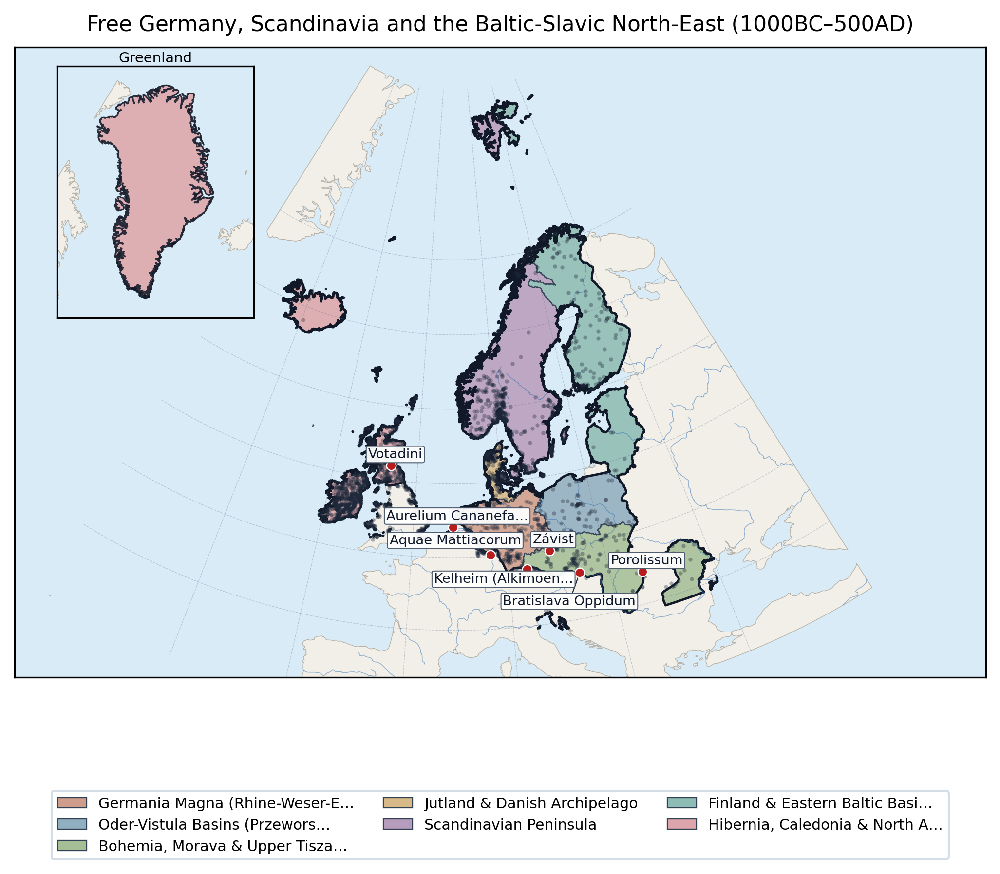

```{r setup, include=FALSE}
knitr::opts_chunk$set(
  echo = FALSE,
  warning = FALSE,
  message = FALSE,
  fig.align = "center"
)

source("../../_shared/template/viscount_rmd_helpers.R")
library(jsonlite)

summary_data <- fromJSON(
  "free_germany_scandinavia_baltic_slavic_summary.json",
  simplifyVector = FALSE
)

fix_mojibake <- function (arg0_vec) {
  s <- as.character(arg0_vec)
  pairs <- list(
    c("\u00e2\u0080\u0093", "\u2013"),
    c("\u00e2\u0080\u0094", "\u2014"),
    c("\u00c3\u00a1", "\u00e1"),
    c("\u00c3\u0081", "\u00c1"),
    c("\u00c3\u00ba", "\u00fa"),
    c("\u00c5\u00b1", "\u0171"),
    c("\u00c5\u0091", "\u0151"),
    c("\u00c3\u00bc", "\u00fc"),
    c("\u00c3\u00b6", "\u00f6"),
    c("\u00c3\u00a4", "\u00e4"),
    c("\u00c3\u00a9", "\u00e9"),
    c("\u00c3\u00b3", "\u00f3"),
    c("\u00c3\u00ad", "\u00ed")
  )
  for (p in pairs) {
    s <- gsub(p[[1]], p[[2]], s, fixed = TRUE)
  }
  s
}

total_area <- as.numeric(summary_data$total_area_km2)
tot_1000bc <- as.numeric(summary_data$domain_totals[["-1000"]])
tot_500bc <- as.numeric(summary_data$domain_totals[["-500"]])
tot_1ad <- as.numeric(summary_data$domain_totals[["0"]])
tot_200ad <- as.numeric(summary_data$domain_totals[["200"]])
tot_500ad <- as.numeric(summary_data$domain_totals[["500"]])
site_count <- as.integer(summary_data$settlement_count)

sub_df <- do.call(rbind, lapply(summary_data$subregions, function (r) {
  area_val <- as.numeric(r$area_km2)
  p1 <- as.numeric(r$population[["-1000"]])
  p2 <- as.numeric(r$population[["-500"]])
  p3 <- as.numeric(r$population[["0"]])
  p4 <- as.numeric(r$population[["200"]])
  p5 <- as.numeric(r$population[["500"]])
  sites_n <- as.integer(summary_data$settlements_by_region[[r$id]])
  data.frame(
    id = r$id,
    name = r$name,
    area_km2 = area_val,
    p_1000bc = p1,
    p_500bc = p2,
    p_1ad = p3,
    p_200ad = p4,
    p_500ad = p5,
    d_1000bc = p1 / area_val,
    d_500bc = p2 / area_val,
    d_1ad = p3 / area_val,
    d_200ad = p4 / area_val,
    d_500ad = p5 / area_val,
    pct_exp = (p4 / p1 - 1) * 100,
    pct_mig = (p5 / p4 - 1) * 100,
    sites = sites_n,
    stringsAsFactors = FALSE
  )
}))
rownames(sub_df) <- NULL
```

```{r hero_markdown_fallback, results='asis'}
if (!knitr::is_latex_output()) {
  cat("\n\n\n")
}
```

# Abstract

Between 1000BC and 500AD the vast territories of northern and north-eastern Europe lying beyond Rome's Rhine, Danube and Antonine frontiers constituted a distinct demographic world shaped by iron-age agricultural clearance, maritime seafaring, frontier commerce and late antique migration. Covering `r viscount_fmt_number(total_area, 1)` km² across seven analytical sub-regions—Elbe-Weser Germania Magna, the Oder-Vistula basin of the Przeworsk and Wielbark cultures, Bohemia, Moravia and Slovakia, Jutland and the Danish Isles, the Scandinavian Peninsula, Finland and the Eastern Baltic together with the North Atlantic rim comprising Hibernia, the Faroes, Iceland and Dorset Greenland—MAGNETIC reconstructs regional population trajectories alongside a geocoded corpus of `r formatC(site_count, format = "d", big.mark = ".")` habitation sites. Aggregate population rose from `r viscount_fmt_pop(tot_1000bc)` in 1000BC (`r viscount_fmt_number(tot_1000bc / total_area, 2)` inhabitants per km²) through `r viscount_fmt_pop(tot_500bc)` in 500BC and `r viscount_fmt_pop(tot_1ad)` at 1AD to a classical peak of `r viscount_fmt_pop(tot_200ad)` in 200AD (`r viscount_fmt_number(tot_200ad / total_area, 2)` per km²), an expansion of `r viscount_fmt_number((tot_200ad / tot_1000bc - 1) * 100, 1)`% driven by bog-iron metallurgy, ard and heavy-plough cultivation of moraine and loess soils alongside trade across the Roman limes. After 200AD epidemic spillovers, climatic cooling and mass Germanic out-migration cut the total by `r viscount_fmt_number(abs((tot_500ad / tot_200ad - 1) * 100), 1)`% to `r viscount_fmt_pop(tot_500ad)` by 500AD. Contraction fell most heavily on the continental plains between the Elbe and the Vistula (-21,6% to -29,1%), while maritime and boreal zones—Scandinavia (-6,1%), Finland and the Eastern Baltic (-4,9%) and Hibernia (-3,9%)—retained most of their peak numbers into the early mediaeval threshold.

# Background

## Geographic Scope and Ecological Gradients

The northern Barbaricum surveyed in this chapter encompasses everything in Europe west of the Russian plain and north of the Roman military border that remained outside durable provincial taxation between 1000BC and 500AD, together with the North Atlantic archipelago extending to Greenland. Its total area of `r viscount_fmt_number(total_area, 1)` km² is deceptive unless broken into sharply contrasting ecological zones. More than half of that surface (2.261.598,9 km²) sits inside the North Atlantic sub-region, where Greenland's ice cap (roughly 2,16M km²), Svalbard's Arctic archipelago and an as yet uninhabited Iceland dilute raw regional density to fractional figures. Across the habitable European core south of the 60th parallel, carrying capacity was governed by the boundary between post-glacial loess terraces, North European clay moraines, sandy heathland geest and boreal granite shields.

South of the Baltic littoral, three continental basins carried the bulk of northern Europe's Iron Age peasantry. Elbe-Weser Germania Magna (172.506 km²) paired tidal North Sea clay marshes—colonised through artificial dwelling mounds known as terpen or Wurten—with fertile loess foothill strips along the Harz and Weser uplands. Eastward across the Oder-Vistula plain (308.459,5 km²), broad sandur plains and marshy river valleys alternated with productive black-earth and loess pockets in Silesia, Lesser Poland and Kuyavia. South of the Sudetes and Ore Mountains, Bohemia, Moravia and south-western Slovakia (126.243,2 km²) formed a sheltered Hercynian amphitheatre drained by the upper Elbe and Morava rivers, commanding the amber corridor directly north of the Middle Danube.

North of the Eider and the Baltic, Jutland and the Danish Isles (42.095,2 km²) formed a maritime farming heartland where mild Atlantic winters and young moraine soils on Funen, Zealand and eastern Jutland supported densities rivalling Free Germany. Beyond the Kattegat, the Scandinavian Peninsula (793.812,5 km²) restricted arable agriculture to Scania, Västergötland, Östergötland, the Mälaren basin, Gotland, Öland and narrow marine-clay shelves along Norway's south-eastern and western fjords. North of Trøndelag and Medelpad, mixed farming gave way to coastal fishing, sealing and interior reindeer hunting.

Across the Gulf of Bothnia, Finland and the Eastern Baltic (494.332 km²) presented a mosaic of limestone alvars and moraine ridges in Estonia, Latvia and Lithuania backed by the spruce-and-lake taiga of interior Finland. To the far west across the Irish Sea, Hibernia (roughly 84.421 km² within the North Atlantic sub-region) offered mild, wet pastures suited to cattle pastoralism and ringfort tillage, while Caledonia north of the Antonine Wall lay along the same Atlantic fringe beyond permanent Roman rule.

## Iron Age Cultural Horizons: Jastorf, Przeworsk, Wielbark and Nordic Spheres

Demographic expansion across these seven sub-regions began well before Rome reached the Rhine. Around 1000BC the Late Bronze Age Urnfield and Nordic Bronze Age networks already linked Jutland, Scania and northern Germany by coasting vessels and riverine portages [@Bengtsson2025Seafaring]. Strontium and genomic profiles from earlier Danish bog burials show that long-distance mobility across the Skagerrak and North European Plain was an established feature of prehistoric northern demography long before classical historians recorded tribal names [@Fischer2024Vittrup].

Between 800BC and 500BC, the shift from imported bronze to locally smelted bog iron transformed northern rural capacity. Bog-iron ores occurred widely across Jutland, Holstein, Lower Saxony, Brandenburg, Mazovia and central Sweden. Local smithies broke northern Europe's dependence on Alpine copper and British tin, placing iron sickles, axes and ploughshares into the hands of dispersed village households.

Three major archaeological complexes structured the continental plain during the Pre-Roman and Roman Iron Ages. Between the Weser, the Elbe and the lower Oder, the Jastorf culture crystallised around 600BC–500BC out of late Bronze Age roots and expanded southwards into Thuringia and Hesse as Celtic La Tène power ebbed. East of the Oder, the Przeworsk culture emerged in the late third and second centuries before the common era across Greater Poland, Silesia and central Poland, developing industrial-scale iron-smelting fields in the Holy Cross Mountains and Mazovia whose slag pits numbered in the hundreds of thousands [@Uczkiewicz2020Chronology].

Along the lower Vistula and eastern Pomerania, the Oksywie horizon gave way around 1AD–50AD to the Wielbark culture, associated with Gothic and Gepidic groups who maintained bi-ritual cemeteries free of weapons and controlled the Sambian amber outlets [@Uczkiewicz2020Chronology; @Mikhail2021Beads]. Amber harvested along the south-eastern Baltic shore travelled southward along the Vistula, through the Moravian Gate and into both Roman Aquileia and Sarmatian steppe burials of the northern Black Sea [@Mikhail2021Beads; @Skoryi2017Professor].

In Bohemia, Moravia and western Slovakia, demographic density rose early under Celtic La Tène hillfort oppida such as Stradonice, Závist and Staré Hradisko during the second and first centuries before the common era, before Germanic Suebic peoples—principally the Marcomanni under Maroboduus and the Quadi along the Morava and Váh—displaced or absorbed the Boii around 10BC–10AD. Farther north, the Nordic Iron Age unfolded without monumental oppida, organised instead around timber longhouses stalling cattle indoors through winter, infield-outfield manuring systems and coastal chieftaincy landing-places across Jutland, Funen, Zealand, Scania and western Norway [@Bengtsson2025Seafaring; @Panagiotakopulu2018There]. Across Finland and the Eastern Baltic, coastal communities adopted tarand stone-enclosure cemeteries and iron-tipped ards while interior Finno-Ugric groups sustained low-density boreal foraging and fur-trapping networks stretching deep into northern Eurasia [@Berezkin2010Plejaadid; @Tallavaara2015].

## Frontier Contact, Roman Trade and Migration-Period Disruption

Rome's conquest of Gaul (58BC–51BC) and occupation of Raetia, Noricum and Pannonia (15BC–9AD) turned the Rhine and Danube into a hardened imperial border after the destruction of Varus's three legions in the Teutoburg Forest in 9AD. Yet militarily guarded rivers functioned economically as corridors rather than sealed walls [@Scheidel2007; @Hanson2016]. Along a 200-kilometre contact band east of the Rhine and north of the Danube, Roman silver denarii, bronze drinking sets, glass beakers and grain purchases drew Germanic agricultural surpluses and auxiliary recruits into the imperial orbit. Excavated villages such as Feddersen Wierde on the Weser estuary and Wijster in Drenthe expanded steadily from 1AD to 300AD, adding specialised bronze-working, comb-making and cattle-byre capacity directly geared toward frontier demand.

Along the north-western maritime flank, a parallel but looser contact zone operated across the Irish Sea and the Forth-Clyde isthmus. After Rome's brief mid-second-century advance to the Antonine Wall (142AD–162AD), the imperial frontier settled back onto Hadrian's Wall, leaving Caledonia and Hibernia outside direct fiscal extraction. Roman coinage, Samian ware and brooches reached Irish royal sites and Scottish brochs through coastal barter and diplomatic gifts, while cattle-raising and oat-and-barley tillage expanded across the drumlin lowlands of Ulster, Leinster and Munster.

That continental equilibrium fractured after 166AD. The Marcomannic Wars (166AD–180AD) devastated borderlands in Moravia, Slovakia and Upper Pannonia while introducing the Antonine epidemic across military supply lines [@Harper2017]. After 250AD cooler and wetter summers marking the end of the Roman Climatic Optimum reduced harvest margins on sandy northern soils and flooded low-lying North Sea terpen [@Harper2017].

Simultaneously, demographic pressure and political realignments drove large confederations southward and westward. Wielbark communities vacated Pomerania and the lower Vistula in successive waves from 180AD to 380AD, moving south-eastward across Volhynia and Podolia to form the multi-ethnic Chernyakhiv horizon between the Dniester and the Dnieper, where craniological series confirm northern European immigration into the forest-steppe zone [@Rudych2026Population]. The arrival of the Huns north of the Black Sea in 375AD, the Rhine crossing of Vandals, Suebi and Alans in 406AD and fifth-century departures of Angles, Saxons, Jutes and Lombards stripped substantial tracts of Brandenburg, Mecklenburg, Silesia, Pomerania and Bohemia of settled farmsteads. Pollen profiles from eastern Holstein, Mecklenburg and Greater Poland register sharp woodland regeneration—beech and hornbeam reclaiming former arable fields—immediately before early Slavic pioneer villages began filtering west of the Vistula around 500AD.

# Methodology

## Areal Reconstruction and Carrying-Capacity Benchmarks

Estimating populations across `r viscount_fmt_number(total_area, 1)` km² of non-literate northern Europe requires explicit triangulation between archaeological proxies and comparative pre-industrial demographic ceilings. Unlike Roman Italy or Roman Egypt, where Augustan census totals and household papyri anchor demographic debate [@LoCascio1994; @BagnallFrier1994; @DeLigt2012], Free Germany, Scandinavia, Hibernia and the Baltic-Slavic woodland zone produced no native tax rolls before the early Middle Ages. Classical figures cited by Caesar, Tacitus or Strabo for tribal warrior levies—such as the 100 cantons of the Suebi or the fighting strengths of the Cherusci and Marcomanni—are rhetorical approximations rather than enumerations, useful only as broad order-of-magnitude checks [@Scheidel2007].

MAGNETIC constructs sub-regional population curves at five canonical anchor dates (1000BC, 500BC, 1AD, 200AD and 500AD) by integrating four independent strands of evidence:

1. **Agro-ecological soil ceilings**: Sub-regional land areas calculated from equal-area geographic masks are partitioned into arable loess and young-moraine zones, pastoral marsh and upland zones plus low-yield boreal or sub-Arctic zones. Pre-industrial dry-farming densities in temperate northern Europe without heavy mouldboard horseshoes or three-field rotation rarely exceeded 10 to 14 inhabitants per km² over large regions, whereas boreal hunter-fisher-farmer mosaics stayed below 1 inhabitant per km² [@Tallavaara2015; @BocquetAppel2005].
2. **Regional archaeological survey and cemetery scaling**: Excavated village footprints (longhouse counts multiplied by average household sizes of 5 to 7 persons) and cemetery demographic reconstructions are calibrated against Mediterranean and temperate survey recovery ratios [@Bintliff1997; @Hansen2006; @BowmanWilson2011]. Because unexcavated rural sites outnumber recorded sites by factors of five to twenty depending on modern plough-zone survey intensity, raw site counts serve as spatial weights rather than direct population sums.
3. **Radiocarbon summed probability distributions**: Temporal inflection points between 1000BC and 500AD—specifically the rapid Pre-Roman Iron Age climb after 500BC, the Roman-period zenith around 150AD–250AD and the fourth-to-fifth-century dip—follow European radiocarbon demographic curves that track boom-and-bust settlement cycles across temperate and northern latitudes [@Shennan2013].
4. **Life-table and mortality envelopes**: Implied compound annual growth rates between benchmark horizons are bounded within pre-industrial demographic plausibility (0,05% to 0,12% per annum during sustained Iron Age clearance; -0,05% to -0,12% per annum during Migration-Period contraction and emigration), consistent with pre-modern mortality regimes where life expectancy at birth hovered around 22 to 28 years [@BagnallFrier1994; @Scheidel2007; @Harper2017].

## Settlement Gazetteer Harmonisation and Provenance Tiering

To anchor sub-regional totals in concrete geographic space, MAGNETIC compiles a geocoded corpus of `r formatC(site_count, format = "d", big.mark = ".")` habitation sites active within the 1000BC–500AD window across `r length(summary_data$countries)` modern national territories. Four scholarly data streams supply the corpus without crowdsourced fallback records (0% crowdsourced share). Table 1 summarises the provenance architecture and standardised habitation-size tiers assigned to each stream.

```{r table_provenance, results='asis'}
prov_counts <- summary_data$provenance_counts
prov_meta <- data.frame(
  Source = c(
    "European Radiocarbon Settlement Corpus",
    "Digital Atlas of the Roman Empire",
    "Pleiades Ancient World Gazetteer",
    "Buringh European Urban Series"
  ),
  Sites = c(
    as.integer(prov_counts$European_Radiocarbon_Settlement_Corpus),
    as.integer(prov_counts$DARE_Digital_Atlas_Roman_Empire),
    as.integer(prov_counts$Pleiades_Ancient_World_Gazetteer),
    as.integer(prov_counts$Buringh_European_Urban_700_2000)
  ),
  Tier_Pop = c("550", "2.200", "850", "650"),
  Character = c(
    "Radiocarbon-dated farmsteads, ringforts and hamlets",
    "Limes forts, vici, oppida and native frontier hubs",
    "Named classical localities and Iron Age hillforts",
    "Continuity centres bridging antiquity and early Middle Ages"
  ),
  stringsAsFactors = FALSE
)
prov_meta$Share <- paste0(
  vapply(prov_meta$Sites / site_count * 100, viscount_fmt_number, character(1), arg1_digits = 1L),
  "%"
)
prov_display <- prov_meta[, c("Source", "Sites", "Share", "Tier_Pop", "Character")]
prov_display$Sites <- formatC(prov_display$Sites, format = "d", big.mark = ".")
rownames(prov_display) <- NULL

viscount_table(
  prov_display,
  "Provenance ledger and standardised habitation-size tiers across the 2.226 recorded sites (1000BC–500AD).",
  c("Archival Source", "Sites", "Share", "Benchmark Pop.", "Settlement Character")
)
```

Two structural features of Table 1 deserve explicit attention. First, nearly two-thirds of all entries (1.451 sites, or 65,2%) derive from the European Radiocarbon Settlement Corpus, assigned a rural village or clustered-farmstead benchmark of 550 inhabitants representing a local catchment cluster rather than a single isolated longhouse. Second, one-third (739 sites, or 33,2%) come from the Digital Atlas of the Roman Empire, clustered disproportionately along the Lower Rhine, the Middle Danube contact zone and adjacent native trade stations, where a uniform classical frontier-node benchmark of 2.200 inhabitants applies.

Pleiades (21 sites at 850 inhabitants, including Gothiscandza, Hegetmatia, Hedeby and the Danevirke border complex, Brusselstown Ring and Haughey's Fort) and Buringh (15 early-continuity urban precursors at 650 inhabitants, including Armagh, Downpatrick, Bremen, Bonn and Maastricht) capture intermediate named centres. Because the northern Barbaricum lacked true Mediterranean cities of 10.000 or more inhabitants [@Hanson2016], this bimodal benchmark assignment intentionally avoids inflating barbarian villages into pseudo-cities while documenting the sharp threshold between frontier-contact stations and interior rural hamlets.

# Validation

## Cross-Checking Densities Against Roman Provincial and Boreal Ceilings

A primary test of any northern European prehistoric-to-classical demographic series is whether its sub-regional densities sit coherently between two firmer anchor zones: the Roman Mediterranean and Gallic provinces to the south and the sub-Arctic foraging threshold to the north. Across Roman Italy and Gaul in the second century, scholarly estimates span 15 to 28 inhabitants per km² depending on low-count versus high-count interpretations of Augustan census totals [@LoCascio1994; @DeLigt2012; @Scheidel2007; @Hanson2016]. At our 200AD peak, the densest sub-regions beyond the limes reach 10,72 inhabitants per km² in Elbe-Weser Germania Magna, 9,26 in Jutland and the Danish Isles, 7,29 in Bohemia, Moravia and Slovakia and 4,8 in Oder-Vistula. Every figure sits cleanly below Roman provincial averages—reflecting shorter growing seasons, heavier forest cover, absence of urban food-import networks and lower arable ratios—yet substantially above Bronze Age floors (1,88 to 3,92 per km² in 1000BC).

At the opposite ecological extreme, the boreal and sub-Arctic margins pass a matching carrying-capacity test. On the Scandinavian Peninsula, aggregate density rises from 0,26 inhabitants per km² in 1000BC to 0,62 in 200AD before easing to 0,58 in 500AD. Because roughly 80% of Sweden and Norway consists of high mountain fell, northern coniferous forest and sub-Arctic tundra incapable of cereal ripening, those peninsula-wide averages translate into 3 to 6 inhabitants per km² across the habitable southern lowlands of Scania, Östergötland, Uppland, Rogaland and Trøndelag, paired with below 0,05 inhabitants per km² across the interior Sámi foraging belt—a gradient closely matching palaeo-demographic carrying-capacity simulations for northern Europe [@Tallavaara2015; @BocquetAppel2005]. Finland and the Eastern Baltic show a parallel trajectory (0,35 per km² in 1000BC to 0,83 in 200AD and 0,79 in 500AD), reflecting the juxtaposition of settled Baltic coastal farming with sparsely peopled Finnish lake taiga [@Berezkin2010Plejaadid].

In the North Atlantic sub-region (2.261.598,9 km²), raw areal density reads just 0,23 inhabitants per km² in 200AD (0,22 in 500AD). Stripping out Greenland's ice sheet (about 2,16M km²) and an uninhabited Iceland (about 103.000 km²) leaves Hibernia (about 84.421 km²) carrying almost the entire regional population at roughly 5,8 to 6 inhabitants per km²—an entirely plausible pre-monastic pastoral-arable density intermediate between Roman Britain (roughly 12 to 16 per km²) and the Scottish Highlands.

## Radiocarbon Proxies, Pollen Horizons and Archaeological Settlement Continuity

Independent archaeobotanical and osteological evidence corroborates both the timing of the 200AD crest and the stark regional asymmetry of the 200AD–500AD downturn. Across Jutland, Schleswig-Holstein and Lower Saxony, pollen records show cereal and ribwort plantain percentages climbing steadily from 500BC to 200AD before dropping sharply in the fourth and fifth centuries as alder, birch and beech recolonised abandoned fields. In the Przeworsk and Wielbark zones of Poland, the cessation of industrial iron smelting in the Holy Cross Mountains and the abandonment of hundreds of cremation cemeteries during the late fourth and early fifth centuries confirm a deep demographic trough (-29,1% between 200AD and 500AD) prior to early Slavic repopulation [@Uczkiewicz2020Chronology]. Simultaneously, male craniological series from Chernyakhiv cemeteries such as Viytenki document the southward arrival of northern Germanic migrants along the forest-steppe corridor, confirming that Oder-Vistula losses stemmed heavily from physical emigration rather than purely local mortality [@Rudych2026Population].

Along the Norwegian coast and northern fjords, by contrast, Iron Age maritime networks remained active well into the Migration Period. Boat burials extending north of the Arctic Circle—exemplified by entomological and archaeological investigations at Øksnes in Vesterålen—demonstrate enduring coastal farming, stockfish exploitation and long-distance sea links that insulated Norway and western Sweden from the continental collapse [@Panagiotakopulu2018There; @Bengtsson2025Seafaring]. Likewise, Hibernia experienced minimal fifth-century depopulation (-3,9%), transitioning smoothly into the dense early mediaeval ringfort boom that later supplied both monastic scholars and part of the maternal founding pool of Viking-Age Iceland [@Plomp2021Composition].

# Results

## Macro-Regional Trajectory from 1000BC to 500AD

Across the full `r viscount_fmt_number(total_area, 1)` km² study domain, total population expanded by a factor of 2,61 over the twelve centuries from 1000BC to 200AD before retreating by nearly one-fifth during the ensuing three centuries. Figure 1 plots the aggregate and sub-regional population curves alongside 500AD spatial densities, while Tables 2 and 3 present exact sub-regional figures, densities and proportional shifts across all five benchmark horizons.

```{r fig_trajectory, results='asis'}
viscount_figure(
  "figures/free_germany_scandinavia_baltic_slavic_population_trajectory.png",
  "Population trajectory from 1000BC to 500AD across the seven northern sub-regions (Panel A) and sub-regional population densities in 500AD in inhabitants per km² (Panel B).",
  "fig:pop_trajectory"
)
```

In 1000BC the entire northern Barbaricum held `r viscount_fmt_pop(tot_1000bc)` inhabitants (0,55 per km² across all land, or 1,2 per km² excluding Greenland and Iceland). Over the five centuries from 1000BC to 500BC, bog-iron adoption and woodland clearance lifted aggregate numbers by 49,9% to `r viscount_fmt_pop(tot_500bc)`—an implied compound growth rate of 0,081% per annum. Expansion continued at nearly identical pace (+46,1%, or 0,076% per annum) through the Pre-Roman Iron Age to reach `r viscount_fmt_pop(tot_1ad)` at 1AD.

The sharpest acceleration occurred during the first two centuries of direct proximity to the Roman Rhine-Danube frontier: between 1AD and 200AD total population added nearly a million inhabitants (+980k, or +19,3%, equal to 0,088% per annum) to peak at `r viscount_fmt_pop(tot_200ad)`. Between 200AD and 500AD that trajectory reversed, shedding 1,18M inhabitants (-19,5%, or -0,072% per annum) to settle at `r viscount_fmt_pop(tot_500ad)` at the opening of the early Middle Ages.

```{r table_subregional_pop, results='asis'}
t2 <- data.frame(
  Subregion = sub_df$name,
  Area = vapply(sub_df$area_km2, viscount_fmt_number, character(1), arg1_digits = 1L),
  Y1000BC = vapply(sub_df$p_1000bc, viscount_fmt_pop, character(1)),
  Y500BC = vapply(sub_df$p_500bc, viscount_fmt_pop, character(1)),
  Y1AD = vapply(sub_df$p_1ad, viscount_fmt_pop, character(1)),
  Y200AD = vapply(sub_df$p_200ad, viscount_fmt_pop, character(1)),
  Y500AD = vapply(sub_df$p_500ad, viscount_fmt_pop, character(1)),
  stringsAsFactors = FALSE
)
t2 <- rbind(
  t2,
  data.frame(
    Subregion = "Domain Total",
    Area = viscount_fmt_number(total_area, 1),
    Y1000BC = viscount_fmt_pop(tot_1000bc),
    Y500BC = viscount_fmt_pop(tot_500bc),
    Y1AD = viscount_fmt_pop(tot_1ad),
    Y200AD = viscount_fmt_pop(tot_200ad),
    Y500AD = viscount_fmt_pop(tot_500ad),
    stringsAsFactors = FALSE
  )
)
rownames(t2) <- NULL

viscount_table(
  t2,
  "Sub-regional land areas and population estimates across Free Germany, Scandinavia, Hibernia and the Baltic-Slavic north-east (1000BC–500AD).",
  c("Sub-Region", "Area (km²)", "1000BC", "500BC", "1AD", "200AD", "500AD")
)
```

```{r table_subregional_density, results='asis'}
t3 <- data.frame(
  Subregion = sub_df$name,
  D1000BC = vapply(sub_df$d_1000bc, viscount_fmt_number, character(1), arg1_digits = 2L),
  D1AD = vapply(sub_df$d_1ad, viscount_fmt_number, character(1), arg1_digits = 2L),
  D200AD = vapply(sub_df$d_200ad, viscount_fmt_number, character(1), arg1_digits = 2L),
  D500AD = vapply(sub_df$d_500ad, viscount_fmt_number, character(1), arg1_digits = 2L),
  Exp = paste0("+", vapply(sub_df$pct_exp, viscount_fmt_number, character(1), arg1_digits = 1L), "%"),
  Mig = paste0(vapply(sub_df$pct_mig, viscount_fmt_number, character(1), arg1_digits = 1L), "%"),
  stringsAsFactors = FALSE
)
t3 <- rbind(
  t3,
  data.frame(
    Subregion = "Domain Average",
    D1000BC = viscount_fmt_number(tot_1000bc / total_area, 2L),
    D1AD = viscount_fmt_number(tot_1ad / total_area, 2L),
    D200AD = viscount_fmt_number(tot_200ad / total_area, 2L),
    D500AD = viscount_fmt_number(tot_500ad / total_area, 2L),
    Exp = paste0("+", viscount_fmt_number((tot_200ad / tot_1000bc - 1) * 100, 1), "%"),
    Mig = paste0(viscount_fmt_number((tot_500ad / tot_200ad - 1) * 100, 1), "%"),
    stringsAsFactors = FALSE
  )
)
rownames(t3) <- NULL

viscount_table(
  t3,
  "Sub-regional population density (inhabitants per km²) and proportional change during Iron Age expansion (1000BC–200AD) and Migration-Period contraction (200AD–500AD).",
  c("Sub-Region", "1000BC", "1AD", "200AD", "500AD", "1000BC–200AD", "200AD–500AD")
)
```

## Germania Magna, Oder-Vistula and the Bohemian-Moravian Basin

The three continental basins—Elbe-Weser Germania Magna, Oder-Vistula and Bohemia, Moravia and Slovakia—accounted for 70,2% of total regional population at the 200AD apex (4,25M out of 6,05M) despite occupying only 14,5% of total land area (607.208,7 km²). Their combined density reached 7 inhabitants per km² in 200AD, making the belt between the Rhine, the Middle Danube and the Vistula the demographic engine of the non-Roman north.

Elbe-Weser Germania Magna led every sub-region in both absolute numbers and peak density. Starting from 620k (3,59 per km²) in 1000BC, it nearly tripled (+198,4%) to 1,85M (10,72 per km²) by 200AD. Growth was fastest between 500BC and 1AD (950k to 1,55M), coinciding with Jastorf expansion, the reclamation of North Sea salt marshes through raised terpen mounds from Groningen to the Weser mouth and the dense agricultural filling of Westphalian and Lower Saxon river terraces. Between 200AD and 500AD, however, rising North Sea storm surges flooded coastal terpen while confederated Franks, Saxons, Angles and Thuringians pushed across the Rhine and the North Sea, reducing regional population by 21,6% to 1,45M (8,41 per km²).

East of the Oder, the Oder-Vistula sub-region (308.459,5 km²) grew from 580k (1,88 per km²) in 1000BC to 1,48M (4,8 per km²) in 200AD (+155,2%), powered by Przeworsk iron metallurgy in southern and central Poland and Wielbark maritime-amber prosperity along the Vistula estuary [@Uczkiewicz2020Chronology; @Mikhail2021Beads]. Yet this vast open plain suffered the steepest demographic reversal in all of northern Europe after 200AD: population plunged 29,1% to 1,05M (3,4 per km²) by 500AD. Sequential departures of Goths and Gepids toward the Black Sea [@Rudych2026Population], followed by Vandals and Burgundians moving toward the Rhine and Danube after 400AD, left Pomerania, Greater Poland and Silesia thinly occupied until early Slavic agrarian communities of the Prague-Korchak horizon expanded westward in the sixth century.

Bohemia, Moravia and Slovakia (126.243,2 km²) followed a parallel boom-and-contraction arc at higher baseline density. Celtic La Tène hillfort networks lifted numbers from 380k (3,01 per km²) in 1000BC to 580k in 500BC and 780k (6,18 per km²) by 1AD. Under Marcomannic and Quadic rule—closely tethered to the Roman Pannonian limes across the Danube at Carnuntum and Brigetio—population rose to 920k (7,29 per km²) in 200AD despite the destructive Marcomannic Wars of 166AD–180AD. Thereafter, fifth-century instability, Hunnic hegemony on the Great Hungarian Plain and the successive emigration of Suebi, Heruli and Lombards cut numbers by 26,1% to 680k (5,39 per km²) in 500AD.

## Jutland, the Scandinavian Peninsula and the Baltic-Slavic Woodland Zone

North of the Elbe, the demographic story shifted from abrupt frontier upheaval to steadier maritime resilience. Jutland and the Danish Isles (42.095,2 km²) stood second only to Elbe-Weser in population density across the entire 1.500-year span. Starting at 165k (3,92 per km²) in 1000BC—actually the highest starting density of all seven sub-regions—Denmark climbed to 235k in 500BC, 320k in 1AD and 390k (9,26 per km²) in 200AD (+136,4%). Intensive cattle stalling, bog-iron smelting in western Jutland and aristocratic wealth centres on Zealand (Himlingøje) and Funen (Gudme) sustained dense village clusters. Even during the fifth-century departures of Jutes and Angles toward Britain and the abandonment of marginal western Jutland sand heaths, Denmark contracted by only 10,3% to 350k (8,31 per km²) in 500AD, maintaining a density virtually identical to Elbe-Weser Germania Magna.

The Scandinavian Peninsula (793.812,5 km²) grew steadily from 210k (0,26 per km²) in 1000BC through 295k in 500BC and 410k in 1AD to 490k (0,62 per km²) in 200AD (+133,3%). Settlement hugged two coastal arcs: the rich agricultural plains of Scania, Halland, Västergötland, Östergötland, Mälaren, Öland and Gotland in Sweden alongside the Gulf Stream-warmed fjord terraces of Oslofjord, Rogaland, Vestland, Trøndelag and Nordland in Norway. Maritime rowed vessels of the Hjortspring and Nydam lineages knit coastal chiefdoms together across sheltered fjords and open Baltic crossings [@Bengtsson2025Seafaring], sustaining permanent farmsteads and elite boat burials as far north as Vesterålen above 68°N [@Panagiotakopulu2018There]. Contraction between 200AD and 500AD remained mild (-6,1% to 460k, or 0,58 per km²), foreshadowing the vigorous Vendel and Merovingian-period demographic rebound—though the volcanic dust veil of 536AD–540AD lay just beyond our 500AD terminal horizon.

Finland and the Eastern Baltic (494.332 km²) tracked an almost identical relative curve: rising from 175k (0,35 per km²) in 1000BC through 245k in 500BC and 340k in 1AD to 410k (0,83 per km²) in 200AD (+134,3%) before easing by just 4,9% to 390k (0,79 per km²) in 500AD. Here the demographic centre of gravity lay in Lithuania, Latvia, northern Estonia and south-western Finland (Varsinais-Suomi, Satakunta and Häme), where Baltic and Baltic-Finnic cultivators cleared moraine soils for barley and rye while exchanging amber and furs southward [@Mikhail2021Beads; @Berezkin2010Plejaadid]. Farther inland across Savo, Karelia and Lapland, sparse mobile hunting bands kept mean densities well below 0,1 inhabitants per km² [@Tallavaara2015].

## Hibernia, Northern Britain and the North Atlantic Rim

The seventh sub-region—Hibernia, Faroes, Iceland and Dorset Greenland (2.261.598,9 km²)—exhibited both the second-strongest Iron Age percentage growth (+175,7% from 1000BC to 200AD) and the mildest Migration-Period dip (-3,9% from 200AD to 500AD). Total numbers rose from 185k in 1000BC to 285k in 500BC, 420k in 1AD and 510k in 200AD, holding at 490k in 500AD.

Virtually the entire population resided on the island of Hibernia, where mild maritime rainfall supported year-round cattle grazing and oats and barley tillage organised around dispersed family farmsteads, crannógs and nascent ringforts, punctuated by ceremonial royal centres at Tara, Emain Macha (Navan Fort), Cruachan and Dún Ailinne. Although never annexed by Rome, Hibernia maintained steady coastal trade and raiding links with Roman Britain and Caledonia north of the Antonine Wall, absorbing Latin literacy and early Christianity during the fifth century without suffering the continental migrations that disrupted Free Germany.

Across the open North Atlantic, human presence before 500AD remained negligible or absent. Archaeological and osteological evidence indicates that Iceland and the Faroe Islands were not permanently colonised until the late eighth to ninth centuries, when Norse settlers and Gaelic-speaking partners from Ireland and western Scotland established the Landnám founding population [@Plomp2021Composition]. Greenland alone carried a thin, discontinuous population of Late Dorset Palaeo-Eskimo marine hunters—numbering at most 3.000 to 6.000 persons scattered along western and eastern coastal polynyas—whose demographic weight barely altered sub-regional totals even though Greenland's vast landmass compressed gross areal density to 0,22 inhabitants per km² in 500AD.

## Settlement Hierarchy and Frontier-Zone Concentration

Figure 2 illustrates the habitation-size distribution of the `r formatC(site_count, format = "d", big.mark = ".")` recorded sites across the entire study domain. Unlike classical Italy, Greece or Roman Gaul—where primate metropolises and ranked civitas capitals yield a smooth Zipf rank-size slope [@Hansen2006; @Hanson2016]—the northern Barbaricum exhibits a stark bimodal step profile.

```{r fig_hierarchy, results='asis'}
viscount_figure(
  "figures/free_germany_scandinavia_baltic_slavic_urban_hierarchy.png",
  "Largest recorded frontier and native habitation centres (Panel A) and rank-size distribution across all 2.226 recorded sites in Free Germany, Scandinavia, Hibernia and the Baltic-Slavic north-east (Panel B).",
  "fig:urban_hierarchy"
)
```

In Panel B of Figure 2, ranks 1 through 739 sit on a flat plateau at 2.200 inhabitants, comprising Roman-era frontier forts, vici, trading stations and native oppida catalogued in the Digital Atlas of the Roman Empire along the Lower Rhine, Middle Danube and North Sea contact margins—among them Albis, Amisia, Anreppen, Antunnacum, Aquae Granni, Adendorf, Ad Flexum and Ad Mures. Immediately below this upper tier lie 21 Pleiades localities at 850 inhabitants and 15 early-urban continuity nodes from Buringh at 650 inhabitants, followed by a broad rural floor of 1.451 radiocarbon-dated settlements benchmarked at 550 inhabitants. While this step-function profile partly reflects standardised proxy tiers across archival datasets, it captures an essential historical reality: north of the Rhine and Danube there were no cities exceeding a few thousand residents before the emergence of Viking-Age emporia (Hedeby, Ribe, Birka) and Carolingian episcopal sees three centuries after 500AD.

# Limitations

Five structural limitations constrain demographic precision across Free Germany, Scandinavia, Hibernia and the Baltic-Slavic north-east between 1000BC and 500AD:

1. **Absence of native textual enumerations**: No indigenous state within the 4,2M km² domain conducted censuses, cadastres or hearth counts prior to 500AD. All regional totals carry an intrinsic uncertainty band of roughly ±20% to ±30%, widening toward the 1000BC baseline and narrowing somewhat around the well-excavated Roman Iron Age zenith of 200AD [@Scheidel2007; @BowmanWilson2011].
2. **Uneven archaeological survey and radiocarbon intensity**: Spatial site counts mirror modern heritage legislation and infrastructure rescue digging as much as ancient settlement density. Ireland (533 sites), Germany (420), Norway (356), Denmark (148), Sweden (143) and Northern Ireland (111) together contribute 76,9% of the entire gazetteer (1.711 of 2.226 sites), driven by motorway rescue archaeology and national open-access radiocarbon databases. By contrast, Poland (126 sites), Finland (82), Lithuania (6), Estonia (2) and Latvia (1) are markedly under-represented in international radiocarbon syntheses despite dense regional Iron Age cemetery networks. For this reason MAGNETIC never derives sub-regional totals proportionally from raw site counts.
3. **Frontier-border overlap in classical gazetteers**: Because polygonal sub-regional masks along the Lower Rhine and Middle Danube necessarily touch Roman frontier corridors, several borderland limes forts and vici from the Digital Atlas of the Roman Empire (such as Ad Flexum and Ad Mures on the Hungarian-Slovak Danube bend, or Aquae Granni and Antunnacum near the Rhineland rim) appear in the 2,2k upper tier. Their demographic weight is kept strictly bounded within the frontier contact zone rather than extrapolated into the un-Romanised interior.
4. **Disentangling mortality from migration after 200AD**: Between 200AD and 500AD, the continental sub-regions lost 1,07M inhabitants (-25,2% across Elbe-Weser, Oder-Vistula and Bohemia-Moravia combined). Archaeology and osteology confirm both climatic-epidemic stress [@Harper2017] and long-distance tribal emigration [@Rudych2026Population], yet the exact partition between excess deaths, fertility decline and net out-migration into Roman provinces or the Pontic steppe remains unquantifiable from burial evidence alone.
5. **Denominator distortion from uninhabited Arctic landmasses**: Grouping Hibernia with the Faroes, Iceland and Greenland preserves cartographic coverage across the North Atlantic rim, but Greenland's 2,16M km² ice sheet lowers sub-regional density by a factor of 26 relative to inhabited Hibernia. Analytical comparisons therefore cite both gross sub-regional density and effective habitable-island density.

# Conclusion

Between 1000BC and 500AD northern Europe beyond Rome's frontiers completed a full prehistoric-to-late-antique demographic cycle without once developing Mediterranean-style urbanism. Driven by local bog-iron smelting, woodland clearance and mixed cattle-cereal agriculture across loess, moraine and coastal marsh belts, total population across the seven sub-regions climbed from 2,32M in 1000BC to 3,47M in 500BC, 5,07M in 1AD and a classical summit of 6,05M in 200AD. Three continental basins—Elbe-Weser Germania Magna (1,85M), Oder-Vistula (1,48M) and Bohemia, Moravia and Slovakia (920k)—generated over 70% of that peak population, while Jutland and the Danish Isles matched Free Germany's density (9,26 inhabitants per km²) on a compact maritime core.

The subsequent Migration-Period downturn (-19,5% overall to 4,87M in 500AD) reshuffled the demographic map of northern Europe along a clear continental-versus-maritime fault line. Emigration, frontier warfare, climatic cooling and epidemic spillovers reduced Oder-Vistula by 29,1%, Bohemia-Moravia by 26,1% and Elbe-Weser by 21,6%, temporarily opening wide lowland corridors east of the Elbe to sixth-century Slavic expansion. Conversely, Denmark (-10,3%), the Scandinavian Peninsula (-6,1%), Finland and the Eastern Baltic (-4,9%) and Hibernia (-3,9%) weathered the late antique transition with their rural foundations largely intact. That asymmetric survival left the Atlantic, Nordic and Baltic rims poised to supply the agrarian resilience, monastic networks and maritime migrations that reshaped Europe after 500AD.

# Appendix

Table 4 cross-tabulates the `r formatC(site_count, format = "d", big.mark = ".")` recorded habitation sites across the seven sub-regions alongside site densities per 10.000 km², illustrating the spatial survey gradients documented in the Limitations section. A fuller site-by-site provenance breakdown, national distribution across all 19 modern polities and the top 25 recorded habitation centres appear in the companion settlement gazetteer report.

```{r table_appendix_sites, results='asis'}
app_df <- data.frame(
  Subregion = sub_df$name,
  Area = vapply(sub_df$area_km2, viscount_fmt_number, character(1), arg1_digits = 1L),
  Sites = formatC(sub_df$sites, format = "d", big.mark = "."),
  SiteShare = paste0(
    vapply(sub_df$sites / site_count * 100, viscount_fmt_number, character(1), arg1_digits = 1L),
    "%"
  ),
  SiteDens = vapply(sub_df$sites / (sub_df$area_km2 / 10000), viscount_fmt_number, character(1), arg1_digits = 2L),
  Pop500AD = vapply(sub_df$p_500ad, viscount_fmt_pop, character(1)),
  stringsAsFactors = FALSE
)
app_df <- rbind(
  app_df,
  data.frame(
    Subregion = "Domain Total",
    Area = viscount_fmt_number(total_area, 1),
    Sites = formatC(site_count, format = "d", big.mark = "."),
    SiteShare = "100%",
    SiteDens = viscount_fmt_number(site_count / (total_area / 10000), 2),
    Pop500AD = viscount_fmt_pop(tot_500ad),
    stringsAsFactors = FALSE
  )
)
rownames(app_df) <- NULL

viscount_table(
  app_df,
  "Sub-regional distribution of the 2.226 geocoded habitation sites, archaeological recording density per 10.000 km² and 500AD population totals.",
  c("Sub-Region", "Area (km²)", "Sites", "Share", "Sites per 10k km²", "Pop. 500AD")
)
```

# Sources
