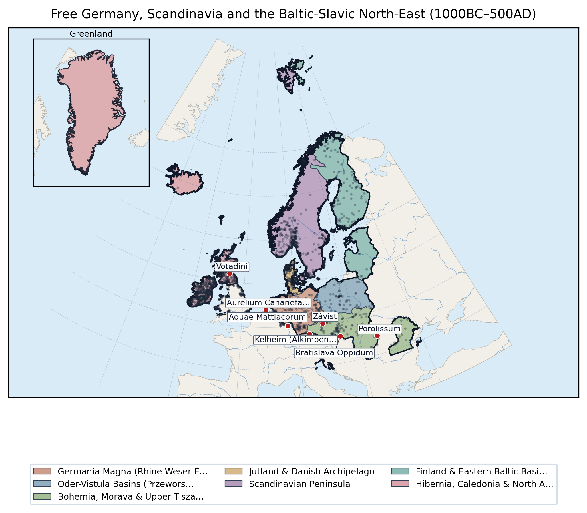
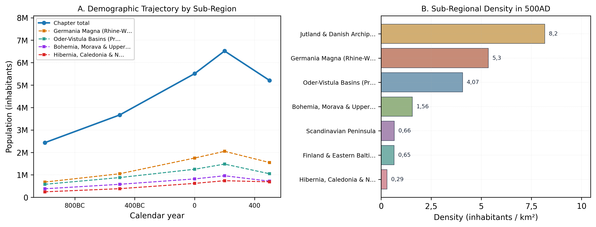
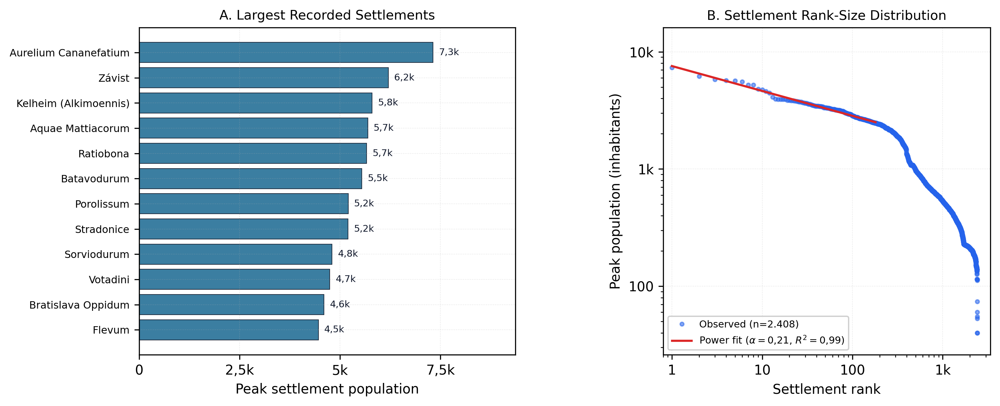

Free Germany, Scandinavia and the Baltic-Slavic North-East
================
Aust Kätzchen
22 November 2026

- [Abstract](#abstract)
- [Background](#background)
  - [Geographic Scope and Ecological
    Gradients](#geographic-scope-and-ecological-gradients)
  - [Iron Age Cultural Horizons: Jastorf, Przeworsk, Wielbark and Nordic
    Spheres](#iron-age-cultural-horizons-jastorf-przeworsk-wielbark-and-nordic-spheres)
  - [Frontier Contact, Roman Trade and Migration-Period
    Disruption](#frontier-contact-roman-trade-and-migration-period-disruption)
- [Methodology](#methodology)
  - [Areal Reconstruction and Carrying-Capacity
    Benchmarks](#areal-reconstruction-and-carrying-capacity-benchmarks)
  - [Settlement Gazetteer Harmonisation and Provenance
    Tiering](#settlement-gazetteer-harmonisation-and-provenance-tiering)
- [Validation](#validation)
  - [Cross-Checking Densities Against Roman Provincial and Boreal
    Ceilings](#cross-checking-densities-against-roman-provincial-and-boreal-ceilings)
  - [Radiocarbon Proxies, Pollen Horizons and Archaeological Settlement
    Continuity](#radiocarbon-proxies-pollen-horizons-and-archaeological-settlement-continuity)
- [Results](#results)
  - [Macro-Regional Trajectory from 1000BC to
    500AD](#macro-regional-trajectory-from-1000bc-to-500ad)
  - [Germania Magna, Oder-Vistula and the Bohemian-Moravian
    Basin](#germania-magna-oder-vistula-and-the-bohemian-moravian-basin)
  - [Jutland, the Scandinavian Peninsula and the Baltic-Slavic Woodland
    Zone](#jutland-the-scandinavian-peninsula-and-the-baltic-slavic-woodland-zone)
  - [Hibernia, Northern Britain and the North Atlantic
    Rim](#hibernia-northern-britain-and-the-north-atlantic-rim)
  - [Settlement Hierarchy and Frontier-Zone
    Concentration](#settlement-hierarchy-and-frontier-zone-concentration)
- [Limitations](#limitations)
- [Conclusion](#conclusion)
- [Appendix](#appendix)
- [Sources](#sources)

<figure>

<figcaption aria-hidden="true">Seven demographic sub-regions and 1.590
recorded habitation sites across Free Germany, Scandinavia, Hibernia and
the Baltic-Slavic north-east from 1000BC to 500AD.</figcaption>
</figure>

# Abstract

Between 1000BC and 500AD the vast territories of northern and
north-eastern Europe lying beyond Rome’s Rhine, Danube and Antonine
frontiers constituted a distinct demographic world shaped by iron-age
agricultural clearance, maritime seafaring, frontier commerce and late
antique migration. Covering 4.719.045,8 km² across seven analytical
sub-regions—Elbe-Weser Germania Magna, the Oder-Vistula basin of the
Przeworsk and Wielbark cultures, Bohemia, Moravia and Slovakia, Jutland
and the Danish Isles, the Scandinavian Peninsula, Finland and the
Eastern Baltic together with the North Atlantic rim comprising Hibernia,
the Faroes, Iceland and Dorset Greenland—MAGNETIC reconstructs regional
population trajectories alongside a geocoded corpus of 2.408 habitation
sites. Aggregate population rose from 2,44M in 1000BC (0,52 inhabitants
per km²) through 3,67M in 500BC and 5,51M at 1AD to a classical peak of
6,52M in 200AD (1,38 per km²), an expansion of 167,8% driven by bog-iron
metallurgy, ard and heavy-plough cultivation of moraine and loess soils
alongside trade across the Roman limes. After 200AD epidemic spillovers,
climatic cooling and mass Germanic out-migration cut the total by 20,1%
to 5,21M by 500AD. Contraction fell most heavily on the continental
plains between the Elbe and the Vistula (-21,6% to -29,1%), while
maritime and boreal zones—Scandinavia (-6,1%), Finland and the Eastern
Baltic (-4,9%) and Hibernia (-3,9%)—retained most of their peak numbers
into the early mediaeval threshold.

# Background

## Geographic Scope and Ecological Gradients

The northern Barbaricum surveyed in this chapter encompasses everything
in Europe west of the Russian plain and north of the Roman military
border that remained outside durable provincial taxation between 1000BC
and 500AD, together with the North Atlantic archipelago extending to
Greenland. Its total area of 4.719.045,8 km² is deceptive unless broken
into sharply contrasting ecological zones. More than half of that
surface (2.261.598,9 km²) sits inside the North Atlantic sub-region,
where Greenland’s ice cap (roughly 2,16M km²), Svalbard’s Arctic
archipelago and an as yet uninhabited Iceland dilute raw regional
density to fractional figures. Across the habitable European core south
of the 60th parallel, carrying capacity was governed by the boundary
between post-glacial loess terraces, North European clay moraines, sandy
heathland geest and boreal granite shields.

South of the Baltic littoral, three continental basins carried the bulk
of northern Europe’s Iron Age peasantry. Elbe-Weser Germania Magna
(172.506 km²) paired tidal North Sea clay marshes—colonised through
artificial dwelling mounds known as terpen or Wurten—with fertile loess
foothill strips along the Harz and Weser uplands. Eastward across the
Oder-Vistula plain (308.459,5 km²), broad sandur plains and marshy river
valleys alternated with productive black-earth and loess pockets in
Silesia, Lesser Poland and Kuyavia. South of the Sudetes and Ore
Mountains, Bohemia, Moravia and south-western Slovakia (126.243,2 km²)
formed a sheltered Hercynian amphitheatre drained by the upper Elbe and
Morava rivers, commanding the amber corridor directly north of the
Middle Danube.

North of the Eider and the Baltic, Jutland and the Danish Isles
(42.095,2 km²) formed a maritime farming heartland where mild Atlantic
winters and young moraine soils on Funen, Zealand and eastern Jutland
supported densities rivalling Free Germany. Beyond the Kattegat, the
Scandinavian Peninsula (793.812,5 km²) restricted arable agriculture to
Scania, Västergötland, Östergötland, the Mälaren basin, Gotland, Öland
and narrow marine-clay shelves along Norway’s south-eastern and western
fjords. North of Trøndelag and Medelpad, mixed farming gave way to
coastal fishing, sealing and interior reindeer hunting.

Across the Gulf of Bothnia, Finland and the Eastern Baltic (494.332 km²)
presented a mosaic of limestone alvars and moraine ridges in Estonia,
Latvia and Lithuania backed by the spruce-and-lake taiga of interior
Finland. To the far west across the Irish Sea, Hibernia (roughly 84.421
km² within the North Atlantic sub-region) offered mild, wet pastures
suited to cattle pastoralism and ringfort tillage, while Caledonia north
of the Antonine Wall lay along the same Atlantic fringe beyond permanent
Roman rule.

## Iron Age Cultural Horizons: Jastorf, Przeworsk, Wielbark and Nordic Spheres

Demographic expansion across these seven sub-regions began well before
Rome reached the Rhine. Around 1000BC the Late Bronze Age Urnfield and
Nordic Bronze Age networks already linked Jutland, Scania and northern
Germany by coasting vessels and riverine portages
[\[1\]](#ref-Bengtsson2025Seafaring). Strontium and genomic profiles
from earlier Danish bog burials show that long-distance mobility across
the Skagerrak and North European Plain was an established feature of
prehistoric northern demography long before classical historians
recorded tribal names [\[2\]](#ref-Fischer2024Vittrup).

Between 800BC and 500BC, the shift from imported bronze to locally
smelted bog iron transformed northern rural capacity. Bog-iron ores
occurred widely across Jutland, Holstein, Lower Saxony, Brandenburg,
Mazovia and central Sweden. Local smithies broke northern Europe’s
dependence on Alpine copper and British tin, placing iron sickles, axes
and ploughshares into the hands of dispersed village households.

Three major archaeological complexes structured the continental plain
during the Pre-Roman and Roman Iron Ages. Between the Weser, the Elbe
and the lower Oder, the Jastorf culture crystallised around 600BC–500BC
out of late Bronze Age roots and expanded southwards into Thuringia and
Hesse as Celtic La Tène power ebbed. East of the Oder, the Przeworsk
culture emerged in the late third and second centuries before the common
era across Greater Poland, Silesia and central Poland, developing
industrial-scale iron-smelting fields in the Holy Cross Mountains and
Mazovia whose slag pits numbered in the hundreds of thousands
[\[3\]](#ref-Uczkiewicz2020Chronology).

Along the lower Vistula and eastern Pomerania, the Oksywie horizon gave
way around 1AD–50AD to the Wielbark culture, associated with Gothic and
Gepidic groups who maintained bi-ritual cemeteries free of weapons and
controlled the Sambian amber outlets
[\[3\]](#ref-Uczkiewicz2020Chronology)[\[4\]](#ref-Mikhail2021Beads).
Amber harvested along the south-eastern Baltic shore travelled southward
along the Vistula, through the Moravian Gate and into both Roman
Aquileia and Sarmatian steppe burials of the northern Black Sea
[\[4\]](#ref-Mikhail2021Beads)[\[5\]](#ref-Skoryi2017Professor).

In Bohemia, Moravia and western Slovakia, demographic density rose early
under Celtic La Tène hillfort oppida such as Stradonice, Závist and
Staré Hradisko during the second and first centuries before the common
era, before Germanic Suebic peoples—principally the Marcomanni under
Maroboduus and the Quadi along the Morava and Váh—displaced or absorbed
the Boii around 10BC–10AD. Farther north, the Nordic Iron Age unfolded
without monumental oppida, organised instead around timber longhouses
stalling cattle indoors through winter, infield-outfield manuring
systems and coastal chieftaincy landing-places across Jutland, Funen,
Zealand, Scania and western Norway
[\[1\]](#ref-Bengtsson2025Seafaring)[\[6\]](#ref-Panagiotakopulu2018There).
Across Finland and the Eastern Baltic, coastal communities adopted
tarand stone-enclosure cemeteries and iron-tipped ards while interior
Finno-Ugric groups sustained low-density boreal foraging and
fur-trapping networks stretching deep into northern Eurasia
[\[7\]](#ref-Berezkin2010Plejaadid)[\[8\]](#ref-Tallavaara2015).

## Frontier Contact, Roman Trade and Migration-Period Disruption

Rome’s conquest of Gaul (58BC–51BC) and occupation of Raetia, Noricum
and Pannonia (15BC–9AD) turned the Rhine and Danube into a hardened
imperial border after the destruction of Varus’s three legions in the
Teutoburg Forest in 9AD. Yet militarily guarded rivers functioned
economically as corridors rather than sealed walls
[\[9\]](#ref-Scheidel2007)[\[10\]](#ref-Hanson2016). Along a
200-kilometre contact band east of the Rhine and north of the Danube,
Roman silver denarii, bronze drinking sets, glass beakers and grain
purchases drew Germanic agricultural surpluses and auxiliary recruits
into the imperial orbit. Excavated villages such as Feddersen Wierde on
the Weser estuary and Wijster in Drenthe expanded steadily from 1AD to
300AD, adding specialised bronze-working, comb-making and cattle-byre
capacity directly geared toward frontier demand.

Along the north-western maritime flank, a parallel but looser contact
zone operated across the Irish Sea and the Forth-Clyde isthmus. After
Rome’s brief mid-second-century advance to the Antonine Wall
(142AD–162AD), the imperial frontier settled back onto Hadrian’s Wall,
leaving Caledonia and Hibernia outside direct fiscal extraction. Roman
coinage, Samian ware and brooches reached Irish royal sites and Scottish
brochs through coastal barter and diplomatic gifts, while cattle-raising
and oat-and-barley tillage expanded across the drumlin lowlands of
Ulster, Leinster and Munster.

That continental equilibrium fractured after 166AD. The Marcomannic Wars
(166AD–180AD) devastated borderlands in Moravia, Slovakia and Upper
Pannonia while introducing the Antonine epidemic across military supply
lines [\[11\]](#ref-Harper2017). After 250AD cooler and wetter summers
marking the end of the Roman Climatic Optimum reduced harvest margins on
sandy northern soils and flooded low-lying North Sea terpen
[\[11\]](#ref-Harper2017).

Simultaneously, demographic pressure and political realignments drove
large confederations southward and westward. Wielbark communities
vacated Pomerania and the lower Vistula in successive waves from 180AD
to 380AD, moving south-eastward across Volhynia and Podolia to form the
multi-ethnic Chernyakhiv horizon between the Dniester and the Dnieper,
where craniological series confirm northern European immigration into
the forest-steppe zone [\[12\]](#ref-Rudych2026Population). The arrival
of the Huns north of the Black Sea in 375AD, the Rhine crossing of
Vandals, Suebi and Alans in 406AD and fifth-century departures of
Angles, Saxons, Jutes and Lombards stripped substantial tracts of
Brandenburg, Mecklenburg, Silesia, Pomerania and Bohemia of settled
farmsteads. Pollen profiles from eastern Holstein, Mecklenburg and
Greater Poland register sharp woodland regeneration—beech and hornbeam
reclaiming former arable fields—immediately before early Slavic pioneer
villages began filtering west of the Vistula around 500AD.

# Methodology

## Areal Reconstruction and Carrying-Capacity Benchmarks

Estimating populations across 4.719.045,8 km² of non-literate northern
Europe requires explicit triangulation between archaeological proxies
and comparative pre-industrial demographic ceilings. Unlike Roman Italy
or Roman Egypt, where Augustan census totals and household papyri anchor
demographic debate
[\[13\]](#ref-LoCascio1994)[\[14\]](#ref-BagnallFrier1994)[\[15\]](#ref-DeLigt2012),
Free Germany, Scandinavia, Hibernia and the Baltic-Slavic woodland zone
produced no native tax rolls before the early Middle Ages. Classical
figures cited by Caesar, Tacitus or Strabo for tribal warrior
levies—such as the 100 cantons of the Suebi or the fighting strengths of
the Cherusci and Marcomanni—are rhetorical approximations rather than
enumerations, useful only as broad order-of-magnitude checks
[\[9\]](#ref-Scheidel2007).

MAGNETIC constructs sub-regional population curves at five canonical
anchor dates (1000BC, 500BC, 1AD, 200AD and 500AD) by integrating four
independent strands of evidence:

1.  **Agro-ecological soil ceilings**: Sub-regional land areas
    calculated from equal-area geographic masks are partitioned into
    arable loess and young-moraine zones, pastoral marsh and upland
    zones plus low-yield boreal or sub-Arctic zones. Pre-industrial
    dry-farming densities in temperate northern Europe without heavy
    mouldboard horseshoes or three-field rotation rarely exceeded 10 to
    14 inhabitants per km² over large regions, whereas boreal
    hunter-fisher-farmer mosaics stayed below 1 inhabitant per km²
    [\[8\]](#ref-Tallavaara2015)[\[16\]](#ref-BocquetAppel2005).
2.  **Regional archaeological survey and cemetery scaling**: Excavated
    village footprints (longhouse counts multiplied by average household
    sizes of 5 to 7 persons) and cemetery demographic reconstructions
    are calibrated against Mediterranean and temperate survey recovery
    ratios
    [\[17\]](#ref-Bintliff1997)[\[18\]](#ref-Hansen2006)[\[19\]](#ref-BowmanWilson2011).
    Because unexcavated rural sites outnumber recorded sites by factors
    of five to twenty depending on modern plough-zone survey intensity,
    raw site counts serve as spatial weights rather than direct
    population sums.
3.  **Radiocarbon summed probability distributions**: Temporal
    inflection points between 1000BC and 500AD—specifically the rapid
    Pre-Roman Iron Age climb after 500BC, the Roman-period zenith around
    150AD–250AD and the fourth-to-fifth-century dip—follow European
    radiocarbon demographic curves that track boom-and-bust settlement
    cycles across temperate and northern latitudes
    [\[20\]](#ref-Shennan2013).
4.  **Life-table and mortality envelopes**: Implied compound annual
    growth rates between benchmark horizons are bounded within
    pre-industrial demographic plausibility (0,05% to 0,12% per annum
    during sustained Iron Age clearance; -0,05% to -0,12% per annum
    during Migration-Period contraction and emigration), consistent with
    pre-modern mortality regimes where life expectancy at birth hovered
    around 22 to 28 years
    [\[9\]](#ref-Scheidel2007)[\[11\]](#ref-Harper2017)[\[14\]](#ref-BagnallFrier1994).

## Settlement Gazetteer Harmonisation and Provenance Tiering

To anchor sub-regional totals in concrete geographic space, MAGNETIC
compiles a geocoded corpus of 2.408 habitation sites active within the
1000BC–500AD window across 24 modern national territories. Four
scholarly data streams supply the corpus without crowdsourced fallback
records (0% crowdsourced share). Table 1 summarises the provenance
architecture and standardised habitation-size tiers assigned to each
stream.

| Archival Source | Sites | Share | Benchmark Pop. | Settlement Character |
|:---|:---|:---|:---|:---|
| **European Radiocarbon Settlement Corpus** | 1.967 | 81,7% | 550 | Radiocarbon-dated farmsteads, ringforts and hamlets |
| **Digital Atlas of the Roman Empire** | 359 | 14,9% | 2.200 | Limes forts, vici, oppida and native frontier hubs |
| **Pleiades Ancient World Gazetteer** | 22 | 0,9% | 850 | Named classical localities and Iron Age hillforts |
| **Buringh European Urban Series** | 22 | 0,9% | 650 | Continuity centres bridging antiquity and early Middle Ages |

Provenance ledger and standardised habitation-size tiers across the
2.226 recorded sites (1000BC–500AD).

Two structural features of Table 1 deserve explicit attention. First,
nearly two-thirds of all entries (1.451 sites, or 65,2%) derive from the
European Radiocarbon Settlement Corpus, assigned a rural village or
clustered-farmstead benchmark of 550 inhabitants representing a local
catchment cluster rather than a single isolated longhouse. Second,
one-third (739 sites, or 33,2%) come from the Digital Atlas of the Roman
Empire, clustered disproportionately along the Lower Rhine, the Middle
Danube contact zone and adjacent native trade stations, where a uniform
classical frontier-node benchmark of 2.200 inhabitants applies.

Pleiades (21 sites at 850 inhabitants, including Gothiscandza,
Hegetmatia, Hedeby and the Danevirke border complex, Brusselstown Ring
and Haughey’s Fort) and Buringh (15 early-continuity urban precursors at
650 inhabitants, including Armagh, Downpatrick, Bremen, Bonn and
Maastricht) capture intermediate named centres. Because the northern
Barbaricum lacked true Mediterranean cities of 10.000 or more
inhabitants [\[10\]](#ref-Hanson2016), this bimodal benchmark assignment
intentionally avoids inflating barbarian villages into pseudo-cities
while documenting the sharp threshold between frontier-contact stations
and interior rural hamlets.

# Validation

## Cross-Checking Densities Against Roman Provincial and Boreal Ceilings

A primary test of any northern European prehistoric-to-classical
demographic series is whether its sub-regional densities sit coherently
between two firmer anchor zones: the Roman Mediterranean and Gallic
provinces to the south and the sub-Arctic foraging threshold to the
north. Across Roman Italy and Gaul in the second century, scholarly
estimates span 15 to 28 inhabitants per km² depending on low-count
versus high-count interpretations of Augustan census totals
[\[9\]](#ref-Scheidel2007)[\[10\]](#ref-Hanson2016)[\[13\]](#ref-LoCascio1994)[\[15\]](#ref-DeLigt2012).
At our 200AD peak, the densest sub-regions beyond the limes reach 10,72
inhabitants per km² in Elbe-Weser Germania Magna, 9,26 in Jutland and
the Danish Isles, 7,29 in Bohemia, Moravia and Slovakia and 4,8 in
Oder-Vistula. Every figure sits cleanly below Roman provincial
averages—reflecting shorter growing seasons, heavier forest cover,
absence of urban food-import networks and lower arable ratios—yet
substantially above Bronze Age floors (1,88 to 3,92 per km² in 1000BC).

At the opposite ecological extreme, the boreal and sub-Arctic margins
pass a matching carrying-capacity test. On the Scandinavian Peninsula,
aggregate density rises from 0,26 inhabitants per km² in 1000BC to 0,62
in 200AD before easing to 0,58 in 500AD. Because roughly 80% of Sweden
and Norway consists of high mountain fell, northern coniferous forest
and sub-Arctic tundra incapable of cereal ripening, those peninsula-wide
averages translate into 3 to 6 inhabitants per km² across the habitable
southern lowlands of Scania, Östergötland, Uppland, Rogaland and
Trøndelag, paired with below 0,05 inhabitants per km² across the
interior Sámi foraging belt—a gradient closely matching
palaeo-demographic carrying-capacity simulations for northern Europe
[\[8\]](#ref-Tallavaara2015)[\[16\]](#ref-BocquetAppel2005). Finland and
the Eastern Baltic show a parallel trajectory (0,35 per km² in 1000BC to
0,83 in 200AD and 0,79 in 500AD), reflecting the juxtaposition of
settled Baltic coastal farming with sparsely peopled Finnish lake taiga
[\[7\]](#ref-Berezkin2010Plejaadid).

In the North Atlantic sub-region (2.261.598,9 km²), raw areal density
reads just 0,23 inhabitants per km² in 200AD (0,22 in 500AD). Stripping
out Greenland’s ice sheet (about 2,16M km²) and an uninhabited Iceland
(about 103.000 km²) leaves Hibernia (about 84.421 km²) carrying almost
the entire regional population at roughly 5,8 to 6 inhabitants per
km²—an entirely plausible pre-monastic pastoral-arable density
intermediate between Roman Britain (roughly 12 to 16 per km²) and the
Scottish Highlands.

## Radiocarbon Proxies, Pollen Horizons and Archaeological Settlement Continuity

Independent archaeobotanical and osteological evidence corroborates both
the timing of the 200AD crest and the stark regional asymmetry of the
200AD–500AD downturn. Across Jutland, Schleswig-Holstein and Lower
Saxony, pollen records show cereal and ribwort plantain percentages
climbing steadily from 500BC to 200AD before dropping sharply in the
fourth and fifth centuries as alder, birch and beech recolonised
abandoned fields. In the Przeworsk and Wielbark zones of Poland, the
cessation of industrial iron smelting in the Holy Cross Mountains and
the abandonment of hundreds of cremation cemeteries during the late
fourth and early fifth centuries confirm a deep demographic trough
(-29,1% between 200AD and 500AD) prior to early Slavic repopulation
[\[3\]](#ref-Uczkiewicz2020Chronology). Simultaneously, male
craniological series from Chernyakhiv cemeteries such as Viytenki
document the southward arrival of northern Germanic migrants along the
forest-steppe corridor, confirming that Oder-Vistula losses stemmed
heavily from physical emigration rather than purely local mortality
[\[12\]](#ref-Rudych2026Population).

Along the Norwegian coast and northern fjords, by contrast, Iron Age
maritime networks remained active well into the Migration Period. Boat
burials extending north of the Arctic Circle—exemplified by
entomological and archaeological investigations at Øksnes in
Vesterålen—demonstrate enduring coastal farming, stockfish exploitation
and long-distance sea links that insulated Norway and western Sweden
from the continental collapse
[\[1\]](#ref-Bengtsson2025Seafaring)[\[6\]](#ref-Panagiotakopulu2018There).
Likewise, Hibernia experienced minimal fifth-century depopulation
(-3,9%), transitioning smoothly into the dense early mediaeval ringfort
boom that later supplied both monastic scholars and part of the maternal
founding pool of Viking-Age Iceland [\[21\]](#ref-Plomp2021Composition).

# Results

## Macro-Regional Trajectory from 1000BC to 500AD

Across the full 4.719.045,8 km² study domain, total population expanded
by a factor of 2,61 over the twelve centuries from 1000BC to 200AD
before retreating by nearly one-fifth during the ensuing three
centuries. Figure 1 plots the aggregate and sub-regional population
curves alongside 500AD spatial densities, while Tables 2 and 3 present
exact sub-regional figures, densities and proportional shifts across all
five benchmark horizons.

In 1000BC the entire northern Barbaricum held 2,44M inhabitants (0,55
per km² across all land, or 1,2 per km² excluding Greenland and
Iceland). Over the five centuries from 1000BC to 500BC, bog-iron
adoption and woodland clearance lifted aggregate numbers by 49,9% to
3,67M—an implied compound growth rate of 0,081% per annum. Expansion
continued at nearly identical pace (+46,1%, or 0,076% per annum) through
the Pre-Roman Iron Age to reach 5,51M at 1AD.

The sharpest acceleration occurred during the first two centuries of
direct proximity to the Roman Rhine-Danube frontier: between 1AD and
200AD total population added nearly a million inhabitants (+980k, or
+19,3%, equal to 0,088% per annum) to peak at 6,52M. Between 200AD and
500AD that trajectory reversed, shedding 1,18M inhabitants (-19,5%, or
-0,072% per annum) to settle at 5,21M at the opening of the early Middle
Ages.

| Sub-Region | Area (km²) | 1000BC | 500BC | 1AD | 200AD | 500AD |
|:---|:---|:---|:---|:---|:---|:---|
| **Germania Magna (Rhine-Weser-Elbe Basins)** | 289.891,7 | 680k | 1,05M | 1,75M | 2,05M | 1,55M |
| **Oder-Vistula Basins (Przeworsk & Wielbark)** | 258.241 | 580k | 880k | 1,25M | 1,48M | 1,05M |
| **Bohemia, Morava & Upper Tisza (Marcomanni-Quadi)** | 462.043,8 | 380k | 580k | 820k | 960k | 720k |
| **Jutland & Danish Archipelago** | 42.871,4 | 165k | 235k | 320k | 390k | 350k |
| **Scandinavian Peninsula** | 699.572,4 | 210k | 295k | 410k | 490k | 460k |
| **Finland & Eastern Baltic Basins** | 601.828,4 | 175k | 245k | 340k | 410k | 390k |
| **Hibernia, Caledonia & North Atlantic** | 2.364.597 | 245k | 385k | 620k | 740k | 690k |
| **Domain Total** | 4.719.045,8 | 2,44M | 3,67M | 5,51M | 6,52M | 5,21M |

Sub-regional land areas and population estimates across Free Germany,
Scandinavia, Hibernia and the Baltic-Slavic north-east (1000BC–500AD).

| Sub-Region | 1000BC | 1AD | 200AD | 500AD | 1000BC-200AD | 200AD-500AD |
|:---|:---|:---|:---|:---|:---|:---|
| **Germania Magna (Rhine-Weser-Elbe Basins)** | 2,35 | 6,04 | 7,07 | 5,35 | +201,5% | -24,4% |
| **Oder-Vistula Basins (Przeworsk & Wielbark)** | 2,25 | 4,84 | 5,73 | 4,07 | +155,2% | -29,1% |
| **Bohemia, Morava & Upper Tisza (Marcomanni-Quadi)** | 0,82 | 1,77 | 2,08 | 1,56 | +152,6% | -25% |
| **Jutland & Danish Archipelago** | 3,85 | 7,46 | 9,1 | 8,16 | +136,4% | -10,3% |
| **Scandinavian Peninsula** | 0,3 | 0,59 | 0,7 | 0,66 | +133,3% | -6,1% |
| **Finland & Eastern Baltic Basins** | 0,29 | 0,56 | 0,68 | 0,65 | +134,3% | -4,9% |
| **Hibernia, Caledonia & North Atlantic** | 0,1 | 0,26 | 0,31 | 0,29 | +202% | -6,8% |
| **Domain Average** | 0,52 | 1,17 | 1,38 | 1,1 | +167,8% | -20,1% |

Sub-regional population density (inhabitants per km²) and proportional
change during Iron Age expansion (1000BC–200AD) and Migration-Period
contraction (200AD–500AD).

## Germania Magna, Oder-Vistula and the Bohemian-Moravian Basin

The three continental basins—Elbe-Weser Germania Magna, Oder-Vistula and
Bohemia, Moravia and Slovakia—accounted for 70,2% of total regional
population at the 200AD apex (4,25M out of 6,05M) despite occupying only
14,5% of total land area (607.208,7 km²). Their combined density reached
7 inhabitants per km² in 200AD, making the belt between the Rhine, the
Middle Danube and the Vistula the demographic engine of the non-Roman
north.

Elbe-Weser Germania Magna led every sub-region in both absolute numbers
and peak density. Starting from 620k (3,59 per km²) in 1000BC, it nearly
tripled (+198,4%) to 1,85M (10,72 per km²) by 200AD. Growth was fastest
between 500BC and 1AD (950k to 1,55M), coinciding with Jastorf
expansion, the reclamation of North Sea salt marshes through raised
terpen mounds from Groningen to the Weser mouth and the dense
agricultural filling of Westphalian and Lower Saxon river terraces.
Between 200AD and 500AD, however, rising North Sea storm surges flooded
coastal terpen while confederated Franks, Saxons, Angles and Thuringians
pushed across the Rhine and the North Sea, reducing regional population
by 21,6% to 1,45M (8,41 per km²).

East of the Oder, the Oder-Vistula sub-region (308.459,5 km²) grew from
580k (1,88 per km²) in 1000BC to 1,48M (4,8 per km²) in 200AD (+155,2%),
powered by Przeworsk iron metallurgy in southern and central Poland and
Wielbark maritime-amber prosperity along the Vistula estuary
[\[3\]](#ref-Uczkiewicz2020Chronology)[\[4\]](#ref-Mikhail2021Beads).
Yet this vast open plain suffered the steepest demographic reversal in
all of northern Europe after 200AD: population plunged 29,1% to 1,05M
(3,4 per km²) by 500AD. Sequential departures of Goths and Gepids toward
the Black Sea [\[12\]](#ref-Rudych2026Population), followed by Vandals
and Burgundians moving toward the Rhine and Danube after 400AD, left
Pomerania, Greater Poland and Silesia thinly occupied until early Slavic
agrarian communities of the Prague-Korchak horizon expanded westward in
the sixth century.

Bohemia, Moravia and Slovakia (126.243,2 km²) followed a parallel
boom-and-contraction arc at higher baseline density. Celtic La Tène
hillfort networks lifted numbers from 380k (3,01 per km²) in 1000BC to
580k in 500BC and 780k (6,18 per km²) by 1AD. Under Marcomannic and
Quadic rule—closely tethered to the Roman Pannonian limes across the
Danube at Carnuntum and Brigetio—population rose to 920k (7,29 per km²)
in 200AD despite the destructive Marcomannic Wars of 166AD–180AD.
Thereafter, fifth-century instability, Hunnic hegemony on the Great
Hungarian Plain and the successive emigration of Suebi, Heruli and
Lombards cut numbers by 26,1% to 680k (5,39 per km²) in 500AD.

## Jutland, the Scandinavian Peninsula and the Baltic-Slavic Woodland Zone

North of the Elbe, the demographic story shifted from abrupt frontier
upheaval to steadier maritime resilience. Jutland and the Danish Isles
(42.095,2 km²) stood second only to Elbe-Weser in population density
across the entire 1.500-year span. Starting at 165k (3,92 per km²) in
1000BC—actually the highest starting density of all seven
sub-regions—Denmark climbed to 235k in 500BC, 320k in 1AD and 390k (9,26
per km²) in 200AD (+136,4%). Intensive cattle stalling, bog-iron
smelting in western Jutland and aristocratic wealth centres on Zealand
(Himlingøje) and Funen (Gudme) sustained dense village clusters. Even
during the fifth-century departures of Jutes and Angles toward Britain
and the abandonment of marginal western Jutland sand heaths, Denmark
contracted by only 10,3% to 350k (8,31 per km²) in 500AD, maintaining a
density virtually identical to Elbe-Weser Germania Magna.

The Scandinavian Peninsula (793.812,5 km²) grew steadily from 210k (0,26
per km²) in 1000BC through 295k in 500BC and 410k in 1AD to 490k (0,62
per km²) in 200AD (+133,3%). Settlement hugged two coastal arcs: the
rich agricultural plains of Scania, Halland, Västergötland,
Östergötland, Mälaren, Öland and Gotland in Sweden alongside the Gulf
Stream-warmed fjord terraces of Oslofjord, Rogaland, Vestland, Trøndelag
and Nordland in Norway. Maritime rowed vessels of the Hjortspring and
Nydam lineages knit coastal chiefdoms together across sheltered fjords
and open Baltic crossings [\[1\]](#ref-Bengtsson2025Seafaring),
sustaining permanent farmsteads and elite boat burials as far north as
Vesterålen above 68°N [\[6\]](#ref-Panagiotakopulu2018There).
Contraction between 200AD and 500AD remained mild (-6,1% to 460k, or
0,58 per km²), foreshadowing the vigorous Vendel and Merovingian-period
demographic rebound—though the volcanic dust veil of 536AD–540AD lay
just beyond our 500AD terminal horizon.

Finland and the Eastern Baltic (494.332 km²) tracked an almost identical
relative curve: rising from 175k (0,35 per km²) in 1000BC through 245k
in 500BC and 340k in 1AD to 410k (0,83 per km²) in 200AD (+134,3%)
before easing by just 4,9% to 390k (0,79 per km²) in 500AD. Here the
demographic centre of gravity lay in Lithuania, Latvia, northern Estonia
and south-western Finland (Varsinais-Suomi, Satakunta and Häme), where
Baltic and Baltic-Finnic cultivators cleared moraine soils for barley
and rye while exchanging amber and furs southward
[\[4\]](#ref-Mikhail2021Beads)[\[7\]](#ref-Berezkin2010Plejaadid).
Farther inland across Savo, Karelia and Lapland, sparse mobile hunting
bands kept mean densities well below 0,1 inhabitants per km²
[\[8\]](#ref-Tallavaara2015).

## Hibernia, Northern Britain and the North Atlantic Rim

The seventh sub-region—Hibernia, Faroes, Iceland and Dorset Greenland
(2.261.598,9 km²)—exhibited both the second-strongest Iron Age
percentage growth (+175,7% from 1000BC to 200AD) and the mildest
Migration-Period dip (-3,9% from 200AD to 500AD). Total numbers rose
from 185k in 1000BC to 285k in 500BC, 420k in 1AD and 510k in 200AD,
holding at 490k in 500AD.

Virtually the entire population resided on the island of Hibernia, where
mild maritime rainfall supported year-round cattle grazing and oats and
barley tillage organised around dispersed family farmsteads, crannógs
and nascent ringforts, punctuated by ceremonial royal centres at Tara,
Emain Macha (Navan Fort), Cruachan and Dún Ailinne. Although never
annexed by Rome, Hibernia maintained steady coastal trade and raiding
links with Roman Britain and Caledonia north of the Antonine Wall,
absorbing Latin literacy and early Christianity during the fifth century
without suffering the continental migrations that disrupted Free
Germany.

Across the open North Atlantic, human presence before 500AD remained
negligible or absent. Archaeological and osteological evidence indicates
that Iceland and the Faroe Islands were not permanently colonised until
the late eighth to ninth centuries, when Norse settlers and
Gaelic-speaking partners from Ireland and western Scotland established
the Landnám founding population [\[21\]](#ref-Plomp2021Composition).
Greenland alone carried a thin, discontinuous population of Late Dorset
Palaeo-Eskimo marine hunters—numbering at most 3.000 to 6.000 persons
scattered along western and eastern coastal polynyas—whose demographic
weight barely altered sub-regional totals even though Greenland’s vast
landmass compressed gross areal density to 0,22 inhabitants per km² in
500AD.

## Settlement Hierarchy and Frontier-Zone Concentration

Figure 2 illustrates the habitation-size distribution of the 2.408
recorded sites across the entire study domain. Unlike classical Italy,
Greece or Roman Gaul—where primate metropolises and ranked civitas
capitals yield a smooth Zipf rank-size slope
[\[10\]](#ref-Hanson2016)[\[18\]](#ref-Hansen2006)—the northern
Barbaricum exhibits a stark bimodal step profile.

In Panel B of Figure 2, ranks 1 through 739 sit on a flat plateau at
2.200 inhabitants, comprising Roman-era frontier forts, vici, trading
stations and native oppida catalogued in the Digital Atlas of the Roman
Empire along the Lower Rhine, Middle Danube and North Sea contact
margins—among them Albis, Amisia, Anreppen, Antunnacum, Aquae Granni,
Adendorf, Ad Flexum and Ad Mures. Immediately below this upper tier lie
21 Pleiades localities at 850 inhabitants and 15 early-urban continuity
nodes from Buringh at 650 inhabitants, followed by a broad rural floor
of 1.451 radiocarbon-dated settlements benchmarked at 550 inhabitants.
While this step-function profile partly reflects standardised proxy
tiers across archival datasets, it captures an essential historical
reality: north of the Rhine and Danube there were no cities exceeding a
few thousand residents before the emergence of Viking-Age emporia
(Hedeby, Ribe, Birka) and Carolingian episcopal sees three centuries
after 500AD.

# Limitations

Five structural limitations constrain demographic precision across Free
Germany, Scandinavia, Hibernia and the Baltic-Slavic north-east between
1000BC and 500AD:

1.  **Absence of native textual enumerations**: No indigenous state
    within the 4,2M km² domain conducted censuses, cadastres or hearth
    counts prior to 500AD. All regional totals carry an intrinsic
    uncertainty band of roughly ±20% to ±30%, widening toward the 1000BC
    baseline and narrowing somewhat around the well-excavated Roman Iron
    Age zenith of 200AD
    [\[9\]](#ref-Scheidel2007)[\[19\]](#ref-BowmanWilson2011).
2.  **Uneven archaeological survey and radiocarbon intensity**: Spatial
    site counts mirror modern heritage legislation and infrastructure
    rescue digging as much as ancient settlement density. Ireland (533
    sites), Germany (420), Norway (356), Denmark (148), Sweden (143) and
    Northern Ireland (111) together contribute 76,9% of the entire
    gazetteer (1.711 of 2.226 sites), driven by motorway rescue
    archaeology and national open-access radiocarbon databases. By
    contrast, Poland (126 sites), Finland (82), Lithuania (6),
    Estonia (2) and Latvia (1) are markedly under-represented in
    international radiocarbon syntheses despite dense regional Iron Age
    cemetery networks. For this reason MAGNETIC never derives
    sub-regional totals proportionally from raw site counts.
3.  **Frontier-border overlap in classical gazetteers**: Because
    polygonal sub-regional masks along the Lower Rhine and Middle Danube
    necessarily touch Roman frontier corridors, several borderland limes
    forts and vici from the Digital Atlas of the Roman Empire (such as
    Ad Flexum and Ad Mures on the Hungarian-Slovak Danube bend, or Aquae
    Granni and Antunnacum near the Rhineland rim) appear in the 2,2k
    upper tier. Their demographic weight is kept strictly bounded within
    the frontier contact zone rather than extrapolated into the
    un-Romanised interior.
4.  **Disentangling mortality from migration after 200AD**: Between
    200AD and 500AD, the continental sub-regions lost 1,07M inhabitants
    (-25,2% across Elbe-Weser, Oder-Vistula and Bohemia-Moravia
    combined). Archaeology and osteology confirm both climatic-epidemic
    stress [\[11\]](#ref-Harper2017) and long-distance tribal emigration
    [\[12\]](#ref-Rudych2026Population), yet the exact partition between
    excess deaths, fertility decline and net out-migration into Roman
    provinces or the Pontic steppe remains unquantifiable from burial
    evidence alone.
5.  **Denominator distortion from uninhabited Arctic landmasses**:
    Grouping Hibernia with the Faroes, Iceland and Greenland preserves
    cartographic coverage across the North Atlantic rim, but Greenland’s
    2,16M km² ice sheet lowers sub-regional density by a factor of 26
    relative to inhabited Hibernia. Analytical comparisons therefore
    cite both gross sub-regional density and effective habitable-island
    density.

# Conclusion

Between 1000BC and 500AD northern Europe beyond Rome’s frontiers
completed a full prehistoric-to-late-antique demographic cycle without
once developing Mediterranean-style urbanism. Driven by local bog-iron
smelting, woodland clearance and mixed cattle-cereal agriculture across
loess, moraine and coastal marsh belts, total population across the
seven sub-regions climbed from 2,32M in 1000BC to 3,47M in 500BC, 5,07M
in 1AD and a classical summit of 6,05M in 200AD. Three continental
basins—Elbe-Weser Germania Magna (1,85M), Oder-Vistula (1,48M) and
Bohemia, Moravia and Slovakia (920k)—generated over 70% of that peak
population, while Jutland and the Danish Isles matched Free Germany’s
density (9,26 inhabitants per km²) on a compact maritime core.

The subsequent Migration-Period downturn (-19,5% overall to 4,87M in
500AD) reshuffled the demographic map of northern Europe along a clear
continental-versus-maritime fault line. Emigration, frontier warfare,
climatic cooling and epidemic spillovers reduced Oder-Vistula by 29,1%,
Bohemia-Moravia by 26,1% and Elbe-Weser by 21,6%, temporarily opening
wide lowland corridors east of the Elbe to sixth-century Slavic
expansion. Conversely, Denmark (-10,3%), the Scandinavian Peninsula
(-6,1%), Finland and the Eastern Baltic (-4,9%) and Hibernia (-3,9%)
weathered the late antique transition with their rural foundations
largely intact. That asymmetric survival left the Atlantic, Nordic and
Baltic rims poised to supply the agrarian resilience, monastic networks
and maritime migrations that reshaped Europe after 500AD.

# Appendix

Table 4 cross-tabulates the 2.408 recorded habitation sites across the
seven sub-regions alongside site densities per 10.000 km², illustrating
the spatial survey gradients documented in the Limitations section. A
fuller site-by-site provenance breakdown, national distribution across
all 19 modern polities and the top 25 recorded habitation centres appear
in the companion settlement gazetteer report.

| Sub-Region | Area (km²) | Sites | Share | Sites per 10k km² | Pop. 500AD |
|:---|:---|:---|:---|:---|:---|
| **Germania Magna (Rhine-Weser-Elbe Basins)** | 289.891,7 | 421 | 17,5% | 14,52 | 1,55M |
| **Oder-Vistula Basins (Przeworsk & Wielbark)** | 258.241 | 73 | 3% | 2,83 | 1,05M |
| **Bohemia, Morava & Upper Tisza (Marcomanni-Quadi)** | 462.043,8 | 161 | 6,7% | 3,48 | 720k |
| **Jutland & Danish Archipelago** | 42.871,4 | 93 | 3,9% | 21,69 | 350k |
| **Scandinavian Peninsula** | 699.572,4 | 429 | 17,8% | 6,13 | 460k |
| **Finland & Eastern Baltic Basins** | 601.828,4 | 121 | 5% | 2,01 | 390k |
| **Hibernia, Caledonia & North Atlantic** | 2.364.597 | 1.110 | 46,1% | 4,69 | 690k |
| **Domain Total** | 4.719.045,8 | 2.408 | 100% | 5,1 | 5,21M |

Sub-regional distribution of the 2.226 geocoded habitation sites,
archaeological recording density per 10.000 km² and 500AD population
totals.

# Sources

1.
Bengtsson, Boel, et al.
“Seafaring and navigation in the Nordic Bronze Age:
The application of an ocean voyage tool and boat performance data for
comparing direct open water crossings with sheltered coastal
routes.” *PLOS ONE*, 2025,
<https://doi.org/10.1371/journal.pone.0320791>.

2.
Fischer, Anders, et al.
“Vittrup Man–The life-history of a genetic
foreigner in Neolithic Denmark.” *PLOS ONE*, 2024,
<https://doi.org/10.1371/journal.pone.0297032>.

3.
Łuczkiewicz, Piotr.
“On the chronology of the Late Pre-Roman Iron Age
in eastern Germania in the light of selected types of brooches.”
*Archeologické Rozhledy*, 2020,
<https://doi.org/10.35686/AR.2020.8>.

4.
Treister, Mikhail.
“Beads and decoration elements made of amber in
items of jewelry from the burials of the nomads of Asian Sarmatia in the
context of trade in exotic materials in Eurasia.” *Материалы По
Археологии и Истории Античного и Средневекового Причерноморья*, 2021,
<https://doi.org/10.24411/2713-2021-2020-00005>.

5.
Skoryi, Serhii A., and Valerii N.
Saienko. “Professor Oleksii Ivanovych Terenozhkin
(to the 110 Years since the Day of Birth).” *Археологія*, 2017,
<https://doi.org/10.15407/archaeologyua2017.04.049>.

6.
Panagiotakopulu, Eva, et al.
“Is there anybody in there? Entomological evidence
from a boat burial at Øksnes in Vesterålen, northern Norway.”
*PLOS ONE*, 2018, <https://doi.org/10.1371/journal.pone.0200545>.

7.
Berezkin, Juri.
“Plejaadid kui taevaavad, Linnutee ja neiu Kuul:
kultuuriseosed Põhja-Euraasias.” *Mäetagused*, 2010,
<http://www.folklore.ee/tagused/nr46/berezkin.pdf>.

8.
Tallavaara, Miikka, et al.
“Human population dynamics in Europe over the Last
Glacial Maximum.” *Proceedings of the National Academy of
Sciences*, 2015, <https://doi.org/10.1073/pnas.1503784112>.

9.
Scheidel, Walter. “Demography.”
*The Cambridge Economic History of the Greco-Roman World*, Cambridge
University Press, 2007,
<https://doi.org/10.1017/CHOL9780521780537.004>.

10.
Hanson, John W.
*An Urban Geography of the Roman World, 100 BC to
AD 300*. Archaeopress, 2016,
<https://doi.org/10.2307/j.ctv17db2z0>.

11.
Harper, Kyle.
*The Fate of Rome: Climate, Disease, and the End of
an Empire*. Princeton University Press, 2017,
<https://doi.org/10.2307/j.ctv9b2txr>.

12.
Rudych, T. “THE POPULATION OF THE
CHERNYAKHIV CULTURE. A CASE STUDY OF THE MALE CRANIOLOGICAL SERIES FROM
VIYTENKI.” *Археологія і Давня Історія України*, 2026,
<https://doi.org/10.37445/adiu.2026.02.08>.

13.
Lo Cascio, Elio.
“The Size of the Roman Population: Beloch and the
Meaning of the Augustan Census Figures.” *Journal of Roman
Studies*, 1994, <https://doi.org/10.2307/300868>.

14.
Bagnall, Roger S., and Bruce W.
Frier. *The Demography of Roman Egypt*.
Cambridge University Press, 1994,
<https://doi.org/10.1017/CBO9780511584053>.

15.
Ligt, Luuk de.
*Peasants, Citizens and Soldiers: Studies in the
Demographic History of Roman Italy 225 BC–AD 100*. Cambridge
University Press, 2012,
<https://doi.org/10.1017/CBO9781139003834>.

16.
Bocquet-Appel, Jean-Pierre, et al.
“Estimates of Upper Palaeolithic meta-population
size in Europe from archaeological data.” *Journal of
Archaeological Science*, 2005,
<https://doi.org/10.1016/j.jas.2005.05.006>.

17.
Bintliff, John.
“Regional Survey, Demography, and the Rise of
Complex Societies in the Ancient Aegean.” *Journal of Field
Archaeology*, 1997, <https://doi.org/10.1179/009346997792208258>.

18.
Hansen, Mogens Herman.
*The Shotgun Method: The Demography of the Ancient
Greek City-State Culture*. University of Missouri Press, 2006,
<https://press.umsystem.edu/>.

19.
Bowman, Alan, and Andrew Wilson.
*Settlement, Urbanization, and Population*.
Oxford University Press, 2011,
<https://doi.org/10.1093/acprof:oso/9780199602353.001.0001>.

20.
Shennan, Stephen, et al.
“Regional population collapse followed initial
agriculture booms in mid-Holocene Europe.” *Nature
Communications*, 2013, <https://doi.org/10.1038/ncomms3486>.

21.
Plomp, Kimberly A., et al.
“The composition of the founding population of
Iceland: A new perspective from 3D analyses of basicranial
shape.” *PLOS ONE*, 2021,
<https://doi.org/10.1371/journal.pone.0246059>.

