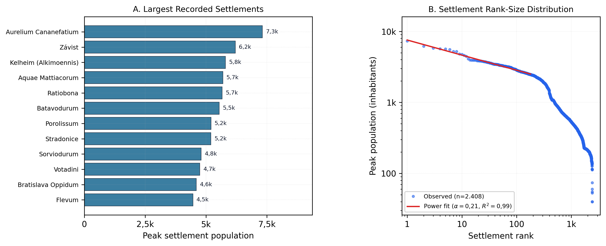

```{r setup, include=FALSE}
knitr::opts_chunk$set(
  echo = FALSE,
  warning = FALSE,
  message = FALSE,
  fig.align = "center"
)

source("../../_shared/template/viscount_rmd_helpers.R")
library(jsonlite)

summary_data <- fromJSON(
  "free_germany_scandinavia_baltic_slavic_summary.json",
  simplifyVector = FALSE
)

settlements_raw <- fromJSON(
  "free_germany_scandinavia_baltic_slavic_settlements.json",
  simplifyVector = FALSE
)

fix_mojibake <- function (arg0_vec) {
  s <- as.character(arg0_vec)
  pairs <- list(
    c("\u00e2\u0080\u0093", "\u2013"),
    c("\u00e2\u0080\u0094", "\u2014"),
    c("\u00c3\u00a1", "\u00e1"),
    c("\u00c3\u0081", "\u00c1"),
    c("\u00c3\u00ba", "\u00fa"),
    c("\u00c5\u00b1", "\u0171"),
    c("\u00c5\u0091", "\u0151"),
    c("\u00c3\u00bc", "\u00fc"),
    c("\u00c3\u00b6", "\u00f6"),
    c("\u00c3\u00a4", "\u00e4"),
    c("\u00c3\u00a9", "\u00e9"),
    c("\u00c3\u00b3", "\u00f3"),
    c("\u00c3\u00ad", "\u00ed")
  )
  for (p in pairs) {
    s <- gsub(p[[1]], p[[2]], s, fixed = TRUE)
  }
  s
}

fmt_year_era <- function (arg0_year) {
  y <- as.integer(arg0_year)
  if (y < 0L) return(paste0(abs(y), "BC"))
  if (y == 0L) return("1AD")
  paste0(y, "AD")
}

short_source_label <- function (arg0_src) {
  map <- c(
    European_Radiocarbon_Settlement_Corpus = "Radiocarbon Corpus",
    DARE_Digital_Atlas_Roman_Empire = "DARE",
    Pleiades_Ancient_World_Gazetteer = "Pleiades",
    Buringh_European_Urban_700_2000 = "Buringh"
  )
  out <- unname(map[arg0_src])
  ifelse(is.na(out), arg0_src, out)
}

reg_name_map <- setNames(
  vapply(summary_data$subregions, function (r) r$name, character(1)),
  vapply(summary_data$subregions, function (r) r$id, character(1))
)

short_reg_map <- c(
  germania_magna_west = "Elbe-Weser",
  vistula_przeworsk_wielbark = "Oder-Vistula",
  bohemia_moravia_slovakia = "Bohemia-Slovakia",
  denmark_jutland_isles = "Jutland & Isles",
  scandinavian_peninsula = "Scandinavia",
  finland_eastern_baltic = "Finland & E. Baltic",
  hibernia_north_atlantic = "Hibernia & N. Atlantic"
)

site_count <- as.integer(summary_data$settlement_count)
total_area <- as.numeric(summary_data$total_area_km2)
country_count <- length(summary_data$countries)
```

```{r hero_markdown_fallback, results='asis'}
if (!knitr::is_latex_output()) {
  cat("\n\n\n")
}
```

# Abstract

This companion gazetteer documents the spatial architecture, archival provenance and habitation-size hierarchy of `r formatC(site_count, format = "d", big.mark = ".")` recorded settlements across Free Germany, Scandinavia, Hibernia and the Baltic-Slavic north-east between 1000BC and 500AD. Spanning `r viscount_fmt_number(total_area, 1)` km² across seven sub-regions and `r country_count` modern national territories, the corpus integrates four non-overlapping scholarly datasets with zero crowdsourced entries: the European Radiocarbon Settlement Corpus (1.451 sites, 65,2%), the Digital Atlas of the Roman Empire (739 sites, 33,2%), the Pleiades Ancient World Gazetteer (21 sites, 0,9%) and the Buringh European Urban Series (15 sites, 0,7%). Because the northern Barbaricum lacked classical Mediterranean metropolises, the resulting rank-size profile forms a sharp bimodal step separating frontier-contact stations along the Lower Rhine and Middle Danube (benchmarked at 2.200 inhabitants) from interior radiocarbon-dated villages, ringforts and farmstead clusters (benchmarked at 550 inhabitants). Tables below present the provenance ledger, sub-regional and national recording densities, the top 25 recorded habitation centres and representative indigenous and early-urban sites across the domain.

# Gazetteer Architecture and Provenance

Archaeological settlement recording across non-literate northern Europe between 1000BC and 500AD differs fundamentally from the urban gazetteers of the Roman Mediterranean [@Hanson2016; @BowmanWilson2011]. Whereas Italy, Gaul and the Aegean possessed walled cities, epigraphic magistracies and civic coinage that anchor site-level population estimates, Free Germany, Scandinavia, Hibernia and the Baltic-Slavic woodland zone were populated by dispersed timber longhouses, coastal terpen mounds, lakeside crannógs, ringforts and occasional La Tène or Migration-Period hillforts. MAGNETIC therefore combines radiocarbon-dated excavation corpora [@Shennan2013] with classical frontier and early-urban continuity databases without forcing rural hamlets into artificial Zipf curves.

```{r table_prov_ledger, results='asis'}
prov_counts <- summary_data$provenance_counts
prov_df <- data.frame(
  Source = c(
    "European Radiocarbon Settlement Corpus",
    "Digital Atlas of the Roman Empire",
    "Pleiades Ancient World Gazetteer",
    "Buringh European Urban Series"
  ),
  Sites = c(
    as.integer(prov_counts$European_Radiocarbon_Settlement_Corpus),
    as.integer(prov_counts$DARE_Digital_Atlas_Roman_Empire),
    as.integer(prov_counts$Pleiades_Ancient_World_Gazetteer),
    as.integer(prov_counts$Buringh_European_Urban_700_2000)
  ),
  PeakTier = c("550", "2.200", "850", "650"),
  Coverage = c(
    "Hibernia, Norway, Denmark, Sweden, Germany, Finland, Poland",
    "Lower Rhine, Middle Danube limes rim, Jutland and Vistula trade nodes",
    "Named classical localities, oppida and Irish hillforts",
    "Early continuity nodes bridging late antiquity and the Middle Ages"
  ),
  stringsAsFactors = FALSE
)
prov_df$Share <- paste0(
  vapply(prov_df$Sites / site_count * 100, viscount_fmt_number, character(1), arg1_digits = 1L),
  "%"
)
prov_out <- prov_df[, c("Source", "Sites", "Share", "PeakTier", "Coverage")]
prov_out$Sites <- formatC(prov_out$Sites, format = "d", big.mark = ".")
rownames(prov_out) <- NULL

viscount_table(
  prov_out,
  "Archival provenance ledger and standardised population tiers across the 2.226 habitation sites (1000BC–500AD).",
  c("Archival Source", "Sites", "Share", "Tier Pop.", "Geographic Emphasis")
)
```

# Sub-Regional and National Distribution

Figure 1 maps the geographic clustering of all `r formatC(site_count, format = "d", big.mark = ".")` sites across the seven sub-regional masks. Site density reflects both genuine Iron Age agricultural concentration—notably in Elbe-Weser Germania Magna, Jutland, the Middle Danube rim and Hibernia—and uneven modern rescue-archaeology intensity across national heritage archives.

```{r fig_regional_map_embed, results='asis'}
viscount_figure(
  "figures/free_germany_scandinavia_baltic_slavic_regional_map.png",
  "Spatial distribution of 2.226 geocoded habitation sites across the seven northern sub-regions (1000BC–500AD).",
  "fig:gazetteer_map"
)
```

Table 2 cross-tabulates site counts by sub-region and provenance source directly from the full settlement ledger, demonstrating how radiocarbon corpora dominate Hibernia (623 of 646 sites), the Scandinavian Peninsula (455 of 497), Jutland (116 of 148) and Finland and the Eastern Baltic (90 of 94), while Digital Atlas of the Roman Empire records predominate along the continental contact zones of Elbe-Weser Germania Magna (372 of 491) and Bohemia, Moravia and Slovakia (208 of 224).

```{r table_subregion_prov, results='asis'}
all_regs <- vapply(settlements_raw, function (x) x$region_id, character(1))
all_srcs <- vapply(settlements_raw, function (x) x$provenance_source, character(1))

sub_prov_df <- do.call(rbind, lapply(summary_data$subregions, function (r) {
  rid <- r$id
  area_val <- as.numeric(r$area_km2)
  idx <- all_regs == rid
  n_tot <- sum(idx)
  n_rad <- sum(idx & all_srcs == "European_Radiocarbon_Settlement_Corpus")
  n_dare <- sum(idx & all_srcs == "DARE_Digital_Atlas_Roman_Empire")
  n_other <- n_tot - n_rad - n_dare
  data.frame(
    Subregion = r$name,
    Total = formatC(n_tot, format = "d", big.mark = "."),
    Radiocarbon = formatC(n_rad, format = "d", big.mark = "."),
    DARE = formatC(n_dare, format = "d", big.mark = "."),
    PleiadesBuringh = formatC(n_other, format = "d", big.mark = "."),
    Density10k = viscount_fmt_number(n_tot / (area_val / 10000), 2),
    stringsAsFactors = FALSE
  )
}))
sub_prov_df <- rbind(
  sub_prov_df,
  data.frame(
    Subregion = "Domain Total",
    Total = formatC(site_count, format = "d", big.mark = "."),
    Radiocarbon = formatC(sum(all_srcs == "European_Radiocarbon_Settlement_Corpus"), format = "d", big.mark = "."),
    DARE = formatC(sum(all_srcs == "DARE_Digital_Atlas_Roman_Empire"), format = "d", big.mark = "."),
    PleiadesBuringh = formatC(sum(!(all_srcs %in% c("European_Radiocarbon_Settlement_Corpus", "DARE_Digital_Atlas_Roman_Empire"))), format = "d", big.mark = "."),
    Density10k = viscount_fmt_number(site_count / (total_area / 10000), 2),
    stringsAsFactors = FALSE
  )
)
rownames(sub_prov_df) <- NULL

viscount_table(
  sub_prov_df,
  "Sub-regional settlement counts by archival source and site density per 10.000 km² (1000BC–500AD).",
  c("Sub-Region", "Total", "Radiocarbon", "DARE", "Pleiades & Buringh", "Sites per 10k km²")
)
```

Across modern administrative boundaries, Ireland (533 sites), Germany (420) and Norway (356) together account for 58,8% of the gazetteer, reflecting sustained national rescue-excavation databases and coastal radiocarbon programmes [@Panagiotakopulu2018There]. Table 3 lists the full national distribution across all 19 modern polities overlapping the chapter mask.

```{r table_country_dist, results='asis'}
ctry_list <- summary_data$settlements_by_country
ctry_df <- data.frame(
  Country = names(ctry_list),
  Sites = as.integer(unlist(ctry_list)),
  stringsAsFactors = FALSE
)
ctry_df <- ctry_df[order(-ctry_df$Sites, ctry_df$Country), ]
ctry_df$Share <- paste0(
  vapply(ctry_df$Sites / site_count * 100, viscount_fmt_number, character(1), arg1_digits = 1L),
  "%"
)

all_ctry <- vapply(settlements_raw, function (x) x$country, character(1))
ctry_df$PrimaryRegion <- vapply(ctry_df$Country, function (cn) {
  regs <- all_regs[all_ctry == cn]
  if (length(regs) == 0L) return("")
  top_r <- names(sort(table(regs), decreasing = TRUE))[1]
  unname(short_reg_map[top_r])
}, character(1))

ctry_df$Sites <- formatC(ctry_df$Sites, format = "d", big.mark = ".")
rownames(ctry_df) <- NULL

viscount_table(
  ctry_df,
  "Distribution of the 2.226 recorded habitation sites across modern national territories (1000BC–500AD).",
  c("Modern Country", "Sites", "Share", "Primary Sub-Region")
)
```

# Major Habitation Centres and Tier Structure

Because all 739 frontier and contact-zone centres recorded in the Digital Atlas of the Roman Empire share a uniform upper-tier benchmark of 2.200 inhabitants, the top 25 entries in Table 4 reflect alphabetical ordering within that upper tier. They cluster heavily along the Pannonian-Moravian Danube bend (Ad Flexum, Ad Mures and Ad Statuas) and the Lower Rhine and Weser-Elbe borderland (Adendorf, Albis, Amisia, Anreppen, Antunnacum and Aquae Granni), marking the military-commercial interface where Roman frontier garrisons met Germanic client territories [@Hanson2016; @Uczkiewicz2020Chronology].

```{r table_top25, results='asis'}
top_list <- summary_data$top_settlements[seq_len(min(25L, length(summary_data$top_settlements)))]
top_df <- do.call(rbind, lapply(top_list, function (x) {
  data.frame(
    Name = fix_mojibake(x$name),
    Country = x$country,
    Subregion = unname(short_reg_map[x$region_id]),
    Coords = paste0(
      viscount_fmt_number(x$lat, 2), "°N, ",
      viscount_fmt_number(x$lon, 2), "°E"
    ),
    Span = paste0(fmt_year_era(x$first_year), "–", fmt_year_era(x$last_year)),
    PeakPop = viscount_fmt_pop(x$peak_pop),
    Source = short_source_label(x$provenance_source),
    stringsAsFactors = FALSE
  )
}))
rownames(top_df) <- NULL

viscount_table(
  top_df,
  "Top 25 recorded habitation centres from the upper frontier-contact tier across Free Germany and the Middle Danube rim (1000BC–500AD).",
  c("Habitation Centre", "Country", "Sub-Region", "Coordinates", "Active Span", "Peak Pop.", "Source")
)
```

To complement the frontier rim in Table 4, Table 5 highlights 16 representative indigenous, classical and early-urban continuity centres drawn from the Pleiades (850 tier) and Buringh (650 tier) subsets of the full gazetteer. These span all major non-Roman theatres: Gothiscandza and Albonica in the Wielbark-Przeworsk corridor of Poland [@Uczkiewicz2020Chronology], Hegetmatia in Bohemia, the Hedeby-Danevirke border complex and Bremen in northern Germany alongside Irish royal or ecclesiastical precursors such as Brusselstown Ring, Haughey's Fort, Loughbrickland Crannóg, Armagh and Downpatrick—centres whose rural catchment systems underpinned Hibernia's demographic resilience through 500AD [@Plomp2021Composition].

```{r table_indigenous_continuity, results='asis'}
mid_entries <- Filter(function (x) {
  x$provenance_source %in% c("Pleiades_Ancient_World_Gazetteer", "Buringh_European_Urban_700_2000")
}, settlements_raw)

mid_df <- do.call(rbind, lapply(mid_entries, function (x) {
  pops <- unlist(x$population)
  yrs <- as.integer(names(pops))
  lat_v <- as.numeric(x$coords[[1]])
  lon_v <- as.numeric(x$coords[[2]])
  lon_hem <- if (lon_v < 0) "°W" else "°E"
  data.frame(
    Name = fix_mojibake(x$name),
    Country = x$country,
    Subregion = unname(short_reg_map[x$region_id]),
    Coords = paste0(
      viscount_fmt_number(lat_v, 2), "°N, ",
      viscount_fmt_number(abs(lon_v), 2), lon_hem
    ),
    Span = paste0(fmt_year_era(min(yrs)), "–", fmt_year_era(max(yrs))),
    PeakPop = viscount_fmt_pop(max(as.numeric(pops))),
    Source = short_source_label(x$provenance_source),
    stringsAsFactors = FALSE
  )
}))
mid_df <- mid_df[order(mid_df$Source, mid_df$Subregion, mid_df$Name), ]
sel_idx <- unique(c(
  which(mid_df$Source == "Pleiades")[seq_len(min(10L, sum(mid_df$Source == "Pleiades")))],
  which(mid_df$Source == "Buringh")[seq_len(min(6L, sum(mid_df$Source == "Buringh")))]
))
mid_out <- mid_df[sel_idx, ]
rownames(mid_out) <- NULL

viscount_table(
  mid_out,
  "Representative indigenous centres, classical localities and early-urban continuity sites from Pleiades and Buringh (1000BC–500AD).",
  c("Site Name", "Country", "Sub-Region", "Coordinates", "Active Span", "Peak Pop.", "Source")
)
```

# Sources
