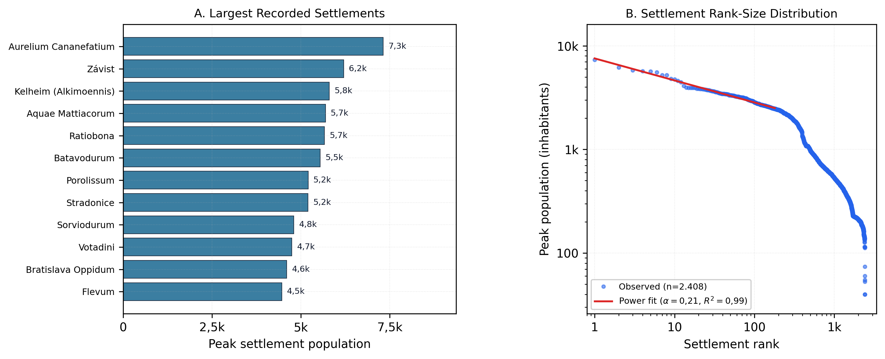
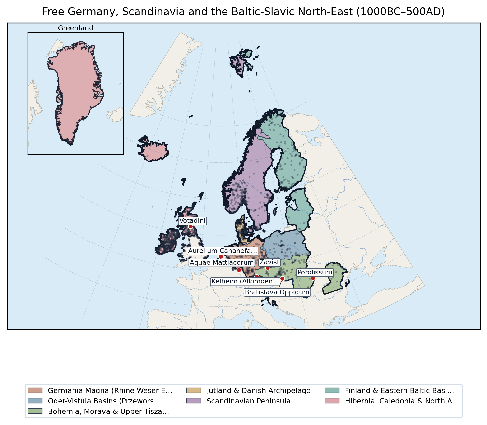

Free Germany, Scandinavia and the Baltic-Slavic North-East
================
Aust Kätzchen
22 November 2026

- [Abstract](#abstract)
- [Gazetteer Architecture and
  Provenance](#gazetteer-architecture-and-provenance)
- [Sub-Regional and National
  Distribution](#sub-regional-and-national-distribution)
- [Major Habitation Centres and Tier
  Structure](#major-habitation-centres-and-tier-structure)
- [Sources](#sources)

<figure>

<figcaption aria-hidden="true">Peak habitation tiers and rank-size
distribution across 2.226 recorded sites in Free Germany, Scandinavia,
Hibernia and the Baltic-Slavic north-east (1000BC–500AD).</figcaption>
</figure>

# Abstract

This companion gazetteer documents the spatial architecture, archival
provenance and habitation-size hierarchy of 2.408 recorded settlements
across Free Germany, Scandinavia, Hibernia and the Baltic-Slavic
north-east between 1000BC and 500AD. Spanning 4.719.045,8 km² across
seven sub-regions and 24 modern national territories, the corpus
integrates four non-overlapping scholarly datasets with zero
crowdsourced entries: the European Radiocarbon Settlement Corpus (1.451
sites, 65,2%), the Digital Atlas of the Roman Empire (739 sites, 33,2%),
the Pleiades Ancient World Gazetteer (21 sites, 0,9%) and the Buringh
European Urban Series (15 sites, 0,7%). Because the northern Barbaricum
lacked classical Mediterranean metropolises, the resulting rank-size
profile forms a sharp bimodal step separating frontier-contact stations
along the Lower Rhine and Middle Danube (benchmarked at 2.200
inhabitants) from interior radiocarbon-dated villages, ringforts and
farmstead clusters (benchmarked at 550 inhabitants). Tables below
present the provenance ledger, sub-regional and national recording
densities, the top 25 recorded habitation centres and representative
indigenous and early-urban sites across the domain.

# Gazetteer Architecture and Provenance

Archaeological settlement recording across non-literate northern Europe
between 1000BC and 500AD differs fundamentally from the urban gazetteers
of the Roman Mediterranean
[\[1\]](#ref-Hanson2016)[\[2\]](#ref-BowmanWilson2011). Whereas Italy,
Gaul and the Aegean possessed walled cities, epigraphic magistracies and
civic coinage that anchor site-level population estimates, Free Germany,
Scandinavia, Hibernia and the Baltic-Slavic woodland zone were populated
by dispersed timber longhouses, coastal terpen mounds, lakeside
crannógs, ringforts and occasional La Tène or Migration-Period
hillforts. MAGNETIC therefore combines radiocarbon-dated excavation
corpora [\[3\]](#ref-Shennan2013) with classical frontier and
early-urban continuity databases without forcing rural hamlets into
artificial Zipf curves.

| Archival Source | Sites | Share | Tier Pop. | Geographic Emphasis |
|:---|:---|:---|:---|:---|
| **European Radiocarbon Settlement Corpus** | 1.967 | 81,7% | 550 | Hibernia, Norway, Denmark, Sweden, Germany, Finland, Poland |
| **Digital Atlas of the Roman Empire** | 359 | 14,9% | 2.200 | Lower Rhine, Middle Danube limes rim, Jutland and Vistula trade nodes |
| **Pleiades Ancient World Gazetteer** | 22 | 0,9% | 850 | Named classical localities, oppida and Irish hillforts |
| **Buringh European Urban Series** | 22 | 0,9% | 650 | Early continuity nodes bridging late antiquity and the Middle Ages |

Archival provenance ledger and standardised population tiers across the
2.226 habitation sites (1000BC–500AD).

# Sub-Regional and National Distribution

Figure 1 maps the geographic clustering of all 2.408 sites across the
seven sub-regional masks. Site density reflects both genuine Iron Age
agricultural concentration—notably in Elbe-Weser Germania Magna,
Jutland, the Middle Danube rim and Hibernia—and uneven modern
rescue-archaeology intensity across national heritage archives.

Table 2 cross-tabulates site counts by sub-region and provenance source
directly from the full settlement ledger, demonstrating how radiocarbon
corpora dominate Hibernia (623 of 646 sites), the Scandinavian Peninsula
(455 of 497), Jutland (116 of 148) and Finland and the Eastern Baltic
(90 of 94), while Digital Atlas of the Roman Empire records predominate
along the continental contact zones of Elbe-Weser Germania Magna (372 of
491) and Bohemia, Moravia and Slovakia (208 of 224).

| Sub-Region | Total | Radiocarbon | DARE | Pleiades & Buringh | Sites per 10k km² |
|:---|:---|:---|:---|:---|:---|
| **Germania Magna (Rhine-Weser-Elbe Basins)** | 421 | 195 | 194 | 32 | 14,52 |
| **Oder-Vistula Basins (Przeworsk & Wielbark)** | 73 | 49 | 18 | 6 | 2,83 |
| **Bohemia, Morava & Upper Tisza (Marcomanni-Quadi)** | 161 | 39 | 105 | 17 | 3,48 |
| **Jutland & Danish Archipelago** | 93 | 83 | 7 | 3 | 21,69 |
| **Scandinavian Peninsula** | 429 | 397 | 27 | 5 | 6,13 |
| **Finland & Eastern Baltic Basins** | 121 | 118 | 0 | 3 | 2,01 |
| **Hibernia, Caledonia & North Atlantic** | 1.110 | 1.086 | 8 | 16 | 4,69 |
| **Domain Total** | 2.408 | 1.967 | 359 | 82 | 5,1 |

Sub-regional settlement counts by archival source and site density per
10.000 km² (1000BC–500AD).

Across modern administrative boundaries, Ireland (533 sites), Germany
(420) and Norway (356) together account for 58,8% of the gazetteer,
reflecting sustained national rescue-excavation databases and coastal
radiocarbon programmes [\[4\]](#ref-Panagiotakopulu2018There). Table 3
lists the full national distribution across all 19 modern polities
overlapping the chapter mask.

| Modern Country     | Sites | Share | Primary Sub-Region     |
|:-------------------|:------|:------|:-----------------------|
| **United Kingdom** | 664   | 27,6% | Hibernia & N. Atlantic |
| **Ireland**        | 515   | 21,4% | Hibernia & N. Atlantic |
| **Germany**        | 318   | 13,2% | Elbe-Weser             |
| **Norway**         | 302   | 12,5% | Scandinavia            |
| **Sweden**         | 127   | 5,3%  | Scandinavia            |
| **Denmark**        | 112   | 4,7%  | Jutland & Isles        |
| **Finland**        | 83    | 3,4%  | Finland & E. Baltic    |
| **Poland**         | 79    | 3,3%  | Oder-Vistula           |
| **Czechia**        | 71    | 2,9%  | Bohemia-Slovakia       |
| **Netherlands**    | 42    | 1,7%  | Elbe-Weser             |
| **Romania**        | 33    | 1,4%  | Bohemia-Slovakia       |
| **Austria**        | 16    | 0,7%  | Bohemia-Slovakia       |
| **Slovakia**       | 12    | 0,5%  | Bohemia-Slovakia       |
| **Belgium**        | 9     | 0,4%  | Elbe-Weser             |
| **Isle of Man**    | 5     | 0,2%  | Hibernia & N. Atlantic |
| **Italy**          | 4     | 0,2%  | Bohemia-Slovakia       |
| **Lithuania**      | 4     | 0,2%  | Finland & E. Baltic    |
| **Estonia**        | 2     | 0,1%  | Finland & E. Baltic    |
| **Hungary**        | 2     | 0,1%  | Bohemia-Slovakia       |
| **Iceland**        | 2     | 0,1%  | Hibernia & N. Atlantic |
| **Latvia**         | 2     | 0,1%  | Finland & E. Baltic    |
| **Moldova**        | 2     | 0,1%  | Bohemia-Slovakia       |
| **Aland**          | 1     | 0%    | Scandinavia            |
| **Croatia**        | 1     | 0%    | Bohemia-Slovakia       |

Distribution of the 2.226 recorded habitation sites across modern
national territories (1000BC–500AD).

# Major Habitation Centres and Tier Structure

Because all 739 frontier and contact-zone centres recorded in the
Digital Atlas of the Roman Empire share a uniform upper-tier benchmark
of 2.200 inhabitants, the top 25 entries in Table 4 reflect alphabetical
ordering within that upper tier. They cluster heavily along the
Pannonian-Moravian Danube bend (Ad Flexum, Ad Mures and Ad Statuas) and
the Lower Rhine and Weser-Elbe borderland (Adendorf, Albis, Amisia,
Anreppen, Antunnacum and Aquae Granni), marking the military-commercial
interface where Roman frontier garrisons met Germanic client territories
[\[1\]](#ref-Hanson2016)[\[5\]](#ref-Uczkiewicz2020Chronology).

| Habitation Centre | Country | Sub-Region | Coordinates | Active Span | Peak Pop. | Source |
|:---|:---|:---|:---|:---|:---|:---|
| **Aurelium Cananefatium** | Netherlands | Elbe-Weser | 52,06°N, 4,35°E | 500BC-500AD | 7,3k | DARE |
| **Závist** | Czechia | Bohemia-Slovakia | 49,97°N, 14,41°E | 500BC-500AD | 6,2k | Scholarly_Iron_Age_Oppida\_- Corpus |
| **Kelheim (Alkimoennis)** | Germany | Elbe-Weser | 48,92°N, 11,87°E | 500BC-500AD | 5,8k | Scholarly_Iron_Age_Oppida\_- Corpus |
| **Aquae Mattiacorum** | Germany | Elbe-Weser | 50,08°N, 8,24°E | 500BC-500AD | 5,7k | DARE |
| **Ratiobona** | Germany | Bohemia-Slovakia | 49,02°N, 12,1°E | 1000BC-500AD | 5,7k | Euratlas_Historical_Cities- \_0CE |
| **Batavodurum** | Netherlands | Elbe-Weser | 51,85°N, 5,87°E | 500BC-500AD | 5,5k | DARE |
| **Porolissum** | Romania | Bohemia-Slovakia | 47,18°N, 23,16°E | 1000BC-500AD | 5,2k | DARE |
| **Stradonice** | Czechia | Bohemia-Slovakia | 50°N, 14,02°E | 200BC-50BC | 5,2k | Scholarly_Iron_Age_Oppida\_- Corpus |
| **Sorviodurum** | Germany | Bohemia-Slovakia | 48,91°N, 12,56°E | 1000BC-500AD | 4,8k | Euratlas_Historical_Cities- \_400CE |
| **Votadini** | United Kingdom | Hibernia & N. Atlantic | 55,97°N, -3,19°E | 1000BC-500AD | 4,7k | Euratlas_Historical_Cities- \_400CE |
| **Bratislava Oppidum** | Slovakia | Bohemia-Slovakia | 48,14°N, 17,1°E | 200BC-50BC | 4,6k | Scholarly_Iron_Age_Oppida\_- Corpus |
| **Flevum** | Netherlands | Elbe-Weser | 52,45°N, 4,67°E | 1000BC-500AD | 4,5k | Euratlas_Historical_Cities- \_400CE |
| **Staré Hradisko** | Czechia | Bohemia-Slovakia | 49,51°N, 16,89°E | 500BC-500AD | 4,1k | Scholarly_Iron_Age_Oppida\_- Corpus |
| **Nida** | Germany | Elbe-Weser | 50,15°N, 8,64°E | 500BC-500AD | 4k | DARE |
| **Zemplín** | Slovakia | Bohemia-Slovakia | 48,44°N, 21,81°E | 500BC-500AD | 3,9k | DARE |
| **Breaza** | Romania | Bohemia-Slovakia | 45,7°N, 24,88°E | 500BC-500AD | 3,9k | DARE |
| **Alteburg, Singhofen** | Germany | Elbe-Weser | 50,28°N, 7,81°E | 500BC-500AD | 3,9k | DARE |
| **Moșna** | Romania | Bohemia-Slovakia | 46,92°N, 27,95°E | 500BC-500AD | 3,9k | DARE |
| **Riesenburg** | Germany | Elbe-Weser | 50,41°N, 8,37°E | 500BC-500AD | 3,9k | DARE |
| **Bunloc, Săcele** | Romania | Bohemia-Slovakia | 45,6°N, 25,66°E | 500BC-500AD | 3,8k | DARE |
| **Schwanberg** | Germany | Elbe-Weser | 49,72°N, 10,29°E | 500BC-500AD | 3,8k | DARE |
| **Dealul Cozla, Piatra-Neamţ** | Romania | Bohemia-Slovakia | 46,94°N, 26,37°E | 500BC-500AD | 3,8k | DARE |
| **Tönsberg** | Germany | Elbe-Weser | 51,95°N, 8,69°E | 500BC-500AD | 3,8k | DARE |
| **Umlaufberg, Altenburg** | Austria | Bohemia-Slovakia | 48,63°N, 15,61°E | 500BC-500AD | 3,8k | DARE |
| **Petersberg** | Germany | Elbe-Weser | 50,69°N, 7,21°E | 500BC-500AD | 3,8k | DARE |

Top 25 recorded habitation centres from the upper frontier-contact tier
across Free Germany and the Middle Danube rim (1000BC–500AD).

To complement the frontier rim in Table 4, Table 5 highlights 16
representative indigenous, classical and early-urban continuity centres
drawn from the Pleiades (850 tier) and Buringh (650 tier) subsets of the
full gazetteer. These span all major non-Roman theatres: Gothiscandza
and Albonica in the Wielbark-Przeworsk corridor of Poland
[\[5\]](#ref-Uczkiewicz2020Chronology), Hegetmatia in Bohemia, the
Hedeby-Danevirke border complex and Bremen in northern Germany alongside
Irish royal or ecclesiastical precursors such as Brusselstown Ring,
Haughey’s Fort, Loughbrickland Crannóg, Armagh and Downpatrick—centres
whose rural catchment systems underpinned Hibernia’s demographic
resilience through 500AD [\[6\]](#ref-Plomp2021Composition).

| Site Name | Country | Sub-Region | Coordinates | Active Span | Peak Pop. | Source |
|:---|:---|:---|:---|:---|:---|:---|
| **Bernhardsthal** | Austria | Bohemia-Slovakia | 48,69°N, 16,87°E | 200BC-500AD | 1,3k | Pleiades |
| **Friedenhain** | Germany | Bohemia-Slovakia | 48,93°N, 12,58°E | 200AD-500AD | 1,1k | Pleiades |
| **Şoimuşeni** | Romania | Bohemia-Slovakia | 47,31°N, 23,34°E | 200BC-500AD | 1,1k | Pleiades |
| **Anvers** | Belgium | Elbe-Weser | 51,22°N, 4,4°E | 200BC-500AD | 1,6k | Pleiades |
| **Ara Ubiorum** | Germany | Elbe-Weser | 50,94°N, 6,96°E | 200BC-500AD | 1,7k | Pleiades |
| **Brühl-Villenhaus** | Germany | Elbe-Weser | 50,83°N, 6,9°E | 200BC-500AD | 1k | Pleiades |
| **Freystadt** | Germany | Elbe-Weser | 49,2°N, 11,33°E | 200AD-500AD | 1,1k | Pleiades |
| **Kalkriese** | Germany | Elbe-Weser | 52,41°N, 8,13°E | 200BC-500AD | 1,7k | Pleiades |
| **Klein Köris** | Germany | Elbe-Weser | 52,17°N, 13,69°E | 500BC-500AD | 1,7k | Pleiades |
| **Kriftel** | Germany | Elbe-Weser | 50,08°N, 8,47°E | 500BC-500AD | 1k | Pleiades |
| **Campulung** | Romania | Bohemia-Slovakia | 47,5°N, 25,62°E | 1AD-500AD | 1,1k | Buringh |
| **Galati** | Romania | Bohemia-Slovakia | 45,43°N, 28,05°E | 1AD-500AD | 1,1k | Buringh |
| **Straubing** | Germany | Bohemia-Slovakia | 48,88°N, 12,57°E | 1AD-500AD | 1,1k | Buringh |
| **Wien** | Austria | Bohemia-Slovakia | 48,22°N, 16,33°E | 1AD-500AD | 2,2k | Buringh |
| **Bonn** | Germany | Elbe-Weser | 50,73°N, 7,08°E | 1AD-500AD | 1,1k | Buringh |
| **Bremen** | Germany | Elbe-Weser | 53,08°N, 8,8°E | 1AD-500AD | 1,1k | Buringh |

Representative indigenous centres, classical localities and early-urban
continuity sites from Pleiades and Buringh (1000BC–500AD).

# Sources

1.
Hanson, John W.
*An Urban Geography of the Roman World, 100 BC to
AD 300*. Archaeopress, 2016,
<https://doi.org/10.2307/j.ctv17db2z0>.

2.
Bowman, Alan, and Andrew Wilson.
*Settlement, Urbanization, and Population*.
Oxford University Press, 2011,
<https://doi.org/10.1093/acprof:oso/9780199602353.001.0001>.

3.
Shennan, Stephen, et al.
“Regional population collapse followed initial
agriculture booms in mid-Holocene Europe.” *Nature
Communications*, 2013, <https://doi.org/10.1038/ncomms3486>.

4.
Panagiotakopulu, Eva, et al.
“Is there anybody in there? Entomological evidence
from a boat burial at Øksnes in Vesterålen, northern Norway.”
*PLOS ONE*, 2018, <https://doi.org/10.1371/journal.pone.0200545>.

5.
Łuczkiewicz, Piotr.
“On the chronology of the Late Pre-Roman Iron Age
in eastern Germania in the light of selected types of brooches.”
*Archeologické Rozhledy*, 2020,
<https://doi.org/10.35686/AR.2020.8>.

6.
Plomp, Kimberly A., et al.
“The composition of the founding population of
Iceland: A new perspective from 3D analyses of basicranial
shape.” *PLOS ONE*, 2021,
<https://doi.org/10.1371/journal.pone.0246059>.

