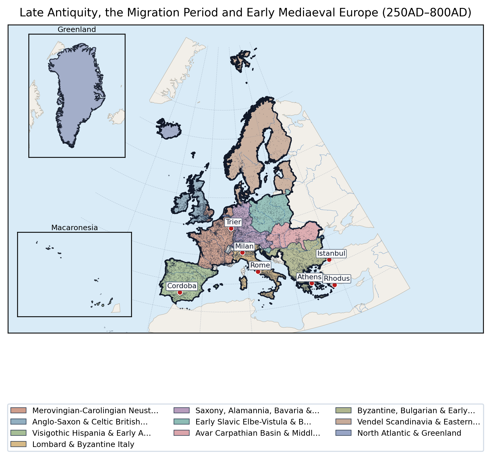

```{r setup, include=FALSE}
knitr::opts_chunk$set(
  echo = FALSE,
  warning = FALSE,
  message = FALSE,
  fig.align = "center"
)

source("../../_shared/template/viscount_rmd_helpers.R")
library(jsonlite)

summary_data <- fromJSON(
  "late_antiquity_and_migration_period_summary.json",
  simplifyVector = FALSE
)

total_area <- as.numeric(summary_data$total_area_km2)
tot_300 <- as.numeric(summary_data$domain_totals[["300"]])
tot_500 <- as.numeric(summary_data$domain_totals[["500"]])
tot_600 <- as.numeric(summary_data$domain_totals[["600"]])
tot_800 <- as.numeric(summary_data$domain_totals[["800"]])
site_count <- as.integer(summary_data$settlement_count)
country_count <- length(summary_data$countries)
crowd_pct <- as.numeric(summary_data$crowd_share_overall) * 100

fmt_signed_pct <- function (arg0_val) {
  v <- as.numeric(arg0_val)
  txt <- viscount_fmt_number(v, 1L)
  if (v > 0) return(paste0("+", txt, "%"))
  paste0(txt, "%")
}

sub_df <- do.call(rbind, lapply(summary_data$subregions, function (r) {
  area_val <- as.numeric(r$area_km2)
  p300 <- as.numeric(r$population[["300"]])
  p500 <- as.numeric(r$population[["500"]])
  p600 <- as.numeric(r$population[["600"]])
  p800 <- as.numeric(r$population[["800"]])
  sites_n <- as.integer(summary_data$settlements_by_region[[r$id]])
  data.frame(
    id = r$id,
    name = r$name,
    area_km2 = area_val,
    p_300 = p300,
    p_500 = p500,
    p_600 = p600,
    p_800 = p800,
    d_300 = p300 / area_val,
    d_500 = p500 / area_val,
    d_600 = p600 / area_val,
    d_800 = p800 / area_val,
    pct_300_500 = (p500 / p300 - 1) * 100,
    pct_500_600 = (p600 / p500 - 1) * 100,
    pct_300_600 = (p600 / p300 - 1) * 100,
    pct_600_800 = (p800 / p600 - 1) * 100,
    pct_300_800 = (p800 / p300 - 1) * 100,
    sites = sites_n,
    stringsAsFactors = FALSE
  )
}))
rownames(sub_df) <- NULL

euro_area <- sum(sub_df$area_km2[sub_df$id != "north_atlantic_early"])
euro_300 <- sum(sub_df$p_300[sub_df$id != "north_atlantic_early"])
euro_600 <- sum(sub_df$p_600[sub_df$id != "north_atlantic_early"])
euro_800 <- sum(sub_df$p_800[sub_df$id != "north_atlantic_early"])

dens_300 <- tot_300 / total_area
dens_euro_300 <- euro_300 / euro_area
dens_euro_600 <- euro_600 / euro_area
dens_euro_800 <- euro_800 / euro_area
pct_tot_300_500 <- (tot_500 / tot_300 - 1) * 100
pct_tot_300_600 <- (tot_600 / tot_300 - 1) * 100
pct_tot_600_800 <- (tot_800 / tot_600 - 1) * 100
pct_tot_300_800 <- (tot_800 / tot_300 - 1) * 100

prov_labels <- c(
  DARE_Digital_Atlas_Roman_Empire = "Digital Atlas of the Roman Empire (DARE)",
  European_Radiocarbon_Settlement_Corpus = "European Radiocarbon Settlement Corpus",
  Buringh_European_Urban_700_2000 = "Buringh European Urban Series (700-2000)",
  Pleiades_Ancient_World_Gazetteer = "Pleiades Ancient World Gazetteer",
  GeoNames_Municipal_Gazetteer_Supplement = "GeoNames Municipal Gazetteer Supplement",
  National_Statistical_Census_Faroe_Islands = "Faroe Islands Historical Settlement Registry"
)

prov_tiers <- c(
  DARE_Digital_Atlas_Roman_Empire = "Institutional archaeological atlas",
  European_Radiocarbon_Settlement_Corpus = "Institutional radiocarbon archive",
  Buringh_European_Urban_700_2000 = "Historical urban database",
  Pleiades_Ancient_World_Gazetteer = "Institutional classical gazetteer",
  GeoNames_Municipal_Gazetteer_Supplement = "Supplemental geographical gazetteer",
  National_Statistical_Census_Faroe_Islands = "National statistical registry"
)

prov_raw <- unlist(summary_data$provenance_counts)
prov_raw <- sort(prov_raw, decreasing = TRUE)
prov_df <- data.frame(
  Source = unname(prov_labels[names(prov_raw)]),
  Tier = unname(prov_tiers[names(prov_raw)]),
  Sites = formatC(as.integer(prov_raw), format = "d", big.mark = "."),
  Share = paste0(viscount_fmt_number(as.numeric(prov_raw) / site_count * 100, 2L), "%"),
  stringsAsFactors = FALSE
)
rownames(prov_df) <- NULL
```

```{r hero_markdown_fallback, results='asis'}
if (!knitr::is_latex_output()) {
  cat("\n\n\n")
}
```

# Abstract

Between 250AD and 800AD Europe experienced its sharpest pre-Black Death demographic contraction and its most durable geographical realignment. Across the 10 sub-regions of MAGNETIC covering `r viscount_fmt_number(total_area, 1)` km² from Iberia and the Aegean to Scandinavia and Greenland, aggregate population fell from `r viscount_fmt_pop(tot_300)` in 300AD (`r viscount_fmt_number(dens_300, 2)` inhabitants per km², or `r viscount_fmt_number(dens_euro_300, 2)` per km² excluding Greenland and the North Atlantic) to `r viscount_fmt_pop(tot_500)` in 500AD (`r fmt_signed_pct(pct_tot_300_500)`) and reached a trough of `r viscount_fmt_pop(tot_600)` in 600AD (`r fmt_signed_pct(pct_tot_300_600)` below 300AD). Imperial fiscal breakdown, frontier warfare, the Late Antique Little Ice Age (536AD–660AD) and the First Plague Pandemic (541AD–750AD) cut hardest into formerly Roman Mediterranean and insular cores: Italy halved from 8,4M to 4,1M (-51,2%), Britain and Ireland fell 46,8% to 1,65M, the Balkans dropped 40,7% to 3,35M and Francia declined 39,3% to 5,4M. Between 600AD and 800AD climatic recovery, the abatement of plague, heavy-plough manorialism north of the Alps and Slavic agrarian clearance lifted continental numbers by `r fmt_signed_pct(pct_tot_600_800)` to `r viscount_fmt_pop(tot_800)` (`r fmt_signed_pct(pct_tot_300_800)` relative to 300AD). Anchored by `r formatC(site_count, format = "d", big.mark = ".")` geocoded habitation sites across `r country_count` modern polities, the record documents a lasting northward tilt: by 800AD Early Slavic Poland, Bohemia and Slovakia stood 4,4% above its 300AD benchmark and Vendel Scandinavia and the Eastern Baltic stood 17% above it, while Italy remained 35,7% below its late-imperial level.

# Background

## The Third-Century Crisis and Late Roman Restructuring

At the opening of our temporal domain in 250AD, the demographic landscape of Europe still reflected the high-water mark of classical Mediterranean urbanisation and frontier integration, yet the foundations of Roman carrying capacity were already fracturing. Half a century of dynastic civil war, coin debasement, Persian pressure in the East and simultaneous raids by Franks, Alamanni, Goths and Carpi across the Rhine and Lower Danube strained provincial tax bases and disrupted long-distance grain shipments [@Russell1958]. Bioarchaeological evidence from the Roman colony of Mursa on the Lower Drava confirms the abrupt mortality pulses generated by mid-third-century civil wars and frontier engagements, where urban mass burials record combat trauma and acute physiological stress among fighting-age men drawn from across the Danubian provinces [@Novak2025Multidisciplinary]. Repeated epidemic waves—extending a pathogenic regime whose urban transmission dynamics had already been exposed by the Antonine Plague in Rome [@Karasaridis2025Comparative] and renewed under the Plague of Cyprian around 249AD–262AD—depressed urban fertility and thinned frontier garrisons.

When Diocletian and Constantine stabilised the imperial state between 284AD and 337AD, they did so on a narrower territorial and municipal footing. Aurelian had already evacuated trans-Danubian Dacia in 271AD, pulling the administrative frontier back to the river line. In Gaul, Raetia, Pannonia and Moesia, open high-imperial cities shrank behind compact masonry fortifications that frequently enclosed less than a quarter of their second-century street grids. The fiscal reforms of the *capitatio-iugatio* bound tenant cultivators (*coloni*) to registered estates in order to guarantee military grain levies (*annona*), while the dedication of Constantinople in 330AD created a massive new imperial consumer on the Bosphorus that drew Egyptian grain and Balkan taxes eastward. By our opening benchmark of 300AD, continental Europe excluding the Polaris Core still carried 43M inhabitants, led by Gaul and the Low Countries (8,9M), Italy (8,4M), Iberia (6,4M) and the Balkans (5,65M). Yet that late-imperial equilibrium rested on fiscal redistribution, Mediterranean maritime security and climatic warmth that would not outlast the fourth century.

## Climate Deterioration, the First Plague Pandemic and the Volkerwanderung

Between 376AD and 568AD the political and demographic architecture of western and south-eastern Europe unravelled in two overlapping shocks: a fifth-century fiscal-military collapse accompanied by Germanic migrations, followed by a sixth-century environmental and epidemiological catastrophe. The crossing of the Danube by Tervingi and Greuthungi Goths in 376AD, the defeat of Valens at Adrianople in 378AD and the Rhine breach of Vandals, Alans and Suebi in December 406AD fractured the Western Roman tax-pay cycle. Rome's formal administrative withdrawal from Britain around 410AD severed the island from imperial coinage and military contracts almost overnight, collapsing Romano-British town life and villa production. The Vandal conquest of Carthage and Proconsular Africa in 439AD cut off Rome's subsidised North African grain fleet, accelerating the depopulation of the Italian capital from several hundred thousand residents in the fourth century to a shadow of its former self by 500AD [@Russell1958; @Malanima1998]. Across northern Gaul, the Rhineland and the Middle Danube, confederated Franks, Alamanni, Burgundians, Rugii, Heruli, Gepids and Ostrogoths carved out successor kingdoms whose ruralised economies no longer required dense commercial road networks or specialist ceramic workshops.

Worse was to follow in the middle decades of the sixth century. High-resolution ice-core and dendrochronological records confirm a cluster of major volcanic eruptions in 536AD, 540AD and 547AD that initiated the Late Antique Little Ice Age (536AD–660AD), depressing northern hemispheric summer temperatures by 1,5°C to 2°C and shortening growing seasons across Alpine, Scandinavian and northern upland margins [@Campbell2016; @Plunkett2022Bucking]. Immediately on the heels of crop failure came the First Plague Pandemic—the Justinianic Plague caused by *Yersinia pestis*—entering the Mediterranean via Pelusium in 541AD and striking Constantinople in 542AD before spreading across ports, river corridors and inland provinces in recurring waves until roughly 750AD [@White2020Modeling; @Benedictow2004]. Zooarchaeological and biomolecular studies of commensal black-rat (*Rattus rattus*) dispersal along Red Sea and Mediterranean shipping corridors highlight how maritime grain logistics inadvertently provisioned the rodent reservoirs of epidemic spread [@Prendergast2017Reconstructing]. Epidemiological modelling indicates that maritime and riverine transmission routes—rather than uniform rural diffusion—produced starkly uneven mortality, devastating imperial cities, coastal ports and heavily militarised theatres while sparing isolated pastoral hinterlands [@White2020Modeling].

Simultaneously, warfare compounded plague across both peninsulas of the central Mediterranean. Justinian's protracted Gothic War in Italy (535AD–554AD) ruined aqueducts, agricultural estates and municipal infrastructure from Milan to Rome, leaving a depleted peninsula open to the Lombard invasion of 568AD. Along the Lower and Middle Danube, the arrival of the nomadic Avar Khaganate in the 560s—bearing Inner Asian steppe military organisation and material culture into the Carpathian Basin [@Kucukcan1994Material]—shattered the Balkan frontier defences and propelled large-scale Slavic migration southward across Moesia, Thrace, Macedonia and inland Greece, as well as westward across the Elbe-Saale corridor into territories vacated by departing Vandals, Burgundians and Lombards [@King2019Diverse]. By 600AD Europe stood at its deepest demographic nadir since the pre-Roman Iron Age.

## Post-Roman Agrarian Restructuring and Early Mediaeval Recovery

The two centuries from 600AD to 800AD witnessed a quiet but decisive agrarian transformation that reversed Europe's long contraction and shifted its demographic centre of gravity permanently northward. Three structural changes underlay this recovery. First, climatic conditions ameliorated after the mid-seventh century while the recurring cycles of the Justinianic Plague faded out across western and central Europe after the mid-eighth century, allowing natural increase to accumulate over successive generations [@Campbell2016; @Izdebski2022]. Second, north of the Alps—above all in the Paris Basin, Picardy, Flanders, Lorraine and the Middle Rhineland—Merovingian and Carolingian aristocracies and monastic houses organised the bipartite manor (*villa*), pairing demesne reserves with hereditary peasant mansi. Coupled with the gradual spread of the heavy wheeled mouldboard plough, ox-and-horse traction harnesses, watermills and incipient three-field rotations, northern farmers brought heavy, moisture-retentive clay and loam soils under sustained cereal cultivation that classical scratch-ards had largely bypassed.

Third, across central, eastern and northern Europe, rural colonisation accelerated independently of Roman municipal inheritance. In Bohemia, Moravia, Slovakia and Greater Poland, early Slavic farming communities cleared river valleys and loess plains around fortified elite hillforts such as Kouřim, where metallurgical craft production and regional exchange networks took root by the late eighth century [@Profantova2024Production; @Guzowski2013]. In the Banat and the Alföld, settled Avar-Slavic villages cultivated mixed cereals and livestock alongside pastoral estates [@Tanase2022Ezare]. In Iberia, after seventh-century famines and the Umayyad conquest of 711AD, the consolidation of the Emirate of Córdoba from 756AD revived irrigated horticulture and urban life in the Guadalquivir and Ebro valleys. Across the North Sea and Baltic, Vendel-period elites and Frisian merchants established specialised coastal emporia—Dorestad, Quentovic, Hamwic, Lundenwic, Ribe, Birka and Kaupang—knitting maritime commerce back together on the eve of the Viking Age [@Bairoch1988; @Buringh2021].

# Methodology

## Sub-Regional Partition and Benchmark Calibration

MAGNETIC partitions Late Antique and Early Mediaeval Europe (excluding the Polaris Core, plus Greenland and the North Atlantic Islands) into 10 contiguous analytical sub-regions totalling `r viscount_fmt_number(total_area, 1)` km² across `r country_count` modern polities. Boundaries follow ecological basins and historically attested early-mediaeval political horizons rather than modern nation-state borders:

1. Merovingian-Carolingian Francia and Low Countries (`r viscount_fmt_number(sub_df$area_km2[1], 1)` km²), covering former Roman Gaul from the Pyrenees to the Lower Rhine and North Sea coastal marshes.
2. Anglo-Saxon and Celtic British Isles (`r viscount_fmt_number(sub_df$area_km2[2], 1)` km²), uniting lowland Anglo-Saxon kingdoms with Wales, Cornwall, Pictland, Dál Riata and Ireland.
3. Visigothic Iberia and Early Al-Andalus (`r viscount_fmt_number(sub_df$area_km2[3], 1)` km²), encompassing the Iberian Peninsula and the Balearic Islands.
4. Lombard and Byzantine Italy (`r viscount_fmt_number(sub_df$area_km2[4], 1)` km²), spanning the Po Valley, peninsular Italy, Sicily, Sardinia, Corsica and Malta.
5. Alamannia, Bavaria, Saxony and Alps (`r viscount_fmt_number(sub_df$area_km2[5], 1)` km²), extending from the Rhine and Alpine passes to the Elbe-Saale frontier and Austria.
6. Early Slavic Poland, Bohemia and Slovakia (`r viscount_fmt_number(sub_df$area_km2[6], 1)` km²), spanning the Oder-Vistula plains and the Bohemian-Moravian-Slovak basins.
7. Avar Carpathian Basin and Lower Danube (`r viscount_fmt_number(sub_df$area_km2[7], 1)` km²), covering former Pannonia, the Great Hungarian Plain, Transylvania and Wallachia.
8. Byzantine and Early Slavic Balkans (`r viscount_fmt_number(sub_df$area_km2[8], 1)` km²), running from the Sava and Lower Danube southward to the Peloponnese, Aegean islands and European Thrace including Constantinople.
9. Vendel Scandinavia and Eastern Baltic (`r viscount_fmt_number(sub_df$area_km2[9], 1)` km²), uniting Denmark, Norway, Sweden, Finland and the three Baltic states.
10. North Atlantic and Greenland (`r viscount_fmt_number(sub_df$area_km2[10], 1)` km²), combining the Faroe Islands, Iceland and Greenland.

Population is estimated at four chronological benchmarks—300AD, 500AD, 600AD and 800AD—chosen specifically to bracket the late-imperial plateau, the post-fifth-century Western collapse, the Justinianic-LALIA trough and the Carolingian agrarian recovery. Because no comprehensive continent-wide census survives between the Diocletianic tax registers and the ninth-century Frankish polyptychs (such as the Polyptych of Irminon at Saint-Germain-des-Prés), each sub-regional series is triangulated from four independent lines of evidence: backward projection from high-mediaeval agrarian and hearth baselines [@Russell1958; @Broadberry2015; @Malanima1998], urban-rural ratios anchored to early-mediaeval city catalogues [@Bairoch1988; @Buringh2021], regional palaeoecological land-cover and cereal-pollen trajectories tracking woodland regeneration and re-clearance [@Izdebski2022] and population-genetic inferences of regional demographic bottlenecks and admixture [@Mathieson2014Demography]. Sub-regional totals are never extrapolated mechanically from raw archaeological site counts, which vary strongly with modern survey intensity.

## Archival Gazetteer Compilation and Four-Wave Saturation

Parallel to the macro-demographic series, MAGNETIC assembles a geocoded habitation gazetteer of `r formatC(site_count, format = "d", big.mark = ".")` sites active between 250AD and 800AD. Ingestion followed a strict four-wave saturation protocol designed to exhaust institutional archaeological, classical and historical urban repositories before permitting any crowdsourced geographic backfill. Wave 1 ingested 1.847 sites from primary institutional registers, specifically the Digital Atlas of the Roman Empire (DARE) and the Pleiades Ancient World Gazetteer, establishing the baseline of late-antique *civitates*, walled capitals, limes forts and fortified acropoleis. Wave 2 incorporated 1.114 early-mediaeval urban centres from the Buringh European Urban Series (700–2000) [@Buringh2021], raising the cumulative total to 2.961 sites (a marginal gain of 60,31%). Wave 3 backfilled 1.296 rural, village and monastic habitation sites from the European Radiocarbon Settlement Corpus, lifting the register to 4.257 sites (+43,77%). Wave 4 executed a targeted gap sweep across the sparsely documented North Atlantic rim, adding just 10 localities (4 from the Faroe Islands Historical Settlement Registry and 6 from the GeoNames Municipal Gazetteer Supplement), reducing marginal gain to 0,23% and confirming corpus saturation while rejecting 800 redundant or out-of-domain candidate records.

```{r table_provenance, results='asis'}
viscount_table(
  prov_df,
  caption = "Archival provenance breakdown of the 4.267 recorded habitation sites across Late Antique and Early Mediaeval Europe (250AD–800AD).",
  col_names = c("Source Corpus", "Source Class", "Sites", "Share")
)
```

As Table 1 demonstrates, primary institutional archives and scholarly historical databases account for 99,86% of the gazetteer (4.261 of 4.267 sites), leaving crowdsourced geographical supplementation at `r viscount_fmt_number(crowd_pct, 2)`% (6 localities confined exclusively to the northern maritime margin). Every site carries WGS84 coordinates checked against the 10-sub-region polygonal mask and a standardised benchmark population profile spanning its documented occupation interval.

# Validation

Evaluating demographic estimates across 250AD–800AD requires testing the MAGNETIC curves against both classical historiography and recent palaeoenvironmental, bioarchaeological and epidemiological research. Two competing schools have long divided scholarship on the sixth century: a maximalist catastrophe school portraying the Justinianic Plague and barbarian invasions as a demographic collapse matching or exceeding the Black Death, and a minimalist revisionist school arguing that rural continuity blunted mortality outside a handful of Mediterranean capitals. MAGNETIC charts an explicitly regionalised middle path supported by multi-proxy evidence.

First, our continental trough of 26,33M in 600AD—representing a 38,8% fall from 300AD and a 13,2% drop during the sixth century alone—aligns closely with Josiah Cox Russell's pioneering late-ancient demographic synthesis [@Russell1958], while incorporating modern revisions that assign substantially larger populations to trans-Alpine Germany, Poland, Bohemia and Scandinavia than mid-twentieth-century scholars recognised. In Italy, our steep fall from 8,4M in 300AD to 4,1M in 600AD (-51,2%) and subsequent climb to 5,4M in 800AD reconciles late-antique urban decay with Paolo Malanima's long-term Italian agricultural and urban benchmarks [@Malanima1998], where northern and central Italy only regained late-Roman population levels in the High Middle Ages. In Britain and Ireland, our trough of 1,65M in 600AD and rebound to 2,35M in 800AD sits squarely beneath the high-mediaeval British agrarian carrying capacities established by Broadberry and colleagues [@Broadberry2015], while reflecting the documented resilience of Irish rural settlement through the sixth-century volcanic cooling episode [@Plunkett2022Bucking].

Second, our spatial gradient of sixth-century contraction matches epidemiological simulations and palaeoecological land-use archives. White and Mordechai's transmission models of the Justinianic Plague [@White2020Modeling] show that mortality depended critically on maritime connectivity, port density and urban crowding, with lower-density agrarian zones escaping catastrophic collapse. Correspondingly, MAGNETIC records sixth-century losses of -21,2% in both Lombard-Byzantine Italy and the Byzantine-Slavic Balkans—the two maritime cores most exposed to Mediterranean grain shipping and imperial troop movements—compared with -12,9% in Francia, -10,8% in Britain and Ireland, -9,7% in Iberia, -5,8% in Alamannia, Bavaria and Saxony, -5,7% in Poland and Bohemia and just -3,3% in Scandinavia and the Eastern Baltic. This stark Mediterranean-versus-continental mortality gradient mirrors the spatially heterogeneous afforestation and cereal-pollen signatures reconstructed across Europe for pandemic shocks by Izdebski and colleagues [@Izdebski2022].

Third, micro-regional excavations corroborate the sub-regional turning points embedded in our tables. In the Danube-Drava corridor, third-century mass graves at Mursa document severe frontier attrition prior to 300AD [@Novak2025Multidisciplinary], while sixth-to-eighth-century rural excavations at Pişchia in the Banat testify to resilient agrarian village life within the Avar sphere [@Tanase2022Ezare]. In northern Iberia, late-antique belt fittings and domestic assemblages from cave sites such as Lazaldai in Álava reflect the dispersal of upland pastoral populations away from exposed Roman valley towns during the fifth-to-seventh-century contraction [@Garate2025Broche]. Conversely, by the late eighth century, fine metalwork dies from the fortified Bohemian hub of Kouřim confirm demographic concentration and craft specialisation across the West Slavic interior [@Profantova2024Production]. Finally, our 800AD urban top tier is anchored directly to Bairoch, Batou and Chèvre [@Bairoch1988] and Buringh [@Buringh2021], ensuring smooth continuity with the High Mediaeval chapter that follows.

# Results

## Continental Trajectory from Imperial Autumn to Carolingian Rebound

Across the 500-year benchmark span from 300AD to 800AD, Europe executed a deep, asymmetric V-shaped demographic trajectory (Figure 1, Panel A). Starting at `r viscount_fmt_pop(tot_300)` in 300AD, the combined population of the 10 sub-regions shed `r viscount_fmt_pop(tot_300 - tot_500)` inhabitants over the fourth and fifth centuries to reach `r viscount_fmt_pop(tot_500)` in 500AD (-29,5%). Over the sixth century, volcanic cooling, plague and warfare subtracted a further `r viscount_fmt_pop(tot_500 - tot_600)` people (-13,2%), driving continental numbers down to `r viscount_fmt_pop(tot_600)` in 600AD—a cumulative loss of `r viscount_fmt_pop(tot_300 - tot_600)` inhabitants (-38,8%). Over the next two centuries, agrarian recovery added `r viscount_fmt_pop(tot_800 - tot_600)` people (+32,1%), raising the total to `r viscount_fmt_pop(tot_800)` in 800AD. Even at Charlemagne's imperial coronation, however, Europe as a whole still stood `r viscount_fmt_pop(tot_300 - tot_800)` inhabitants (-19,1%) below its 300AD total.

```{r fig_trajectory, results='asis'}
viscount_figure(
  "figures/late_antiquity_and_migration_period_population_trajectory.png",
  caption = "Continental and leading sub-regional population trajectories from 300AD to 800AD (Panel A) and sub-regional population density in 800AD in inhabitants per km² (Panel B).",
  label = "fig:population_trajectory"
)
```

Beneath this aggregate curve lay a permanent geographical redistribution of European humanity. Excluding the 2,18M km² North Atlantic and Greenland mask, continental and insular Europe (`r viscount_fmt_number(euro_area, 1)` km²) fell in mean density from `r viscount_fmt_number(dens_euro_300, 2)` inhabitants per km² in 300AD to `r viscount_fmt_number(dens_euro_600, 2)` in 600AD before recovering to `r viscount_fmt_number(dens_euro_800, 2)` in 800AD. Yet the three Mediterranean peninsulas—Italy, Iberia and the Balkans—saw their combined share of European population shrink from 47,6% in 300AD (20,45M of 43M) to 42,3% in 800AD (14,7M of 34,79M). Over the same five centuries, the five trans-Alpine, Atlantic and northern sub-regions (Francia, British Isles, Alamannia-Bavaria-Saxony, Poland-Bohemia-Slovakia and Scandinavia-Eastern Baltic) increased their share from 46,7% (20,1M) to 51,6% (17,93M), crossing the half-way threshold for the first time in recorded European history. Tables 2 and 3 present the full sub-regional population totals, areal densities and interval growth rates.

```{r table_subregional_pop, results='asis'}
t2 <- data.frame(
  Subregion = sub_df$name,
  Area = viscount_fmt_number(sub_df$area_km2, 1L),
  Y300 = vapply(sub_df$p_300, viscount_fmt_pop, character(1)),
  Y500 = vapply(sub_df$p_500, viscount_fmt_pop, character(1)),
  Y600 = vapply(sub_df$p_600, viscount_fmt_pop, character(1)),
  Y800 = vapply(sub_df$p_800, viscount_fmt_pop, character(1)),
  Share800 = paste0(viscount_fmt_number(sub_df$p_800 / tot_800 * 100, 1L), "%"),
  stringsAsFactors = FALSE
)
t2 <- rbind(
  t2,
  data.frame(
    Subregion = "Domain Total",
    Area = viscount_fmt_number(total_area, 1L),
    Y300 = viscount_fmt_pop(tot_300),
    Y500 = viscount_fmt_pop(tot_500),
    Y600 = viscount_fmt_pop(tot_600),
    Y800 = viscount_fmt_pop(tot_800),
    Share800 = "100%",
    stringsAsFactors = FALSE
  )
)
rownames(t2) <- NULL

viscount_table(
  t2,
  caption = "Sub-regional land areas, benchmark populations (300AD–800AD) and 800AD shares across Late Antique and Early Mediaeval Europe.",
  col_names = c("Sub-Region", "Area (km²)", "300AD", "500AD", "600AD", "800AD", "Share 800AD")
)
```

```{r table_subregional_density, results='asis'}
t3 <- data.frame(
  Subregion = sub_df$name,
  D300 = vapply(sub_df$d_300, viscount_fmt_number, character(1), arg1_digits = 2L),
  D600 = vapply(sub_df$d_600, viscount_fmt_number, character(1), arg1_digits = 2L),
  D800 = vapply(sub_df$d_800, viscount_fmt_number, character(1), arg1_digits = 2L),
  C300_600 = vapply(sub_df$pct_300_600, fmt_signed_pct, character(1)),
  C600_800 = vapply(sub_df$pct_600_800, fmt_signed_pct, character(1)),
  C300_800 = vapply(sub_df$pct_300_800, fmt_signed_pct, character(1)),
  stringsAsFactors = FALSE
)
t3 <- rbind(
  t3,
  data.frame(
    Subregion = "Domain Average",
    D300 = viscount_fmt_number(tot_300 / total_area, 2L),
    D600 = viscount_fmt_number(tot_600 / total_area, 2L),
    D800 = viscount_fmt_number(tot_800 / total_area, 2L),
    C300_600 = fmt_signed_pct((tot_600 / tot_300 - 1) * 100),
    C600_800 = fmt_signed_pct((tot_800 / tot_600 - 1) * 100),
    C300_800 = fmt_signed_pct((tot_800 / tot_300 - 1) * 100),
    stringsAsFactors = FALSE
  )
)
rownames(t3) <- NULL

viscount_table(
  t3,
  caption = "Sub-regional population density (inhabitants per km²) and proportional change during late-antique contraction (300AD–600AD), early-mediaeval rebound (600AD–800AD) and net five-century shift (300AD–800AD).",
  col_names = c("Sub-Region", "300AD", "600AD", "800AD", "300AD–600AD", "600AD–800AD", "300AD–800AD")
)
```

## The Mediterranean Core: Italy, Iberia and the Byzantine-Slavic Balkans

Lombard and Byzantine Italy (300.408,2 km²) suffered the most severe demographic implosion in Europe. In 300AD the Italian peninsula and its islands sustained 8,4M inhabitants at 27,96 inhabitants per km²—nearly double the density of Gaul and nearly triple that of Iberia or the Balkans. Two centuries later, after Visigothic and Vandal sacks of Rome, the cessation of African tax grain and the unravelling of senatorial estate networks, numbers had fallen 38,1% to 5,2M (17,31 per km²). The sixth century delivered a second, still sharper blow: twenty years of Justinian's Gothic War (535AD–554AD) devastated cities and rural granaries alike, repeated waves of Justinianic plague emptied coastal ports and river basins while the Lombard invasion of 568AD partitioned the peninsula into rival Lombard duchies (Pavia, Spoleto, Benevento) and Byzantine enclaves (Ravenna, Rome, Naples, Sicily). Between 500AD and 600AD Italy lost a further 21,2%, sinking to 4,1M (13,65 per km²)—less than half (-51,2%) its 300AD total.

Drainage canals silted in the lower Po Valley and Pontine Marshes, inviting malaria back into coastal lowlands, while rural settlement retreated to defensible Apennine hilltops. From that deep floor, seventh- and eighth-century stability under Lombard royal law and early Carolingian rule after 774AD restored population by 31,7% to 5,4M (17,98 per km²) by 800AD. Even after losing more than a third of its late-imperial population (-35,7% net), Italy remained Europe's most densely settled sub-region (Figure 1, Panel B), sustained by surviving civic poles at Milan, Ravenna, Pavia, Rome, Naples and Palermo [@Malanima1998].

Visigothic Iberia and Early Al-Andalus (594.723,6 km²) experienced a steadier contraction and a slower recovery. Standing at 6,4M (10,76 per km²) in 300AD, Hispania declined 27,3% to 4,65M (7,82 per km²) by 500AD following the 409AD entry of Suebi, Alans and Vandals, subsequent Visigothic campaigns and the collapse of Baetican olive-oil exports. Sixth-century losses were comparatively restrained (-9,7% to 4,2M, or 7,06 per km² in 600AD; -34,4% cumulative), as plague hit Mediterranean ports such as Tarragona, Valencia and Cartagena harder than the dry Meseta interior, though upland communities across the Cantabrian-Pyrenean arc increasingly occupied defensible hilltops and caves such as Lazaldai in Álava [@Garate2025Broche].

Between 600AD and 800AD Iberia posted the weakest rebound of all ten sub-regions (+17,9%, rising to 4,95M or 8,32 per km², still 22,7% below 300AD). Severe late-seventh-century famines, plague and Visigothic succession crises were followed by the Umayyad conquest of 711AD, Berber uprisings in the 740s and the creation of a thinly peopled military buffer zone along the Duero Valley between the Asturian kingdom and Islamic Al-Andalus. Only after Abd al-Rahman I established the Umayyad Emirate of Córdoba in 756AD did irrigated agriculture and urban expansion in Seville, Córdoba, Mérida and Zaragoza set southern Iberia on a sustained upward trajectory.

The Byzantine and Early Slavic Balkans (547.845,5 km²) mirrored Italy's sixth-century trauma while following a distinct geopolitical path. At 5,65M (10,31 per km²) in 300AD, the Danubian and Aegean provinces constituted the populous hinterland of the newly elevated Eastern Empire. Gothic raids, Hunnic devastation of Naissus, Singidunum and Serdica in the 440s and rural flight reduced numbers 24,8% to 4,25M (7,76 per km²) by 500AD.

During the sixth century the sub-region plunged another 21,2% to 3,35M (6,11 per km² in 600AD; -40,7% cumulative). Constantinople—Europe's sole surviving imperial metropolis—absorbed repeated, deadly visitations of *Yersinia pestis* beginning in 542AD [@White2020Modeling], while Avar-Slavic offensives broke the Danube limes after 582AD, extinguishing most classical inland towns across Moesia, Illyricum and northern Greece. Yet maritime survival at Constantinople, Thessalonica and the Aegean islands, combined with Slavic agrarian settlement across interior valleys, Byzantine thematic military reorganisation and the rise of the First Bulgarian Empire after 681AD, lifted population by 29,9% to 4,35M (7,94 per km²) in 800AD (-23% relative to 300AD).

## The Atlantic and Frankish West: Francia and the British Isles

Merovingian-Carolingian Francia and the Low Countries (615.093,6 km²) remained Europe's single largest demographic bloc at every benchmark from 300AD to 800AD, holding a 20,7% share of continental population in both 300AD and 800AD after briefly dipping to 20,5% in 600AD. From 8,9M (14,47 per km²) in 300AD, late Roman Gaul and the Belgic-Frisian lowlands fell 30,3% to 6,2M (10,08 per km²) in 500AD as frontier warfare along the Rhine, *Bagaudae* peasant revolts, imperial tax collapse and Frankish, Visigothic and Burgundian settlement shrank Gallo-Roman towns and coastal estates.

Sixth-century plague waves documented by Gregory of Tours—moving up the Rhône from Marseille into Arles, Lyon, Clermont and the Loire valley—alongside Merovingian civil wars reduced population a further 12,9% to 5,4M (8,78 per km²) in 600AD (-39,3% cumulative). Thereafter, Francia led Europe's early-mediaeval agricultural revival. Between 600AD and 800AD population expanded by exactly one third (+33,3%) to 7,2M (11,71 per km², second only to Italy in density). Growth concentrated in Neustria and Austrasia—between the Loire, Seine, Meuse and Rhine—where royal monasteries (Saint-Denis, Corbie, Saint-Germain-des-Prés, Prüm), heavy-plough cultivation and North Sea wool-and-wine commerce through Quentovic and Dorestad generated dense village networks that sustained Charlemagne's imperial armies.

Across the English Channel, the Anglo-Saxon and Celtic British Isles (311.813,8 km²) displayed the sharpest early collapse and one of the sharpest subsequent rebounds in western Europe. From 3,1M (9,94 per km²) in 300AD—when lowland Roman Britannia supported prosperous villa estates and frontier garrisons alongside a dense Iron Age farming population in Ireland—numbers plunged 40,3% to 1,85M (5,93 per km²) by 500AD. No other former Roman province lost its monetary economy, wheel-thrown pottery industry and urban fabric so abruptly after imperial supply ceased around 410AD.

While Germanic settlers (Angles, Saxons, Jutes and Frisians) migrated into eastern and southern Britain across the fifth and sixth centuries, demographic contraction persisted into the sixth century (-10,8% to 1,65M or 5,29 per km² in 600AD; -46,8% cumulative) under the combined weight of the 536AD climatic downturn and the plague outbreak of the 540s recorded in British and Irish annals. Remarkably, palaeoenvironmental and radiocarbon series indicate that Ireland's dispersed ringfort and monastic cattle-tillage economy weathered the sixth-century volcanic anomaly with greater resilience than lowland England [@Plunkett2022Bucking]. Between 600AD and 800AD consolidation of the Heptarchy kingdoms (Mercia, Wessex, Northumbria, East Anglia), monastic estate clearance, middle-Saxon coastal emporia (*wics* at Hamwic, Lundenwic, Gipeswic and Eoforwic) and steady Irish and Pictish rural growth drove a 42,4% surge to 2,35M (7,54 per km²), narrowing the net deficit against 300AD to -24,2%.

## Trans-Alpine Central Europe, the Carpathian Basin and the Slavic East

North and east of the Alps, the demographic signature shifts dramatically: contractions were shallower and eighth-century rebounds carried two sub-regions above their late-antique baselines. Alamannia, Bavaria, Saxony and the Alps (481.097,9 km²) dropped 23,3% from 4,5M (9,35 per km²) in 300AD to 3,45M (7,17 per km²) in 500AD as Alamannic, Frankish, Saxon and Thuringian warbands moved westward and southward into former imperial provinces and North Sea storm surges flooded Frisian-Saxon coastal marshes. Sixth-century attrition remained mild (-5,8% to 3,25M or 6,76 per km² in 600AD; -27,8% cumulative), insulated by inland distances from Mediterranean plague ports. Over the seventh and eighth centuries, intensive woodland clearance (*Rodung*), Bavarian expansion into the eastern Alps and Carolingian ecclesiastical colonisation centred on Fulda, Lorsch, Würzburg, Salzburg, St Gallen and Reichenau lifted numbers by 36,9% to 4,45M (9,25 per km²) in 800AD—within 1,1% of its 300AD level and third highest in Europe in areal density behind Italy and Francia.

Farther east, Early Slavic Poland, Bohemia and Slovakia (434.702,7 km²) achieved a full demographic turnaround. Between 300AD and 500AD the sequential departures of Przeworsk and Wielbark Germanic populations—Vandals, Burgundians, Rugii, Heruli and Lombards—combined with Hunnic-era instability cut regional population by 22,2% from 2,25M (5,18 per km²) to 1,75M (4,03 per km²), dipping a modest 5,7% further to 1,65M (3,8 per km²) in 600AD (-26,7% cumulative).

Into these thinned Oder, Vistula, Elbe and Morava river basins moved early Slavic farming communities of the Prague-Korchak and Sukow-Dziedzice horizons, practising adaptable millet, rye, wheat and livestock agriculture in clustered riverside villages. By 800AD rapid natural increase and the crystallisation of fortified tribal strongholds (*grody*) in Bohemia, Moravia and Greater Poland—exemplified by elite craft workshops at Kouřim [@Profantova2024Production]—had expanded population by 42,4% (matching the British Isles for Europe's fastest post-600AD growth) to 2,35M (5,41 per km²), standing 4,4% above the 300AD benchmark.

Immediately south of the Carpathian arc, the Avar Carpathian Basin and Lower Danube (354.166,4 km²) endured harsher frontier turbulence before stabilising under Avar-Slavic rule. From 2,45M (6,92 per km²) in 300AD—already bruised by the abandonment of Dacia and third-century frontier wars [@Novak2025Multidisciplinary]—numbers fell 28,6% to 1,75M (4,94 per km²) in 500AD through the collapse of Roman Pannonia and the rise and fall of Attila's Hunnic Empire. After the Gepids were crushed and the Lombards departed for Italy in 568AD, population reached a trough of 1,55M (4,38 per km²) in 600AD (-36,7% below 300AD).

Yet the Middle and Late Avar Khaganate proved far more sedentary than earlier historiography supposed: dense inhumation cemeteries across the Danube-Tisza interfluve and rural village excavations such as Pişchia in the Banat reveal prosperous mixed pastoral-agricultural communities [@Tanase2022Ezare]. Between 600AD and 800AD the basin grew 38,7% to 2,15M (6,07 per km²), recovering to within 12,2% of its 300AD benchmark just as Charlemagne's armies dismantled the Avar Ring in the 790s.

## The Northern Rim: Vendel Scandinavia, the Eastern Baltic and the North Atlantic

Vendel Scandinavia and the Eastern Baltic (1.330.239,7 km²) exhibited the shallowest late-antique dip and the strongest five-century net gain of any major European sub-region. From 1,35M (1,01 per km²) in 300AD, population eased only 9,6% to 1,22M (0,92 per km²) in 500AD and edged down just 3,3% to 1,18M (0,89 per km²) in 600AD (-12,6% cumulative). The volcanic dust veil of 536AD–540AD—remembered in Nordic mythology as the *Fimbulwinter*—triggered genuine farm abandonments in marginal upland Norway, Norrland, Gotland and Öland, yet low-lying moraine plains in Jutland, Zealand, Funen, Scania, Västergötland, Mälaren, Trøndelag, south-western Finland and the Baltic coastal lowlands rebounded swiftly as landholding consolidated into larger aristocratic estates and central halls at Gamla Uppsala, Gudme, Lejre, Uppåkra and Borg.

Between 600AD and 800AD iron smelting, clinker-built sailing ships, Baltic fur and amber commerce and nascent emporia at Ribe, Birka and Åhus lifted population by 33,9% to 1,58M (1,19 per km²)—a +17% net gain over 300AD. That demographic surplus across Scandinavia's arable fjords and islands directly fuelled the Viking expansion that opened in the 790s.

Finally, the North Atlantic and Greenland sub-region (2.178.792,8 km²) remained a sparse Arctic and sub-Arctic rim throughout 250AD–800AD. Total population stood at roughly 3,5k in 300AD and 500AD, 4k in 600AD and 5,5k in 800AD (+57,1% across the five-century span), compressing gross areal density to less than 0,01 inhabitants per km² because of Greenland's 2,16M km² ice sheet. Nearly all inhabitants were Late Dorset Palaeo-Eskimo marine hunters exploiting seal, walrus and caribou along Greenland's ice-free coastal margins [@Dugmore2012], joined during the seventh and eighth centuries by small pioneering groups of Irish monastic hermits (*papar*) and early Norse settlers reaching the Faroe Islands, with permanent Icelandic colonisation (*Landnám*) still awaiting the ninth century.

## Urban Contraction and the Late Antique Rank-Size Hierarchy

Figure 2 portrays the urban and settlement hierarchy across all `r formatC(site_count, format = "d", big.mark = ".")` recorded localities in the study domain, capturing the stark asymmetry between the surviving Eastern imperial capitals and the thoroughly ruralised post-Roman West.

```{r fig_hierarchy, results='asis'}
viscount_figure(
  "figures/late_antiquity_and_migration_period_urban_hierarchy.png",
  caption = "Largest recorded urban and fortified centres (Panel A) and rank-size distribution across all 4.267 recorded sites in Late Antique and Early Mediaeval Europe (Panel B).",
  label = "fig:urban_hierarchy"
)
```

At the apex of Panel A stands Constantinople (listed as Istanbul in the Buringh urban register) at 156k inhabitants—nearly five times larger than second-ranked Thessalonica (Saloniki, 32,5k) and more than eleven times larger than the largest Western centre in the harmonised series, Milan (Milano, 13.650). Even allowing for temporary fourth-century peaks in Rome before the 410AD–546AD sieges and the post-756AD rise of Umayyad Córdoba, the post-Roman urban landscape of western Europe had shrunk to compact episcopal and royal towns: Ravenna (7.800), Seville (7.150), Porto (6.500) and a band of fortified classical centres and acropoleis catalogued in Pleiades at 6k inhabitants (such as Aletrium, Circeii, Eretria, Lilaia, Siphnos and Akraiphiai).

In Panel B, the log-log rank-size curve exhibits a distinctly flattened Zipf power-law exponent of 0,36 (coefficient of determination R² of 0,5)—well below the canonical unity slope of mature integrated urban systems [@Bairoch1988; @Buringh2021]. Three distinct tiers shape the curve beneath the Byzantine primate duo: first, 122 Pleiades fortified/urban localities at 6k and 127 mid-tier classical centres at 2,5k, alongside Buringh's intermediate early-mediaeval towns between 1,3k and 5,2k (217 sites); second, a broad middle plateau of 1.598 former Roman *civitates*, vici and frontier forts from DARE benchmarked at 2,2k; and third, the vast rural and proto-urban floor comprising 891 minor Buringh towns at 650 inhabitants, 1.296 radiocarbon-dated rural villages at 550 inhabitants and 10 North Atlantic hamlets ranging from 80 to 528 residents. While discrete horizontal steps reflect standardised proxy tiers across archival datasets, the overarching geometry reflects a genuine historical transformation: outside the Bosphorus and Aegean littoral, early-mediaeval Europe had reverted to a society of villages, monastic estates and modest walled bishoprics.

# Limitations

Five methodological constraints bound the precision of demographic reconstruction between 250AD and 800AD:

1. **Absence of state-wide censuses between Diocletian and the Carolingian polyptychs**: Aside from fragmented fourth-century tax schedules, seventh-century Anglo-Saxon tribal hidages and early-ninth-century estate surveys from northern Francia, no direct demographic enumerations survive across Europe during this interval. Sub-regional totals carry an unavoidable uncertainty envelope of roughly ±15% to ±25%, widest at the 600AD trough and in the non-literate northern and eastern sub-regions [@Russell1958].
2. **Disputed mortality amplitude of the Justinianic Plague**: While ancient DNA confirms *Yersinia pestis* across sixth-to-eighth-century burials from Bavaria and Cambridgeshire to Spain and the Levant, historians and epidemiological modellers continue to debate whether aggregate mortality reached 25%–35% or remained closer to 10%–15% in interior provinces [@White2020Modeling; @Benedictow2004]. Our 500AD–600AD contractions (-21,2% in Italy and the Balkans versus -3,3% to -5,8% north of the Alps) capture this maritime-interior gradient, yet local village-level losses certainly varied more sharply than regional averages.
3. **Asymmetric archaeological and radiocarbon survey coverage**: National site counts in our 4.267-site gazetteer reflect modern rescue-archaeology legislation and digital catalogue availability as strongly as ancient settlement density. Spain (925 sites), the United Kingdom (835), Portugal (419), Italy (405) and France (317) together supply 68% of all recorded localities, whereas Poland (27 sites), Bulgaria (19), Romania (17), Slovakia (8) and Serbia (5) remain under-represented in international English-language radiocarbon and classical atlases. MAGNETIC therefore decouples regional population estimation strictly from raw site counts.
4. **Standardised site-size proxies and intramural shrinkage**: Classical atlases such as DARE and Pleiades preserve spatial continuity of Roman towns across Late Antiquity, yet many former *civitas* capitals survived after 500AD merely as shrunken cathedral enclosures or fortified citadels housing a fraction of their third-century populations. Standardised tier values (2,2k for DARE sites and 6k for upper Pleiades sites) should therefore be read as maximum regional node anchors rather than constant sixth-century municipal counts.
5. **Arctic landmass distortion of continental density**: Including Greenland's 2,16M km² ice sheet in the 10-sub-region domain lowers aggregate continental density by nearly one third (from 6,99 inhabitants per km² across continental and insular Europe in 800AD to 4,87 across the full 7,15M km² mask). Analytical comparisons throughout this study consequently report both full-domain and habitable-Europe densities.

# Conclusion

Between 250AD and 800AD Europe traversed the deepest demographic contraction since prehistory and emerged with a fundamentally altered spatial order. Aggregate population across the 10 MAGNETIC sub-regions fell 38,8% from 43M in 300AD to 30,32M in 500AD and a nadir of 26,33M in 600AD as Roman fiscal integration collapsed, Germanic and Avar-Slavic migrations redrew the political map, volcanic cooling shortened growing seasons and the Justinianic Plague repeatedly scythed Mediterranean ports and cities. Italy (-51,2% to 600AD), the British Isles (-46,8%), the Balkans (-40,7%) and Francia (-39,3%) bore the heaviest absolute and proportional losses.

Yet the recovery between 600AD and 800AD (+32,1% overall, lifting Europe to 34,79M) did not simply restore the classical map. Driven by climatic amelioration, plague abatement, Carolingian bipartite manorialism, heavy-plough cultivation of northern clay soils, West Slavic agricultural colonisation and Nordic maritime expansion, population surged fastest north and east of the Alps. By 800AD Alamannia, Bavaria and Saxony had effectively regained its 300AD total (-1,1%), Early Slavic Poland, Bohemia and Slovakia exceeded its 300AD benchmark by 4,4% and Vendel Scandinavia and the Eastern Baltic stood 17% higher—even as Italy remained 35,7% below late-imperial numbers and western cities stayed small shadows of Constantinople. This five-century northward pivot laid the rural, agrarian and maritime foundation for the High Mediaeval expansion after 800AD.

# Appendix

Table 4 summarises the spatial distribution of all `r formatC(site_count, format = "d", big.mark = ".")` recorded habitation sites across the 10 sub-regions, reporting land area, absolute site count, share of the gazetteer, recording density per 10.000 km² and 800AD population. Full provenance audits, national distributions across all `r country_count` modern polities, settlement-size tiers and the top 25 recorded urban and fortified centres appear in the companion settlement gazetteer report.

```{r table_appendix_sites, results='asis'}
app_df <- data.frame(
  Subregion = sub_df$name,
  Area = viscount_fmt_number(sub_df$area_km2, 1L),
  Sites = formatC(sub_df$sites, format = "d", big.mark = "."),
  SiteShare = paste0(viscount_fmt_number(sub_df$sites / site_count * 100, 1L), "%"),
  SiteDens = viscount_fmt_number(sub_df$sites / (sub_df$area_km2 / 10000), 2L),
  Pop800 = vapply(sub_df$p_800, viscount_fmt_pop, character(1)),
  stringsAsFactors = FALSE
)
app_df <- rbind(
  app_df,
  data.frame(
    Subregion = "Domain Total",
    Area = viscount_fmt_number(total_area, 1L),
    Sites = formatC(site_count, format = "d", big.mark = "."),
    SiteShare = "100%",
    SiteDens = viscount_fmt_number(site_count / (total_area / 10000), 2L),
    Pop800 = viscount_fmt_pop(tot_800),
    stringsAsFactors = FALSE
  )
)
rownames(app_df) <- NULL

viscount_table(
  app_df,
  caption = "Sub-regional distribution of the 4.267 geocoded habitation sites, recording density per 10.000 km² and 800AD population totals.",
  col_names = c("Sub-Region", "Area (km²)", "Sites", "Share", "Sites per 10k km²", "Pop. 800AD")
)
```

# Sources
