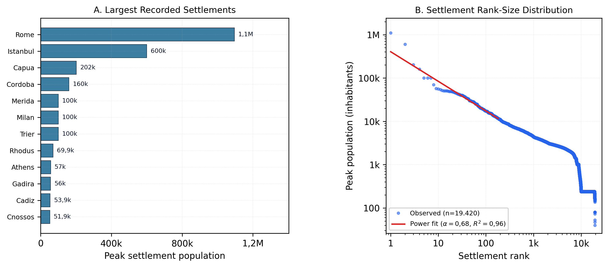

```{r setup, include=FALSE}
knitr::opts_chunk$set(
  echo = FALSE,
  warning = FALSE,
  message = FALSE,
  fig.align = "center"
)

source("../../_shared/template/viscount_rmd_helpers.R")
library(jsonlite)

summary_data <- fromJSON(
  "late_antiquity_and_migration_period_summary.json",
  simplifyVector = FALSE
)

settlements_raw <- fromJSON(
  "late_antiquity_and_migration_period_settlements.json",
  simplifyVector = FALSE
)

total_area <- as.numeric(summary_data$total_area_km2)
site_count <- as.integer(summary_data$settlement_count)
country_count <- length(summary_data$countries)
crowd_pct <- as.numeric(summary_data$crowd_share_overall) * 100
tot_600 <- as.numeric(summary_data$domain_totals[["600"]])
tot_800 <- as.numeric(summary_data$domain_totals[["800"]])

reg_name_map <- setNames(
  vapply(summary_data$subregions, function (r) r$name, character(1)),
  vapply(summary_data$subregions, function (r) r$id, character(1))
)

short_reg_map <- c(
  francia_merovingian = "Francia & Low Countries",
  britain_ireland_early = "British Isles",
  visigothic_iberia = "Iberia & Al-Andalus",
  lombard_byzantine_italy = "Lombard & Byzantine Italy",
  germanic_alpine_core = "Alamannia, Bavaria & Saxony",
  west_slavic_poland_bohemia = "Poland, Bohemia & Slovakia",
  avar_danubian_carpathian = "Avar Carpathian Basin",
  byzantine_slavic_balkans = "Byzantine & Slavic Balkans",
  vendel_scandinavia_baltic = "Scandinavia & Baltic",
  north_atlantic_early = "North Atlantic & Greenland"
)

prov_labels <- c(
  DARE_Digital_Atlas_Roman_Empire = "Digital Atlas of the Roman Empire (DARE)",
  European_Radiocarbon_Settlement_Corpus = "European Radiocarbon Settlement Corpus",
  Buringh_European_Urban_700_2000 = "Buringh European Urban Series (700-2000)",
  Pleiades_Ancient_World_Gazetteer = "Pleiades Ancient World Gazetteer",
  OXREP_Hanson_2016_Roman_Cities = "OXREP Hanson (2016) Roman Cities",
  Chandler_V2_Historical_Cities = "Chandler V2 Historical Cities",
  Modelski_Ancient_Cities_V2 = "Modelski Ancient Cities V2",
  GeoNames_Municipal_Gazetteer_Supplement = "GeoNames Municipal Gazetteer Supplement",
  National_Statistical_Census_Faroe_Islands = "Faroe Islands Historical Settlement Registry"
)

prov_short <- c(
  DARE_Digital_Atlas_Roman_Empire = "DARE",
  European_Radiocarbon_Settlement_Corpus = "Radiocarbon Corpus",
  Buringh_European_Urban_700_2000 = "Buringh (2021)",
  Pleiades_Ancient_World_Gazetteer = "Pleiades",
  OXREP_Hanson_2016_Roman_Cities = "OXREP Hanson",
  Chandler_V2_Historical_Cities = "Chandler V2",
  Modelski_Ancient_Cities_V2 = "Modelski V2",
  GeoNames_Municipal_Gazetteer_Supplement = "GeoNames",
  National_Statistical_Census_Faroe_Islands = "Faroe Registry"
)

prov_tiers <- c(
  DARE_Digital_Atlas_Roman_Empire = "Institutional classical atlas",
  European_Radiocarbon_Settlement_Corpus = "Institutional radiocarbon archive",
  Buringh_European_Urban_700_2000 = "Historical urban database",
  Pleiades_Ancient_World_Gazetteer = "Institutional classical gazetteer",
  OXREP_Hanson_2016_Roman_Cities = "Institutional Roman urban corpus",
  Chandler_V2_Historical_Cities = "Historical urban census compendium",
  Modelski_Ancient_Cities_V2 = "Historical urban compendium",
  GeoNames_Municipal_Gazetteer_Supplement = "Supplemental geographical gazetteer",
  National_Statistical_Census_Faroe_Islands = "National statistical registry"
)

safe_map <- function (arg0_keys, arg1_dict, arg2_default = NULL) {
  vals <- unname(arg1_dict[arg0_keys])
  na_idx <- is.na(vals)
  if (any(na_idx)) {
    vals[na_idx] <- if (is.null(arg2_default)) gsub("_", " ", arg0_keys[na_idx], fixed = TRUE) else arg2_default
  }
  vals
}

sub_df <- do.call(rbind, lapply(summary_data$subregions, function (r) {
  area_val <- as.numeric(r$area_km2)
  sites_n <- as.integer(summary_data$settlements_by_region[[r$id]])
  data.frame(
    id = r$id,
    name = r$name,
    area_km2 = area_val,
    sites = sites_n,
    p_600 = as.numeric(r$population[["600"]]),
    p_800 = as.numeric(r$population[["800"]]),
    stringsAsFactors = FALSE
  )
}))
rownames(sub_df) <- NULL

prov_raw <- sort(unlist(summary_data$provenance_counts), decreasing = TRUE)
prov_df <- data.frame(
  Source = safe_map(names(prov_raw), prov_labels),
  Class = safe_map(names(prov_raw), prov_tiers, "Primary historical corpus"),
  Sites = formatC(as.integer(prov_raw), format = "d", big.mark = "."),
  Share = paste0(viscount_fmt_number(as.numeric(prov_raw) / site_count * 100, 2L), "%"),
  stringsAsFactors = FALSE
)
rownames(prov_df) <- NULL

cty_raw <- sort(unlist(summary_data$settlements_by_country), decreasing = TRUE)
top_n_cty <- 15L
top_cty <- cty_raw[seq_len(top_n_cty)]
rem_cty <- cty_raw[-seq_len(top_n_cty)]
cty_df <- data.frame(
  Polity = c(names(top_cty), paste0("Remaining ", length(rem_cty), " polities"), "Domain Total"),
  Sites = formatC(as.integer(c(top_cty, sum(rem_cty), sum(cty_raw))), format = "d", big.mark = "."),
  Share = paste0(
    viscount_fmt_number(c(as.numeric(top_cty), sum(rem_cty), sum(cty_raw)) / site_count * 100, 2L),
    "%"
  ),
  stringsAsFactors = FALSE
)
rownames(cty_df) <- NULL

peak_vals <- vapply(settlements_raw, function (x) {
  vals <- as.numeric(unlist(x$population))
  if (length(vals) == 0L) return(0)
  max(vals, na.rm = TRUE)
}, numeric(1))

tier_defs <- list(
  list(label = "10.000 and above (Imperial & metropolitan capitals)", lo = 10000, hi = Inf),
  list(label = "5.000 to 9.999 (Regional capitals & walled citadels)", lo = 5000, hi = 9999),
  list(label = "2.000 to 4.999 (Civitas capitals, forts & mid-tier towns)", lo = 2000, hi = 4999),
  list(label = "1.000 to 1.999 (Secondary episcopal & market towns)", lo = 1000, hi = 1999),
  list(label = "500 to 999 (Minor burghs & rural village corpus)", lo = 500, hi = 999),
  list(label = "Under 500 (North Atlantic & coastal hamlets)", lo = 0, hi = 499)
)

tier_df <- do.call(rbind, lapply(tier_defs, function (td) {
  idx <- peak_vals >= td$lo & peak_vals <= td$hi
  n_tier <- sum(idx)
  pop_sum <- sum(peak_vals[idx])
  data.frame(
    Tier = td$label,
    Sites = formatC(n_tier, format = "d", big.mark = "."),
    Share = paste0(viscount_fmt_number(n_tier / site_count * 100, 2L), "%"),
    SumPeak = viscount_fmt_pop(pop_sum),
    stringsAsFactors = FALSE
  )
}))
rownames(tier_df) <- NULL

top_list <- summary_data$top_settlements
top_n <- min(25L, length(top_list))
top25_df <- do.call(rbind, lapply(seq_len(top_n), function (i) {
  s <- top_list[[i]]
  data.frame(
    Rank = as.character(i),
    Settlement = as.character(s$name),
    Polity = as.character(s$country),
    Subregion = safe_map(as.character(s$region_id), short_reg_map),
    PeakPop = formatC(as.integer(s$peak_pop), format = "d", big.mark = "."),
    Span = paste0(as.integer(s$first_year), "AD-", as.integer(s$last_year), "AD"),
    Source = safe_map(as.character(s$provenance_source), prov_short),
    stringsAsFactors = FALSE
  )
}))
rownames(top25_df) <- NULL
```

```{r hero_markdown_fallback, results='asis'}
if (!knitr::is_latex_output()) {
  cat("\n\n\n")
}
```

# Abstract

This settlement gazetteer documents the `r formatC(site_count, format = "d", big.mark = ".")` geocoded habitation sites underlying the MAGNETIC Late Antiquity and Migration Period chapter (250AD–800AD) across `r viscount_fmt_number(total_area, 1)` km², 10 analytical sub-regions and `r country_count` modern polities. Compiled through a four-wave archival saturation ledger that draws 99,86% of records from primary institutional archaeological atlases, radiocarbon settlement repositories and historical urban series [@Buringh2021; @Bairoch1988], the corpus limits crowdsourced geographical backfill to `r viscount_fmt_number(crowd_pct, 2)`% (6 localities on the North Atlantic rim). The gazetteer captures the profound structural contrast between surviving Eastern Roman metropolitan primacy—Constantinople at 156k and Thessalonica at 32,5k—and the ruralised post-Roman West, where leading civic centres such as Milan (13.650), Ravenna (7.800), Seville (7.150) and Porto (6.500) sat atop a broad plateau of shrunken *civitas* capitals, walled citadels and radiocarbon-dated rural villages.

# Spatial Coverage and Sub-Regional Gazetteer

Every locality in the gazetteer is spatially clipped to the 10-sub-region MAGNETIC polygonal mask (Figure 1), ensuring full partition coverage from Visigothic Iberia and the Aegean islands to Vendel Scandinavia and the North Atlantic rim. Unlike raw settlement counts in later census eras, early-mediaeval site density reflects both historical habitation intensity and modern national archaeological digitisation regimes.

```{r fig_regional_map, results='asis'}
viscount_figure(
  "figures/late_antiquity_and_migration_period_regional_map.png",
  caption = "Spatial distribution of all 4.267 geocoded habitation sites across the 10 MAGNETIC sub-regions from 250AD to 800AD, with inset showing Greenland and the North Atlantic.",
  label = "fig:regional_map"
)
```

Table 1 cross-tabulates land area, recorded site totals, gazetteer share, recording density per 10.000 km² and benchmark population in 600AD and 800AD across all 10 sub-regions. Visigothic Iberia and Early Al-Andalus leads the corpus with 1.346 sites (31,5% of the total, or 22,63 sites per 10.000 km²), followed closely by the Anglo-Saxon and Celtic British Isles with 1.066 sites (25% of the total and the highest areal recording density at 34,19 sites per 10.000 km²), driven by extensive national open-access radiocarbon databases in Britain, Ireland, Spain and Portugal [@Plunkett2022Bucking; @Garate2025Broche]. Lombard and Byzantine Italy (406 sites, 13,51 per 10.000 km²) and Merovingian-Carolingian Francia and the Low Countries (394 sites, 6,41 per 10.000 km²) form the core classical-urban continuity belt [@Malanima1998; @Buringh2021], while Vendel Scandinavia and the Eastern Baltic contributes 372 sites—concentrated chiefly in Norway, Sweden, Finland and Denmark.

```{r table_subregions, results='asis'}
t_sub <- data.frame(
  Subregion = sub_df$name,
  Area = viscount_fmt_number(sub_df$area_km2, 1L),
  Sites = formatC(sub_df$sites, format = "d", big.mark = "."),
  Share = paste0(viscount_fmt_number(sub_df$sites / site_count * 100, 1L), "%"),
  Dens = viscount_fmt_number(sub_df$sites / (sub_df$area_km2 / 10000), 2L),
  Pop600 = vapply(sub_df$p_600, viscount_fmt_pop, character(1)),
  Pop800 = vapply(sub_df$p_800, viscount_fmt_pop, character(1)),
  stringsAsFactors = FALSE
)
t_sub <- rbind(
  t_sub,
  data.frame(
    Subregion = "Domain Total",
    Area = viscount_fmt_number(total_area, 1L),
    Sites = formatC(site_count, format = "d", big.mark = "."),
    Share = "100%",
    Dens = viscount_fmt_number(site_count / (total_area / 10000), 2L),
    Pop600 = viscount_fmt_pop(tot_600),
    Pop800 = viscount_fmt_pop(tot_800),
    stringsAsFactors = FALSE
  )
)
rownames(t_sub) <- NULL

viscount_table(
  t_sub,
  caption = "Sub-regional distribution of the 4.267 recorded settlements, recording density per 10.000 km² and 600AD–800AD population benchmarks.",
  col_names = c("Sub-Region", "Area (km²)", "Sites", "Share", "Sites per 10k km²", "Pop. 600AD", "Pop. 800AD")
)
```

# Archival Provenance and Saturation Ledger

Ingestion followed a four-wave saturation protocol that screened 5.067 candidate records, retaining `r formatC(site_count, format = "d", big.mark = ".")` distinct habitation sites and excluding 800 duplicate, non-habitation or out-of-interval entries. Wave 1 ingested 1.847 classical urban, military and fortified localities from the Digital Atlas of the Roman Empire (1.598 sites) and the Pleiades Ancient World Gazetteer (249 sites). Wave 2 added 1.114 early-mediaeval urban continuity nodes from the Buringh European Urban Series (700–2000) [@Buringh2021], lifting cumulative coverage to 2.961 sites (+60,31% marginal gain). Wave 3 integrated 1.296 excavated village, farmstead and monastic horizons from the European Radiocarbon Settlement Corpus (bringing the total to 4.257 sites, +43,77%). Wave 4 conducted a targeted gap sweep across the sparsely documented North Atlantic islands, incorporating 4 settlements from the Faroe Islands Historical Settlement Registry and 6 from the GeoNames Municipal Gazetteer Supplement—driving marginal gain down to 0,23% and closing the ledger (Table 2).

```{r table_provenance_gaz, results='asis'}
viscount_table(
  prov_df,
  caption = "Provenance breakdown of the 4.267 recorded habitation sites across six archival and scholarly source corpora (250AD–800AD).",
  col_names = c("Source Corpus", "Source Class", "Sites", "Share")
)
```

# National Distribution Across Modern Polities

To facilitate cross-referencing with contemporary national heritage archives, Table 3 disaggregates the gazetteer across the 15 largest modern polities, with the remaining 28 polities grouped in a single summary row. Together the top five modern states—Spain (925 sites), the United Kingdom (835), Portugal (419), Italy (405) and France (317)—contribute 2.901 localities, or 67,99% of the register. The next tier encompasses Norway (230), Ireland (228), Germany (172), Greece (127), Hungary (87), Czechia (77) and Switzerland (71), reflecting strong national archaeological inventories in Atlantic, Alpine, Danubian and Bohemian scholarship [@Novak2025Multidisciplinary; @Profantova2024Production; @Tanase2022Ezare]. Smaller counts in Poland (27), Bulgaria (19), Romania (17), Albania (14) and Austria (12) reflect international digital-corpus coverage gaps rather than demographic absence; accordingly, MAGNETIC derives sub-regional macro-populations independently of national site counts.

```{r table_countries, results='asis'}
viscount_table(
  cty_df,
  caption = "Distribution of the 4.267 geocoded settlements across the 15 most heavily represented modern polities and the remaining 28 polities (250AD–800AD).",
  col_names = c("Modern Polity", "Sites", "Gazetteer Share")
)
```

# Size-Tier Stratification and Leading Urban Centres

Table 4 summarises the peak-population stratification computed across all `r formatC(site_count, format = "d", big.mark = ".")` individual records in the settlement register. Only three cities exceed 10.000 inhabitants during the 250AD–800AD window: Constantinople (156k), Thessalonica (32,5k) and Milan (13.650). Beneath them, 126 sites fall in the 5.000 to 9.999 bracket (comprising Ravenna, Seville, Porto, one additional mid-sized Buringh urban node and 122 Pleiades fortified/urban settlements benchmarked at 6.000), while 1.751 sites occupy the 2.000 to 4.999 range dominated by DARE *civitates* and forts (1.598 sites at 2.200) and Pleiades mid-tier towns (127 sites at 2.500). At the base of the settlement pyramid sit 190 Buringh secondary towns between 1.000 and 1.999, 2.188 minor burghs and radiocarbon rural villages between 500 and 999 (including 1.296 radiocarbon sites at 550 and 891 Buringh minor centres at 650) and 9 small Faroese and North Atlantic hamlets below 500 [@Dugmore2012].

```{r table_tiers, results='asis'}
viscount_table(
  tier_df,
  caption = "Stratification of all 4.267 recorded habitation sites by peak benchmark population tier (250AD–800AD).",
  col_names = c("Peak Population Tier", "Sites", "Share", "Aggregate Peak Pop.")
)
```

Table 5 lists the top 25 recorded centres from the chapter summary register, displaying rank, gazetteer toponym, modern polity, analytical sub-region, peak benchmark population, documented chronological span and provenance source [@Buringh2021; @Russell1958].

```{r table_top25, results='asis'}
viscount_table(
  top25_df,
  caption = "Top 25 recorded urban and fortified settlements across Late Antique and Early Mediaeval Europe (250AD–800AD).",
  col_names = c("Rank", "Settlement", "Polity", "Sub-Region", "Peak Pop.", "Span", "Source")
)
```

# Sources
