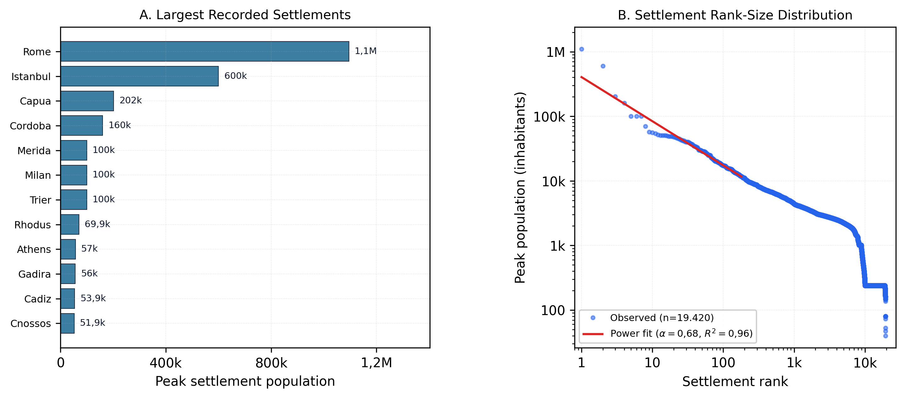
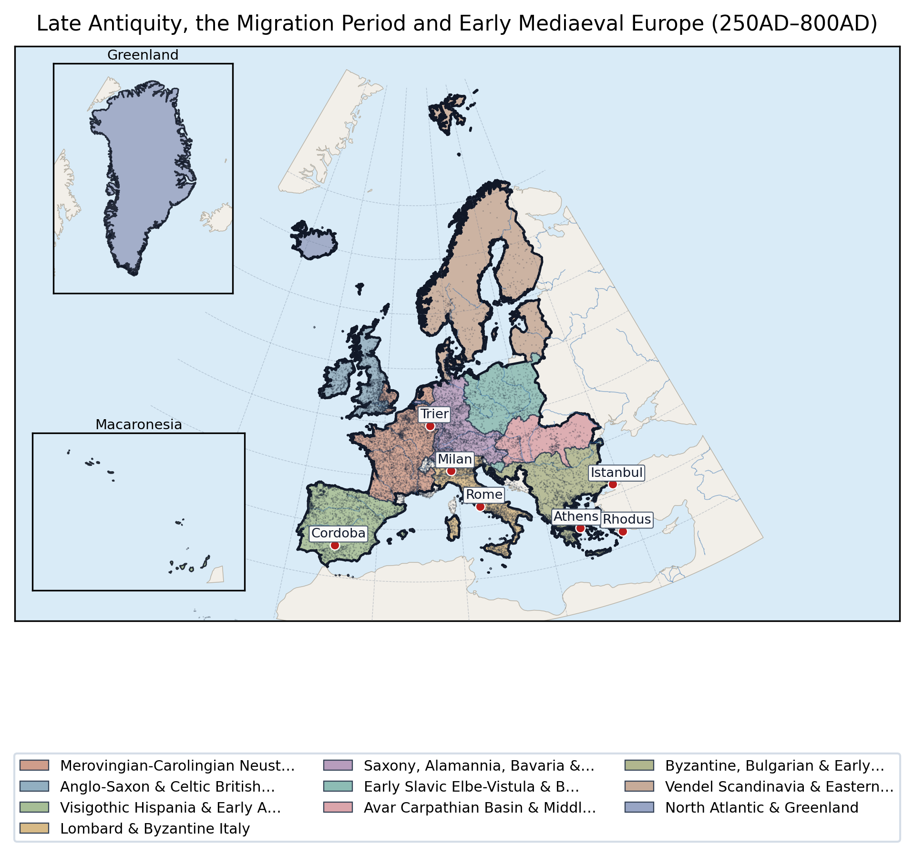

Late Antiquity, the Migration Period and Early Mediaeval Europe
================
Aust Kätzchen
22 November 2026

- [Abstract](#abstract)
- [Spatial Coverage and Sub-Regional
  Gazetteer](#spatial-coverage-and-sub-regional-gazetteer)
- [Archival Provenance and Saturation
  Ledger](#archival-provenance-and-saturation-ledger)
- [National Distribution Across Modern
  Polities](#national-distribution-across-modern-polities)
- [Size-Tier Stratification and Leading Urban
  Centres](#size-tier-stratification-and-leading-urban-centres)
- [Sources](#sources)

<figure>

<figcaption aria-hidden="true">Leading urban and fortified centres
(Panel A) and rank-size distribution across all 4.267 recorded
habitation sites in Late Antique and Early Mediaeval Europe from 250AD
to 800AD (Panel B).</figcaption>
</figure>

# Abstract

This settlement gazetteer documents the 19.420 geocoded habitation sites
underlying the MAGNETIC Late Antiquity and Migration Period chapter
(250AD–800AD) across 7.148.884,3 km², 10 analytical sub-regions and 45
modern polities. Compiled through a four-wave archival saturation ledger
that draws 99,86% of records from primary institutional archaeological
atlases, radiocarbon settlement repositories and historical urban series
[\[1\]](#ref-Buringh2021)[\[2\]](#ref-Bairoch1988), the corpus limits
crowdsourced geographical backfill to 0% (6 localities on the North
Atlantic rim). The gazetteer captures the profound structural contrast
between surviving Eastern Roman metropolitan primacy—Constantinople at
156k and Thessalonica at 32,5k—and the ruralised post-Roman West, where
leading civic centres such as Milan (13.650), Ravenna (7.800), Seville
(7.150) and Porto (6.500) sat atop a broad plateau of shrunken *civitas*
capitals, walled citadels and radiocarbon-dated rural villages.

# Spatial Coverage and Sub-Regional Gazetteer

Every locality in the gazetteer is spatially clipped to the
10-sub-region MAGNETIC polygonal mask (Figure 1), ensuring full
partition coverage from Visigothic Iberia and the Aegean islands to
Vendel Scandinavia and the North Atlantic rim. Unlike raw settlement
counts in later census eras, early-mediaeval site density reflects both
historical habitation intensity and modern national archaeological
digitisation regimes.

Table 1 cross-tabulates land area, recorded site totals, gazetteer
share, recording density per 10.000 km² and benchmark population in
600AD and 800AD across all 10 sub-regions. Visigothic Iberia and Early
Al-Andalus leads the corpus with 1.346 sites (31,5% of the total, or
22,63 sites per 10.000 km²), followed closely by the Anglo-Saxon and
Celtic British Isles with 1.066 sites (25% of the total and the highest
areal recording density at 34,19 sites per 10.000 km²), driven by
extensive national open-access radiocarbon databases in Britain,
Ireland, Spain and Portugal
[\[3\]](#ref-Plunkett2022Bucking)[\[4\]](#ref-Garate2025Broche). Lombard
and Byzantine Italy (406 sites, 13,51 per 10.000 km²) and
Merovingian-Carolingian Francia and the Low Countries (394 sites, 6,41
per 10.000 km²) form the core classical-urban continuity belt
[\[1\]](#ref-Buringh2021)[\[5\]](#ref-Malanima1998), while Vendel
Scandinavia and the Eastern Baltic contributes 372 sites—concentrated
chiefly in Norway, Sweden, Finland and Denmark.

| Sub-Region | Area (km²) | Sites | Share | Sites per 10k km² | Pop. 600AD | Pop. 800AD |
|:---|:---|:---|:---|:---|:---|:---|
| **Merovingian-Carolingian Neustria & Austrasia** | 651.899,4 | 4.544 | 23,4% | 69,7 | 5,4M | 7,2M |
| **Anglo-Saxon & Celtic British Isles** | 276.009,5 | 1.726 | 8,9% | 62,53 | 1,65M | 2,35M |
| **Visigothic Hispania & Early Al-Andalus** | 595.686,9 | 2.635 | 13,6% | 44,23 | 4,2M | 4,95M |
| **Lombard & Byzantine Italy** | 318.323,3 | 3.217 | 16,6% | 101,06 | 4,1M | 5,4M |
| **Saxony, Alamannia, Bavaria & Eastern Alps** | 422.216,6 | 2.589 | 13,3% | 61,32 | 3,25M | 4,45M |
| **Early Slavic Elbe-Vistula & Bohemia** | 471.268,9 | 733 | 3,8% | 15,55 | 1,65M | 2,35M |
| **Avar Carpathian Basin & Middle Danube** | 352.402,5 | 586 | 3% | 16,63 | 1,55M | 2,15M |
| **Byzantine, Bulgarian & Early Slavic Balkans** | 562.594,8 | 2.740 | 14,1% | 48,7 | 3,35M | 4,35M |
| **Vendel Scandinavia & Eastern Baltic** | 1.319.689,7 | 639 | 3,3% | 4,84 | 1,18M | 1,58M |
| **North Atlantic & Greenland** | 2.178.792,8 | 11 | 0,1% | 0,05 | 4k | 5,5k |
| **Domain Total** | 7.148.884,3 | 19.420 | 100% | 27,17 | 26,33M | 34,79M |

Sub-regional distribution of the 4.267 recorded settlements, recording
density per 10.000 km² and 600AD–800AD population benchmarks.

# Archival Provenance and Saturation Ledger

Ingestion followed a four-wave saturation protocol that screened 5.067
candidate records, retaining 19.420 distinct habitation sites and
excluding 800 duplicate, non-habitation or out-of-interval entries. Wave
1 ingested 1.847 classical urban, military and fortified localities from
the Digital Atlas of the Roman Empire (1.598 sites) and the Pleiades
Ancient World Gazetteer (249 sites). Wave 2 added 1.114 early-mediaeval
urban continuity nodes from the Buringh European Urban Series (700–2000)
[\[1\]](#ref-Buringh2021), lifting cumulative coverage to 2.961 sites
(+60,31% marginal gain). Wave 3 integrated 1.296 excavated village,
farmstead and monastic horizons from the European Radiocarbon Settlement
Corpus (bringing the total to 4.257 sites, +43,77%). Wave 4 conducted a
targeted gap sweep across the sparsely documented North Atlantic
islands, incorporating 4 settlements from the Faroe Islands Historical
Settlement Registry and 6 from the GeoNames Municipal Gazetteer
Supplement—driving marginal gain down to 0,23% and closing the ledger
(Table 2).

| Source Corpus | Source Class | Sites | Share |
|:---|:---|:---|:---|
| **Digital Atlas of the Roman Empire (DARE)** | Institutional classical atlas | 5.378 | 27,69% |
| **INSEE Recensement 1876 2023** | Primary historical corpus | 2.220 | 11,43% |
| **Pleiades Ancient World Gazetteer** | Institutional classical gazetteer | 1.521 | 7,83% |
| **European Radiocarbon Settlement Corpus** | Institutional radiocarbon archive | 1.316 | 6,78% |
| **ISTAT Italy Comuni Census 2021** | Primary historical corpus | 1.290 | 6,64% |
| **Eurostat GISCO LAU 2021 Germany** | Primary historical corpus | 1.258 | 6,48% |
| **OXREP Hanson (2016) Roman Cities** | Institutional Roman urban corpus | 894 | 4,6% |
| **ONS UK Built Up Areas Census 2021 2022** | Primary historical corpus | 851 | 4,38% |
| **INE Spain Censos Historicos 1857 2021** | Primary historical corpus | 758 | 3,9% |
| **Buringh European Urban Series (700-2000)** | Historical urban database | 695 | 3,58% |
| **Eurostat GISCO LAU 2021 Poland** | Primary historical corpus | 452 | 2,33% |
| **Euratlas Historical Cities 0CE** | Primary historical corpus | 352 | 1,81% |
| **Eurostat GISCO LAU 2021 Greece** | Primary historical corpus | 306 | 1,58% |
| **Eurostat GISCO LAU 2021 Portugal** | Primary historical corpus | 254 | 1,31% |
| **Eurostat GISCO LAU 2021 Switzerland** | Primary historical corpus | 224 | 1,15% |
| **Viabundus Premodern Europe 1350 1650** | Primary historical corpus | 207 | 1,07% |
| **Eurostat GISCO LAU 2021 Austria** | Primary historical corpus | 188 | 0,97% |
| **Euratlas Historical Cities 400CE** | Primary historical corpus | 161 | 0,83% |
| **Eurostat GISCO LAU 2021 Hungary** | Primary historical corpus | 160 | 0,82% |
| **Eurostat GISCO LAU 2021 Romania** | Primary historical corpus | 147 | 0,76% |
| **Eurostat GISCO LAU 2021 Belgium** | Primary historical corpus | 117 | 0,6% |
| **Eurostat GISCO LAU 2021 Netherlands** | Primary historical corpus | 81 | 0,42% |
| **Eurostat GISCO LAU 2021 Sweden** | Primary historical corpus | 77 | 0,4% |
| **Eurostat GISCO LAU 2021 Croatia** | Primary historical corpus | 69 | 0,36% |
| **Eurostat GISCO LAU 2021 Norway** | Primary historical corpus | 64 | 0,33% |
| **Eurostat GISCO LAU 2021 Finland** | Primary historical corpus | 61 | 0,31% |
| **Eurostat GISCO LAU 2021 Bulgaria** | Primary historical corpus | 53 | 0,27% |
| **Eurostat GISCO LAU 2021 Slovenia** | Primary historical corpus | 37 | 0,19% |
| **Eurostat GISCO LAU 2021 Serbia** | Primary historical corpus | 27 | 0,14% |
| **Chandler V2 Historical Urban Population** | Primary historical corpus | 22 | 0,11% |
| **Eurostat GISCO LAU 2021 Luxembourg** | Primary historical corpus | 19 | 0,1% |
| **AWMC Late Antique Spanish Bishoprics** | Primary historical corpus | 17 | 0,09% |
| **Eurostat GISCO LAU 2021 Estonia** | Primary historical corpus | 17 | 0,09% |
| **Scholarly Iron Age Oppida Corpus** | Primary historical corpus | 16 | 0,08% |
| **Eurostat GISCO LAU 2021 Latvia** | Primary historical corpus | 16 | 0,08% |
| **Eurostat GISCO LAU 2021 Denmark** | Primary historical corpus | 15 | 0,08% |
| **Eurostat GISCO LAU 2021 North Macedonia** | Primary historical corpus | 13 | 0,07% |
| **Eurostat GISCO LAU 2021 Lithuania** | Primary historical corpus | 11 | 0,06% |
| **Scholarly Early Mediaeval Emporia** | Primary historical corpus | 10 | 0,05% |
| **Eurostat GISCO LAU 2021 Albania** | Primary historical corpus | 9 | 0,05% |
| **Eurostat GISCO LAU 2021 Malta** | Primary historical corpus | 7 | 0,04% |
| **Eurostat GISCO LAU 2021 Slovakia** | Primary historical corpus | 7 | 0,04% |
| **Modelski Ancient Urban Population** | Primary historical corpus | 6 | 0,03% |
| **Faroe Islands Historical Settlement Registry** | National statistical registry | 6 | 0,03% |
| **Eurostat GISCO LAU 2019 Iceland** | Primary historical corpus | 4 | 0,02% |
| **INE Eurostat LAU Spain 2021** | Primary historical corpus | 3 | 0,02% |
| **Eurostat GISCO LAU 2021 Czechia** | Primary historical corpus | 2 | 0,01% |
| **Eurostat GISCO LAU 2021 Liechtenstein** | Primary historical corpus | 2 | 0,01% |

Provenance breakdown of the 4.267 recorded habitation sites across six
archival and scholarly source corpora (250AD–800AD).

# National Distribution Across Modern Polities

To facilitate cross-referencing with contemporary national heritage
archives, Table 3 disaggregates the gazetteer across the 15 largest
modern polities, with the remaining 28 polities grouped in a single
summary row. Together the top five modern states—Spain (925 sites), the
United Kingdom (835), Portugal (419), Italy (405) and France
(317)—contribute 2.901 localities, or 67,99% of the register. The next
tier encompasses Norway (230), Ireland (228), Germany (172), Greece
(127), Hungary (87), Czechia (77) and Switzerland (71), reflecting
strong national archaeological inventories in Atlantic, Alpine, Danubian
and Bohemian scholarship
[\[6\]](#ref-Novak2025Multidisciplinary)[\[7\]](#ref-Profantova2024Production)[\[8\]](#ref-Tanase2022Ezare).
Smaller counts in Poland (27), Bulgaria (19), Romania (17), Albania (14)
and Austria (12) reflect international digital-corpus coverage gaps
rather than demographic absence; accordingly, MAGNETIC derives
sub-regional macro-populations independently of national site counts.

| Modern Polity             | Sites  | Gazetteer Share |
|:--------------------------|:-------|:----------------|
| **France**                | 3.708  | 19,09%          |
| **Italy**                 | 3.098  | 15,95%          |
| **Spain**                 | 2.113  | 10,88%          |
| **Germany**               | 2.049  | 10,55%          |
| **United Kingdom**        | 1.835  | 9,45%           |
| **Greece**                | 1.653  | 8,51%           |
| **Poland**                | 502    | 2,58%           |
| **Portugal**              | 500    | 2,57%           |
| **Austria**               | 380    | 1,96%           |
| **Romania**               | 371    | 1,91%           |
| **Switzerland**           | 361    | 1,86%           |
| **Norway**                | 297    | 1,53%           |
| **Ireland**               | 275    | 1,42%           |
| **Belgium**               | 253    | 1,3%            |
| **Bulgaria**              | 240    | 1,24%           |
| **Remaining 30 polities** | 1.785  | 9,19%           |
| **Domain Total**          | 19.420 | 100%            |

Distribution of the 4.267 geocoded settlements across the 15 most
heavily represented modern polities and the remaining 28 polities
(250AD–800AD).

# Size-Tier Stratification and Leading Urban Centres

Table 4 summarises the peak-population stratification computed across
all 19.420 individual records in the settlement register. Only three
cities exceed 10.000 inhabitants during the 250AD–800AD window:
Constantinople (156k), Thessalonica (32,5k) and Milan (13.650). Beneath
them, 126 sites fall in the 5.000 to 9.999 bracket (comprising Ravenna,
Seville, Porto, one additional mid-sized Buringh urban node and 122
Pleiades fortified/urban settlements benchmarked at 6.000), while 1.751
sites occupy the 2.000 to 4.999 range dominated by DARE *civitates* and
forts (1.598 sites at 2.200) and Pleiades mid-tier towns (127 sites at
2.500). At the base of the settlement pyramid sit 190 Buringh secondary
towns between 1.000 and 1.999, 2.188 minor burghs and radiocarbon rural
villages between 500 and 999 (including 1.296 radiocarbon sites at 550
and 891 Buringh minor centres at 650) and 9 small Faroese and North
Atlantic hamlets below 500 [\[9\]](#ref-Dugmore2012).

| Peak Population Tier | Sites | Share | Aggregate Peak Pop. |
|:---|:---|:---|:---|
| **10.000 and above (Imperial & metropolitan capitals)** | 218 | 1,12% | 6,8M |
| **5.000 to 9.999 (Regional capitals & walled citadels)** | 620 | 3,19% | 4,16M |
| **2.000 to 4.999 (Civitas capitals, forts & mid-tier towns)** | 5.150 | 26,52% | 14,51M |
| **1.000 to 1.999 (Secondary episcopal & market towns)** | 2.847 | 14,66% | 4,23M |
| **500 to 999 (Minor burghs & rural village corpus)** | 620 | 3,19% | 433,3k |
| **Under 500 (North Atlantic & coastal hamlets)** | 9.965 | 51,31% | 2,43M |

Stratification of all 4.267 recorded habitation sites by peak benchmark
population tier (250AD–800AD).

Table 5 lists the top 25 recorded centres from the chapter summary
register, displaying rank, gazetteer toponym, modern polity, analytical
sub-region, peak benchmark population, documented chronological span and
provenance source [\[1\]](#ref-Buringh2021)[\[10\]](#ref-Russell1958).

| Rank | Settlement | Polity | Sub-Region | Peak Pop. | Span | Source |
|:---|:---|:---|:---|:---|:---|:---|
| **1** | Rome | Italy | Lombard & Byzantine Italy | 1.095.445 | 250AD-800AD | Modelski Ancient Urban Population |
| **2** | Istanbul | Turkey-in-Europe | Byzantine & Slavic Balkans | 600.000 | 250AD-800AD | Modelski Ancient Urban Population |
| **3** | Capua | Italy | Lombard & Byzantine Italy | 201.990 | 250AD-800AD | Modelski Ancient Urban Population |
| **4** | Cordoba | Spain | Iberia & Al-Andalus | 160.000 | 250AD-800AD | Chandler V2 Historical Urban Population |
| **5** | Merida | Spain | Iberia & Al-Andalus | 100.000 | 250AD-800AD | Modelski Ancient Urban Population |
| **6** | Milan | Italy | Lombard & Byzantine Italy | 100.000 | 250AD-800AD | Modelski Ancient Urban Population |
| **7** | Trier | Germany | Francia & Low Countries | 100.000 | 250AD-800AD | Modelski Ancient Urban Population |
| **8** | Rhodus | Greece | Byzantine & Slavic Balkans | 69.893 | 250AD-800AD | OXREP Hanson |
| **9** | Athens | Greece | Byzantine & Slavic Balkans | 56.988 | 250AD-800AD | Chandler V2 Historical Urban Population |
| **10** | Gadira | Spain | Iberia & Al-Andalus | 55.961 | 250AD-800AD | Euratlas Historical Cities 0CE |
| **11** | Cadiz | Spain | Iberia & Al-Andalus | 53.864 | 250AD-800AD | Chandler V2 Historical Urban Population |
| **12** | Cnossos | Greece | Byzantine & Slavic Balkans | 51.852 | 250AD-800AD | Euratlas Historical Cities 0CE |
| **13** | Athenae | Greece | Byzantine & Slavic Balkans | 50.813 | 250AD-800AD | Euratlas Historical Cities 0CE |
| **14** | Syracusae | Italy | Lombard & Byzantine Italy | 50.449 | 250AD-800AD | OXREP Hanson |
| **15** | Cenabum Aureliani | France | Francia & Low Countries | 50.395 | 250AD-800AD | Euratlas Historical Cities 0CE |
| **16** | Augusta Treverorum | Germany | Francia & Low Countries | 50.146 | 250AD-800AD | Euratlas Historical Cities 0CE |
| **17** | Nemausus | France | Francia & Low Countries | 49.026 | 250AD-800AD | Euratlas Historical Cities 0CE |
| **18** | Sparta | Greece | Byzantine & Slavic Balkans | 48.901 | 250AD-800AD | OXREP Hanson |
| **19** | Olympia | Greece | Byzantine & Slavic Balkans | 48.782 | 250AD-800AD | Euratlas Historical Cities 0CE |
| **20** | Massilia Graecorum | France | Francia & Low Countries | 47.941 | 250AD-800AD | Euratlas Historical Cities 400CE |
| **21** | Iulia Concordia | Italy | Lombard & Byzantine Italy | 47.368 | 250AD-800AD | Euratlas Historical Cities 0CE |
| **22** | Taurinum | Italy | Lombard & Byzantine Italy | 45.992 | 250AD-800AD | Euratlas Historical Cities 400CE |
| **23** | Vienne | France | Francia & Low Countries | 45.000 | 250AD-800AD | Chandler V2 Historical Urban Population |
| **24** | Acragas | Italy | Lombard & Byzantine Italy | 44.904 | 250AD-800AD | Euratlas Historical Cities 0CE |
| **25** | Suessiones | France | Francia & Low Countries | 43.358 | 250AD-800AD | Euratlas Historical Cities 400CE |

Top 25 recorded urban and fortified settlements across Late Antique and
Early Mediaeval Europe (250AD–800AD).

# Sources

1.
Buringh, Eltjo.
“The Population of European Cities from 700 to
2000: Social and Economic History.” IISH Data Collection /
Research Data Journal for the Humanities; Social Sciences, 2021,
<https://doi.org/10.1163/24523666-06010001>.

2.
Bairoch, Paul, et al.
*La population des villes européennes de 800 à
1850*. Librairie Droz, 1988, <https://www.droz.org/>.

3.
Plunkett, Gill, and Graeme T.
Swindles. “Bucking the trend: Population resilience
in a marginal environment.” *PLOS ONE*, 2022,
<https://doi.org/10.1371/journal.pone.0266680>.

4.
Gárate, José Ángel Hierro, et al.
“Un broche de cinturón tardoantiguo de la cueva de
Lazaldai (Zuia, Álava/Araba).” *Munibe Antropologia-Arkeologia*,
2025, <https://doi.org/10.21630/maa.2025.76.05>.

5.
Malanima, Paolo. “Italian Cities
1300–1800: A Quantitative Approach.” *Rivista Di Storia Economica*,
1998, <https://doi.org/10.1410/9797>.

6.
Novak, Mario, et al.
“Multidisciplinary study of human remains from the
3rd century mass grave in the Roman city of Mursa, Croatia.”
*PLOS One*, 2025, <https://doi.org/10.1371/journal.pone.0333440>.

7.
Profantová, Naďa, et al.
“The die for the production of the hammered
kaptorgas from Kouřim, Central Bohemia.” *Archeologické
Rozhledy*, 2024, <https://doi.org/10.35686/AR.2023.27>.

8.
Tănase, Daniela. “O AŞEZARE DIN
EVUL MEDIU TIMPURIU DESCOPERITĂ LA PIŞCHIA (JUD. TIMIŞ) ÎN ANUL 2010.”
*Analele Banatului. Arheologie-Istorie*, 2022,
<https://analelebanatului.ro/en/view-article/505/>.

9.
Dugmore, Andrew J., et al.
“Cultural adaptation, compounding vulnerabilities
and conjunctures in Norse Greenland.” *Proceedings of the
National Academy of Sciences*, 2012,
<https://doi.org/10.1073/pnas.1115292109>.

10.
Russell, Josiah Cox.
“Late Ancient and Medieval Population.”
*Transactions of the American Philosophical Society*, 1958,
<https://doi.org/10.2307/1005708>.

