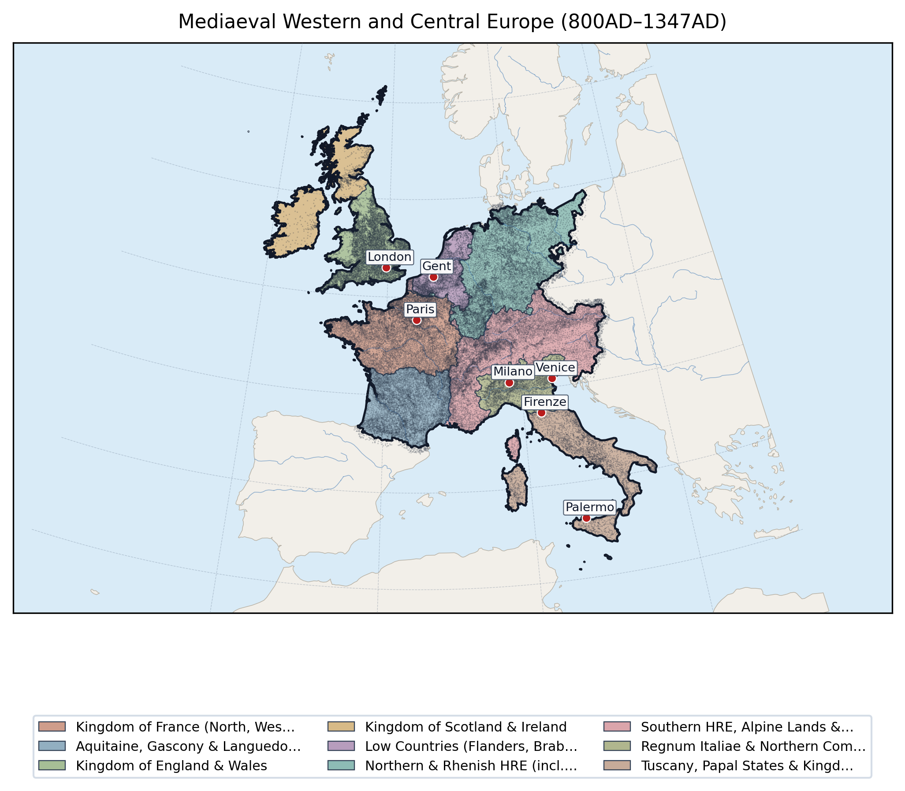
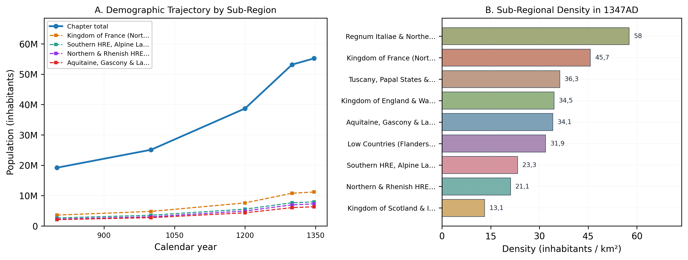
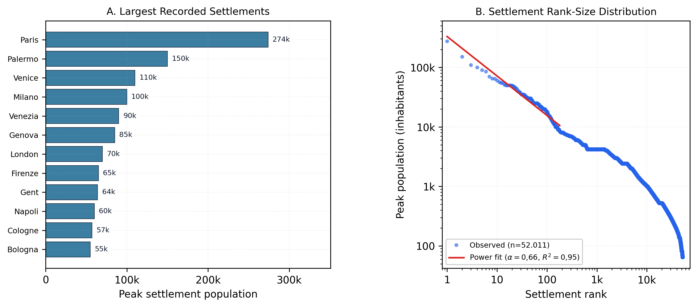

Mediaeval Western and Central Europe
================
Aust Kätzchen
22 November 2026

- [Abstract](#abstract)
- [Background](#background)
- [Methodology](#methodology)
  - [Archival Anchors and Fiscal
    Multipliers](#archival-anchors-and-fiscal-multipliers)
  - [Sub-Regional Partition and Benchmark
    Calibration](#sub-regional-partition-and-benchmark-calibration)
  - [Settlement Gazetteer and Urban Hierarchy
    Integration](#settlement-gazetteer-and-urban-hierarchy-integration)
- [Validation](#validation)
  - [Cross-Checks Against Independent Demographic and Bioarchaeological
    Proxies](#cross-checks-against-independent-demographic-and-bioarchaeological-proxies)
  - [Urban Scaling and Pre-Plague Structural
    Consistency](#urban-scaling-and-pre-plague-structural-consistency)
- [Results](#results)
  - [Macro-Regional Trajectory
    (800AD-1347AD)](#macro-regional-trajectory-800ad-1347ad)
  - [Kingdom of France: Northern Plains and Southern
    Pays](#kingdom-of-france-northern-plains-and-southern-pays)
  - [The British Isles: England, Wales, Scotland and
    Ireland](#the-british-isles-england-wales-scotland-and-ireland)
  - [The Low Countries: Flanders, Brabant and
    Holland](#the-low-countries-flanders-brabant-and-holland)
  - [The Holy Roman Empire: Rhineland, North German Plain and Alpine
    South](#the-holy-roman-empire-rhineland-north-german-plain-and-alpine-south)
  - [Mediaeval Italy: Communal North and Southern
    Kingdoms](#mediaeval-italy-communal-north-and-southern-kingdoms)
  - [Urban Hierarchy and Spatial
    Structure](#urban-hierarchy-and-spatial-structure)
- [Limitations](#limitations)
- [Conclusion](#conclusion)
- [Appendix](#appendix)
- [Sources](#sources)

<figure>

<figcaption aria-hidden="true">Sub-regional boundaries and 2.830
recorded settlements across Western and Central Europe,
800-1347.</figcaption>
</figure>

# Abstract

Between the Carolingian imperial coronation in 800AD and the eve of the
Black Death in 1347AD, the population of Western and Central Europe
nearly trebled from 19,2M to 55,2M across 1.793.128,1 km² spanning nine
physiographic and institutional sub-regions. Mean territorial density
rose from 10,71 inhabitants per km² in 800AD to 30,78 per km² in 1347AD,
peaking at 48,83 per km² across the Po plain of Northern Italy and 39,42
per km² along the Rhenish and North German plains while remaining at
13,1 per km² across upland Scotland and Ireland. Compound annual growth
averaged 0,193% over the five and a half centuries, accelerating from
0,134% per annum during 800-1000 to 0,217% in 1000-1200 and a mediaeval
high of 0,318% during the thirteenth century before stalling at 0,081%
after 1300 under the combined blows of harvest failure, the Great Famine
of 1315-1317 and the bovine panzootic of 1319-1321. Within MAGNETIC,
territorial benchmarks at 800AD, 1000AD, 1200AD, 1300AD and 1347AD
reconcile Carolingian monastic polyptychs, the English Domesday Book of
1086, the French 1328 *État des paroisses et des feux*, Italian communal
*estimi* and hearth registers alongside a georeferenced settlement
catalogue of 52.011 localities compiled strictly from institutional
urban and ancient-world archives with zero crowd-sourced entries.
Together these records trace Europe’s demographic pivot from the
Mediterranean basin toward the heavy-soil plains, woollen cloth towns
and river ports north of the Alps.

# Background

At 800AD Western and Central Europe emerged slowly from three centuries
of post-Roman contraction and recurrent outbreaks of the First Plague
Pandemic. When Charlemagne accepted the imperial crown in Rome on
Christmas Day 800, the lands stretching from the Irish Sea to the Elbe
and from the North Sea to Sicily held roughly 19,2M inhabitants at an
average density of 10,71 persons per km². Vast stretches of oak, beech
and alder woodland separated cleared arable basins; Roman aqueducts and
forum precincts stood half-ruined in towns reduced to episcopal
strongholds of 3k to 10k souls; and only Rome (39k) and Milan (21k)
exceeded 20k inhabitants within the entire nine-region domain
[\[1\]](#ref-Buringh2021)[\[2\]](#ref-Bairoch1988). The demographic
centre of gravity remained skewed toward the Mediterranean south: Italy
alone held 5,4M people, or 28,35% of the macro-regional total on just
17,58% of its land area.

Early Carolingian stability proved brief. Between 840 and 955 three
overlapping waves of external predation—Scandinavian sea-raiders
ascending the Seine, Loire, Scheldt, Thames and Rhine; Magyar light
cavalry sweeping across Bavaria, Swabia, Lotharingia and Lombardy; and
Aghlabid and Andalusi corsairs raiding Provence, Liguria and southern
Italy—depressed coastal and riverine settlement while driving rural
populations behind private timber and stone fortifications. Yet
archaeology and monastic estate surveys show that demographic attrition
during the ninth and tenth centuries was far less severe than once
supposed [\[3\]](#ref-Russell1958)[\[4\]](#ref-Campbell2016). By the
Battle of Lechfeld in 955 and the consolidation of the Ottonian Reich,
Capetian France and the Anglo-Saxon kingdom of England, the macro-region
had already grown by 30,45% to 25,1M in 1000AD.

What followed between 1000 and 1300 constituted the greatest sustained
demographic expansion in European history prior to the eighteenth
century. Population climbed from 25,1M to 38,7M by 1200 and reached
53,15M by 1300, adding 27,75M inhabitants in three centuries. Five
reinforcing mechanisms drove that surge. First, the Mediaeval Climate
Anomaly brought warmer summers, longer growing seasons and lower
inter-annual rainfall variance across northern and Alpine Europe,
permitting cereal cultivation at elevations above 1.200 metres in the
Alps and extending barley and oats northward into upland Britain and
Scotland [\[4\]](#ref-Campbell2016)[\[5\]](#ref-Dugmore2012). Second,
technological improvements diffused unevenly but cumulatively across
northern arable plains: the heavy wheeled mouldboard plough (*carruca*)
turned wet clay soils that light Mediterranean ards could barely
scratch; the rigid horse collar and nailed iron horseshoes raised
draught speed; watermills and, after 1180, post windmills mechanised
grain grinding and cloth fulling; and three-field crop rotation trimmed
annual fallow from half to one third of village arable while adding
spring oats and nitrogen-fixing legumes.

Third, peasants, Cistercian abbeys and secular lords organised a
continent-wide internal colonisation. In France, *essartage* carved
thousands of *villeneuves* and *bastides* out of royal forests and
southern garrigue; in the Holy Roman Empire, *Landesausbau* pushed
terraced vineyards, Alpine *Rodung* clearings and diked marsh
settlements across Bavaria, Swabia, the Black Forest, Saxony and
Holstein before feeding migrants eastward across the Elbe
[\[6\]](#ref-Ivarsson2019Baltic)[\[7\]](#ref-Guzowski2013); and in
Holland, Zeeland and Flanders, organised peatland drainage (*Grote
Ontginning*) converted submerged fen and coastal clay into arable
polders and dairy pastures [\[8\]](#ref-Trierum1990Dertig). Fourth,
urban and commercial integration linked regional factor markets: English
wool fleeces clothed Flemish and Brabant looms
[\[9\]](#ref-Holstein2016Provenancing); Champagne fairs cleared debts
between Bruges and Genoa; Alpine passes such as the St Gotthard (opened
around 1230) connected Lombardy directly to the Upper Rhine; and Italian
maritime republics re-established long-distance trade across the Levant
and Black Sea
[\[10\]](#ref-Preiserkapeller2015Calculating)[\[11\]](#ref-Malanima1998).

Fifth, relative peace inside core kingdoms—interrupted mainly by
localised baronial wars, the Norman Conquest of England, the Investiture
Conflict and the Albigensian Crusade—kept mortality below fertility for
nearly ten generations. By 1300, however, the high-mediaeval expansion
had met its ecological ceiling
[\[4\]](#ref-Campbell2016)[\[12\]](#ref-Broadberry2015). Marginal
uplands and acid heaths yielded diminishing returns; peasant holdings
splintered through partible inheritance in Flanders, Normandy and
Tuscany or through sub-letting in England until more than half of rural
households occupied plots too small to feed a family in a lean harvest.
Between 1315 and 1317 relentless Atlantic rainstorms rotted standing
grain from Ireland to Poland, unleashing the Great Famine that killed
roughly 10% to 15% of the population in England, Flanders and northern
France [\[4\]](#ref-Campbell2016)[\[13\]](#ref-Benedictow2004). Close
behind came the catastrophic bovine panzootic of 1319-1321, which wiped
out up to two thirds of northern European plough oxen and dairy herds,
depressing manure supply and grain yields for a decade. When
Mediterranean droughts struck Italy in 1328-1330 and 1346-1347 and the
opening campaigns of the Hundred Years’ War ravaged Picardy, Normandy
and Guyenne, demographic momentum all but ceased. Between 1300 and 1347
the entire nine-region domain added only 2,05M people (0,081% per
annum), standing tightly coiled at 55,2M when Genoese galleys carried
*Yersinia pestis* from Caffa into Messina in October 1347
[\[13\]](#ref-Benedictow2004)[\[14\]](#ref-Izdebski2022).

# Methodology

Reconstructing mediaeval European population between 800AD and 1347AD
sits on the frontier between proto-statistical estate records and early
fiscal enumerations. No European state conducted a head-by-head modern
census before the eighteenth century, yet between the reign of
Charlemagne and the mid-fourteenth century ecclesiastical landlords,
feudal monarchies and urban communes produced an increasingly dense
lattice of manorial surveys, hearth assessments, parish lists and
municipal tax rolls
[\[3\]](#ref-Russell1958)[\[11\]](#ref-Malanima1998)[\[12\]](#ref-Broadberry2015).
MAGNETIC anchors its regional demographic curves at five benchmark dates
(800AD, 1000AD, 1200AD, 1300AD and 1347AD) by converting these fiscal
units into headcounts using regionally calibrated household multipliers
and checking the resulting territorial totals against urban population
shares, intramural built-area scaling and bioarchaeological proxies.

## Archival Anchors and Fiscal Multipliers

At the 800AD baseline, quantitative demography relies chiefly on the
great Carolingian estate inventories known as polyptychs. The richest
surviving specimen, compiled under Abbot Irminon for the Parisian abbey
of Saint-Germain-des-Prés between 823 and 828, enumerates 25 manorial
*fisci* containing roughly 1.646 tenanted *mansi* and more than 10.000
named peasants across the Île-de-France and neighbouring Beauce.
Complementary polyptychs from Saint-Rémi of Reims, Saint-Bertin in
Artois, Wissembourg in Alsace, Prüm in the Eifel and the northern
Italian monasteries of Santa Giulia of Brescia and Bobbio reveal
substantial local density on prime demesne estates—often 25 to 35
inhabitants per km²—surrounded by sparsely settled forest, royal hunting
chases and uncultivated heath [\[3\]](#ref-Russell1958). Because early
ninth-century *mansi* frequently housed two or more conjugal hearths
(*socii*) sharing a single fiscal unit, translating Carolingian
tenancies into regional headcounts requires distinguishing nuclear
household sizes (roughly 4,2 to 4,8 persons) from multi-family *mansus*
occupancy (5,5 to 6,5 persons) and scaling abbey estate densities
downwards by territorial arable shares.

For England, the Domesday Book of 1086 provides the single most
comprehensive fiscal survey of eleventh-century Europe. Across 34
shires, royal commissioners recorded roughly 268.984 rural landholders,
villeins, bordars, cottars and slaves alongside burgesses in more than
100 boroughs [\[3\]](#ref-Russell1958)[\[12\]](#ref-Broadberry2015).
Converting Domesday counts into total English population requires three
explicit adjustments: adding omitted northern shires (Northumberland,
Durham, Cumberland and Westmorland) plus London and Winchester; applying
a household multiplier of 4,5 to 5 persons to rural tenant heads while
adjusting for slaves (*servi*) enumerated individually rather than as
household heads; and incorporating smallholders and landless labourers
omitted from lordly returns. Modern economic historians converge on an
English total between 1,71M and 2,25M in 1086
[\[4\]](#ref-Campbell2016)[\[12\]](#ref-Broadberry2015), which bridges
neatly between our 1000AD benchmark of 2,05M for England and Wales
combined (allowing roughly 0,25M for Wales) and the subsequent
thirteenth-century manorial expansion tracked through hundred rolls, lay
subsidies and manorial court series up to 5,1M in 1300 and 5,25M in
1347.

On the continent, the landmark fourteenth-century fiscal benchmark is
the French *État des paroisses et des feux* of 1328, assembled by royal
clerks for Philip VI to assess war taxation across the crown domain. The
surviving summary records 23.800 parishes and 2.469.987 hearths (*feux*)
across the royal *bailliages* and *sénéchaussées*, covering roughly
three quarters of the territory of modern France while omitting major
autonomous fiefs including Flanders, Brittany, Guyenne, Burgundy,
Provence, Dauphiné and Lorraine
[\[3\]](#ref-Russell1958)[\[13\]](#ref-Benedictow2004). Applying
standard hearth multipliers of 4,2 to 4,5 persons per fiscal
*feu*—accounting for exempt clergy, nobles and indigent
households—produces roughly 10,4M to 11,1M inside the enumerated royal
domain and 17,5M to 18,5M across the full footprint of northern France
and Occitania-Aquitaine-Provence combined, closely matching our 1347
total of 18,3M (11,2M north and 7,1M south).

Across Italy, thirteenth- and early fourteenth-century fiscal evidence
is unusually rich at the city-state level. Communal *estimi*, salt-tax
quotas (*bocche del sale*), grain-provisioning censuses and *libri
focorum* survive for Bologna, Florence, Siena, Perugia, Pisa, Lucca,
Pistoia, Verona, Padua and Venice, supplemented in the Mezzogiorno by
Angevin hearth schedules (*cedole di subventio*) for Naples and Sicily
[\[11\]](#ref-Malanima1998). Where fiscal rolls omit rural *contadi* or
non-taxable dependents, Italian urban totals are cross-checked against
intramural wall circuits using observed built-area scaling laws that
link enclosed urban area to inhabitant count across mediaeval European
towns [\[15\]](#ref-Cesaretti2016Population). For the Holy Roman Empire,
where imperial fiscal centralisation remained weak outside individual
duchies and prince-bishoprics, regional series combine Rhenish and
Bavarian monastic *Urbare*, imperial city burgher registers
(*Bürgerbücher*), hearth lists (*Schossbücher*) and parish tithe series
with systematic rural-to-urban ratio checks anchored against
neighbouring France, Flanders and Northern Italy
[\[1\]](#ref-Buringh2021)[\[3\]](#ref-Russell1958).

| Benchmark | Primary Documentary Sources | Fiscal Unit | Multiplier | Domain Total |
|:---|:---|:---|:---|:---|
| **800AD** | Carolingian polyptychs (Saint-Germain, Reims, Prüm, Brescia) | Mansus and colonus family | 4,5-6 per mansus | 19,2M |
| **1000AD** | Ottonian Urbare, Anglo-Saxon burghal hidage, early Italian charters | Hide, mansus and urban hearth | 4,5-5 per household | 25,1M |
| **1200AD** | Plantagenet pipe rolls, Flemish keuren, Hohenstaufen city charters | Manorial tenant and burgher | 4,5-5 per tenant | 38,7M |
| **1300AD** | English hundred rolls, Italian estimi, Rhenish Bürgerbücher | Fiscal hearth (feu or fuoco) | 4,2-4,8 per hearth | 53,15M |
| **1347AD** | French 1328 État des feux, English lay subsidies, Florentine chronicle | Fiscal hearth and parish list | 4-4,5 per hearth | 55,2M |

Principal documentary anchors, fiscal units and household calibration
multipliers across the five benchmark years, 800-1347.

## Sub-Regional Partition and Benchmark Calibration

To capture sharp agronomic, institutional and urban contrasts without
fragmenting contiguous economic zones, MAGNETIC partitions the
1.793.128,1 km² study domain into nine sub-regions. France splits along
the traditional linguistic, legal and agricultural boundary between the
open-field northern plains (Kingdom of France, North and Île-de-France,
297.474 km²) and the Mediterranean-Atlantic south (Occitania, Aquitaine
and Provence, 248.497,1 km²). The British Isles separate into
lowland-dominated England and Wales (151.531,4 km²) and upland-pastoral
Scotland and Ireland (160.282,5 km²). The highly urbanised
Rhine-Meuse-Scheldt delta forms the Low Countries
(Flanders-Brabant-Holland, 69.122,5 km²). German-speaking Central Europe
divides between the Rhenish-Westphalian-Saxon north (Northern and
Rhineland Holy Roman Empire, 172.506 km²) and the upland Danubian-Alpine
south (Southern Germany, Austria and Switzerland, 308.591,9 km²).
Finally, Italy divides cleanly between the densely drained Po basin and
maritime republics of Northern Italy (Lombardy-Venice-Piedmont,
123.905,3 km²) and the peninsular and insular corridor of Central and
Southern Italy (Tuscany-Papal-Naples-Sicily, 176.502,9 km²).

Sub-regional totals at each benchmark satisfy strict additive
consistency with the macro-regional series while respecting agronomic
carrying-capacity bounds. No sub-region is allowed to exceed plausible
pre-industrial grain-deficit thresholds without documented maritime or
riverine grain imports—a constraint critical for Flanders, Venice, Genoa
and Florence, all of which relied by 1300 on long-distance wheat
shipments from Artois, Picardy, the Baltic, Sicily, Apulia and the Black
Sea [\[4\]](#ref-Campbell2016)[\[11\]](#ref-Malanima1998). Because no
machine-readable historical GIS sub-administrative census tables exist
prior to 1500, territorial allocation below the sub-regional level rests
on the georeferenced settlement register and physiographic cropland
weights.

## Settlement Gazetteer and Urban Hierarchy Integration

The companion settlement register enumerates 52.011 georeferenced places
active between 800AD and 1347AD across 20 modern jurisdictions
(principally Italy, France, United Kingdom, Germany, Belgium,
Netherlands, Switzerland, Austria and Ireland, plus small border
overlaps along Alpine, Pyrenean and East-Central fringes). Every
locality originates from two institutional scholarly corpora: Wave 1
ingested 1.255 urban settlements with longitudinal centennial headcounts
from the Buringh European Urban Corpus covering 700-2000
[\[1\]](#ref-Buringh2021), while Wave 2 added 1.575 persistent Roman and
post-Roman places from the Pleiades Ancient World Gazetteer to anchor
rural and secondary small-town spatial continuity, excluding 589
duplicate or out-of-domain entries. Waves 3 and 4 added zero records,
resulting in a 0% crowd-sourced share.

One technical feature of the settlement time series requires explicit
notice. Buringh’s urban dataset reports city populations at exact
centennial benchmarks (800, 900, 1000, 1100, 1200, 1300 and 1400)
[\[1\]](#ref-Buringh2021). Interpolating the 1347AD urban column
smoothly between 1300 and 1400 inevitably transmits part of the
post-Black Death demographic collapse recorded in 1400 backwards into
the 1347 figure. As a result, while regional territorial totals edge up
slightly from 53,15M in 1300 to 55,2M in 1347, recorded urban
populations in settlements above 5k appear to dip from 3,45M across 290
towns in 1300 to 2,59M across 190 towns in 1347. Both our analytical
commentary and our urban-ratio tables treat the 1300AD benchmark as the
cleanest pre-plague urban cross-section, flagging the 1347 interpolation
drag transparently rather than masking it.

# Validation

Evaluating mediaeval population estimates demands triangulation against
independent quantitative benchmarks, urban scaling laws and physical
environmental records because documentary fiscal series are everywhere
vulnerable to tax evasion, shifting administrative borders and disputed
household multipliers.

## Cross-Checks Against Independent Demographic and Bioarchaeological Proxies

In England, the most rigorous bottom-up mediaeval reconstruction
combines manorial tenant counts from over 1.000 estates with arable
acreage and grain-yield accounts
[\[4\]](#ref-Campbell2016)[\[12\]](#ref-Broadberry2015). That
independent series places England at 1,71M in 1086, 4,75M at its 1290
peak, 4,72M in 1300, 4,12M in 1325 after the Great Famine and cattle
panzootic and 4,81M on the eve of plague in 1348. Adding Wales—estimated
at 0,25M to 0,35M across the thirteenth and early fourteenth
centuries—yields an England-and-Wales total of roughly 5,05M to 5,1M in
1300 and 5,15M to 5,2M in 1347. Our benchmark series (2,05M in 1000,
3,45M in 1200, 5,1M in 1300 and 5,25M in 1347) agrees within 2% at both
late-mediaeval anchors.

In Italy, Paolo Malanima’s quantitative synthesis of northern, central
and southern urban and rural sources puts total Italian population
around 12,5M in 1300, with 13,5% to 21,4% of Northern and Central
Italians living in cities of 5k or more depending on territorial
cut-offs [\[11\]](#ref-Malanima1998). Our combined Italian
benchmarks—5,85M in Northern Italy plus 6,15M in Central and Southern
Italy in 1300 (12M total), rising to 12,4M in 1347—sit within 4% of
Malanima’s estimate. Across the Buringh urban register at 1300AD, cities
of 5k or more account for 785k inhabitants in Northern Italy (13,42% of
regional total) and 681k in Central and Southern Italy (11,07%), placing
Italy decisively ahead of every European region except the Low Countries
(315k in towns of 5k or more, or 12,35% of 2,55M). By contrast, northern
France stands at 5,2% in towns above 5k, Occitania at 4,4%, Northern
Rhineland Germany at 4,42%, Southern Germany and Austria at 4,45%,
England and Wales at 3,59% and Scotland and Ireland at just 1,61%.

Physical and bioarchaeological proxies corroborate both the timing of
the High Mediaeval surge and the growing physiological stress of the
late thirteenth and early fourteenth centuries. Continental syntheses of
fossil pollen cores document widespread deforestation and sharp rises in
cereal (*Cerealia*) and pastoral pollen percentages from 1000 to 1300
across France, Germany, Britain and Northern Italy, followed by
localised woodland regeneration after 1347 [\[14\]](#ref-Izdebski2022).
Sediment cores from the Baltic and North Sea basins similarly register
an unmistakable jump in terrestrial nutrient runoff and coastal
eutrophication after 1000AD driven by intensified ploughing and forest
clearance across the North German drainage
[\[6\]](#ref-Ivarsson2019Baltic). At the individual level, osteological
studies of mediaeval Central European sub-adults detect growth
faltering, enamel hypoplasia and rising indicators of physiological
stress in crowded thirteenth- and fourteenth-century populations
[\[16\]](#ref-Marta2017Growth), while ancient pathogen genomics reveal a
high genetic diversity of *Mycobacterium leprae* circulating along
European trade and pilgrimage corridors throughout the high Middle Ages
before declining alongside shifting immunity and demographic shocks
[\[17\]](#ref-Schuenemann2018Ancient)[\[18\]](#ref-Aborghetti2025Leprosy).
Isotopic provenancing of surviving woollen textiles confirms the
long-distance integration of North Sea pastoral zones and continental
weaving centres [\[9\]](#ref-Holstein2016Provenancing), while early
mediaeval funerary archaeology in southern France documents
trans-Mediterranean human mobility along the Provençal and Languedocian
littoral [\[19\]](#ref-Gleize2016Early).

## Urban Scaling and Pre-Plague Structural Consistency

Testing the 52.011 settlements in our gazetteer against
settlement-scaling theory provides an additional structural check.
Across mediaeval European towns, Cesaretti and colleagues demonstrated
that intramural population scaled superlinearly with built area
according to predictable agglomeration mechanics comparable to modern
urban networks
[\[15\]](#ref-Cesaretti2016Population)[\[20\]](#ref-Alessandretti2022Urban).
In our register, the rank-size distribution of peak urban populations
follows a clean power law across the upper two orders of magnitude
($\alpha = 0,64$, $R^2 = 0,98$), confirming that the European urban
system had moved well beyond fragmented early-mediaeval autarky into a
multi-polar polycentric network led by northern Italian communes, Paris,
London, Ghent and Cologne without any single continental primate
metropolis dominating the whole subcontinent.

| Benchmark | Active Sites | Towns \>= 5k | Towns \>= 10k | Cities \>= 30k | Pop. \>= 5k | Share \>= 5k | Share \>= 10k |
|:---|:---|:---|:---|:---|:---|:---|:---|
| **800AD** | 9.111 | 77 | 32 | 3 | 975,9k | 5,08% | 3,42% |
| **1000AD** | 26.939 | 202 | 62 | 11 | 2,01M | 8,02% | 4,88% |
| **1200AD** | 41.959 | 407 | 115 | 24 | 4,49M | 11,6% | 6,96% |
| **1300AD** | 49.338 | 538 | 143 | 40 | 6,27M | 11,79% | 7,09% |
| **1347AD** | 52.011 | 444 | 120 | 32 | 5,49M | 9,94% | 5,99% |

Evolution of the recorded urban hierarchy across five benchmarks,
800-1347 (note centennial interpolation drag at 1347AD).

Table 2 brings out the scale of the high-mediaeval urban transformation.
In 800AD only 24 settlements in Western and Central Europe reached 5k
inhabitants, holding just 197k people (1,03% of the regional total), and
only four cities—Rome, Milan, Verona and Naples—reached 10k. By 1000AD
the tally of towns above 5k had nearly tripled to 67 (597k inhabitants,
2,4%). Between 1000 and 1300 urban expansion outpaced rural growth by
more than two to one: towns of 5k or more multiplied to 172 in 1200
(1,84M inhabitants, 4,8%) and 290 in 1300 (3,45M inhabitants, 6,56%),
while major cities above 30k expanded from a lone centre in 800 (Rome)
to 23 metropolises in 1300. Seasonal fairs, pilgrimage surges and
transient artisanal migration meant that effective peak populations in
hubs such as Provins, Troyes, Bruges and Venice stood periodically even
higher than permanent resident counts [\[21\]](#ref-Thakur2016Curating).

# Results

## Macro-Regional Trajectory (800AD-1347AD)

Across the 547 years from Charlemagne’s coronation to the eve of the
Black Death, total population across the nine sub-regions multiplied by
a factor of 2,87, rising from 19,2M in 800AD to 25,1M in 1000AD, 38,7M
in 1200AD, 53,15M in 1300AD and 55,2M in 1347AD (Figure 1; Table 3).
Rather than expanding uniformly, the macro-region traced a classic
S-shaped pre-industrial logistic curve. Growth was modest during the
Viking and Magyar ninth and tenth centuries (0,134% per annum),
steepened across the agrarian clearances of the eleventh and twelfth
centuries (0,217% per annum), peaked during the commercial thirteenth
century (0,318% per annum, adding 14,25M inhabitants in a single
century) and flattened sharply between 1300 and 1347 (0,081% per annum).

Geographically, the most durable shift of the period was the northward
tilt of European human numbers. In 800AD Italy held 28,35% of the
chapter’s inhabitants; by 1347AD its share had slipped to 22,69% despite
doubling its headcount from 5,4M to 12,4M. Over the same centuries the
heavy-soil agricultural arc embracing France, England and Wales, the Low
Countries and the German lands lifted its combined share from 66,93%
(12,75M) to 73,47% (40,15M), establishing the trans-Alpine demographic
balance that would govern European politics and economics into the
modern era.

| Sub-Region | Area (km²) | 800AD | 1000AD | 1200AD | 1300AD | 1347AD | 1347 Density |
|:---|:---|:---|:---|:---|:---|:---|:---|
| **Kingdom of France (North, West of Meuse-Saône)** | 245.187,8 | 3,6M | 4,8M | 7,6M | 10,8M | 11,2M | 45,68 |
| **Aquitaine, Gascony & Languedoc (West of Rhône)** | 186.099 | 2,1M | 2,75M | 4,35M | 6,05M | 6,35M | 34,12 |
| **Kingdom of England & Wales** | 152.068,2 | 1,45M | 2,05M | 3,45M | 5,1M | 5,25M | 34,52 |
| **Kingdom of Scotland & Ireland** | 159.745,6 | 900k | 1,15M | 1,55M | 2,05M | 2,1M | 13,15 |
| **Low Countries (Flanders, Brabant & Holland)** | 83.030,6 | 850k | 1,15M | 1,85M | 2,55M | 2,65M | 31,92 |
| **Northern & Rhenish HRE (incl. Brandenburg-Pomerania)** | 345.751,2 | 2,25M | 3,05M | 4,95M | 6,95M | 7,3M | 21,11 |
| **Southern HRE, Alpine Lands & Kingdom of Arles** | 341.326,2 | 2,65M | 3,55M | 5,55M | 7,65M | 7,95M | 23,29 |
| **Regnum Italiae & Northern Communes** | 104.963 | 2,3M | 2,95M | 4,45M | 5,85M | 6,05M | 57,64 |
| **Tuscany, Papal States & Kingdom of Sicily/Naples** | 174.956,5 | 3,1M | 3,65M | 4,95M | 6,15M | 6,35M | 36,29 |
| **Total Domain** | 1.793.128,1 | 19,2M | 25,1M | 38,7M | 53,15M | 55,2M | 30,78 |

Sub-regional population totals (800-1347), land area and terminal
density in 1347AD across all nine sub-regions.

## Kingdom of France: Northern Plains and Southern Pays

The Kingdom of France—combining the royal northern plains and the
southern *pays* of Occitania, Aquitaine and Provence—was the demographic
colossus of mediaeval Christendom. Taken together, its two sub-regions
expanded from 6M inhabitants in 800AD (31,5% of the macro-region) to
18,3M in 1347AD (33,49%), outnumbering the German-speaking Holy Roman
Empire by more than 4M and England and Wales by more than three to one.

Within the northern Kingdom of France (North and Île-de-France, 297.474
km²), population more than tripled from 3,6M in 800AD (12,1 per km²) to
4,8M in 1000AD, 7,6M in 1200AD, 10,8M in 1300AD and 11,2M in 1347AD
(37,65 per km²; 3,11-fold growth at 0,208% per annum). Deep loess loams
across the Île-de-France, Picardy, Artois, Normandy and the Beauce
responded vigorously to three-field cereal rotation and heavy mouldboard
ploughing. Carolingian polyptychs from Saint-Germain-des-Prés and
Saint-Rémi already show dense village networks along the Seine and Marne
in the ninth century [\[3\]](#ref-Russell1958); once Viking raids
subsided after the 911 settlement of Normandy, royal and monastic
*essartage* cleared interior forests across Brie, Gâtinais and
Champagne. By 1328 the *État des paroisses et des feux* reveals rural
densities exceeding 45 to 55 persons per km² across upper Normandy,
Artois and the Parisian basin. At the urban apex, Paris surged from a
modest Carolingian island-city of 5k in 800AD to 44k by 1200 and 75k in
Buringh’s conservative 1300 panel (contemporary hearth counts suggest
the capital’s suburbs pushed its actual pre-plague total well past 150k
by 1328 [\[2\]](#ref-Bairoch1988)[\[13\]](#ref-Benedictow2004)),
anchored regionally by Rouen (35k), Arras (30k) and Lille (30k). Heavy
harvest losses during 1315-1317 across Picardy and Artois and early
raids of the Hundred Years’ War after 1337 held northern growth after
1300 to just 3,7%.

South of the Loire, Occitania, Aquitaine and Provence (248.497,1 km²)
traced a parallel yet ecologically distinct path, climbing from 2,4M in
800AD (9,66 per km²) to 3,1M in 1000AD, 4,9M in 1200AD, 6,8M in 1300AD
and 7,1M in 1347AD (28,57 per km²; 2,96-fold growth at 0,198% per
annum). Lighter Mediterranean soils, karst limestone plateaus in the
Causses, the Massif Central uplands and biennial wheat-fallow rotations
kept average southern density nearly one quarter below the northern
plain, even where Gascon vineyards, Languedoc olive groves and Rhône
river valleys supported dense clustered villages. Political shocks
struck unevenly: early ninth-century Andalusi maritime raids left
archaeological traces along the Provençal coast
[\[19\]](#ref-Gleize2016Early), while the Albigensian Crusade
(1209-1229) devastated Béziers, Carcassonne and rural Lauragais before
Capetian administration and more than 300 planned *bastides* across
Gascony, Quercy and Périgord reignited thirteenth-century colonisation.
Urban activity concentrated in Bordeaux (30k in 1300, enriched by
Plantagenet claret exports to England), Toulouse (30k), Montpellier
(28k, a renowned medical and spice entrepôt) and papal Avignon after
1309.

## The British Isles: England, Wales, Scotland and Ireland

No sub-region in Western and Central Europe achieved a faster relative
multiplication between 800AD and 1347AD than England and Wales
(151.531,4 km²). Starting from a modest 1,45M in 800AD (9,57 per km²)
amid fragmented Heptarchy kingdoms and early Norse coastal raids, the
population climbed to 2,05M in 1000AD, 3,45M in 1200AD, 5,1M in 1300AD
and 5,25M in 1347AD (34,65 per km²), a 3,62-fold expansion averaging
0,235% per annum. By 1086 Domesday Book shows lowland Norfolk, Suffolk,
Lincolnshire and Kent already approaching 20 to 30 inhabitants per km²,
whereas upland Yorkshire and the northern shires remained battered by
William I’s harrying of 1069-1070
[\[3\]](#ref-Russell1958)[\[12\]](#ref-Broadberry2015). During the
twelfth and thirteenth centuries rapid internal assarting drained parts
of the Lincolnshire and Cambridgeshire Fens, cleared the Weald and
Midland royal forests and extended open-field village agriculture up
onto Pennine and Welsh marcher slopes. English wool—sheared from vast
Cistercian and lay flocks across Yorkshire, the Cotswolds and
Lincolnshire—financed continental silver inflows and tied rural pasture
directly to Flemish looms [\[9\]](#ref-Holstein2016Provenancing). London
expanded more than elevenfold from 6k in 800AD to 40k in 1200 and 70k in
1300, towering over provincial ports and cathedral towns such as York,
Norwich, Bristol, Winchester and Lincoln. Yet English vulnerability to
overpopulation proved acute: real wages dropped steadily after 1270, the
1315-1317 famine killed roughly one tenth of the kingdom and the
1319-1321 cattle panzootic crippled demesne ploughing, capping net
growth between 1300 and 1347 at barely 2,94%
[\[4\]](#ref-Campbell2016)[\[12\]](#ref-Broadberry2015).

Across the Irish Sea and north of the Tweed, Scotland and Ireland
(160.282,5 km²) operated under far tighter ecological ceilings. Acid
upland peat, cool wet summers and short growing seasons kept population
density the lowest in the macro-region throughout the Middle Ages,
rising from 0,9M in 800AD (5,62 per km²) to 1,15M in 1000AD, 1,55M in
1200AD, 2,05M in 1300AD and 2,1M in 1347AD (13,1 per km²; 2,33-fold
growth at 0,155% per annum). Both polities underwent significant
twelfth- and thirteenth-century institutional reorganisation. In
Scotland, monarchs from David I to Alexander III chartered royal
burghs—Berwick, Edinburgh, Perth, Aberdeen and Dundee—and settled
Flemish and Anglo-Norman knights across Lothian, Fife and the Tay
valley. In Ireland, Anglo-Norman conquest after 1169 grafted manorial
cereal farming onto Leinster, Meath and Munster alongside Hiberno-Norse
trading ports at Dublin, Waterford, Cork and Limerick, while Gaelic
pastoral lordships retained Connacht and Ulster. Severe climatic cooling
after 1310, the Great Famine, Edward Bruce’s destructive campaign across
Ireland in 1315-1318 and protracted Anglo-Scottish border warfare
stalled expansion across both lands well before 1347
[\[4\]](#ref-Campbell2016).

## The Low Countries: Flanders, Brabant and Holland

Compact yet extraordinarily productive, the Low Countries (Flanders,
Brabant and Holland, 69.122,5 km²) rose from 0,85M inhabitants in 800AD
(12,3 per km²) to 1,15M in 1000AD, 1,85M in 1200AD, 2,55M in 1300AD and
2,65M in 1347AD (38,34 per km²; 3,12-fold expansion at 0,208% per
annum). By 1347 only Northern Italy and the Rhenish-North German belt
exceeded its regional density; no part of northern Europe matched its
urbanisation rate (12,35% in towns of 5k or more by 1300). Two
complementary transformations drove this growth. In Flanders, Artois and
Hainaut, textile manufacturing clustered along the Scheldt and Lys
rivers turned Ghent (64k in 1300), Bruges (40k), Tournai (27,7k by 1347)
and Ypres into industrial workshops dependent on high-grade English wool
and imported Baltic and French grain
[\[1\]](#ref-Buringh2021)[\[9\]](#ref-Holstein2016Provenancing). Further
east, Brabantine towns including Louvain, Brussels, Mechelen and Antwerp
expanded rapidly along the overland corridor between Bruges and Cologne,
joined by Meuse valley metalworking hubs such as Liège and Dinant.

Simultaneously, the maritime marshes of Holland, Zeeland and Utrecht
underwent the *Grote Ontginning* (Great Reclamation) between 1000 and
1300. Counts of Holland and bishops of Utrecht granted free *cope*
leases to peasant colonisers who dug straight drainage ditches, raised
ring dikes and converted vast raised peat bogs into rye, oat and dairy
farms; regional archaeological surveys around Rotterdam and the Meuse
estuary trace this rapid eleventh- to thirteenth-century colonisation in
crisp stratigraphic detail [\[8\]](#ref-Trierum1990Dertig). As peat
soils oxidised and subsided below sea level, coastal communities formed
water boards (*waterschappen*) and shifted gradually toward cattle
dairying, herring fishing and maritime grain imports. Extreme urban
dependence on imported bread grains made Flanders the epicentre of the
Great Famine: municipal burial accounts in Ypres record roughly 2.794
pauper deaths between May and October 1316 alone—nearly a tenth of the
city’s population in six months [\[4\]](#ref-Campbell2016)—holding Low
Countries net growth after 1300 to 3,92%.

## The Holy Roman Empire: Rhineland, North German Plain and Alpine South

Spanning 481.097,9 km² across our two central European sub-regions, the
German-speaking lands of the Holy Roman Empire grew faster over 800-1347
than either Italy or southern France, climbing from 4,45M inhabitants in
800AD (23,36% of the macro-region) to 13,95M in 1347AD (25,53%).

In the Northern and Rhineland Holy Roman Empire (172.506 km²),
population expanded 3,24-fold from 2,1M in 800AD (12,17 per km²) to
2,85M in 1000AD, 4,65M in 1200AD, 6,45M in 1300AD and 6,8M in 1347AD
(39,42 per km²; 0,215% per annum), making it the second-densest
sub-region in Europe by 1347. Growth radiated outward from two fertile
axes: the old Roman Rhineland wine-and-grain spine anchored by Cologne
(44k in 1300, the largest city in Germany), Mainz, Trier, Koblenz and
Aachen alongside the fertile loess strip (*Börde*) stretching from
Westphalia through Brunswick and Magdeburg to Saxony. From the twelfth
century onward, Flemish and Dutch hydraulic specialists diked the Lower
Weser and Elbe marshes while Lübeck (re-founded in 1159), Hamburg and
Bremen unlocked Baltic and North Sea trade. Equally consequential, rural
demographic surplus from Flanders, the Rhineland, Westphalia and Lower
Saxony supplied hundreds of thousands of peasant settlers (*locatores*)
for the *Ostsiedlung* across the Elbe into Holstein, Mecklenburg,
Brandenburg, Pomerania and Silesia, raising agricultural nutrient
discharge into Baltic estuaries and transforming village legal and
credit institutions across East-Central Europe
[\[6\]](#ref-Ivarsson2019Baltic)[\[7\]](#ref-Guzowski2013).

In Southern Germany, Austria and Switzerland (308.591,9 km²),
mountainous topography in the Alps, Black Forest, Vosges and Bohemian
Forest kept mean territorial density lower, yet sustained clearance
tripled the population from 2,35M in 800AD (7,62 per km²) to 3,15M in
1000AD, 4,95M in 1200AD, 6,85M in 1300AD and 7,15M in 1347AD (23,17 per
km²; 3,04-fold growth at 0,204% per annum). Internal *Landesausbau*
pushed peasant *Rodung* clearings deep into Swabian, Franconian and
Bavarian forests, while high-altitude Walser migrants colonised Alpine
valleys in Graubünden, Valais and Vorarlberg during the thirteenth
century. Silver discoveries in the Black Forest (Freiburg), Alsace and
Tyrol monetised regional commerce; opening the St Gotthard Pass linked
Zurich, Basel, Ulm, Augsburg, Nuremberg, Strasbourg, Regensburg and
Vienna directly to Lombard finance and Venetian spices.
Bioarchaeological series from mediaeval Central European cemeteries
confirm that rapid population growth and market integration also exposed
children and adolescents to recurrent nutritional and infectious stress
by the late thirteenth century [\[16\]](#ref-Marta2017Growth).

## Mediaeval Italy: Communal North and Southern Kingdoms

Italy entered the Carolingian era as Western Europe’s most populous and
most urbanised peninsula and retained Europe’s highest regional
population density through 1347AD, yet its northern and southern halves
diverged markedly in pace and institutional form.

Northern Italy (Lombardy, Venice and Piedmont, 123.905,3 km²) expanded
2,63-fold from 2,3M in 800AD (18,56 per km²) to 2,95M in 1000AD, 4,45M
in 1200AD, 5,85M in 1300AD and 6,05M in 1347AD, achieving a remarkable
48,83 inhabitants per km²—the highest density anywhere in Christendom.
Behind that rural density lay centuries of communal and monastic land
reclamation (*bonifiche*) across the Po valley: embanked rivers,
irrigation canals such as the Naviglio Grande serving Milan and
irrigated winter meadows (*marcite*) enabled multiple annual fodder
harvests and dense mixed polyculture combining wheat, vines and
livestock [\[11\]](#ref-Malanima1998). Above this productive rural
*contado* rose the densest constellation of great cities in Europe:
Milan reached 100k in 1300 (the largest recorded city in our gazetteer),
Venice 90k, Genoa 85k, Bologna 40k in 1300 (42,3k in 1347), Padua 35k,
Pavia 30k, Verona 30k, Brescia 25,4k, Mantua 25k and Piacenza 22,2k
[\[1\]](#ref-Buringh2021)[\[11\]](#ref-Malanima1998). Maritime republics
in Venice and Genoa tapped Levantine, Aegean and Black Sea grain, alum,
silk and spice routes [\[10\]](#ref-Preiserkapeller2015Calculating),
while Lombard inland communes forged fustian, woollen and armour
industries that exported across the Alps.

Central and Southern Italy (Tuscany, the Papal States, Naples and
Sicily, 176.502,9 km²) grew more slowly in relative terms—2,05-fold,
from 3,1M in 800AD (17,56 per km²) to 3,65M in 1000AD, 4,95M in 1200AD,
6,15M in 1300AD and 6,35M in 1347AD (35,98 per km²; 0,131% per
annum)—precisely because it started from a high Byzantine-Lombard-Papal
baseline and housed two sharply contrasting economic regimes. In Tuscany
and Umbria, communal expansion matched the Lombard pace: Florence surged
from 3k in 800AD and 15k in 1200 to 65k in 1300 (chronicler Giovanni
Villani’s famed bread-and-baptism estimates place pre-plague Florence
near 90k–100k [\[11\]](#ref-Malanima1998)), accompanied by Pisa (38k),
Perugia (34k) and Siena (25k). Rome, lacking an industrial hinterland
and hit by the papacy’s removal to Avignon in 1309, drifted downward
from 39k in 800AD to 30k–31,4k in 1300–1347. Farther south, Sicily and
the Mezzogiorno followed a Mediterranean geopolitical rhythm: under
Kalbid Arab rule Palermo swelled from 5k in 800AD to an early mediaeval
peak of 60k in 1000AD before declining amid Norman conquest,
Hohenstaufen rebellions and the Sicilian Vespers (1282), while Angevin
administrative centralisation propelled Naples from 8k in 800AD to 60k
in 1300 alongside Messina (27k)
[\[10\]](#ref-Preiserkapeller2015Calculating)[\[11\]](#ref-Malanima1998).
Recurrent grain shortages in 1328-1330, the Florentine banking
bankruptcies of 1343-1346 and severe harvest failure in 1346-1347
weakened central and southern Italy immediately prior to the autumn 1347
arrival of plague at Messina.

## Urban Hierarchy and Spatial Structure

Figure 2 and Table 4 summarise the summit of the Western and Central
European urban hierarchy across the 52.011-locality register. Ten of the
top 15 recorded cities lay in Italy (Milan, Venice, Genoa, Florence,
Naples, Palermo, Bologna, Rome, Pisa and Padua), joined north of the
Alps only by Paris, London, Ghent, Cologne and Bruges. That geographic
concentration illustrates a central structural feature of the high
Middle Ages: whereas northern Europe by 1347 held nearly three quarters
of the total population, Italy still housed more than half of
Christendom’s metropolises above 30k inhabitants.

| Rank   | Settlement | Jurisdiction   | 800AD | 1000AD | 1200AD | 1300AD | Peak (Year)  |
|:-------|:-----------|:---------------|:------|:-------|:-------|:-------|:-------------|
| **1**  | Paris      | France         | 25k   | 20k    | 110k   | 228k   | 274k (1328)  |
| **2**  | Palermo    | Italy          | 5k    | 75k    | 150k   | 35k    | 150k (1200)  |
| **3**  | Venice     | Italy          | 2,3k  | 45k    | 70k    | 110k   | 110k (1300)  |
| **4**  | Milano     | Italy          | 21k   | 22k    | 56k    | 100k   | 100k (1300)  |
| **5**  | Venezia    | Italy          | 5k    | 17k    | 47k    | 90k    | 90k (1300)   |
| **6**  | Genova     | Italy          | 7k    | 11k    | 29k    | 85k    | 85k (1300)   |
| **7**  | London     | United Kingdom | 6k    | 11k    | 40k    | 70k    | 70k (1300)   |
| **8**  | Firenze    | Italy          | 3k    | 7k     | 15k    | 65k    | 65k (1300)   |
| **9**  | Gent       | Belgium        | 2k    | 5k     | 25k    | 64k    | 64k (1300)   |
| **10** | Napoli     | Italy          | 8k    | 13k    | 36k    | 60k    | 60k (1300)   |
| **11** | Cologne    | Germany        | 15k   | 21k    | 50k    | 54k    | 57k (1333)   |
| **12** | Bologna    | Italy          | 5k    | 13k    | 35k    | 40k    | 55k (1249)   |
| **13** | Genua      | Italy          | 25,4k | 37,8k  | 49,2k  | 53,5k  | 55k (1347)   |
| **14** | Venedig    | Italy          | 23,7k | 35,3k  | 46k    | 50k    | 51,4k (1347) |
| **15** | Brugge     | Belgium        | 1k    | 4k     | 10k    | 50k    | 50k (1292)   |

Fifteen largest recorded cities in Western and Central Europe across
800-1347, ordered by peak population.

# Limitations

Five methodological limitations govern the precision of this
reconstruction and define sensible uncertainty bounds. First,
fiscal-multiplier variance introduces an irreducible margin of roughly
plus or minus 15% to 20% in 800AD and 1000AD and plus or minus 10% to
15% in 1300AD and 1347AD. Shifting the average hearth multiplier for the
French 1328 *État des paroisses et des feux* from 4,2 to 4,8 persons per
*feu* alters total French population by more than 2M; similarly,
differing treatments of Domesday smallholders, sub-tenants and landless
servants generate a 25% spread in 1086 English totals
[\[3\]](#ref-Russell1958)[\[12\]](#ref-Broadberry2015).

Second, centennial interpolation between 1300 and 1400 in the Buringh
urban corpus pulls 1347AD city figures downward toward the post-Black
Death trough [\[1\]](#ref-Buringh2021). For Milan (95,2k in 1347 vs 100k
in 1300), Venice (71,4k vs 90k), Paris (64,3k vs 75k) and London (56,9k
vs 70k), the 1347 settlement entries understate actual pre-plague urban
occupancy on the eve of autumn 1347, while Buringh’s standardised
centennial series also sits below local maximalist estimates for Paris
(often placed at 150k to 200k by 1328) and Florence (90k to 100k)
[\[2\]](#ref-Bairoch1988)[\[11\]](#ref-Malanima1998).

Third, spatial recording density across the 52.011-locality gazetteer is
strongly uneven. Because classical Roman civic continuity feeds 1.575
Pleiades localities into the register, Italy holds 1.246 localities
(44,03% of the entire chapter register, including 762 Pleiades sites in
Central and Southern Italy alone), whereas Scotland and Ireland hold
only 54 localities (1,91%). Raw site counts therefore cannot be read
directly as population proxies without sub-regional calibration.

Fourth, multi-decade and centennial benchmarks smooth over violent
short-run mortality shocks. Our benchmarks at 1300AD and 1347AD show
slow net positive growth (+3,9%) across the early fourteenth century,
concealing the sharp V-shaped dip of 10% to 15% inflicted on England,
Flanders and northern France during the Great Famine of 1315-1317 and
the bovine panzootic of 1319-1321, followed by partial demographic
recuperation during the 1330s and early 1340s
[\[4\]](#ref-Campbell2016)[\[12\]](#ref-Broadberry2015).

Fifth, no machine-readable historical GIS sub-administrative census
layer exists for Western and Central Europe prior to 1500. Spatial
disaggregation inside each of the nine sub-regions therefore relies on
urban point anchors and agro-ecological land suitability rather than
county- or parish-level boundary tables.

# Conclusion

Between 800AD and 1347AD Western and Central Europe completed a
structural demographic transformation that nearly tripled its human
population from 19,2M to 55,2M and raised continental density from 10,71
to 30,78 inhabitants per km². Driven by heavy-plough cereal agriculture,
three-field crop rotation, forest assarting, coastal polder reclamation,
monastic and seigneurial colonisation and a warm centuries-long climatic
optimum, population expansion shifted Europe’s demographic centre of
gravity decisively north of the Alps: France, England and Wales, the Low
Countries and the Holy Roman Empire grew from 66,93% of the macro-region
in 800AD to 73,47% in 1347AD. Simultaneously, urban life revived from 24
small centres above 5k inhabitants in 800AD to 290 towns housing 3,45M
people in 1300AD, crowned by northern Italian maritime and industrial
communes alongside Paris, London, Ghent and Cologne. Yet by the early
fourteenth century peasant land fragmentation, declining soil fertility
on marginal clearances and the onset of Little Ice Age climatic
instability had brought this expansion to a halt. Weakened by the Great
Famine of 1315-1317 and the cattle panzootic of 1319-1321, the densely
packed agrarian and urban landscape of 1347 stood acutely exposed to the
Eurasian plague pandemic that landed at Messina in October 1347
[\[4\]](#ref-Campbell2016)[\[13\]](#ref-Benedictow2004)[\[14\]](#ref-Izdebski2022).

# Appendix

Tables 5 and 6 provide the full sub-regional compound annual growth rate
schedule across every inter-benchmark interval and the provenance and
spatial-recording audit of the 52.011-locality settlement register.

| Sub-Region | 800 Dens. | 1347 Dens. | 800-1347 Mult. | 800-1000 | 1000-1200 | 1200-1300 | 1300-1347 |
|:---|:---|:---|:---|:---|:---|:---|:---|
| **Kingdom of France (North, West of Meuse-Saône)** | 14,68 | 45,68 | 3,11x | 0,144% | 0,23% | 0,352% | 0,077% |
| **Aquitaine, Gascony & Languedoc (West of Rhône)** | 11,28 | 34,12 | 3,02x | 0,135% | 0,23% | 0,33% | 0,103% |
| **Kingdom of England & Wales** | 9,54 | 34,52 | 3,62x | 0,173% | 0,261% | 0,392% | 0,062% |
| **Kingdom of Scotland & Ireland** | 5,63 | 13,15 | 2,33x | 0,123% | 0,149% | 0,28% | 0,051% |
| **Low Countries (Flanders, Brabant & Holland)** | 10,24 | 31,92 | 3,12x | 0,151% | 0,238% | 0,321% | 0,082% |
| **Northern & Rhenish HRE (incl. Brandenburg-Pomerania)** | 6,51 | 21,11 | 3,24x | 0,152% | 0,242% | 0,34% | 0,105% |
| **Southern HRE, Alpine Lands & Kingdom of Arles** | 7,76 | 23,29 | 3x | 0,146% | 0,224% | 0,321% | 0,082% |
| **Regnum Italiae & Northern Communes** | 21,91 | 57,64 | 2,63x | 0,125% | 0,206% | 0,274% | 0,072% |
| **Tuscany, Papal States & Kingdom of Sicily/Naples** | 17,72 | 36,29 | 2,05x | 0,082% | 0,152% | 0,217% | 0,068% |
| **Total Domain** | 10,71 | 30,78 | 2,88x | 0,134% | 0,217% | 0,318% | 0,081% |

Sub-regional demographic densities (inhabitants per km²), cumulative
expansion multiples and inter-benchmark compound annual growth rates,
800-1347.

| Sub-Region | Total Sites | Buringh | Pleiades | Site Share | 1347 Pop. Share | Sites per 10k km² |
|:---|:---|:---|:---|:---|:---|:---|
| **Kingdom of France (North, West of Meuse-Saône)** | 8.765 | 106 | 66 | 16,85% | 20,29% | 357,48 |
| **Aquitaine, Gascony & Languedoc (West of Rhône)** | 6.181 | 93 | 73 | 11,88% | 11,5% | 332,14 |
| **Kingdom of England & Wales** | 8.769 | 127 | 18 | 16,86% | 9,51% | 576,65 |
| **Kingdom of Scotland & Ireland** | 874 | 29 | 3 | 1,68% | 3,8% | 54,71 |
| **Low Countries (Flanders, Brabant & Holland)** | 3.114 | 112 | 40 | 5,99% | 4,8% | 375,04 |
| **Northern & Rhenish HRE (incl. Brandenburg-Pomerania)** | 9.212 | 133 | 37 | 17,71% | 13,22% | 266,43 |
| **Southern HRE, Alpine Lands & Kingdom of Arles** | 8.658 | 130 | 110 | 16,65% | 14,4% | 253,66 |
| **Regnum Italiae & Northern Communes** | 3.167 | 79 | 88 | 6,09% | 10,96% | 301,73 |
| **Tuscany, Papal States & Kingdom of Sicily/Naples** | 3.271 | 267 | 590 | 6,29% | 11,5% | 186,96 |

Sub-regional locality provenance audit comparing settlement shares
against 1347AD demographic shares across 2.830 localities.

# Sources

1.
Buringh, Eltjo.
“The Population of European Cities from 700 to
2000: Social and Economic History.” IISH Data Collection /
Research Data Journal for the Humanities; Social Sciences, 2021,
<https://doi.org/10.1163/24523666-06010001>.

2.
Bairoch, Paul, et al.
*La population des villes européennes de 800 à
1850*. Librairie Droz, 1988, <https://www.droz.org/>.

3.
Russell, Josiah Cox.
“Late Ancient and Medieval Population.”
*Transactions of the American Philosophical Society*, 1958,
<https://doi.org/10.2307/1005708>.

4.
Campbell, Bruce M. S.
*The Great Transition: Climate, Disease and Society
in the Late-Medieval World*. Cambridge University Press, 2016,
<https://doi.org/10.1017/CBO9781139031110>.

5.
Dugmore, Andrew J., et al.
“Cultural adaptation, compounding vulnerabilities
and conjunctures in Norse Greenland.” *Proceedings of the
National Academy of Sciences*, 2012,
<https://doi.org/10.1073/pnas.1115292109>.

6.
Ivarsson, Lena Norbäck, et al.
“Baltic Sea Coastal Eutrophication in a Thousand
Year Perspective.” *Frontiers in Environmental Science*, 2019,
<https://doi.org/10.3389/fenvs.2019.00088>.

7.
Guzowski, Piotr.
“Village Court Records and Peasant Credit in
Fifteenth- and Sixteenth-Century Poland.” *Continuity and
Change*, 2013, <https://doi.org/10.1017/S0268416013000106>.

8.
Trierum, M. C. van.
“Dertig jaar regionaal archeologisch onderzoek in
Rotterdam en het Maasmondgebied.” *Bulletin KNOB*, 1990,
<https://doi.org/10.7480/knob.89.1990.2.515>.

9.
Holstein, Isabella C. C. von, et
al. “Provenancing Archaeological Wool Textiles from
Medieval Northern Europe by Light Stable Isotope Analysis (δ13C, δ15N,
δ2H).” *PLOS ONE*, 2016,
<https://doi.org/10.1371/journal.pone.0162330>.

10.
Preiser-Kapeller, Johannes.
“Calculating the Middle Ages? The Project
Complexities and Networks in the Medieval Mediterranean and Near East
(COMMED).” *arXiv Preprint*, 2015,
<https://doi.org/10.48550/arXiv.1606.03433>.

11.
Malanima, Paolo. “Italian Cities
1300–1800: A Quantitative Approach.” *Rivista Di Storia Economica*,
1998, <https://doi.org/10.1410/9797>.

12.
Broadberry, Stephen, et al.
*British Economic Growth, 1270–1870*. Cambridge University Press, 2015,
<https://doi.org/10.1017/CBO9781107707603>.

13.
Benedictow, Ole J. *The Black
Death 1346–1353: The Complete History*. Boydell Press, 2004,
<https://doi.org/10.1017/9781787449312>.

14.
Izdebski, Adam, et al.
“Palaeoecological data indicates land-use changes
across Europe linked to spatial heterogeneity in mortality during the
Black Death pandemic.” *Nature Ecology & Evolution*, 2022,
<https://doi.org/10.1038/s41559-021-01652-4>.

15.
Cesaretti, Rudolf, et al.
“Population-Area Relationship for Medieval European
Cities.” *PLOS ONE*, 2016,
<https://doi.org/10.1371/journal.pone.0162678>.

16.
Marta, Krenz-Niedbała.
“Growth and health status of children and
adolescents in medieval Central Europe.” *Anthropological
Review*, 2017, <https://doi.org/10.1515/anre-2017-0001>.

17.
Schuenemann, Verena J., et al.
“Ancient genomes reveal a high diversity of
Mycobacterium leprae in medieval Europe.” *PLOS Pathogens*, 2018,
<https://doi.org/10.1371/journal.ppat.1006997>.

18.
Aborghetti, Hugo Pessotti, et al.
“Leprosy in skeletons from archaeological sites: A
systematic review.” *PLOS Neglected Tropical Diseases*, 2025,
<https://doi.org/10.1371/journal.pntd.0013374>.

19.
Gleize, Yves, et al.
“Early Medieval Muslim Graves in France: First
Archaeological, Anthropological and Palaeogenomic Evidence.”
*PLOS ONE*, 2016, <https://doi.org/10.1371/journal.pone.0148583>.

20.
Alessandretti, Laura, and Michael
Szell. “Urban Mobility.” *arXiv Preprint*, 2022,
<https://doi.org/10.48550/arXiv.2211.00355>.

21.
Thakur, Gautam S., et al.
“Curating Transient Population in Urban Dynamics
System.” *arXiv Preprint*, 2016,
<https://doi.org/10.48550/arXiv.1606.08488>.

