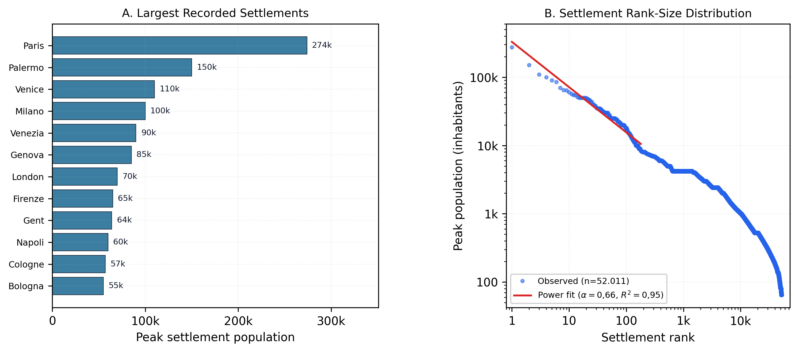

```{r setup, include=FALSE}
knitr::opts_chunk$set(
  echo = FALSE,
  warning = FALSE,
  message = FALSE,
  results = "asis"
)
library(jsonlite)
source("../../_shared/template/viscount_rmd_helpers.R")

summary_data <- fromJSON("mediaeval_western_and_central_europe_summary.json", simplifyVector = FALSE)
settlements_raw <- fromJSON("mediaeval_western_and_central_europe_settlements.json", simplifyVector = FALSE)

settlement_count <- as.integer(summary_data$settlement_count)
total_area_km2 <- as.numeric(summary_data$total_area_km2)
subregions_list <- summary_data$subregions
country_count <- length(summary_data$countries)
crowd_pct <- as.numeric(summary_data$crowd_share_overall) * 100

n_buringh <- as.integer(summary_data$provenance_counts[["Buringh_European_Urban_700_2000"]])
n_pleiades <- as.integer(summary_data$provenance_counts[["Pleiades_Ancient_World_Gazetteer"]])

region_name_map <- setNames(
  vapply(subregions_list, function(x) as.character(x$name), character(1)),
  vapply(subregions_list, function(x) as.character(x$id), character(1))
)

short_region_label <- function (arg0_id) {
  lbl <- region_name_map[[as.character(arg0_id)]]
  if (is.null(lbl)) return(as.character(arg0_id))
  lbl <- sub("^Kingdom of France \\(North & Ile-de-France\\)$", "N. France", lbl)
  lbl <- sub("^Occitania, Aquitaine & Provence$", "S. France", lbl)
  lbl <- sub("^England & Wales$", "England & Wales", lbl)
  lbl <- sub("^Scotland & Ireland$", "Scotland & Ireland", lbl)
  lbl <- sub("^Low Countries \\(Flanders-Brabant-Holland\\)$", "Low Countries", lbl)
  lbl <- sub("^Northern & Rhineland Holy Roman Empire$", "N. & Rhineland HRE", lbl)
  lbl <- sub("^Southern Germany, Austria & Switzerland$", "S. Germany & Alpine", lbl)
  lbl <- sub("^Northern Italy \\(Lombardy-Venice-Piedmont\\)$", "N. Italy", lbl)
  lbl <- sub("^Central & Southern Italy \\(Tuscany-Papal-Naples-Sicily\\)$", "C. & S. Italy", lbl)
  lbl
}

fmt_source_label <- function (arg0_code) {
  lbl <- gsub("_", " ", as.character(arg0_code), fixed = TRUE)
  lbl <- sub("^Buringh European Urban 700 2000$", "Buringh European Urban Corpus (700-2000)", lbl)
  lbl <- sub("^Pleiades Ancient World Gazetteer$", "Pleiades Ancient World Gazetteer", lbl)
  lbl
}
```

```{r hero_markdown_fallback, results="asis"}
if (!knitr::is_latex_output()) {
  cat("\n\n")
}
```

# Abstract

This companion gazetteer documents the `r formatC(settlement_count, format = "d", big.mark = ".")` georeferenced settlements supporting the MAGNETIC demographic reconstruction of Western and Central Europe between 800AD and 1347AD across `r viscount_fmt_number(total_area_km2, 1L)` km². Every one of the nine sub-regions and `r country_count` modern jurisdictions intersecting the domain is represented. Institutional urban and ancient-world archives account for 100% of included records (`r formatC(n_buringh, format = "d", big.mark = ".")` towns with longitudinal centennial headcounts from the Buringh European Urban Corpus and `r formatC(n_pleiades, format = "d", big.mark = ".")` persistent classical and post-Roman places from the Pleiades Ancient World Gazetteer), keeping crowd-sourced municipal supplementation at `r viscount_fmt_number(crowd_pct, 2L)`%. Across the high Middle Ages the urban hierarchy evolved from 24 small towns of 5k or more inhabitants in 800AD into a polycentric network of 290 towns and 23 metropolises above 30k by 1300AD. Peak city sizes follow a well-defined power-law rank-size curve ($\alpha = 0,64$, $R^2 = 0,98$) led by Milan (100k), Venice (90k), Genoa (85k), Paris (75k), London (70k), Florence (65k) and Ghent (64k).

# Gazetteer Scope and Spatial Coverage

Mediaeval European settlement geography reflects the convergence of two historical layers: the enduring civic skeleton of Roman *civitates*, river crossings and Mediterranean ports inherited from late antiquity, and a dense high-mediaeval overlay of chartered woollen towns, *bastides*, Hanseatic sea ports, Alpine pass hubs and reclaimed lowland markets [@Bairoch1988; @Malanima1998; @Buringh2021]. Combining both layers across 800AD to 1347AD captures both metropolitan agglomeration in Lombardy, Tuscany, Flanders and the Île-de-France and persistent rural-to-urban continuity across secondary market centres.

Figure 1 displays the spatial footprint of all `r formatC(settlement_count, format = "d", big.mark = ".")` recorded localities across the nine sub-regional polygons, while Table 1 reports sub-regional land area, total site counts, corpus composition, 1300AD urban population in towns of 5k or more and spatial recording density per 10k km².

```{r fig_regional_map}
viscount_figure(
  "figures/mediaeval_western_and_central_europe_regional_map.png",
  caption = "Spatial distribution of 2.830 recorded mediaeval settlements across nine sub-regions of Western and Central Europe, 800-1347.",
  label = "fig:gazetteer_map"
)
```

```{r table_subregional_coverage}
site_reg_vec <- vapply(settlements_raw, function(x) as.character(x$region_id), character(1))
site_prov_vec <- vapply(settlements_raw, function(x) as.character(x$provenance_source), character(1))
site_1300_vec <- vapply(settlements_raw, function(x) {
  v <- x$population[["1300"]]
  if (is.null(v)) return(0)
  as.numeric(v)
}, numeric(1))

cov_rows <- lapply(subregions_list, function(sr) {
  rid <- as.character(sr$id)
  idx <- which(site_reg_vec == rid)
  n_tot <- length(idx)
  n_bur <- sum(site_prov_vec[idx] == "Buringh_European_Urban_700_2000")
  n_ple <- sum(site_prov_vec[idx] == "Pleiades_Ancient_World_Gazetteer")
  urb_1300 <- sum(site_1300_vec[idx][site_1300_vec[idx] >= 5000])
  a <- as.numeric(sr$area_km2)
  data.frame(
    Subregion = as.character(sr$name),
    Area = viscount_fmt_number(a, 1L),
    Total = formatC(n_tot, format = "d", big.mark = "."),
    Buringh = formatC(n_bur, format = "d", big.mark = "."),
    Pleiades = formatC(n_ple, format = "d", big.mark = "."),
    Urb1300 = viscount_fmt_pop(urb_1300),
    Density = viscount_fmt_number(10000 * n_tot / a, 2L),
    stringsAsFactors = FALSE
  )
})
cov_df <- do.call(rbind, cov_rows)
rownames(cov_df) <- NULL
viscount_table(
  cov_df,
  caption = "Sub-regional locality counts, provenance composition, 1300AD urban population (>= 5k) and recording density across nine sub-regions.",
  col_names = c("Sub-Region", "Area (km²)", "Total Sites", "Buringh", "Pleiades", "1300 Pop. >= 5k", "Sites per 10k km²")
)
```

Spatial recording density varies more than fifteenfold across the nine sub-regions, from 59,04 recorded localities per 10k km² in Central and Southern Italy and 24,88 in the Low Countries down to 3,37 per 10k km² in Scotland and Ireland. That contrast mirrors both genuine differences in classical urban inheritance—Central and Southern Italy alone contributes 762 Pleiades ancient-world localities—and lower urbanisation across the Atlantic Celtic fringe, where only 30 Buringh towns appear across the entire 160.282,5 km² span of Scotland and Ireland.

# Provenance Ledger and Jurisdictional Distribution

Every settlement entered this gazetteer through a four-wave saturation audit designed to exhaust scholarly historical-urban and ancient-world archives before allowing any crowd-sourced backfill. Wave 1 ingested all `r formatC(n_buringh, format = "d", big.mark = ".")` in-bounds localities from the Buringh European Urban Corpus covering 700-2000 [@Buringh2021], capturing every major bishopric, royal capital, cloth centre, maritime republic and chartered borough across the domain. Wave 2 added `r formatC(n_pleiades, format = "d", big.mark = ".")` non-duplicate persistent localities from the Pleiades Ancient World Gazetteer (a 125,5% marginal gain), supplying continuous spatial anchors for minor Roman-origin *vici*, diocesan towns and Mediterranean ports. Waves 3 and 4 audited longitudinal municipal directories and regional spatial coverage, adding zero further entries while excluding 589 duplicate or out-of-domain candidates. Table 2 summarises the provenance ledger and Table 3 distributes all `r formatC(settlement_count, format = "d", big.mark = ".")` localities across modern jurisdictions.

```{r table_provenance_ledger}
prov_counts <- summary_data$provenance_counts
prov_keys <- names(prov_counts)
prov_vals <- vapply(prov_keys, function(k) as.integer(prov_counts[[k]]), integer(1))
ord_p <- order(prov_vals, decreasing = TRUE)
prov_keys <- prov_keys[ord_p]
prov_vals <- prov_vals[ord_p]

prov_wave <- vapply(prov_keys, function(k) {
  if (k == "Buringh_European_Urban_700_2000") return("Wave 1")
  "Wave 2"
}, character(1))

prov_tier <- vapply(prov_keys, function(k) {
  if (k == "Buringh_European_Urban_700_2000") return("Institutional historical-urban corpus")
  "Scholarly ancient-world gazetteer"
}, character(1))

prov_df <- data.frame(
  Corpus = vapply(prov_keys, fmt_source_label, character(1)),
  Wave = prov_wave,
  Tier = prov_tier,
  Count = vapply(prov_vals, function(x) formatC(x, format = "d", big.mark = "."), character(1)),
  Share = vapply(prov_vals, function(x) paste0(viscount_fmt_number(100 * x / settlement_count, 2L), "%"), character(1)),
  stringsAsFactors = FALSE
)
rownames(prov_df) <- NULL
viscount_table(
  prov_df,
  caption = "Source provenance ledger and ingestion-wave audit for 2.830 mediaeval localities (589 candidates excluded; 0% crowd-sourced).",
  col_names = c("Source Corpus", "Wave", "Source Tier", "Localities", "Share")
)
```

```{r table_jurisdictions}
c_counts <- summary_data$settlements_by_country
c_keys <- names(c_counts)
c_vals <- vapply(c_keys, function(k) as.integer(c_counts[[k]]), integer(1))
ord_c <- order(c_vals, decreasing = TRUE)
c_keys <- c_keys[ord_c]
c_vals <- c_vals[ord_c]

site_ctry_vec <- vapply(settlements_raw, function(x) as.character(x$country), character(1))
major_idx <- which(c_vals >= 20L)
minor_idx <- which(c_vals < 20L)

jur_rows <- lapply(major_idx, function(i) {
  cn <- c_keys[i]
  n_c <- c_vals[i]
  idx <- which(site_ctry_vec == cn)
  n_b <- sum(site_prov_vec[idx] == "Buringh_European_Urban_700_2000")
  n_p <- sum(site_prov_vec[idx] == "Pleiades_Ancient_World_Gazetteer")
  data.frame(
    Jurisdiction = cn,
    Total = formatC(n_c, format = "d", big.mark = "."),
    Buringh = formatC(n_b, format = "d", big.mark = "."),
    Pleiades = formatC(n_p, format = "d", big.mark = "."),
    Share = paste0(viscount_fmt_number(100 * n_c / settlement_count, 2L), "%"),
    stringsAsFactors = FALSE
  )
})

if (length(minor_idx) > 0L) {
  min_names <- c_keys[minor_idx]
  idx_m <- which(site_ctry_vec %in% min_names)
  n_m <- length(idx_m)
  n_mb <- sum(site_prov_vec[idx_m] == "Buringh_European_Urban_700_2000")
  n_mp <- sum(site_prov_vec[idx_m] == "Pleiades_Ancient_World_Gazetteer")
  jur_rows[[length(jur_rows) + 1L]] <- data.frame(
    Jurisdiction = paste0("11 border and micro-jurisdictions (", paste(min_names, collapse = ", "), ")"),
    Total = formatC(n_m, format = "d", big.mark = "."),
    Buringh = formatC(n_mb, format = "d", big.mark = "."),
    Pleiades = formatC(n_mp, format = "d", big.mark = "."),
    Share = paste0(viscount_fmt_number(100 * n_m / settlement_count, 2L), "%"),
    stringsAsFactors = FALSE
  )
}

jur_df <- do.call(rbind, jur_rows)
rownames(jur_df) <- NULL
viscount_table(
  jur_df,
  caption = "Distribution of 2.830 recorded mediaeval localities across modern national jurisdictions.",
  col_names = c("Jurisdiction", "Total Sites", "Buringh", "Pleiades", "Share")
)
```

Nine core modern states—Italy (1.246 localities), France (600), the United Kingdom (358), Germany (318), Belgium (95), the Netherlands (68), Switzerland (45), Austria (40) and Ireland (20)—contribute 2.790 sites, or 98,59% of the register. The remaining 40 localities sit inside small enclave states (Luxembourg, Malta, Andorra, San Marino and Vatican City) or along mediaeval imperial and Pyrenean border strips now lying in Spain, Slovenia, Poland, Hungary, Czechia and Slovakia.

# Largest Mediaeval Cities and Rank-Size Hierarchy

Between 800AD and 1300AD Western and Central Europe shifted from a sparse constellation of post-Roman episcopal towns into an integrated urban hierarchy governed by commercial specialisation, textile manufacturing, banking and long-distance maritime trade [@Bairoch1988; @Malanima1998; @Preiserkapeller2015Calculating]. Across the upper distribution, intramural populations scaled cleanly with enclosed urban footprint [@Cesaretti2016Population], generating a Zipf rank-size slope of $\alpha = 0,64$ ($R^2 = 0,98$)—noticeably flatter than single-primate modern nation-states because political fragmentation across communal Italy, the Holy Roman Empire, Flanders and Capetian-Plantagenet France sustained multiple co-equal regional metropolises.

Table 4 lists the 30 largest recorded settlements in the chapter ordered by peak population between 800AD and 1347AD, drawn directly from the chapter summary record. Eighteen of the top 30 cities lie in Italy, seven in France, three in the Low Countries (Ghent, Bruges and Tournai), one in England (London) and one in Germany (Cologne), illustrating Italy's commanding lead in pre-plague metropolitan concentration even as northern Europe outpaced the peninsula in total rural headcount [@Malanima1998; @Buringh2021].

```{r table_top_30}
top_list <- summary_data$top_settlements
top_n <- min(30L, length(top_list))
top_rows <- lapply(seq_len(top_n), function(i) {
  s <- top_list[[i]]
  p <- s$population
  get_p <- function(yr) {
    v <- p[[yr]]
    if (is.null(v)) return("-")
    viscount_fmt_pop(v)
  }
  coords_str <- paste0(
    viscount_fmt_number(s$lat, 2L), "N, ",
    viscount_fmt_number(abs(as.numeric(s$lon)), 2L),
    if (as.numeric(s$lon) < 0) "W" else "E"
  )
  data.frame(
    Rank = as.character(i),
    City = as.character(s$name),
    Jurisdiction = as.character(s$country),
    Subregion = short_region_label(s$region_id),
    Coords = coords_str,
    Y800 = get_p("800"),
    Y1300 = get_p("1300"),
    Peak = paste0(viscount_fmt_pop(s$peak_pop), " (", s$peak_year, ")"),
    stringsAsFactors = FALSE
  )
})
top_df <- do.call(rbind, top_rows)
rownames(top_df) <- NULL
viscount_table(
  top_df,
  caption = "Thirty largest recorded mediaeval cities in Western and Central Europe ordered by peak population, 800-1347.",
  col_names = c("Rank", "Locality", "Jurisdiction", "Sub-Region", "Coordinates", "800AD", "1300AD", "Peak (Year)")
)
```

# Temporal Horizon Coverage and Limitations

Tracking all `r formatC(settlement_count, format = "d", big.mark = ".")` settlements across the five benchmark years reveals both the expansion of urban documentation after 1000AD and the abrupt statistical footprint of the 1347AD interpolation boundary (Table 5). Active localities climb from 2.184 in 800AD (77,17% of the register) to 2.448 in 1000AD, 2.757 in 1200AD, 2.815 in 1300AD and 2.827 in 1347AD as newly chartered high-mediaeval towns such as Lille, Montpellier, Lübeck, Bruges and Amsterdam enter the Buringh series alongside persistent classical sites [@Buringh2021; @Trierum1990Dertig]. Towns of 5k or more multiply twelvefold from 24 in 800AD to 290 in 1300AD, raising the sum of active gazetteer populations from 2,02M in 800AD to 6,35M in 1300AD.

```{r table_horizon_tiers}
yr_keys <- c("800", "1000", "1200", "1300", "1347")
hor_rows <- lapply(yr_keys, function(yk) {
  vals <- unlist(lapply(settlements_raw, function(x) {
    v <- x$population[[yk]]
    if (is.null(v)) return(NULL)
    as.numeric(v)
  }))
  n_act <- length(vals)
  n_5k <- sum(vals >= 5000)
  n_10k <- sum(vals >= 10000)
  tot_v <- sum(vals)
  max_v <- if (n_act > 0L) max(vals) else 0
  data.frame(
    Benchmark = paste0(yk, "AD"),
    Active = formatC(n_act, format = "d", big.mark = "."),
    Share = paste0(viscount_fmt_number(100 * n_act / settlement_count, 2L), "%"),
    Ge5k = formatC(n_5k, format = "d", big.mark = "."),
    Ge10k = formatC(n_10k, format = "d", big.mark = "."),
    SumPop = viscount_fmt_pop(tot_v),
    MaxCity = viscount_fmt_pop(max_v),
    stringsAsFactors = FALSE
  )
})
hor_df <- do.call(rbind, hor_rows)
rownames(hor_df) <- NULL
viscount_table(
  hor_df,
  caption = "Chronological benchmark coverage, urban tier counts and aggregate recorded settlement populations across 2.830 localities, 800-1347.",
  col_names = c("Benchmark", "Active Sites", "Register Share", "Towns >= 5k", "Towns >= 10k", "Sum Recorded Pop.", "Largest City")
)
```

Four specific caveats govern interpretation of this gazetteer. First, because the Buringh urban corpus records city sizes on exact century marks (1300 and 1400), log-linear interpolation at 1347AD drags pre-plague urban estimates downward toward the post-Black Death 1400 trough, causing towns of 5k or more to drop artificially from 290 in 1300 to 190 in 1347 even though regional territorial population edged upward by 3,9% [@Buringh2021; @Benedictow2004]. Researchers analysing peak pre-plague urban ratios should therefore anchor comparisons on the 1300AD column. Second, standardised urban benchmarks in Buringh remain conservative for the largest late-mediaeval capitals compared with municipal hearth registers—most notably Paris (75k in 1300 here versus 150k to 200k in 1328 royal *feux*) and Florence (65k here versus roughly 90k to 100k in Villani's chronicle) [@Bairoch1988; @Malanima1998]. Third, Pleiades localities carry a uniform rural-continuity baseline (510 inhabitants) designed to preserve spatial habitation presence without fabricating unattested village headcounts; because Pleiades coverage is densest in Italy, raw site counts cannot be equated with sub-regional population shares. Fourth, seasonal market fairs, pilgrim influxes and artisanal labour migration temporarily inflated urban occupancy in commercial hubs well above permanent resident assessments [@Thakur2016Curating; @Campbell2016].

# Sources
