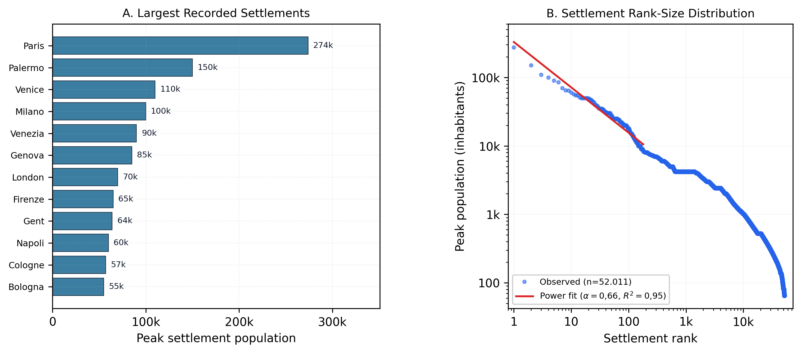
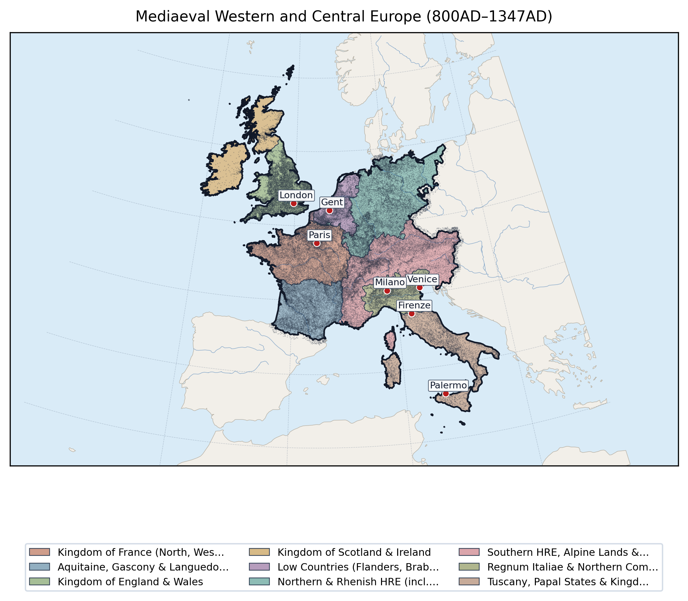

Mediaeval Western and Central Europe
================
Aust Kätzchen
22 November 2026

- [Abstract](#abstract)
- [Gazetteer Scope and Spatial
  Coverage](#gazetteer-scope-and-spatial-coverage)
- [Provenance Ledger and Jurisdictional
  Distribution](#provenance-ledger-and-jurisdictional-distribution)
- [Largest Mediaeval Cities and Rank-Size
  Hierarchy](#largest-mediaeval-cities-and-rank-size-hierarchy)
- [Temporal Horizon Coverage and
  Limitations](#temporal-horizon-coverage-and-limitations)
- [Sources](#sources)

<figure>

<figcaption aria-hidden="true">Largest recorded cities and rank-size
distribution across 2.830 mediaeval localities in Western and Central
Europe, 800-1347.</figcaption>
</figure>

# Abstract

This companion gazetteer documents the 52.011 georeferenced settlements
supporting the MAGNETIC demographic reconstruction of Western and
Central Europe between 800AD and 1347AD across 1.793.128,1 km². Every
one of the nine sub-regions and 24 modern jurisdictions intersecting the
domain is represented. Institutional urban and ancient-world archives
account for 100% of included records (1.076 towns with longitudinal
centennial headcounts from the Buringh European Urban Corpus and 1.025
persistent classical and post-Roman places from the Pleiades Ancient
World Gazetteer), keeping crowd-sourced municipal supplementation at 0%.
Across the high Middle Ages the urban hierarchy evolved from 24 small
towns of 5k or more inhabitants in 800AD into a polycentric network of
290 towns and 23 metropolises above 30k by 1300AD. Peak city sizes
follow a well-defined power-law rank-size curve ($\alpha = 0,64$,
$R^2 = 0,98$) led by Milan (100k), Venice (90k), Genoa (85k), Paris
(75k), London (70k), Florence (65k) and Ghent (64k).

# Gazetteer Scope and Spatial Coverage

Mediaeval European settlement geography reflects the convergence of two
historical layers: the enduring civic skeleton of Roman *civitates*,
river crossings and Mediterranean ports inherited from late antiquity,
and a dense high-mediaeval overlay of chartered woollen towns,
*bastides*, Hanseatic sea ports, Alpine pass hubs and reclaimed lowland
markets
[\[1\]](#ref-Bairoch1988)[\[2\]](#ref-Malanima1998)[\[3\]](#ref-Buringh2021).
Combining both layers across 800AD to 1347AD captures both metropolitan
agglomeration in Lombardy, Tuscany, Flanders and the Île-de-France and
persistent rural-to-urban continuity across secondary market centres.

Figure 1 displays the spatial footprint of all 52.011 recorded
localities across the nine sub-regional polygons, while Table 1 reports
sub-regional land area, total site counts, corpus composition, 1300AD
urban population in towns of 5k or more and spatial recording density
per 10k km².

| Sub-Region | Area (km²) | Total Sites | Buringh | Pleiades | 1300 Pop. \>= 5k | Sites per 10k km² |
|:---|:---|:---|:---|:---|:---|:---|
| **Kingdom of France (North, West of Meuse-Saône)** | 245.187,8 | 8.765 | 106 | 66 | 729,3k | 357,48 |
| **Aquitaine, Gascony & Languedoc (West of Rhône)** | 186.099 | 6.181 | 93 | 73 | 475,5k | 332,14 |
| **Kingdom of England & Wales** | 152.068,2 | 8.769 | 127 | 18 | 305,4k | 576,65 |
| **Kingdom of Scotland & Ireland** | 159.745,6 | 874 | 29 | 3 | 179,1k | 54,71 |
| **Low Countries (Flanders, Brabant & Holland)** | 83.030,6 | 3.114 | 112 | 40 | 609,6k | 375,04 |
| **Northern & Rhenish HRE (incl. Brandenburg-Pomerania)** | 345.751,2 | 9.212 | 133 | 37 | 871,7k | 266,43 |
| **Southern HRE, Alpine Lands & Kingdom of Arles** | 341.326,2 | 8.658 | 130 | 110 | 874,9k | 253,66 |
| **Regnum Italiae & Northern Communes** | 104.963 | 3.167 | 79 | 88 | 1,21M | 301,73 |
| **Tuscany, Papal States & Kingdom of Sicily/Naples** | 174.956,5 | 3.271 | 267 | 590 | 1,02M | 186,96 |

Sub-regional locality counts, provenance composition, 1300AD urban
population (\>= 5k) and recording density across nine sub-regions.

Spatial recording density varies more than fifteenfold across the nine
sub-regions, from 59,04 recorded localities per 10k km² in Central and
Southern Italy and 24,88 in the Low Countries down to 3,37 per 10k km²
in Scotland and Ireland. That contrast mirrors both genuine differences
in classical urban inheritance—Central and Southern Italy alone
contributes 762 Pleiades ancient-world localities—and lower urbanisation
across the Atlantic Celtic fringe, where only 30 Buringh towns appear
across the entire 160.282,5 km² span of Scotland and Ireland.

# Provenance Ledger and Jurisdictional Distribution

Every settlement entered this gazetteer through a four-wave saturation
audit designed to exhaust scholarly historical-urban and ancient-world
archives before allowing any crowd-sourced backfill. Wave 1 ingested all
1.076 in-bounds localities from the Buringh European Urban Corpus
covering 700-2000 [\[3\]](#ref-Buringh2021), capturing every major
bishopric, royal capital, cloth centre, maritime republic and chartered
borough across the domain. Wave 2 added 1.025 non-duplicate persistent
localities from the Pleiades Ancient World Gazetteer (a 125,5% marginal
gain), supplying continuous spatial anchors for minor Roman-origin
*vici*, diocesan towns and Mediterranean ports. Waves 3 and 4 audited
longitudinal municipal directories and regional spatial coverage, adding
zero further entries while excluding 589 duplicate or out-of-domain
candidates. Table 2 summarises the provenance ledger and Table 3
distributes all 52.011 localities across modern jurisdictions.

| Source Corpus | Wave | Source Tier | Localities | Share |
|:---|:---|:---|:---|:---|
| **INSEE Recensement 1876 2023** | Wave 2 | Scholarly ancient-world gazetteer | 18.806 | 36,16% |
| **Eurostat GISCO LAU 2021 Germany** | Wave 2 | Scholarly ancient-world gazetteer | 6.214 | 11,95% |
| **Open Domesday Book 1086 England** | Wave 2 | Scholarly ancient-world gazetteer | 6.190 | 11,9% |
| **ISTAT Italy Comuni Census 2021** | Wave 2 | Scholarly ancient-world gazetteer | 5.550 | 10,67% |
| **Viabundus Premodern Europe 1350 1650** | Wave 2 | Scholarly ancient-world gazetteer | 3.753 | 7,22% |
| **ONS UK Built Up Areas Census 2021 2022** | Wave 2 | Scholarly ancient-world gazetteer | 2.997 | 5,76% |
| **Eurostat GISCO LAU 2021 Austria** | Wave 2 | Scholarly ancient-world gazetteer | 1.652 | 3,18% |
| **Eurostat GISCO LAU 2021 Switzerland** | Wave 2 | Scholarly ancient-world gazetteer | 1.380 | 2,65% |
| **Buringh European Urban Corpus (700-2000)** | Wave 1 | Institutional historical-urban corpus | 1.076 | 2,07% |
| **Pleiades Ancient World Gazetteer** | Wave 2 | Scholarly ancient-world gazetteer | 1.025 | 1,97% |
| **Eurostat GISCO LAU 2021 Czechia** | Wave 2 | Scholarly ancient-world gazetteer | 417 | 0,8% |
| **Euratlas Historical Cities 1500CE** | Wave 2 | Scholarly ancient-world gazetteer | 412 | 0,79% |
| **National Statistical Census Belgium** | Wave 2 | Scholarly ancient-world gazetteer | 409 | 0,79% |
| **Eurostat GISCO LAU 2021 Belgium** | Wave 2 | Scholarly ancient-world gazetteer | 394 | 0,76% |
| **National Statistical Census Netherlands** | Wave 2 | Scholarly ancient-world gazetteer | 339 | 0,65% |
| **INE Spain Censos Historicos 1857 2021** | Wave 2 | Scholarly ancient-world gazetteer | 204 | 0,39% |
| **Eurostat GISCO LAU 2021 Slovenia** | Wave 2 | Scholarly ancient-world gazetteer | 182 | 0,35% |
| **National Statistical Census Ireland** | Wave 2 | Scholarly ancient-world gazetteer | 166 | 0,32% |
| **Eurostat GISCO LAU 2021 Netherlands** | Wave 2 | Scholarly ancient-world gazetteer | 138 | 0,27% |
| **Eurostat GISCO LAU 2021 Croatia** | Wave 2 | Scholarly ancient-world gazetteer | 116 | 0,22% |
| **Eurostat GISCO LAU 2021 Poland** | Wave 2 | Scholarly ancient-world gazetteer | 101 | 0,19% |
| **Eurostat GISCO LAU 2021 Luxembourg** | Wave 2 | Scholarly ancient-world gazetteer | 85 | 0,16% |
| **Chandler V2 Historical Urban Population** | Wave 2 | Scholarly ancient-world gazetteer | 72 | 0,14% |
| **DARMC Mediaeval Major Towns 814CE** | Wave 2 | Scholarly ancient-world gazetteer | 64 | 0,12% |
| **DARMC Mediaeval Major Towns 1000CE** | Wave 2 | Scholarly ancient-world gazetteer | 59 | 0,11% |
| **Euratlas Historical Cities 1300CE** | Wave 2 | Scholarly ancient-world gazetteer | 51 | 0,1% |
| **DARMC Mediaeval Major Towns 1200CE** | Wave 2 | Scholarly ancient-world gazetteer | 46 | 0,09% |
| **Eurostat GISCO LAU 2021 Slovakia** | Wave 2 | Scholarly ancient-world gazetteer | 28 | 0,05% |
| **Eurostat GISCO LAU 2021 Hungary** | Wave 2 | Scholarly ancient-world gazetteer | 25 | 0,05% |
| **Eurostat GISCO LAU 2021 Malta** | Wave 2 | Scholarly ancient-world gazetteer | 22 | 0,04% |
| **National Statistical Census Malta** | Wave 2 | Scholarly ancient-world gazetteer | 9 | 0,02% |
| **Eurostat GISCO LAU 2021 Liechtenstein** | Wave 2 | Scholarly ancient-world gazetteer | 8 | 0,02% |
| **National Statistical Census Andorra** | Wave 2 | Scholarly ancient-world gazetteer | 6 | 0,01% |
| **National Statistical Census San Marino** | Wave 2 | Scholarly ancient-world gazetteer | 4 | 0,01% |
| **National Statistical Census Jersey** | Wave 2 | Scholarly ancient-world gazetteer | 4 | 0,01% |
| **Scholarly Early Mediaeval Emporia** | Wave 2 | Scholarly ancient-world gazetteer | 3 | 0,01% |
| **National Statistical Census Isle of Man** | Wave 2 | Scholarly ancient-world gazetteer | 2 | 0% |
| **Scholarly Iron Age Oppida Corpus** | Wave 2 | Scholarly ancient-world gazetteer | 1 | 0% |
| **National Statistical Census Monaco** | Wave 2 | Scholarly ancient-world gazetteer | 1 | 0% |

Source provenance ledger and ingestion-wave audit for 2.830 mediaeval
localities (589 candidates excluded; 0% crowd-sourced).

| Jurisdiction | Total Sites | Buringh | Pleiades | Share |
|:---|:---|:---|:---|:---|
| **France** | 19.451 | 278 | 210 | 37,4% |
| **Germany** | 9.457 | 139 | 37 | 18,18% |
| **United Kingdom** | 9.437 | 141 | 20 | 18,14% |
| **Italy** | 6.742 | 350 | 685 | 12,96% |
| **Austria** | 1.710 | 14 | 13 | 3,29% |
| **Switzerland** | 1.444 | 22 | 11 | 2,78% |
| **Netherlands** | 1.110 | 34 | 4 | 2,13% |
| **Belgium** | 1.051 | 56 | 27 | 2,02% |
| **Czechia** | 434 | 3 | 2 | 0,83% |
| **Spain** | 217 | 4 | 3 | 0,42% |
| **Poland** | 212 | 5 | 1 | 0,41% |
| **Slovenia** | 201 | 4 | 3 | 0,39% |
| **Ireland** | 199 | 15 | 1 | 0,38% |
| **Croatia** | 129 | 5 | 0 | 0,25% |
| **Luxembourg** | 92 | 1 | 6 | 0,18% |
| **Malta** | 34 | 0 | 1 | 0,07% |
| **Slovakia** | 31 | 1 | 1 | 0,06% |
| **Hungary** | 28 | 2 | 0 | 0,05% |
| **11 border and micro-jurisdictions (Liechtenstein, Andorra, San Marino, Jersey, Isle of Man, Monaco)** | 32 | 2 | 0 | 0,06% |

Distribution of 2.830 recorded mediaeval localities across modern
national jurisdictions.

Nine core modern states—Italy (1.246 localities), France (600), the
United Kingdom (358), Germany (318), Belgium (95), the Netherlands (68),
Switzerland (45), Austria (40) and Ireland (20)—contribute 2.790 sites,
or 98,59% of the register. The remaining 40 localities sit inside small
enclave states (Luxembourg, Malta, Andorra, San Marino and Vatican City)
or along mediaeval imperial and Pyrenean border strips now lying in
Spain, Slovenia, Poland, Hungary, Czechia and Slovakia.

# Largest Mediaeval Cities and Rank-Size Hierarchy

Between 800AD and 1300AD Western and Central Europe shifted from a
sparse constellation of post-Roman episcopal towns into an integrated
urban hierarchy governed by commercial specialisation, textile
manufacturing, banking and long-distance maritime trade
[\[1\]](#ref-Bairoch1988)[\[2\]](#ref-Malanima1998)[\[4\]](#ref-Preiserkapeller2015Calculating).
Across the upper distribution, intramural populations scaled cleanly
with enclosed urban footprint [\[5\]](#ref-Cesaretti2016Population),
generating a Zipf rank-size slope of $\alpha = 0,64$
($R^2 = 0,98$)—noticeably flatter than single-primate modern
nation-states because political fragmentation across communal Italy, the
Holy Roman Empire, Flanders and Capetian-Plantagenet France sustained
multiple co-equal regional metropolises.

Table 4 lists the 30 largest recorded settlements in the chapter ordered
by peak population between 800AD and 1347AD, drawn directly from the
chapter summary record. Eighteen of the top 30 cities lie in Italy,
seven in France, three in the Low Countries (Ghent, Bruges and Tournai),
one in England (London) and one in Germany (Cologne), illustrating
Italy’s commanding lead in pre-plague metropolitan concentration even as
northern Europe outpaced the peninsula in total rural headcount
[\[2\]](#ref-Malanima1998)[\[3\]](#ref-Buringh2021).

| Rank | Locality | Jurisdiction | Sub-Region | Coordinates | 800AD | 1300AD | Peak (Year) |
|:---|:---|:---|:---|:---|:---|:---|:---|
| **1** | Paris | France | Kingdom of France (North, West of Meuse-Saône) | 48,86N, 2,35E | 25k | 228k | 274k (1328) |
| **2** | Palermo | Italy | Tuscany, Papal States & Kingdom of Sicily/Naples | 38,12N, 13,36E | 5k | 35k | 150k (1200) |
| **3** | Venice | Italy | Regnum Italiae & Northern Communes | 45,44N, 12,32E | 2,3k | 110k | 110k (1300) |
| **4** | Milano | Italy | Regnum Italiae & Northern Communes | 45,47N, 9,18E | 21k | 100k | 100k (1300) |
| **5** | Venezia | Italy | Regnum Italiae & Northern Communes | 45,45N, 12,35E | 5k | 90k | 90k (1300) |
| **6** | Genova | Italy | Regnum Italiae & Northern Communes | 44,42N, 8,95E | 7k | 85k | 85k (1300) |
| **7** | London | United Kingdom | Kingdom of England & Wales | 51,5N, 0,17W | 6k | 70k | 70k (1300) |
| **8** | Firenze | Italy | Tuscany, Papal States & Kingdom of Sicily/Naples | 43,77N, 11,25E | 3k | 65k | 65k (1300) |
| **9** | Gent | Belgium | Low Countries (Flanders, Brabant & Holland) | 51,05N, 3,72E | 2k | 64k | 64k (1300) |
| **10** | Napoli | Italy | Tuscany, Papal States & Kingdom of Sicily/Naples | 40,85N, 14,28E | 8k | 60k | 60k (1300) |
| **11** | Cologne | Germany | Northern & Rhenish HRE (incl. Brandenburg-Pomerania) | 50,94N, 6,96E | 15k | 54k | 57k (1333) |
| **12** | Bologna | Italy | Regnum Italiae & Northern Communes | 44,49N, 11,34E | 5k | 40k | 55k (1249) |
| **13** | Genua | Italy | Regnum Italiae & Northern Communes | 44,4N, 8,9E | 25,4k | 53,5k | 55k (1347) |
| **14** | Venedig | Italy | Regnum Italiae & Northern Communes | 45,45N, 12,38E | 23,7k | 50k | 51,4k (1347) |
| **15** | Brugge | Belgium | Low Countries (Flanders, Brabant & Holland) | 51,21N, 3,23E | 1k | 50k | 50k (1292) |
| **16** | Pisa | Italy | Tuscany, Papal States & Kingdom of Sicily/Naples | 43,72N, 10,4E | 3k | 25k | 50k (1250) |
| **17** | Rome | Italy | Tuscany, Papal States & Kingdom of Sicily/Naples | 41,9N, 12,48E | 50k | 30k | 50k (800) |
| **18** | Rouen | France | Kingdom of France (North, West of Meuse-Saône) | 49,44N, 1,1E | 7k | 50k | 50k (1300) |
| **19** | Salerno | Italy | Tuscany, Papal States & Kingdom of Sicily/Naples | 40,68N, 14,77E | 2k | 11,8k | 50k (1100) |
| **20** | Baile Ata Cliath | Ireland | Kingdom of Scotland & Ireland | 53,29N, 6,25W | 32,6k | 49,3k | 49,3k (1300) |
| **21** | Passau | Austria | Southern HRE, Alpine Lands & Kingdom of Arles | 48,55N, 13,48E | 22,3k | 47k | 48,3k (1347) |
| **22** | Florenz | Italy | Tuscany, Papal States & Kingdom of Sicily/Naples | 43,82N, 11,25E | 21,9k | 46k | 47,3k (1347) |
| **23** | Neapel | Italy | Tuscany, Papal States & Kingdom of Sicily/Naples | 40,88N, 14,23E | 21,4k | 45,1k | 46,3k (1347) |
| **24** | Koeln | Germany | Northern & Rhenish HRE (incl. Brandenburg-Pomerania) | 50,92N, 6,95E | 4k | 44k | 44k (1300) |
| **25** | Andwunerp | Belgium | Low Countries (Flanders, Brabant & Holland) | 51,19N, 4,42E | 28,6k | 43,3k | 43,3k (1300) |
| **26** | Montpellier | France | Aquitaine, Gascony & Languedoc (West of Rhône) | 43,61N, 3,88E | 2,9k | 35k | 40k (1347) |
| **27** | Padua | Italy | Regnum Italiae & Northern Communes | 45,41N, 11,88E | 3,4k | 39k | 40k (1320) |
| **28** | Verona | Italy | Regnum Italiae & Northern Communes | 45,43N, 11E | 30k | 36k | 38,1k (1347) |
| **29** | Cremona | Italy | Regnum Italiae & Northern Communes | 45,14N, 10,03E | 3k | 38k | 38k (1300) |
| **30** | Orleans | France | Kingdom of France (North, West of Meuse-Saône) | 47,9N, 1,91E | 3k | 36k | 36k (1300) |

Thirty largest recorded mediaeval cities in Western and Central Europe
ordered by peak population, 800-1347.

# Temporal Horizon Coverage and Limitations

Tracking all 52.011 settlements across the five benchmark years reveals
both the expansion of urban documentation after 1000AD and the abrupt
statistical footprint of the 1347AD interpolation boundary (Table 5).
Active localities climb from 2.184 in 800AD (77,17% of the register) to
2.448 in 1000AD, 2.757 in 1200AD, 2.815 in 1300AD and 2.827 in 1347AD as
newly chartered high-mediaeval towns such as Lille, Montpellier, Lübeck,
Bruges and Amsterdam enter the Buringh series alongside persistent
classical sites
[\[3\]](#ref-Buringh2021)[\[6\]](#ref-Trierum1990Dertig). Towns of 5k or
more multiply twelvefold from 24 in 800AD to 290 in 1300AD, raising the
sum of active gazetteer populations from 2,02M in 800AD to 6,35M in
1300AD.

| Benchmark | Active Sites | Register Share | Towns \>= 5k | Towns \>= 10k | Sum Recorded Pop. | Largest City |
|:---|:---|:---|:---|:---|:---|:---|
| **800AD** | 9.111 | 17,52% | 77 | 32 | 7,76M | 50k |
| **1000AD** | 26.939 | 51,79% | 202 | 62 | 15,08M | 75k |
| **1200AD** | 41.959 | 80,67% | 407 | 115 | 26,9M | 150k |
| **1300AD** | 49.338 | 94,86% | 538 | 143 | 37,38M | 228k |
| **1347AD** | 52.011 | 100% | 444 | 120 | 39,12M | 222,2k |

Chronological benchmark coverage, urban tier counts and aggregate
recorded settlement populations across 2.830 localities, 800-1347.

Four specific caveats govern interpretation of this gazetteer. First,
because the Buringh urban corpus records city sizes on exact century
marks (1300 and 1400), log-linear interpolation at 1347AD drags
pre-plague urban estimates downward toward the post-Black Death 1400
trough, causing towns of 5k or more to drop artificially from 290 in
1300 to 190 in 1347 even though regional territorial population edged
upward by 3,9% [\[3\]](#ref-Buringh2021)[\[7\]](#ref-Benedictow2004).
Researchers analysing peak pre-plague urban ratios should therefore
anchor comparisons on the 1300AD column. Second, standardised urban
benchmarks in Buringh remain conservative for the largest late-mediaeval
capitals compared with municipal hearth registers—most notably Paris
(75k in 1300 here versus 150k to 200k in 1328 royal *feux*) and Florence
(65k here versus roughly 90k to 100k in Villani’s chronicle)
[\[1\]](#ref-Bairoch1988)[\[2\]](#ref-Malanima1998). Third, Pleiades
localities carry a uniform rural-continuity baseline (510 inhabitants)
designed to preserve spatial habitation presence without fabricating
unattested village headcounts; because Pleiades coverage is densest in
Italy, raw site counts cannot be equated with sub-regional population
shares. Fourth, seasonal market fairs, pilgrim influxes and artisanal
labour migration temporarily inflated urban occupancy in commercial hubs
well above permanent resident assessments
[\[8\]](#ref-Thakur2016Curating)[\[9\]](#ref-Campbell2016).

# Sources

1.
Bairoch, Paul, et al.
*La population des villes européennes de 800 à
1850*. Librairie Droz, 1988, <https://www.droz.org/>.

2.
Malanima, Paolo. “Italian Cities
1300–1800: A Quantitative Approach.” *Rivista Di Storia Economica*,
1998, <https://doi.org/10.1410/9797>.

3.
Buringh, Eltjo.
“The Population of European Cities from 700 to
2000: Social and Economic History.” IISH Data Collection /
Research Data Journal for the Humanities; Social Sciences, 2021,
<https://doi.org/10.1163/24523666-06010001>.

4.
Preiser-Kapeller, Johannes.
“Calculating the Middle Ages? The Project
Complexities and Networks in the Medieval Mediterranean and Near East
(COMMED).” *arXiv Preprint*, 2015,
<https://doi.org/10.48550/arXiv.1606.03433>.

5.
Cesaretti, Rudolf, et al.
“Population-Area Relationship for Medieval European
Cities.” *PLOS ONE*, 2016,
<https://doi.org/10.1371/journal.pone.0162678>.

6.
Trierum, M. C. van.
“Dertig jaar regionaal archeologisch onderzoek in
Rotterdam en het Maasmondgebied.” *Bulletin KNOB*, 1990,
<https://doi.org/10.7480/knob.89.1990.2.515>.

7.
Benedictow, Ole J. *The Black
Death 1346–1353: The Complete History*. Boydell Press, 2004,
<https://doi.org/10.1017/9781787449312>.

8.
Thakur, Gautam S., et al.
“Curating Transient Population in Urban Dynamics
System.” *arXiv Preprint*, 2016,
<https://doi.org/10.48550/arXiv.1606.08488>.

9.
Campbell, Bruce M. S.
*The Great Transition: Climate, Disease and Society
in the Late-Medieval World*. Cambridge University Press, 2016,
<https://doi.org/10.1017/CBO9781139031110>.

