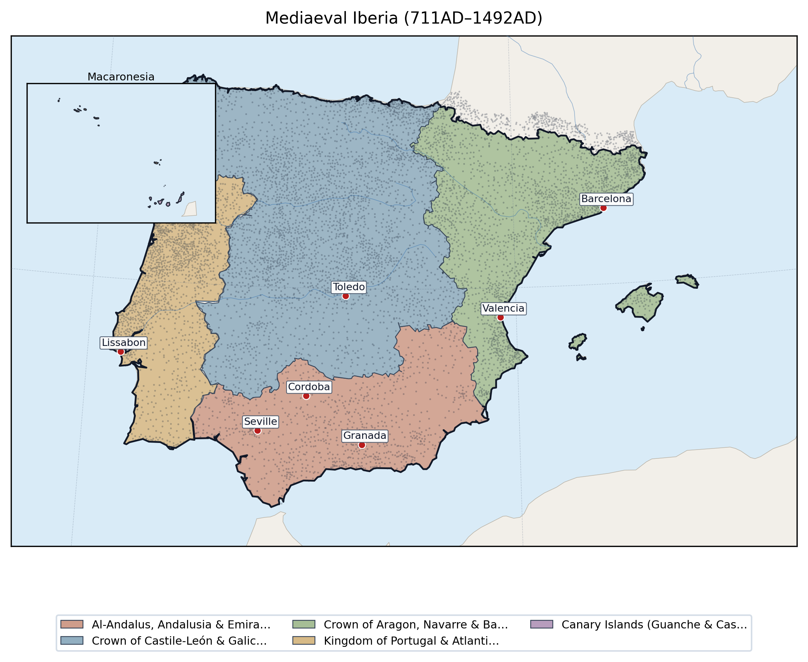

```{r setup, include=FALSE}
knitr::opts_chunk$set(
  echo = FALSE,
  warning = FALSE,
  message = FALSE,
  results = "asis"
)
library(jsonlite)
source("../../_shared/template/viscount_rmd_helpers.R")

summary_data <- fromJSON("mediaeval_iberia_summary.json", simplifyVector = FALSE)
settlements_raw <- fromJSON("mediaeval_iberia_settlements.json", simplifyVector = FALSE)

total_area_km2 <- as.numeric(summary_data$total_area_km2)
settlement_count <- as.integer(summary_data$settlement_count)
subregions_list <- summary_data$subregions
domain_totals <- summary_data$domain_totals

pop_711 <- as.numeric(domain_totals[["711"]])
pop_1000 <- as.numeric(domain_totals[["1000"]])
pop_1200 <- as.numeric(domain_totals[["1200"]])
pop_1347 <- as.numeric(domain_totals[["1347"]])
pop_1492 <- as.numeric(domain_totals[["1492"]])

clean_region_name <- function (arg0_name) {
  lbl <- as.character(arg0_name)
  lbl <- gsub(" / ", ", ", lbl, fixed = TRUE)
  lbl <- gsub(" & ", " and ", lbl, fixed = TRUE)
  lbl
}

fmt_source_label <- function (arg0_code) {
  lbl <- gsub("_", " ", as.character(arg0_code), fixed = TRUE)
  lbl <- sub("^Buringh European Urban 700 2000$", "Buringh European Urban Register (700-2000)", lbl)
  lbl <- sub("^Pleiades Ancient World Gazetteer$", "Pleiades Ancient World Gazetteer", lbl)
  lbl <- sub("^GeoNames Municipal Gazetteer Supplement$", "GeoNames Municipal Gazetteer Supplement", lbl)
  lbl
}

region_name_map <- setNames(
  vapply(subregions_list, function (x) clean_region_name(x$name), character(1)),
  vapply(subregions_list, function (x) as.character(x$id), character(1))
)
```

```{r hero_markdown_fallback, results="asis"}
if (!knitr::is_latex_output()) {
  cat("\n\n")
}
```

# Abstract

Between the Umayyad landing at Gibraltar in 711AD and the capitulation of Nasrid Granada in 1492AD, the population of Iberia and its associated Mediterranean and Atlantic archipelagos grew by 79,88%, rising from `r viscount_fmt_pop(pop_711)` to `r viscount_fmt_pop(pop_1492)` across `r viscount_fmt_number(total_area_km2, 1L)` km² after reaching a pre-Black Death peak of `r viscount_fmt_pop(pop_1347)` in 1347AD. Mean regional density climbed from 8,4 inhabitants per km² in 711AD to 15,46 per km² on the eve of the mid-fourteenth-century plague pandemic and stood at 15,11 per km² in 1492AD, yielding a long-run compound growth rate of 0,075% per annum. Beneath that gradual expansion lay a decisive north-south demographic inversion. At the zenith of the Umayyad Caliphate of Cordoba in 1000AD, Al-Andalus held 40,74% of peninsular inhabitants (`r viscount_fmt_pop(as.numeric(subregions_list[[1]]$population[["1000"]]))` at 25,3 per km²) and six of Iberia's ten largest cities, led by Cordoba (100k) and Sevilla (72k). Over the ensuing five centuries, Christian Reconquista colonisation, Castilian Meseta expansion, recurrent plague mortality and the fragmentation of Islamic polities reversed that balance: by 1492AD the Crown of Castile-Leon held 43,96% of the total population (`r viscount_fmt_pop(as.numeric(subregions_list[[2]]$population[["1492"]]))`), Al-Andalus had receded to 23,93% (`r viscount_fmt_pop(as.numeric(subregions_list[[1]]$population[["1492"]]))`) and urban primacy had shifted to maritime Valencia (71,3k) and Lisboa (64,1k). MAGNETIC synthesises fiscal hearth counts, archival city series, bioarchaeological and archaeobotanical indicators and a georeferenced gazetteer of `r formatC(settlement_count, format = "d", big.mark = ".")` settlements across five sub-regions to reconstruct these long-run trajectories.

# Background

In 711AD the Iberian Peninsula was a sparsely settled post-Roman landscape whose late Visigothic population had barely recovered from sixth-century Justinianic plague recurrences, civil wars and intermittent harvest failures [@Russell1958; @Martinpuertas2010Late]. Roughly `r viscount_fmt_pop(pop_711)` people occupied `r viscount_fmt_number(total_area_km2, 1L)` km² at an average density of 8,4 inhabitants per km². Settlement remained heavily tilted towards the old Roman *Baetica* and the Mediterranean littoral, where alluvial valleys, olive groves and surviving municipal nuclei still sustained densities approaching 19 inhabitants per km², whereas the high interior Meseta and the rainy northern mountain rim carried scarcely 5 to 7 people per km². When Tariq ibn Ziyad crossed the Strait of Gibraltar in spring 711AD and defeated King Roderic near the Guadalete, the Visigothic state collapsed within five years. Yet the Arab and Berber forces that entered the peninsula numbered only in the tens of thousands; they formed a military and fiscal elite superimposed upon an overwhelmingly Hispano-Roman rural majority whose gradual conversion to Islam (*muwalladun*) and Arabisation shaped Andalusi society over the next three centuries [@Macroberts2024Shrouded].

The establishment of the independent Umayyad Emirate at Cordoba by Abd al-Rahman I in 756AD and the proclamation of the Caliphate by Abd al-Rahman III in 929AD coincided with one of the sharpest urban and agricultural expansions in early mediaeval Europe. Benefiting from the warmer, more stable precipitation patterns of the Mediaeval Climate Anomaly across the southwestern Mediterranean [@Martinpuertas2010Late], Andalusi cultivators extended and rehabilitated hydraulic irrigation networks (*acequias*, *qanats* and animal-driven *norias*) throughout the Guadalquivir, Genil, Segura and Turia basins. New summer crops diffused from the eastern Islamic world — hard wheat, rice, cotton, sugarcane, citrus, aubergine and white mulberry for sericulture — permitted double cropping on irrigated *huertas* and raised calorie yields per hectare far above dryland Roman norms, paralleling contemporary dietary and ceramic transformations observed in Islamic Sicily [@Lundy2021Insights].

Bioarchaeological evidence from eighth-to-tenth-century Santarém along the lower Tagus shows a well-integrated urban-frontier Muslim community maintaining mixed cereal, legume and caprine diets under Umayyad rule [@Macroberts2024Shrouded], while glass assemblages from Ciudad de Vascos near Toledo attest to long-distance Mediterranean exchange alongside vigorous local craft production inside fortified provincial *madinas* [@Ares2017Glass]. Between 711AD and 1000AD the population of Al-Andalus expanded by 35,9% from 1,95M to 2,65M, lifting the Iberian aggregate from `r viscount_fmt_pop(pop_711)` to `r viscount_fmt_pop(pop_1000)`. Cordoba reached 100k inhabitants, rivalled in Europe only by Constantinople, while Sevilla (72k), Toledo (37k), Merida (30k), Jaen (20k), Jerez de la Frontera (19k), Ecija (18k) and the naval port of Almeria (18k) anchored a dense network of monetised markets, madrasas and artisanal quarters [@Bairoch1988; @Buringh2021; @Qureshi2017Mystics].

Political unity in the south fractured abruptly after 1009AD. The Cordoban *fitna* sacked Madinat al-Zahra, dismantled the Caliphate by 1031AD and splintered Al-Andalus into more than two dozen competing *Taifa* kingdoms. Urban prosperity did not collapse everywhere immediately — Sevilla, Granada, Zaragoza, Badajoz and Valencia continued to expand as regional courts — yet tributary extortion (*parias*) paid to the northern Christian kings drained Andalusi silver and destabilised rural taxation. The intervention of North African empires, first the Almoravids after 1086AD and then the Almohads after 1147AD, temporarily halted Christian advances and elevated Sevilla into the peninsula's foremost Islamic metropolis, reaching 80k inhabitants by 1200AD. Nevertheless, intermittent frontier raids, deportations of Mozarab communities and the gradual loss of the Tagus and Ebro valleys eroded the demographic base of southern Al-Andalus, whose population eased from 2,65M in 1000AD to 2,45M in 1200AD.

North of the Duero and Ebro rivers, a contrasting demographic engine was gathering speed. In the eighth and ninth centuries the small Christian realms of Asturias, Pamplona-Navarre and the Catalan counties of the Carolingian Hispanic March held cramped mountain valleys and thinly populated border marches. From the late ninth century onwards, monarchs, monasteries and secular magnates organised systematic frontier colonisation (*repoblación*), first through free peasant *presura* grants across the Duero plains and later through chartered municipal *fueros* along the Trans-Duero and Tagus corridors. Castle-centred lordships in interior Galicia, exemplified by sites such as San Salvador de Todea in Ourense, consolidated rural surplus extraction and local defence across dissected northern uplands [@Novoa2022Origen]. Archaeobotanical records demonstrate that the mediaeval expansion of rye (*Secale cereale*) played a decisive agronomic role across the cool, acidic soils of northwestern Iberia, northern Portugal and the northern Meseta, allowing cultivators to colonise higher elevations and shorter growing seasons where wheat failed [@Seabra2023Introduction]. The capture of Toledo (1085AD), Zaragoza (1118AD), Lisboa (1147AD) and Tortosa (1148AD) opened immense fertile plains to Christian settlers, while the crushing victory over the Almohads at Las Navas de Tolosa in 1212AD broke the military barrier of the Sierra Morena. Within four decades James I of Aragon conquered Mallorca (1229AD) and Valencia (1238AD), Ferdinand III of Castile took Cordoba (1236AD), Jaen (1246AD) and Sevilla (1248AD), and Afonso III of Portugal completed the occupation of the Algarve (1249AD).

Territorial conquest outran northern manpower. Across western Andalusia, Extremadura and La Mancha, the expulsion or flight of much of the Muslim peasantry after the 1264AD Mudejar revolt left extensive royal and noble *repartimientos* chronically short of labour. Landowners and military orders responded by converting abandoned arable into vast estates (*latifundia*) and seasonal pastures; in 1273AD Alfonso X incorporated the *Honrado Concejo de la Mesta*, institutionalising long-distance transhumance of millions of merino sheep between Cantabrian-Leonese summer ranges and Extremaduran-Andalusian winter grazing grounds. By contrast, in the newly conquered Kingdom of Valencia and the Ebro valley, Aragonese and Catalan lords retained dense rural Mudejar workforces on irrigated terraces, sustaining high agricultural output alongside booming coastal commerce in Barcelona and Palma. Meanwhile, refugees fleeing conquered Andalusia crowded into the mountain-ringed Nasrid Emirate of Granada (established 1238AD), inflating the city of Granada from 20k in 1200AD to 50k by 1300AD and giving the diminutive emirate one of the highest rural densities in western Europe. Overall Iberian population rose from `r viscount_fmt_pop(pop_1200)` in 1200AD to `r viscount_fmt_pop(pop_1347)` in 1347AD, a level not surpassed again until the sixteenth century.

The fourteenth and fifteenth centuries subjected this agrarian order to severe ecological, epidemic and political shocks. Cooling and heightened hydroclimatic variability signalling the early onset of the Little Ice Age destabilised harvests from the 1310s onwards, with acute subsistence crises hitting Castile, Catalonia and Navarre in 1333AD (*lo mal any primer*) and 1343-1347AD [@Martinpuertas2010Late; @Campbell2016]. In the spring of 1348AD Genoese and Catalan shipping carried *Yersinia pestis* directly into Palma de Mallorca, Barcelona, Valencia and Sevilla, from which the Black Death spread rapidly across the interior Meseta, Portugal and Nasrid Granada [@Benedictow2004]. Mortality varied sharply by ecology and connectivity: coastal Catalonia, Mallorca and the crowded quarters of Aragon suffered catastrophic losses exceeding 35% to 45%, whereas parts of northern Castile and interior highlands experienced somewhat lighter mortality and swifter post-plague rebound, a spatial heterogeneity mirrored across continental palaeoecological pollen archives [@Izdebski2022].

Recurrent plague waves in 1362-1363AD, 1371-1375AD, 1384AD and the 1410s depressed Mediterranean Iberia for over a century. In Barcelona, pestilence compounded banking collapses, the anti-Jewish pogroms of 1391AD that destroyed the city's historic *call* [@Martinezarino2020Jewish] and the Catalan Civil War of 1462-1472AD, halving the city from 48k in 1300AD to 21,1k in 1492AD. Across Castile, however, demographic recovery accelerated sharply after 1420AD as rural birth rates rebounded, wool exports enriched Meseta fair towns such as Medina del Campo, Valladolid and Burgos, and Sevilla prepared for Atlantic trade. Along the western seaboard, Portugal consolidated independence after Aljubarrota (1385AD), expanded Lisboa into a 64,1k maritime entrepôt and colonised uninhabited Madeira (1419AD) and the Azores (1430s), while Castilian expeditions gradually conquered the Canary Islands (completing Gran Canaria in 1483AD and initiating the final campaigns on La Palma and Tenerife in 1492-1496AD). When Ferdinand and Isabella entered Granada on 2 January 1492AD and promulgated the Alhambra Decree expelling the Sephardic Jewish communities three months later, Iberia stood at `r viscount_fmt_pop(pop_1492)` inhabitants — nearly matching its 1347AD ceiling, yet fundamentally reorganised around Castile, Lisboa and Valencia.

# Methodology

Demographic reconstruction for mediaeval Iberia confronts an asymmetric archival record. Direct territory-wide censuses do not exist for the Umayyad Caliphate, the Taifa states or the early Christian kingdoms prior to the mid-fourteenth century. Rather than extrapolating mechanically from any single modern back-projection, MAGNETIC combines five independent evidence streams across five fixed areal sub-regions totalling `r viscount_fmt_number(total_area_km2, 1L)` km²: (1) late-mediaeval fiscal hearth enumerations (*fogatges* in Catalonia, Valencia and Mallorca from 1359AD, 1365AD, 1378AD and 1497AD; *vecindarios* and royal *pechero* assessments in Castile from 1482AD and the early sixteenth century; and the 1527-1532AD Portuguese *Numeramento* back-projected to 1492AD); (2) standardised longitudinal urban population series for European and Mediterranean cities [@Bairoch1988; @Buringh2021]; (3) regional rural density benchmarks derived from comparative European agrarian demography [@Russell1958; @Malanima1998; @Broadberry2015; @Guzowski2013]; (4) environmental and archaeological proxies tracking land clearance, crop diffusion, settlement continuity and post-plague abandonment [@Martinpuertas2010Late; @Izdebski2022; @Seabra2023Introduction; @Macroberts2024Shrouded; @Novoa2022Origen]; and (5) a spatially explicit gazetteer of `r formatC(settlement_count, format = "d", big.mark = ".")` habitation localities.

The five sub-regional polygons partition the Iberian macro-domain along durable political-ecological boundaries rather than shifting frontier lines so that longitudinal populations and densities remain strictly comparable across all five benchmark dates (711AD, 1000AD, 1200AD, 1347AD and 1492AD). First, Al-Andalus, Andalusia and Granada (`r viscount_fmt_number(as.numeric(subregions_list[[1]]$area_km2), 1L)` km²) encompasses the Guadalquivir basin, the Baetic cordilleras, Murcia-Cartagena and the historic core of the Caliphate and Nasrid Emirate. Second, the Crown of Castile-Leon (`r viscount_fmt_number(as.numeric(subregions_list[[2]]$area_km2), 1L)` km²) spans Old and New Castile, Leon, Galicia, Asturias, Cantabria, the Basque provinces, Extremadura and Navarre, accounting for 49,01% of total domain area. Third, the Crown of Aragon, Catalonia and Valencia (`r viscount_fmt_number(as.numeric(subregions_list[[3]]$area_km2), 1L)` km²) covers the Ebro depression, Pyrenean valleys, Catalan littoral and Valencian *huerta*. Fourth, the Kingdom of Portugal and Atlantic Isles (`r viscount_fmt_number(as.numeric(subregions_list[[4]]$area_km2), 1L)` km²) pairs mainland Portugal with the fifteenth-century Macaronesian colonies of Madeira and the Azores. Fifth, the Balearic and Canary Islands (`r viscount_fmt_number(as.numeric(subregions_list[[5]]$area_km2), 1L)` km²) groups the western Mediterranean Balearic archipelago with the Castilian Canary archipelago.

Converting mediaeval fiscal registers into total headcount requires explicit treatment of household multipliers and tax-exempt strata. In Catalan and Valencian *fogatges* (hearth counts), multipliers typically fall between 4,1 and 4,5 persons per taxable hearth once unenumerated poor households, clergy and floating urban labour are incorporated; in late-fifteenth-century Castilian *vecindarios*, a coefficient near 4,3 to 4,5 persons per *vecino* reconciles hearth lists with early-sixteenth-century parish evidence and comparative Mediterranean urban household ratios [@Russell1958; @Malanima1998]. For pre-1300AD benchmarks, where fiscal hearths are absent or fragmentary, sub-regional aggregates are anchored to two constraints: minimum agro-ecological carrying capacities implied by irrigated versus dryland cereal systems and archaeobotanical crop repertoires [@Seabra2023Introduction; @Lundy2021Insights], and urban-to-rural scaling ratios calibrated against the longitudinal city database [@Buringh2021; @Bairoch1988]. Thus, Cordoba's 100k population and Sevilla's 72k population in 1000AD require an agricultural hinterland across southern Al-Andalus capable of generating a grain, oil and livestock surplus compatible with an urban share (cities of 10k or more) near 10% to 12% of the southern sub-region, ruling out implausibly low rural densities below 15 inhabitants per km² while equally rejecting mediaeval chroniclers' rhetorical claims of half a million residents in Cordoba alone.

The `r formatC(settlement_count, format = "d", big.mark = ".")`-locality habitation register was compiled through a four-wave saturation protocol that prioritised institutional historical urban databases and scholarly archaeological gazetteers before permitting any municipal spatial supplement (Table 1). Wave 1 ingested 307 longitudinal mediaeval city series from the Buringh European Urban Register (700-2000) [@Buringh2021], capturing virtually every Iberian town that reached 1k inhabitants between 750AD and 1492AD. Wave 2 incorporated 192 continuous Roman-to-mediaeval habitation localities from the Pleiades Ancient World Gazetteer (a 62,54% marginal gain), filling rural market centres, road stations and episcopal seats absent from urban-threshold tables. Wave 3 audited supplementary municipal backfill registries and added zero entries. Wave 4 conducted a sub-regional coverage sweep across the Macaronesian archipelagos, adding 9 Canary Islands spatial anchors from the GeoNames Municipal Gazetteer Supplement (a 1,8% marginal gain), while 85 out-of-domain or duplicate candidates were excluded. Across the entire gazetteer, primary scholarly corpora account for 98,23% of all included settlements, restricting crowd-sourced supplementation to 1,77%.

```{r table_provenance}
prov_counts <- summary_data$provenance_counts
prov_keys <- names(prov_counts)
prov_vals <- vapply(prov_keys, function (k) as.integer(prov_counts[[k]]), integer(1))
ord_p <- order(prov_vals, decreasing = TRUE)
prov_keys <- prov_keys[ord_p]
prov_vals <- prov_vals[ord_p]

prov_wave <- vapply(prov_keys, function (k) {
  if (k == "Buringh_European_Urban_700_2000") return("Wave 1")
  if (k == "Pleiades_Ancient_World_Gazetteer") return("Wave 2")
  "Wave 4"
}, character(1))

prov_class <- vapply(prov_keys, function (k) {
  if (k == "GeoNames_Municipal_Gazetteer_Supplement") return("Municipal spatial supplement")
  if (k == "Pleiades_Ancient_World_Gazetteer") return("Scholarly ancient gazetteer")
  "Primary urban historical register"
}, character(1))

prov_df <- data.frame(
  Corpus = vapply(prov_keys, fmt_source_label, character(1)),
  Wave = prov_wave,
  Class = prov_class,
  Count = vapply(prov_vals, function (x) formatC(x, format = "d", big.mark = "."), character(1)),
  Share = vapply(prov_vals, function (x) paste0(viscount_fmt_number(100 * x / settlement_count, 2L), "%"), character(1)),
  stringsAsFactors = FALSE
)
rownames(prov_df) <- NULL
viscount_table(
  prov_df,
  caption = "Source provenance ledger and saturation waves across 508 recorded settlements in Mediaeval Iberia.",
  col_names = c("Source Corpus", "Wave", "Archive Class", "Included Sites", "Share")
)
```

# Validation

Four independent cross-checks assess the coherence of the reconstructed macro-series and settlement hierarchy. First, the terminal 1492AD total of `r viscount_fmt_pop(pop_1492)` aligns closely with early-modern fiscal reconstructions of Spain and Portugal at the opening of the sixteenth century. Subtracting the Portuguese and Atlantic Isles component (1,22M) and the insular Balearic-Canary share (185k) leaves 7,58M across mainland Spain (3,95M in Castile-Leon and Navarre, 2,15M in Andalusia-Granada-Murcia and 1,48M in Aragon-Catalonia-Valencia). That figure sits squarely within the consensus band derived from the 1482AD Quintanilla assessment for Castile (roughly 1,1M to 1,2M *vecinos*, or 5M to 5,5M inhabitants including Andalusia and Murcia), the 1497AD Catalan *fogatge* (approximately 59,9k hearths, or 270k to 290k residents after post-civil-war recovery), Valencian and Aragonese hearth registers (roughly 300k and 250k respectively) and the 1527-1532AD Portuguese *Numeramento* (280k *fogos*, corresponding to 1,15M to 1,25M inhabitants three decades earlier) [@Russell1958].

Second, the 1347-1492AD inflection conforms to both epidemiological historiography and continental palaeoecology. Iberia's aggregate population fell by only 2,28% net between 1347AD (`r viscount_fmt_pop(pop_1347)`) and 1492AD (`r viscount_fmt_pop(pop_1492)`), yet that mild net change conceals a sharp fourteenth-century trough followed by divergent fifteenth-century rebounds. Aggregate recorded city population across the 508-settlement register dropped by 19,13% from 1,64M in 1300AD to 1,32M in 1400AD before climbing back to 1,72M by 1492AD — a classic V-shaped late-mediaeval demographic trajectory matching England and Italy [@Broadberry2015; @Malanima1998; @Campbell2016]. Crucially, sub-regional divergence echoes recent European pollen syntheses showing that Black Death mortality and agricultural contraction were far less uniform than earlier uniform-loss models assumed [@Izdebski2022; @Benedictow2004]. Coastal Aragon-Catalonia-Valencia (-10,3% net across 1347-1492AD) and Portugal (-9,63%) still sat well below their 1347AD peaks in 1492AD, whereas interior Castile-Leon stood 8,22% above its pre-plague mark, driven by rapid fifteenth-century rural resettlement and textile-pastoral prosperity.

Third, urban-to-total ratios stay within realistic pre-industrial Mediterranean bounds across every benchmark. Defining cities at the standard 10k threshold [@Bairoch1988; @Malanima1998], recorded Iberian urban residents totalled 450,8k across 18 cities in 1000AD (6,93% of the 6,51M peninsular total), 500,8k across 23 cities in 1200AD (6,26%), 554,7k across 22 cities in 1347AD (6,03%) and 640,2k across 29 cities in 1492AD (7,12%). Broadening the urban threshold to 5k inhabitants raises the Iberian urbanisation ratio from 8,18% in 1000AD (31 towns, 531,8k) and 9,1% in 1200AD (60 towns, 727,8k) to 11,09% in 1492AD (80 towns, 996,5k). These levels trail northern and central Italy's 14% to 18% late-mediaeval urbanisation [@Malanima1998] yet consistently outpace northern Europe and England's 3% to 5% urban share [@Broadberry2015], faithfully capturing Iberia's intermediate Mediterranean position.

Fourth, the rank-size distribution of peak recorded populations across all 508 settlements obeys an exceptionally tight power-law relationship ($\alpha = 0,78$, $R^2 = 0,99$). A Zipf exponent below unity (0,78) is diagnostically expected for a politically divided peninsula lacking a single primate capital: instead of one dominant metropolis, mediaeval Iberia sustained multiple rival regional capitals — Cordoba, Sevilla, Toledo, Leon, Barcelona, Valencia, Granada and Lisboa — across separate linguistic and dynastic realms. Two spatial-data artefacts identified during auditing do not distort macro-totals but require transparent documentation: Palma de Mallorca (17k peak in 1300AD) falls inside the Aragon-Catalonia mask polygon at the coastal boundary rather than the Balearic-Canary polygon, and the 9 GeoNames Canary Islands anchors carry flat static population tiers (including Telde at 14,8k) across 750-1492AD rather than historically dated Guanche-to-Castilian trajectories.

# Results

## Peninsular Trajectory and Regional Rebalancing

Between 711AD and 1492AD the demographic trajectory of mediaeval Iberia unfolded in four distinct intervals (Figure 1; Table 2). During the Umayyad expansion from 711AD to 1000AD, total population rose by 30,23% from `r viscount_fmt_pop(pop_711)` to `r viscount_fmt_pop(pop_1000)` (0,091% per annum), led by Al-Andalus (+700k) and modest gains across the northern Christian marches. Between 1000AD and 1200AD growth accelerated to 0,103% per annum (+22,91%, adding 1,49M inhabitants to reach `r viscount_fmt_pop(pop_1200)`), powered entirely by the northern Christian kingdoms as Castile-Leon added 1M inhabitants, Aragon-Catalonia 400k and Portugal 260k while Al-Andalus contracted by 200k under civil strife and frontier warfare. From 1200AD to 1347AD the pace remained vigorous at 0,095% per annum (+15,01%), lifting Iberia to its mediaeval ceiling of `r viscount_fmt_pop(pop_1347)` across all five sub-regions even as Al-Andalus slipped another 100k following the thirteenth-century *repartimientos*. Finally, between 1347AD and 1492AD the Black Death, recurrent plague cycles and political upheavals produced a net contraction of 2,28% (-0,016% per annum) to `r viscount_fmt_pop(pop_1492)`, masking a 300k net gain in Castile-Leon against combined losses of 510k across the other four sub-regions.

```{r fig_trajectory}
viscount_figure(
  "figures/mediaeval_iberia_population_trajectory.png",
  caption = "Sub-regional population trajectories from 711AD to 1492AD (Panel A) and sub-regional densities in 1492AD (Panel B) across Mediaeval Iberia.",
  label = "fig:trajectory"
)
```

```{r table_subregional_pop}
pop_rows <- lapply(subregions_list, function (sr) {
  a <- as.numeric(sr$area_km2)
  p711 <- as.numeric(sr$population[["711"]])
  p1000 <- as.numeric(sr$population[["1000"]])
  p1200 <- as.numeric(sr$population[["1200"]])
  p1347 <- as.numeric(sr$population[["1347"]])
  p1492 <- as.numeric(sr$population[["1492"]])
  data.frame(
    Subregion = clean_region_name(sr$name),
    Area = viscount_fmt_number(a, 1L),
    Y711 = viscount_fmt_pop(p711),
    Y1000 = viscount_fmt_pop(p1000),
    Y1200 = viscount_fmt_pop(p1200),
    Y1347 = viscount_fmt_pop(p1347),
    Y1492 = viscount_fmt_pop(p1492),
    D1492 = viscount_fmt_number(p1492 / a, 2L),
    stringsAsFactors = FALSE
  )
})
tot_row <- data.frame(
  Subregion = "Mediaeval Iberia Total",
  Area = viscount_fmt_number(total_area_km2, 1L),
  Y711 = viscount_fmt_pop(pop_711),
  Y1000 = viscount_fmt_pop(pop_1000),
  Y1200 = viscount_fmt_pop(pop_1200),
  Y1347 = viscount_fmt_pop(pop_1347),
  Y1492 = viscount_fmt_pop(pop_1492),
  D1492 = viscount_fmt_number(pop_1492 / total_area_km2, 2L),
  stringsAsFactors = FALSE
)
pop_df <- do.call(rbind, c(pop_rows, list(tot_row)))
rownames(pop_df) <- NULL
viscount_table(
  pop_df,
  caption = "Sub-regional population totals across five historical benchmarks (711-1492AD) and 1492AD population density.",
  col_names = c("Sub-Region", "Area (km²)", "711AD", "1000AD", "1200AD", "1347AD", "1492AD", "1492 Density (/km²)")
)
```

The geographic redistribution of Iberian population across these eight centuries is laid bare in Table 3. In 711AD southern Al-Andalus held 39,04% of the peninsula's people on just 17,61% of its land; by 1000AD its share reached 40,74% and its density of 25,3 inhabitants per km² stood nearly four times higher than Castile-Leon's 6,69 per km². Thereafter the centre of demographic gravity marched northwards onto the Meseta. Castile-Leon rose from 29,98% of the peninsular total in 1000AD to 36,9% in 1200AD, 39,7% in 1347AD and 43,96% in 1492AD — more than doubling its density from 5,32 to 13,55 inhabitants per km² over the chapter span. Even at 1492AD, however, the southern Andalusi and insular margins retained Iberia's highest densities (20,53 and 24,73 inhabitants per km² respectively), confirming the enduring ecological advantage of irrigated Mediterranean lowlands over dryland continental plateaus.

```{r table_densities_shares}
ds_rows <- lapply(subregions_list, function (sr) {
  a <- as.numeric(sr$area_km2)
  p711 <- as.numeric(sr$population[["711"]])
  p1000 <- as.numeric(sr$population[["1000"]])
  p1347 <- as.numeric(sr$population[["1347"]])
  p1492 <- as.numeric(sr$population[["1492"]])
  data.frame(
    Subregion = clean_region_name(sr$name),
    D711 = viscount_fmt_number(p711 / a, 2L),
    D1000 = viscount_fmt_number(p1000 / a, 2L),
    D1347 = viscount_fmt_number(p1347 / a, 2L),
    D1492 = viscount_fmt_number(p1492 / a, 2L),
    Sh1000 = paste0(viscount_fmt_number(100 * p1000 / pop_1000, 2L), "%"),
    Sh1492 = paste0(viscount_fmt_number(100 * p1492 / pop_1492, 2L), "%"),
    Chg711 = paste0(ifelse(p1492 >= p711, "+", ""), viscount_fmt_number(100 * (p1492 - p711) / p711, 1L), "%"),
    stringsAsFactors = FALSE
  )
})
ds_df <- do.call(rbind, ds_rows)
rownames(ds_df) <- NULL
viscount_table(
  ds_df,
  caption = "Sub-regional population density evolution (inhabitants per km²), share of peninsular total and 711-1492AD net growth.",
  col_names = c("Sub-Region", "711 (/km²)", "1000 (/km²)", "1347 (/km²)", "1492 (/km²)", "1000 Share", "1492 Share", "711-1492 Net")
)
```

## Al-Andalus, Andalusia and the Nasrid Emirate of Granada

Across `r viscount_fmt_number(as.numeric(subregions_list[[1]]$area_km2), 1L)` km², southern Iberia traced an asymmetric arc unique on the European mainland: rapid early-mediaeval ascent followed by five centuries of gradual contraction. Starting from 1,95M inhabitants in 711AD (18,62 per km²), Al-Andalus climbed to 2,65M in 1000AD (25,3 per km²), retreated to 2,45M in 1200AD (23,4 per km²) and 2,35M in 1347AD (22,44 per km²), and closed at 2,15M in 1492AD (20,53 per km²). Its 184 recorded localities make it the densest urban-settlement cluster in the chapter (17,57 localities per 10k km²), split almost evenly between 95 longitudinal urban series from Buringh and 89 continuous Roman-to-mediaeval settlements from Pleiades.

Caliphate urbanisation reached levels unmatched north of the Pyrenees before the thirteenth century. Cordoba grew from 36,7k in 750AD to 75k in 800AD, 95k in 900AD and 100k in 1000AD, supported by sprawling artisanal suburbs (*arrabales*), leather and textile workshops, paper mills and extensive royal estates along the Guadalquivir. Sevilla maintained 72k inhabitants by 900-1000AD, while inland agricultural and administrative centres — Jaen (20k), Jerez de la Frontera (19k) and Ecija (18k) — alongside the Mediterranean ports of Almeria (18k) and Cartagena (17k) completed a deeply integrated southern urban lattice [@Buringh2021; @Qureshi2017Mystics]. Following the collapse of the Caliphate, Cordoba declined steadily to 80k in 1100AD, 60k in 1200-1300AD, 40k in 1400AD and 35,4k in 1492AD. Sevilla, elevated to imperial capital under the Almohads and royal maritime base under Castile after 1248AD, followed a later peak, climbing to 80k in 1200AD and 90k in 1300AD before plague and demographic dislocation trimmed it to 70k in 1400AD and 46,6k in 1492AD.

The demographic shock of the thirteenth-century Castilian conquest of western Andalusia was severe. Large Muslim urban and rural communities departed after the capitulations of Cordoba (1236AD), Sevilla (1248AD) and the crushed Mudejar uprising of 1264-1266AD, leaving vast tracts of the lower Guadalquivir underpopulated despite generous royal *repartimiento* land grants. Cartagena plunged from 17k in 1200AD to 5k in 1300AD and 3,9k in 1492AD, and Almeria fell from 18k in 1300AD to 9,2k in 1492AD. Conversely, those displaced Muslim artisans, farmers and scholars poured into the Nasrid Emirate of Granada. Granada itself surged from 11k in 1000AD and 20k in 1200AD to 50k in 1300AD, remaining at 41,1k on the eve of the Black Death in 1347AD before plague and the protracted War of Granada (1482-1492AD) reduced the city to 23,7k in 1492AD. Even so, the mountain-terraced Alpujarras, the Vega of Granada and coastal Malaga sustained roughly 300k to 350k Nasrid subjects on scarcely 30k km² right down to 1492AD, while upper Guadalquivir Castilian frontier towns — Jaen (21,7k), Ubeda (18,9k), Ecija (16,3k) and Baeza (13,5k) — rebounded vigorously during the late fifteenth century.

## Crown of Castile-Leon and the Meseta Expansion

Covering `r viscount_fmt_number(as.numeric(subregions_list[[2]]$area_km2), 1L)` km² from the Galician rias and the Cantabrian cordillera across the Duero and Tagus basins to Extremadura and La Mancha, the Crown of Castile-Leon (incorporating Navarre within the northern polygon) was the principal engine of mediaeval Iberian demographic expansion. Total population rose more than two-and-a-half-fold (+154,84%) from 1,55M in 711AD (5,32 per km²) to 1,95M in 1000AD (6,69 per km²), 2,95M in 1200AD (10,12 per km²), 3,65M in 1347AD (12,52 per km²) and 3,95M in 1492AD (13,55 per km²). Crucially, Castile-Leon was the sole sub-region in Iberia to stand meaningfully larger in 1492AD than in 1347AD (+8,22%, adding 300k inhabitants), confirming the vitality of its late-mediaeval rural and commercial recovery.

Early mediaeval settlement in this vast interior was polarised between the Muslim Middle March (*al-Thaghr al-Awsat*) along the Tagus and Guadiana and the embryonic Christian kingdoms of the north. In 900-1000AD the two largest cities inside the polygon were still Islamic frontier capitals: Merida peaked at 40k in 900AD (30k in 1000AD) before declining into a modest Extremaduran town of 9,7k in 1492AD, Badajoz reached 16k in 1000AD and Toledo rose from 25k in 800AD to 37k in 1000AD. Meanwhile, Christian *repoblación* south of the Cantabrian watershed built an entirely new northern urban tier anchored by Leon (rising from 5k in 800AD to 15k in 1000AD and peaking at 40k in 1200AD as the seat of the Leonese monarchy) and Burgos (growing from 1k in 800AD to 18k in 1000AD and 27k in 1400AD as the hub of the Camino de Santiago and Cantabrian wool trade). Along the Galician interior and northern uplands, rye cultivation and castellar nucleation sustained steady peasant expansion across terrain unsuited to Mediterranean wheat [@Seabra2023Introduction; @Novoa2022Origen].

After 1250AD the political union of Castile and Leon (1230AD) and the opening of southern grazing ranges reconfigured the Meseta hierarchy. Leon declined sharply once royal patronage shifted southwards, falling from 40k in 1200AD to 17k in 1347AD and 5,3k in 1492AD, while Burgos contracted from 27k in 1400AD to 8,8k in 1492AD as wool marketing migrated towards the central Duero. In their place rose a vigorous network of fifteenth-century Castilian administrative, textile and fair cities: Toledo reached its mediaeval zenith of 45k in 1400AD (32,9k in 1492AD); Valladolid climbed steadily from 6k in 1000AD and 16k in 1200AD to 29k in 1492AD as the favoured royal court and chancery seat; Plasencia surged from 1k in 1200AD to 23k in 1492AD; Medina del Campo reached 20,1k in 1492AD as Iberia's premier international banking and wool fair; Alcazar de San Juan grew from 3k in 1400AD to 17,2k in 1492AD; Medina de Rioseco reached 14,8k; Palencia climbed to 13,2k; and the university city of Salamanca stood at 11,8k [@Buringh2021]. Along the Bay of Biscay, Basque ironworks and maritime shipbuilding — centred on Bilbao and the coastal villas — further diversified northern Castile's pre-1492AD economy.

## Crown of Aragon, Catalonia and Valencia

Spanning `r viscount_fmt_number(as.numeric(subregions_list[[3]]$area_km2), 1L)` km² across the Ebro basin, the Pyrenees, Catalonia and the Valencian coast, the Crown of Aragon nearly doubled (+97,33%) between 711AD and 1492AD, rising from 750k (7,36 per km²) to 950k in 1000AD (9,32 per km²), 1,35M in 1200AD (13,24 per km²) and a pre-plague peak of 1,65M in 1347AD (16,18 per km²), before falling 10,3% to 1,48M in 1492AD (14,51 per km²). Its 87 recorded localities (52 from Buringh and 35 from Pleiades) document one of the sharpest internal geographic realignments in late-mediaeval Europe.

Between 1000AD and 1300AD Catalonia was the demographic and commercial powerhouse of the eastern peninsula. Barcelona expanded nearly tenfold from 5k in 1000AD to 23k in 1200AD and 48k in 1300AD, commanding Mediterranean trade routes to Sicily, Sardinia, Alexandria and Constantinople while Palma de Mallorca (assigned to the Aragon-Catalonia coastal mask at 17k in 1300AD) served as its forward maritime staging post. Inland, Zaragoza grew steadily from 5k in 1000AD to 11k in 1200AD and 15k in 1300AD after Alfonso I's 1118AD conquest integrated the irrigated Ebro valley into the Aragonese crown.

From 1348AD onwards, however, Catalonia entered a century and a half of severe demographic contraction. The Black Death struck Barcelona, Girona, Tarragona and the Emporda with devastating intensity [@Benedictow2004], followed by recurring plagues, agrarian rent struggles (*remensa* peasant revolts), the destruction of Barcelona's Jewish *call* in the 1391AD pogroms [@Martinezarino2020Jewish] and the ruinous Catalan Civil War of 1462-1472AD. Barcelona shrank from 48k in 1300AD to 43k in 1347AD, 38k in 1400AD, 27,6k in 1450AD and just 21,1k in 1492AD — losing over half its peak headcount. Over the very same period, the Kingdom of Valencia experienced Iberia's most dramatic late-mediaeval boom. Blessed with intensive hydraulic irrigation tended by a large Mudejar rural workforce, expanding silk and ceramic industries and direct access to Italian and Castilian trade, the city of Valencia climbed relentlessly from 8k in 1000AD and 18k in 1200AD to 27k in 1300AD, 32,5k in 1347AD, 40k in 1400AD, 54,8k in 1450AD and 71,3k in 1492AD, eclipsing Sevilla, Cordoba and Lisboa to become the single most populous city in the Iberian Peninsula on the eve of the sixteenth century. Zaragoza held steady at 20k throughout the fifteenth century, anchoring the Aragonese interior while commercial primacy belonged decisively to Valencia.

## Kingdom of Portugal and the Atlantic Isles

Encompassing `r viscount_fmt_number(as.numeric(subregions_list[[4]]$area_km2), 1L)` km² across mainland Portugal together with Madeira and the Azores, the western sub-region expanded by 87,69% across the chapter span, rising from 650k in 711AD (7,3 per km²) to 820k in 1000AD (9,21 per km²), 1,08M in 1200AD (12,13 per km²) and 1,35M in 1347AD (15,16 per km²), before contracting 9,63% to 1,22M in 1492AD (13,7 per km²). Its 61 recorded localities (47 Buringh urban series and 14 Pleiades ancient-to-mediaeval sites) reflect the persistent north-south contrast between densely settled Minho-Douro smallholdings and sparsely populated Alentejo estates.

During the early mediaeval centuries, northern Portugal shared the wet Atlantic-upland rye and chestnut ecology of neighbouring Galicia [@Seabra2023Introduction], while southern Gharb al-Andalus — centred on Santarém, Lisboa, Evora, Beja and Silves — belonged to the Islamic agrarian and urban sphere [@Macroberts2024Shrouded]. Lisboa remained a steady provincial port of roughly 15k from 750AD to 1200AD, while Porto hovered between 7k and 10k. Afonso Henriques's capture of Santarém and Lisboa in 1147AD, aided by northern European crusader fleets, and the final annexation of the Algarve in 1249AD unified the Portuguese littoral and oriented the kingdom towards Atlantic shipping, salt, wine, cod and coastal whaling and fishing economies with deep pre-mediaeval roots [@Nabais2024Zooarchaeology]. Once Afonso III transferred the royal capital from Coimbra to Lisboa in 1255AD, urban growth accelerated dramatically: Lisboa more than doubled from 15k in 1200AD to 35k in 1300AD, reached 43,3k in 1347AD, weathered the 1348AD plague and the 1383-1385AD succession crisis to hit 55k in 1400AD, and climbed to 64,1k in 1492AD — second only to Valencia across all Iberia. Porto likewise rebounded from 6k in 1300AD to 18k in 1400AD (14,3k in 1492AD). Despite rural labour shortages codified in the 1375AD *Lei das Sesmarias* after recurring plague mortality, Portugal possessed enough maritime surplus by the fifteenth century to settle Madeira (from 1419AD, rapidly becoming Europe's premier sugar-exporting island) and the Azores (from the 1430s), laying the demographic springboard for the Atlantic empire.

## Balearic and Canary Islands

Although the Balearic and Canary Islands represent only `r viscount_fmt_number(as.numeric(subregions_list[[5]]$area_km2), 1L)` km² (1,26% of the chapter area), they recorded the highest population densities of any Iberian sub-region after 1200AD: rising from 95k in 711AD (12,7 per km²) to 135k in 1000AD (18,04 per km²), 165k in 1200AD (22,05 per km²) and 195k in 1347AD (26,06 per km²), before easing 5,13% to 185k in 1492AD (24,73 per km²). Their trajectory merges two distinct island histories. In the Mediterranean, Mallorca, Menorca and Ibiza prospered under Umayyad, Taifa and Almoravid rule as maritime entrepôts and irrigated agricultural islands before James I's 1229-1231AD conquest replaced much of the Muslim population with Catalan colonists; Mallorca then suffered devastating Black Death losses in 1348AD and acute fourteenth-century peasant unrest (*forans* against urban elites in Palma). In the Atlantic, the seven Canary Islands remained home to Berber-descended indigenous Guanche and Canario pastoral-agrarian communities — perhaps 60k to 80k inhabitants prior to sustained European contact — until Norman-Castilian expeditions beginning in 1402AD (Lanzarote, Fuerteventura, El Hierro) and crown campaigns on Gran Canaria (1478-1483AD), La Palma (1492-1493AD) and Tenerife (1494-1496AD) triggered demographic collapse from introduced Old World pathogens, enslavement and warfare, partially offset by arriving Castilian, Portuguese and Genoese sugar colonists. As a marginal insular frontier exposed to abrupt ecological and epidemiological shocks, the Canarian transition parallels other mediaeval North Atlantic island vulnerabilities [@Dugmore2012].

## Urban Hierarchy and Rank-Size Structure

Figure 2 and Table 4 chart the structural transformation of Iberia's urban apex between 800AD and 1492AD. Across all 508 recorded settlements, peak populations follow a disciplined rank-size gradient ($\alpha = 0,78$, $R^2 = 0,99$), reflecting a multi-polar urban system distributed across five regional spheres rather than a single primate capital. Yet the identity of the leading cities changed dramatically over time. In 1000AD, the top five cities in Iberia were Cordoba (100k), Sevilla (72k), Toledo (37k), Merida (30k) and Jaen (20k) — all five ruled by the Umayyad Caliphate. By 1300AD, following the thirteenth-century Reconquista, the leading five comprised Sevilla (90k), Cordoba (60k), Granada (50k), Barcelona (48k) and Toledo (42k), reflecting a temporary equilibrium between Castilian Andalusia, Nasrid Granada, Catalan Mediterranean trade and the Meseta. By 1492AD, the ranking had inverted once more: Valencia (71,3k) and Lisboa (64,1k) led the entire peninsula, followed by Sevilla (46,6k), Cordoba (35,4k), Toledo (32,9k), Valladolid (29k), Granada (23,7k), Plasencia (23k), Jaen (21,7k) and Barcelona (21,1k).

```{r fig_urban}
viscount_figure(
  "figures/mediaeval_iberia_urban_hierarchy.png",
  caption = "Top 12 mediaeval Iberian cities by peak recorded population (Panel A) and rank-size distribution across 508 localities (Panel B), 711-1492AD.",
  label = "fig:urban_hierarchy"
)
```

```{r table_top_cities}
top_list <- summary_data$top_settlements
n_show <- min(15L, length(top_list))
city_rows <- lapply(seq_len(n_show), function (i) {
  s <- top_list[[i]]
  rid <- as.character(s$region_id)
  rshort <- switch(
    rid,
    al_andalus_south = "Al-Andalus",
    castile_leon = "Castile-Leon",
    aragon_catalonia = "Aragon-Catalonia",
    portugal_med = "Portugal",
    balearics_canaries_med = "Islands",
    rid
  )
  get_yr <- function (yk) {
    v <- s$population[[yk]]
    if (is.null(v)) return("—")
    viscount_fmt_pop(as.numeric(v))
  }
  data.frame(
    City = as.character(s$name),
    Subregion = rshort,
    Y800 = get_yr("800"),
    Y1000 = get_yr("1000"),
    Y1200 = get_yr("1200"),
    Y1300 = get_yr("1300"),
    Y1400 = get_yr("1400"),
    Y1492 = get_yr("1492"),
    stringsAsFactors = FALSE
  )
})
city_df <- do.call(rbind, city_rows)
rownames(city_df) <- NULL
viscount_table(
  city_df,
  caption = "Longitudinal population trajectories of the 15 largest recorded mediaeval Iberian cities across 800-1492AD.",
  col_names = c("City", "Sub-Region", "800AD", "1000AD", "1200AD", "1300AD", "1400AD", "1492AD")
)
```

This urban rotation reflects a decisive economic shift. Early mediaeval Iberia's wealth resided in inland hydraulic river valleys — the middle Guadalquivir, the Guadiana and the Tagus — integrated into the trans-Mediterranean Islamic market. Late mediaeval Iberia's fastest-growing cities lay instead along the eastern and western maritime rims (Valencia and Lisboa) and across the commercial fair towns of Old and New Castile (Valladolid, Medina del Campo, Plasencia, Alcazar de San Juan). At the same time, the total number of Iberian towns exceeding 5k inhabitants expanded nearly threefold from 31 in 1000AD to 80 in 1492AD, while cities at or above 10k grew from 18 to 29, pushing the 5k-plus peninsular urban share past 11% for the first time in Iberian history.

Disaggregating the 5k-plus urban tier by sub-region reveals how unevenly urbanisation spread between 1000AD and 1492AD (Table 5). At the Caliphate peak in 1000AD, Al-Andalus alone held 13 of Iberia's 31 towns of 5k or more (317k residents, 11,96% of its sub-regional total), while Portugal held only 3 (3,54%) and Aragon-Catalonia 7 (4,63%). By 1492AD, Al-Andalus retained the highest urban share in Iberia (15,76% across 27 agro-towns and regional cities totalling 338,7k), reflecting the classic nucleated *campiña* settlement pattern of late-mediaeval Andalusia, whereas Castile-Leon quadrupled its count of 5k-plus towns from 7 to 29 (323,7k, 8,19%), Aragon-Catalonia more than doubled its urban ratio to 11,08% (163,9k) and Portugal more than tripled its ratio to 12,73% (155,4k across 13 towns) as Lisboa consolidated Atlantic commerce.

```{r table_subregional_urbanisation}
site_reg_vec <- vapply(settlements_raw, function (x) as.character(x$region_id), character(1))

suburb_rows <- lapply(subregions_list, function (sr) {
  rid <- as.character(sr$id)
  idx <- which(site_reg_vec == rid)
  get_vals <- function (yk) {
    unlist(lapply(settlements_raw[idx], function (x) {
      v <- x$population[[yk]]
      if (is.null(v)) return(NULL)
      as.numeric(v)
    }))
  }
  v1000 <- get_vals("1000")
  v1492 <- get_vals("1492")
  n1000 <- sum(v1000 >= 5000)
  s1000 <- sum(v1000[v1000 >= 5000])
  n1492 <- sum(v1492 >= 5000)
  s1492 <- sum(v1492[v1492 >= 5000])
  p1000_sr <- as.numeric(sr$population[["1000"]])
  p1492_sr <- as.numeric(sr$population[["1492"]])
  data.frame(
    Subregion = clean_region_name(sr$name),
    N1000 = formatC(n1000, format = "d", big.mark = "."),
    S1000 = viscount_fmt_pop(s1000),
    U1000 = paste0(viscount_fmt_number(100 * s1000 / p1000_sr, 2L), "%"),
    N1492 = formatC(n1492, format = "d", big.mark = "."),
    S1492 = viscount_fmt_pop(s1492),
    U1492 = paste0(viscount_fmt_number(100 * s1492 / p1492_sr, 2L), "%"),
    stringsAsFactors = FALSE
  )
})
suburb_df <- do.call(rbind, suburb_rows)
rownames(suburb_df) <- NULL
viscount_table(
  suburb_df,
  caption = "Sub-regional distribution of towns with 5k or more inhabitants and urban population shares in 1000AD and 1492AD.",
  col_names = c("Sub-Region", "1000 Towns", "1000 Urban Pop.", "1000 Share", "1492 Towns", "1492 Urban Pop.", "1492 Share")
)
```

# Limitations

Five evidentiary and cartographic limitations bound the precision of these reconstructions. First, the total absence of surviving household censuses in Al-Andalus and pre-1350AD Christian Iberia means that 711AD, 1000AD and 1200AD sub-regional totals carry wider uncertainty envelopes (roughly plus or minus 15% to 20%) than the 1347AD and 1492AD benchmarks (roughly plus or minus 10%), where Aragonese *fogatges* and Castilian-Portuguese hearth surveys anchor rural densities [@Russell1958; @Buringh2021]. Second, household-size multipliers used to convert fiscal hearths (*fuegos* and *vecinos*) into individuals varied across time and social strata — falling towards 3,8 to 4 immediately after severe plague waves and rising above 4,5 in expanding peasant frontiers — while noble, ecclesiastical, enslaved and itinerant groups were inconsistently enumerated. Third, the 1492AD benchmark captures Iberia at the exact threshold of the Alhambra Decree expelling the Sephardic Jewish population and immediately before the forced conversions and sixteenth-century uprisings of the Moriscos; depending on whether departing Jewish households (most modern scholarship places actual emigrants between 40k and 100k, with a portion converting or returning via Portugal) are counted on 1 January or 31 December 1492AD, late-year urban figures in Toledo, Sevilla, Zaragoza and Barcelona shift noticeably [@Martinezarino2020Jewish].

Fourth, static raster-polygon boundaries introduce minor territorial edge artefacts: Palma de Mallorca falls inside the Aragon-Catalonia coastal mask, and nine northern Pyrenean and Roussillon localities located inside modern France (reflecting historical Aragonese-Catalan sovereignty over Roussillon and Cerdagne until 1659AD, alongside narrow western Pyrenean mask overlaps such as Hasparren and Coutances) plus Andorra la Vella enter the northern sub-regions. Fifth, whereas the 307 Buringh urban series capture dynamic century-by-century growth and contraction, the 192 Pleiades continuous settlements are modelled at conservative floor tiers (predominantly 510 inhabitants) and the 9 GeoNames Canary Islands anchors carry fixed municipal tiers (including Telde at 14,8k) across 750-1492AD; accordingly, macro-regional totals in the Canary Islands rely on ethnohistorical and colonial estimates rather than summed static gazetteer entries.

# Conclusion

Over the 781 years between 711AD and 1492AD, Iberia added nearly 4M inhabitants, lifting its total from `r viscount_fmt_pop(pop_711)` to `r viscount_fmt_pop(pop_1492)` after cresting at `r viscount_fmt_pop(pop_1347)` on the eve of the Black Death. Far from representing uniform gradualism, those centuries inverted the peninsula's demographic geography. The Umayyad Caliphate lifted southern Al-Andalus to densities of 25,3 inhabitants per km² and built Europe's foremost western metropolis at Cordoba (100k), yet political fragmentation, the thirteenth-century *repartimientos* and plague erosion pared the south back to 23,93% of peninsular headcount by 1492AD. Across the same span, northern Christian *repoblación*, upland cereal adaptation, transhumant wool commerce and fifteenth-century rural resilience pushed the Crown of Castile-Leon up by 154,84% to `r viscount_fmt_pop(as.numeric(subregions_list[[2]]$population[["1492"]]))` — 43,96% of all Iberia and the sole sub-region to surpass its 1347AD ceiling before 1500AD. Meanwhile, maritime Valencia (71,3k) and Lisboa (64,1k) displaced Cordoba and Barcelona at the apex of a polycentric urban network ($\alpha = 0,78$) spanning 80 towns of 5k or more inhabitants. On the threshold of overseas empire, Iberia's demographic centre of gravity stood firmly anchored on the Castilian Meseta and its Atlantic and Levantine ports, ready to supply the settlers, mariners and fiscal base of the early modern Iberian crowns.

# Appendix

Table 6 aggregates chronological settlement activity and urban concentration across all 508 localities in the chapter register from 750AD to 1492AD. Active localities rise steadily from 356 in 750AD to 428 in 1000AD, 480 in 1200AD, 496 in 1300-1347AD and 507 in 1492AD (the sole site terminating before 1492AD is Lucentum, whose occupation record closes at 1000AD as settlement shifted to adjacent Alicante). Comparing aggregate urban headcount in the 5k-plus and 10k-plus tiers against the interpolated peninsular totals illustrates both the Caliphate urban climax of 1000AD (6,93% in 10k-plus cities), the mid-fourteenth-century plague contraction (dropping recorded 5k-plus urban totals by 28,26% between 1300AD and 1400AD) and the vigorous fifteenth-century urban resurgence that raised the 5k-plus share to 11,09% by 1492AD.

```{r table_appendix_urbanisation}
yr_keys <- c("750", "800", "900", "1000", "1100", "1200", "1300", "1347", "1400", "1450", "1492")
bench_map <- list(
  "1000" = pop_1000,
  "1200" = pop_1200,
  "1347" = pop_1347,
  "1492" = pop_1492
)

urb_rows <- lapply(yr_keys, function (yk) {
  vals <- unlist(lapply(settlements_raw, function (x) {
    v <- x$population[[yk]]
    if (is.null(v)) return(NULL)
    as.numeric(v)
  }))
  n_act <- length(vals)
  n5 <- sum(vals >= 5000)
  s5 <- sum(vals[vals >= 5000])
  n10 <- sum(vals >= 10000)
  s10 <- sum(vals[vals >= 10000])
  max_v <- max(vals)
  u10_str <- if (yk %in% names(bench_map)) {
    paste0(viscount_fmt_number(100 * s10 / bench_map[[yk]], 2L), "%")
  } else {
    "—"
  }
  data.frame(
    Year = paste0(yk, "AD"),
    Active = formatC(n_act, format = "d", big.mark = "."),
    N5k = formatC(n5, format = "d", big.mark = "."),
    Sum5k = viscount_fmt_pop(s5),
    N10k = formatC(n10, format = "d", big.mark = "."),
    Sum10k = viscount_fmt_pop(s10),
    Urb10 = u10_str,
    MaxCity = viscount_fmt_pop(max_v),
    stringsAsFactors = FALSE
  )
})
urb_df <- do.call(rbind, urb_rows)
rownames(urb_df) <- NULL
viscount_table(
  urb_df,
  caption = "Chronological urbanisation indicators across 508 recorded Iberian localities, 750-1492AD.",
  col_names = c("Year", "Active Sites", "Towns 5k+", "Pop. 5k+", "Cities 10k+", "Pop. 10k+", "Share 10k+", "Largest City")
)
```

# Sources
