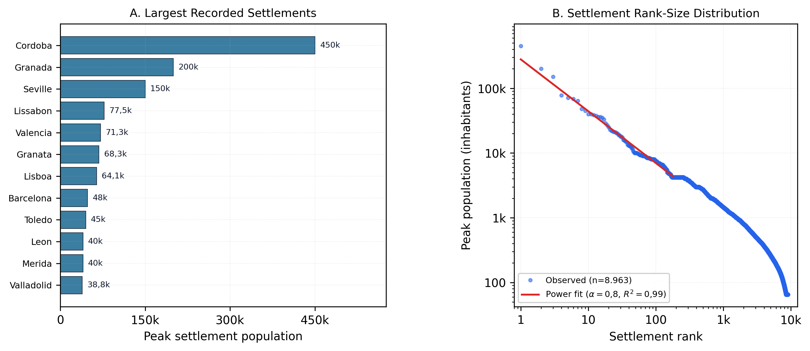

```{r setup, include=FALSE}
knitr::opts_chunk$set(
  echo = FALSE,
  warning = FALSE,
  message = FALSE,
  results = "asis"
)
library(jsonlite)
source("../../_shared/template/viscount_rmd_helpers.R")

summary_data <- fromJSON("mediaeval_iberia_summary.json", simplifyVector = FALSE)
settlements_raw <- fromJSON("mediaeval_iberia_settlements.json", simplifyVector = FALSE)

settlement_count <- as.integer(summary_data$settlement_count)
total_area_km2 <- as.numeric(summary_data$total_area_km2)
subregions_list <- summary_data$subregions
country_count <- length(summary_data$countries)
crowd_pct <- as.numeric(summary_data$crowd_share_overall) * 100

clean_region_name <- function (arg0_name) {
  lbl <- as.character(arg0_name)
  lbl <- gsub(" / ", ", ", lbl, fixed = TRUE)
  lbl <- gsub(" & ", " and ", lbl, fixed = TRUE)
  lbl
}

region_name_map <- setNames(
  vapply(subregions_list, function (x) clean_region_name(x$name), character(1)),
  vapply(subregions_list, function (x) as.character(x$id), character(1))
)

fmt_source_label <- function (arg0_code) {
  lbl <- gsub("_", " ", as.character(arg0_code), fixed = TRUE)
  lbl <- sub("^Buringh European Urban 700 2000$", "Buringh European Urban Register (700-2000)", lbl)
  lbl <- sub("^Pleiades Ancient World Gazetteer$", "Pleiades Ancient World Gazetteer", lbl)
  lbl <- sub("^GeoNames Municipal Gazetteer Supplement$", "GeoNames Municipal Gazetteer Supplement", lbl)
  lbl
}

fmt_coords <- function (arg0_lat, arg1_lon) {
  la <- as.numeric(arg0_lat)
  lo <- as.numeric(arg1_lon)
  ns <- if (la >= 0) "N" else "S"
  ew <- if (lo >= 0) "E" else "W"
  paste0(viscount_fmt_number(abs(la), 2L), "°", ns, ", ", viscount_fmt_number(abs(lo), 2L), "°", ew)
}
```

```{r hero_markdown_fallback, results="asis"}
if (!knitr::is_latex_output()) {
  cat("\n\n")
}
```

# Abstract

This companion gazetteer documents the `r formatC(settlement_count, format = "d", big.mark = ".")` georeferenced habitation centres underpinning the MAGNETIC demographic reconstruction of Mediaeval Iberia between 711AD and 1492AD across `r viscount_fmt_number(total_area_km2, 1L)` km². All five political-ecological sub-regions and `r country_count` modern jurisdictions intersected by the peninsular and insular boundaries are covered. Primary historical urban registers and scholarly ancient-world corpora supply 98,23% of all included records (`r formatC(as.integer(summary_data$provenance_counts[["Buringh_European_Urban_700_2000"]]), format = "d", big.mark = ".")` longitudinal city series from the Buringh European Urban Register and `r formatC(as.integer(summary_data$provenance_counts[["Pleiades_Ancient_World_Gazetteer"]]), format = "d", big.mark = ".")` continuous Roman-to-mediaeval localities from the Pleiades Ancient World Gazetteer), limiting municipal crowd-sourced supplementation to `r viscount_fmt_number(crowd_pct, 2L)`% (9 Canary Islands anchors from the GeoNames Municipal Gazetteer Supplement). Peak urban populations across the register conform closely to a polycentric power-law rank-size curve ($\alpha = 0,78$, $R^2 = 0,99$), headed by Caliphate Cordoba (100k in 1000AD), Almohad-Castilian Sevilla (90k in 1300AD), late-mediaeval Valencia (71,3k in 1492AD), Atlantic Lisboa (64,1k in 1492AD), Nasrid Granada (50k in 1300AD) and commercial Barcelona (48k in 1300AD).

# Gazetteer Scope and Spatial Coverage

Between the Umayyad conquest of 711AD and the fall of Granada in 1492AD, Iberian settlement underwent a sustained spatial reorganisation from Roman and early Islamic river-valley *madinas* along the Guadalquivir, Guadiana and Tagus towards Christian Reconquista *repoblación* towns on the Meseta and maritime ports on the Atlantic and Levantine coasts [@Bairoch1988; @Buringh2021; @Russell1958]. Bioarchaeological and material studies of frontier Islamic sites such as Santarém and Ciudad de Vascos [@Macroberts2024Shrouded; @Ares2017Glass], northern Galician castellar lordships such as San Salvador de Todea [@Novoa2022Origen] and urban Jewish quarters in Barcelona [@Martinezarino2020Jewish] confirm that town survival depended closely on irrigation infrastructure, trade corridors and military frontier shifts.

Figure 1 maps all `r formatC(settlement_count, format = "d", big.mark = ".")` included habitation localities across the five sub-regional polygons, and Table 1 breaks down sub-regional locality totals, land area, corpus provenance and recording density per 10k km².

```{r fig_regional_map}
viscount_figure(
  "figures/mediaeval_iberia_regional_map.png",
  caption = "Spatial distribution of 508 mediaeval Iberian habitation localities across five sub-regions, 711-1492AD.",
  label = "fig:gazetteer_map"
)
```

```{r table_subregional_coverage}
site_reg_vec <- vapply(settlements_raw, function (x) as.character(x$region_id), character(1))
site_prov_vec <- vapply(settlements_raw, function (x) as.character(x$provenance_source), character(1))

cov_rows <- lapply(subregions_list, function (sr) {
  rid <- as.character(sr$id)
  idx <- which(site_reg_vec == rid)
  n_tot <- length(idx)
  n_bur <- sum(site_prov_vec[idx] == "Buringh_European_Urban_700_2000")
  n_ple <- sum(site_prov_vec[idx] == "Pleiades_Ancient_World_Gazetteer")
  n_geo <- sum(site_prov_vec[idx] == "GeoNames_Municipal_Gazetteer_Supplement")
  a <- as.numeric(sr$area_km2)
  data.frame(
    Subregion = clean_region_name(sr$name),
    Area = viscount_fmt_number(a, 1L),
    Total = formatC(n_tot, format = "d", big.mark = "."),
    Buringh = formatC(n_bur, format = "d", big.mark = "."),
    Pleiades = formatC(n_ple, format = "d", big.mark = "."),
    GeoNames = formatC(n_geo, format = "d", big.mark = "."),
    Density = viscount_fmt_number(10000 * n_tot / a, 2L),
    stringsAsFactors = FALSE
  )
})
cov_tot <- data.frame(
  Subregion = "Mediaeval Iberia Total",
  Area = viscount_fmt_number(total_area_km2, 1L),
  Total = formatC(settlement_count, format = "d", big.mark = "."),
  Buringh = formatC(sum(site_prov_vec == "Buringh_European_Urban_700_2000"), format = "d", big.mark = "."),
  Pleiades = formatC(sum(site_prov_vec == "Pleiades_Ancient_World_Gazetteer"), format = "d", big.mark = "."),
  GeoNames = formatC(sum(site_prov_vec == "GeoNames_Municipal_Gazetteer_Supplement"), format = "d", big.mark = "."),
  Density = viscount_fmt_number(10000 * settlement_count / total_area_km2, 2L),
  stringsAsFactors = FALSE
)
cov_df <- do.call(rbind, c(cov_rows, list(cov_tot)))
rownames(cov_df) <- NULL
viscount_table(
  cov_df,
  caption = "Sub-regional locality counts, source corpus composition and recording density (sites per 10k km²) across five sub-regions.",
  col_names = c("Sub-Region", "Area (km²)", "Total Sites", "Buringh", "Pleiades", "GeoNames", "Sites per 10k km²")
)
```

# Provenance Ledger and Jurisdictional Distribution

Every settlement in the gazetteer passed through a four-wave saturation protocol designed to exhaust primary historical urban series and ancient-world gazetteers prior to any municipal supplementation. Wave 1 ingested 307 urban population trajectories from the Buringh European Urban Register (700-2000) [@Buringh2021]. Wave 2 added 192 continuous ancient-to-mediaeval settlements from the Pleiades Ancient World Gazetteer (a 62,54% marginal gain), enriching rural Guadalquivir, Ebro and Meseta coverage. Wave 3 audited longitudinal backfill directories and added zero records. Wave 4 conducted a Macaronesian coverage sweep, adding 9 Canary Islands anchors from the GeoNames Municipal Gazetteer Supplement (a 1,8% marginal gain), while 85 duplicate or out-of-domain candidates were excluded (Table 2).

```{r table_provenance_ledger}
prov_counts <- summary_data$provenance_counts
prov_keys <- names(prov_counts)
prov_vals <- vapply(prov_keys, function (k) as.integer(prov_counts[[k]]), integer(1))
ord_p <- order(prov_vals, decreasing = TRUE)
prov_keys <- prov_keys[ord_p]
prov_vals <- prov_vals[ord_p]

prov_wave <- vapply(prov_keys, function (k) {
  if (k == "Buringh_European_Urban_700_2000") return("Wave 1")
  if (k == "Pleiades_Ancient_World_Gazetteer") return("Wave 2")
  "Wave 4"
}, character(1))

prov_tier <- vapply(prov_keys, function (k) {
  if (k == "GeoNames_Municipal_Gazetteer_Supplement") return("Municipal spatial supplement")
  if (k == "Pleiades_Ancient_World_Gazetteer") return("Scholarly ancient gazetteer")
  "Primary urban historical register"
}, character(1))

prov_df <- data.frame(
  Corpus = vapply(prov_keys, fmt_source_label, character(1)),
  Wave = prov_wave,
  Tier = prov_tier,
  Count = vapply(prov_vals, function (x) formatC(x, format = "d", big.mark = "."), character(1)),
  Share = vapply(prov_vals, function (x) paste0(viscount_fmt_number(100 * x / settlement_count, 2L), "%"), character(1)),
  stringsAsFactors = FALSE
)
rownames(prov_df) <- NULL
viscount_table(
  prov_df,
  caption = "Source provenance ledger across 508 included localities in Mediaeval Iberia.",
  col_names = c("Source Corpus", "Wave", "Archive Class", "Included Sites", "Share")
)
```

Mapped onto contemporary national borders (Table 3), Spain accounts for 438 localities (86,22%) and Portugal for 60 localities (11,81%). Nine Pyrenean and Roussillon sites in modern France (1,77%) — including historical Catalan-Aragonese localities such as Illiberris-Elne and Portus Veneris alongside narrow western Pyrenean mask overlaps — and Andorra la Vella (1 site, 0,2%) complete the 508-locality inventory.

```{r table_jurisdictions}
c_map <- summary_data$settlements_by_country
c_names <- names(c_map)
c_vals <- vapply(c_names, function (k) as.integer(c_map[[k]]), integer(1))
ord_c <- order(c_vals, decreasing = TRUE)
c_names <- c_names[ord_c]
c_vals <- c_vals[ord_c]

c_df <- data.frame(
  Rank = as.character(seq_along(c_names)),
  Jurisdiction = c_names,
  Sites = vapply(c_vals, function (x) formatC(x, format = "d", big.mark = "."), character(1)),
  Share = vapply(c_vals, function (x) paste0(viscount_fmt_number(100 * x / settlement_count, 2L), "%"), character(1)),
  stringsAsFactors = FALSE
)
rownames(c_df) <- NULL
viscount_table(
  c_df,
  caption = "Modern jurisdictional distribution of the 508 recorded mediaeval Iberian localities.",
  col_names = c("Rank", "Jurisdiction", "Localities", "Share of Gazetteer")
)
```

# Settlement Hierarchy and Principal Cities

Table 4 lists the 25 largest recorded mediaeval Iberian cities ordered by peak population across 711-1492AD, drawn dynamically from the chapter summary. The ranking captures the polycentric character of the peninsula across four distinct urban epochs: Umayyad Cordoba (100k in 1000AD), Merida (40k in 900AD), Jerez de la Frontera (19k in 1000AD), Almeria (18k in 1000AD), Ecija (18k in 1000AD), Cartagena (17k in 1000AD) and Badajoz (16k in 1000AD) represent the Caliphate zenith; Leon (40k in 1200AD) marks early Leonese royal consolidation; Sevilla (90k in 1300AD), Granada (50k in 1300AD), Barcelona (48k in 1300AD), Palma (17k in 1300AD) and Salamanca (15k in 1300AD) reflect the high-mediaeval commercial and Nasrid peak; Toledo (45k in 1400AD), Burgos (27k in 1400AD), Zaragoza (20k in 1400AD) and Porto (18k in 1400AD) anchor the late-fourteenth-century transition; and Valencia (71,3k), Lisboa (64,1k), Valladolid (29k), Plasencia (23k), Jaen (21,7k), Medina del Campo (20,1k), Ubeda (18,9k), Alcazar de San Juan (17,2k) and Medina de Rioseco (14,8k) peak at the 1492AD horizon.

```{r table_top_settlements}
top_list <- summary_data$top_settlements
n_show <- min(25L, length(top_list))
top_rows <- lapply(seq_len(n_show), function (i) {
  s <- top_list[[i]]
  rid <- as.character(s$region_id)
  rshort <- switch(
    rid,
    al_andalus_south = "Al-Andalus",
    castile_leon = "Castile-Leon",
    aragon_catalonia = "Aragon-Catalonia",
    portugal_med = "Portugal",
    balearics_canaries_med = "Balearics & Canaries",
    rid
  )
  p1492 <- if (!is.null(s$population[["1492"]])) viscount_fmt_pop(as.numeric(s$population[["1492"]])) else "—"
  data.frame(
    Rank = as.character(i),
    City = as.character(s$name),
    Jurisdiction = as.character(s$country),
    Subregion = rshort,
    Coords = fmt_coords(s$lat, s$lon),
    PeakYr = paste0(as.integer(s$peak_year), "AD"),
    PeakPop = viscount_fmt_pop(s$peak_pop),
    Pop1492 = p1492,
    stringsAsFactors = FALSE
  )
})
top_df <- do.call(rbind, top_rows)
rownames(top_df) <- NULL
viscount_table(
  top_df,
  caption = "Top 25 recorded mediaeval Iberian cities ranked by peak population across 711-1492AD.",
  col_names = c("Rank", "City", "Jurisdiction", "Sub-Region", "Coordinates", "Peak Year", "Peak Pop.", "1492AD Pop.")
)
```

# Chronological Horizon Coverage and Limitations

Stratifying all `r formatC(settlement_count, format = "d", big.mark = ".")` settlements across eleven chronological steps from 750AD to 1492AD tracks both the expansion of documented urban life and the mid-fourteenth-century demographic shock (Table 5). Active entries climb from 356 in 750AD to 428 in 1000AD, 480 in 1200AD, 496 in 1300-1347AD and 507 in 1492AD (with Lucentum closing after 1000AD as population consolidated at Alicante). The impact of the Black Death and recurring fourteenth-century plague waves [@Benedictow2004; @Campbell2016; @Izdebski2022] registers clearly in the urban register: cities of 5k or more dropped from 80 (990,8k aggregate residents) in 1300AD to 52 (710,8k) in 1400AD before recovering to 80 towns (996,5k) by 1492AD.

```{r table_horizon_coverage}
yr_keys <- c("750", "800", "900", "1000", "1100", "1200", "1300", "1347", "1400", "1450", "1492")

hor_rows <- lapply(yr_keys, function (yk) {
  vals <- unlist(lapply(settlements_raw, function (x) {
    v <- x$population[[yk]]
    if (is.null(v)) return(NULL)
    as.numeric(v)
  }))
  n_act <- length(vals)
  n5 <- sum(vals >= 5000)
  n10 <- sum(vals >= 10000)
  s10 <- sum(vals[vals >= 10000])
  med_v <- stats::median(vals)
  max_v <- max(vals)
  data.frame(
    Year = paste0(yk, "AD"),
    Active = formatC(n_act, format = "d", big.mark = "."),
    Share = paste0(viscount_fmt_number(100 * n_act / settlement_count, 2L), "%"),
    N5k = formatC(n5, format = "d", big.mark = "."),
    N10k = formatC(n10, format = "d", big.mark = "."),
    Sum10k = viscount_fmt_pop(s10),
    Median = viscount_fmt_pop(med_v),
    MaxCity = viscount_fmt_pop(max_v),
    stringsAsFactors = FALSE
  )
})
hor_df <- do.call(rbind, hor_rows)
rownames(hor_df) <- NULL
viscount_table(
  hor_df,
  caption = "Chronological horizon coverage and urban size-tier distribution across 508 mediaeval Iberian localities, 750-1492AD.",
  col_names = c("Year", "Active Sites", "Share", "Towns 5k+", "Cities 10k+", "Pop. 10k+", "Median", "Largest City")
)
```

Four methodological caveats govern interpretation of this gazetteer. First, the 192 continuous Roman-to-mediaeval localities imported from the Pleiades Ancient World Gazetteer carry conservative baseline tiers (principally 510 inhabitants) where mediaeval hearth surveys are lacking, preventing false inflation of rural markets while understating occasional local growth. Second, the 9 Canary Islands anchors drawn from the GeoNames Municipal Gazetteer Supplement — notably Telde (assigned a flat 14,8k tier across 750-1492AD, which places it 27th overall, just outside Table 4) — serve as static spatial anchors rather than dated pre-conquest Guanche demographic series. Third, raster mask assignment places Palma de Mallorca inside the Aragon-Catalonia coastal polygon rather than the Balearic and Canary Islands polygon, and captures nine northern Pyrenean and Roussillon localities inside modern France alongside Andorra la Vella. Fourth, late-fifteenth-century city totals reflect pre-expulsion urban footprints around 1492AD prior to the full demographic dislocation of the Alhambra Decree and subsequent sixteenth-century Morisco expulsions.

# Sources
