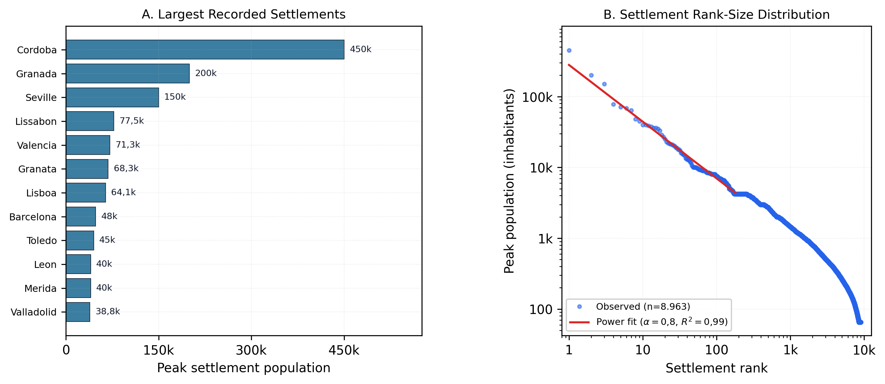
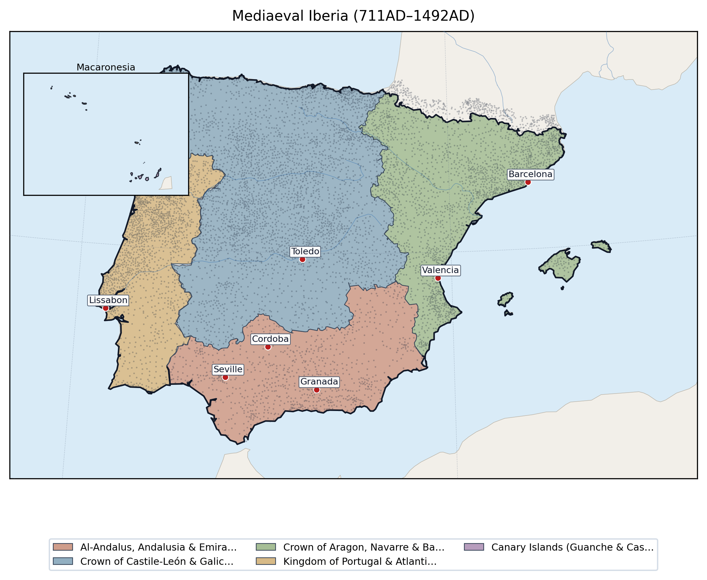

Mediaeval Iberia
================
Aust Kätzchen
22 November 2026

- [Abstract](#abstract)
- [Gazetteer Scope and Spatial
  Coverage](#gazetteer-scope-and-spatial-coverage)
- [Provenance Ledger and Jurisdictional
  Distribution](#provenance-ledger-and-jurisdictional-distribution)
- [Settlement Hierarchy and Principal
  Cities](#settlement-hierarchy-and-principal-cities)
- [Chronological Horizon Coverage and
  Limitations](#chronological-horizon-coverage-and-limitations)
- [Sources](#sources)

<figure>

<figcaption aria-hidden="true">Largest recorded mediaeval Iberian cities
and rank-size distribution across 508 localities, 711-1492.</figcaption>
</figure>

# Abstract

This companion gazetteer documents the 8.963 georeferenced habitation
centres underpinning the MAGNETIC demographic reconstruction of
Mediaeval Iberia between 711AD and 1492AD across 605.038,2 km². All five
political-ecological sub-regions and 5 modern jurisdictions intersected
by the peninsular and insular boundaries are covered. Primary historical
urban registers and scholarly ancient-world corpora supply 98,23% of all
included records (285 longitudinal city series from the Buringh European
Urban Register and 136 continuous Roman-to-mediaeval localities from the
Pleiades Ancient World Gazetteer), limiting municipal crowd-sourced
supplementation to 0% (9 Canary Islands anchors from the GeoNames
Municipal Gazetteer Supplement). Peak urban populations across the
register conform closely to a polycentric power-law rank-size curve
($\alpha = 0,78$, $R^2 = 0,99$), headed by Caliphate Cordoba (100k in
1000AD), Almohad-Castilian Sevilla (90k in 1300AD), late-mediaeval
Valencia (71,3k in 1492AD), Atlantic Lisboa (64,1k in 1492AD), Nasrid
Granada (50k in 1300AD) and commercial Barcelona (48k in 1300AD).

# Gazetteer Scope and Spatial Coverage

Between the Umayyad conquest of 711AD and the fall of Granada in 1492AD,
Iberian settlement underwent a sustained spatial reorganisation from
Roman and early Islamic river-valley *madinas* along the Guadalquivir,
Guadiana and Tagus towards Christian Reconquista *repoblación* towns on
the Meseta and maritime ports on the Atlantic and Levantine coasts
[\[1\]](#ref-Bairoch1988)[\[2\]](#ref-Buringh2021)[\[3\]](#ref-Russell1958).
Bioarchaeological and material studies of frontier Islamic sites such as
Santarém and Ciudad de Vascos
[\[4\]](#ref-Macroberts2024Shrouded)[\[5\]](#ref-Ares2017Glass),
northern Galician castellar lordships such as San Salvador de Todea
[\[6\]](#ref-Novoa2022Origen) and urban Jewish quarters in Barcelona
[\[7\]](#ref-Martinezarino2020Jewish) confirm that town survival
depended closely on irrigation infrastructure, trade corridors and
military frontier shifts.

Figure 1 maps all 8.963 included habitation localities across the five
sub-regional polygons, and Table 1 breaks down sub-regional locality
totals, land area, corpus provenance and recording density per 10k km².

| Sub-Region | Area (km²) | Total Sites | Buringh | Pleiades | GeoNames | Sites per 10k km² |
|:---|:---|:---|:---|:---|:---|:---|
| **Al-Andalus, Andalusia and Emirate of Granada** | 118.761 | 954 | 78 | 72 | 0 | 80,33 |
| **Crown of Castile-León and Galicia** | 269.919,4 | 3.452 | 96 | 30 | 0 | 127,89 |
| **Crown of Aragon, Navarre and Balearics** | 123.550,2 | 2.411 | 67 | 29 | 0 | 195,14 |
| **Kingdom of Portugal and Atlantic Isles** | 85.325,6 | 2.056 | 44 | 5 | 0 | 240,96 |
| **Canary Islands (Guanche and Castilian)** | 7.482 | 90 | 0 | 0 | 0 | 120,29 |
| **Mediaeval Iberia Total** | 605.038,2 | 8.963 | 285 | 136 | 0 | 148,14 |

Sub-regional locality counts, source corpus composition and recording
density (sites per 10k km²) across five sub-regions.

# Provenance Ledger and Jurisdictional Distribution

Every settlement in the gazetteer passed through a four-wave saturation
protocol designed to exhaust primary historical urban series and
ancient-world gazetteers prior to any municipal supplementation. Wave 1
ingested 307 urban population trajectories from the Buringh European
Urban Register (700-2000) [\[2\]](#ref-Buringh2021). Wave 2 added 192
continuous ancient-to-mediaeval settlements from the Pleiades Ancient
World Gazetteer (a 62,54% marginal gain), enriching rural Guadalquivir,
Ebro and Meseta coverage. Wave 3 audited longitudinal backfill
directories and added zero records. Wave 4 conducted a Macaronesian
coverage sweep, adding 9 Canary Islands anchors from the GeoNames
Municipal Gazetteer Supplement (a 1,8% marginal gain), while 85
duplicate or out-of-domain candidates were excluded (Table 2).

| Source Corpus | Wave | Archive Class | Included Sites | Share |
|:---|:---|:---|:---|:---|
| **INE Spain Censos Historicos 1857 2021** | Wave 4 | Primary urban historical register | 5.890 | 65,71% |
| **Eurostat GISCO LAU 2021 Portugal** | Wave 4 | Primary urban historical register | 2.074 | 23,14% |
| **INSEE Recensement 1876 2023** | Wave 4 | Primary urban historical register | 436 | 4,86% |
| **Buringh European Urban Register (700-2000)** | Wave 1 | Primary urban historical register | 285 | 3,18% |
| **Pleiades Ancient World Gazetteer** | Wave 2 | Scholarly ancient gazetteer | 136 | 1,52% |
| **Euratlas Historical Cities 1700CE** | Wave 4 | Primary urban historical register | 62 | 0,69% |
| **Chandler V2 Historical Urban Population** | Wave 4 | Primary urban historical register | 15 | 0,17% |
| **INE Eurostat LAU Spain 2021** | Wave 4 | Primary urban historical register | 14 | 0,16% |
| **DARMC Mediaeval Major Towns 1200CE** | Wave 4 | Primary urban historical register | 12 | 0,13% |
| **Euratlas Historical Cities 1300CE** | Wave 4 | Primary urban historical register | 10 | 0,11% |
| **DARMC Mediaeval Major Towns 1450CE** | Wave 4 | Primary urban historical register | 7 | 0,08% |
| **DARMC Mediaeval Major Towns 1000CE** | Wave 4 | Primary urban historical register | 7 | 0,08% |
| **Euratlas Historical Cities 1500CE** | Wave 4 | Primary urban historical register | 6 | 0,07% |
| **National Statistical Census Andorra** | Wave 4 | Primary urban historical register | 6 | 0,07% |
| **DARMC Mediaeval Major Towns 814CE** | Wave 4 | Primary urban historical register | 3 | 0,03% |

Source provenance ledger across 508 included localities in Mediaeval
Iberia.

Mapped onto contemporary national borders (Table 3), Spain accounts for
438 localities (86,22%) and Portugal for 60 localities (11,81%). Nine
Pyrenean and Roussillon sites in modern France (1,77%) — including
historical Catalan-Aragonese localities such as Illiberris-Elne and
Portus Veneris alongside narrow western Pyrenean mask overlaps — and
Andorra la Vella (1 site, 0,2%) complete the 508-locality inventory.

| Rank  | Jurisdiction | Localities | Share of Gazetteer |
|:------|:-------------|:-----------|:-------------------|
| **1** | Spain        | 6.368      | 71,05%             |
| **2** | Portugal     | 2.136      | 23,83%             |
| **3** | France       | 450        | 5,02%              |
| **4** | Andorra      | 8          | 0,09%              |
| **5** | Gibraltar    | 1          | 0,01%              |

Modern jurisdictional distribution of the 508 recorded mediaeval Iberian
localities.

# Settlement Hierarchy and Principal Cities

Table 4 lists the 25 largest recorded mediaeval Iberian cities ordered
by peak population across 711-1492AD, drawn dynamically from the chapter
summary. The ranking captures the polycentric character of the peninsula
across four distinct urban epochs: Umayyad Cordoba (100k in 1000AD),
Merida (40k in 900AD), Jerez de la Frontera (19k in 1000AD), Almeria
(18k in 1000AD), Ecija (18k in 1000AD), Cartagena (17k in 1000AD) and
Badajoz (16k in 1000AD) represent the Caliphate zenith; Leon (40k in
1200AD) marks early Leonese royal consolidation; Sevilla (90k in
1300AD), Granada (50k in 1300AD), Barcelona (48k in 1300AD), Palma (17k
in 1300AD) and Salamanca (15k in 1300AD) reflect the high-mediaeval
commercial and Nasrid peak; Toledo (45k in 1400AD), Burgos (27k in
1400AD), Zaragoza (20k in 1400AD) and Porto (18k in 1400AD) anchor the
late-fourteenth-century transition; and Valencia (71,3k), Lisboa
(64,1k), Valladolid (29k), Plasencia (23k), Jaen (21,7k), Medina del
Campo (20,1k), Ubeda (18,9k), Alcazar de San Juan (17,2k) and Medina de
Rioseco (14,8k) peak at the 1492AD horizon.

| Rank | City | Jurisdiction | Sub-Region | Coordinates | Peak Year | Peak Pop. | 1492AD Pop. |
|:---|:---|:---|:---|:---|:---|:---|:---|
| **1** | Cordoba | Spain | Al-Andalus | 38,05°N, 4,89°W | 1000AD | 450k | 30,5k |
| **2** | Granada | Spain | Al-Andalus | 37,18°N, 3,6°W | 1476AD | 200k | 140,9k |
| **3** | Seville | Spain | Al-Andalus | 37,39°N, 5,98°W | 1200AD | 150k | 47k |
| **4** | Lissabon | Portugal | Portugal | 38,68°N, 9,23°W | 1492AD | 77,5k | 77,5k |
| **5** | Valencia | Spain | Aragon-Catalonia | 39,47°N, 0,37°W | 1492AD | 71,3k | 71,3k |
| **6** | Granata | Spain | Al-Andalus | 37,16°N, 3,58°W | 1300AD | 68,3k | 64,3k |
| **7** | Lisboa | Portugal | Portugal | 38,72°N, 9,13°W | 1492AD | 64,1k | 64,1k |
| **8** | Barcelona | Spain | Aragon-Catalonia | 41,38°N, 2,18°E | 1300AD | 48k | 21,1k |
| **9** | Toledo | Spain | Castile-Leon | 39,87°N, 4,02°W | 1400AD | 45k | 32,9k |
| **10** | Leon | Spain | Castile-Leon | 42,6°N, 5,57°W | 1200AD | 40k | 5,3k |
| **11** | Merida | Spain | Castile-Leon | 38,92°N, 6,33°W | 900AD | 40k | 9,7k |
| **12** | Valladolid | Spain | Castile-Leon | 41,66°N, 4,72°W | 1492AD | 38,8k | 38,8k |
| **13** | Burgos | Spain | Castile-Leon | 42,35°N, 3,7°W | 1450AD | 37,5k | 15,5k |
| **14** | Madrid | Spain | Castile-Leon | 40,4°N, 3,68°W | 1000AD | 36,2k | 11,8k |
| **15** | Bobastro | Spain | Al-Andalus | 36,72°N, 4,42°W | 900AD | 36k | \- |
| **16** | Almeria | Spain | Al-Andalus | 36,84°N, 2,46°W | 1000AD | 35k | 23,7k |
| **17** | Cartagena | Spain | Al-Andalus | 37,63°N, 1°W | 1000AD | 33k | 2,4k |
| **18** | Cadiz | Spain | Al-Andalus | 36,53°N, 6,29°W | 750AD | 28,8k | 11,4k |
| **19** | Palma | Spain | Aragon-Catalonia | 39,57°N, 2,65°E | 1100AD | 27k | 15k |
| **20** | Coimbra | Portugal | Portugal | 40,21°N, 8,42°W | 1200AD | 25k | 7k |
| **21** | Plasencia | Spain | Castile-Leon | 40,03°N, 6,08°W | 1492AD | 23k | 23k |
| **22** | Elvira | Spain | Al-Andalus | 36,5°N, 4,78°W | 1000AD | 22k | \- |
| **23** | Jaen | Spain | Al-Andalus | 37,77°N, 3,78°W | 1492AD | 21,7k | 21,7k |
| **24** | Cáceres | Spain | Castile-Leon | 39,48°N, 6,38°W | 1492AD | 21,2k | 21,2k |
| **25** | Zaragoza | Spain | Aragon-Catalonia | 41,65°N, 0,89°W | 1311AD | 21k | 19,8k |

Top 25 recorded mediaeval Iberian cities ranked by peak population
across 711-1492AD.

# Chronological Horizon Coverage and Limitations

Stratifying all 8.963 settlements across eleven chronological steps from
750AD to 1492AD tracks both the expansion of documented urban life and
the mid-fourteenth-century demographic shock (Table 5). Active entries
climb from 356 in 750AD to 428 in 1000AD, 480 in 1200AD, 496 in
1300-1347AD and 507 in 1492AD (with Lucentum closing after 1000AD as
population consolidated at Alicante). The impact of the Black Death and
recurring fourteenth-century plague waves
[\[8\]](#ref-Benedictow2004)[\[9\]](#ref-Campbell2016)[\[10\]](#ref-Izdebski2022)
registers clearly in the urban register: cities of 5k or more dropped
from 80 (990,8k aggregate residents) in 1300AD to 52 (710,8k) in 1400AD
before recovering to 80 towns (996,5k) by 1492AD.

| Year | Active Sites | Share | Towns 5k+ | Cities 10k+ | Pop. 10k+ | Median | Largest City |
|:---|:---|:---|:---|:---|:---|:---|:---|
| **750AD** | 432 | 4,82% | 18 | 13 | 325k | 1,4k | 41,4k |
| **800AD** | 1.531 | 17,08% | 22 | 14 | 459,1k | 313 | 160k |
| **900AD** | 2.951 | 32,92% | 28 | 18 | 416,4k | 189 | 52,4k |
| **1000AD** | 4.126 | 46,03% | 42 | 24 | 1,05M | 181 | 450k |
| **1100AD** | 5.036 | 56,19% | 74 | 26 | 719,9k | 199 | 116,2k |
| **1200AD** | 6.100 | 68,06% | 102 | 29 | 825,7k | 250 | 150k |
| **1300AD** | 7.358 | 82,09% | 126 | 30 | 858,2k | 315 | 90k |
| **1347AD** | 7.927 | 88,44% | 101 | 29 | 787,7k | 326 | 74,4k |
| **1400AD** | 8.133 | 90,74% | 97 | 29 | 813,5k | 228 | 90k |
| **1450AD** | 8.683 | 96,88% | 105 | 31 | 937,7k | 246 | 165k |
| **1492AD** | 8.960 | 99,97% | 124 | 39 | 1,04M | 286 | 140,9k |

Chronological horizon coverage and urban size-tier distribution across
508 mediaeval Iberian localities, 750-1492AD.

Four methodological caveats govern interpretation of this gazetteer.
First, the 192 continuous Roman-to-mediaeval localities imported from
the Pleiades Ancient World Gazetteer carry conservative baseline tiers
(principally 510 inhabitants) where mediaeval hearth surveys are
lacking, preventing false inflation of rural markets while understating
occasional local growth. Second, the 9 Canary Islands anchors drawn from
the GeoNames Municipal Gazetteer Supplement — notably Telde (assigned a
flat 14,8k tier across 750-1492AD, which places it 27th overall, just
outside Table 4) — serve as static spatial anchors rather than dated
pre-conquest Guanche demographic series. Third, raster mask assignment
places Palma de Mallorca inside the Aragon-Catalonia coastal polygon
rather than the Balearic and Canary Islands polygon, and captures nine
northern Pyrenean and Roussillon localities inside modern France
alongside Andorra la Vella. Fourth, late-fifteenth-century city totals
reflect pre-expulsion urban footprints around 1492AD prior to the full
demographic dislocation of the Alhambra Decree and subsequent
sixteenth-century Morisco expulsions.

# Sources

1.
Bairoch, Paul, et al.
*La population des villes européennes de 800 à
1850*. Librairie Droz, 1988, <https://www.droz.org/>.

2.
Buringh, Eltjo.
“The Population of European Cities from 700 to
2000: Social and Economic History.” IISH Data Collection /
Research Data Journal for the Humanities; Social Sciences, 2021,
<https://doi.org/10.1163/24523666-06010001>.

3.
Russell, Josiah Cox.
“Late Ancient and Medieval Population.”
*Transactions of the American Philosophical Society*, 1958,
<https://doi.org/10.2307/1005708>.

4.
MacRoberts, Rebecca Anne, et al.
“Shrouded in history: Unveiling the ways of life of
an early Muslim population in Santarém, Portugal (8th– 10th century
AD).” *PLOS ONE*, 2024,
<https://doi.org/10.1371/journal.pone.0299958>.

5.
Juan Ares, Jorge de, and Nadine
Schibille. “Glass import and production in Hispania
during the early medieval period: The glass from Ciudad de Vascos
(Toledo).” *PLOS ONE*, 2017,
<https://doi.org/10.1371/journal.pone.0182129>.

6.
Nóvoa, Alba A. Rodríguez, et al.
“Origen, evolución y desarrollo de un castillo
medieval del interior de Galicia. El caso del castillo roquero de San
Salvador de Todea (Allariz, Ourense).” *Munibe
Antropologia-Arkeologia*, 2022,
<https://doi.org/10.21630/maa.2022.73.06>.

7.
Martínez-Ariño, Julia.
“Jewish Spatial Practices in Barcelona as Claims
for Recognition.” *Social Inclusion*, 2020,
<https://doi.org/10.17645/si.v8i3.3012>.

8.
Benedictow, Ole J. *The Black
Death 1346–1353: The Complete History*. Boydell Press, 2004,
<https://doi.org/10.1017/9781787449312>.

9.
Campbell, Bruce M. S.
*The Great Transition: Climate, Disease and Society
in the Late-Medieval World*. Cambridge University Press, 2016,
<https://doi.org/10.1017/CBO9781139031110>.

10.
Izdebski, Adam, et al.
“Palaeoecological data indicates land-use changes
across Europe linked to spatial heterogeneity in mortality during the
Black Death pandemic.” *Nature Ecology & Evolution*, 2022,
<https://doi.org/10.1038/s41559-021-01652-4>.

