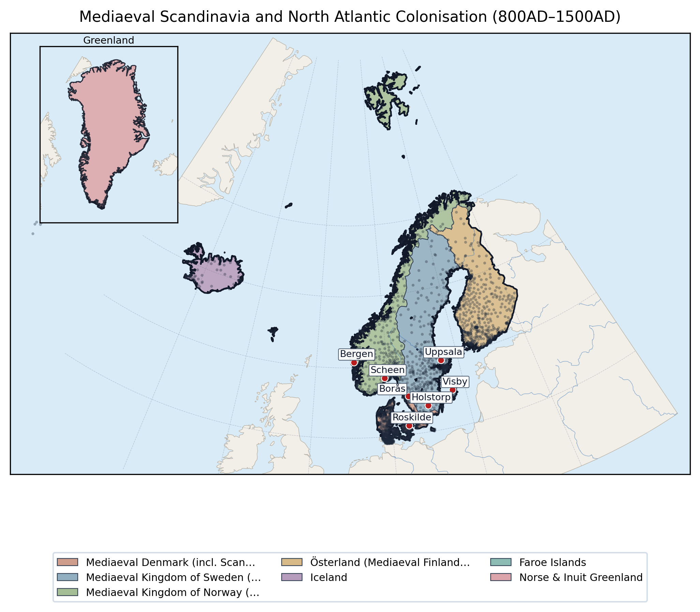

```{r setup, include=FALSE}
knitr::opts_chunk$set(
  echo = FALSE,
  warning = FALSE,
  message = FALSE,
  fig.align = "center"
)

source("../../_shared/template/viscount_rmd_helpers.R")
library(jsonlite)

summary_data <- fromJSON(
  "mediaeval_scandinavia_and_north_atlantic_summary.json",
  simplifyVector = FALSE
)
settlements_raw <- fromJSON(
  "mediaeval_scandinavia_and_north_atlantic_settlements.json",
  simplifyVector = FALSE
)

fix_mojibake <- function (arg0_vec) {
  s <- as.character(arg0_vec)
  pairs <- list(
    c("\u00c3\u00a1", "\u00e1"),
    c("\u00c3\u0081", "\u00c1"),
    c("\u00c3\u00a4", "\u00e4"),
    c("\u00c3\u00b6", "\u00f6"),
    c("\u00c3\u00a5", "\u00e5"),
    c("\u00c3\u00b8", "\u00f8"),
    c("\u00c3\u00a6", "\u00e6"),
    c("\u00c3\u00be", "\u00fe"),
    c("\u00c3\u00b0", "\u00f0"),
    c("\u00c3\u00ad", "\u00ed"),
    c("\u00c3\u00b3", "\u00f3"),
    c("\u00c3\u00ba", "\u00fa")
  )
  for (p in pairs) {
    s <- gsub(p[[1]], p[[2]], s, fixed = TRUE)
  }
  s
}

fmt_source_label <- function (arg0_code) {
  lbl <- gsub("_", " ", as.character(arg0_code), fixed = TRUE)
  lbl <- sub("^Buringh European Urban 700 2000$", "Buringh European Urban Corpus (700–2000)", lbl)
  lbl <- sub("^National Statistical Census ", "National Statistical Census of ", lbl)
  lbl <- sub("^GeoNames Municipal Gazetteer Supplement$", "GeoNames Municipal Gazetteer Supplement", lbl)
  lbl
}

total_area <- as.numeric(summary_data$total_area_km2)
tot_800 <- as.numeric(summary_data$domain_totals[["800"]])
tot_1000 <- as.numeric(summary_data$domain_totals[["1000"]])
tot_1200 <- as.numeric(summary_data$domain_totals[["1200"]])
tot_1347 <- as.numeric(summary_data$domain_totals[["1347"]])
tot_1500 <- as.numeric(summary_data$domain_totals[["1500"]])
site_count <- as.integer(summary_data$settlement_count)
crowd_pct <- as.numeric(summary_data$crowd_share_overall) * 100

sub_df <- do.call(rbind, lapply(summary_data$subregions, function (r) {
  area_val <- as.numeric(r$area_km2)
  p800 <- as.numeric(r$population[["800"]])
  p800_raw <- as.numeric(r$population_raw[["800"]])
  p1000 <- as.numeric(r$population[["1000"]])
  p1200 <- as.numeric(r$population[["1200"]])
  p1347 <- as.numeric(r$population[["1347"]])
  p1500 <- as.numeric(r$population[["1500"]])
  sites_n <- as.integer(summary_data$settlements_by_region[[r$id]])
  data.frame(
    id = as.character(r$id),
    name = as.character(r$name),
    area_km2 = area_val,
    p_800 = p800,
    p_800_raw = p800_raw,
    p_1000 = p1000,
    p_1200 = p1200,
    p_1347 = p1347,
    p_1500 = p1500,
    d_800 = p800 / area_val,
    d_1000 = p1000 / area_val,
    d_1200 = p1200 / area_val,
    d_1347 = p1347 / area_val,
    d_1500 = p1500 / area_val,
    pct_exp = if (p800_raw > 0) (p1347 / p800_raw - 1) * 100 else NA_real_,
    pct_exp_1000 = (p1347 / p1000 - 1) * 100,
    pct_crisis = (p1500 / p1347 - 1) * 100,
    sites = sites_n,
    stringsAsFactors = FALSE
  )
}))
rownames(sub_df) <- NULL

tot_800_raw <- sum(sub_df$p_800_raw)
area_ex_gl <- sum(sub_df$area_km2[sub_df$id != "greenland_norse_inuit"])
dens_1347_all <- tot_1347 / total_area
dens_1347_ex_gl <- (tot_1347 - 8500) / area_ex_gl
crisis_drop_pct <- abs((tot_1500 / tot_1347 - 1) * 100)
hgis_sum <- summary_data$hgis_regime_summary[[1]]
hgis_pop <- as.numeric(hgis_sum$population_sum)
hgis_area <- as.numeric(hgis_sum$area_km2_sum)
hgis_units <- as.integer(hgis_sum$units)
hgis_dens <- hgis_pop / hgis_area
```

```{r hero_markdown_fallback, results='asis'}
if (!knitr::is_latex_output()) {
  cat("\n\n\n")
}
```

# Abstract

Between 800AD and 1500AD the Nordic kingdoms and the North Atlantic islands underwent the most geographically ambitious maritime expansion in European mediaeval history, followed by one of the continent's sharpest late mediaeval demographic contractions. Covering `r viscount_fmt_number(total_area, 1)` km² across seven sub-regions—the Kingdom of Denmark, the Kingdom of Sweden, the Kingdom of Norway, Finland (Eastland), Iceland, the Faroe Islands and Norse and Inuit Greenland—this MAGNETIC study reconstructs regional population series alongside a geocoded corpus of `r formatC(site_count, format = "d", big.mark = ".")` settlements. Aggregate population rose from `r viscount_fmt_pop(tot_800_raw)` in 800AD on the raw pre-settlement series (`r viscount_fmt_pop(tot_800)` when the 800AD opening boundary carries Iceland's post-colonisation benchmark) through `r viscount_fmt_pop(tot_1000)` in 1000AD and `r viscount_fmt_pop(tot_1200)` in 1200AD to a High Mediaeval peak of `r viscount_fmt_pop(tot_1347)` in 1347AD (`r viscount_fmt_number(dens_1347_all, 2)` inhabitants per km² overall, or `r viscount_fmt_number(dens_1347_ex_gl, 2)` per km² excluding Greenland). Denmark alone held 37,5% of that 1347AD total on just 1,26% of the domain's surface, reaching 22,57 inhabitants per km², while Norse colonisation planted permanent pastoral societies on the Faroes, Iceland and south-western Greenland. After 1347AD plague mortality, Little Ice Age climatic deterioration and farm desertion cut regional totals by `r viscount_fmt_number(crisis_drop_pct, 1)`% to `r viscount_fmt_pop(tot_1500)` by 1500AD. Norway suffered a collapse of 45,8%, Iceland lost 33,3% after its fifteenth-century plagues, Denmark fell 28,4% and the Norse Greenlandic colonies vanished altogether, whereas Finland bucked the European downturn with net growth of 8,3% driven by interior boreal clearance.

# Background

## Biogeographical Gradients and Agrarian Ceilings

No macro-region of mediaeval Europe spanned a steeper ecological gradient than the Nordic and North Atlantic world. Moving north-west from the moraine lowlands of Jutland and the Danish Isles to the inland ice sheet of Greenland meant crossing five distinct agricultural thresholds within a single cultural and linguistic sphere. At the southern base lay the Kingdom of Denmark (42.095,2 km² in the present sub-regional geometry), whose glacial boulder clays, mild maritime winters and flat relief resembled northern Germany far more closely than the Scandinavian Shield. Cereal farming with winter rye, six-row barley and oats, paired with heavy wheeled ploughs and intensive meadow grazing, allowed Danish parishes to sustain rural densities above 20 inhabitants per km² by the early fourteenth century—a figure ten to twenty times higher than anything achievable across the Skagerrak or Gulf of Bothnia.

Across the Kattegat and Sound, the Kingdoms of Sweden (438.626,8 km²) and Norway (355.185,7 km²) rested on ancient Precambrian granite and gneiss scraped thin by Pleistocene glaciation. Arable pockets hugged post-glacial marine clays around Lake Mälaren, Östergötland, Västergötland, Scania, the Oslofjord basin, the broad valleys of Hedmark and Gudbrandsdalen and the sheltered fjord terraces of Trøndelag and Vestland. Above 61°N grain ripened reliably only in coastal microclimates warmed by the North Atlantic Current, pushing mixed cereal-and-dairy farming up Norwegian fjords as far as Troms while leaving mountain plateaux to summer transhumance shielings (*seter* in Norway, *fäbodar* in Sweden) and the northern interior to mobile Sámi reindeer pastoralists, hunters and fishers. Two maritime harvests partially offset poor soils: the autumn herring shoals of the Sound, which drew merchants from every Baltic port from the twelfth century onward, and the winter *skrei* cod spawning grounds of the Lofoten Islands, whose wind-dried stockfish (*tørrfisk*) turned Bergen into northern Europe's premier Atlantic staple market.

East of the Gulf of Bothnia, Finland (326.358,5 km²)—known in mediaeval Swedish charters as *Österland* (Eastland)—combined fertile south-western clay plains in Varsinais-Suomi, Satakunta and Häme with a vast interior lake plateau clothed in spruce, pine and birch taiga. Permanent open-field tillage remained concentrated in the south-west, whereas eastern and central communities in Savo and Karelia relied on rotational burn-beating (*huuhta* and *kaski* swidden rye) coupled with fur trapping, freshwater fishing and forest pasture. Farther west across the open North Atlantic, the Faroe Islands (1.328 km²) and Iceland (100.656,8 km²) offered volcanic turf pastures drenched by oceanic rain and stripped quickly of their fragile dwarf-birch scrub after Norse arrival [@Dugmore2012; @Hegmon2018Human]. Barley cultivation proved marginal in the Faroes and gradually retreated from northern and eastern Iceland as temperatures cooled after 1200AD, leaving island societies overwhelmingly dependent on sheep, dairy cattle, seabirds, drift whales and coastal cod. Beyond Denmark Strait lay Greenland (2.076.808,1 km²), where more than four-fifths of the landmass lay buried under permanent ice and human habitation clung to narrow inner-fjord meadow pockets in the south-west and marine hunting polynyas along the outer coast [@Dugmore2012; @Solazzo2017Molecular].

## From Viking-Age Chiefdoms to the Kalmar Union

At the opening of our study horizon in 800AD, Scandinavia stood at the threshold of the Viking Age. Having recovered from the sixth-century climatic downturn and the reorganisations of the Vendel and Merovingian periods, coastal chiefdoms in Denmark, Norway and central Sweden possessed shallow-draught clinker-built sailing ships capable of crossing both the North Sea and the open Baltic [@Paardekooper2012Book]. Early emporia such as Ribe in western Jutland, Hedeby at the base of the Jutland peninsula, Kaupang on the Oslofjord and Birka in Lake Mälaren already drew silver, glass, whetstones and travellers from Frisia, the Rhineland and the eastern river routes [@Croix2020Individual; @Tsoraki2025Microwear]. Strontium isotope analyses of ninth-century burial grounds demonstrate both cosmopolitan immigration into early Danish trading ports [@Croix2020Individual] and rapid overseas movement of Scandinavian raiding and settler groups—accompanied by horses and domestic animals—across the North Sea into Britain [@Loffelmann2023Analyses] and the Scottish insular zone [@Morez2023Imputed].

Between 800AD and 1050AD demographic pressure in fertile fjord and island districts, inheritance competition among chieftains and the lure of silver and virgin pasture drove two parallel movements. Southward and eastward, Danish, Norwegian and Swedish warriors and traders carved out the Danelaw, Normandy, Norse-Gaelic kingdoms around the Irish Sea and riverine trading networks reaching the Volga and Constantinople. Westward across the North Atlantic, Norwegian and Norse-Gaelic colonists transformed an uninhabited oceanic frontier into permanent agrarian settlements: the Faroe Islands from around 800–825AD, Iceland during the rapid *Landnám* of c. 870–930AD [@Coroban2017Memory] and south-western Greenland from 985AD under Erik the Red [@Dugmore2012].

From the late tenth through the thirteenth centuries, dispersed chiefdoms consolidated into three Christian monarchies. In Denmark the Jelling dynasty of Harald Bluetooth and Sweyn Forkbeard forged a unified realm anchored on Jutland, Funen, Zealand and Scania, culminating in the Valdemarian expansion of 1157–1241 across the southern Baltic. Norway achieved durable territorial unification under Harald Fairhair, Olaf Haraldsson and the thirteenth-century Sverre dynasty, extending royal sovereignty over the Faroes, Iceland (1262–1264) and Norse Greenland (1261) while establishing an archiepiscopal see at Nidaros (Trondheim) in 1152. Sweden coalesced more gradually around the Lake Mälaren and Göta basins, acquiring its archdiocese at Uppsala in 1164, founding Stockholm around 1252 and incorporating southern and western Finland through a sequence of twelfth- and thirteenth-century crusades, fortresses (Turku, Hämeenlinna, Viipuri) and coastal peasant migrations.

High Mediaeval expansion came to an abrupt halt in the fourteenth century. Wet summers, harvest failures around 1315–1322 and gradual North Atlantic cooling ushered in the Great Transition across northern Europe [@Campbell2016]. In the summer of 1349AD, plague (*Yersinia pestis*) reached Bergen aboard an English grain vessel and swept through Norway, Denmark and Sweden during 1349–1350 [@Benedictow2004]. Recurrent epidemics over the next century emptied thousands of upland and marginal farmsteads (*ødegårder* in Norway and Denmark, *ödegårdar* in Sweden), crushed noble land rents and drove the weakened Nordic crowns into the personal union of Kalmar in 1397. Iceland escaped the 1349AD wave only to lose roughly a third to half of its people in the Great Plague of 1402–1404 and a second outbreak in 1494–1495. Meanwhile in Greenland, sea-ice expansion, deteriorating pasture, declining European demand for walrus ivory and the southward advance of Thule Inuit hunters extinguished the Norse Western Settlement in the mid-fourteenth century and the Eastern Settlement during the fifteenth century [@Dugmore2012].

# Methodology

## Sub-Regional Partition and Boundary Conventions

To keep mediaeval trajectories comparable with both earlier Iron Age and subsequent early modern reconstructions, MAGNETIC divides the `r viscount_fmt_number(total_area, 1)` km² study domain into seven fixed polygonal sub-regions mapped in the hero figure. Four cover mainland Fenno-Scandia: the Kingdom of Denmark (42.095,2 km²), the Kingdom of Sweden (438.626,8 km²), the Kingdom of Norway (355.185,7 km²) and Finland or Eastland (326.358,5 km²). Three cover the North Atlantic archipelago and Arctic rim: Iceland (100.656,8 km²), the Faroe Islands (1.328 km²) and Norse and Inuit Greenland (2.076.808,1 km²).

Two boundary conventions require explicit statement at the outset so that densities and historical totals are read without ambiguity. First, sub-regional polygons follow consistent modern national baselines rather than shifting mediaeval dynastic borders. Consequently, Scania, Halland and Blekinge (which belonged to the Danish crown throughout 800AD–1500AD) as well as Bohuslän and Jämtland (which belonged to Norway) sit geometrically within the Swedish sub-regional polygon, while the Norwegian polygon includes the uninhabited High Arctic archipelago of Svalbard and the Danish polygon touches the southern Schleswig frontier around Flensburg. Our population totals for Denmark (950k in 1347AD), Sweden (780k) and Norway (480k) respect these consistent territorial envelopes, meaning that historical Danish crown totals including Scania would sit roughly 150k–200k higher and Sweden's mediaeval core correspondingly lower.

Second, Iceland illustrates an explicit boundary-interpolation rule in the regional summary ledger. In the raw demographic series, Iceland carries a value of 0 in 800AD—accurately reflecting the absence of permanent Norse agrarian settlement before c. 870–874AD, apart from at most a handful of seasonal Irish *papar* anchorites—giving a raw domain sum of `r viscount_fmt_pop(tot_800_raw)` (1.150.300 inhabitants) at 800AD. Because continuous kriging surfaces require non-zero opening anchor values for every inhabited sub-region within a chapter span, the smoothed summary table assigns Iceland's 1000AD post-colonisation benchmark (45k) to the 800AD opening slot, lifting the smoothed 800AD domain total to `r viscount_fmt_pop(tot_800)` (1.195.300). Throughout the analytical narrative below, both the raw 800AD baseline (1,15M) and the smoothed boundary sum (1,2M) are kept strictly distinct, and Iceland's growth is measured from its true 1000AD post-*Landnám* baseline of 45k.

## Mediaeval Fiscal, Hearth and Archaeological Sources

Direct household censuses do not exist anywhere in northern Europe before the mid-sixteenth century, when Gustav Vasa's Swedish-Finnish tax cadastres (*jordeböcker* and *maakirjat*) and Danish-Norwegian hearth rolls (*skattematrikler*) begin to enumerate individual farms. Reconstructing 800AD–1500AD therefore requires triangulating five complementary classes of historical and scientific evidence:

1. **Royal cadastres and naval-levy rolls**: King Valdemar II's Survey (*Kong Valdemars Jordebog*, c. 1231) lists hundreds (*herreder*), ploughlands (*plove*), royal demesnes and towns across Denmark, providing a firm thirteenth-century fiscal floor when combined with parish church counts (more than 2.000 mediaeval stone and timber parishes across the Danish realm) and rural village excavations. In Norway, royal *leidang* naval-militia districts, Archbishop Aslak Bolt's cadastre of the Nidaros archiepiscopal estates (1432–1449) and the *Norske Regnskaber og Jordebøger* (1518–1523) anchor late mediaeval farm numbers.
2. **Papal Peter's Pence and tithe accounts**: Surviving fourteenth-century tax receipts for *Denarius Sancti Petri* (Peter's Pence) collected across Norwegian, Swedish and Danish dioceses in the 1320s and 1330s provide the closest pre-plague cross-regional headcount available in northern Europe. Although exemptions for paupers, clerics and regional collection rates require household multipliers of roughly 5 to 7 persons per contributing hearth, these accounts independently confirm the High Mediaeval demographic peak around 1300–1347AD [@Russell1958; @Benedictow2004].
3. **Nordic Deserted Farms Project (*Det nordiske ødegårdsprosjekt*)**: Systematic parish-by-parish reconstruction of occupied versus abandoned holdings between c. 1340 and c. 1520 across Norway, Sweden, Denmark, Finland and Iceland supplies our primary documentary anchor for post-1347AD contraction. Norway's loss of roughly 45% to 60% of named farms—and even higher shares in mountain valleys and western fjords—contrasts sharply with lower desertion rates in fertile Danish plains and continued net farm creation in eastern Finland [@Benedictow2004].
4. **North Atlantic documentary and zooarchaeological records**: Iceland possesses an exceptional early benchmark in Ari Þorgilsson's *Íslendingabók* (c. 1122–1133), which records Bishop Gissur Ísleifsson's 1095AD enumeration of 4.560 tithe-paying householders (*þingfararkaupsbændr*) across the four quarters of the island [@Coroban2017Memory]. Allowing for poorer cottars below the tax threshold and average multi-generational household sizes of 9 to 12 persons yields an early twelfth-century population near 50k–60k, bridging smoothly between 45k in 1000AD and 65k in 1200AD [@Crocker2022Multidisciplinary; @Orkisz2016Pole]. For the Faroes, the 1298AD Sheep Letter (*Seyðabrævið*) and *markatal* land-valuation system tightly bound carrying capacity near 3,5k–4,5k. For Greenland, field archaeological mapping of roughly 500 ruined Norse farms in the Eastern Settlement (*Eystribyggð*) and 95 in the Western Settlement (*Vestribyggð*) limits peak Norse numbers to 3k–4k around 1200AD, supplemented by archaeological estimates of 4,5k–6k Late Dorset and Thule Inuit coastal hunters [@Dugmore2012; @Solazzo2017Molecular].
5. **Palaeoecological pollen and radiocarbon archives**: Continental syntheses of fossil cereal, weed and tree pollen cores across Sweden, Norway, Denmark and Finland track forest clearance from 800AD to 1300AD and rapid birch-and-spruce regrowth on deserted farmland after 1350AD, independently corroborating Norway's severe contraction and Finland's sustained clearance [@Izdebski2022].

## Settlement Register Construction and Provenance Architecture

Alongside the seven sub-regional macro-series, MAGNETIC compiles a geocoded settlement register of `r formatC(site_count, format = "d", big.mark = ".")` localities active within the 800AD–1500AD horizon, drawn from 1.350 audited candidates (with 328 duplicate or out-of-domain records excluded). Assembly followed a four-wave saturation protocol prioritising primary scholarly and national institutional sources before permitting any crowd-sourced supplementation. Wave 1 ingested 42 historical urban entries from Eltjo Buringh's European urban database [@Buringh2021]. Wave 2 added 14 late Iron Age and early mediaeval continuity localities from the Pleiades Ancient World Gazetteer (chiefly on Gotland, Öland, Mälaren, Bornholm and Jutland). Wave 3 integrated 959 municipal spatial anchors from the seven national statistical archives of Finland, Norway, Sweden, Denmark, Iceland, Greenland and the Faroe Islands alongside 2 Icelandic radiocarbon localities from the European Radiocarbon Settlement Corpus (961 Wave 3 additions in total). Wave 4 closed a minor spatial gap in the Faroe Islands with 5 localities from the GeoNames Municipal Gazetteer Supplement, restricting overall crowd-sourced supplementation to `r viscount_fmt_number(crowd_pct, 2)`% of the entire register.

```{r table_provenance, results='asis'}
prov_counts <- summary_data$provenance_counts
prov_keys <- names(prov_counts)
prov_vals <- vapply(prov_keys, function (k) as.integer(prov_counts[[k]]), integer(1))
ord_p <- order(prov_vals, decreasing = TRUE)
prov_keys <- prov_keys[ord_p]
prov_vals <- prov_vals[ord_p]

prov_tier <- vapply(prov_keys, function (k) {
  if (k == "GeoNames_Municipal_Gazetteer_Supplement") return("Crowd-sourced supplement")
  if (k == "Buringh_European_Urban_700_2000") return("Historical urban corpus")
  if (k == "Pleiades_Ancient_World_Gazetteer") return("Ancient continuity gazetteer")
  if (k == "European_Radiocarbon_Settlement_Corpus") return("Radiocarbon archive")
  "National census anchor"
}, character(1))

t1 <- data.frame(
  Corpus = vapply(prov_keys, fmt_source_label, character(1)),
  Class = prov_tier,
  Count = vapply(prov_vals, function (x) formatC(x, format = "d", big.mark = "."), character(1)),
  Share = vapply(prov_vals, function (x) paste0(viscount_fmt_number(100 * x / site_count, 2), "%"), character(1)),
  stringsAsFactors = FALSE
)
rownames(t1) <- NULL

viscount_table(
  t1,
  caption = "Source provenance ledger for the 1.022 geocoded settlements in mediaeval Scandinavia and the North Atlantic (800AD–1500AD).",
  col_names = c("Source Corpus", "Archive Class", "Included Sites", "Share")
)
```

# Validation

## Cross-Checking against Nordic Agrarian, Pollen and Urban Benchmarks

Evaluating our sub-regional totals against independent historical-demographic, palaeoecological and urban-history benchmarks confirms both the absolute scale and the relative divergence of the seven Nordic trajectories. At the 1347AD climax, our combined population for Denmark, Sweden, Norway and Finland stands at 2,45M (plus 84,7k across Iceland, the Faroes and Greenland, totalling `r viscount_fmt_pop(tot_1347)`). This sits squarely within the consensus corridor established by classic mediaeval syntheses [@Russell1958] and modern plague historiography [@Benedictow2004; @Campbell2016]. Specifically, Ole Benedictow's detailed farm-and-tax reconstructions place pre-plague Norway around 350k–500k (our estimate: 480k), Denmark including Scania near 1M–1,1M (our modern-boundary Denmark: 950k, reflecting dense Zealand, Funen and Jutland settlement), Sweden near 700k–800k (our estimate: 780k) and Finland near 200k–250k (our estimate: 240k).

Independent botanical evidence from the European palaeoecological synthesis of Izdebski and colleagues reinforces the stark late mediaeval divergence between Norway, Sweden and Finland [@Izdebski2022]. Pollen cores from southern and central Norway and western Sweden reveal sharp declines in cereal pollen (*Secale* and *Hordeum*) and rapid birch, alder and spruce recolonisation between 1350 and 1450, directly matching our steep contraction in Norway (-45,8%) and moderate contraction in Sweden (-16,7%). Conversely, cores from south-eastern and central Finland show uninterrupted expansion of open-land and swidden indicators across the fifteenth century, corroborating Finland's unique net demographic rise of +8,3% between 1347AD and 1500AD. Across the North Sea, Broadberry and colleagues document an English contraction of roughly 45% to 50% between the pre-plague peak and 1450–1500 [@Broadberry2015]—closely mirroring Norway's 45,8% decline and demonstrating that maritime societies tied tightly into North Sea grain and fish shipping lanes endured the harshest demographic shocks of the late Middle Ages [@Campbell2016].

Urban ratios furnish a third external check. In high-urbanisation regions of mediaeval Europe such as central and northern Italy, Paolo Malanima records urbanisation rates exceeding 20% in 1300AD, led by cities of 50k–120k inhabitants [@Malanima1998]. Across all of mediaeval Scandinavia, by contrast, Paul Bairoch and Eltjo Buringh show an overwhelmingly rural world [@Bairoch1988; @Buringh2021]. Summing every genuine mediaeval urban entry in the Buringh register across Denmark, Sweden, Norway, Finland and Iceland yields barely 45k–55k urban residents in 1300AD and 60k–70k by 1500AD—an urbanisation rate of only 2% to 3,5%, with no single Nordic town exceeding 7k–10k inhabitants before 1500AD. Here a vital data-hygiene audit must be stated plainly: because Wave 3 spatial anchoring backfilled modern national-census proportionality weights onto pre-urban centuries for municipalities lacking early Buringh rows (and for early pre-foundation centuries of Stockholm, Oslo and Helsinki), peak settlement values displayed in the raw urban-hierarchy plot reach 121,2k for Stockholm and 92,3k for Copenhagen. Those spatial kriging weights are NEVER summed into our regional totals; all sub-regional figures in Tables 3 and 4 derive independently from mediaeval fiscal, farm and ecological anchors.

## Continental Frontier Calibration and the 1500AD Imperial Circles Benchmark

A fourth quantitative check comes from directly comparing Denmark's southern frontier at 1500AD against the historical GIS sub-administrative enumeration of the Holy Roman Empire's Imperial Circles (*Reichskreise*, codified in 1512 and anchored to 1500AD), captured in our chapter summary (`r hgis_units` Imperial Circle units totalling `r viscount_fmt_pop(hgis_pop)` across `r viscount_fmt_number(hgis_area, 0)` km², for a mean density of `r viscount_fmt_number(hgis_dens, 2)` inhabitants per km²). Because Denmark shared its land border directly with the Lower Saxon Circle (*Niedersächsischer Kreis*, extending across Holstein, Lower Saxony and Mecklenburg) and drew Flensburg into the Danish Schleswig orbit, cross-border densities in 1500AD ought to match smoothly without an artificial cliff.

```{r table_hgis_validation, results='asis'}
hgis_list <- summary_data$hgis_featured_units
find_circle <- function (arg0_name) {
  for (u in hgis_list) {
    if (identical(as.character(u$unit_name), arg0_name)) return(u)
  }
  NULL
}

c_ns <- find_circle("Niedersächsischer Kreis")
c_os <- find_circle("Obersächsischer Kreis")
c_nw <- find_circle("Niederrheinisch-Westfälischer Kreis")
c_bg <- find_circle("Burgundischer Kreis")

val_rows <- list(
  data.frame(
    Unit = "Kingdom of Denmark (Nordic core)",
    Zone = "Scandinavia",
    Area = viscount_fmt_number(sub_df$area_km2[sub_df$id == "denmark_med"], 0),
    Pop1500 = viscount_fmt_pop(sub_df$p_1500[sub_df$id == "denmark_med"]),
    Dens1500 = viscount_fmt_number(sub_df$d_1500[sub_df$id == "denmark_med"], 2),
    stringsAsFactors = FALSE
  ),
  data.frame(
    Unit = "Niedersächsischer Kreis (adjacent frontier)",
    Zone = "HRE 1500/1512",
    Area = viscount_fmt_number(as.numeric(c_ns$area_km2), 0),
    Pop1500 = viscount_fmt_pop(as.numeric(c_ns$population)),
    Dens1500 = viscount_fmt_number(as.numeric(c_ns$population) / as.numeric(c_ns$area_km2), 2),
    stringsAsFactors = FALSE
  ),
  data.frame(
    Unit = "Obersächsischer Kreis (Baltic-Elbe rim)",
    Zone = "HRE 1500/1512",
    Area = viscount_fmt_number(as.numeric(c_os$area_km2), 0),
    Pop1500 = viscount_fmt_pop(as.numeric(c_os$population)),
    Dens1500 = viscount_fmt_number(as.numeric(c_os$population) / as.numeric(c_os$area_km2), 2),
    stringsAsFactors = FALSE
  ),
  data.frame(
    Unit = "Niederrheinisch-Westfälischer Kreis",
    Zone = "HRE 1500/1512",
    Area = viscount_fmt_number(as.numeric(c_nw$area_km2), 0),
    Pop1500 = viscount_fmt_pop(as.numeric(c_nw$population)),
    Dens1500 = viscount_fmt_number(as.numeric(c_nw$population) / as.numeric(c_nw$area_km2), 2),
    stringsAsFactors = FALSE
  ),
  data.frame(
    Unit = "Burgundischer Kreis (Low Countries benchmark)",
    Zone = "HRE 1500/1512",
    Area = viscount_fmt_number(as.numeric(c_bg$area_km2), 0),
    Pop1500 = viscount_fmt_pop(as.numeric(c_bg$population)),
    Dens1500 = viscount_fmt_number(as.numeric(c_bg$population) / as.numeric(c_bg$area_km2), 2),
    stringsAsFactors = FALSE
  ),
  data.frame(
    Unit = "Holy Roman Empire Total (11 Imperial Circles)",
    Zone = "HRE 1500/1512",
    Area = viscount_fmt_number(hgis_area, 0),
    Pop1500 = viscount_fmt_pop(hgis_pop),
    Dens1500 = viscount_fmt_number(hgis_pop / hgis_area, 2),
    stringsAsFactors = FALSE
  ),
  data.frame(
    Unit = "Kingdom of Sweden (Fennoscandian Shield)",
    Zone = "Scandinavia",
    Area = viscount_fmt_number(sub_df$area_km2[sub_df$id == "sweden_med"], 0),
    Pop1500 = viscount_fmt_pop(sub_df$p_1500[sub_df$id == "sweden_med"]),
    Dens1500 = viscount_fmt_number(sub_df$d_1500[sub_df$id == "sweden_med"], 2),
    stringsAsFactors = FALSE
  )
)
t2 <- do.call(rbind, val_rows)
rownames(t2) <- NULL

viscount_table(
  t2,
  caption = "Cross-border 1500AD population density calibration comparing Denmark and Sweden against northern Imperial Circles of the Holy Roman Empire (HistoGIS 1512 benchmark).",
  col_names = c("Territorial Unit", "Benchmark", "Area (km²)", "Pop. 1500AD", "Density (per km²)")
)
```

Table 2 demonstrates how cleanly the Nordic gradient joins the North European Plain. In 1500AD, Denmark's 16,15 inhabitants per km² sits just 9,9% below the immediately adjacent Lower Saxon Circle (17,93 per km²) and 10,5% below the Baltic-Elbe Upper Saxon Circle (18,04 per km²), while remaining appropriately below the more urbanised Lower Rhine-Westphalian (24,24) and Burgundian Low Countries (28,7) zones—and more than ten times denser than Sweden across the Kattegat (1,48 per km²). Similar rural density parallels across the southern Baltic littoral in fifteenth-century Poland further confirm the coherence of this northern European agrarian gradient [@Guzowski2013].

# Results

## Domain-Wide Trajectory: Expansion, Climax and Contraction (800AD–1500AD)

Over the seven centuries between 800AD and 1500AD, Scandinavia and the North Atlantic completed a classic mediaeval boom-and-bust cycle punctuated by an exceptional maritime colonisation wave. Figure 1 traces aggregate population and the four mainland trajectories across all five benchmark years alongside sub-regional densities at 1500AD.

```{r fig_trajectory, results='asis'}
viscount_figure(
  "figures/mediaeval_scandinavia_and_north_atlantic_population_trajectory.png",
  caption = "Aggregate and mainland sub-regional population trajectories across mediaeval Scandinavia and the North Atlantic, 800AD–1500AD (Panel A), and sub-regional population densities in 1500AD (Panel B).",
  label = "fig:trajectory"
)
```

Starting from `r viscount_fmt_pop(tot_800_raw)` in 800AD on the raw pre-settlement series (`r viscount_fmt_pop(tot_800)` on the smoothed opening boundary), aggregate population climbed by 36% in the two centuries of Viking-Age expansion to `r viscount_fmt_pop(tot_1000)` in 1000AD. Growth then accelerated during the High Mediaeval warm period and rural clearance boom, adding 589,3k inhabitants (+37,7%) between 1000AD and 1200AD to reach `r viscount_fmt_pop(tot_1200)`, and a further 381,4k (+17,7%) between 1200AD and the pre-plague climax of `r viscount_fmt_pop(tot_1347)` in 1347AD. Across the entire 547-year expansion phase from 800AD to 1347AD, regional numbers more than doubled (+120,4% on the raw 800AD baseline; +112,1% on the smoothed boundary).

The late mediaeval reversal was equally dramatic. Between 1347AD and 1500AD, the domain lost 628k inhabitants—a net contraction of `r viscount_fmt_number(crisis_drop_pct, 1)`% that pushed total numbers back down to `r viscount_fmt_pop(tot_1500)`, roughly 246,6k below the 1200AD mark. Gross areal density across the entire 3,34M km² domain rose from 0,36 inhabitants per km² in 800AD (0,34 raw) to 0,76 in 1347AD before falling to 0,57 in 1500AD. Removing Greenland's largely ice-covered landmass yields an effective Nordic and North Atlantic density rising from 0,91 inhabitants per km² in 800AD (raw) to 1,23 in 1000AD, 1,7 in 1200AD and exactly 2 inhabitants per km² in 1347AD, before retreating to 1,5 per km² in 1500AD. Tables 3 and 4 report the full sub-regional headcounts, densities and period growth rates.

```{r table_subregional_pop, results='asis'}
t3 <- data.frame(
  Subregion = sub_df$name,
  Area = vapply(sub_df$area_km2, viscount_fmt_number, character(1), arg1_digits = 1L),
  P800 = vapply(seq_len(nrow(sub_df)), function (i) {
    if (sub_df$id[i] == "iceland_med") return("0 (45k*)")
    viscount_fmt_pop(sub_df$p_800[i])
  }, character(1)),
  P1000 = vapply(sub_df$p_1000, viscount_fmt_pop, character(1)),
  P1200 = vapply(sub_df$p_1200, viscount_fmt_pop, character(1)),
  P1347 = vapply(sub_df$p_1347, viscount_fmt_pop, character(1)),
  P1500 = vapply(sub_df$p_1500, viscount_fmt_pop, character(1)),
  stringsAsFactors = FALSE
)
t3 <- rbind(
  t3,
  data.frame(
    Subregion = "Domain Total (raw 800AD; smoothed*)",
    Area = viscount_fmt_number(total_area, 1L),
    P800 = paste0(viscount_fmt_pop(tot_800_raw), " (", viscount_fmt_pop(tot_800), "*)"),
    P1000 = viscount_fmt_pop(tot_1000),
    P1200 = viscount_fmt_pop(tot_1200),
    P1347 = viscount_fmt_pop(tot_1347),
    P1500 = viscount_fmt_pop(tot_1500),
    stringsAsFactors = FALSE
  )
)
rownames(t3) <- NULL

viscount_table(
  t3,
  caption = "Sub-regional land areas and population estimates across mediaeval Scandinavia and the North Atlantic (800AD–1500AD). Asterisk (*) marks the smoothed 800AD opening boundary carrying Iceland's 1000AD post-Landnám benchmark.",
  col_names = c("Sub-Region", "Area (km²)", "800AD", "1000AD", "1200AD", "1347AD", "1500AD")
)
```

```{r table_subregional_density, results='asis'}
t4 <- data.frame(
  Subregion = sub_df$name,
  D1000 = vapply(sub_df$d_1000, function (x) viscount_fmt_number(x, if (x < 0.05) 3L else 2L), character(1)),
  D1200 = vapply(sub_df$d_1200, function (x) viscount_fmt_number(x, if (x < 0.05) 3L else 2L), character(1)),
  D1347 = vapply(sub_df$d_1347, function (x) viscount_fmt_number(x, if (x < 0.05) 3L else 2L), character(1)),
  D1500 = vapply(sub_df$d_1500, function (x) viscount_fmt_number(x, if (x < 0.05) 3L else 2L), character(1)),
  Exp = vapply(seq_len(nrow(sub_df)), function (i) {
    if (is.na(sub_df$pct_exp[i])) return(paste0("+", viscount_fmt_number(sub_df$pct_exp_1000[i], 1L), "% (from 1000)"))
    paste0("+", viscount_fmt_number(sub_df$pct_exp[i], 1L), "%")
  }, character(1)),
  Crisis = vapply(sub_df$pct_crisis, function (x) {
    if (x >= 0) return(paste0("+", viscount_fmt_number(x, 1L), "%"))
    paste0(viscount_fmt_number(x, 1L), "%")
  }, character(1)),
  stringsAsFactors = FALSE
)
t4 <- rbind(
  t4,
  data.frame(
    Subregion = "Domain Average",
    D1000 = viscount_fmt_number(tot_1000 / total_area, 2L),
    D1200 = viscount_fmt_number(tot_1200 / total_area, 2L),
    D1347 = viscount_fmt_number(tot_1347 / total_area, 2L),
    D1500 = viscount_fmt_number(tot_1500 / total_area, 2L),
    Exp = paste0("+", viscount_fmt_number((tot_1347 / tot_800_raw - 1) * 100, 1L), "%"),
    Crisis = paste0(viscount_fmt_number((tot_1500 / tot_1347 - 1) * 100, 1L), "%"),
    stringsAsFactors = FALSE
  )
)
rownames(t4) <- NULL

viscount_table(
  t4,
  caption = "Sub-regional population density (inhabitants per km²) and proportional change during High Mediaeval expansion (800AD–1347AD) and late mediaeval contraction (1347AD–1500AD).",
  col_names = c("Sub-Region", "1000AD", "1200AD", "1347AD", "1500AD", "800AD–1347AD", "1347AD–1500AD")
)
```

## Kingdom of Denmark: The High-Density Southern Core

Denmark formed the unmistakable demographic centre of gravity of mediaeval Scandinavia. Occupying only 1,26% of the chapter's land surface (42.095,2 km²), Jutland, Funen, Zealand, Lolland, Falster and Bornholm carried 39,1% of the raw domain population in 800AD (450k, or 10,69 inhabitants per km²) and remained above 35% of the Nordic total at every subsequent benchmark. Between 800AD and 1000AD population jumped 37,8% to 620k (14,73 per km²) even as Danish fleets raided and settled eastern England and Normandy. Village stability replaced the wandering Iron Age settlements of earlier centuries: place-names ending in *-by*, *-toft* and *-torp* mark an intensive infill of clay plains on Zealand, Funen and eastern Jutland, backed by early market ports at Ribe [@Croix2020Individual], Aarhus, Odense and Roskilde.

High Mediaeval growth pushed Denmark from 620k in 1000AD to 850k in 1200AD (20,19 per km²) and a climax of 950k in 1347AD (22,57 per km²)—an overall rise of 111,1% since 800AD. Woodland clearance (recorded in *-rød* and *-tved* toponyms), three-field crop rotations, watermills and the lucrative autumn herring markets of the Sound financed the construction of more than 1.700 stone parish churches on modern Danish territory alone between 1100 and 1250. Yet signs of agrarian saturation appeared early: growth slowed from +37,1% between 1000AD and 1200AD to +11,8% between 1200AD and 1347AD as peasant holdings fragmented and sandy heaths in western Jutland yielded diminishing returns.

When the Black Death swept Denmark in 1349–1350, followed by repeated plague waves in 1360, 1368–1369 and the early fifteenth century, population fell sharply [@Benedictow2004]. By 1500AD Denmark stood at 680k (16,15 per km²), down 28,4% (-270k) from its 1347AD crest. Desertion hit thin western Jutland soils hardest, whereas fertile islands consolidated into larger copyhold farms supplying grain and fattened oxen to Lübeck and the Low Countries. Because Denmark retained dense village infrastructure and rapid maritime recovery, its late mediaeval decline proved far less destructive than Norway's, allowing the Danish crown to dominate the Kalmar Union throughout the fifteenth century.

## Kingdom of Sweden: Lake-Basin Consolidation and Late Mediaeval Resilience

Sweden (438.626,8 km²) held the second-largest population throughout the entire seven-century span, rising from 380k in 800AD (0,87 inhabitants per km²) to 480k in 1000AD (1,09), 650k in 1200AD (1,48) and a peak of 780k in 1347AD (1,78 per km², +105,3% since 800AD). Because vast northern tracts of Norrland and Lapland carried negligible agrarian populations, gross density understated the true crowding of Sweden's core agricultural lowlands. Across the clay plains around Lake Mälaren, Uppland, Södermanland, Östergötland, Västergötland and the southern provinces of Scania and Halland, local rural densities reached 8 to 15 inhabitants per km² by 1300AD.

During the Viking Age, Swedish maritime energies looked east across the Baltic toward the Gulf of Finland, Lake Ladoga and the Russian riverways, channelling Arabic dirham silver back to Birka and Gotland—where over 700 silver hoards testify to an extraordinary maritime accumulation of wealth. From 1100AD onward, demographic expansion turned inward and northward: colonists pushed up the Dalälven and Norrland river estuaries, cleared forest parishes in Småland and Värmland and opened the rich copper and iron ore fields of Bergslagen (Stora Kopparberget at Falun and the ironworks of Norberg). The foundation of Stockholm around 1252 locked Lake Mälaren's commerce into the Hanseatic trade network alongside Visby on Gotland, Kalmar and Söderköping.

Sweden weathered the late mediaeval crisis more resiliently than either Denmark or Norway. Plague struck hard in 1350AD—killing an estimated third or more of the population in coastal parishes and across Västergötland and Småland—while Valdemar Atterdag's 1361AD invasion shattered Visby's independent prosperity [@Benedictow2004]. Yet by 1500AD Sweden had recovered to 650k inhabitants (1,48 per km²), a net loss of only 16,7% (-130k) relative to 1347AD. Lower baseline rural density, dispersed forest hamlets that slowed epidemic spread in northern districts, buoyant European demand for Swedish osmond iron and copper and continued clearance along the Bothnian coast allowed Sweden's demographic base to rebound steadily during the second half of the fifteenth century.

## Kingdom of Norway: Fjord Expansion and the Great Desertion

Norway (355.185,7 km²) exhibited the sharpest demographic boom-and-bust amplitude of all the mainland Nordic kingdoms. Starting at 220k in 800AD (0,62 inhabitants per km²), Norwegian population climbed to 280k in 1000AD (0,79), 390k in 1200AD (1,1) and a pre-plague apex of 480k in 1347AD (1,35 per km²). That +118,2% expansion—exceeding both Denmark (+111,1%) and Sweden (+105,3%)—reflected relentless agricultural pioneering into narrow mountain valleys, upper fjord shelves and northern coastal fishing stations. Even as hundreds of Viking-Age households emigrated westward to Shetland, Orkney, the Hebrides, the Faroes and Iceland between 800AD and 930AD, domestic farm numbers multiplied through subdivision of ancestral *odal* estates and the clearing of high-elevation *rud* (assart) farms in eastern Norway and Trøndelag. By 1300AD, cereal-and-pastoral farming had been pushed to its absolute climatic ceiling above 600 metres in Gudbrandsdalen and Valdres, while Lofoten dried cod exports paid for regular Baltic grain imports through Bergen.

That ecological overextension left Norway acutely vulnerable when climate cooled after 1300AD and *Yersinia pestis* arrived at Bergen in the summer of 1349AD [@Campbell2016; @Benedictow2004]. Moving swiftly along coastal shipping lanes and inland valley tracks before the winter freeze, the initial pandemic and its recurrent fourteenth- and fifteenth-century sequels devastated Norwegian society. Between 1347AD and 1500AD, Norway's population plunged from 480k to 260k (0,73 per km²)—a catastrophic net loss of 45,8% (-220k) that exceeded Denmark's contraction by more than seventeen percentage points and Sweden's by nearly thirty.

Findings from the Nordic Deserted Farms Project confirm why recovery stalled for over a century. Across upland eastern parishes, interior western fjords and parts of Trøndelag, 50% to 70% of all named farms stood abandoned (*ødegårder*) around 1450–1500, with surviving tenants migrating down onto the best lowland clay soils and paying rents collapsed by 60% to 80% [@Benedictow2004]. Pollen profiles confirm rapid forest regrowth over deserted alpine pastures [@Izdebski2022]. Deprived of tax revenue and aristocratic manpower, Norway's native nobility virtually vanished as a political estate, cementing the kingdom's subordinate status within the Danish-led Kalmar Union until the timber and fishing boom of the sixteenth century finally restored pre-plague numbers.

## Finland (Eastland): Boreal Colonisation and Counter-Cyclical Growth

Finland (326.358,5 km²) tells the mirror-image story of late mediaeval Norway. At 800AD, Iron Age agricultural settlement remained tightly confined to south-western Varsinais-Suomi, the Kokemäenjoki river valley in Satakunta, the lake basins of Häme and the Karelian Isthmus, yielding an aggregate population of roughly 95k (0,29 inhabitants per km²). Over the next five and a half centuries, Finland experienced the fastest proportional mainland expansion in the study domain: rising to 130k in 1000AD (0,4 per km²), 185k in 1200AD (0,57) and 240k in 1347AD (0,74 per km²)—an increase of +152,6% since 800AD.

Two parallel colonisation currents drove that surge. Along the maritime rim, Swedish-speaking peasant settlers moved into Åland, the Turku archipelago, coastal Uusimaa (Nyland) and Ostrobothnia during the twelfth and thirteenth centuries in tandem with Swedish ecclesiastical and royal administration centred on Turku (Åbo) Cathedral and Castle. Simultaneously, Finnish-speaking swidden cultivators pushed steadily north-east from Häme and Lake Ladoga into the vast forested lakelands of Savo and northern Karelia. Burning mature spruce forests to sow high-yielding *huuhta* rye delivered extraordinary seed-to-yield ratios—frequently 20:1 to 40:1 on freshly cleared ash—enabling small pioneer families to clear virgin taiga far beyond the reach of open-field plough agriculture.

Crucially, Finland is the ONLY sub-region in the entire chapter to record net population growth between 1347AD and 1500AD, rising by +8,3% (+20k) from 240k to 260k (0,8 inhabitants per km²) and matching Norway's entire population by 1500AD. While coastal towns and western parishes did not escape periodic late mediaeval epidemics, low settlement density, long winter road isolation and dispersed inland farmsteads blunted plague transmission [@Benedictow2004]. More importantly, an open boreal land frontier remained available throughout the fifteenth century: as confirmed by regional pollen sequences [@Izdebski2022], pioneer clearance across Savo, northern Häme and Ostrobothnia more than offset any local mortality losses, establishing the demographic base of early modern Finland.

## The Faroe Islands and Iceland: Landnám, Commons and Delayed Plagues

West across the open North Atlantic, the Faroe Islands and Iceland provide textbook demonstrations of island founder demography, ecological carrying capacity and maritime epidemic delay. In the Faroe Islands (1.328 km²), scattered Irish hermits and the earliest Norse settlers around 800AD account for a starting population of roughly 800 (0,6 inhabitants per km²). Rapid pastoral colonisation across the eighteen basaltic islands lifted numbers more than threefold to 2,5k by 1000AD (1,88 per km²), 3,8k by 1200AD (2,86) and a pre-plague peak of 4,2k in 1347AD (3,16 per km²)—the second-highest population density anywhere in the seven sub-regions after Denmark. Because grazing capacity on steep maritime slopes was finite, the Norwegian crown codified strict stocking limits in the 1298AD Sheep Letter (*Seyðabrævið*), anchoring every household to fractional *mørk* land shares. Late mediaeval plague outbreaks (traditionally remembered as *Svartideyði*, striking mid-fourteenth-century settlements heavily) and worsening North Atlantic storms reduced Faroese numbers by 23,8% to 3,2k (2,41 per km²) by 1500AD, leaving many upland outfields empty until early modern recovery.

Iceland (100.656,8 km²) was the largest uninhabited temperate landmass ever colonised in European history. Standing at zero permanent agrarian inhabitants in 800AD, the island received an intense sixty-year influx during the *Landnám* (c. 870–930AD), drawing Norwegian chieftains, free farmers and a substantial proportion of Gaelic-speaking women and dependents from Scotland and Ireland [@Coroban2017Memory; @Morez2023Imputed]. By 1000AD—when the Alþingi formally accepted Christianity—the founding cohort and three generations of natural increase had built a population of 45k (0,45 inhabitants per km²). That benchmark accords closely with Ari Þorgilsson's *Íslendingabók* figure of 4.560 tax-paying farms in 1095AD [@Coroban2017Memory]: multiplying by 10 to 12 residents per estate and adding landless cottars puts Iceland near 55k around 1100AD, climbing smoothly to 65k in 1200AD (0,65 per km²) and peaking at 72k in 1347AD (0,72 per km²), a 60% expansion above the 1000AD level.

Iceland's late mediaeval downturn followed a different calendar from mainland Scandinavia. Because Norwegian shipping collapsed after the 1349AD Bergen plague, no infected vessel reached Iceland during the first European pandemic—preserving the island's peak population through the late fourteenth century [@Benedictow2004]. Isolation failed catastrophically in 1402AD, however, when a merchant ship brought the Great Plague (*Plágan mikla*, 1402–1404) ashore at Hvalfjörður; a second virulent epidemic struck in 1494–1495. Compounded by Little Ice Age sea ice along the northern coast, repeated volcanic tephra falls (notably Hekla in 1300 and 1389 and Öræfajökull in 1362), and centuries of pasture erosion after the clearing of Iceland's original birch woodlands [@Dugmore2012; @Hegmon2018Human], these twin plagues cut Icelandic numbers by 33,3% (-24k) to 48k (0,48 inhabitants per km²) by 1500AD.

## Norse and Inuit Greenland: Dual Colonisation and Arctic Transition

Greenland (2.076.808,1 km²) represents the sole sub-region whose mediaeval population peaked around 1200AD rather than 1347AD, reflecting the intersecting fates of three distinct Arctic and sub-Arctic peoples. In 800AD, before any European sighted the island, Greenland supported an estimated 4,5k Late Dorset Palaeo-Eskimo marine hunters dispersed along coastal seal and walrus polynyas in western and north-western Greenland (a gross density of just 0,002 inhabitants per km² across the entire landmass). Following Erik the Red's 985AD expedition from Iceland, Norse colonists established two fjord-head pastoral enclaves in south-western Greenland: the larger Eastern Settlement (*Eystribyggð*, near modern Qaqortoq) and the smaller, more northerly Western Settlement (*Vestribyggð*, near modern Nuuk). Combined Norse and indigenous populations reached 6,5k by 1000AD.

During the twelfth and early thirteenth centuries, Greenland attained its mediaeval summit of 9,5k inhabitants (0,005 per km²). At this apex, roughly 3k to 4k Norse settlers occupied approximately 500–600 farms, sixteen parish churches, a monastic house and the episcopal see of Garðar (founded 1126), exporting high-value Arctic walrus ivory (*rosmhvalr*), narwhal tusks and polar bear pelts to Europe while supplementing dairy farming heavily with harp and hooded seals [@Dugmore2012]. Simultaneously, Thule Inuit whalers and kayak hunters migrating eastward out of the Canadian Arctic entered northern Greenland around 1200AD, replacing Late Dorset groups and expanding southward along the Davis Strait coast with superior skin-boat, harpoon and baleen hunting technologies [@Solazzo2017Molecular].

Unlike mainland Scandinavia, Greenland was already contracting well before 1347AD. As Little Ice Age cooling thickened East Greenland drift ice, shortened hay-growing seasons and heightened storminess after 1250AD, Norse Greenlanders faced compounding vulnerabilities: overgrazed fjord meadows, falling European demand for walrus ivory as African elephant ivory re-entered Mediterranean markets, reduced shipping from plague-stricken Norway and sporadic friction with southward-moving Thule Inuit bands [@Dugmore2012; @Hegmon2018Human]. The Western Settlement failed around 1340–1360AD—found deserted by the church steward Ívar Bárðarson—trimming Greenland's combined total to 8,5k by 1347AD (-10,5% below 1200AD). The last documented Norse event in the Eastern Settlement, a wedding at Hvalsey Church, occurred in 1408AD; by the late fifteenth century the remaining Norse farms had been abandoned or extinguished. By 1500AD, Greenland's population stood at 5,5k (-35,3% below 1347AD), consisting entirely of Thule Inuit coastal communities adapted to cold-water marine hunting across the western and eastern fjords.

## Urban Hierarchy and Maritime Emporia

Compared with Flanders, northern Italy or the Rhineland, mediaeval Scandinavia remained profoundly rural, yet its small maritime towns exerted outsized fiscal and commercial leverage across the Baltic and North Atlantic. Figure 2 displays the twelve highest-ranked entries and the overall rank-size distribution ($\alpha = 0,77$, $R^2 = 0,99$) across all `r formatC(site_count, format = "d", big.mark = ".")` recorded settlement localities in the chapter register.

```{r fig_hierarchy, results='asis'}
viscount_figure(
  "figures/mediaeval_scandinavia_and_north_atlantic_urban_hierarchy.png",
  caption = "Leading recorded settlement anchors (Panel A) and log-log rank-size distribution across 1.022 Nordic and North Atlantic localities, 800AD–1500AD (Panel B).",
  label = "fig:urban_hierarchy"
)
```

As explained in the Validation section, Figure 2 reflects the full 1.022-locality spatial gazetteer including Wave 3 national-census proportionality weights assigned to pre-urban centuries for kriging continuity (producing the high backfilled peaks of 121,2k for Stockholm, 92,3k for Copenhagen, 86,6k for Oslo and 52,7k for Helsinki). To separate genuine mediaeval urban headcounts from spatial backfill weights, Table 5 extracts the authentic thirteenth- to fifteenth-century town populations directly from the Buringh European Urban Corpus [@Buringh2021] inside our settlement archive.

```{r table_buringh_towns, results='asis'}
buringh_entries <- Filter(function (x) {
  identical(as.character(x$provenance_source), "Buringh_European_Urban_700_2000")
}, settlements_raw)

b_rows <- lapply(buringh_entries, function (x) {
  p1200 <- if (!is.null(x$population[["1200"]])) as.numeric(x$population[["1200"]]) else NA_real_
  p1300 <- if (!is.null(x$population[["1300"]])) as.numeric(x$population[["1300"]]) else NA_real_
  p1347 <- if (!is.null(x$population[["1347"]])) as.numeric(x$population[["1347"]]) else NA_real_
  p1400 <- if (!is.null(x$population[["1400"]])) as.numeric(x$population[["1400"]]) else NA_real_
  p1500 <- if (!is.null(x$population[["1500"]])) as.numeric(x$population[["1500"]]) else NA_real_
  if (is.na(p1500) || p1500 < 1000 || (p1500 %% 1000 != 0)) return(NULL)
  v1200 <- if (!is.na(p1200) && p1200 <= 10000 && (p1200 %% 1000 == 0)) p1200 else NA_real_
  v1300 <- if (!is.na(p1300) && p1300 <= 10000 && (p1300 %% 1000 == 0)) p1300 else NA_real_
  v1400 <- if (!is.na(p1400) && p1400 <= 10000 && (p1400 %% 1000 == 0)) p1400 else NA_real_
  v1347 <- if (!is.na(v1300) && !is.na(p1347) && p1347 <= 10000) p1347 else NA_real_
  data.frame(
    Town = as.character(x$name),
    Country = as.character(x$country),
    P1200 = if (!is.na(v1200)) viscount_fmt_pop(v1200) else "—",
    P1300 = if (!is.na(v1300)) viscount_fmt_pop(v1300) else "—",
    P1347 = if (!is.na(v1347)) viscount_fmt_pop(v1347) else "—",
    P1400 = if (!is.na(v1400)) viscount_fmt_pop(v1400) else "—",
    P1500 = viscount_fmt_pop(p1500),
    sort_1500 = p1500,
    sort_1300 = if (!is.na(v1300)) v1300 else 0,
    stringsAsFactors = FALSE
  )
})
b_rows <- Filter(Negate(is.null), b_rows)
b_df <- do.call(rbind, b_rows)
b_df <- b_df[order(-b_df$sort_1500, -b_df$sort_1300, b_df$Town), ]
b_df <- head(b_df, 16L)
b_show <- b_df[, c("Town", "Country", "P1200", "P1300", "P1347", "P1400", "P1500")]
rownames(b_show) <- NULL

viscount_table(
  b_show,
  caption = "Mediaeval urban trajectories of 16 principal Nordic towns from the Buringh European Urban Corpus (1200AD–1500AD), filtering out pre-foundation spatial backfill weights.",
  col_names = c("Town", "Jurisdiction", "1200AD", "1300AD", "1347AD", "1400AD", "1500AD")
)
```

Table 5 captures the true modest scale and shifting hierarchy of mediaeval Nordic urbanism. In 1200AD–1300AD, only two cities in the entire Nordic world reached 7k inhabitants: Roskilde, the ecclesiastical and royal seat of Zealand, and Bergen, Norway's Atlantic capital and Hanseatic stockfish entrepôt. Below them stood a cluster of 2k–3k cathedral and port towns: Stockholm (founded c. 1252 and climbing swiftly from 1k in 1200AD to 3k in 1300AD and 7k by 1500AD), Visby on Gotland (3k in 1300AD), Aarhus, Copenhagen (listed in Buringh as Kobenhaven, rising from 2k in 1200AD to 3k in 1300AD and gaining royal capital status in 1416), Odense, Ribe, Flensburg (chartered in Danish Schleswig in 1284), Oslo, Helsingør, Kalmar, Lund and Aalborg. Across the Black Death century, Bergen dropped from 7k in 1300AD to 4k in 1400AD before regaining 7k by 1500AD, while Oslo fell from 2k to 1k before recovering to 3k. By 1500AD the urban centre of gravity had shifted decisively toward Baltic commerce: Stockholm (7k), Bergen (7k), Roskilde (6k) and Malmö (5k, propelled by the Sound herring trade) headed the Nordic urban league, while Turku (2k) anchored Swedish administration in Finland and Iceland remained entirely rural with Reykjavík and the episcopal seats of Skálholt and Hólar functioning as large manor-farms rather than chartered towns.

# Limitations

Six structural constraints qualify demographic precision across mediaeval Scandinavia and the North Atlantic between 800AD and 1500AD:

1. **Pre-1550 fiscal gaps and household multipliers**: Prior to sixteenth-century Swedish *jordeböcker* and Danish-Norwegian hearth lists, all regional headcounts rely on partial royal cadastres, church counts, Peter's Pence receipts and farm-desertion surveys. Converting farmsteads or taxable hearths into total inhabitants introduces a multiplier uncertainty of roughly ±15% to ±20% around 1347AD and 1500AD, widening to ±25% at the 800AD Viking-Age baseline [@Russell1958; @Benedictow2004].
2. **Modern polygonal boundaries versus mediaeval realms**: Holding sub-regional masks fixed to modern national borders ensures consistent longitudinal linkage across chapters, but places mediaeval Danish Scania, Halland and Blekinge and Norwegian Bohuslän and Jämtland inside the Swedish polygon while placing Flensburg inside the Danish polygon. Readers comparing our series against dynastic kingdom totals must adjust for those border provinces.
3. **Wave 3 spatial backfill weights in the settlement gazetteer**: To populate continuous spatial kriging surfaces across all 1.022 municipalities, Wave 3 backfilled scaled modern municipal weights onto centuries preceding Buringh's first historical urban observations. While clearly separated from our fiscal macro-series and filtered out in Table 5, these backfill values inflate the raw peak-population bars in Figure 2 Panel A far above true mediaeval town sizes.
4. **Iceland's 800AD opening boundary convention**: Assigning Iceland's 1000AD post-colonisation population (45k) to the 800AD slot in the smoothed summary table adds 45k to the raw 800AD total of 1,15M. Both figures are explicitly paired in Table 3 so that *Landnám* arrival after c. 870AD is never obscured.
5. **Arctic ice-sheet denominator distortion**: Greenland's 2,08M km² landmass represents 62,16% of the entire chapter's area while holding under 0,5% of its inhabitants, depressing overall domain density by more than two-thirds. Analytical comparisons therefore cite both gross domain density and Greenland-excluded Nordic density.
6. **Uneven national municipal recording density**: Modern national statistical structures produce sharp asymmetries in site counts—Finland alone accounts for 481 of 1.022 localities (47,06%) and Norway for 273 (26,71%), compared with 140 in Sweden and 89 in Denmark—confirming why regional populations are never inferred proportionally from raw locality counts.

# Conclusion

Between 800AD and 1500AD, mediaeval Scandinavia and the North Atlantic islands traced a sweeping demographic arc shaped by maritime mobility, agrarian frontier expansion and late mediaeval epidemic shock. From a raw Viking-Age baseline of `r viscount_fmt_pop(tot_800_raw)` in 800AD (`r viscount_fmt_pop(tot_800)` smoothed), population more than doubled to a High Mediaeval peak of `r viscount_fmt_pop(tot_1347)` in 1347AD. That expansion rested on two distinct engines: dense village intensification across Denmark's clay lowlands—which reached 22,57 inhabitants per km² and carried 37,5% of the entire Nordic population on 1,26% of its area—and vigorous pioneer colonisation into Norway's mountain valleys, Sweden's river basins, Finland's boreal forests and the uninhabited North Atlantic islands of the Faroes, Iceland and Greenland.

The century and a half after 1347AD redrew that map just as decisively. Plague mortality, climatic cooling and structural farm desertion cut aggregate population by 24,8% to `r viscount_fmt_pop(tot_1500)` by 1500AD, yet outcomes diverged dramatically across the seven sub-regions. Norway lost nearly half its inhabitants (-45,8%) as upland *ødegårder* reverted to birch and spruce; Iceland lost a third (-33,3%) in the delayed plagues of 1402–1404 and 1494–1495; Denmark contracted by 28,4% while consolidating larger commercial farms; and the Norse settlements of Greenland disappeared altogether, leaving Thule Inuit hunters in sole possession of the Arctic coast. Only Finland—shielded by sparse inland settlement and propelled by Savo-Karelian swidden clearance—emerged larger in 1500AD than in 1347AD (+8,3%), standing equal with Norway at 260k inhabitants as northern Europe entered the early modern age.

# Appendix

Table 6 cross-tabulates the `r formatC(site_count, format = "d", big.mark = ".")` geocoded settlement localities across all seven sub-regions alongside spatial recording density per 10k km² and the 1347AD climax and 1500AD terminal populations. Full jurisdictional tables, Wave 1–4 provenance ledgers, chronological horizon counts and the top 25 recorded settlement anchors appear in the companion settlement gazetteer report.

```{r table_appendix_sites, results='asis'}
app_df <- data.frame(
  Subregion = sub_df$name,
  Area = vapply(sub_df$area_km2, viscount_fmt_number, character(1), arg1_digits = 1L),
  Sites = vapply(sub_df$sites, function (x) formatC(x, format = "d", big.mark = "."), character(1)),
  SiteShare = vapply(sub_df$sites, function (x) paste0(viscount_fmt_number(100 * x / site_count, 1L), "%"), character(1)),
  SiteDens = vapply(seq_len(nrow(sub_df)), function (i) {
    viscount_fmt_number(10000 * sub_df$sites[i] / sub_df$area_km2[i], 2L)
  }, character(1)),
  Pop1347 = vapply(sub_df$p_1347, viscount_fmt_pop, character(1)),
  Pop1500 = vapply(sub_df$p_1500, viscount_fmt_pop, character(1)),
  stringsAsFactors = FALSE
)
app_df <- rbind(
  app_df,
  data.frame(
    Subregion = "Domain Total",
    Area = viscount_fmt_number(total_area, 1L),
    Sites = formatC(site_count, format = "d", big.mark = "."),
    SiteShare = "100%",
    SiteDens = viscount_fmt_number(10000 * site_count / total_area, 2L),
    Pop1347 = viscount_fmt_pop(tot_1347),
    Pop1500 = viscount_fmt_pop(tot_1500),
    stringsAsFactors = FALSE
  )
)
rownames(app_df) <- NULL

viscount_table(
  app_df,
  caption = "Sub-regional distribution of the 1.022 geocoded settlements, recording density per 10k km², and 1347AD and 1500AD population totals.",
  col_names = c("Sub-Region", "Area (km²)", "Sites", "Share", "Sites per 10k km²", "Pop. 1347AD", "Pop. 1500AD")
)
```

# Sources
