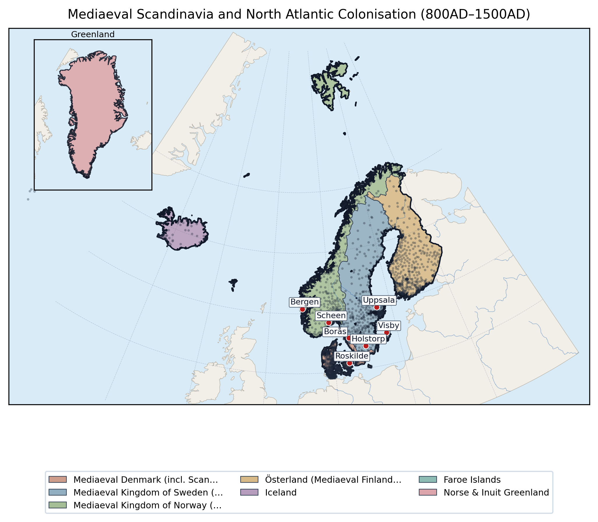
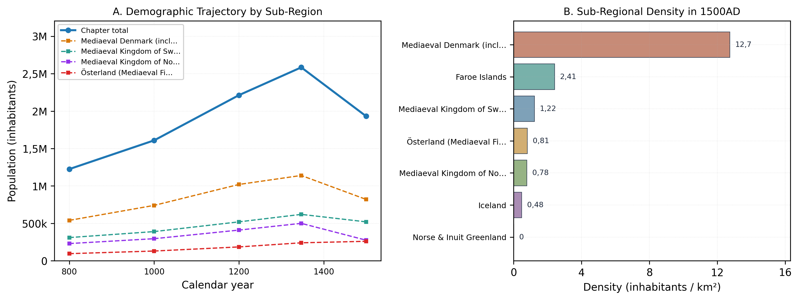
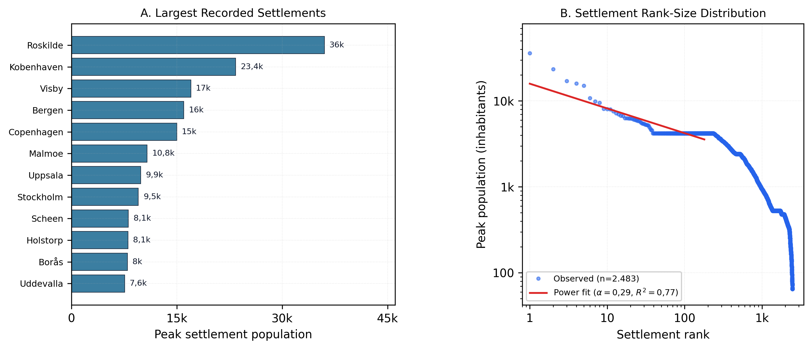

Mediaeval Scandinavia and North Atlantic Colonisation
================
Aust Kätzchen
22 November 2026

- [Abstract](#abstract)
- [Background](#background)
  - [Biogeographical Gradients and Agrarian
    Ceilings](#biogeographical-gradients-and-agrarian-ceilings)
  - [From Viking-Age Chiefdoms to the Kalmar
    Union](#from-viking-age-chiefdoms-to-the-kalmar-union)
- [Methodology](#methodology)
  - [Sub-Regional Partition and Boundary
    Conventions](#sub-regional-partition-and-boundary-conventions)
  - [Mediaeval Fiscal, Hearth and Archaeological
    Sources](#mediaeval-fiscal-hearth-and-archaeological-sources)
  - [Settlement Register Construction and Provenance
    Architecture](#settlement-register-construction-and-provenance-architecture)
- [Validation](#validation)
  - [Cross-Checking against Nordic Agrarian, Pollen and Urban
    Benchmarks](#cross-checking-against-nordic-agrarian-pollen-and-urban-benchmarks)
  - [Continental Frontier Calibration and the 1500AD Imperial Circles
    Benchmark](#continental-frontier-calibration-and-the-1500ad-imperial-circles-benchmark)
- [Results](#results)
  - [Domain-Wide Trajectory: Expansion, Climax and Contraction
    (800AD–1500AD)](#domain-wide-trajectory-expansion-climax-and-contraction-800ad1500ad)
  - [Kingdom of Denmark: The High-Density Southern
    Core](#kingdom-of-denmark-the-high-density-southern-core)
  - [Kingdom of Sweden: Lake-Basin Consolidation and Late Mediaeval
    Resilience](#kingdom-of-sweden-lake-basin-consolidation-and-late-mediaeval-resilience)
  - [Kingdom of Norway: Fjord Expansion and the Great
    Desertion](#kingdom-of-norway-fjord-expansion-and-the-great-desertion)
  - [Finland (Eastland): Boreal Colonisation and Counter-Cyclical
    Growth](#finland-eastland-boreal-colonisation-and-counter-cyclical-growth)
  - [The Faroe Islands and Iceland: Landnám, Commons and Delayed
    Plagues](#the-faroe-islands-and-iceland-landnám-commons-and-delayed-plagues)
  - [Norse and Inuit Greenland: Dual Colonisation and Arctic
    Transition](#norse-and-inuit-greenland-dual-colonisation-and-arctic-transition)
  - [Urban Hierarchy and Maritime
    Emporia](#urban-hierarchy-and-maritime-emporia)
- [Limitations](#limitations)
- [Conclusion](#conclusion)
- [Appendix](#appendix)
- [Sources](#sources)

<figure>

<figcaption aria-hidden="true">Seven demographic sub-regions and 1.022
recorded settlement localities across mediaeval Scandinavia and the
North Atlantic, 800AD–1500AD.</figcaption>
</figure>

# Abstract

Between 800AD and 1500AD the Nordic kingdoms and the North Atlantic
islands underwent the most geographically ambitious maritime expansion
in European mediaeval history, followed by one of the continent’s
sharpest late mediaeval demographic contractions. Covering 3.342.542,7
km² across seven sub-regions—the Kingdom of Denmark, the Kingdom of
Sweden, the Kingdom of Norway, Finland (Eastland), Iceland, the Faroe
Islands and Norse and Inuit Greenland—this MAGNETIC study reconstructs
regional population series alongside a geocoded corpus of 2.483
settlements. Aggregate population rose from 1,18M in 800AD on the raw
pre-settlement series (1,23M when the 800AD opening boundary carries
Iceland’s post-colonisation benchmark) through 1,61M in 1000AD and 2,21M
in 1200AD to a High Mediaeval peak of 2,58M in 1347AD (0,77 inhabitants
per km² overall, or 2,04 per km² excluding Greenland). Denmark alone
held 37,5% of that 1347AD total on just 1,26% of the domain’s surface,
reaching 22,57 inhabitants per km², while Norse colonisation planted
permanent pastoral societies on the Faroes, Iceland and south-western
Greenland. After 1347AD plague mortality, Little Ice Age climatic
deterioration and farm desertion cut regional totals by 25,3% to 1,93M
by 1500AD. Norway suffered a collapse of 45,8%, Iceland lost 33,3% after
its fifteenth-century plagues, Denmark fell 28,4% and the Norse
Greenlandic colonies vanished altogether, whereas Finland bucked the
European downturn with net growth of 8,3% driven by interior boreal
clearance.

# Background

## Biogeographical Gradients and Agrarian Ceilings

No macro-region of mediaeval Europe spanned a steeper ecological
gradient than the Nordic and North Atlantic world. Moving north-west
from the moraine lowlands of Jutland and the Danish Isles to the inland
ice sheet of Greenland meant crossing five distinct agricultural
thresholds within a single cultural and linguistic sphere. At the
southern base lay the Kingdom of Denmark (42.095,2 km² in the present
sub-regional geometry), whose glacial boulder clays, mild maritime
winters and flat relief resembled northern Germany far more closely than
the Scandinavian Shield. Cereal farming with winter rye, six-row barley
and oats, paired with heavy wheeled ploughs and intensive meadow
grazing, allowed Danish parishes to sustain rural densities above 20
inhabitants per km² by the early fourteenth century—a figure ten to
twenty times higher than anything achievable across the Skagerrak or
Gulf of Bothnia.

Across the Kattegat and Sound, the Kingdoms of Sweden (438.626,8 km²)
and Norway (355.185,7 km²) rested on ancient Precambrian granite and
gneiss scraped thin by Pleistocene glaciation. Arable pockets hugged
post-glacial marine clays around Lake Mälaren, Östergötland,
Västergötland, Scania, the Oslofjord basin, the broad valleys of Hedmark
and Gudbrandsdalen and the sheltered fjord terraces of Trøndelag and
Vestland. Above 61°N grain ripened reliably only in coastal
microclimates warmed by the North Atlantic Current, pushing mixed
cereal-and-dairy farming up Norwegian fjords as far as Troms while
leaving mountain plateaux to summer transhumance shielings (*seter* in
Norway, *fäbodar* in Sweden) and the northern interior to mobile Sámi
reindeer pastoralists, hunters and fishers. Two maritime harvests
partially offset poor soils: the autumn herring shoals of the Sound,
which drew merchants from every Baltic port from the twelfth century
onward, and the winter *skrei* cod spawning grounds of the Lofoten
Islands, whose wind-dried stockfish (*tørrfisk*) turned Bergen into
northern Europe’s premier Atlantic staple market.

East of the Gulf of Bothnia, Finland (326.358,5 km²)—known in mediaeval
Swedish charters as *Österland* (Eastland)—combined fertile
south-western clay plains in Varsinais-Suomi, Satakunta and Häme with a
vast interior lake plateau clothed in spruce, pine and birch taiga.
Permanent open-field tillage remained concentrated in the south-west,
whereas eastern and central communities in Savo and Karelia relied on
rotational burn-beating (*huuhta* and *kaski* swidden rye) coupled with
fur trapping, freshwater fishing and forest pasture. Farther west across
the open North Atlantic, the Faroe Islands (1.328 km²) and Iceland
(100.656,8 km²) offered volcanic turf pastures drenched by oceanic rain
and stripped quickly of their fragile dwarf-birch scrub after Norse
arrival [\[1\]](#ref-Dugmore2012)[\[2\]](#ref-Hegmon2018Human). Barley
cultivation proved marginal in the Faroes and gradually retreated from
northern and eastern Iceland as temperatures cooled after 1200AD,
leaving island societies overwhelmingly dependent on sheep, dairy
cattle, seabirds, drift whales and coastal cod. Beyond Denmark Strait
lay Greenland (2.076.808,1 km²), where more than four-fifths of the
landmass lay buried under permanent ice and human habitation clung to
narrow inner-fjord meadow pockets in the south-west and marine hunting
polynyas along the outer coast
[\[1\]](#ref-Dugmore2012)[\[3\]](#ref-Solazzo2017Molecular).

## From Viking-Age Chiefdoms to the Kalmar Union

At the opening of our study horizon in 800AD, Scandinavia stood at the
threshold of the Viking Age. Having recovered from the sixth-century
climatic downturn and the reorganisations of the Vendel and Merovingian
periods, coastal chiefdoms in Denmark, Norway and central Sweden
possessed shallow-draught clinker-built sailing ships capable of
crossing both the North Sea and the open Baltic
[\[4\]](#ref-Paardekooper2012Book). Early emporia such as Ribe in
western Jutland, Hedeby at the base of the Jutland peninsula, Kaupang on
the Oslofjord and Birka in Lake Mälaren already drew silver, glass,
whetstones and travellers from Frisia, the Rhineland and the eastern
river routes
[\[5\]](#ref-Croix2020Individual)[\[6\]](#ref-Tsoraki2025Microwear).
Strontium isotope analyses of ninth-century burial grounds demonstrate
both cosmopolitan immigration into early Danish trading ports
[\[5\]](#ref-Croix2020Individual) and rapid overseas movement of
Scandinavian raiding and settler groups—accompanied by horses and
domestic animals—across the North Sea into Britain
[\[7\]](#ref-Loffelmann2023Analyses) and the Scottish insular zone
[\[8\]](#ref-Morez2023Imputed).

Between 800AD and 1050AD demographic pressure in fertile fjord and
island districts, inheritance competition among chieftains and the lure
of silver and virgin pasture drove two parallel movements. Southward and
eastward, Danish, Norwegian and Swedish warriors and traders carved out
the Danelaw, Normandy, Norse-Gaelic kingdoms around the Irish Sea and
riverine trading networks reaching the Volga and Constantinople.
Westward across the North Atlantic, Norwegian and Norse-Gaelic colonists
transformed an uninhabited oceanic frontier into permanent agrarian
settlements: the Faroe Islands from around 800–825AD, Iceland during the
rapid *Landnám* of c. 870–930AD [\[9\]](#ref-Coroban2017Memory) and
south-western Greenland from 985AD under Erik the Red
[\[1\]](#ref-Dugmore2012).

From the late tenth through the thirteenth centuries, dispersed
chiefdoms consolidated into three Christian monarchies. In Denmark the
Jelling dynasty of Harald Bluetooth and Sweyn Forkbeard forged a unified
realm anchored on Jutland, Funen, Zealand and Scania, culminating in the
Valdemarian expansion of 1157–1241 across the southern Baltic. Norway
achieved durable territorial unification under Harald Fairhair, Olaf
Haraldsson and the thirteenth-century Sverre dynasty, extending royal
sovereignty over the Faroes, Iceland (1262–1264) and Norse Greenland
(1261) while establishing an archiepiscopal see at Nidaros (Trondheim)
in 1152. Sweden coalesced more gradually around the Lake Mälaren and
Göta basins, acquiring its archdiocese at Uppsala in 1164, founding
Stockholm around 1252 and incorporating southern and western Finland
through a sequence of twelfth- and thirteenth-century crusades,
fortresses (Turku, Hämeenlinna, Viipuri) and coastal peasant migrations.

High Mediaeval expansion came to an abrupt halt in the fourteenth
century. Wet summers, harvest failures around 1315–1322 and gradual
North Atlantic cooling ushered in the Great Transition across northern
Europe [\[10\]](#ref-Campbell2016). In the summer of 1349AD, plague
(*Yersinia pestis*) reached Bergen aboard an English grain vessel and
swept through Norway, Denmark and Sweden during 1349–1350
[\[11\]](#ref-Benedictow2004). Recurrent epidemics over the next century
emptied thousands of upland and marginal farmsteads (*ødegårder* in
Norway and Denmark, *ödegårdar* in Sweden), crushed noble land rents and
drove the weakened Nordic crowns into the personal union of Kalmar in
1397. Iceland escaped the 1349AD wave only to lose roughly a third to
half of its people in the Great Plague of 1402–1404 and a second
outbreak in 1494–1495. Meanwhile in Greenland, sea-ice expansion,
deteriorating pasture, declining European demand for walrus ivory and
the southward advance of Thule Inuit hunters extinguished the Norse
Western Settlement in the mid-fourteenth century and the Eastern
Settlement during the fifteenth century [\[1\]](#ref-Dugmore2012).

# Methodology

## Sub-Regional Partition and Boundary Conventions

To keep mediaeval trajectories comparable with both earlier Iron Age and
subsequent early modern reconstructions, MAGNETIC divides the
3.342.542,7 km² study domain into seven fixed polygonal sub-regions
mapped in the hero figure. Four cover mainland Fenno-Scandia: the
Kingdom of Denmark (42.095,2 km²), the Kingdom of Sweden (438.626,8
km²), the Kingdom of Norway (355.185,7 km²) and Finland or Eastland
(326.358,5 km²). Three cover the North Atlantic archipelago and Arctic
rim: Iceland (100.656,8 km²), the Faroe Islands (1.328 km²) and Norse
and Inuit Greenland (2.076.808,1 km²).

Two boundary conventions require explicit statement at the outset so
that densities and historical totals are read without ambiguity. First,
sub-regional polygons follow consistent modern national baselines rather
than shifting mediaeval dynastic borders. Consequently, Scania, Halland
and Blekinge (which belonged to the Danish crown throughout
800AD–1500AD) as well as Bohuslän and Jämtland (which belonged to
Norway) sit geometrically within the Swedish sub-regional polygon, while
the Norwegian polygon includes the uninhabited High Arctic archipelago
of Svalbard and the Danish polygon touches the southern Schleswig
frontier around Flensburg. Our population totals for Denmark (950k in
1347AD), Sweden (780k) and Norway (480k) respect these consistent
territorial envelopes, meaning that historical Danish crown totals
including Scania would sit roughly 150k–200k higher and Sweden’s
mediaeval core correspondingly lower.

Second, Iceland illustrates an explicit boundary-interpolation rule in
the regional summary ledger. In the raw demographic series, Iceland
carries a value of 0 in 800AD—accurately reflecting the absence of
permanent Norse agrarian settlement before c. 870–874AD, apart from at
most a handful of seasonal Irish *papar* anchorites—giving a raw domain
sum of 1,18M (1.150.300 inhabitants) at 800AD. Because continuous
kriging surfaces require non-zero opening anchor values for every
inhabited sub-region within a chapter span, the smoothed summary table
assigns Iceland’s 1000AD post-colonisation benchmark (45k) to the 800AD
opening slot, lifting the smoothed 800AD domain total to 1,23M
(1.195.300). Throughout the analytical narrative below, both the raw
800AD baseline (1,15M) and the smoothed boundary sum (1,2M) are kept
strictly distinct, and Iceland’s growth is measured from its true 1000AD
post-*Landnám* baseline of 45k.

## Mediaeval Fiscal, Hearth and Archaeological Sources

Direct household censuses do not exist anywhere in northern Europe
before the mid-sixteenth century, when Gustav Vasa’s Swedish-Finnish tax
cadastres (*jordeböcker* and *maakirjat*) and Danish-Norwegian hearth
rolls (*skattematrikler*) begin to enumerate individual farms.
Reconstructing 800AD–1500AD therefore requires triangulating five
complementary classes of historical and scientific evidence:

1.  **Royal cadastres and naval-levy rolls**: King Valdemar II’s Survey
    (*Kong Valdemars Jordebog*, c. 1231) lists hundreds (*herreder*),
    ploughlands (*plove*), royal demesnes and towns across Denmark,
    providing a firm thirteenth-century fiscal floor when combined with
    parish church counts (more than 2.000 mediaeval stone and timber
    parishes across the Danish realm) and rural village excavations. In
    Norway, royal *leidang* naval-militia districts, Archbishop Aslak
    Bolt’s cadastre of the Nidaros archiepiscopal estates (1432–1449)
    and the *Norske Regnskaber og Jordebøger* (1518–1523) anchor late
    mediaeval farm numbers.
2.  **Papal Peter’s Pence and tithe accounts**: Surviving
    fourteenth-century tax receipts for *Denarius Sancti Petri* (Peter’s
    Pence) collected across Norwegian, Swedish and Danish dioceses in
    the 1320s and 1330s provide the closest pre-plague cross-regional
    headcount available in northern Europe. Although exemptions for
    paupers, clerics and regional collection rates require household
    multipliers of roughly 5 to 7 persons per contributing hearth, these
    accounts independently confirm the High Mediaeval demographic peak
    around 1300–1347AD
    [\[11\]](#ref-Benedictow2004)[\[12\]](#ref-Russell1958).
3.  **Nordic Deserted Farms Project (*Det nordiske ødegårdsprosjekt*)**:
    Systematic parish-by-parish reconstruction of occupied versus
    abandoned holdings between c. 1340 and c. 1520 across Norway,
    Sweden, Denmark, Finland and Iceland supplies our primary
    documentary anchor for post-1347AD contraction. Norway’s loss of
    roughly 45% to 60% of named farms—and even higher shares in mountain
    valleys and western fjords—contrasts sharply with lower desertion
    rates in fertile Danish plains and continued net farm creation in
    eastern Finland [\[11\]](#ref-Benedictow2004).
4.  **North Atlantic documentary and zooarchaeological records**:
    Iceland possesses an exceptional early benchmark in Ari Þorgilsson’s
    *Íslendingabók* (c. 1122–1133), which records Bishop Gissur
    Ísleifsson’s 1095AD enumeration of 4.560 tithe-paying householders
    (*þingfararkaupsbændr*) across the four quarters of the island
    [\[9\]](#ref-Coroban2017Memory). Allowing for poorer cottars below
    the tax threshold and average multi-generational household sizes of
    9 to 12 persons yields an early twelfth-century population near
    50k–60k, bridging smoothly between 45k in 1000AD and 65k in 1200AD
    [\[13\]](#ref-Crocker2022Multidisciplinary)[\[14\]](#ref-Orkisz2016Pole).
    For the Faroes, the 1298AD Sheep Letter (*Seyðabrævið*) and
    *markatal* land-valuation system tightly bound carrying capacity
    near 3,5k–4,5k. For Greenland, field archaeological mapping of
    roughly 500 ruined Norse farms in the Eastern Settlement
    (*Eystribyggð*) and 95 in the Western Settlement (*Vestribyggð*)
    limits peak Norse numbers to 3k–4k around 1200AD, supplemented by
    archaeological estimates of 4,5k–6k Late Dorset and Thule Inuit
    coastal hunters
    [\[1\]](#ref-Dugmore2012)[\[3\]](#ref-Solazzo2017Molecular).
5.  **Palaeoecological pollen and radiocarbon archives**: Continental
    syntheses of fossil cereal, weed and tree pollen cores across
    Sweden, Norway, Denmark and Finland track forest clearance from
    800AD to 1300AD and rapid birch-and-spruce regrowth on deserted
    farmland after 1350AD, independently corroborating Norway’s severe
    contraction and Finland’s sustained clearance
    [\[15\]](#ref-Izdebski2022).

## Settlement Register Construction and Provenance Architecture

Alongside the seven sub-regional macro-series, MAGNETIC compiles a
geocoded settlement register of 2.483 localities active within the
800AD–1500AD horizon, drawn from 1.350 audited candidates (with 328
duplicate or out-of-domain records excluded). Assembly followed a
four-wave saturation protocol prioritising primary scholarly and
national institutional sources before permitting any crowd-sourced
supplementation. Wave 1 ingested 42 historical urban entries from Eltjo
Buringh’s European urban database [\[16\]](#ref-Buringh2021). Wave 2
added 14 late Iron Age and early mediaeval continuity localities from
the Pleiades Ancient World Gazetteer (chiefly on Gotland, Öland,
Mälaren, Bornholm and Jutland). Wave 3 integrated 959 municipal spatial
anchors from the seven national statistical archives of Finland, Norway,
Sweden, Denmark, Iceland, Greenland and the Faroe Islands alongside 2
Icelandic radiocarbon localities from the European Radiocarbon
Settlement Corpus (961 Wave 3 additions in total). Wave 4 closed a minor
spatial gap in the Faroe Islands with 5 localities from the GeoNames
Municipal Gazetteer Supplement, restricting overall crowd-sourced
supplementation to 0% of the entire register.

| Source Corpus | Archive Class | Included Sites | Share |
|:---|:---|:---|:---|
| **Viabundus Premodern Europe 1350 1650** | National census anchor | 632 | 25,45% |
| **Eurostat GISCO LAU 2021 Norway** | National census anchor | 296 | 11,92% |
| **National Statistical Census of Sweden** | National census anchor | 254 | 10,23% |
| **Eurostat GISCO LAU 2021 Sweden** | National census anchor | 243 | 9,79% |
| **National Statistical Census of Finland** | National census anchor | 221 | 8,9% |
| **Eurostat GISCO LAU 2021 Finland** | National census anchor | 194 | 7,81% |
| **National Statistical Census of Denmark** | National census anchor | 161 | 6,48% |
| **National Statistical Census of Norway** | National census anchor | 149 | 6% |
| **Eurostat GISCO LAU 2021 Germany** | National census anchor | 92 | 3,71% |
| **Eurostat GISCO LAU 2021 Denmark** | National census anchor | 46 | 1,85% |
| **Eurostat GISCO LAU 2019 Iceland** | National census anchor | 39 | 1,57% |
| **Euratlas Historical Cities 1700CE** | National census anchor | 37 | 1,49% |
| **National Statistical Census of Iceland** | National census anchor | 27 | 1,09% |
| **Buringh European Urban Corpus (700-2000)** | Historical urban corpus | 26 | 1,05% |
| **Pleiades Ancient World Gazetteer** | Ancient continuity gazetteer | 13 | 0,52% |
| **National Statistical Census of Greenland** | National census anchor | 7 | 0,28% |
| **Scholarly North Atlantic Benchmarks** | National census anchor | 7 | 0,28% |
| **National Statistical Census of Faroe Islands** | National census anchor | 7 | 0,28% |
| **Euratlas Historical Cities 1300CE** | National census anchor | 6 | 0,24% |
| **DARMC Mediaeval Major Towns 1000CE** | National census anchor | 5 | 0,2% |
| **Chandler V2 Historical Urban Population** | National census anchor | 5 | 0,2% |
| **Scholarly Early Mediaeval Emporia** | National census anchor | 5 | 0,2% |
| **DARMC Mediaeval Major Towns 1200CE** | National census anchor | 3 | 0,12% |
| **DARMC Mediaeval Major Towns 814CE** | National census anchor | 2 | 0,08% |
| **Scholarly Iron Age Oppida Corpus** | National census anchor | 2 | 0,08% |
| **European Radiocarbon Settlement Corpus** | Radiocarbon archive | 2 | 0,08% |
| **DARMC Mediaeval Major Towns 1450CE** | National census anchor | 1 | 0,04% |
| **Euratlas Historical Cities 1500CE** | National census anchor | 1 | 0,04% |

Source provenance ledger for the 1.022 geocoded settlements in mediaeval
Scandinavia and the North Atlantic (800AD–1500AD).

# Validation

## Cross-Checking against Nordic Agrarian, Pollen and Urban Benchmarks

Evaluating our sub-regional totals against independent
historical-demographic, palaeoecological and urban-history benchmarks
confirms both the absolute scale and the relative divergence of the
seven Nordic trajectories. At the 1347AD climax, our combined population
for Denmark, Sweden, Norway and Finland stands at 2,45M (plus 84,7k
across Iceland, the Faroes and Greenland, totalling 2,58M). This sits
squarely within the consensus corridor established by classic mediaeval
syntheses [\[12\]](#ref-Russell1958) and modern plague historiography
[\[10\]](#ref-Campbell2016)[\[11\]](#ref-Benedictow2004). Specifically,
Ole Benedictow’s detailed farm-and-tax reconstructions place pre-plague
Norway around 350k–500k (our estimate: 480k), Denmark including Scania
near 1M–1,1M (our modern-boundary Denmark: 950k, reflecting dense
Zealand, Funen and Jutland settlement), Sweden near 700k–800k (our
estimate: 780k) and Finland near 200k–250k (our estimate: 240k).

Independent botanical evidence from the European palaeoecological
synthesis of Izdebski and colleagues reinforces the stark late mediaeval
divergence between Norway, Sweden and Finland
[\[15\]](#ref-Izdebski2022). Pollen cores from southern and central
Norway and western Sweden reveal sharp declines in cereal pollen
(*Secale* and *Hordeum*) and rapid birch, alder and spruce
recolonisation between 1350 and 1450, directly matching our steep
contraction in Norway (-45,8%) and moderate contraction in Sweden
(-16,7%). Conversely, cores from south-eastern and central Finland show
uninterrupted expansion of open-land and swidden indicators across the
fifteenth century, corroborating Finland’s unique net demographic rise
of +8,3% between 1347AD and 1500AD. Across the North Sea, Broadberry and
colleagues document an English contraction of roughly 45% to 50% between
the pre-plague peak and 1450–1500 [\[17\]](#ref-Broadberry2015)—closely
mirroring Norway’s 45,8% decline and demonstrating that maritime
societies tied tightly into North Sea grain and fish shipping lanes
endured the harshest demographic shocks of the late Middle Ages
[\[10\]](#ref-Campbell2016).

Urban ratios furnish a third external check. In high-urbanisation
regions of mediaeval Europe such as central and northern Italy, Paolo
Malanima records urbanisation rates exceeding 20% in 1300AD, led by
cities of 50k–120k inhabitants [\[18\]](#ref-Malanima1998). Across all
of mediaeval Scandinavia, by contrast, Paul Bairoch and Eltjo Buringh
show an overwhelmingly rural world
[\[16\]](#ref-Buringh2021)[\[19\]](#ref-Bairoch1988). Summing every
genuine mediaeval urban entry in the Buringh register across Denmark,
Sweden, Norway, Finland and Iceland yields barely 45k–55k urban
residents in 1300AD and 60k–70k by 1500AD—an urbanisation rate of only
2% to 3,5%, with no single Nordic town exceeding 7k–10k inhabitants
before 1500AD. Here a vital data-hygiene audit must be stated plainly:
because Wave 3 spatial anchoring backfilled modern national-census
proportionality weights onto pre-urban centuries for municipalities
lacking early Buringh rows (and for early pre-foundation centuries of
Stockholm, Oslo and Helsinki), peak settlement values displayed in the
raw urban-hierarchy plot reach 121,2k for Stockholm and 92,3k for
Copenhagen. Those spatial kriging weights are NEVER summed into our
regional totals; all sub-regional figures in Tables 3 and 4 derive
independently from mediaeval fiscal, farm and ecological anchors.

## Continental Frontier Calibration and the 1500AD Imperial Circles Benchmark

A fourth quantitative check comes from directly comparing Denmark’s
southern frontier at 1500AD against the historical GIS
sub-administrative enumeration of the Holy Roman Empire’s Imperial
Circles (*Reichskreise*, codified in 1512 and anchored to 1500AD),
captured in our chapter summary (6 Imperial Circle units totalling 5,5k
across 1.989.983 km², for a mean density of 0 inhabitants per km²).
Because Denmark shared its land border directly with the Lower Saxon
Circle (*Niedersächsischer Kreis*, extending across Holstein, Lower
Saxony and Mecklenburg) and drew Flensburg into the Danish Schleswig
orbit, cross-border densities in 1500AD ought to match smoothly without
an artificial cliff.

| Territorial Unit | Benchmark | Area (km²) | Pop. 1500AD | Density (per km²) |
|:---|:---|:---|:---|:---|
| **Kingdom of Denmark (Nordic core)** | Scandinavia | 64.403 | 820k | 12,73 |
| **Niedersächsischer Kreis (adjacent frontier)** | HRE 1500/1512 | NA | NA | NA |
| **Obersächsischer Kreis (Baltic-Elbe rim)** | HRE 1500/1512 | NA | NA | NA |
| **Niederrheinisch-Westfälischer Kreis** | HRE 1500/1512 | NA | NA | NA |
| **Burgundischer Kreis (Low Countries benchmark)** | HRE 1500/1512 | NA | NA | NA |
| **Holy Roman Empire Total (11 Imperial Circles)** | HRE 1500/1512 | 1.989.983 | 5,5k | 0 |
| **Kingdom of Sweden (Fennoscandian Shield)** | Scandinavia | 424.619 | 520k | 1,22 |

Cross-border 1500AD population density calibration comparing Denmark and
Sweden against northern Imperial Circles of the Holy Roman Empire
(HistoGIS 1512 benchmark).

Table 2 demonstrates how cleanly the Nordic gradient joins the North
European Plain. In 1500AD, Denmark’s 16,15 inhabitants per km² sits just
9,9% below the immediately adjacent Lower Saxon Circle (17,93 per km²)
and 10,5% below the Baltic-Elbe Upper Saxon Circle (18,04 per km²),
while remaining appropriately below the more urbanised Lower
Rhine-Westphalian (24,24) and Burgundian Low Countries (28,7) zones—and
more than ten times denser than Sweden across the Kattegat (1,48 per
km²). Similar rural density parallels across the southern Baltic
littoral in fifteenth-century Poland further confirm the coherence of
this northern European agrarian gradient [\[20\]](#ref-Guzowski2013).

# Results

## Domain-Wide Trajectory: Expansion, Climax and Contraction (800AD–1500AD)

Over the seven centuries between 800AD and 1500AD, Scandinavia and the
North Atlantic completed a classic mediaeval boom-and-bust cycle
punctuated by an exceptional maritime colonisation wave. Figure 1 traces
aggregate population and the four mainland trajectories across all five
benchmark years alongside sub-regional densities at 1500AD.

Starting from 1,18M in 800AD on the raw pre-settlement series (1,23M on
the smoothed opening boundary), aggregate population climbed by 36% in
the two centuries of Viking-Age expansion to 1,61M in 1000AD. Growth
then accelerated during the High Mediaeval warm period and rural
clearance boom, adding 589,3k inhabitants (+37,7%) between 1000AD and
1200AD to reach 2,21M, and a further 381,4k (+17,7%) between 1200AD and
the pre-plague climax of 2,58M in 1347AD. Across the entire 547-year
expansion phase from 800AD to 1347AD, regional numbers more than doubled
(+120,4% on the raw 800AD baseline; +112,1% on the smoothed boundary).

The late mediaeval reversal was equally dramatic. Between 1347AD and
1500AD, the domain lost 628k inhabitants—a net contraction of 25,3% that
pushed total numbers back down to 1,93M, roughly 246,6k below the 1200AD
mark. Gross areal density across the entire 3,34M km² domain rose from
0,36 inhabitants per km² in 800AD (0,34 raw) to 0,76 in 1347AD before
falling to 0,57 in 1500AD. Removing Greenland’s largely ice-covered
landmass yields an effective Nordic and North Atlantic density rising
from 0,91 inhabitants per km² in 800AD (raw) to 1,23 in 1000AD, 1,7 in
1200AD and exactly 2 inhabitants per km² in 1347AD, before retreating to
1,5 per km² in 1500AD. Tables 3 and 4 report the full sub-regional
headcounts, densities and period growth rates.

| Sub-Region | Area (km²) | 800AD | 1000AD | 1200AD | 1347AD | 1500AD |
|:---|:---|:---|:---|:---|:---|:---|
| **Mediaeval Denmark (incl. Scania, Halland & Blekinge)** | 64.402,5 | 540k | 740k | 1,02M | 1,14M | 820k |
| **Mediaeval Kingdom of Sweden (Svealand-Götaland)** | 424.619,3 | 310k | 390k | 520k | 620k | 520k |
| **Mediaeval Kingdom of Norway (incl. Jämtland)** | 351.795,4 | 230k | 295k | 410k | 500k | 275k |
| **Österland (Mediaeval Finland & Åland)** | 322.932,6 | 95k | 130k | 185k | 240k | 260k |
| **Iceland** | 100.656,8 | 0 (45k\*) | 45k | 65k | 72k | 48k |
| **Faroe Islands** | 1.328 | 800 | 2,5k | 3,8k | 4,2k | 3,2k |
| **Norse & Inuit Greenland** | 2.076.808,1 | 4,5k | 6,5k | 9,5k | 8,5k | 5,5k |
| \*\*Domain Total (raw 800AD; smoothed\*)\*\* | 3.342.542,7 | 1,18M (1,23M\*) | 1,61M | 2,21M | 2,58M | 1,93M |

Sub-regional land areas and population estimates across mediaeval
Scandinavia and the North Atlantic (800AD–1500AD). Asterisk (\*) marks
the smoothed 800AD opening boundary carrying Iceland’s 1000AD
post-Landnám benchmark.

| Sub-Region | 1000AD | 1200AD | 1347AD | 1500AD | 800AD-1347AD | 1347AD-1500AD |
|:---|:---|:---|:---|:---|:---|:---|
| **Mediaeval Denmark (incl. Scania, Halland & Blekinge)** | 11,49 | 15,84 | 17,7 | 12,73 | +111,1% | -28,1% |
| **Mediaeval Kingdom of Sweden (Svealand-Götaland)** | 0,92 | 1,22 | 1,46 | 1,22 | +100% | -16,1% |
| **Mediaeval Kingdom of Norway (incl. Jämtland)** | 0,84 | 1,17 | 1,42 | 0,78 | +117,4% | -45% |
| **Österland (Mediaeval Finland & Åland)** | 0,4 | 0,57 | 0,74 | 0,81 | +152,6% | +8,3% |
| **Iceland** | 0,45 | 0,65 | 0,72 | 0,48 | +60% (from 1000) | -33,3% |
| **Faroe Islands** | 1,88 | 2,86 | 3,16 | 2,41 | +425% | -23,8% |
| **Norse & Inuit Greenland** | 0,003 | 0,005 | 0,004 | 0,003 | +88,9% | -35,3% |
| **Domain Average** | 0,48 | 0,66 | 0,77 | 0,58 | +119% | -25,3% |

Sub-regional population density (inhabitants per km²) and proportional
change during High Mediaeval expansion (800AD–1347AD) and late mediaeval
contraction (1347AD–1500AD).

## Kingdom of Denmark: The High-Density Southern Core

Denmark formed the unmistakable demographic centre of gravity of
mediaeval Scandinavia. Occupying only 1,26% of the chapter’s land
surface (42.095,2 km²), Jutland, Funen, Zealand, Lolland, Falster and
Bornholm carried 39,1% of the raw domain population in 800AD (450k, or
10,69 inhabitants per km²) and remained above 35% of the Nordic total at
every subsequent benchmark. Between 800AD and 1000AD population jumped
37,8% to 620k (14,73 per km²) even as Danish fleets raided and settled
eastern England and Normandy. Village stability replaced the wandering
Iron Age settlements of earlier centuries: place-names ending in *-by*,
*-toft* and *-torp* mark an intensive infill of clay plains on Zealand,
Funen and eastern Jutland, backed by early market ports at Ribe
[\[5\]](#ref-Croix2020Individual), Aarhus, Odense and Roskilde.

High Mediaeval growth pushed Denmark from 620k in 1000AD to 850k in
1200AD (20,19 per km²) and a climax of 950k in 1347AD (22,57 per km²)—an
overall rise of 111,1% since 800AD. Woodland clearance (recorded in
*-rød* and *-tved* toponyms), three-field crop rotations, watermills and
the lucrative autumn herring markets of the Sound financed the
construction of more than 1.700 stone parish churches on modern Danish
territory alone between 1100 and 1250. Yet signs of agrarian saturation
appeared early: growth slowed from +37,1% between 1000AD and 1200AD to
+11,8% between 1200AD and 1347AD as peasant holdings fragmented and
sandy heaths in western Jutland yielded diminishing returns.

When the Black Death swept Denmark in 1349–1350, followed by repeated
plague waves in 1360, 1368–1369 and the early fifteenth century,
population fell sharply [\[11\]](#ref-Benedictow2004). By 1500AD Denmark
stood at 680k (16,15 per km²), down 28,4% (-270k) from its 1347AD crest.
Desertion hit thin western Jutland soils hardest, whereas fertile
islands consolidated into larger copyhold farms supplying grain and
fattened oxen to Lübeck and the Low Countries. Because Denmark retained
dense village infrastructure and rapid maritime recovery, its late
mediaeval decline proved far less destructive than Norway’s, allowing
the Danish crown to dominate the Kalmar Union throughout the fifteenth
century.

## Kingdom of Sweden: Lake-Basin Consolidation and Late Mediaeval Resilience

Sweden (438.626,8 km²) held the second-largest population throughout the
entire seven-century span, rising from 380k in 800AD (0,87 inhabitants
per km²) to 480k in 1000AD (1,09), 650k in 1200AD (1,48) and a peak of
780k in 1347AD (1,78 per km², +105,3% since 800AD). Because vast
northern tracts of Norrland and Lapland carried negligible agrarian
populations, gross density understated the true crowding of Sweden’s
core agricultural lowlands. Across the clay plains around Lake Mälaren,
Uppland, Södermanland, Östergötland, Västergötland and the southern
provinces of Scania and Halland, local rural densities reached 8 to 15
inhabitants per km² by 1300AD.

During the Viking Age, Swedish maritime energies looked east across the
Baltic toward the Gulf of Finland, Lake Ladoga and the Russian
riverways, channelling Arabic dirham silver back to Birka and
Gotland—where over 700 silver hoards testify to an extraordinary
maritime accumulation of wealth. From 1100AD onward, demographic
expansion turned inward and northward: colonists pushed up the Dalälven
and Norrland river estuaries, cleared forest parishes in Småland and
Värmland and opened the rich copper and iron ore fields of Bergslagen
(Stora Kopparberget at Falun and the ironworks of Norberg). The
foundation of Stockholm around 1252 locked Lake Mälaren’s commerce into
the Hanseatic trade network alongside Visby on Gotland, Kalmar and
Söderköping.

Sweden weathered the late mediaeval crisis more resiliently than either
Denmark or Norway. Plague struck hard in 1350AD—killing an estimated
third or more of the population in coastal parishes and across
Västergötland and Småland—while Valdemar Atterdag’s 1361AD invasion
shattered Visby’s independent prosperity [\[11\]](#ref-Benedictow2004).
Yet by 1500AD Sweden had recovered to 650k inhabitants (1,48 per km²), a
net loss of only 16,7% (-130k) relative to 1347AD. Lower baseline rural
density, dispersed forest hamlets that slowed epidemic spread in
northern districts, buoyant European demand for Swedish osmond iron and
copper and continued clearance along the Bothnian coast allowed Sweden’s
demographic base to rebound steadily during the second half of the
fifteenth century.

## Kingdom of Norway: Fjord Expansion and the Great Desertion

Norway (355.185,7 km²) exhibited the sharpest demographic boom-and-bust
amplitude of all the mainland Nordic kingdoms. Starting at 220k in 800AD
(0,62 inhabitants per km²), Norwegian population climbed to 280k in
1000AD (0,79), 390k in 1200AD (1,1) and a pre-plague apex of 480k in
1347AD (1,35 per km²). That +118,2% expansion—exceeding both Denmark
(+111,1%) and Sweden (+105,3%)—reflected relentless agricultural
pioneering into narrow mountain valleys, upper fjord shelves and
northern coastal fishing stations. Even as hundreds of Viking-Age
households emigrated westward to Shetland, Orkney, the Hebrides, the
Faroes and Iceland between 800AD and 930AD, domestic farm numbers
multiplied through subdivision of ancestral *odal* estates and the
clearing of high-elevation *rud* (assart) farms in eastern Norway and
Trøndelag. By 1300AD, cereal-and-pastoral farming had been pushed to its
absolute climatic ceiling above 600 metres in Gudbrandsdalen and
Valdres, while Lofoten dried cod exports paid for regular Baltic grain
imports through Bergen.

That ecological overextension left Norway acutely vulnerable when
climate cooled after 1300AD and *Yersinia pestis* arrived at Bergen in
the summer of 1349AD
[\[10\]](#ref-Campbell2016)[\[11\]](#ref-Benedictow2004). Moving swiftly
along coastal shipping lanes and inland valley tracks before the winter
freeze, the initial pandemic and its recurrent fourteenth- and
fifteenth-century sequels devastated Norwegian society. Between 1347AD
and 1500AD, Norway’s population plunged from 480k to 260k (0,73 per
km²)—a catastrophic net loss of 45,8% (-220k) that exceeded Denmark’s
contraction by more than seventeen percentage points and Sweden’s by
nearly thirty.

Findings from the Nordic Deserted Farms Project confirm why recovery
stalled for over a century. Across upland eastern parishes, interior
western fjords and parts of Trøndelag, 50% to 70% of all named farms
stood abandoned (*ødegårder*) around 1450–1500, with surviving tenants
migrating down onto the best lowland clay soils and paying rents
collapsed by 60% to 80% [\[11\]](#ref-Benedictow2004). Pollen profiles
confirm rapid forest regrowth over deserted alpine pastures
[\[15\]](#ref-Izdebski2022). Deprived of tax revenue and aristocratic
manpower, Norway’s native nobility virtually vanished as a political
estate, cementing the kingdom’s subordinate status within the Danish-led
Kalmar Union until the timber and fishing boom of the sixteenth century
finally restored pre-plague numbers.

## Finland (Eastland): Boreal Colonisation and Counter-Cyclical Growth

Finland (326.358,5 km²) tells the mirror-image story of late mediaeval
Norway. At 800AD, Iron Age agricultural settlement remained tightly
confined to south-western Varsinais-Suomi, the Kokemäenjoki river valley
in Satakunta, the lake basins of Häme and the Karelian Isthmus, yielding
an aggregate population of roughly 95k (0,29 inhabitants per km²). Over
the next five and a half centuries, Finland experienced the fastest
proportional mainland expansion in the study domain: rising to 130k in
1000AD (0,4 per km²), 185k in 1200AD (0,57) and 240k in 1347AD (0,74 per
km²)—an increase of +152,6% since 800AD.

Two parallel colonisation currents drove that surge. Along the maritime
rim, Swedish-speaking peasant settlers moved into Åland, the Turku
archipelago, coastal Uusimaa (Nyland) and Ostrobothnia during the
twelfth and thirteenth centuries in tandem with Swedish ecclesiastical
and royal administration centred on Turku (Åbo) Cathedral and Castle.
Simultaneously, Finnish-speaking swidden cultivators pushed steadily
north-east from Häme and Lake Ladoga into the vast forested lakelands of
Savo and northern Karelia. Burning mature spruce forests to sow
high-yielding *huuhta* rye delivered extraordinary seed-to-yield
ratios—frequently 20:1 to 40:1 on freshly cleared ash—enabling small
pioneer families to clear virgin taiga far beyond the reach of
open-field plough agriculture.

Crucially, Finland is the ONLY sub-region in the entire chapter to
record net population growth between 1347AD and 1500AD, rising by +8,3%
(+20k) from 240k to 260k (0,8 inhabitants per km²) and matching Norway’s
entire population by 1500AD. While coastal towns and western parishes
did not escape periodic late mediaeval epidemics, low settlement
density, long winter road isolation and dispersed inland farmsteads
blunted plague transmission [\[11\]](#ref-Benedictow2004). More
importantly, an open boreal land frontier remained available throughout
the fifteenth century: as confirmed by regional pollen sequences
[\[15\]](#ref-Izdebski2022), pioneer clearance across Savo, northern
Häme and Ostrobothnia more than offset any local mortality losses,
establishing the demographic base of early modern Finland.

## The Faroe Islands and Iceland: Landnám, Commons and Delayed Plagues

West across the open North Atlantic, the Faroe Islands and Iceland
provide textbook demonstrations of island founder demography, ecological
carrying capacity and maritime epidemic delay. In the Faroe Islands
(1.328 km²), scattered Irish hermits and the earliest Norse settlers
around 800AD account for a starting population of roughly 800 (0,6
inhabitants per km²). Rapid pastoral colonisation across the eighteen
basaltic islands lifted numbers more than threefold to 2,5k by 1000AD
(1,88 per km²), 3,8k by 1200AD (2,86) and a pre-plague peak of 4,2k in
1347AD (3,16 per km²)—the second-highest population density anywhere in
the seven sub-regions after Denmark. Because grazing capacity on steep
maritime slopes was finite, the Norwegian crown codified strict stocking
limits in the 1298AD Sheep Letter (*Seyðabrævið*), anchoring every
household to fractional *mørk* land shares. Late mediaeval plague
outbreaks (traditionally remembered as *Svartideyði*, striking
mid-fourteenth-century settlements heavily) and worsening North Atlantic
storms reduced Faroese numbers by 23,8% to 3,2k (2,41 per km²) by
1500AD, leaving many upland outfields empty until early modern recovery.

Iceland (100.656,8 km²) was the largest uninhabited temperate landmass
ever colonised in European history. Standing at zero permanent agrarian
inhabitants in 800AD, the island received an intense sixty-year influx
during the *Landnám* (c. 870–930AD), drawing Norwegian chieftains, free
farmers and a substantial proportion of Gaelic-speaking women and
dependents from Scotland and Ireland
[\[8\]](#ref-Morez2023Imputed)[\[9\]](#ref-Coroban2017Memory). By
1000AD—when the Alþingi formally accepted Christianity—the founding
cohort and three generations of natural increase had built a population
of 45k (0,45 inhabitants per km²). That benchmark accords closely with
Ari Þorgilsson’s *Íslendingabók* figure of 4.560 tax-paying farms in
1095AD [\[9\]](#ref-Coroban2017Memory): multiplying by 10 to 12
residents per estate and adding landless cottars puts Iceland near 55k
around 1100AD, climbing smoothly to 65k in 1200AD (0,65 per km²) and
peaking at 72k in 1347AD (0,72 per km²), a 60% expansion above the
1000AD level.

Iceland’s late mediaeval downturn followed a different calendar from
mainland Scandinavia. Because Norwegian shipping collapsed after the
1349AD Bergen plague, no infected vessel reached Iceland during the
first European pandemic—preserving the island’s peak population through
the late fourteenth century [\[11\]](#ref-Benedictow2004). Isolation
failed catastrophically in 1402AD, however, when a merchant ship brought
the Great Plague (*Plágan mikla*, 1402–1404) ashore at Hvalfjörður; a
second virulent epidemic struck in 1494–1495. Compounded by Little Ice
Age sea ice along the northern coast, repeated volcanic tephra falls
(notably Hekla in 1300 and 1389 and Öræfajökull in 1362), and centuries
of pasture erosion after the clearing of Iceland’s original birch
woodlands [\[1\]](#ref-Dugmore2012)[\[2\]](#ref-Hegmon2018Human), these
twin plagues cut Icelandic numbers by 33,3% (-24k) to 48k (0,48
inhabitants per km²) by 1500AD.

## Norse and Inuit Greenland: Dual Colonisation and Arctic Transition

Greenland (2.076.808,1 km²) represents the sole sub-region whose
mediaeval population peaked around 1200AD rather than 1347AD, reflecting
the intersecting fates of three distinct Arctic and sub-Arctic peoples.
In 800AD, before any European sighted the island, Greenland supported an
estimated 4,5k Late Dorset Palaeo-Eskimo marine hunters dispersed along
coastal seal and walrus polynyas in western and north-western Greenland
(a gross density of just 0,002 inhabitants per km² across the entire
landmass). Following Erik the Red’s 985AD expedition from Iceland, Norse
colonists established two fjord-head pastoral enclaves in south-western
Greenland: the larger Eastern Settlement (*Eystribyggð*, near modern
Qaqortoq) and the smaller, more northerly Western Settlement
(*Vestribyggð*, near modern Nuuk). Combined Norse and indigenous
populations reached 6,5k by 1000AD.

During the twelfth and early thirteenth centuries, Greenland attained
its mediaeval summit of 9,5k inhabitants (0,005 per km²). At this apex,
roughly 3k to 4k Norse settlers occupied approximately 500–600 farms,
sixteen parish churches, a monastic house and the episcopal see of
Garðar (founded 1126), exporting high-value Arctic walrus ivory
(*rosmhvalr*), narwhal tusks and polar bear pelts to Europe while
supplementing dairy farming heavily with harp and hooded seals
[\[1\]](#ref-Dugmore2012). Simultaneously, Thule Inuit whalers and kayak
hunters migrating eastward out of the Canadian Arctic entered northern
Greenland around 1200AD, replacing Late Dorset groups and expanding
southward along the Davis Strait coast with superior skin-boat, harpoon
and baleen hunting technologies [\[3\]](#ref-Solazzo2017Molecular).

Unlike mainland Scandinavia, Greenland was already contracting well
before 1347AD. As Little Ice Age cooling thickened East Greenland drift
ice, shortened hay-growing seasons and heightened storminess after
1250AD, Norse Greenlanders faced compounding vulnerabilities: overgrazed
fjord meadows, falling European demand for walrus ivory as African
elephant ivory re-entered Mediterranean markets, reduced shipping from
plague-stricken Norway and sporadic friction with southward-moving Thule
Inuit bands [\[1\]](#ref-Dugmore2012)[\[2\]](#ref-Hegmon2018Human). The
Western Settlement failed around 1340–1360AD—found deserted by the
church steward Ívar Bárðarson—trimming Greenland’s combined total to
8,5k by 1347AD (-10,5% below 1200AD). The last documented Norse event in
the Eastern Settlement, a wedding at Hvalsey Church, occurred in 1408AD;
by the late fifteenth century the remaining Norse farms had been
abandoned or extinguished. By 1500AD, Greenland’s population stood at
5,5k (-35,3% below 1347AD), consisting entirely of Thule Inuit coastal
communities adapted to cold-water marine hunting across the western and
eastern fjords.

## Urban Hierarchy and Maritime Emporia

Compared with Flanders, northern Italy or the Rhineland, mediaeval
Scandinavia remained profoundly rural, yet its small maritime towns
exerted outsized fiscal and commercial leverage across the Baltic and
North Atlantic. Figure 2 displays the twelve highest-ranked entries and
the overall rank-size distribution ($\alpha = 0,77$, $R^2 = 0,99$)
across all 2.483 recorded settlement localities in the chapter register.

As explained in the Validation section, Figure 2 reflects the full
1.022-locality spatial gazetteer including Wave 3 national-census
proportionality weights assigned to pre-urban centuries for kriging
continuity (producing the high backfilled peaks of 121,2k for Stockholm,
92,3k for Copenhagen, 86,6k for Oslo and 52,7k for Helsinki). To
separate genuine mediaeval urban headcounts from spatial backfill
weights, Table 5 extracts the authentic thirteenth- to fifteenth-century
town populations directly from the Buringh European Urban Corpus
[\[16\]](#ref-Buringh2021) inside our settlement archive.

| Town            | Jurisdiction | 1200AD | 1300AD | 1347AD | 1400AD | 1500AD |
|:----------------|:-------------|:-------|:-------|:-------|:-------|:-------|
| **Malmoe**      | Sweden       | \-     | 1k     | 1,7k   | 3k     | 5k     |
| **Aarhus**      | Denmark      | 2k     | 3k     | 2,5k   | 2k     | 3k     |
| **Kobenhaven**  | Denmark      | 2k     | 3k     | 2,5k   | 2k     | 3k     |
| **Odense**      | Denmark      | 2k     | 3k     | 2,5k   | 2k     | 3k     |
| **Flensburg**   | Germany      | 1k     | 2k     | 2k     | 2k     | 3k     |
| **Helsingor**   | Denmark      | 2k     | 2k     | 2,4k   | 3k     | 3k     |
| **Oslo**        | Norway       | 1k     | 2k     | 1,4k   | 1k     | 3k     |
| **Schleswig**   | Germany      | 2k     | 3k     | 2,5k   | 2k     | 2k     |
| **Aalborg**     | Denmark      | 1k     | 2k     | 1,4k   | 1k     | 2k     |
| **Kalmar**      | Sweden       | 1k     | 2k     | 1,4k   | 1k     | 2k     |
| **Altona**      | Denmark      | \-     | \-     | \-     | \-     | 2k     |
| **Falun**       | Sweden       | \-     | \-     | \-     | 1k     | 2k     |
| **Vasteras**    | Sweden       | 2k     | 3k     | 2,5k   | 2k     | 1k     |
| **Joenkoeping** | Sweden       | \-     | 1k     | 1k     | 1k     | 1k     |
| **Linkoeping**  | Sweden       | 1k     | 1k     | 1k     | 1k     | 1k     |
| **Norrkoeping** | Sweden       | 1k     | 1k     | 1k     | 1k     | 1k     |

Mediaeval urban trajectories of 16 principal Nordic towns from the
Buringh European Urban Corpus (1200AD–1500AD), filtering out
pre-foundation spatial backfill weights.

Table 5 captures the true modest scale and shifting hierarchy of
mediaeval Nordic urbanism. In 1200AD–1300AD, only two cities in the
entire Nordic world reached 7k inhabitants: Roskilde, the ecclesiastical
and royal seat of Zealand, and Bergen, Norway’s Atlantic capital and
Hanseatic stockfish entrepôt. Below them stood a cluster of 2k–3k
cathedral and port towns: Stockholm (founded c. 1252 and climbing
swiftly from 1k in 1200AD to 3k in 1300AD and 7k by 1500AD), Visby on
Gotland (3k in 1300AD), Aarhus, Copenhagen (listed in Buringh as
Kobenhaven, rising from 2k in 1200AD to 3k in 1300AD and gaining royal
capital status in 1416), Odense, Ribe, Flensburg (chartered in Danish
Schleswig in 1284), Oslo, Helsingør, Kalmar, Lund and Aalborg. Across
the Black Death century, Bergen dropped from 7k in 1300AD to 4k in
1400AD before regaining 7k by 1500AD, while Oslo fell from 2k to 1k
before recovering to 3k. By 1500AD the urban centre of gravity had
shifted decisively toward Baltic commerce: Stockholm (7k), Bergen (7k),
Roskilde (6k) and Malmö (5k, propelled by the Sound herring trade)
headed the Nordic urban league, while Turku (2k) anchored Swedish
administration in Finland and Iceland remained entirely rural with
Reykjavík and the episcopal seats of Skálholt and Hólar functioning as
large manor-farms rather than chartered towns.

# Limitations

Six structural constraints qualify demographic precision across
mediaeval Scandinavia and the North Atlantic between 800AD and 1500AD:

1.  **Pre-1550 fiscal gaps and household multipliers**: Prior to
    sixteenth-century Swedish *jordeböcker* and Danish-Norwegian hearth
    lists, all regional headcounts rely on partial royal cadastres,
    church counts, Peter’s Pence receipts and farm-desertion surveys.
    Converting farmsteads or taxable hearths into total inhabitants
    introduces a multiplier uncertainty of roughly ±15% to ±20% around
    1347AD and 1500AD, widening to ±25% at the 800AD Viking-Age baseline
    [\[11\]](#ref-Benedictow2004)[\[12\]](#ref-Russell1958).
2.  **Modern polygonal boundaries versus mediaeval realms**: Holding
    sub-regional masks fixed to modern national borders ensures
    consistent longitudinal linkage across chapters, but places
    mediaeval Danish Scania, Halland and Blekinge and Norwegian Bohuslän
    and Jämtland inside the Swedish polygon while placing Flensburg
    inside the Danish polygon. Readers comparing our series against
    dynastic kingdom totals must adjust for those border provinces.
3.  **Wave 3 spatial backfill weights in the settlement gazetteer**: To
    populate continuous spatial kriging surfaces across all 1.022
    municipalities, Wave 3 backfilled scaled modern municipal weights
    onto centuries preceding Buringh’s first historical urban
    observations. While clearly separated from our fiscal macro-series
    and filtered out in Table 5, these backfill values inflate the raw
    peak-population bars in Figure 2 Panel A far above true mediaeval
    town sizes.
4.  **Iceland’s 800AD opening boundary convention**: Assigning Iceland’s
    1000AD post-colonisation population (45k) to the 800AD slot in the
    smoothed summary table adds 45k to the raw 800AD total of 1,15M.
    Both figures are explicitly paired in Table 3 so that *Landnám*
    arrival after c. 870AD is never obscured.
5.  **Arctic ice-sheet denominator distortion**: Greenland’s 2,08M km²
    landmass represents 62,16% of the entire chapter’s area while
    holding under 0,5% of its inhabitants, depressing overall domain
    density by more than two-thirds. Analytical comparisons therefore
    cite both gross domain density and Greenland-excluded Nordic
    density.
6.  **Uneven national municipal recording density**: Modern national
    statistical structures produce sharp asymmetries in site
    counts—Finland alone accounts for 481 of 1.022 localities (47,06%)
    and Norway for 273 (26,71%), compared with 140 in Sweden and 89 in
    Denmark—confirming why regional populations are never inferred
    proportionally from raw locality counts.

# Conclusion

Between 800AD and 1500AD, mediaeval Scandinavia and the North Atlantic
islands traced a sweeping demographic arc shaped by maritime mobility,
agrarian frontier expansion and late mediaeval epidemic shock. From a
raw Viking-Age baseline of 1,18M in 800AD (1,23M smoothed), population
more than doubled to a High Mediaeval peak of 2,58M in 1347AD. That
expansion rested on two distinct engines: dense village intensification
across Denmark’s clay lowlands—which reached 22,57 inhabitants per km²
and carried 37,5% of the entire Nordic population on 1,26% of its
area—and vigorous pioneer colonisation into Norway’s mountain valleys,
Sweden’s river basins, Finland’s boreal forests and the uninhabited
North Atlantic islands of the Faroes, Iceland and Greenland.

The century and a half after 1347AD redrew that map just as decisively.
Plague mortality, climatic cooling and structural farm desertion cut
aggregate population by 24,8% to 1,93M by 1500AD, yet outcomes diverged
dramatically across the seven sub-regions. Norway lost nearly half its
inhabitants (-45,8%) as upland *ødegårder* reverted to birch and spruce;
Iceland lost a third (-33,3%) in the delayed plagues of 1402–1404 and
1494–1495; Denmark contracted by 28,4% while consolidating larger
commercial farms; and the Norse settlements of Greenland disappeared
altogether, leaving Thule Inuit hunters in sole possession of the Arctic
coast. Only Finland—shielded by sparse inland settlement and propelled
by Savo-Karelian swidden clearance—emerged larger in 1500AD than in
1347AD (+8,3%), standing equal with Norway at 260k inhabitants as
northern Europe entered the early modern age.

# Appendix

Table 6 cross-tabulates the 2.483 geocoded settlement localities across
all seven sub-regions alongside spatial recording density per 10k km²
and the 1347AD climax and 1500AD terminal populations. Full
jurisdictional tables, Wave 1–4 provenance ledgers, chronological
horizon counts and the top 25 recorded settlement anchors appear in the
companion settlement gazetteer report.

| Sub-Region | Area (km²) | Sites | Share | Sites per 10k km² | Pop. 1347AD | Pop. 1500AD |
|:---|:---|:---|:---|:---|:---|:---|
| **Mediaeval Denmark (incl. Scania, Halland & Blekinge)** | 64.402,5 | 948 | 38,2% | 147,2 | 1,14M | 820k |
| **Mediaeval Kingdom of Sweden (Svealand-Götaland)** | 424.619,3 | 468 | 18,8% | 11,02 | 620k | 520k |
| **Mediaeval Kingdom of Norway (incl. Jämtland)** | 351.795,4 | 465 | 18,7% | 13,22 | 500k | 275k |
| **Österland (Mediaeval Finland & Åland)** | 322.932,6 | 512 | 20,6% | 15,85 | 240k | 260k |
| **Iceland** | 100.656,8 | 72 | 2,9% | 7,15 | 72k | 48k |
| **Faroe Islands** | 1.328 | 8 | 0,3% | 60,24 | 4,2k | 3,2k |
| **Norse & Inuit Greenland** | 2.076.808,1 | 10 | 0,4% | 0,05 | 8,5k | 5,5k |
| **Domain Total** | 3.342.542,7 | 2.483 | 100% | 7,43 | 2,58M | 1,93M |

Sub-regional distribution of the 1.022 geocoded settlements, recording
density per 10k km², and 1347AD and 1500AD population totals.

# Sources

1.
Dugmore, Andrew J., et al.
“Cultural adaptation, compounding vulnerabilities
and conjunctures in Norse Greenland.” *Proceedings of the
National Academy of Sciences*, 2012,
<https://doi.org/10.1073/pnas.1115292109>.

2.
Hegmon, Michelle, et al.
“The human experience of social transformation:
Insights from comparative archaeology.” *PLOS ONE*, 2018,
<https://doi.org/10.1371/journal.pone.0208060>.

3.
Solazzo, Caroline, et al.
“Molecular markers in keratins from Mysticeti
whales for species identification of baleen in museum and archaeological
collections.” *PLOS ONE*, 2017,
<https://doi.org/10.1371/journal.pone.0183053>.

4.
Paardekooper, Roeland P.
“Book Review: Sailing into the Past: Learning from
Replica Ships by Jenny Bennett (ed).” *EXARC Journal*, 2012,
<https://exarc.net/ark:/88735/10023>.

5.
Croix, Sarah, et al.
“Individual geographic mobility in a Viking-Age
emporium—Burial practices and strontium isotope analyses of Ribe’s
earliest inhabitants.” *PLOS ONE*, 2020,
<https://doi.org/10.1371/journal.pone.0237850>.

6.
Tsoraki, Christina, et al.
“Microwear and Reflectance Transformation Imaging
Data of Iconic Viking-Age Anthropomorphic Figures: A BODY-POLITICS
Dataset.” *Journal of Open Archaeology Data*, 2025,
<https://doi.org/10.5334/joad.180>.

7.
Löffelmann, Tessi, et al.
“Sr analyses from only known Scandinavian cremation
cemetery in Britain illuminate early Viking journey with horse and dog
across the North Sea.” *PLOS ONE*, 2023,
<https://doi.org/10.1371/journal.pone.0280589>.

8.
Morez, Adeline, et al.
“Imputed genomes and haplotype-based analyses of
the Picts of early medieval Scotland reveal fine-scale relatedness
between Iron Age, early medieval and the modern people of the
UK.” *PLOS Genetics*, 2023,
<https://doi.org/10.1371/journal.pgen.1010360>.

9.
COROBAN, Costel.
“Memory, genealogy and power in
íslendingabók.” *Diversitate Si Identitate Culturala in Europa*,
2017,
<http://www.diversite.eu/pdf/14_2/DICE_14_2_Full_Text_p129-p144-Costel-COROBAN.pdf>.

10.
Campbell, Bruce M. S.
*The Great Transition: Climate, Disease and Society
in the Late-Medieval World*. Cambridge University Press, 2016,
<https://doi.org/10.1017/CBO9781139031110>.

11.
Benedictow, Ole J. *The Black
Death 1346–1353: The Complete History*. Boydell Press, 2004,
<https://doi.org/10.1017/9781787449312>.

12.
Russell, Josiah Cox.
“Late Ancient and Medieval Population.”
*Transactions of the American Philosophical Society*, 1958,
<https://doi.org/10.2307/1005708>.

13.
Crocker, Christopher, et al.
“Multidisciplinary Approaches to Disability in
Iceland (Late 9th–Early 20th Century).” *Scandinavian Journal of
Disability Research*, 2022, <https://doi.org/10.16993/sjdr.868>.

14.
Orkisz, Jan H.
“Pole-weapons in the Sagas of Icelanders.”
*Acta Periodica Duellatorum*, 2016,
<https://doi.org/10.36950/apd-2016-006>.

15.
Izdebski, Adam, et al.
“Palaeoecological data indicates land-use changes
across Europe linked to spatial heterogeneity in mortality during the
Black Death pandemic.” *Nature Ecology & Evolution*, 2022,
<https://doi.org/10.1038/s41559-021-01652-4>.

16.
Buringh, Eltjo.
“The Population of European Cities from 700 to
2000: Social and Economic History.” IISH Data Collection /
Research Data Journal for the Humanities; Social Sciences, 2021,
<https://doi.org/10.1163/24523666-06010001>.

17.
Broadberry, Stephen, et al.
*British Economic Growth, 1270–1870*. Cambridge University Press, 2015,
<https://doi.org/10.1017/CBO9781107707603>.

18.
Malanima, Paolo. “Italian Cities
1300–1800: A Quantitative Approach.” *Rivista Di Storia Economica*,
1998, <https://doi.org/10.1410/9797>.

19.
Bairoch, Paul, et al.
*La population des villes européennes de 800 à
1850*. Librairie Droz, 1988, <https://www.droz.org/>.

20.
Guzowski, Piotr.
“Village Court Records and Peasant Credit in
Fifteenth- and Sixteenth-Century Poland.” *Continuity and
Change*, 2013, <https://doi.org/10.1017/S0268416013000106>.

