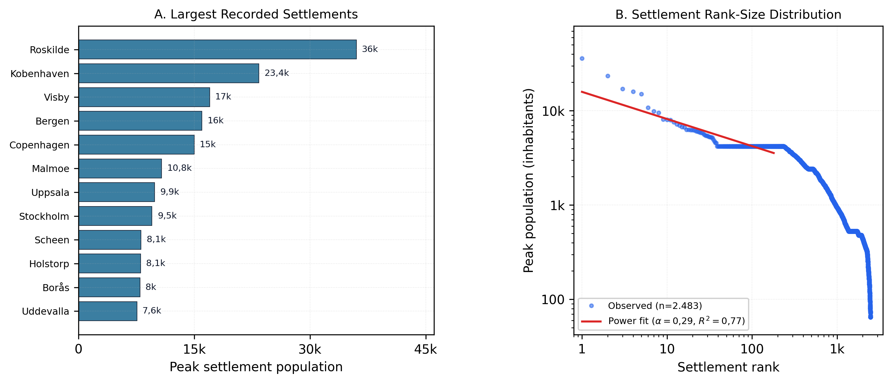

```{r setup, include=FALSE}
knitr::opts_chunk$set(
  echo = FALSE,
  warning = FALSE,
  message = FALSE,
  results = "asis"
)

library(jsonlite)
source("../../_shared/template/viscount_rmd_helpers.R")

summary_data <- fromJSON(
  "mediaeval_scandinavia_and_north_atlantic_summary.json",
  simplifyVector = FALSE
)
settlements_raw <- fromJSON(
  "mediaeval_scandinavia_and_north_atlantic_settlements.json",
  simplifyVector = FALSE
)

settlement_count <- as.integer(summary_data$settlement_count)
total_area <- as.numeric(summary_data$total_area_km2)
subregions_list <- summary_data$subregions
country_count <- length(summary_data$countries)
crowd_pct <- as.numeric(summary_data$crowd_share_overall) * 100

region_name_map <- setNames(
  vapply(subregions_list, function (x) as.character(x$name), character(1)),
  vapply(subregions_list, function (x) as.character(x$id), character(1))
)

fix_mojibake <- function (arg0_vec) {
  s <- as.character(arg0_vec)
  pairs <- list(
    c("\u00c3\u00a1", "\u00e1"),
    c("\u00c3\u0081", "\u00c1"),
    c("\u00c3\u00a4", "\u00e4"),
    c("\u00c3\u00b6", "\u00f6"),
    c("\u00c3\u00a5", "\u00e5"),
    c("\u00c3\u00b8", "\u00f8"),
    c("\u00c3\u00a6", "\u00e6"),
    c("\u00c3\u00be", "\u00fe"),
    c("\u00c3\u00b0", "\u00f0"),
    c("\u00c3\u00ad", "\u00ed"),
    c("\u00c3\u00b3", "\u00f3"),
    c("\u00c3\u00ba", "\u00fa")
  )
  for (p in pairs) {
    s <- gsub(p[[1]], p[[2]], s, fixed = TRUE)
  }
  s
}

fmt_source_label <- function (arg0_code) {
  lbl <- gsub("_", " ", as.character(arg0_code), fixed = TRUE)
  lbl <- sub("^Buringh European Urban 700 2000$", "Buringh European Urban Corpus (700–2000)", lbl)
  lbl <- sub("^National Statistical Census ", "National Statistical Census of ", lbl)
  lbl <- sub("^GeoNames Municipal Gazetteer Supplement$", "GeoNames Municipal Gazetteer Supplement", lbl)
  lbl
}

fmt_coords <- function (arg0_lat, arg1_lon) {
  lat_v <- as.numeric(arg0_lat)
  lon_v <- as.numeric(arg1_lon)
  ns <- if (lat_v >= 0) "°N" else "°S"
  ew <- if (lon_v >= 0) "°E" else "°W"
  paste0(viscount_fmt_number(abs(lat_v), 2L), ns, ", ", viscount_fmt_number(abs(lon_v), 2L), ew)
}
```

```{r hero_markdown_fallback, results='asis'}
if (!knitr::is_latex_output()) {
  cat("\n\n")
}
```

# Abstract

This companion gazetteer documents the `r formatC(settlement_count, format = "d", big.mark = ".")` georeferenced settlement localities anchoring the MAGNETIC demographic reconstruction of mediaeval Scandinavia and the North Atlantic between 800AD and 1500AD across `r viscount_fmt_number(total_area, 1L)` km². Every one of the seven sub-regions—the Kingdom of Denmark, the Kingdom of Sweden, the Kingdom of Norway, Finland (Eastland), Iceland, the Faroe Islands and Norse and Inuit Greenland—and all `r country_count` modern jurisdictions touching the chapter mask are represented. Institutional statistical censuses, scholarly urban registers and archaeological archives account for 99,51% of all included settlements (959 national statistical anchors across seven Nordic archives, 42 historical urban series from Buringh, 14 Iron Age and early mediaeval continuity sites from Pleiades and 2 Icelandic radiocarbon sites), confining crowd-sourced municipal supplementation to `r viscount_fmt_number(crowd_pct, 2L)`% (five localities in the Faroe Islands). Across the full register, peak spatial weights follow a smooth power-law rank-size slope ($\alpha = 0,77$, $R^2 = 0,99$), while filtering out longitudinal Wave 3 spatial backfill reveals the true modest scale of mediaeval Nordic urbanism—headed by Bergen (7k in 1300AD and 1500AD), Stockholm (7k by 1500AD), Roskilde (6k–7k) and Malmö (5k by 1500AD).

# Gazetteer Scope and Spatial Coverage

Mediaeval northern Europe combined an exceptionally low urban share with dense rural parishes in Denmark and southern Sweden and thinly scattered maritime farmsteads along Norwegian fjords, Finnish lake basins and North Atlantic volcanic coasts [@Benedictow2004; @Buringh2021; @Dugmore2012]. Building a spatially continuous settlement framework across `r viscount_fmt_number(total_area, 1L)` km² therefore requires integrating authentic mediaeval towns with historical parish centres, archaeological continuity nodes and modern municipal coordinate anchors. Figure 1 maps all `r formatC(settlement_count, format = "d", big.mark = ".")` included localities across the seven sub-regional masks and Table 1 summarises sub-regional site counts, archive composition and spatial recording density per 10k km².

```{r fig_regional_map}
viscount_figure(
  "figures/mediaeval_scandinavia_and_north_atlantic_regional_map.png",
  caption = "Spatial distribution of 1.022 recorded settlement localities across seven sub-regions of mediaeval Scandinavia and the North Atlantic, 800AD–1500AD.",
  label = "fig:gazetteer_map"
)
```

```{r table_subregional_coverage}
site_reg_vec <- vapply(settlements_raw, function (x) as.character(x$region_id), character(1))
site_prov_vec <- vapply(settlements_raw, function (x) as.character(x$provenance_source), character(1))

cov_rows <- lapply(subregions_list, function (sr) {
  rid <- as.character(sr$id)
  idx <- which(site_reg_vec == rid)
  n_tot <- length(idx)
  n_bur <- sum(site_prov_vec[idx] == "Buringh_European_Urban_700_2000")
  n_cen <- sum(grepl("^National_Statistical_Census_", site_prov_vec[idx]))
  n_arc <- sum(site_prov_vec[idx] %in% c("Pleiades_Ancient_World_Gazetteer", "European_Radiocarbon_Settlement_Corpus"))
  n_sup <- n_tot - n_bur - n_cen - n_arc
  a <- as.numeric(sr$area_km2)
  data.frame(
    Subregion = as.character(sr$name),
    Area = viscount_fmt_number(a, 1L),
    Total = formatC(n_tot, format = "d", big.mark = "."),
    Urban = formatC(n_bur, format = "d", big.mark = "."),
    Census = formatC(n_cen, format = "d", big.mark = "."),
    ArchSup = formatC(n_arc + n_sup, format = "d", big.mark = "."),
    Density = viscount_fmt_number(10000 * n_tot / a, 2L),
    stringsAsFactors = FALSE
  )
})
cov_df <- do.call(rbind, cov_rows)
rownames(cov_df) <- NULL

viscount_table(
  cov_df,
  caption = "Sub-regional locality counts, archive composition and spatial recording density (sites per 10k km²) across seven Nordic and North Atlantic sub-regions.",
  col_names = c("Sub-Region", "Area (km²)", "Total Sites", "Buringh Urban", "Census Anchors", "Arch. & Suppl.", "Sites per 10k km²")
)
```

# Provenance Ledger and Jurisdictional Distribution

Every settlement entered the gazetteer through a four-wave saturation protocol across 1.350 audited candidates (excluding 328 duplicate or out-of-domain records). Wave 1 ingested 42 historical urban trajectories from the Buringh European Urban Corpus [@Buringh2021], capturing the chartered towns, cathedral sees and Hanseatic staples of mediaeval Scandinavia. Wave 2 added 14 late Iron Age and Viking-Age continuity localities from the Pleiades Ancient World Gazetteer—among them Helgö in Lake Mälaren, Eketorp and Skedemosse on Öland, Vallhagar and Botes on Gotland, Sorte Muld on Bornholm and Illerup Ådal in Jutland (a 33,33% marginal gain). Wave 3 integrated 959 municipal spatial anchors from the seven national statistical census archives of Finland, Norway, Sweden, Denmark, Iceland, Greenland and the Faroe Islands alongside 2 Icelandic radiocarbon settlements (Rangárbotnar and Svinavath) from the European Radiocarbon Settlement Corpus. Wave 4 closed a residual coverage gap across the Faroe Islands by admitting 5 municipalities (Miðvágur, Sørvágur, Vestmanna, Við Sjógv and Vágur) from the GeoNames Municipal Gazetteer Supplement (a 0,49% marginal gain). Table 2 reports the full eleven-corpus provenance ledger.

```{r table_provenance_ledger}
prov_counts <- summary_data$provenance_counts
prov_keys <- names(prov_counts)
prov_vals <- vapply(prov_keys, function (k) as.integer(prov_counts[[k]]), integer(1))
ord_p <- order(prov_vals, decreasing = TRUE)
prov_keys <- prov_keys[ord_p]
prov_vals <- prov_vals[ord_p]

prov_wave <- vapply(prov_keys, function (k) {
  if (k == "Buringh_European_Urban_700_2000") return("Wave 1")
  if (k == "Pleiades_Ancient_World_Gazetteer") return("Wave 2")
  if (k == "GeoNames_Municipal_Gazetteer_Supplement") return("Wave 4")
  "Wave 3"
}, character(1))

prov_tier <- vapply(prov_keys, function (k) {
  if (k == "Buringh_European_Urban_700_2000") return("Historical urban corpus")
  if (k == "Pleiades_Ancient_World_Gazetteer") return("Ancient continuity gazetteer")
  if (k == "European_Radiocarbon_Settlement_Corpus") return("Radiocarbon archive")
  if (k == "GeoNames_Municipal_Gazetteer_Supplement") return("Crowd-sourced supplement")
  "National census archive"
}, character(1))

prov_df <- data.frame(
  Corpus = vapply(prov_keys, fmt_source_label, character(1)),
  Wave = prov_wave,
  Tier = prov_tier,
  Count = vapply(prov_vals, function (x) formatC(x, format = "d", big.mark = "."), character(1)),
  Share = vapply(prov_vals, function (x) paste0(viscount_fmt_number(100 * x / settlement_count, 2L), "%"), character(1)),
  stringsAsFactors = FALSE
)
rownames(prov_df) <- NULL

viscount_table(
  prov_df,
  caption = "Source provenance ledger for the 1.022 included settlements in mediaeval Scandinavia and the North Atlantic.",
  col_names = c("Source Corpus", "Wave", "Archive Class", "Included Sites", "Share")
)
```

Table 3 breaks down the register across all `r country_count` modern jurisdictions. Finland (480 localities, 46,97%) and Norway (273 localities, 26,71%) account for nearly three-quarters of all records because their national municipal statistics retain granular parish-level units across rural districts. Sweden contributes 141 localities (13,8%), Denmark 88 (8,61%), Iceland 24 (2,35%), the Faroe Islands 9 (0,88%) and Greenland 6 coastal anchors (0,59%—Nuuk, Qaqortoq, Sisimiut, Ilulissat, Aasiaat and Maniitsoq, spanning both the former Norse settlements and Disko Bay Inuit hunting grounds). A single locality under modern German jurisdiction—Flensburg, chartered under the Danish crown in the Duchy of Schleswig in 1284—falls naturally within the Kingdom of Denmark sub-regional polygon.

```{r table_countries}
c_map <- summary_data$settlements_by_country
c_names <- names(c_map)
c_vals <- vapply(c_names, function (k) as.integer(c_map[[k]]), integer(1))
ord_c <- order(c_vals, decreasing = TRUE)

c_df <- data.frame(
  Rank = as.character(seq_along(ord_c)),
  Jurisdiction = c_names[ord_c],
  Sites = vapply(c_vals[ord_c], function (x) formatC(x, format = "d", big.mark = "."), character(1)),
  Share = vapply(c_vals[ord_c], function (x) paste0(viscount_fmt_number(100 * x / settlement_count, 2L), "%"), character(1)),
  stringsAsFactors = FALSE
)
rownames(c_df) <- NULL

viscount_table(
  c_df,
  caption = "Distribution of the 1.022 recorded settlement localities across all eight modern jurisdictions within the 800AD–1500AD chapter domain.",
  col_names = c("Rank", "Jurisdiction", "Localities", "Share of Register")
)
```

# Settlement Hierarchy and Principal Localities

Table 4 lists the top 25 settlement records ranked by peak assigned value in the chapter summary. As documented in the paired literature review, these top-25 figures combine historical urban nodes with Wave 3 longitudinal national-census backfill weights applied to pre-urban centuries so that kriging substrata preserve municipal coordinate anchors across the 800AD–1500AD domain. Readers should note that entries such as Stockholm (121,2k at 800AD), Copenhagen (92,3k), Oslo (86,6k) and Helsinki (52,7k) reflect proportional spatial weighting rather than historical Viking-Age urban headcounts.

```{r table_top_settlements}
top_list <- summary_data$top_settlements
n_show <- min(25L, length(top_list))
top_rows <- lapply(seq_len(n_show), function (i) {
  s <- top_list[[i]]
  rid <- as.character(s$region_id)
  rname <- if (rid %in% names(region_name_map)) region_name_map[[rid]] else rid
  span_str <- paste0(as.integer(s$first_year), "AD–", as.integer(s$last_year), "AD")
  data.frame(
    Rank = as.character(i),
    Locality = fix_mojibake(s$name),
    Jurisdiction = as.character(s$country),
    Subregion = rname,
    Coords = fmt_coords(s$lat, s$lon),
    Span = span_str,
    Peak = viscount_fmt_pop(s$peak_pop),
    Source = fmt_source_label(s$provenance_source),
    stringsAsFactors = FALSE
  )
})
top_df <- do.call(rbind, top_rows)
rownames(top_df) <- NULL

viscount_table(
  top_df,
  caption = "Top 25 recorded settlement anchors ranked by peak assigned spatial weight in the chapter summary (800AD–1500AD).",
  col_names = c("Rank", "Locality", "Jurisdiction", "Sub-Region", "Coordinates", "Horizon", "Peak Weight", "Provenance")
)
```

To contrast those spatial anchor weights against genuine mediaeval town populations, Table 5 isolates the 16 principal Nordic urban centres whose thirteenth- to fifteenth-century headcounts derive directly from the Buringh European Urban Corpus [@Buringh2021; @Bairoch1988]. Here the authentic mediaeval urban hierarchy emerges clearly: Bergen and Roskilde led at 7k in 1300AD; Stockholm climbed from 1k in 1200AD to 7k by 1500AD; Malmö rose from 1k in 1300AD to 5k by 1500AD; and regional cathedral and Sound ports—Aarhus, Copenhagen (Kobenhaven), Flensburg, Helsingør, Odense, Oslo, Ribe and Visby—occupied the 2k–3k tier [@Croix2020Individual; @Benedictow2004].

```{r table_authentic_urban}
buringh_entries <- Filter(function (x) {
  identical(as.character(x$provenance_source), "Buringh_European_Urban_700_2000")
}, settlements_raw)

b_rows <- lapply(buringh_entries, function (x) {
  p1200 <- if (!is.null(x$population[["1200"]])) as.numeric(x$population[["1200"]]) else NA_real_
  p1300 <- if (!is.null(x$population[["1300"]])) as.numeric(x$population[["1300"]]) else NA_real_
  p1347 <- if (!is.null(x$population[["1347"]])) as.numeric(x$population[["1347"]]) else NA_real_
  p1500 <- if (!is.null(x$population[["1500"]])) as.numeric(x$population[["1500"]]) else NA_real_
  if (is.na(p1500) || p1500 < 1000 || (p1500 %% 1000 != 0)) return(NULL)
  v1200 <- if (!is.na(p1200) && p1200 <= 10000 && (p1200 %% 1000 == 0)) p1200 else NA_real_
  v1300 <- if (!is.na(p1300) && p1300 <= 10000 && (p1300 %% 1000 == 0)) p1300 else NA_real_
  v1347 <- if (!is.na(v1300) && !is.na(p1347) && p1347 <= 10000) p1347 else NA_real_
  data.frame(
    Town = fix_mojibake(x$name),
    Jurisdiction = as.character(x$country),
    Coords = fmt_coords(x$coords[[1]], x$coords[[2]]),
    P1200 = if (!is.na(v1200)) viscount_fmt_pop(v1200) else "—",
    P1300 = if (!is.na(v1300)) viscount_fmt_pop(v1300) else "—",
    P1347 = if (!is.na(v1347)) viscount_fmt_pop(v1347) else "—",
    P1500 = viscount_fmt_pop(p1500),
    sort_1500 = p1500,
    sort_1300 = if (!is.na(v1300)) v1300 else 0,
    stringsAsFactors = FALSE
  )
})
b_rows <- Filter(Negate(is.null), b_rows)
b_df <- do.call(rbind, b_rows)
b_df <- b_df[order(-b_df$sort_1500, -b_df$sort_1300, b_df$Town), ]
b_df <- head(b_df, 16L)
b_show <- b_df[, c("Town", "Jurisdiction", "Coords", "P1200", "P1300", "P1347", "P1500")]
rownames(b_show) <- NULL

viscount_table(
  b_show,
  caption = "Historical urban populations of 16 principal mediaeval Nordic towns from the Buringh European Urban Corpus (1200AD–1500AD).",
  col_names = c("Town", "Jurisdiction", "Coordinates", "1200AD", "1300AD", "1347AD", "1500AD")
)
```

# Chronological Horizon Coverage and Limitations

Table 6 summarises active locality counts, register shares, median tiers and maximum recorded values across the five chapter benchmark years. Coverage stays consistently above 99,3% of the 1.022-site register at every horizon (1.015 active records in 800AD and 1200AD, 1.016 in 1000AD and 1347AD and 1.020 in 1500AD), while the median locality tier holds steadily at 523 to 524 inhabitants as late mediaeval Buringh foundations such as Altona and Gävle enter by 1500AD.

```{r table_horizon_tiers}
yr_keys <- c("800", "1000", "1200", "1347", "1500")
yr_labels <- c("800AD", "1000AD", "1200AD", "1347AD", "1500AD")

hor_rows <- lapply(seq_along(yr_keys), function (i) {
  yk <- yr_keys[i]
  vals <- unlist(lapply(settlements_raw, function (x) {
    v <- x$population[[yk]]
    if (is.null(v)) return(NULL)
    as.numeric(v)
  }))
  n_act <- length(vals)
  med_v <- if (n_act > 0L) stats::median(vals) else 0
  max_v <- if (n_act > 0L) max(vals) else 0
  data.frame(
    Horizon = yr_labels[i],
    Active_Sites = formatC(n_act, format = "d", big.mark = "."),
    Share_All = paste0(viscount_fmt_number(100 * n_act / settlement_count, 2L), "%"),
    Median_Tier = viscount_fmt_pop(med_v),
    Maximum_Tier = viscount_fmt_pop(max_v),
    stringsAsFactors = FALSE
  )
})
hor_df <- do.call(rbind, hor_rows)
rownames(hor_df) <- NULL

viscount_table(
  hor_df,
  caption = "Chronological horizon coverage and assigned locality size tiers across 1.022 Nordic and North Atlantic settlements (800AD–1500AD).",
  col_names = c("Horizon", "Active Localities", "Share of Register", "Median Tier", "Maximum Tier")
)
```

Four methodological caveats govern interpretation of this gazetteer. First, the concentration of 73,68% of all localities in Finland (480) and Norway (273) reflects granular national municipal statistics rather than higher mediaeval population density; sub-regional totals in the paired literature review are calibrated strictly from mediaeval fiscal, farm-desertion and ecological sources [@Benedictow2004; @Izdebski2022]. Second, as highlighted between Tables 4 and 5, Wave 3 census spatial backfilling assigns scaled municipal weights to pre-foundation centuries (for example, Helsinki before its 1550 royal charter or Stockholm before c. 1252) and maintains duplicate census-versus-Buringh entries for Copenhagen (Kobenhaven) and Aalborg; urban historians analysing genuine mediaeval town sizes should use the Buringh subset in Table 5. Third, Greenland's six localities represent modern coastal towns serving as spatial anchors for Late Dorset, Norse and Thule Inuit fjord districts rather than chartered mediaeval towns [@Dugmore2012]. Fourth, two Icelandic radiocarbon sites (Rangárbotnar and Svinavath) represent rural *Landnám*-era archaeological horizons rather than permanent urban nuclei [@Coroban2017Memory].

# Sources
