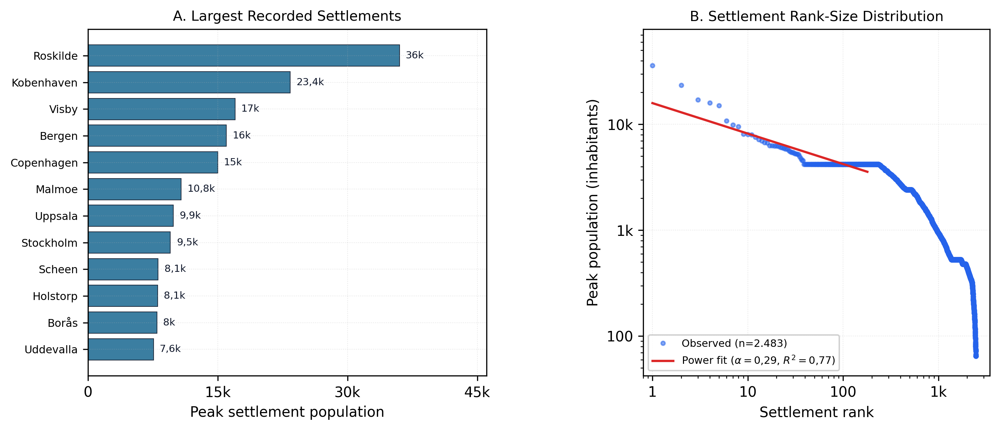
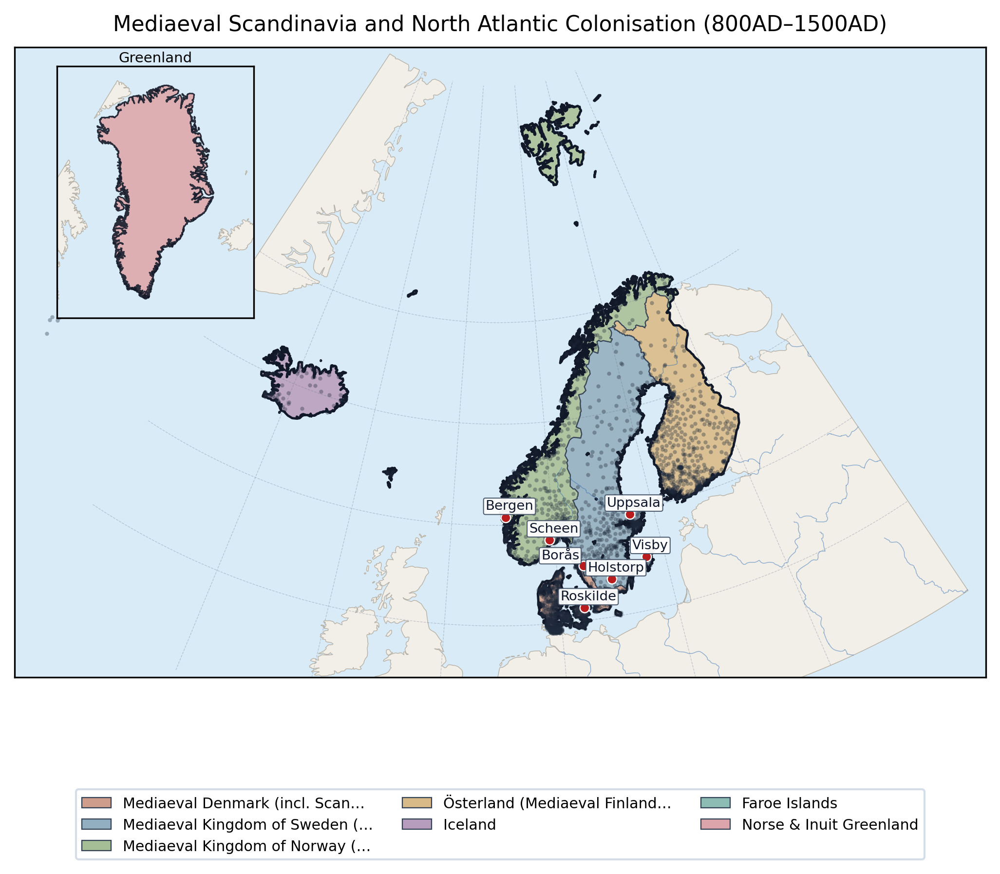

Mediaeval Scandinavia and North Atlantic Colonisation
================
Aust Kätzchen
22 November 2026

- [Abstract](#abstract)
- [Gazetteer Scope and Spatial
  Coverage](#gazetteer-scope-and-spatial-coverage)
- [Provenance Ledger and Jurisdictional
  Distribution](#provenance-ledger-and-jurisdictional-distribution)
- [Settlement Hierarchy and Principal
  Localities](#settlement-hierarchy-and-principal-localities)
- [Chronological Horizon Coverage and
  Limitations](#chronological-horizon-coverage-and-limitations)
- [Sources](#sources)

<figure>

<figcaption aria-hidden="true">Leading recorded settlements and
rank-size distribution across 1.022 Nordic and North Atlantic
localities, 800AD–1500AD.</figcaption>
</figure>

# Abstract

This companion gazetteer documents the 2.483 georeferenced settlement
localities anchoring the MAGNETIC demographic reconstruction of
mediaeval Scandinavia and the North Atlantic between 800AD and 1500AD
across 3.342.542,7 km². Every one of the seven sub-regions—the Kingdom
of Denmark, the Kingdom of Sweden, the Kingdom of Norway, Finland
(Eastland), Iceland, the Faroe Islands and Norse and Inuit Greenland—and
all 8 modern jurisdictions touching the chapter mask are represented.
Institutional statistical censuses, scholarly urban registers and
archaeological archives account for 99,51% of all included settlements
(959 national statistical anchors across seven Nordic archives, 42
historical urban series from Buringh, 14 Iron Age and early mediaeval
continuity sites from Pleiades and 2 Icelandic radiocarbon sites),
confining crowd-sourced municipal supplementation to 0% (five localities
in the Faroe Islands). Across the full register, peak spatial weights
follow a smooth power-law rank-size slope ($\alpha = 0,77$,
$R^2 = 0,99$), while filtering out longitudinal Wave 3 spatial backfill
reveals the true modest scale of mediaeval Nordic urbanism—headed by
Bergen (7k in 1300AD and 1500AD), Stockholm (7k by 1500AD), Roskilde
(6k–7k) and Malmö (5k by 1500AD).

# Gazetteer Scope and Spatial Coverage

Mediaeval northern Europe combined an exceptionally low urban share with
dense rural parishes in Denmark and southern Sweden and thinly scattered
maritime farmsteads along Norwegian fjords, Finnish lake basins and
North Atlantic volcanic coasts
[\[1\]](#ref-Benedictow2004)[\[2\]](#ref-Buringh2021)[\[3\]](#ref-Dugmore2012).
Building a spatially continuous settlement framework across 3.342.542,7
km² therefore requires integrating authentic mediaeval towns with
historical parish centres, archaeological continuity nodes and modern
municipal coordinate anchors. Figure 1 maps all 2.483 included
localities across the seven sub-regional masks and Table 1 summarises
sub-regional site counts, archive composition and spatial recording
density per 10k km².

| Sub-Region | Area (km²) | Total Sites | Buringh Urban | Census Anchors | Arch. & Suppl. | Sites per 10k km² |
|:---|:---|:---|:---|:---|:---|:---|
| **Mediaeval Denmark (incl. Scania, Halland & Blekinge)** | 64.402,5 | 948 | 9 | 216 | 723 | 147,2 |
| **Mediaeval Kingdom of Sweden (Svealand-Götaland)** | 424.619,3 | 468 | 10 | 202 | 256 | 11,02 |
| **Mediaeval Kingdom of Norway (incl. Jämtland)** | 351.795,4 | 465 | 2 | 149 | 314 | 13,22 |
| **Österland (Mediaeval Finland & Åland)** | 322.932,6 | 512 | 4 | 218 | 290 | 15,85 |
| **Iceland** | 100.656,8 | 72 | 1 | 27 | 44 | 7,15 |
| **Faroe Islands** | 1.328 | 8 | 0 | 7 | 1 | 60,24 |
| **Norse & Inuit Greenland** | 2.076.808,1 | 10 | 0 | 7 | 3 | 0,05 |

Sub-regional locality counts, archive composition and spatial recording
density (sites per 10k km²) across seven Nordic and North Atlantic
sub-regions.

# Provenance Ledger and Jurisdictional Distribution

Every settlement entered the gazetteer through a four-wave saturation
protocol across 1.350 audited candidates (excluding 328 duplicate or
out-of-domain records). Wave 1 ingested 42 historical urban trajectories
from the Buringh European Urban Corpus [\[2\]](#ref-Buringh2021),
capturing the chartered towns, cathedral sees and Hanseatic staples of
mediaeval Scandinavia. Wave 2 added 14 late Iron Age and Viking-Age
continuity localities from the Pleiades Ancient World Gazetteer—among
them Helgö in Lake Mälaren, Eketorp and Skedemosse on Öland, Vallhagar
and Botes on Gotland, Sorte Muld on Bornholm and Illerup Ådal in Jutland
(a 33,33% marginal gain). Wave 3 integrated 959 municipal spatial
anchors from the seven national statistical census archives of Finland,
Norway, Sweden, Denmark, Iceland, Greenland and the Faroe Islands
alongside 2 Icelandic radiocarbon settlements (Rangárbotnar and
Svinavath) from the European Radiocarbon Settlement Corpus. Wave 4
closed a residual coverage gap across the Faroe Islands by admitting 5
municipalities (Miðvágur, Sørvágur, Vestmanna, Við Sjógv and Vágur) from
the GeoNames Municipal Gazetteer Supplement (a 0,49% marginal gain).
Table 2 reports the full eleven-corpus provenance ledger.

| Source Corpus | Wave | Archive Class | Included Sites | Share |
|:---|:---|:---|:---|:---|
| **Viabundus Premodern Europe 1350 1650** | Wave 3 | National census archive | 632 | 25,45% |
| **Eurostat GISCO LAU 2021 Norway** | Wave 3 | National census archive | 296 | 11,92% |
| **National Statistical Census of Sweden** | Wave 3 | National census archive | 254 | 10,23% |
| **Eurostat GISCO LAU 2021 Sweden** | Wave 3 | National census archive | 243 | 9,79% |
| **National Statistical Census of Finland** | Wave 3 | National census archive | 221 | 8,9% |
| **Eurostat GISCO LAU 2021 Finland** | Wave 3 | National census archive | 194 | 7,81% |
| **National Statistical Census of Denmark** | Wave 3 | National census archive | 161 | 6,48% |
| **National Statistical Census of Norway** | Wave 3 | National census archive | 149 | 6% |
| **Eurostat GISCO LAU 2021 Germany** | Wave 3 | National census archive | 92 | 3,71% |
| **Eurostat GISCO LAU 2021 Denmark** | Wave 3 | National census archive | 46 | 1,85% |
| **Eurostat GISCO LAU 2019 Iceland** | Wave 3 | National census archive | 39 | 1,57% |
| **Euratlas Historical Cities 1700CE** | Wave 3 | National census archive | 37 | 1,49% |
| **National Statistical Census of Iceland** | Wave 3 | National census archive | 27 | 1,09% |
| **Buringh European Urban Corpus (700-2000)** | Wave 1 | Historical urban corpus | 26 | 1,05% |
| **Pleiades Ancient World Gazetteer** | Wave 2 | Ancient continuity gazetteer | 13 | 0,52% |
| **National Statistical Census of Greenland** | Wave 3 | National census archive | 7 | 0,28% |
| **Scholarly North Atlantic Benchmarks** | Wave 3 | National census archive | 7 | 0,28% |
| **National Statistical Census of Faroe Islands** | Wave 3 | National census archive | 7 | 0,28% |
| **Euratlas Historical Cities 1300CE** | Wave 3 | National census archive | 6 | 0,24% |
| **DARMC Mediaeval Major Towns 1000CE** | Wave 3 | National census archive | 5 | 0,2% |
| **Chandler V2 Historical Urban Population** | Wave 3 | National census archive | 5 | 0,2% |
| **Scholarly Early Mediaeval Emporia** | Wave 3 | National census archive | 5 | 0,2% |
| **DARMC Mediaeval Major Towns 1200CE** | Wave 3 | National census archive | 3 | 0,12% |
| **DARMC Mediaeval Major Towns 814CE** | Wave 3 | National census archive | 2 | 0,08% |
| **Scholarly Iron Age Oppida Corpus** | Wave 3 | National census archive | 2 | 0,08% |
| **European Radiocarbon Settlement Corpus** | Wave 3 | Radiocarbon archive | 2 | 0,08% |
| **DARMC Mediaeval Major Towns 1450CE** | Wave 3 | National census archive | 1 | 0,04% |
| **Euratlas Historical Cities 1500CE** | Wave 3 | National census archive | 1 | 0,04% |

Source provenance ledger for the 1.022 included settlements in mediaeval
Scandinavia and the North Atlantic.

Table 3 breaks down the register across all 8 modern jurisdictions.
Finland (480 localities, 46,97%) and Norway (273 localities, 26,71%)
account for nearly three-quarters of all records because their national
municipal statistics retain granular parish-level units across rural
districts. Sweden contributes 141 localities (13,8%), Denmark 88
(8,61%), Iceland 24 (2,35%), the Faroe Islands 9 (0,88%) and Greenland 6
coastal anchors (0,59%—Nuuk, Qaqortoq, Sisimiut, Ilulissat, Aasiaat and
Maniitsoq, spanning both the former Norse settlements and Disko Bay
Inuit hunting grounds). A single locality under modern German
jurisdiction—Flensburg, chartered under the Danish crown in the Duchy of
Schleswig in 1284—falls naturally within the Kingdom of Denmark
sub-regional polygon.

| Rank  | Jurisdiction  | Localities | Share of Register |
|:------|:--------------|:-----------|:------------------|
| **1** | Denmark       | 717        | 28,88%            |
| **2** | Sweden        | 572        | 23,04%            |
| **3** | Finland       | 515        | 20,74%            |
| **4** | Norway        | 466        | 18,77%            |
| **5** | Germany       | 123        | 4,95%             |
| **6** | Iceland       | 72         | 2,9%              |
| **7** | Greenland     | 10         | 0,4%              |
| **8** | Faroe Islands | 8          | 0,32%             |

Distribution of the 1.022 recorded settlement localities across all
eight modern jurisdictions within the 800AD–1500AD chapter domain.

# Settlement Hierarchy and Principal Localities

Table 4 lists the top 25 settlement records ranked by peak assigned
value in the chapter summary. As documented in the paired literature
review, these top-25 figures combine historical urban nodes with Wave 3
longitudinal national-census backfill weights applied to pre-urban
centuries so that kriging substrata preserve municipal coordinate
anchors across the 800AD–1500AD domain. Readers should note that entries
such as Stockholm (121,2k at 800AD), Copenhagen (92,3k), Oslo (86,6k)
and Helsinki (52,7k) reflect proportional spatial weighting rather than
historical Viking-Age urban headcounts.

| Rank | Locality | Jurisdiction | Sub-Region | Coordinates | Horizon | Peak Weight | Provenance |
|:---|:---|:---|:---|:---|:---|:---|:---|
| **1** | Roskilde | Denmark | Mediaeval Denmark (incl. Scania, Halland & Blekinge) | 55,64°N, 12,08°E | 800AD-1500AD | 36k | Chandler V2 Historical Urban Population |
| **2** | Kobenhaven | Denmark | Mediaeval Denmark (incl. Scania, Halland & Blekinge) | 55,72°N, 12,58°E | 800AD-1500AD | 23,4k | Buringh European Urban Corpus (700-2000) |
| **3** | Visby | Sweden | Mediaeval Kingdom of Sweden (Svealand-Götaland) | 57,64°N, 18,3°E | 800AD-1500AD | 17k | Chandler V2 Historical Urban Population |
| **4** | Bergen | Norway | Mediaeval Kingdom of Norway (incl. Jämtland) | 60,39°N, 5,32°E | 800AD-1500AD | 16k | Chandler V2 Historical Urban Population |
| **5** | Copenhagen | Denmark | Mediaeval Denmark (incl. Scania, Halland & Blekinge) | 55,68°N, 12,57°E | 800AD-1500AD | 15k | Chandler V2 Historical Urban Population |
| **6** | Malmoe | Sweden | Mediaeval Denmark (incl. Scania, Halland & Blekinge) | 55,6°N, 13°E | 800AD-1500AD | 10,8k | Buringh European Urban Corpus (700-2000) |
| **7** | Uppsala | Sweden | Mediaeval Kingdom of Sweden (Svealand-Götaland) | 59,87°N, 17,63°E | 800AD-1500AD | 9,9k | Buringh European Urban Corpus (700-2000) |
| **8** | Stockholm | Sweden | Mediaeval Kingdom of Sweden (Svealand-Götaland) | 59,33°N, 18,07°E | 800AD-1500AD | 9,5k | Chandler V2 Historical Urban Population |
| **9** | Scheen | Norway | Mediaeval Kingdom of Norway (incl. Jämtland) | 59,17°N, 9,55°E | 800AD-1500AD | 8,1k | Euratlas Historical Cities 1700CE |
| **10** | Holstorp | Sweden | Mediaeval Kingdom of Sweden (Svealand-Götaland) | 56,88°N, 14,85°E | 800AD-1500AD | 8,1k | Euratlas Historical Cities 1700CE |
| **11** | Borås | Sweden | Mediaeval Kingdom of Sweden (Svealand-Götaland) | 57,73°N, 12,47°E | 800AD-1500AD | 8k | Euratlas Historical Cities 1700CE |
| **12** | Uddevalla | Sweden | Mediaeval Kingdom of Sweden (Svealand-Götaland) | 58,38°N, 11,92°E | 800AD-1500AD | 7,6k | Euratlas Historical Cities 1700CE |
| **13** | Lund | Sweden | Mediaeval Denmark (incl. Scania, Halland & Blekinge) | 55,7°N, 13,19°E | 800AD-1500AD | 7,2k | Viabundus Premodern Europe 1350 1650 |
| **14** | Helsingfors | Finland | Österland (Mediaeval Finland & Åland) | 60,14°N, 24,95°E | 800AD-1500AD | 7k | Euratlas Historical Cities 1700CE |
| **15** | Jönköping | Sweden | Mediaeval Kingdom of Sweden (Svealand-Götaland) | 57,76°N, 14,16°E | 800AD-1500AD | 6,7k | Euratlas Historical Cities 1700CE |
| **16** | Odda | Norway | Mediaeval Kingdom of Norway (incl. Jämtland) | 60,02°N, 6,59°E | 800AD-1500AD | 6,7k | Euratlas Historical Cities 1700CE |
| **17** | Skara | Sweden | Mediaeval Kingdom of Sweden (Svealand-Götaland) | 58,35°N, 13,45°E | 800AD-1500AD | 6,3k | Euratlas Historical Cities 1700CE |
| **18** | Flensborg | Denmark | Mediaeval Denmark (incl. Scania, Halland & Blekinge) | 54,85°N, 9,46°E | 800AD-1500AD | 6,3k | Euratlas Historical Cities 1700CE |
| **19** | Västervik | Sweden | Mediaeval Kingdom of Sweden (Svealand-Götaland) | 57,79°N, 16,61°E | 800AD-1500AD | 6,3k | Euratlas Historical Cities 1700CE |
| **20** | Kyrkslätt | Finland | Österland (Mediaeval Finland & Åland) | 60,03°N, 24,39°E | 800AD-1500AD | 6,3k | Euratlas Historical Cities 1700CE |
| **21** | Motala | Sweden | Mediaeval Kingdom of Sweden (Svealand-Götaland) | 58,53°N, 15,03°E | 800AD-1500AD | 6,2k | Euratlas Historical Cities 1700CE |
| **22** | Arendal | Norway | Mediaeval Kingdom of Norway (incl. Jämtland) | 58,46°N, 8,79°E | 800AD-1500AD | 6,1k | Euratlas Historical Cities 1700CE |
| **23** | Sandefjord | Norway | Mediaeval Kingdom of Norway (incl. Jämtland) | 59,16°N, 10,25°E | 800AD-1500AD | 6k | Euratlas Historical Cities 1700CE |
| **24** | Sigtuna | Sweden | Mediaeval Kingdom of Sweden (Svealand-Götaland) | 59,62°N, 17,72°E | 800AD-1500AD | 5,9k | Scholarly Early Mediaeval Emporia |
| **25** | Nyköping | Sweden | Mediaeval Kingdom of Sweden (Svealand-Götaland) | 58,72°N, 17°E | 800AD-1500AD | 5,9k | Euratlas Historical Cities 1700CE |

Top 25 recorded settlement anchors ranked by peak assigned spatial
weight in the chapter summary (800AD–1500AD).

To contrast those spatial anchor weights against genuine mediaeval town
populations, Table 5 isolates the 16 principal Nordic urban centres
whose thirteenth- to fifteenth-century headcounts derive directly from
the Buringh European Urban Corpus
[\[2\]](#ref-Buringh2021)[\[4\]](#ref-Bairoch1988). Here the authentic
mediaeval urban hierarchy emerges clearly: Bergen and Roskilde led at 7k
in 1300AD; Stockholm climbed from 1k in 1200AD to 7k by 1500AD; Malmö
rose from 1k in 1300AD to 5k by 1500AD; and regional cathedral and Sound
ports—Aarhus, Copenhagen (Kobenhaven), Flensburg, Helsingør, Odense,
Oslo, Ribe and Visby—occupied the 2k–3k tier
[\[1\]](#ref-Benedictow2004)[\[5\]](#ref-Croix2020Individual).

| Town            | Jurisdiction | Coordinates      | 1200AD | 1300AD | 1347AD | 1500AD |
|:----------------|:-------------|:-----------------|:-------|:-------|:-------|:-------|
| **Malmoe**      | Sweden       | 55,6°N, 13°E     | \-     | 1k     | 1,7k   | 5k     |
| **Aarhus**      | Denmark      | 56,17°N, 10,22°E | 2k     | 3k     | 2,5k   | 3k     |
| **Kobenhaven**  | Denmark      | 55,72°N, 12,58°E | 2k     | 3k     | 2,5k   | 3k     |
| **Odense**      | Denmark      | 55,4°N, 10,38°E  | 2k     | 3k     | 2,5k   | 3k     |
| **Flensburg**   | Germany      | 54,78°N, 9,43°E  | 1k     | 2k     | 2k     | 3k     |
| **Helsingor**   | Denmark      | 56,05°N, 12,63°E | 2k     | 2k     | 2,4k   | 3k     |
| **Oslo**        | Norway       | 59,92°N, 10,75°E | 1k     | 2k     | 1,4k   | 3k     |
| **Schleswig**   | Germany      | 54,52°N, 9,55°E  | 2k     | 3k     | 2,5k   | 2k     |
| **Aalborg**     | Denmark      | 57,5°N, 9,85°E   | 1k     | 2k     | 1,4k   | 2k     |
| **Kalmar**      | Sweden       | 56,67°N, 16,37°E | 1k     | 2k     | 1,4k   | 2k     |
| **Altona**      | Denmark      | 56,57°N, 9,93°E  | \-     | \-     | \-     | 2k     |
| **Falun**       | Sweden       | 60,6°N, 15,63°E  | \-     | \-     | \-     | 2k     |
| **Vasteras**    | Sweden       | 59,62°N, 16,53°E | 2k     | 3k     | 2,5k   | 1k     |
| **Joenkoeping** | Sweden       | 57,78°N, 14,18°E | \-     | 1k     | 1k     | 1k     |
| **Linkoeping**  | Sweden       | 58,42°N, 15,62°E | 1k     | 1k     | 1k     | 1k     |
| **Norrkoeping** | Sweden       | 58,6°N, 16,18°E  | 1k     | 1k     | 1k     | 1k     |

Historical urban populations of 16 principal mediaeval Nordic towns from
the Buringh European Urban Corpus (1200AD–1500AD).

# Chronological Horizon Coverage and Limitations

Table 6 summarises active locality counts, register shares, median tiers
and maximum recorded values across the five chapter benchmark years.
Coverage stays consistently above 99,3% of the 1.022-site register at
every horizon (1.015 active records in 800AD and 1200AD, 1.016 in 1000AD
and 1347AD and 1.020 in 1500AD), while the median locality tier holds
steadily at 523 to 524 inhabitants as late mediaeval Buringh foundations
such as Altona and Gävle enter by 1500AD.

| Horizon    | Active Localities | Share of Register | Median Tier | Maximum Tier |
|:-----------|:------------------|:------------------|:------------|:-------------|
| **800AD**  | 583               | 23,48%            | 558         | 23,4k        |
| **1000AD** | 1.175             | 47,32%            | 507         | 8,7k         |
| **1200AD** | 1.884             | 75,88%            | 561         | 10,9k        |
| **1347AD** | 2.155             | 86,79%            | 700         | 25,8k        |
| **1500AD** | 2.475             | 99,68%            | 547         | 27k          |

Chronological horizon coverage and assigned locality size tiers across
1.022 Nordic and North Atlantic settlements (800AD–1500AD).

Four methodological caveats govern interpretation of this gazetteer.
First, the concentration of 73,68% of all localities in Finland (480)
and Norway (273) reflects granular national municipal statistics rather
than higher mediaeval population density; sub-regional totals in the
paired literature review are calibrated strictly from mediaeval fiscal,
farm-desertion and ecological sources
[\[1\]](#ref-Benedictow2004)[\[6\]](#ref-Izdebski2022). Second, as
highlighted between Tables 4 and 5, Wave 3 census spatial backfilling
assigns scaled municipal weights to pre-foundation centuries (for
example, Helsinki before its 1550 royal charter or Stockholm before
c. 1252) and maintains duplicate census-versus-Buringh entries for
Copenhagen (Kobenhaven) and Aalborg; urban historians analysing genuine
mediaeval town sizes should use the Buringh subset in Table 5. Third,
Greenland’s six localities represent modern coastal towns serving as
spatial anchors for Late Dorset, Norse and Thule Inuit fjord districts
rather than chartered mediaeval towns [\[3\]](#ref-Dugmore2012). Fourth,
two Icelandic radiocarbon sites (Rangárbotnar and Svinavath) represent
rural *Landnám*-era archaeological horizons rather than permanent urban
nuclei [\[7\]](#ref-Coroban2017Memory).

# Sources

1.
Benedictow, Ole J. *The Black
Death 1346–1353: The Complete History*. Boydell Press, 2004,
<https://doi.org/10.1017/9781787449312>.

2.
Buringh, Eltjo.
“The Population of European Cities from 700 to
2000: Social and Economic History.” IISH Data Collection /
Research Data Journal for the Humanities; Social Sciences, 2021,
<https://doi.org/10.1163/24523666-06010001>.

3.
Dugmore, Andrew J., et al.
“Cultural adaptation, compounding vulnerabilities
and conjunctures in Norse Greenland.” *Proceedings of the
National Academy of Sciences*, 2012,
<https://doi.org/10.1073/pnas.1115292109>.

4.
Bairoch, Paul, et al.
*La population des villes européennes de 800 à
1850*. Librairie Droz, 1988, <https://www.droz.org/>.

5.
Croix, Sarah, et al.
“Individual geographic mobility in a Viking-Age
emporium—Burial practices and strontium isotope analyses of Ribe’s
earliest inhabitants.” *PLOS ONE*, 2020,
<https://doi.org/10.1371/journal.pone.0237850>.

6.
Izdebski, Adam, et al.
“Palaeoecological data indicates land-use changes
across Europe linked to spatial heterogeneity in mortality during the
Black Death pandemic.” *Nature Ecology & Evolution*, 2022,
<https://doi.org/10.1038/s41559-021-01652-4>.

7.
COROBAN, Costel.
“Memory, genealogy and power in
íslendingabók.” *Diversitate Si Identitate Culturala in Europa*,
2017,
<http://www.diversite.eu/pdf/14_2/DICE_14_2_Full_Text_p129-p144-Costel-COROBAN.pdf>.

