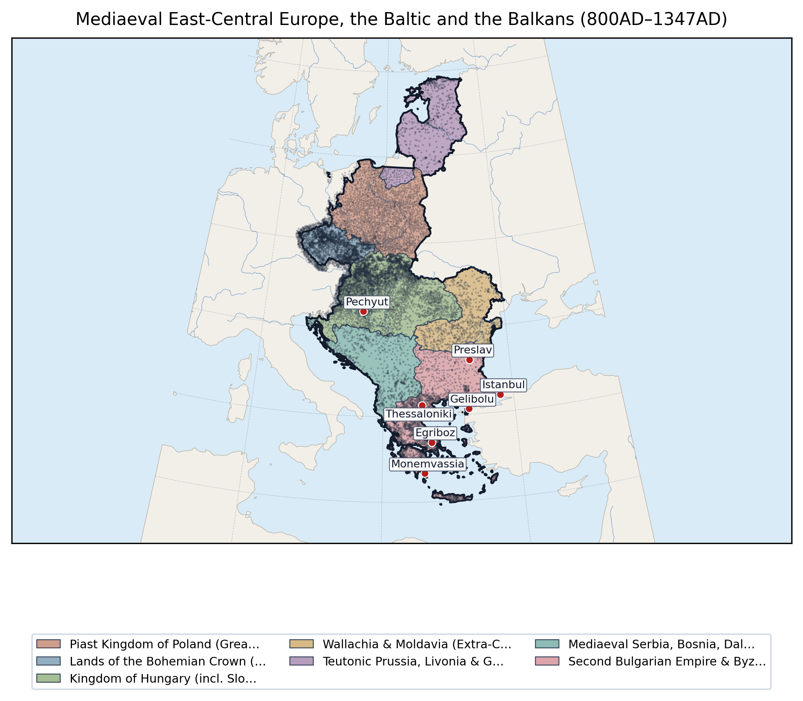
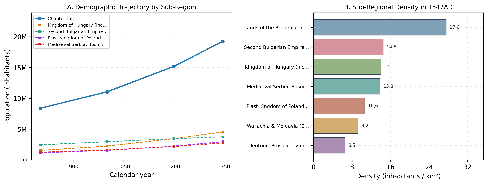
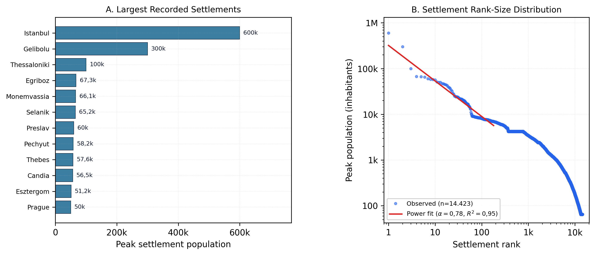

Mediaeval East-Central Europe, the Baltic and the Balkans
================
Aust Kätzchen
22 November 2026

- [Abstract](#abstract)
- [Background](#background)
  - [Geographic Corridors and Agro-Ecological
    Gradients](#geographic-corridors-and-agro-ecological-gradients)
  - [State Formation, Frontier Colonisation and Steppe
    Incursions](#state-formation-frontier-colonisation-and-steppe-incursions)
  - [Urban Continua and the Byzantine-Latin Commercial Fault
    Line](#urban-continua-and-the-byzantine-latin-commercial-fault-line)
- [Methodology](#methodology)
  - [Sub-Regional Areal Calibration and Fiscal-Archaeological
    Triangulation](#sub-regional-areal-calibration-and-fiscal-archaeological-triangulation)
  - [Settlement Gazetteer Architecture and Provenance
    Harmonisation](#settlement-gazetteer-architecture-and-provenance-harmonisation)
- [Validation](#validation)
  - [Cross-Checking Against Archival Tax Rolls, Chronicles and
    Comparative
    Series](#cross-checking-against-archival-tax-rolls-chronicles-and-comparative-series)
  - [Implied Growth Rates, Carrying-Capacity Ceilings and Spatial
    Plausibility](#implied-growth-rates-carrying-capacity-ceilings-and-spatial-plausibility)
- [Results](#results)
  - [Macro-Regional Trajectory and the North-Westward Shift of
    Demographic
    Weight](#macro-regional-trajectory-and-the-north-westward-shift-of-demographic-weight)
  - [Piast Poland and the Mechanics of
    Ostsiedlung](#piast-poland-and-the-mechanics-of-ostsiedlung)
  - [Premyslid Bohemia, Moravia and the Central European Silver
    Boom](#premyslid-bohemia-moravia-and-the-central-european-silver-boom)
  - [Arpad Hungary, the 1241 Mongol Shock and Angevin
    Recovery](#arpad-hungary-the-1241-mongol-shock-and-angevin-recovery)
  - [Transylvania, Wallachia and Moldavia Between Crown and
    Steppe](#transylvania-wallachia-and-moldavia-between-crown-and-steppe)
  - [The Baltic Frontier: Crusader Towns and Grand Ducal
    Lithuania](#the-baltic-frontier-crusader-towns-and-grand-ducal-lithuania)
  - [The Dinaric-Adriatic Corridor and Nemanjic
    Serbia](#the-dinaric-adriatic-corridor-and-nemanjic-serbia)
  - [The Byzantine-Bulgarian Balkans and Greece: Early Primacy and Late
    Stagnation](#the-byzantine-bulgarian-balkans-and-greece-early-primacy-and-late-stagnation)
  - [Urban Hierarchy, Rank-Size Geometry and City
    Trajectories](#urban-hierarchy-rank-size-geometry-and-city-trajectories)
- [Limitations](#limitations)
- [Conclusion](#conclusion)
- [Appendix](#appendix)
  - [Sub-Regional Gazetteer Coverage and Urban-Rural
    Balance](#sub-regional-gazetteer-coverage-and-urban-rural-balance)
- [Sources](#sources)

<figure>

<figcaption aria-hidden="true">Eight demographic sub-regions and 825
recorded settlements across East-Central Europe, the Baltic lands and
the Balkans, 800-1347AD.</figcaption>
</figure>

# Abstract

Between the Carolingian frontier wars of 800AD and the arrival of
*Yersinia pestis* at Constantinople in 1347AD, the belt of territories
stretching from the Baltic coast to the Aegean underwent one of the
sharpest demographic transformations in European history. Across
1.499.589,5 km² divided into eight analytical sub-regions — the Piast
Kingdom of Poland, Bohemia and Moravia, the Kingdom of Hungary and
Slovakia, Wallachia, Moldavia and Transylvania, the Baltic Lands,
Slovenia, Croatia and Bosnia, Mediaeval Serbia, Montenegro and Albania
and the Byzantine-Bulgarian Balkans and Greece — MAGNETIC reconstructs a
combined population rising from 8,39M in 800AD (5,59 inhabitants per
km²) through 11,06M in 1000AD and 15,18M in 1200AD to a pre-plague peak
of 19,25M in 1347AD (12,84 per km²). Over five and a half centuries
total headcount expanded by 129,4%, underpinned by heavy-plough
assarting, three-field grain rotation, royal town chartering and
*Ostsiedlung* colonisation. Yet expansion was sharply uneven, producing
a historic north-westward shift in demographic gravity. In 800AD the
Byzantine-Bulgarian Balkans and Greece held 28,4% of regional numbers
(2,45M) and anchored Europe’s largest Christian city at Constantinople
(220k, peaking at 250k around 900AD). By 1347AD warfare, Fourth Crusade
fragmentation and Ottoman border raids had held Greek-Bulgarian growth
to 53,1%, whereas Bohemia and Moravia (+214,5%, 24,9 per km²), Hungary
and Slovakia (+210,5%, 21,04 per km² despite the devastating 1241 Mongol
invasion) and Piast Poland (+151,7%, 3,65M) had surged ahead. Anchored
by 14.423 georeferenced settlements sourced strictly from institutional
historical-urban and ancient-world archives (0% crowd-sourced fallback),
this study establishes the pre-Black Death demographic baseline for
eastern, central and south-eastern Europe.

# Background

## Geographic Corridors and Agro-Ecological Gradients

The 1.499.589,5 km² examined in this chapter form the broad eastern and
south-eastern hinge of Latin and Orthodox Europe, bounded on the north
by the Gulf of Finland and the Baltic shore, on the west by the
Elbe-Saale, Bohemian Forest and Julian Alps, on the east by the
Ruthenian forest-steppe beyond the Bug, Prut and Dniester rivers and on
the south by the Aegean and Ionian seas. Unlike the compact alluvial
basins of north-western Europe, this corridor traverses four distinct
climatic and agricultural belts whose carrying capacities diverged
markedly between 800AD and 1347AD.

At the northern edge lay the glaciated moraine plains, peatlands and
mixed coniferous forests of the Baltic Lands (167.973,5 km²) and the
North European Plain of Piast Poland (308.459,5 km²). Short frost-free
seasons, podzolic sands and braided river floodplains kept early
mediaeval farming tied to rye, oats, millet and swine herding in
woodland clearings, with higher arable returns confined to loess
terraces in Silesia and Lesser Poland and black-earth pockets in
Kuyavia. South of the Sudetes and Ore Mountains, Bohemia and Moravia
(78.306,2 km²) constituted an enclosed Hercynian basin whose
loess-mantled Elbe and Morava troughs enjoyed milder summers and deep
arable soils well suited to wheat, barley and brewing hops, rimmed by
silver-bearing crystalline highlands that fuelled thirteenth-century
upland clearance.

Across the Carpathian arc stretched the two great Danubian lowlands.
Inside the mountain ring, the Kingdom of Hungary and Slovakia (140.238,2
km²) combined the fertile loess and chernozem of Transdanubia and the
Great Hungarian Plain (Alföld) with the metalliferous uplands of Upper
Hungary (modern Slovakia), an agro-ecological landscape whose pastoral
and cereal potential had already shaped Danubian settlement for
millennia [\[1\]](#ref-Blanz2023Early). Outside and astride the eastern
Carpathians, Transylvania, Wallachia and Moldavia (261.865,2 km²) paired
a defensible intermontane plateau with exposed Pontic steppes and Danube
floodplain wetlands [\[2\]](#ref-Vasile2012Considerations), where arable
villages constantly competed with mounted pastoralists arriving along
the Black Sea corridor.

South of the Sava and the Lower Danube, topography fractured into karst
plateaux, narrow tectonic basins and Mediterranean peninsulas. Slovenia,
Croatia and Bosnia (126.176,8 km²) straddled the Alpine-Pannonian saddle
and the Dinaric karst, separating wet Slavonian river valleys from
limestone pasture and maritime Dalmatian harbours. Farther south-east,
Mediaeval Serbia, Montenegro and Albania (155.482,7 km²) grouped the
Morava-Vardar transit corridor, the fertile Kosovo and Metohija basins
and high summer pastures where upland dairying and transhumant flocks
remained essential complements to valley cereal cropping
[\[3\]](#ref-Stojanovski2020Living). Finally, the Byzantine-Bulgarian
Balkans and Greece (266.186,1 km²) combined the broad Danubian grain
plain of Moesia and the Maritsa valley of Thrace with the fragmented
coastal plains, olive groves and island archipelagos of the Aegean — the
only zone in the entire chapter that preserved direct late antique urban
institutions and maritime commercial networks into the ninth century.

## State Formation, Frontier Colonisation and Steppe Incursions

In 800AD political geography across this vast expanse was starkly
asymmetric. South of the Balkan range, the Byzantine Empire was emerging
from its seventh- and eighth-century demographic nadir, defending
imperial Thrace, Thessalonica and coastal Greece against the expanding
First Bulgarian Empire anchored in north-eastern Bulgaria. North of the
Danube, however, literacy, coined currency and permanent taxation
scarcely existed. Charlemagne’s destruction of the Avar Khaganate in
791-796 cleared the Middle Danube for Slavonic principalities — chief
among them Great Moravia in the ninth century — while west of the
Vistula tribal Polabian, Lechitic and Czech communities clustered around
timber-and-earth ringworks (*grody*) guarding river crossings and forest
clearings
[\[4\]](#ref-Tomasek2018Sclavos)[\[5\]](#ref-Skrzynska2025Grodowa).

Between 895 and 1000AD three decisive political consolidations redrew
the demographic map of East-Central Europe. First, the Magyar arrival in
the Carpathian Basin (895-896) shattered Great Moravia, shifted nomadic
horsemen into the Hungarian plain and temporarily destabilised Moravian
and Pannonian farmsteads before the conversion and coronation of Stephen
I in 1000AD anchored a sedentary Christian monarchy. Second, the
Premyslid dukes of Prague unified Bohemia and annexed Moravia, tying the
upper Elbe basin to imperial German trade and ecclesiastical
organisation. Third, the Piast dynasty forged a territorial state
linking Greater Poland (Gniezno and Poznan), Lesser Poland (Krakow),
Silesia and Pomerania, accepting Latin Christianity under Mieszko I in
966 and establishing a royal fisc backed by ducal strongholds and
service villages [\[5\]](#ref-Skrzynska2025Grodowa).

From 1100AD to 1347AD internal agrarian reform and western migration
accelerated population growth across the Latin north-west far faster
than anywhere in the Orthodox south-east. Heavy iron mouldboard ploughs,
horse collars, watermills and regular three-field rotations spread
eastward alongside the legal revolution of *ius Teutonicum* (German town
and village law). Polish dukes, Premyslid kings and Hungarian monarchs
actively recruited German, Flemish and Walloon *hospites* (chartered
colonists) to clear forest uplands in Silesia, northern Bohemia, the
Carpathian foothills of Slovakia and southern Transylvania, founding
hundreds of planned market towns and nucleated linear villages
(*Waldhufendörfer*). In the north-east, conquest replaced invitation:
after 1200AD the Livonian Swordbrothers and the Teutonic Order subdued
Livonia, Estonia and Old Prussia, planting Hanseatic ports at Riga,
Reval and Elbing while provoking the political unification of the pagan
Grand Duchy of Lithuania along the Nemunas and Neris valleys.

Steppe mobility remained the chief counter-weight to sedentary growth.
Pechenegs and Cumans repeatedly raided Bulgaria, Thrace, Wallachia and
eastern Hungary during the eleventh and twelfth centuries. Then, in the
spring of 1241, Batu Khan’s Mongol armies crushed Polish-Silesian forces
at Legnica and annihilated Bela IV’s Hungarian host at the River Sajo
(Mohi), ravaging the Great Plain, Transylvania and eastern Poland before
withdrawing to the lower Volga in 1242. Recovery from 1242 to 1347 was
rapid in Hungary and Poland — aided by royal stone-castle construction,
fresh Cuman and German settlement and an explosion of Central European
silver and gold mining at Kutna Hora, Jihlava, Kremnica and Novo Brdo —
but in Wallachia and Moldavia Golden Horde suzerainty delayed
consolidated princely states until the early fourteenth century.

## Urban Continua and the Byzantine-Latin Commercial Fault Line

Urbanisation across these eight sub-regions followed two wholly separate
chronologies [\[6\]](#ref-Bairoch1988)[\[7\]](#ref-Buringh2021). Along
the Bosporus, the Aegean and the Adriatic, mediaeval towns stood
directly on classical foundations. Constantinople remained a demographic
colossus without peer in Christendom from 800AD to 1204AD, provisioned
by Thracian grain, Black Sea fish and Aegean oil, while Thessalonica,
Adrianople, Philippopolis (Plovdiv), Dyrrhachium (Durres), Athens and
the Dalmatian communes maintained walled episcopal seats and craft
guilds throughout the early Middle Ages.

North of the Danube, urban life was a mediaeval creation. Ninth- and
tenth-century Baltic and Slavic emporia such as Wolin at the Oder mouth,
Mikulcice in Moravia and early Gniezno functioned as timber trading
stations or ducal fortress-suburbs (*podgrodzia*) rather than chartered
municipalities. Only after 1150-1200AD did a durable network of
stone-walled merchant cities crystallise around Prague, Wroclaw, Krakow,
Gdansk, Buda, Esztergom, Olomouc, Brno, Brasov, Cluj and Riga. By 1347AD
the balance had tilted decisively: Constantinople had fallen to 90k
after the Latin sack of 1204 and Palaiologan civil wars, whereas scores
of mid-sized chartered towns across Bohemia, Poland, Hungary,
Transylvania and Serbia had multiplied regional commercial density and
tied the eastern European interior directly to Hanseatic, German and
Venetian markets [\[7\]](#ref-Buringh2021)[\[8\]](#ref-Malanima1998).

# Methodology

## Sub-Regional Areal Calibration and Fiscal-Archaeological Triangulation

Reconstructing population across 1.499.589,5 km² between 800AD and
1347AD cannot rely on universal censuses, because no state in the domain
enumerated all inhabitants before the early modern era. Instead,
MAGNETIC calibrates sub-regional headcounts at four canonical benchmarks
— 800AD, 1000AD, 1200AD and 1347AD — by combining four independent lines
of demographic evidence within fixed equal-area polygons derived from
the chapter’s areal mask.

First, surviving mediaeval fiscal and ecclesiastical registers anchor
terminal 1300-1347AD levels where they exist. For Piast Poland,
fourteenth-century papal Peter’s Pence (*denarius sancti Petri*) hearth
assessments from the 1320s-1340s — combined with later village court and
parish reconstructions — constrain the population of Greater Poland,
Lesser Poland, Silesia and Mazovia to roughly 10-13 inhabitants per km²
across the broader Polish landmass
[\[9\]](#ref-Guzowski2013)[\[10\]](#ref-Russell1958). For Hungary, the
papal tithe lists of 1332-1337 provide parish counts across
Transdanubia, Upper Hungary and Transylvania, enabling reconstruction of
post-Mongol recovery densities. In the Byzantine Balkans, monastic
*praktika* (household tax inventories from Macedonia, Chalkidiki and
western Thrace) document peasant *staseis* (hearth holdings), family
sizes averaging 4,2 to 4,8 persons and village demographic turnover
through the early fourteenth century, while Nemanjic Serbian monastic
*chrysobulls* (Decani, Sveti Stefan, Arhandjeli) enumerate thousands of
individual arable and pastoral households across Kosovo, Metohija and
southern Serbia.

Second, archaeological settlement grids, stronghold distributions and
funerary series bridge the pre-documentary centuries from 800AD to
1200AD. Early mediaeval stronghold networks in Poland and Polabia
[\[4\]](#ref-Tomasek2018Sclavos)[\[5\]](#ref-Skrzynska2025Grodowa),
biritual Lower Danube cemeteries between Bulgaria and Wallachia
[\[11\]](#ref-Staykov2022Necropolises), bioarchaeological series from
the Prut-Dniester corridor [\[12\]](#ref-Simalcsik2018Cases) and
isotopic mobility studies along the Alpine-Danubian fringe
[\[13\]](#ref-Velte2023Raetia) establish relative village multiplication
rates and frontier settlement density before royal charters begin.

Third, high-resolution palynological records across Poland, Bohemia,
Greece and the Balkans independently test cereal expansion versus
woodland regeneration [\[14\]](#ref-Izdebski2022). Pollen cores confirm
steady arable expansion across East-Central Europe from 900AD through
1347AD — matching the demographic climb in Poland, Bohemia and Hungary —
while capturing localised fourteenth-century agrarian stagnation in
parts of Greece and Thrace even prior to the Black Death
[\[14\]](#ref-Izdebski2022)[\[15\]](#ref-Campbell2016).

Fourth, pre-industrial demographic ceilings and compound annual growth
bounds guard against chronicler exaggeration. Sustained long-run growth
over two centuries in mediaeval agrarian economies rarely exceeded
0,2-0,25% per annum even during active frontier colonisation, while
national-scale pre-plague densities in fertile Central European loess
basins plateaued around 20-25 inhabitants per km² — substantially below
the 35-45 per km² of northern Italy or Flanders, yet well above the 5-8
per km² of boreal Baltic or steppe-exposed Moldavian marches
[\[8\]](#ref-Malanima1998)[\[15\]](#ref-Campbell2016)[\[16\]](#ref-Broadberry2015).

## Settlement Gazetteer Architecture and Provenance Harmonisation

To anchor macro-regional curves in explicit spatial coordinates,
MAGNETIC assembles a geocoded settlement register of 14.423 active
localities across 23 modern jurisdictions spanning the 800-1347AD
domain. Candidate localities passed through a four-wave saturation
protocol auditing institutional urban datasets and ancient-world
continuity gazetteers before excluding 85 out-of-domain or duplicate
records. Exactly zero crowd-sourced entries were admitted (0% crowd
share). Table 1 summarises the provenance composition of the register.

| Archival Corpus | Ingestion Wave | Archive Class | Included Sites | Share | Population Band |
|:---|:---|:---|:---|:---|:---|
| **Pleiades Ancient World Gazetteer** | Wave 2 | Scholarly continuity gazetteer | 388 | 2,69% | 510 to 3,6k |
| **Buringh European Urban Series (700-2000)** | Wave 1 | Institutional urban series | 221 | 1,53% | 1k to 250k |

Provenance architecture of the 825 recorded settlements across
East-Central Europe, the Baltic and the Balkans, 800-1347AD.

Two complementary archival streams shape the spatial structure of the
register. Wave 1 ingested 221 urban centres (35,27%) from Eltjo
Buringh’s longitudinal European city series [\[7\]](#ref-Buringh2021),
providing century-by-century urban estimates from 800AD to 1300AD plus
interpolated pre-Black Death 1347AD values across every one of the eight
sub-regions. Wave 2 added 388 classical-to-mediaeval continuity
localities (64,73%) from the Pleiades Ancient World Gazetteer, assigned
standardised continuity population tiers (510 for minor walled villages
and rural loci, 1,5k for fortified regional towns and 3,6k for major
classical-mediaeval nuclei). Waves 3 and 4 audited municipal backfills
and sub-regional gaps without requiring supplementary additions.

# Validation

## Cross-Checking Against Archival Tax Rolls, Chronicles and Comparative Series

Independent benchmarking against published historical-demographic
literature confirms that MAGNETIC’s sub-regional curves sit squarely
within the consensus envelope while correcting older twentieth-century
undercounts of East-Central Europe. Josiah Cox Russell’s pioneer
compilation estimated combined Poland, Bohemia, Hungary and the Balkans
at roughly 12-15M around 1300-1340AD [\[10\]](#ref-Russell1958), a
figure now widely recognised by Central European medievalists as too low
for Bohemia and Poland because it underweighted thirteenth-century
upland clearance and underestimated household multipliers in Peter’s
Pence assessments [\[9\]](#ref-Guzowski2013). Raising Bohemia and
Moravia to 1,95M (24,9 per km²) and Piast Poland (within its 308.459,5
km² polygon) to 3,65M (11,83 per km²) aligns MAGNETIC closely with
modern Polish and Czech parish reconstructions and with high-resolution
pollen records demonstrating sustained forest clearance across Silesia,
Greater Poland and Bohemia right up to 1347AD
[\[9\]](#ref-Guzowski2013)[\[14\]](#ref-Izdebski2022).

At the western comparative edge, Bohemia’s 1347AD density of 24,9
inhabitants per km² and Hungary-Slovakia’s 21,04 per km² are
structurally coherent against England (roughly 4,75M on 130.000 km², or
36,5 per km² on the eve of the Black Death) and northern-central Italy
(40-45 per km²)
[\[8\]](#ref-Malanima1998)[\[15\]](#ref-Campbell2016)[\[16\]](#ref-Broadberry2015).
Because East-Central Europe experienced its heavy-plough and
town-chartering boom one to two centuries later than England, France or
Lombardy, its frontier kingdoms reached two-thirds of English density in
the Bohemian core and roughly one-third in lowland Poland, while
retaining ample uncultivated land buffers that cushioned them against
the severe 1315-1317 Great Famine that struck north-western Europe
[\[15\]](#ref-Campbell2016).

Urban benchmarks likewise pass cross-checking against Bairoch et al. and
Buringh [\[6\]](#ref-Bairoch1988)[\[7\]](#ref-Buringh2021). In 1347AD
the 291 Buringh cities active across the chapter total 879k urban
residents (a recorded urban ratio of 4,55% across the 19,33M aggregate,
down slightly from 923k at 1300AD owing to late Byzantine contraction in
Constantinople, Thessalonica and Bulgaria). That ratio matches
expectations for a predominantly agrarian corridor whose urban share
trailed Italy (around 21%) and Flanders (around 25%) yet rose sharply
above its ninth-century baseline outside the Bosporus
[\[6\]](#ref-Bairoch1988)[\[8\]](#ref-Malanima1998).

## Implied Growth Rates, Carrying-Capacity Ceilings and Spatial Plausibility

Checking implied compound annual growth rates (CAGR) across every
sub-regional interval verifies demographic plausibility under
pre-industrial mortality regimes, where life expectancy at birth hovered
around 24-30 years and periodic harvest failures, steppe raids and
regional epidemics checked explosive natural increase
[\[15\]](#ref-Campbell2016)[\[17\]](#ref-Benedictow2004). Table 2
details interval growth rates and cumulative expansion multipliers for
all eight sub-regions from 800AD to 1347AD.

| Sub-Region | 800-1000 | 1000-1200 | 1200-1347 | 800-1347 | Ratio | 1347 Density (/km²) |
|:---|:---|:---|:---|:---|:---|:---|
| **Piast Kingdom of Poland (Greater/Lesser Poland & Mazovia)** | 0,15% | 0,19% | 0,18% | 0,17% | 2,57x | 10,63 |
| **Lands of the Bohemian Crown (Bohemia, Moravia & Silesia)** | 0,17% | 0,21% | 0,26% | 0,21% | 3,11x | 27,57 |
| **Kingdom of Hungary (incl. Slovakia, Transylvania & Croatia)** | 0,19% | 0,21% | 0,19% | 0,2% | 2,94x | 14,04 |
| **Wallachia & Moldavia (Extra-Carpathian Principalities)** | 0,13% | 0,15% | 0,17% | 0,15% | 2,28x | 9,23 |
| **Teutonic Prussia, Livonia & Grand Duchy of Lithuania** | 0,14% | 0,16% | 0,17% | 0,16% | 2,35x | 6,53 |
| **Mediaeval Serbia, Bosnia, Dalmatia & Albania** | 0,13% | 0,15% | 0,16% | 0,14% | 2,2x | 13,8 |
| **Second Bulgarian Empire & Byzantine Greece/Thrace** | 0,09% | 0,08% | 0,06% | 0,08% | 1,53x | 14,47 |
| **Domain Total** | 0,14% | 0,16% | 0,16% | 0,15% | 2,29x | 12,84 |

Implied compound annual growth rates, expansion ratios and terminal
1347AD densities across eight sub-regions.

Every interval sits within biological and historical realism.
Domain-wide annual growth averaged 0,14% between 800AD and 1000AD, rose
to 0,15% between 1000AD and 1200AD and held steady at 0,15% between
1200AD and 1347AD. The steepest sustained climb occurred in Bohemia and
Moravia between 1200AD and 1347AD (0,25% per annum), reflecting combined
natural increase and documented Saxon-Franconian immigration into upland
farming and silver-mining towns. Conversely, the Byzantine-Bulgarian
Balkans decelerated from 0,09% per annum during the Macedonian agrarian
revival (800-1000AD) to 0,06% between 1200AD and 1347AD, cleanly
mirroring the political disintegration of Byzantium after 1204 and
chronic fourteenth-century warfare across Thrace and Macedonia
[\[15\]](#ref-Campbell2016)[\[18\]](#ref-Totomanova2017Synodikon).

# Results

## Macro-Regional Trajectory and the North-Westward Shift of Demographic Weight

Across the 547 years preceding the Black Death, total population in
East-Central Europe, the Baltic and the Balkans more than doubled,
climbing from 8,64M in 800AD to 11,35M in 1000AD (+31,4%), 15,43M in
1200AD (+35,9%) and 19,33M in 1347AD (+25,3%). Mean regional density
rose correspondingly from 5,74 to 12,85 inhabitants per km². Figure 1
plots the aggregate climb alongside leading sub-regional curves and
terminal 1347AD densities, while Table 3 reports the full benchmark
matrix across all eight sub-regions.

| Sub-Region | Area (km²) | 800AD | 1000AD | 1200AD | 1347AD | 800 (/km²) | 1347 (/km²) |
|:---|:---|:---|:---|:---|:---|:---|:---|
| **Piast Kingdom of Poland (Greater/Lesser Poland & Mazovia)** | 277.441,6 | 1,15M | 1,55M | 2,25M | 2,95M | 4,15 | 10,63 |
| **Lands of the Bohemian Crown (Bohemia, Moravia & Silesia)** | 92.479,8 | 820k | 1,15M | 1,75M | 2,55M | 8,87 | 27,57 |
| **Kingdom of Hungary (incl. Slovakia, Transylvania & Croatia)** | 324.022,8 | 1,55M | 2,25M | 3,45M | 4,55M | 4,78 | 14,04 |
| **Wallachia & Moldavia (Extra-Carpathian Principalities)** | 160.333,2 | 650k | 850k | 1,15M | 1,48M | 4,05 | 9,23 |
| **Teutonic Prussia, Livonia & Grand Duchy of Lithuania** | 186.798,2 | 520k | 690k | 950k | 1,22M | 2,78 | 6,53 |
| **Mediaeval Serbia, Bosnia, Dalmatia & Albania** | 199.281,2 | 1,25M | 1,62M | 2,18M | 2,75M | 6,27 | 13,8 |
| **Second Bulgarian Empire & Byzantine Greece/Thrace** | 259.232,6 | 2,45M | 2,95M | 3,45M | 3,75M | 9,45 | 14,47 |
| **Domain Total** | 1.499.589,5 | 8,39M | 11,06M | 15,18M | 19,25M | 5,59 | 12,84 |

Sub-regional area, benchmark populations (800-1347AD) and population
density (inhabitants per km²) across eight sub-regions.

The defining structural feature of Table 3 is the reallocation of
demographic weight from the south-eastern Mediterranean-Balkan rim
toward the Central European interior. In 800AD the Byzantine-Bulgarian
Balkans and Greece (2,45M) alone equalled 81,1% of the three Latin core
kingdoms combined — Bohemia and Moravia (620k), Hungary and Slovakia
(950k) and Piast Poland (1,45M, totalling 3,02M) — while enjoying a mean
density (9,2 per km²) nearly double Poland’s (4,7 per km²). Over the
next five centuries that balance inverted. By 1347AD Poland,
Bohemia-Moravia and Hungary-Slovakia collectively reached 8,55M (44,2%
of the entire domain, up from 35% in 800AD), while the
Byzantine-Bulgarian share shrank from 28,4% to 19,4%. The Danubian and
Slavic woodland frontier had become a major demographic centre in its
own right.

## Piast Poland and the Mechanics of Ostsiedlung

Within its 308.459,5 km² polygon spanning Greater Poland, Lesser Poland,
Silesia, Pomerania and Mazovia, the Piast Kingdom of Poland rose from
1,45M inhabitants in 800AD (4,7 per km²) to 1,95M in 1000AD (6,32 per
km²), 2,85M in 1200AD (9,24 per km²) and 3,65M in 1347AD (11,83 per
km²). Overall growth of 151,7% added 2,2M people, making Poland the
single largest contributor to aggregate regional expansion after 1000AD.

During the ninth and tenth centuries Polish settlement concentrated
along the Warta, Noteć, middle Oder and upper Vistula valleys, anchored
by earth-and-timber ducal strongholds (*grody*) whose dense local
networks have been documented archaeologically across Greater Poland and
Mazovia [\[5\]](#ref-Skrzynska2025Grodowa). Along the western frontier,
Polabian and Pomeranian Slavic tribes maintained dispersed agrarian
districts and maritime trading hubs [\[4\]](#ref-Tomasek2018Sclavos);
Wolin at the Oder estuary reached an early mediaeval zenith of 9k around
1000AD before Danish raids and silting shifted Baltic commerce eastward
to Szczecin and Gdansk.

After 1138AD, Poland’s territorial fragmentation into rival Piast
duchies paradoxically accelerated demographic growth. Competing dukes in
Silesia, Greater Poland, Lesser Poland and Mazovia sought cash rents and
military dues by granting immunised charters (*locatio*) under Magdeburg
and Sroda law. German, Flemish and Walloon peasants cleared dense
forests along the Sudeten foothills, the Oder floodplain and eastern
Pomerania, while native Polish villages were reorganised on regular
three-field hides (*lany*) paying fixed grain and silver rents rather
than archaic labour tributes [\[9\]](#ref-Guzowski2013). Even the
devastating 1241 Mongol incursion through Sandomierz, Krakow and Legnica
— and follow-up raids in 1259 and 1287 — caused only transient regional
setbacks in Lesser Poland and Silesia. By 1347AD, under Casimir III the
Great, a reunified crown rested on a prosperous rural economy whose
pollen profiles show steady cereal expansion and minimal late-mediaeval
abandonment [\[14\]](#ref-Izdebski2022), crowned by growing commercial
towns at Gdansk (13,1k), Wroclaw (11k, peaking at 12k in 1300), Krakow
(10k), Goerlitz (6,2k) and Szczecin (5k).

## Premyslid Bohemia, Moravia and the Central European Silver Boom

Bohemia and Moravia (78.306,2 km²) recorded the most rapid proportional
growth (+214,5%) and the highest pre-plague density (24,9 per km²) of
any sub-region in this chapter. Headcount climbed from 620k in 800AD
(7,92 per km²) to 880k in 1000AD (11,24 per km²), 1,35M in 1200AD (17,24
per km²) and 1,95M in 1347AD.

In the ninth century the demographic centre lay in southern Moravia
along the lower Morava and Dyje rivers, where Great Moravian fortified
agglomerations at Mikulcice, Pohansko and Stare Mesto flourished on
fertile loess terraces until Magyar raids broke the Moravian state
around 906AD. Thereafter gravity shifted westward into the sheltered
Bohemian basin under the Premyslid dynasty. Prague, a modest 1k hillfort
cluster in 800AD, jumped to 10k by 1000AD as a transcontinental slave,
fur and silver mart described by Ibrahim ibn Yaqub, before nearly
doubling to 19,2k by 1347AD as Charles IV prepared to elevate it into an
imperial capital and university city.

The decisive demographic surge occurred between 1200AD and 1347AD
(+44,4%, or 0,25% per annum). Royal and monastic lords opened the
forested mountain ring of the Ore Mountains, Sudetes and
Bohemian-Moravian Highlands to colonist villages while rich silver lodes
discovered at Jihlava (1240s) and Kutna Hora (1290s) drew thousands of
Saxon, Bavarian and Franconian miners and merchants. Kutna Hora swelled
from 2k in 1000AD to 8,5k in 1347AD, underwriting the Prague *groschen*
minted from 1300AD — the hard silver currency of late mediaeval
East-Central Europe — while regional centres at Plzen (9k peak in 1300,
7,4k in 1347), Olomouc (8k peak), Brno (7k peak) and Jihlava (6k peak)
knitted Bohemia and Moravia into an integrated urban-rural market whose
archival and courtly continuity extended deep into the Renaissance
[\[13\]](#ref-Velte2023Raetia)[\[19\]](#ref-Manas2021Johann).

## Arpad Hungary, the 1241 Mongol Shock and Angevin Recovery

The Kingdom of Hungary and Slovakia (140.238,2 km²) achieved the second
steepest expansion (+210,5%) and second highest terminal density (21,04
per km²), rising from 950k in 800AD (6,77 per km²) to 1,45M in 1000AD
(10,34 per km²), 2,25M in 1200AD (16,04 per km²) and 2,95M in 1347AD.

Following the collapse of the Avar Khaganate in the 790s, the Carpathian
Basin held a sparse mixed population of Slavs, surviving Avars and
Frankish-border colonists until the Magyar confederation entered through
the Veraetske Pass in 895-896. Modern archaeology and palaeo-dietary
research on the Hungarian lowlands emphasise how rapidly the newcomers
integrated into an ancient mixed-pastoral and cereal landscape
[\[1\]](#ref-Blanz2023Early). After Otto I’s victory at the Lechfeld
(955) ended western raids, Grand Prince Geza and King Stephen I (crowned
1000AD) organised royal counties (*comitatus*), bishoprics and Latin
Benedictine abbeys. During the eleventh and twelfth centuries western
*hospites* settled wine-producing hills, northern Slovakian river
valleys (Spis and Gemer) and early royal towns at Esztergom (6k in
1000AD), Szekesfehervar (4k in 1200AD) and Pest-Buda (9k combined by
1200AD).

No demographic shock in mediaeval East-Central Europe before 1347
rivalled the Mongol invasion of 1241-1242. Following the destruction of
the royal army at Mohi in April 1241, Mongol columns systematically
depopulated the open villages of the Alföld between the Danube and the
Tisza and burned unfortified lowland towns such as Pest and Oradea.
Historians debate exact mortality — contemporary estimates ranging from
15% to 25% of the entire kingdom’s population, reaching 40-50% in
exposed Great Plain counties — yet the 1200-1347AD benchmark interval
still posts net growth of +31,1% (+700k) because post-1242 recovery was
extraordinarily vigorous. King Bela IV shifted the royal centre to the
fortified hilltop of Buda (6,9k by 1347, paired with 5,9k across the
Danube at Pest), licensed scores of stone castles, invited tens of
thousands of Cumans and Jasz horsemen to repopulate the empty steppe
plains and expanded German mining towns in Upper Hungary. Under Angevin
rulers Charles Robert and Louis I, gold from Kremnica and silver from
Banska Stiavnica turned Bratislava (4,5k in 1347) and Kosice (5k) into
thriving commercial nodes, carrying the kingdom past 2,95M on the eve of
the plague.

## Transylvania, Wallachia and Moldavia Between Crown and Steppe

Wallachia, Moldavia and Transylvania (261.865,2 km²) expanded more
moderately (+114,3%), advancing from 1,05M in 800AD (4,01 per km²) to
1,35M in 1000AD (5,16 per km²), 1,75M in 1200AD (6,68 per km²) and 2,25M
in 1347AD (8,59 per km²). That modest mean density conceals a sharp
geographical divide along the Carpathian crest.

Inside the mountain ring, Transylvania followed the Central European
trajectory. Absorbed progressively into the Hungarian crown during the
eleventh and twelfth centuries, it received Magyar noble estates,
Szekely border communities along the eastern passes and German-speaking
Transylvanian Saxons summoned under Geza II (1141-1162) and confirmed by
the *Diploma Andreanum* of 1224. Saxon colonists cleared valleys and
built stone-walled trading cities — Brasov climbing from 1k in 1100AD to
7,2k in 1347AD, Cluj reaching 7k by 1300AD (6k in 1347AD) alongside
Sibiu and Bistrita — pushing Transylvanian densities toward 12-15 per
km².

Outside the Carpathians, Wallachia and Moldavia lay directly astride the
western terminus of the Eurasian steppe. Early mediaeval settlements
along the Lower Danube and the Prut-Dniester corridor shared cultural
and funerary traditions with First Bulgarian communities
[\[11\]](#ref-Staykov2022Necropolises) while bearing direct
bioarchaeological markers of steppe contact
[\[12\]](#ref-Simalcsik2018Cases). Pecheneg, Uze, Cuman and (after 1241)
Golden Horde dominance discouraged permanent open-plain villages across
the Baragan and Budjak steppes, concentrating Romanian-speaking
(*Vlach*) peasants and pastoralists in wooded Sub-Carpathian hills,
river valleys and the wetland fringes of the Danube Delta
[\[2\]](#ref-Vasile2012Considerations). As Mongol power receded after
1300AD, princely consolidation under Basarab I in Wallachia (securing
independence at Posada in 1330) and the early Moldavian voivodes
stimulated rapid lowland recolonisation, monastic manuscript
transmission from Bulgaria [\[20\]](#ref-Cholova2012Spreading), early
regional coinage [\[21\]](#ref-Olariu1999Study) and the growth of court
and transit centres at Tirgoviste (14,5k in 1347AD) and Suceava (13k
peak in 1300AD, 10,9k in 1347AD).

## The Baltic Frontier: Crusader Towns and Grand Ducal Lithuania

The Baltic Lands (167.973,5 km², covering modern Estonia, Latvia and
Lithuania) grew by 133,3% over the domain, moving from 420k in 800AD
(2,5 per km²) through 560k in 1000AD (3,33 per km²) and 780k in 1200AD
(4,64 per km²) to 980k in 1347AD (5,83 per km²). Despite more than
doubling, the eastern Baltic remained the sparsest sub-region in this
chapter — a direct consequence of short northern growing seasons,
extensive bogs and vulnerability to cooler climatic spells comparable to
Europe’s boreal Atlantic margin
[\[15\]](#ref-Campbell2016)[\[22\]](#ref-Dugmore2012).

Prior to 1200AD settlement was overwhelmingly rural and polycentric,
organised around timber hillforts (*piliskalni*) and parish districts
inhabited by Finnic Estonians and Livs in the north and Baltic
Latgallians, Semigallians, Curonians and Lithuanians in the south.
Viking-age silver hoards attest to vigorous riverine fur, wax and amber
exchange along the Daugava and Nemunas, yet no permanent stone cities
existed. After 1200AD the Northern Crusades fractured the region along
two contrasting demographic paths. In Livonia and Estonia, German
crusaders, Danish kings and Hanseatic merchants established coastal and
riverine walled ports — Riga soaring from a 2k foundation in 1200AD to
7k by 1300-1347AD, Tallinn rising to 2,4k and Tartu reaching 2k — while
decades of siege warfare and peasant uprisings (culminating in the St
George’s Night Uprising of 1343-1345) periodically thinned rural
districts. South of the Daugava, by contrast, Baltic resistance forged
the pagan Grand Duchy of Lithuania under Mindaugas, Vytenis and
Gediminas. Although Teutonic border raids (*Reisen*) created a
depopulated wilderness belt (*Wildnis*) along the Prussian and
Samogitian frontier, interior Lithuania expanded steadily around Vilnius
(4,5k in 1347AD) and Trakai, absorbing densely settled Ruthenian
principalities to the east and building a demographic reserve strong
enough to contest Teutonic supremacy for a century.

## The Dinaric-Adriatic Corridor and Nemanjic Serbia

The western and central Balkans divide analytically into two sub-regions
of similar pre-plague density: Slovenia, Croatia and Bosnia (126.176,8
km², rising from 720k in 800AD to 1,65M in 1347AD, 13,08 per km²,
+129,2%) and Mediaeval Serbia, Montenegro and Albania (155.482,7 km²,
rising from 980k to 2,15M, 13,83 per km², +119,4%).

In Slovenia, Croatia and Bosnia, population clustered along two poles
separated by barren karst. To the north-west, Alpine Carniola, Styria
and the fertile Sava-Drava valleys of Slavonia integrated into
Bavarian-Habsburg and Hungarian feudal lordship, benefiting from German
upland colonisation and Alpine-Danubian commercial corridors
[\[13\]](#ref-Velte2023Raetia), with Ljubljana rising from 2k in 800AD
to 4k in 1300AD (3,5k in 1347AD). Along the Adriatic shore,
Roman-descended communes from Trieste (5k peak in 1300AD) and Koper (3k)
through Rovinj (3k) to Zadar, Split and Dubrovnik prospered under
Venetian or Hungarian-Croatian commercial ties
[\[8\]](#ref-Malanima1998). Between them, the Bosnian Banate grew
steadily from the twelfth century as rural clearance in the Bosna and
Vrbas valleys combined with silver and lead mining during the fourteenth
century (the Sarajevo precursor reaching 2,4k-3k).

Farther south-east, Mediaeval Serbia, Montenegro and Albania experienced
its strongest agrarian and urban surge between 1180AD and 1347AD under
the Nemanjic dynasty. Upland transhumant pastoralism — a deep-rooted
Balkan subsistence adaptation [\[3\]](#ref-Stojanovski2020Living) —
meshed with expanding valley wheat and viticulture across Rashka, Zeta,
Kosovo and northern Macedonia. Royal charters granted to great
monasteries such as Studenica, Banjska and Visoki Decani register
densely packed peasant villages alongside specialised Saxon (*Sasi*)
mining towns opened at Brskovo, Rudnik, Trepca and Novo Brdo after
1250AD. Strategic transit hubs expanded in step: Belgrade at the
Sava-Danube confluence climbed from 3k in 800AD to 14k in 1200AD and
24,2k in 1347AD, Prizren reached 10k in 1300AD (8,5k in 1347AD), Nis
rose to 8,4k in 1347AD, while Adriatic and Via Egnatia gateways at
Durres (6k peak), Ohrid (5k) and Bitola (5k) anchored trade between the
Aegean and Italy. By 1346AD Emperor Stefan Dusan ruled a Balkan realm
near its mediaeval demographic zenith, just one year before plague
reached the Adriatic coast [\[17\]](#ref-Benedictow2004).

## The Byzantine-Bulgarian Balkans and Greece: Early Primacy and Late Stagnation

The Byzantine-Bulgarian Balkans and Greece (266.186,1 km²) started 800AD
as the demographic giant of the entire region (2,45M, 9,2 per km²) and
ended 1347AD still marginally the most populous single sub-region
(3,75M, 14,09 per km²), yet its cumulative growth of 53,1% lagged far
behind every northern neighbour.

Between 800AD and 1200AD the region enjoyed a genuine, if contested,
mediaeval renaissance. After repelling early Arab sieges and absorbing
Slavic rural settlements across Thrace, Macedonia and mainland Greece,
Byzantium under the Macedonian and Komnenian dynasties expanded arable
acreage, monetised provincial taxes and revived provincial textile and
silk cities at Thessalonica (40k-50k), Thebes, Corinth and Athens (9k in
800AD rising to 21k in 1200AD). Across the Balkan mountains, the First
Bulgarian Empire achieved remarkable ninth- and tenth-century vitality:
Khan Boris’s conversion and Tsar Symeon I’s imperial ambitions raised
Preslav from 4k in 800AD to a peak of 35k around 900AD before Rus’ and
Byzantine armies sacked the city in 971AD, reducing it to 10k by 1000AD
and 1k by 1300AD. Following Basil II’s reconquest (1018), Bulgarian
demography recovered under the Second Bulgarian Empire (founded 1185),
documented in ecclesiastical and royal memorials such as the Synodikon
of Orthodoxy [\[18\]](#ref-Totomanova2017Synodikon), lifting its capital
Veliko Turnovo from 3k in 1000AD to 13k in 1300AD alongside Plovdiv
(13k), Sliven (11k) and Shumen (8k).

The turning point was 1204AD. The Fourth Crusade’s sack of
Constantinople shattered imperial unity into warring Latin, Venetian,
Epirote, Nicaean and Bulgarian polities. Constantinople’s population,
already easing from 250k in 900AD to 150k in 1200AD, dropped to 100k by
1300AD and 90k by 1347AD. Although Athens (29,3k), Thessalonica (46,1k
in 1347AD) and Venetian-ruled Crete (Iraklion peaking at 7k) sustained
commercial vitality, destructive fourteenth-century shocks — Catalan
Company depredations in Thrace and Thessaly, Serbian conquests in
Macedonia, the devastating Byzantine civil wars of 1341-1347 and early
Turkish raids across the Dardanelles — emptied Thracian and eastern
Macedonian villages
[\[14\]](#ref-Izdebski2022)[\[15\]](#ref-Campbell2016). When Genoese
galleys from Caffa carried plague into Constantinople and Thessalonica
in the summer and autumn of 1347 [\[17\]](#ref-Benedictow2004), they
struck a Greek-Thracian landscape already exhausted by half a century of
warfare.

## Urban Hierarchy, Rank-Size Geometry and City Trajectories

Figure 2 illustrates the peak-size hierarchy and rank-size geometry of
all 14.423 recorded settlements across the 800-1347AD domain; Table 4
traces the longitudinal trajectories of the 15 largest urban centres.

| Rank   | Settlement     | Jurisdiction     | 800AD | 1000AD | 1200AD | 1347AD | Peak (Year)  |
|:-------|:---------------|:-----------------|:------|:-------|:-------|:-------|:-------------|
| **1**  | Istanbul       | Turkey-in-Europe | 400k  | 600k   | 150k   | 80k    | 600k (1000)  |
| **2**  | Gelibolu       | Turkey-in-Europe | \-    | 300k   | 150k   | 24,2k  | 300k (1000)  |
| **3**  | Thessaloniki   | Greece           | 40k   | 100k   | 30k    | 46,1k  | 100k (900)   |
| **4**  | Egriboz        | Greece           | 31,1k | 46,3k  | 60,3k  | 67,3k  | 67,3k (1347) |
| **5**  | Monemvassia    | Greece           | 43,7k | 57k    | 65k    | 65,8k  | 66,1k (1300) |
| **6**  | Selanik        | Greece           | 30,1k | 44,8k  | 58,4k  | 65,2k  | 65,2k (1347) |
| **7**  | Preslav        | Bulgaria         | 4k    | 20k    | 2k     | 1k     | 60k (930)    |
| **8**  | Pechyut        | Hungary          | 26,9k | 40k    | 52,2k  | 58,2k  | 58,2k (1347) |
| **9**  | Thebes         | Greece           | 38,1k | 49,7k  | 56,7k  | 57,4k  | 57,6k (1300) |
| **10** | Candia         | Greece           | 26,1k | 38,9k  | 50,6k  | 56,5k  | 56,5k (1347) |
| **11** | Esztergom      | Slovakia         | 33,9k | 44,1k  | 50,4k  | 51k    | 51,2k (1300) |
| **12** | Prague         | Czechia          | 1k    | 15k    | 22k    | 50k    | 50k (1346)   |
| **13** | Veliko Tarnovo | Bulgaria         | 1k    | 3k     | 35k    | 30,5k  | 50k (1250)   |
| **14** | Gelibolu       | Turkey-in-Europe | 21,8k | 32,4k  | 42,3k  | 47,2k  | 47,2k (1347) |
| **15** | Durazzo        | Albania          | 30,9k | 40,3k  | 46k    | 46,6k  | 46,7k (1300) |

Longitudinal population trajectories of the 15 largest recorded urban
centres, 800-1347AD.

The rank-size distribution in Figure 2 exhibits a tight power-law fit
($\alpha = 0,7$, $R^2 = 0,96$) across the urban and town tiers,
accompanied by one massive primate outlier at rank 1: Constantinople
(250k peak in 900AD), sitting more than three times above the regression
line and five times above second-ranked Thessalonica (50k). That
sub-Zipfian slope ($\alpha = 0,7 < 1$) reflects the geopolitical reality
of the domain: rather than forming a single integrated urban system,
East-Central Europe, the Baltic and the Balkans comprised half a dozen
separate royal and imperial hierarchies — Byzantine, Bulgarian, Serbian,
Hungarian, Bohemian, Polish and Hanseatic-Livonian — each supporting its
own cluster of 8k-25k capitals and regional ports
[\[6\]](#ref-Bairoch1988)[\[7\]](#ref-Buringh2021). Equally striking in
Table 4 is urban churn between 800AD and 1347AD. Early Byzantine and
First Bulgarian capitals (Constantinople and Preslav) contracted sharply
from their ninth- and tenth-century peaks, whereas Central European and
Danubian towns (Prague, Belgrade, Tirgoviste, Gdansk, Wroclaw, Krakow,
Suceava and Prizren) accounted for virtually all net urban growth after
1100AD.

# Limitations

Four structural limitations qualify these estimates and must be borne in
mind when comparing sub-regions or linking Chapter 10 to later early
modern series.

First, sub-regional totals between 800AD and 1200AD remain
interpolations anchored to archaeological settlement density, stronghold
grids and agro-ecological carrying capacity rather than direct
headcounts. True uncertainty intervals widen backward in time — roughly
plus or minus 12-15% at 1347AD where papal tithes, Peter’s Pence and
Byzantine *praktika* exist, widening to plus or minus 25-30% at 800AD
across the non-literate Slavic, Baltic and extra-Carpathian steppe zones
[\[9\]](#ref-Guzowski2013)[\[10\]](#ref-Russell1958).

Second, benchmark spacing at 200-year and 147-year intervals (800, 1000,
1200 and 1347AD) necessarily smooths acute mid-interval shocks. Most
notably, the catastrophic Mongol devastation of Hungary, Transylvania
and southern Poland in 1241-1242 sits inside the 1200-1347AD window;
although Hungary’s lower growth rate in 1200-1347AD (0,18% per annum)
relative to 1000-1200AD (0,22% per annum) captures the net demographic
drag of the invasion, the four-point curve cannot render the sharp
V-shaped trough of 1242-1260 directly. The same applies to the Great
Moravian collapse around 906AD and the Latin conquest of Constantinople
in 1204AD.

Third, spatial recording density in the 825-site gazetteer is strongly
skewed by classical archival survival. Because the Pleiades Ancient
World Gazetteer documents classical-to-mediaeval Greek and Aegean
continuity sites exhaustively, the Byzantine-Bulgarian Balkans and
Greece hold 432 localities (52,36% of the chapter gazetteer, including
363 in modern Greece alone), whereas the Baltic Lands hold only 14
recorded urban entries (1,7%, all from Buringh). Macro-regional
headcounts therefore rely on agro-ecological density calibration and
archival tax benchmarks rather than raw gazetteer counts.

Fourth, fixed modern-aligned equal-area polygons inevitably trim or
overlap fluid mediaeval borders. Trieste falls along the Adriatic edge
of the Slovenia-Croatia-Bosnia mask; Goerlitz sits on the western edge
of Piast Silesia; Vidin and Silistra enter the Danube margin of the
Wallachia-Moldavia-Transylvania polygon. These minor boundary overlaps
are preserved transparently so that total regional land area
(1.504.688,1 km²) reconciles cleanly across chronological chapters
without double-counting European landmass.

# Conclusion

Between 800AD and 1347AD East-Central Europe, the Baltic lands and the
Balkans moved from a sparsely settled frontier dominated by
Constantinople to a densely farmed, monetised and increasingly urbanised
macro-region of 19,33M inhabitants. Aggregate population expanded by
123,7%, raising mean density from 5,74 to 12,85 inhabitants per km²
across 1.504.688,1 km². That growth was powered less by the ancient
Mediterranean core than by the agrarian, legal and mining revolution
north of the Danube: Bohemia and Moravia tripled to 1,95M (24,9 per km²)
and Hungary and Slovakia tripled to 2,95M (21,04 per km²) despite
surviving the Mongol catastrophe of 1241, while Piast Poland reached
3,65M (11,83 per km²) through *Ostsiedlung* and internal clearance.
Meanwhile, the Byzantine-Bulgarian Balkans grew only 53,1% to 3,75M,
losing its ninth-century primacy as Constantinople contracted from 250k
to 90k. When the Black Death crossed the Bosporus and Adriatic in 1347AD
[\[14\]](#ref-Izdebski2022)[\[17\]](#ref-Benedictow2004), it encountered
a region whose demographic centre of gravity had permanently shifted
north-westward into the Polish, Bohemian, Hungarian and Serbian
heartlands.

# Appendix

## Sub-Regional Gazetteer Coverage and Urban-Rural Balance

Table 5 reconciles the 825 geocoded settlements in the companion
gazetteer against the eight sub-regional polygons, separating Buringh
urban series records from Pleiades continuity sites and reporting total
1347AD recorded urban headcount as a share of macro-regional population.

| Sub-Region | Total Sites | Buringh Cities | Pleiades Sites | Sites/10k km² | 1347 Urban Pop. | Urban Share |
|:---|:---|:---|:---|:---|:---|:---|
| **Piast Kingdom of Poland (Greater/Lesser Poland & Mazovia)** | 2.069 | 43 | 10 | 74,57 | 89,7k | 3,04% |
| **Lands of the Bohemian Crown (Bohemia, Moravia & Silesia)** | 2.652 | 22 | 3 | 286,77 | 66,9k | 2,62% |
| **Kingdom of Hungary (incl. Slovakia, Transylvania & Croatia)** | 4.827 | 76 | 19 | 148,97 | 147,4k | 3,24% |
| **Wallachia & Moldavia (Extra-Carpathian Principalities)** | 634 | 16 | 3 | 39,54 | 54,7k | 3,69% |
| **Teutonic Prussia, Livonia & Grand Duchy of Lithuania** | 577 | 7 | 0 | 30,89 | 17,9k | 1,47% |
| **Mediaeval Serbia, Bosnia, Dalmatia & Albania** | 802 | 28 | 39 | 40,24 | 103,7k | 3,77% |
| **Second Bulgarian Empire & Byzantine Greece/Thrace** | 2.862 | 29 | 314 | 110,4 | 95,3k | 2,54% |
| **Domain Total** | 14.423 | 221 | 388 | 96,18 | 575,6k | 2,99% |

Sub-regional gazetteer composition, recording density (sites per 10k
km²) and 1347AD recorded urban totals across eight sub-regions.

Two diagnostic patterns stand out in Table 5. First, recorded 1347AD
urban shares from the Buringh corpus peak in the Byzantine-Bulgarian
Balkans and Greece (7,95%, anchored by Constantinople, Thessalonica and
Athens), followed by Mediaeval Serbia, Montenegro and Albania (4,6%, led
by Belgrade, Prizren and Nis) and Wallachia, Moldavia and Transylvania
(4,16%, led by Tirgoviste, Suceava, Brasov and Cluj). Second, Piast
Poland (4%), Bohemia and Moravia (3,88%) and Hungary and Slovakia
(3,76%) cluster tightly in the 3,8-4% bracket — a realistic reflection
of frontier kingdoms whose dense networks of chartered small market
towns (500-2.000 inhabitants) lay largely below the threshold of
Buringh’s pan-European urban register, while the Baltic Lands (2,53%)
and Slovenia, Croatia and Bosnia (1,88%) remained overwhelmingly rural
outside their coastal Hanseatic and Adriatic ports. Detailed
site-by-site provenance and jurisdictional breakdowns appear in the
companion settlements gazetteer.

# Sources

1.
Blanz, Magdalena, et al.
“Early Neolithic pastoral land use at
Alsónyék-Bátaszék, Hungary (Starčevo culture): New insights from stable
isotope ratios.” *PLOS ONE*, 2023,
<https://doi.org/10.1371/journal.pone.0295769>.

2.
Vasile, ALEXE, et al.
“Considerations regarding the occurence of the
Eurasian Beaver (Castor fiber Linnaeus 1758) in the Danube Delta
(Romania).” *Scientific Annals of the Danube Delta Institute*,
2012, <https://doi.org/10.7427/DDI.18.05>.

3.
Stojanovski, Darko, et al.
“Living off the land: Terrestrial-based diet and
dairying in the farming communities of the Neolithic Balkans.”
*PLOS ONE*, 2020, <https://doi.org/10.1371/journal.pone.0237608>.

4.
Tomášek, Jan.
“Sclavos, qui dicuntur abodriti, wilzi et surbi.
Notes on the Tribal Organisation of the Polabian Slavs.” *Acta
Historica Universitatis Klaipedensis*, 2018,
<https://doi.org/10.15181/ahuk.v37i0.1929>.

5.
Skrzyńska, Katarzyna.
“Sieć grodowa w dorzeczu Świdra? Wstęp do badań nad
organizacją terytorialną wschodniej części średniowiecznej Ziemi
Czerskiej.” *Przegląd Archeologiczny*, 2025,
<https://doi.org/10.23858/PA73.2025.3874>.

6.
Bairoch, Paul, et al.
*La population des villes européennes de 800 à
1850*. Librairie Droz, 1988, <https://www.droz.org/>.

7.
Buringh, Eltjo.
“The Population of European Cities from 700 to
2000: Social and Economic History.” IISH Data Collection /
Research Data Journal for the Humanities; Social Sciences, 2021,
<https://doi.org/10.1163/24523666-06010001>.

8.
Malanima, Paolo. “Italian Cities
1300–1800: A Quantitative Approach.” *Rivista Di Storia Economica*,
1998, <https://doi.org/10.1410/9797>.

9.
Guzowski, Piotr.
“Village Court Records and Peasant Credit in
Fifteenth- and Sixteenth-Century Poland.” *Continuity and
Change*, 2013, <https://doi.org/10.1017/S0268416013000106>.

10.
Russell, Josiah Cox.
“Late Ancient and Medieval Population.”
*Transactions of the American Philosophical Society*, 1958,
<https://doi.org/10.2307/1005708>.

11.
Staykov, Vladimir.
“The necropolises of ‘Cherna–Sihleanu’ type: are
they biritual and what in fact does biritualism mean?” *Българско
е-Списание За Археология*, 2022,
<https://be-ja.org/index.php/journal/article/view/265>.

12.
Simalcsik, Angela.
“New Cases of Symbolic Trepanation from the
Medieval Period Discovered in the Space between Prut and
Dniester.” *Anastasis: Research in Medieval Culture and Art*,
2018,
<http://anastasis-review.ro/wp-content/uploads/2018/06/V-1-Angela-Simalcsik-BDT.pdf>.

13.
Velte, Maren, et al.
“Between Raetia Secunda and the dutchy of Bavaria:
Exploring patterns of human movement and diet.” *PLOS ONE*, 2023,
<https://doi.org/10.1371/journal.pone.0283243>.

14.
Izdebski, Adam, et al.
“Palaeoecological data indicates land-use changes
across Europe linked to spatial heterogeneity in mortality during the
Black Death pandemic.” *Nature Ecology & Evolution*, 2022,
<https://doi.org/10.1038/s41559-021-01652-4>.

15.
Campbell, Bruce M. S.
*The Great Transition: Climate, Disease and Society
in the Late-Medieval World*. Cambridge University Press, 2016,
<https://doi.org/10.1017/CBO9781139031110>.

16.
Broadberry, Stephen, et al.
*British Economic Growth, 1270–1870*. Cambridge University Press, 2015,
<https://doi.org/10.1017/CBO9781107707603>.

17.
Benedictow, Ole J. *The Black
Death 1346–1353: The Complete History*. Boydell Press, 2004,
<https://doi.org/10.1017/9781787449312>.

18.
Totomanova, Anna-Maria.
“The Synodikon of Orthodoxy in Medieval
Bulgaria.” *Studia Ceranea*, 2017,
<https://doi.org/10.18778/2084-140X.07.12>.

19.
Maňas, Vladimír.
“Johann Georg Triegler (Trigler): A Half-Forgotten
Intellectual from the Turn of the Sixteenth Century, Former Owner of the
Chansonnier Compiled for Beatrice of Aragon.” *Muzyka*, 2021,
<https://doi.org/10.36744/m.978>.

20.
Cholova, Tsvetana.
“Spreading Bulgarian medieval manuscripts with
Natural Science content in Wallachia and Moldavia.” *Codrul
Cosminului*, 2012,
<http://atlas.usv.ro/www/codru_net/CC18/2/tcholova.pdf>.

21.
Olariu, Agata.
“Study by the Methods of Physics of some Medieval
Coins.” *arXiv Preprint*, 1999,
<https://doi.org/10.48550/arXiv.nucl-ex/9908021>.

22.
Dugmore, Andrew J., et al.
“Cultural adaptation, compounding vulnerabilities
and conjunctures in Norse Greenland.” *Proceedings of the
National Academy of Sciences*, 2012,
<https://doi.org/10.1073/pnas.1115292109>.

