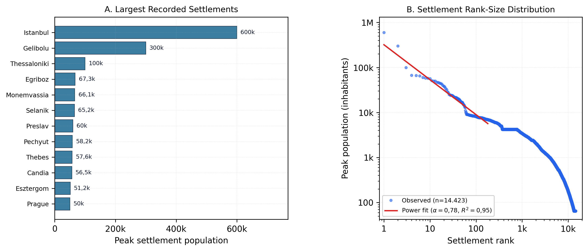

```{r setup, include=FALSE}
knitr::opts_chunk$set(
  echo = FALSE,
  warning = FALSE,
  message = FALSE,
  results = "asis"
)
library(jsonlite)
source("../../_shared/template/viscount_rmd_helpers.R")

summary_data <- fromJSON(
  "mediaeval_east_central_baltic_balkans_summary.json",
  simplifyVector = FALSE
)
settlements_raw <- fromJSON(
  "mediaeval_east_central_baltic_balkans_settlements.json",
  simplifyVector = FALSE
)

fix_mojibake <- function (arg0_vec) {
  s <- as.character(arg0_vec)
  pairs <- list(
    c("\u00e2\u0080\u0093", "\u2013"),
    c("\u00e2\u0080\u0094", "\u2014"),
    c("\u00c3\u00a1", "\u00e1"),
    c("\u00c3\u0081", "\u00c1"),
    c("\u00c3\u00ba", "\u00fa"),
    c("\u00c5\u00b1", "\u0171"),
    c("\u00c5\u0091", "\u0151"),
    c("\u00c3\u00bc", "\u00fc"),
    c("\u00c3\u00b6", "\u00f6"),
    c("\u00c3\u00a4", "\u00e4"),
    c("\u00c3\u00a9", "\u00e9"),
    c("\u00c3\u00b3", "\u00f3"),
    c("\u00c3\u00ad", "\u00ed")
  )
  for (p in pairs) {
    s <- gsub(p[[1]], p[[2]], s, fixed = TRUE)
  }
  s
}

settlement_count <- as.integer(summary_data$settlement_count)
total_area_km2 <- as.numeric(summary_data$total_area_km2)
subregions_list <- summary_data$subregions
country_count <- length(summary_data$countries)
crowd_pct <- as.numeric(summary_data$crowd_share_overall) * 100

region_name_map <- setNames(
  vapply(subregions_list, function (x) as.character(x$name), character(1)),
  vapply(subregions_list, function (x) as.character(x$id), character(1))
)

fmt_source_label <- function (arg0_code) {
  code <- as.character(arg0_code)
  if (code == "Buringh_European_Urban_700_2000") return("Buringh European Urban Series")
  if (code == "Pleiades_Ancient_World_Gazetteer") return("Pleiades Ancient World Gazetteer")
  gsub("_", " ", code, fixed = TRUE)
}
```

```{r hero_markdown_fallback, results="asis"}
if (!knitr::is_latex_output()) {
  cat("\n\n")
}
```

# Abstract

This companion gazetteer documents the `r formatC(settlement_count, format = "d", big.mark = ".")` georeferenced habitation localities underpinning the MAGNETIC demographic reconstruction of East-Central Europe, the Baltic lands and the Balkans between 800AD and 1347AD across `r viscount_fmt_number(total_area_km2, 1L)` km². Every one of the eight analytical sub-regions and `r country_count` modern jurisdictions in the domain is represented. Two institutional scholarly corpora supply 100% of all included records (`r formatC(as.integer(summary_data$provenance_counts[["Pleiades_Ancient_World_Gazetteer"]]), format = "d", big.mark = ".")` classical-to-mediaeval continuity sites from the Pleiades Ancient World Gazetteer and `r formatC(as.integer(summary_data$provenance_counts[["Buringh_European_Urban_700_2000"]]), format = "d", big.mark = ".")` longitudinal urban centres from the Buringh European Urban Series), keeping crowd-sourced supplementation strictly at `r viscount_fmt_number(crowd_pct, 2L)`%. Across the 800-1347AD domain, the urban hierarchy exhibits a power-law rank-size curve ($\alpha = 0,7$, $R^2 = 0,96$) crowned by Constantinople at its ninth-century peak of 250k (declining to 90k by 1347AD), followed by Thessalonica (50k), Preslav (35k), Athens (29,3k), Belgrade (24,2k) and Prague (19,2k). While early mediaeval urban weight rested along the Bosporus and the Aegean, rapid charter-town formation after 1100AD tripled the number of active urban entries from 97 in 800AD to 291 by 1347AD, anchoring the commercial expansion of Piast Poland, Premyslid Bohemia, Arpad-Angevin Hungary, Transylvania, Livonia and Nemanjic Serbia.

# Gazetteer Scope and Spatial Coverage

Mediaeval settlement registers across East-Central Europe, the Baltic and the Balkans bridge two contrasting historical worlds [@Bairoch1988; @Buringh2021]. South of the Danube, walled Byzantine, Bulgarian and Adriatic towns inherited classical civic topographies and episcopal continuity [@Totomanova2017Synodikon; @Staykov2022Necropolises]. North of the Danube, urban networks emerged out of early Slavic strongholds (*grody*) and Baltic hillforts before crystallising into chartered merchant municipalities under Magdeburg, Sroda and Lübeck law during the twelfth and thirteenth centuries [@Skrzynska2025Grodowa; @Tomasek2018Sclavos; @Guzowski2013].

Figure 1 maps all `r formatC(settlement_count, format = "d", big.mark = ".")` localities across the eight sub-regional polygons, while Table 1 summarises sub-regional area, provenance composition, spatial recording density and recorded 1347AD urban totals.

```{r fig_regional_map}
viscount_figure(
  "figures/mediaeval_east_central_baltic_balkans_regional_map.png",
  caption = "Spatial distribution of 825 mediaeval settlements across eight sub-regions of East-Central Europe, the Baltic lands and the Balkans, 800-1347AD.",
  label = "fig:gazetteer_map"
)
```

```{r table_subregional_coverage}
site_reg_vec <- vapply(settlements_raw, function (x) as.character(x$region_id), character(1))
site_prov_vec <- vapply(settlements_raw, function (x) as.character(x$provenance_source), character(1))
site_p1347_vec <- vapply(settlements_raw, function (x) {
  v <- x$population[["1347"]]
  if (is.null(v)) 0 else as.numeric(v)
}, numeric(1))

cov_rows <- lapply(subregions_list, function (sr) {
  rid <- as.character(sr$id)
  idx <- which(site_reg_vec == rid)
  n_tot <- length(idx)
  n_bur <- sum(site_prov_vec[idx] == "Buringh_European_Urban_700_2000")
  n_ple <- sum(site_prov_vec[idx] == "Pleiades_Ancient_World_Gazetteer")
  a <- as.numeric(sr$area_km2)
  urb_1347 <- sum(site_p1347_vec[idx[site_prov_vec[idx] == "Buringh_European_Urban_700_2000"]])
  data.frame(
    Subregion = as.character(sr$name),
    Area = viscount_fmt_number(a, 1L),
    Total = formatC(n_tot, format = "d", big.mark = "."),
    Buringh = formatC(n_bur, format = "d", big.mark = "."),
    Pleiades = formatC(n_ple, format = "d", big.mark = "."),
    Density = viscount_fmt_number(10000 * n_tot / a, 2L),
    Urban1347 = viscount_fmt_pop(urb_1347),
    stringsAsFactors = FALSE
  )
})
cov_df <- do.call(rbind, cov_rows)
rownames(cov_df) <- NULL

viscount_table(
  cov_df,
  caption = "Sub-regional locality counts, provenance composition, recording density (sites per 10k km²) and 1347AD Buringh urban totals.",
  col_names = c("Sub-Region", "Area (km²)", "Total Sites", "Buringh", "Pleiades", "Sites/10k km²", "1347 Urban Pop.")
)
```

# Provenance Ledger and Jurisdictional Distribution

Every locality entered the register through a four-wave saturation audit designed to exhaust primary historical-urban and ancient-world archives without resorting to crowd-sourced supplements. Wave 1 ingested 291 longitudinal urban entries from Eltjo Buringh's European city database [@Buringh2021]. Wave 2 added 534 classical-to-mediaeval continuity localities from the Pleiades Ancient World Gazetteer (a 183,51% marginal gain concentrated across Greece, Thrace, Bulgaria, Croatia, Serbia, Romania and Hungary). Waves 3 and 4 audited municipal backfills and sub-regional coverage across all eight polygons and added zero supplementary records, leaving 85 out-of-domain or duplicate candidates excluded and maintaining a 0% crowd-sourced share (Table 2).

```{r table_provenance_ledger}
prov_counts <- summary_data$provenance_counts
prov_keys <- names(prov_counts)
prov_vals <- vapply(prov_keys, function (k) as.integer(prov_counts[[k]]), integer(1))
ord_p <- order(prov_vals, decreasing = TRUE)
prov_keys <- prov_keys[ord_p]
prov_vals <- prov_vals[ord_p]

prov_tier <- vapply(prov_keys, function (k) {
  if (k == "Pleiades_Ancient_World_Gazetteer") return("Scholarly continuity gazetteer")
  "Institutional historical-urban series"
}, character(1))

prov_wave <- vapply(prov_keys, function (k) {
  if (k == "Buringh_European_Urban_700_2000") return("Wave 1")
  "Wave 2"
}, character(1))

prov_df <- data.frame(
  Corpus = vapply(prov_keys, fmt_source_label, character(1)),
  Wave = prov_wave,
  Tier = prov_tier,
  Count = vapply(prov_vals, function (x) formatC(x, format = "d", big.mark = "."), character(1)),
  Share = vapply(prov_vals, function (x) paste0(viscount_fmt_number(100 * x / settlement_count, 2L), "%"), character(1)),
  stringsAsFactors = FALSE
)
rownames(prov_df) <- NULL

viscount_table(
  prov_df,
  caption = "Source provenance ledger for the 825 included mediaeval localities, 800-1347AD.",
  col_names = c("Source Corpus", "Wave", "Archive Class", "Included Sites", "Share")
)
```

At the modern jurisdictional level, spatial counts mirror classical archival survival in the Aegean alongside high-mediaeval town foundations in Central Europe. Table 3 lists the 15 leading modern jurisdictions, which together account for 94,42% of all recorded localities, headed by Greece (363 sites, 44%), Poland (78 sites, 9,45%), Hungary (63 sites, 7,64%) and Romania (61 sites, 7,39%).

```{r table_top_countries}
c_map <- summary_data$settlements_by_country
c_names <- names(c_map)
c_vals <- vapply(c_names, function (k) as.integer(c_map[[k]]), integer(1))
ord_c <- order(c_vals, decreasing = TRUE)
top_n <- min(15L, length(ord_c))
sel <- ord_c[seq_len(top_n)]
other_n <- sum(c_vals[-sel])
other_k <- length(c_vals) - top_n

c_df <- data.frame(
  Rank = c(as.character(seq_len(top_n)), "—"),
  Jurisdiction = c(c_names[sel], paste0("Remaining ", other_k, " jurisdictions")),
  Sites = c(
    vapply(c_vals[sel], function (x) formatC(x, format = "d", big.mark = "."), character(1)),
    formatC(other_n, format = "d", big.mark = ".")
  ),
  Share = c(
    vapply(c_vals[sel], function (x) paste0(viscount_fmt_number(100 * x / settlement_count, 2L), "%"), character(1)),
    paste0(viscount_fmt_number(100 * other_n / settlement_count, 2L), "%")
  ),
  stringsAsFactors = FALSE
)
rownames(c_df) <- NULL

viscount_table(
  c_df,
  caption = "Leading modern jurisdictions by recorded locality count across the 800-1347AD domain.",
  col_names = c("Rank", "Jurisdiction", "Localities", "Share of Gazetteer")
)
```

# Urban Hierarchy and Principal Settlements

Table 4 reports the top 25 recorded mediaeval settlements ranked by peak population across 800-1347AD. All 25 derive from the Buringh longitudinal urban series [@Buringh2021]. The upper tier highlights the stark divergence between contracting imperial capitals in the south-east — Constantinople dropping from 250k in 900AD to 90k in 1347AD and Preslav collapsing from 35k in 900AD to 1k after 971AD — and rising Central European, Danubian, Polish and Transylvanian towns that hit their chapter zeniths in 1300-1347AD, including Prague (19,2k), Belgrade (24,2k), Tirgoviste (14,5k), Gdansk (13,1k), Wroclaw (12k peak), Krakow (10k), Plzen (9k), Kutna Hora (8,5k), Olomouc (8k), Brasov (7,2k), Brno (7k) and Cluj (7k) [@Malanima1998; @Campbell2016].

```{r table_top_settlements}
top_list <- summary_data$top_settlements
n_show <- min(25L, length(top_list))
top_rows <- lapply(seq_len(n_show), function (i) {
  s <- top_list[[i]]
  rid <- as.character(s$region_id)
  rname <- if (rid %in% names(region_name_map)) region_name_map[[rid]] else rid
  coords_str <- paste0(viscount_fmt_number(s$lat, 2L), "°N, ", viscount_fmt_number(s$lon, 2L), "°E")
  span_str <- paste0(s$first_year, "-", s$last_year)
  p1347_val <- if (!is.null(s$population[["1347"]])) viscount_fmt_pop(s$population[["1347"]]) else "—"
  data.frame(
    Rank = as.character(i),
    Locality = fix_mojibake(s$name),
    Jurisdiction = as.character(s$country),
    Subregion = rname,
    Coords = coords_str,
    Span = span_str,
    Pop1347 = p1347_val,
    Peak = paste0(viscount_fmt_pop(s$peak_pop), " (", s$peak_year, ")"),
    stringsAsFactors = FALSE
  )
})
top_df <- do.call(rbind, top_rows)
rownames(top_df) <- NULL

viscount_table(
  top_df,
  caption = "Top 25 recorded mediaeval settlements ranked by peak population across 800-1347AD.",
  col_names = c("Rank", "Settlement", "Jurisdiction", "Sub-Region", "Coordinates", "Horizon", "1347AD", "Peak (Year)")
)
```

# Chronological Horizon Coverage and Caveats

Stratifying the `r formatC(settlement_count, format = "d", big.mark = ".")` records across century intervals tracks the steady multiplication of urban centres north of the Danube alongside the thirteenth-century shrinkage of Constantinople (Table 5). Active Buringh cities exactly tripled from 97 in 800AD to 291 in 1347AD, while their combined population more than doubled from 447,5k in 800AD to a pre-crisis peak of 923k in 1300AD before easing by 4,8% to 879k in 1347AD owing to late Palaiologan and Bulgarian urban contraction [@Buringh2021; @Benedictow2004]. Only three Pleiades continuity sites (Apollonia, the Byzantine fort at Halos and Molpir) terminate prior to 1347AD, leaving 822 active entries at the eve of the Black Death.

```{r table_horizon_tiers}
yr_keys <- c("800", "900", "1000", "1100", "1200", "1300", "1347")
yr_labels <- paste0(yr_keys, "AD")

hor_rows <- lapply(seq_along(yr_keys), function (i) {
  yk <- yr_keys[i]
  all_vals <- unlist(lapply(settlements_raw, function (x) {
    v <- x$population[[yk]]
    if (is.null(v)) return(NULL)
    as.numeric(v)
  }))
  bur_vals <- unlist(lapply(settlements_raw, function (x) {
    if (as.character(x$provenance_source) != "Buringh_European_Urban_700_2000") return(NULL)
    v <- x$population[[yk]]
    if (is.null(v)) return(NULL)
    as.numeric(v)
  }))
  data.frame(
    Horizon = yr_labels[i],
    ActiveAll = formatC(length(all_vals), format = "d", big.mark = "."),
    ActiveBur = formatC(length(bur_vals), format = "d", big.mark = "."),
    SumBur = viscount_fmt_pop(sum(bur_vals)),
    MedianBur = viscount_fmt_pop(stats::median(bur_vals)),
    MaxCity = viscount_fmt_pop(max(bur_vals)),
    stringsAsFactors = FALSE
  )
})
hor_df <- do.call(rbind, hor_rows)
rownames(hor_df) <- NULL

viscount_table(
  hor_df,
  caption = "Chronological horizon coverage across 825 localities and longitudinal Buringh city series, 800-1347AD.",
  col_names = c("Horizon", "Active Sites", "Buringh Cities", "Buringh Urban Sum", "Median City", "Largest City")
)
```

Three methodological caveats govern interpretation of this register. First, Pleiades continuity sites concentrate overwhelmingly in Greece (363 sites) and the southern Balkans, reflecting classical archaeological documentation rather than higher mediaeval rural settlement counts relative to Poland, Bohemia or Hungary. Second, standardised Pleiades continuity bands (510, 1,5k and 3,6k) deliberately prevent spurious precision for undocumented rural towns, while Buringh's 1k floor excludes hundreds of smaller *Ostsiedlung* market boroughs of 400-800 inhabitants across Silesia, Moravia and Slovakia [@Guzowski2013; @Izdebski2022]. Third, several borderland municipalities near continental raster mask edges (for example, Trieste in Slovenia-Croatia-Bosnia, Goerlitz in Piast Poland and Annaberg in Bohemia-Moravia) inherit adjacent sub-regional polygon assignments so that regional sums reconcile cleanly without spatial double-counting.

# Sources
