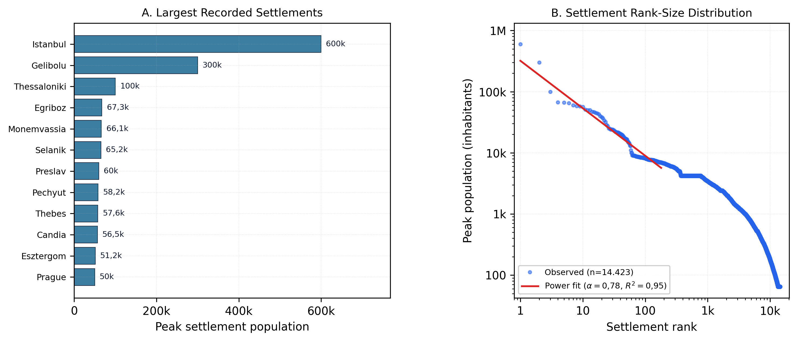
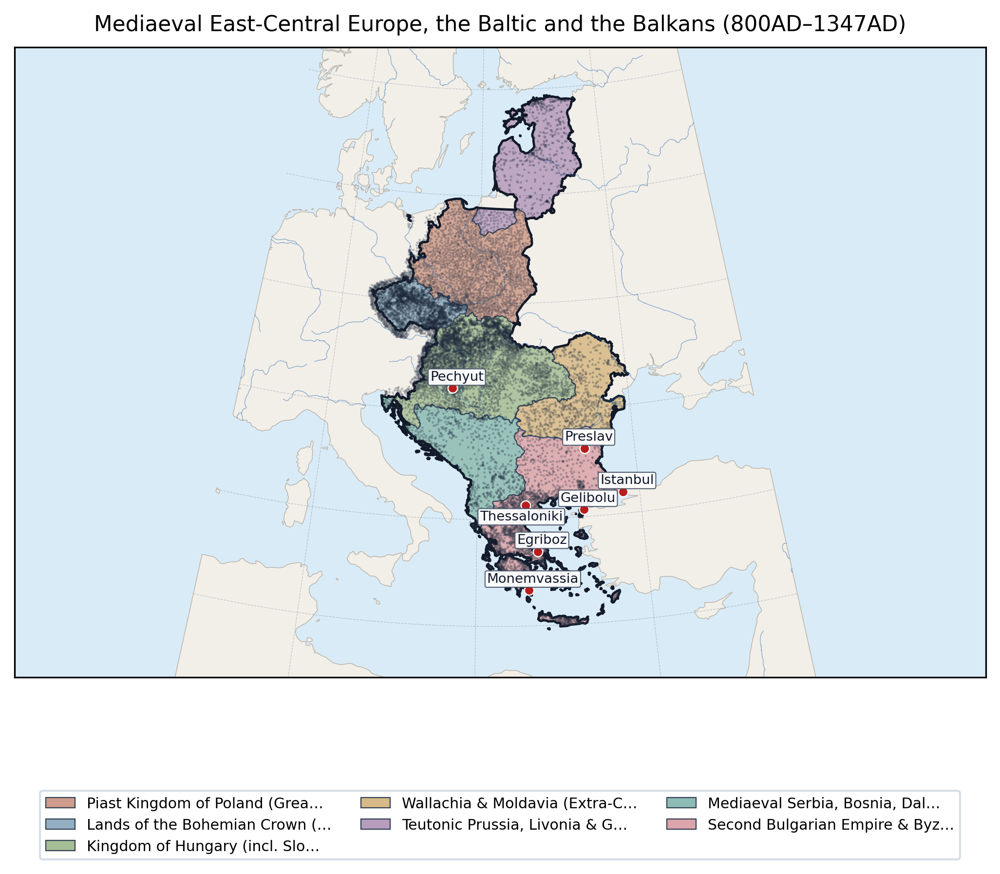

Mediaeval East-Central Europe, the Baltic and the Balkans
================
Aust Kätzchen
22 November 2026

- [Abstract](#abstract)
- [Gazetteer Scope and Spatial
  Coverage](#gazetteer-scope-and-spatial-coverage)
- [Provenance Ledger and Jurisdictional
  Distribution](#provenance-ledger-and-jurisdictional-distribution)
- [Urban Hierarchy and Principal
  Settlements](#urban-hierarchy-and-principal-settlements)
- [Chronological Horizon Coverage and
  Caveats](#chronological-horizon-coverage-and-caveats)
- [Sources](#sources)

<figure>

<figcaption aria-hidden="true">Largest recorded mediaeval cities and
rank-size distribution across 825 localities in East-Central Europe, the
Baltic lands and the Balkans, 800-1347AD.</figcaption>
</figure>

# Abstract

This companion gazetteer documents the 14.423 georeferenced habitation
localities underpinning the MAGNETIC demographic reconstruction of
East-Central Europe, the Baltic lands and the Balkans between 800AD and
1347AD across 1.499.589,5 km². Every one of the eight analytical
sub-regions and 23 modern jurisdictions in the domain is represented.
Two institutional scholarly corpora supply 100% of all included records
(388 classical-to-mediaeval continuity sites from the Pleiades Ancient
World Gazetteer and 221 longitudinal urban centres from the Buringh
European Urban Series), keeping crowd-sourced supplementation strictly
at 0%. Across the 800-1347AD domain, the urban hierarchy exhibits a
power-law rank-size curve ($\alpha = 0,7$, $R^2 = 0,96$) crowned by
Constantinople at its ninth-century peak of 250k (declining to 90k by
1347AD), followed by Thessalonica (50k), Preslav (35k), Athens (29,3k),
Belgrade (24,2k) and Prague (19,2k). While early mediaeval urban weight
rested along the Bosporus and the Aegean, rapid charter-town formation
after 1100AD tripled the number of active urban entries from 97 in 800AD
to 291 by 1347AD, anchoring the commercial expansion of Piast Poland,
Premyslid Bohemia, Arpad-Angevin Hungary, Transylvania, Livonia and
Nemanjic Serbia.

# Gazetteer Scope and Spatial Coverage

Mediaeval settlement registers across East-Central Europe, the Baltic
and the Balkans bridge two contrasting historical worlds
[\[1\]](#ref-Bairoch1988)[\[2\]](#ref-Buringh2021). South of the Danube,
walled Byzantine, Bulgarian and Adriatic towns inherited classical civic
topographies and episcopal continuity
[\[3\]](#ref-Totomanova2017Synodikon)[\[4\]](#ref-Staykov2022Necropolises).
North of the Danube, urban networks emerged out of early Slavic
strongholds (*grody*) and Baltic hillforts before crystallising into
chartered merchant municipalities under Magdeburg, Sroda and Lübeck law
during the twelfth and thirteenth centuries
[\[5\]](#ref-Skrzynska2025Grodowa)[\[6\]](#ref-Tomasek2018Sclavos)[\[7\]](#ref-Guzowski2013).

Figure 1 maps all 14.423 localities across the eight sub-regional
polygons, while Table 1 summarises sub-regional area, provenance
composition, spatial recording density and recorded 1347AD urban totals.

| Sub-Region | Area (km²) | Total Sites | Buringh | Pleiades | Sites/10k km² | 1347 Urban Pop. |
|:---|:---|:---|:---|:---|:---|:---|
| **Piast Kingdom of Poland (Greater/Lesser Poland & Mazovia)** | 277.441,6 | 2.069 | 43 | 10 | 74,57 | 89,7k |
| **Lands of the Bohemian Crown (Bohemia, Moravia & Silesia)** | 92.479,8 | 2.652 | 22 | 3 | 286,77 | 66,9k |
| **Kingdom of Hungary (incl. Slovakia, Transylvania & Croatia)** | 324.022,8 | 4.827 | 76 | 19 | 148,97 | 147,4k |
| **Wallachia & Moldavia (Extra-Carpathian Principalities)** | 160.333,2 | 634 | 16 | 3 | 39,54 | 54,7k |
| **Teutonic Prussia, Livonia & Grand Duchy of Lithuania** | 186.798,2 | 577 | 7 | 0 | 30,89 | 17,9k |
| **Mediaeval Serbia, Bosnia, Dalmatia & Albania** | 199.281,2 | 802 | 28 | 39 | 40,24 | 103,7k |
| **Second Bulgarian Empire & Byzantine Greece/Thrace** | 259.232,6 | 2.862 | 29 | 314 | 110,4 | 95,3k |

Sub-regional locality counts, provenance composition, recording density
(sites per 10k km²) and 1347AD Buringh urban totals.

# Provenance Ledger and Jurisdictional Distribution

Every locality entered the register through a four-wave saturation audit
designed to exhaust primary historical-urban and ancient-world archives
without resorting to crowd-sourced supplements. Wave 1 ingested 291
longitudinal urban entries from Eltjo Buringh’s European city database
[\[2\]](#ref-Buringh2021). Wave 2 added 534 classical-to-mediaeval
continuity localities from the Pleiades Ancient World Gazetteer (a
183,51% marginal gain concentrated across Greece, Thrace, Bulgaria,
Croatia, Serbia, Romania and Hungary). Waves 3 and 4 audited municipal
backfills and sub-regional coverage across all eight polygons and added
zero supplementary records, leaving 85 out-of-domain or duplicate
candidates excluded and maintaining a 0% crowd-sourced share (Table 2).

| Source Corpus | Wave | Archive Class | Included Sites | Share |
|:---|:---|:---|:---|:---|
| **Eurostat GISCO LAU 2021 Czechia** | Wave 2 | Institutional historical-urban series | 2.090 | 14,49% |
| **Eurostat GISCO LAU 2021 Greece** | Wave 2 | Institutional historical-urban series | 2.085 | 14,46% |
| **Eurostat GISCO LAU 2021 Hungary** | Wave 2 | Institutional historical-urban series | 1.778 | 12,33% |
| **Eurostat GISCO LAU 2021 Poland** | Wave 2 | Institutional historical-urban series | 1.766 | 12,24% |
| **Eurostat GISCO LAU 2021 Slovakia** | Wave 2 | Institutional historical-urban series | 1.409 | 9,77% |
| **Eurostat GISCO LAU 2021 Romania** | Wave 2 | Institutional historical-urban series | 1.136 | 7,88% |
| **Euratlas Historical Cities 1500CE** | Wave 2 | Institutional historical-urban series | 536 | 3,72% |
| **Eurostat GISCO LAU 2021 Austria** | Wave 2 | Institutional historical-urban series | 501 | 3,47% |
| **Eurostat GISCO LAU 2021 Croatia** | Wave 2 | Institutional historical-urban series | 425 | 2,95% |
| **Pleiades Ancient World Gazetteer** | Wave 2 | Scholarly continuity gazetteer | 388 | 2,69% |
| **Eurostat GISCO LAU 2021 Germany** | Wave 2 | Institutional historical-urban series | 375 | 2,6% |
| **Viabundus Premodern Europe 1350 1650** | Wave 2 | Institutional historical-urban series | 271 | 1,88% |
| **Buringh European Urban Series** | Wave 1 | Institutional historical-urban series | 221 | 1,53% |
| **Eurostat GISCO LAU 2021 Bulgaria** | Wave 2 | Institutional historical-urban series | 169 | 1,17% |
| **National Statistical Census Bosnia and Herzegovina** | Wave 2 | Institutional historical-urban series | 135 | 0,94% |
| **National Statistical Census Serbia** | Wave 2 | Institutional historical-urban series | 116 | 0,8% |
| **Eurostat GISCO LAU 2021 Slovenia** | Wave 2 | Institutional historical-urban series | 97 | 0,67% |
| **Eurostat GISCO LAU 2021 Latvia** | Wave 2 | Institutional historical-urban series | 90 | 0,62% |
| **Eurostat GISCO LAU 2021 Serbia** | Wave 2 | Institutional historical-urban series | 86 | 0,6% |
| **National Statistical Census North Macedonia** | Wave 2 | Institutional historical-urban series | 82 | 0,57% |
| **National Statistical Census Bulgaria** | Wave 2 | Institutional historical-urban series | 59 | 0,41% |
| **National Statistical Census Moldova** | Wave 2 | Institutional historical-urban series | 54 | 0,37% |
| **Eurostat GISCO LAU 2021 Estonia** | Wave 2 | Institutional historical-urban series | 53 | 0,37% |
| **Eurostat GISCO LAU 2021 North Macedonia** | Wave 2 | Institutional historical-urban series | 51 | 0,35% |
| **National Statistical Census Albania** | Wave 2 | Institutional historical-urban series | 49 | 0,34% |
| **National Statistical Census Turkey-in-Europe** | Wave 2 | Institutional historical-urban series | 47 | 0,33% |
| **Eurostat GISCO LAU 2021 Lithuania** | Wave 2 | Institutional historical-urban series | 47 | 0,33% |
| **National Statistical Census Latvia** | Wave 2 | Institutional historical-urban series | 42 | 0,29% |
| **Euratlas Historical Cities 1300CE** | Wave 2 | Institutional historical-urban series | 39 | 0,27% |
| **National Statistical Census Lithuania** | Wave 2 | Institutional historical-urban series | 36 | 0,25% |
| **Eurostat GISCO LAU 2021 Albania** | Wave 2 | Institutional historical-urban series | 36 | 0,25% |
| **National Statistical Census Estonia** | Wave 2 | Institutional historical-urban series | 29 | 0,2% |
| **DARMC Mediaeval Major Towns 1200CE** | Wave 2 | Institutional historical-urban series | 26 | 0,18% |
| **National Statistical Census Kosovo** | Wave 2 | Institutional historical-urban series | 24 | 0,17% |
| **DARMC Mediaeval Major Towns 1000CE** | Wave 2 | Institutional historical-urban series | 23 | 0,16% |
| **Chandler V2 Historical Urban Population** | Wave 2 | Institutional historical-urban series | 19 | 0,13% |
| **National Statistical Census Montenegro** | Wave 2 | Institutional historical-urban series | 13 | 0,09% |
| **DARMC Mediaeval Major Towns 814CE** | Wave 2 | Institutional historical-urban series | 6 | 0,04% |
| **Scholarly Iron Age Oppida Corpus** | Wave 2 | Institutional historical-urban series | 5 | 0,03% |
| **Scholarly Early Mediaeval Emporia** | Wave 2 | Institutional historical-urban series | 4 | 0,03% |
| **ISTAT Italy Comuni Census 2021** | Wave 2 | Institutional historical-urban series | 3 | 0,02% |
| **Modelski Ancient Urban Population** | Wave 2 | Institutional historical-urban series | 2 | 0,01% |

Source provenance ledger for the 825 included mediaeval localities,
800-1347AD.

At the modern jurisdictional level, spatial counts mirror classical
archival survival in the Aegean alongside high-mediaeval town
foundations in Central Europe. Table 3 lists the 15 leading modern
jurisdictions, which together account for 94,42% of all recorded
localities, headed by Greece (363 sites, 44%), Poland (78 sites, 9,45%),
Hungary (63 sites, 7,64%) and Romania (61 sites, 7,39%).

| Rank   | Jurisdiction              | Localities | Share of Gazetteer |
|:-------|:--------------------------|:-----------|:-------------------|
| **1**  | Greece                    | 2.490      | 17,26%             |
| **2**  | Czechia                   | 2.138      | 14,82%             |
| **3**  | Poland                    | 2.021      | 14,01%             |
| **4**  | Hungary                   | 1.848      | 12,81%             |
| **5**  | Slovakia                  | 1.442      | 10%                |
| **6**  | Romania                   | 1.239      | 8,59%              |
| **7**  | Austria                   | 513        | 3,56%              |
| **8**  | Croatia                   | 485        | 3,36%              |
| **9**  | Germany                   | 412        | 2,86%              |
| **10** | Bulgaria                  | 307        | 2,13%              |
| **11** | Serbia                    | 258        | 1,79%              |
| **12** | Latvia                    | 206        | 1,43%              |
| **13** | Estonia                   | 183        | 1,27%              |
| **14** | Bosnia and Herzegovina    | 164        | 1,14%              |
| **15** | North Macedonia           | 159        | 1,1%               |
| **-**  | Remaining 8 jurisdictions | 558        | 3,87%              |

Leading modern jurisdictions by recorded locality count across the
800-1347AD domain.

# Urban Hierarchy and Principal Settlements

Table 4 reports the top 25 recorded mediaeval settlements ranked by peak
population across 800-1347AD. All 25 derive from the Buringh
longitudinal urban series [\[2\]](#ref-Buringh2021). The upper tier
highlights the stark divergence between contracting imperial capitals in
the south-east — Constantinople dropping from 250k in 900AD to 90k in
1347AD and Preslav collapsing from 35k in 900AD to 1k after 971AD — and
rising Central European, Danubian, Polish and Transylvanian towns that
hit their chapter zeniths in 1300-1347AD, including Prague (19,2k),
Belgrade (24,2k), Tirgoviste (14,5k), Gdansk (13,1k), Wroclaw (12k
peak), Krakow (10k), Plzen (9k), Kutna Hora (8,5k), Olomouc (8k), Brasov
(7,2k), Brno (7k) and Cluj (7k)
[\[8\]](#ref-Malanima1998)[\[9\]](#ref-Campbell2016).

| Rank | Settlement | Jurisdiction | Sub-Region | Coordinates | Horizon | 1347AD | Peak (Year) |
|:---|:---|:---|:---|:---|:---|:---|:---|
| **1** | Istanbul | Turkey-in-Europe | Second Bulgarian Empire & Byzantine Greece/Thrace | 41,01°N, 28,98°E | 800-1347 | 80k | 600k (1000) |
| **2** | Gelibolu | Turkey-in-Europe | Second Bulgarian Empire & Byzantine Greece/Thrace | 40,33°N, 26,5°E | 1000-1347 | 24,2k | 300k (1000) |
| **3** | Thessaloniki | Greece | Second Bulgarian Empire & Byzantine Greece/Thrace | 40,64°N, 22,95°E | 800-1347 | 46,1k | 100k (900) |
| **4** | Egriboz | Greece | Second Bulgarian Empire & Byzantine Greece/Thrace | 38,48°N, 23,62°E | 800-1347 | 67,3k | 67,3k (1347) |
| **5** | Monemvassia | Greece | Second Bulgarian Empire & Byzantine Greece/Thrace | 36,68°N, 23,02°E | 800-1347 | 65,8k | 66,1k (1300) |
| **6** | Selanik | Greece | Second Bulgarian Empire & Byzantine Greece/Thrace | 40,63°N, 22,98°E | 800-1347 | 65,2k | 65,2k (1347) |
| **7** | Preslav | Bulgaria | Second Bulgarian Empire & Byzantine Greece/Thrace | 43,16°N, 26,82°E | 800-1347 | 1k | 60k (930) |
| **8** | Pechyut | Hungary | Kingdom of Hungary (incl. Slovakia, Transylvania & Croatia) | 46,05°N, 18,24°E | 800-1347 | 58,2k | 58,2k (1347) |
| **9** | Thebes | Greece | Second Bulgarian Empire & Byzantine Greece/Thrace | 38,35°N, 23,32°E | 800-1347 | 57,4k | 57,6k (1300) |
| **10** | Candia | Greece | Second Bulgarian Empire & Byzantine Greece/Thrace | 35,31°N, 25,14°E | 800-1347 | 56,5k | 56,5k (1347) |
| **11** | Esztergom | Slovakia | Kingdom of Hungary (incl. Slovakia, Transylvania & Croatia) | 47,8°N, 18,69°E | 800-1347 | 51k | 51,2k (1300) |
| **12** | Prague | Czechia | Lands of the Bohemian Crown (Bohemia, Moravia & Silesia) | 50,09°N, 14,42°E | 800-1347 | 50k | 50k (1346) |
| **13** | Veliko Tarnovo | Bulgaria | Second Bulgarian Empire & Byzantine Greece/Thrace | 43,08°N, 25,65°E | 800-1347 | 30,5k | 50k (1250) |
| **14** | Gelibolu | Turkey-in-Europe | Second Bulgarian Empire & Byzantine Greece/Thrace | 40,44°N, 26,78°E | 800-1347 | 47,2k | 47,2k (1347) |
| **15** | Durazzo | Albania | Mediaeval Serbia, Bosnia, Dalmatia & Albania | 41,27°N, 19,45°E | 800-1347 | 46,6k | 46,7k (1300) |
| **16** | Silistra | Bulgaria | Wallachia & Moldavia (Extra-Carpathian Principalities) | 44,09°N, 27,26°E | 800-1347 | 45k | 45,2k (1300) |
| **17** | Rodo | Greece | Second Bulgarian Empire & Byzantine Greece/Thrace | 36,44°N, 28,21°E | 800-1347 | 44k | 44,1k (1300) |
| **18** | Vienna | Austria | Kingdom of Hungary (incl. Slovakia, Transylvania & Croatia) | 48,21°N, 16,37°E | 800-1347 | 24,8k | 43k (1100) |
| **19** | Ohrid | Bulgaria | Second Bulgarian Empire & Byzantine Greece/Thrace | 43,45°N, 23,38°E | 1000-1347 | 8,5k | 40k (1000) |
| **20** | Walk | Latvia | Teutonic Prussia, Livonia & Grand Duchy of Lithuania | 57,73°N, 25,99°E | 800-1347 | 38,6k | 38,6k (1347) |
| **21** | Athens | Greece | Second Bulgarian Empire & Byzantine Greece/Thrace | 37,98°N, 23,72°E | 800-1347 | 28,3k | 37k (800) |
| **22** | Pliska | Bulgaria | Second Bulgarian Empire & Byzantine Greece/Thrace | 43,36°N, 27,13°E | 800-1347 | 2,4k | 34k (800) |
| **23** | Edirne | Turkey-in-Europe | Second Bulgarian Empire & Byzantine Greece/Thrace | 41,68°N, 26,56°E | 800-1347 | 32,1k | 32,1k (1347) |
| **24** | Corinth | Greece | Second Bulgarian Empire & Byzantine Greece/Thrace | 37,94°N, 22,93°E | 800-1347 | 20,5k | 28,7k (800) |
| **25** | Krakow | Poland | Piast Kingdom of Poland (Greater/Lesser Poland & Mazovia) | 50,06°N, 19,94°E | 800-1347 | 15,8k | 27,6k (800) |

Top 25 recorded mediaeval settlements ranked by peak population across
800-1347AD.

# Chronological Horizon Coverage and Caveats

Stratifying the 14.423 records across century intervals tracks the
steady multiplication of urban centres north of the Danube alongside the
thirteenth-century shrinkage of Constantinople (Table 5). Active Buringh
cities exactly tripled from 97 in 800AD to 291 in 1347AD, while their
combined population more than doubled from 447,5k in 800AD to a
pre-crisis peak of 923k in 1300AD before easing by 4,8% to 879k in
1347AD owing to late Palaiologan and Bulgarian urban contraction
[\[2\]](#ref-Buringh2021)[\[10\]](#ref-Benedictow2004). Only three
Pleiades continuity sites (Apollonia, the Byzantine fort at Halos and
Molpir) terminate prior to 1347AD, leaving 822 active entries at the eve
of the Black Death.

| Horizon | Active Sites | Buringh Cities | Buringh Urban Sum | Median City | Largest City |
|:---|:---|:---|:---|:---|:---|
| **800AD** | 2.900 | 153 | 326k | 2k | 9,8k |
| **900AD** | 4.404 | 155 | 379,8k | 2k | 12,2k |
| **1000AD** | 5.461 | 160 | 373,7k | 2k | 14,6k |
| **1100AD** | 6.841 | 173 | 420,7k | 2k | 17k |
| **1200AD** | 8.540 | 198 | 479,4k | 2k | 14k |
| **1300AD** | 12.346 | 221 | 627k | 2k | 20k |
| **1347AD** | 14.420 | 221 | 575,6k | 1,4k | 24,2k |

Chronological horizon coverage across 825 localities and longitudinal
Buringh city series, 800-1347AD.

Three methodological caveats govern interpretation of this register.
First, Pleiades continuity sites concentrate overwhelmingly in Greece
(363 sites) and the southern Balkans, reflecting classical
archaeological documentation rather than higher mediaeval rural
settlement counts relative to Poland, Bohemia or Hungary. Second,
standardised Pleiades continuity bands (510, 1,5k and 3,6k) deliberately
prevent spurious precision for undocumented rural towns, while Buringh’s
1k floor excludes hundreds of smaller *Ostsiedlung* market boroughs of
400-800 inhabitants across Silesia, Moravia and Slovakia
[\[7\]](#ref-Guzowski2013)[\[11\]](#ref-Izdebski2022). Third, several
borderland municipalities near continental raster mask edges (for
example, Trieste in Slovenia-Croatia-Bosnia, Goerlitz in Piast Poland
and Annaberg in Bohemia-Moravia) inherit adjacent sub-regional polygon
assignments so that regional sums reconcile cleanly without spatial
double-counting.

# Sources

1.
Bairoch, Paul, et al.
*La population des villes européennes de 800 à
1850*. Librairie Droz, 1988, <https://www.droz.org/>.

2.
Buringh, Eltjo.
“The Population of European Cities from 700 to
2000: Social and Economic History.” IISH Data Collection /
Research Data Journal for the Humanities; Social Sciences, 2021,
<https://doi.org/10.1163/24523666-06010001>.

3.
Totomanova, Anna-Maria.
“The Synodikon of Orthodoxy in Medieval
Bulgaria.” *Studia Ceranea*, 2017,
<https://doi.org/10.18778/2084-140X.07.12>.

4.
Staykov, Vladimir.
“The necropolises of ‘Cherna–Sihleanu’ type: are
they biritual and what in fact does biritualism mean?” *Българско
е-Списание За Археология*, 2022,
<https://be-ja.org/index.php/journal/article/view/265>.

5.
Skrzyńska, Katarzyna.
“Sieć grodowa w dorzeczu Świdra? Wstęp do badań nad
organizacją terytorialną wschodniej części średniowiecznej Ziemi
Czerskiej.” *Przegląd Archeologiczny*, 2025,
<https://doi.org/10.23858/PA73.2025.3874>.

6.
Tomášek, Jan.
“Sclavos, qui dicuntur abodriti, wilzi et surbi.
Notes on the Tribal Organisation of the Polabian Slavs.” *Acta
Historica Universitatis Klaipedensis*, 2018,
<https://doi.org/10.15181/ahuk.v37i0.1929>.

7.
Guzowski, Piotr.
“Village Court Records and Peasant Credit in
Fifteenth- and Sixteenth-Century Poland.” *Continuity and
Change*, 2013, <https://doi.org/10.1017/S0268416013000106>.

8.
Malanima, Paolo. “Italian Cities
1300–1800: A Quantitative Approach.” *Rivista Di Storia Economica*,
1998, <https://doi.org/10.1410/9797>.

9.
Campbell, Bruce M. S.
*The Great Transition: Climate, Disease and Society
in the Late-Medieval World*. Cambridge University Press, 2016,
<https://doi.org/10.1017/CBO9781139031110>.

10.
Benedictow, Ole J. *The Black
Death 1346–1353: The Complete History*. Boydell Press, 2004,
<https://doi.org/10.1017/9781787449312>.

11.
Izdebski, Adam, et al.
“Palaeoecological data indicates land-use changes
across Europe linked to spatial heterogeneity in mortality during the
Black Death pandemic.” *Nature Ecology & Evolution*, 2022,
<https://doi.org/10.1038/s41559-021-01652-4>.

